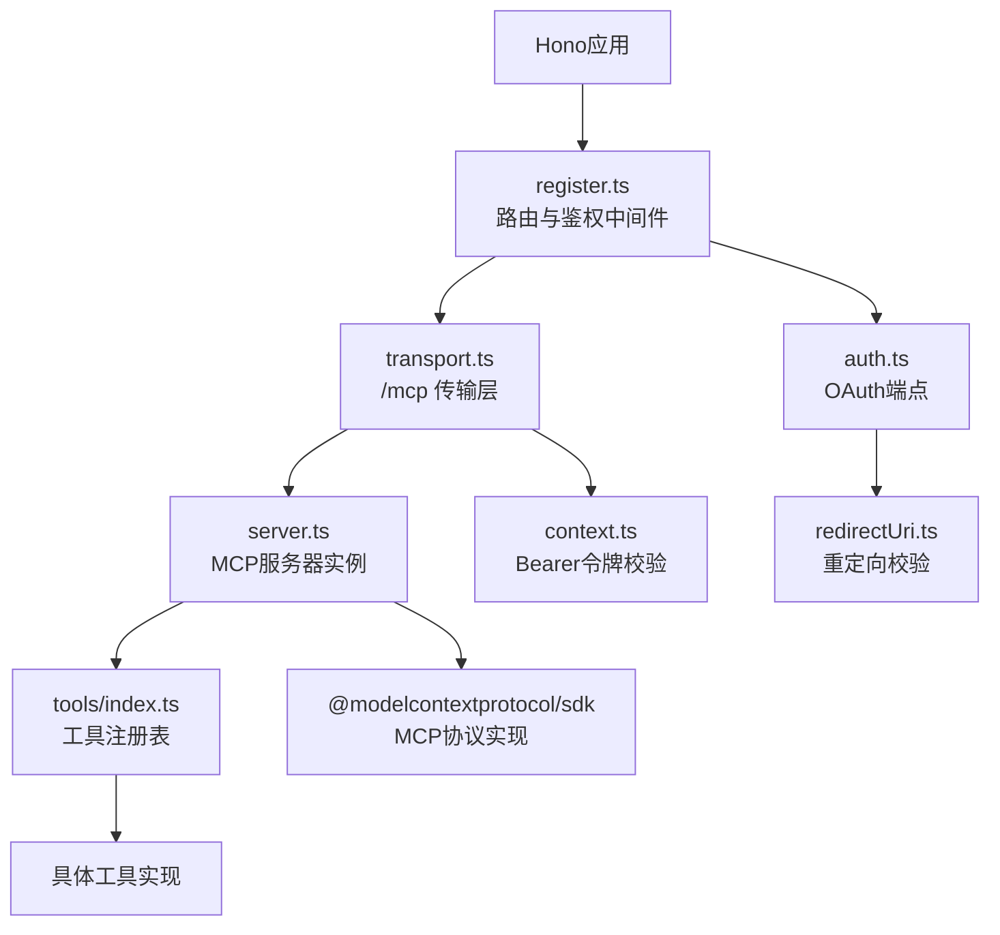
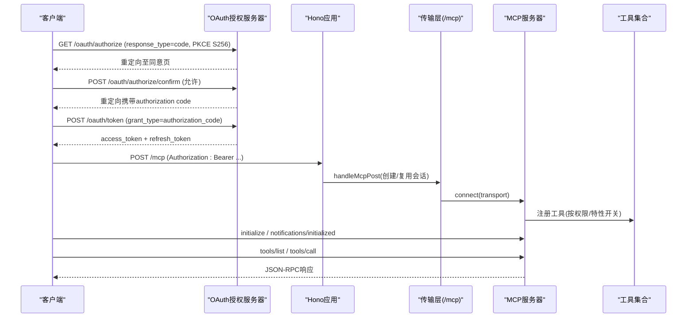
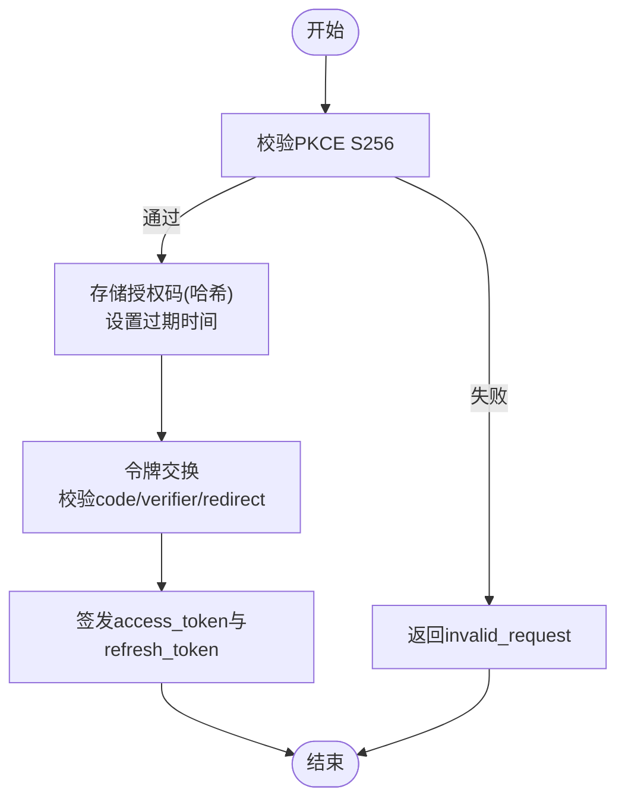
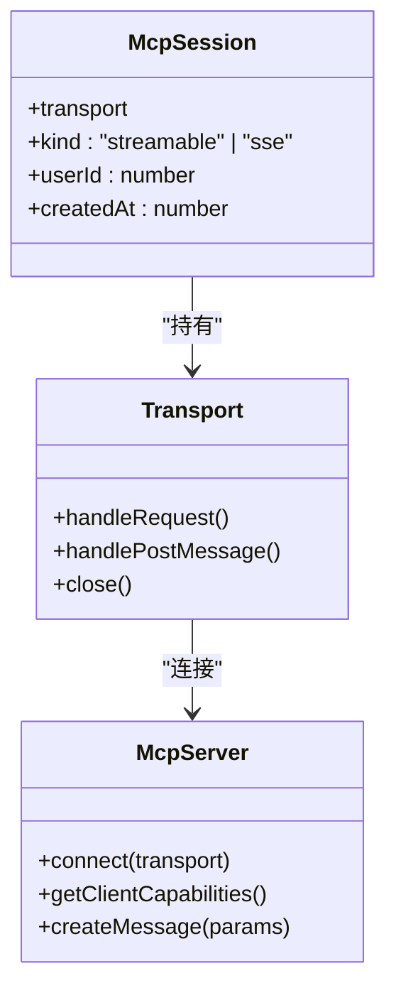
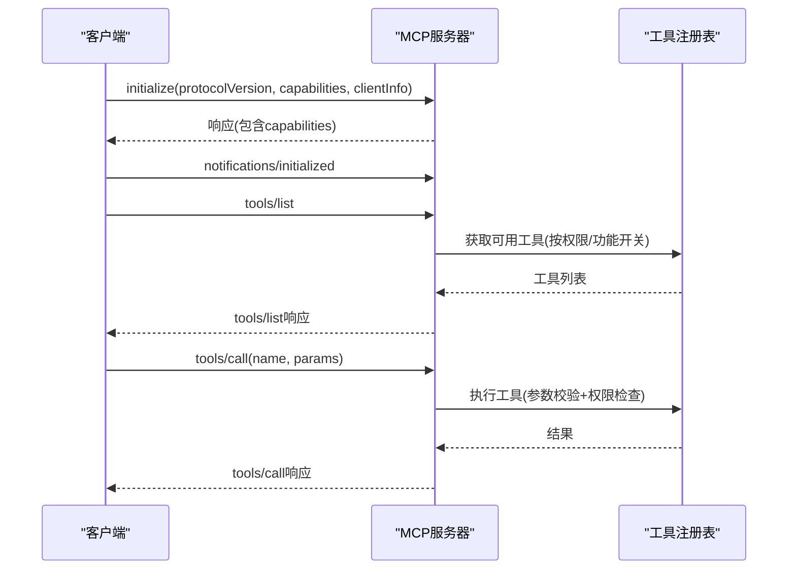
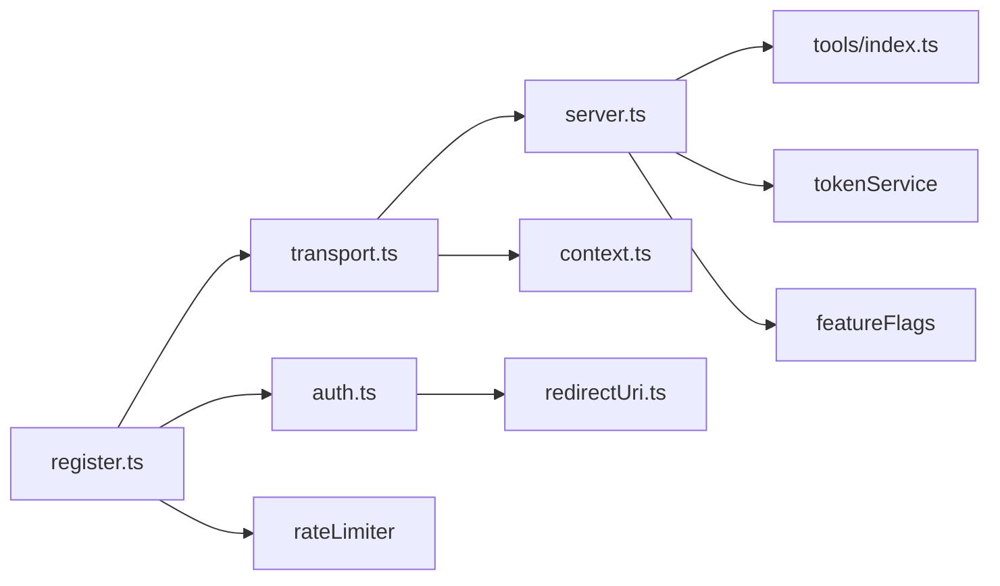

# MCP协议概览

<cite>
**本文引用的文件**
- [api/mcp/server.ts](file://api/mcp/server.ts)
- [api/mcp/auth.ts](file://api/mcp/auth.ts)
- [api/mcp/transport.ts](file://api/mcp/transport.ts)
- [api/mcp/types.ts](file://api/mcp/types.ts)
- [api/mcp/register.ts](file://api/mcp/register.ts)
- [api/mcp/context.ts](file://api/mcp/context.ts)
- [api/mcp/redirectUri.ts](file://api/mcp/redirectUri.ts)
- [api/mcp/tools/index.ts](file://api/mcp/tools/index.ts)
- [api/mcp/tools/help.ts](file://api/mcp/tools/help.ts)
- [api/mcp/tools/samplePing.ts](file://api/mcp/tools/samplePing.ts)
- [db/migrations/010_mcp.sql](file://db/migrations/010_mcp.sql)
</cite>

## 目录
1. [简介](#简介)
2. [项目结构](#项目结构)
3. [核心组件](#核心组件)
4. [架构总览](#架构总览)
5. [详细组件分析](#详细组件分析)
6. [依赖关系分析](#依赖关系分析)
7. [性能与可扩展性](#性能与可扩展性)
8. [故障排查指南](#故障排查指南)
9. [结论](#结论)
10. [附录：连接示例与调试技巧](#附录连接示例与调试技巧)

## 简介
本文件为DeeWaanAI的MCP（Model Context Protocol）服务器提供协议概览，覆盖以下方面：
- 核心概念、架构设计与通信机制
- 服务器初始化流程、会话管理与认证机制
- OAuth 2.1授权码+PKCE流程、令牌验证与权限控制
- 传输层抽象、消息格式与错误处理策略
- 协议版本管理、能力协商与工具发现机制
- 实际连接示例与调试技巧

## 项目结构
MCP相关代码集中在 api/mcp 目录下，按职责划分清晰：
- server.ts：MCP服务器工厂与工具注册、审计与用量统计
- auth.ts：OAuth 2.1授权服务器端点（动态客户端注册、授权、令牌交换）
- transport.ts：传输层（流式HTTP与遗留SSE）、会话生命周期管理
- types.ts：跨模块共享类型（认证上下文、工具定义）
- register.ts：路由挂载、鉴权中间件、速率限制
- context.ts：Bearer令牌解析与校验
- redirectUri.ts：重定向URI白名单校验
- tools/*：工具实现与注册表

图表来源
- [api/mcp/register.ts:144-164](file://api/mcp/register.ts#L144-L164)
- [api/mcp/auth.ts:147-173](file://api/mcp/auth.ts#L147-L173)
- [api/mcp/transport.ts:74-170](file://api/mcp/transport.ts#L74-L170)
- [api/mcp/server.ts:135-186](file://api/mcp/server.ts#L135-L186)
- [api/mcp/tools/index.ts:45-94](file://api/mcp/tools/index.ts#L45-L94)

章节来源
- [api/mcp/register.ts:144-164](file://api/mcp/register.ts#L144-L164)
- [api/mcp/auth.ts:147-173](file://api/mcp/auth.ts#L147-L173)
- [api/mcp/transport.ts:74-170](file://api/mcp/transport.ts#L74-L170)
- [api/mcp/server.ts:135-186](file://api/mcp/server.ts#L135-L186)
- [api/mcp/tools/index.ts:45-94](file://api/mcp/tools/index.ts#L45-L94)

## 核心组件
- 认证与授权
  - OAuth 2.1授权服务器：/.well-known/*、/oauth/register、/oauth/authorize、/oauth/token
  - Bearer令牌校验：从Authorization头提取并验证访问令牌
  - 作用域控制：mcp:read、mcp:run、mcp:write
- 传输与会话
  - 流式HTTP传输：POST/GET/DELETE /mcp，支持SSE或JSON响应
  - 遗留SSE传输：GET /mcp/sse、POST /mcp/messages
  - 进程内会话映射：按SDK生成的sessionId维护Transport与用户信息
- 服务器与工具
  - 每会话一个McpServer实例，绑定认证上下文
  - 工具注册表集中管理，支持功能开关与权限检查
  - 调用审计与用量计数：写入审计日志与月度计数器
- 路由与限流
  - 统一中间件：鉴权、客户分层、速率限制
  - 401 + WWW-Authenticate挑战；429 + Retry-After提示

章节来源
- [api/mcp/auth.ts:147-173](file://api/mcp/auth.ts#L147-L173)
- [api/mcp/context.ts:17-41](file://api/mcp/context.ts#L17-L41)
- [api/mcp/transport.ts:74-170](file://api/mcp/transport.ts#L74-L170)
- [api/mcp/server.ts:84-124](file://api/mcp/server.ts#L84-L124)
- [api/mcp/register.ts:90-142](file://api/mcp/register.ts#L90-L142)

## 架构总览
下图展示了从客户端到MCP服务器的完整交互路径，包括OAuth授权、令牌交换、会话建立与工具调用。

图表来源
- [api/mcp/auth.ts:229-335](file://api/mcp/auth.ts#L229-L335)
- [api/mcp/auth.ts:337-426](file://api/mcp/auth.ts#L337-L426)
- [api/mcp/transport.ts:76-141](file://api/mcp/transport.ts#L76-L141)
- [api/mcp/server.ts:135-186](file://api/mcp/server.ts#L135-L186)

## 详细组件分析

### 认证与授权（OAuth 2.1 + PKCE）
- 公开元数据
  - /.well-known/oauth-protected-resource：声明资源与支持的scope
  - /.well-known/oauth-authorization-server：授权服务器元数据（端点、支持的能力）
- 动态客户端注册
  - /oauth/register：校验client_name与redirect_uris（仅https或本地回环http），生成clientId
- 授权流程
  - /oauth/authorize：校验response_type=code、client_id、redirect_uri、PKCE S256，重定向至同意页
  - /oauth/authorize/confirm：校验会话用户、记录授权码（SHA-256哈希存储，单次使用，10分钟过期）
- 令牌交换
  - /oauth/token：支持authorization_code与refresh_token
    - authorization_code：校验code、client_id、redirect_uri、code_verifier（PKCE S256），原子标记usedAt并发安全，签发access_token与refresh_token
    - refresh_token：旋转刷新令牌并返回新令牌对
- 作用域
  - 内置作用域：mcp:read、mcp:run、mcp:write
  - 请求作用域需与已授权作用域交集，否则拒绝

图表来源
- [api/mcp/auth.ts:229-335](file://api/mcp/auth.ts#L229-L335)
- [api/mcp/auth.ts:337-426](file://api/mcp/auth.ts#L337-L426)
- [api/mcp/redirectUri.ts:14-27](file://api/mcp/redirectUri.ts#L14-L27)

章节来源
- [api/mcp/auth.ts:147-173](file://api/mcp/auth.ts#L147-L173)
- [api/mcp/auth.ts:229-335](file://api/mcp/auth.ts#L229-L335)
- [api/mcp/auth.ts:337-426](file://api/mcp/auth.ts#L337-L426)
- [api/mcp/redirectUri.ts:14-27](file://api/mcp/redirectUri.ts#L14-L27)

### 传输层抽象与会话管理
- 流式HTTP传输（推荐）
  - POST /mcp：首次请求创建StreamableHTTPServerTransport，后续请求复用同一会话（mcp-session-id）
  - GET /mcp：服务端→客户端事件流
  - DELETE /mcp：关闭会话
- 遗留SSE传输（兼容旧客户端）
  - GET /mcp/sse：打开SSE流并发送endpoint事件
  - POST /mcp/messages：发送JSON-RPC消息
- 会话管理
  - 进程内Map存储会话，键为SDK生成的sessionId
  - 定期清理超时会话（TTL 24小时）
  - 会话初始化后注入运行时桥接（采样能力探测与createMessage）

图表来源
- [api/mcp/transport.ts:38-57](file://api/mcp/transport.ts#L38-L57)
- [api/mcp/transport.ts:76-141](file://api/mcp/transport.ts#L76-L141)
- [api/mcp/transport.ts:174-210](file://api/mcp/transport.ts#L174-L210)
- [api/mcp/server.ts:135-186](file://api/mcp/server.ts#L135-L186)

章节来源
- [api/mcp/transport.ts:74-170](file://api/mcp/transport.ts#L74-L170)
- [api/mcp/transport.ts:174-210](file://api/mcp/transport.ts#L174-L210)

### 服务器初始化、能力协商与工具发现
- 服务器构建
  - 每个会话新建McpServer实例，名称与版本固定
  - 能力声明：tools:{}（表示支持工具）
- 工具注册
  - 从工具注册表加载所有工具
  - 按作用域与功能开关过滤：未启用功能的工具隐藏且不可调用
  - 输入参数由SDK基于zod schema进行校验，非法参数返回InvalidParams
- 能力协商
  - 客户端在initialize中声明capabilities与clientInfo
  - 服务器可读取客户端能力（如sampling）以决定是否启用特定功能
- 工具发现
  - tools/list：返回当前会话可用的工具列表（受权限与功能开关影响）
  - tools/call：执行工具并返回结果（包装为text内容）

图表来源
- [api/mcp/server.ts:135-186](file://api/mcp/server.ts#L135-L186)
- [api/mcp/server.ts:84-124](file://api/mcp/server.ts#L84-L124)
- [api/mcp/tools/index.ts:45-94](file://api/mcp/tools/index.ts#L45-L94)

章节来源
- [api/mcp/server.ts:135-186](file://api/mcp/server.ts#L135-L186)
- [api/mcp/server.ts:84-124](file://api/mcp/server.ts#L84-L124)
- [api/mcp/tools/index.ts:45-94](file://api/mcp/tools/index.ts#L45-L94)

### 权限控制与作用域
- 作用域定义
  - mcp:read：只读操作
  - mcp:run：运行类操作
  - mcp:write：写类操作
- 工具级权限
  - 每个工具声明requiredScopes，调用前校验当前会话是否具备全部所需作用域
  - 缺少作用域时返回InvalidRequest并记录审计
- 功能开关
  - 工具可声明featureFlag，仅在用户启用该功能时注册并暴露
  - 功能检查失败时默认隐藏工具（fail closed）

章节来源
- [api/mcp/auth.ts:35-66](file://api/mcp/auth.ts#L35-L66)
- [api/mcp/server.ts:84-124](file://api/mcp/server.ts#L84-L124)
- [api/mcp/types.ts:33-44](file://api/mcp/types.ts#L33-L44)

### 消息格式与错误处理
- 消息格式
  - JSON-RPC 2.0：jsonrpc、method、params、id等字段
  - 工具调用结果包装为content数组，type为text，内容为JSON字符串
- 错误处理
  - 参数校验失败：InvalidParams
  - 权限不足：InvalidRequest
  - 未知工具：UnknownMethod
  - 会话不存在：-32001 Session not found
  - 解析错误：-32700 Parse error
  - 传输错误：通用错误对象
- 审计与用量
  - 每次工具调用记录审计日志（用户ID、客户端ID、工具名、延迟、状态、错误）
  - 每月用量计数器累加（fire-and-forget，不影响主流程）

章节来源
- [api/mcp/server.ts:46-82](file://api/mcp/server.ts#L46-L82)
- [api/mcp/server.ts:84-124](file://api/mcp/server.ts#L84-L124)
- [api/mcp/transport.ts:59-72](file://api/mcp/transport.ts#L59-L72)
- [db/migrations/010_mcp.sql:29-40](file://db/migrations/010_mcp.sql#L29-L40)

## 依赖关系分析
- 外部依赖
  - @modelcontextprotocol/sdk：MCP协议实现（服务器、传输、类型）
  - Drizzle ORM：数据库访问
  - Hono：Web框架与中间件
- 内部依赖
  - tokenService：访问令牌验证与刷新
  - featureFlags：功能开关检查
  - rateLimiter：按客户分层限速
  - logger/messages：日志与国际化消息

图表来源
- [api/mcp/register.ts:144-164](file://api/mcp/register.ts#L144-L164)
- [api/mcp/auth.ts:147-173](file://api/mcp/auth.ts#L147-L173)
- [api/mcp/transport.ts:74-170](file://api/mcp/transport.ts#L74-L170)
- [api/mcp/server.ts:135-186](file://api/mcp/server.ts#L135-L186)

章节来源
- [api/mcp/register.ts:144-164](file://api/mcp/register.ts#L144-L164)
- [api/mcp/auth.ts:147-173](file://api/mcp/auth.ts#L147-L173)
- [api/mcp/transport.ts:74-170](file://api/mcp/transport.ts#L74-L170)
- [api/mcp/server.ts:135-186](file://api/mcp/server.ts#L135-L186)

## 性能与可扩展性
- 会话清理：定时扫描并关闭超时会话，防止内存泄漏
- 速率限制：按客户分层（solo/team/admin）限制MCP调用频率，超限返回429与Retry-After
- 功能开关：按需启用工具，减少不必要注册与校验开销
- 异步审计：审计与用量统计采用fire-and-forget，避免阻塞主流程
- 多节点扩展：当前会话Map为进程内，多节点部署需粘性路由（基于mcp-session-id）

[本节为一般性指导，不直接分析具体文件]

## 故障排查指南
- 401 Unauthorized
  - 检查Authorization头是否为Bearer令牌
  - 确认令牌有效且未过期
  - 查看WWW-Authenticate响应头中的资源元数据URL
- 429 Rate Limit Exceeded
  - 检查Retry-After头部，等待重试
  - 确认客户分层是否正确识别
- 会话不存在
  - 确保使用正确的mcp-session-id
  - 检查会话是否已过期或被删除
- 工具调用失败
  - 检查工具所需作用域是否满足
  - 查看工具是否被功能开关隐藏
  - 检查参数是否符合zod schema

章节来源
- [api/mcp/register.ts:90-142](file://api/mcp/register.ts#L90-L142)
- [api/mcp/transport.ts:59-72](file://api/mcp/transport.ts#L59-L72)
- [api/mcp/server.ts:84-124](file://api/mcp/server.ts#L84-L124)

## 结论
DeeWaanAI的MCP服务器实现了完整的OAuth 2.1授权流程、安全的令牌交换、灵活的传输层抽象以及严格的权限控制。通过会话隔离、功能开关与速率限制，系统在安全性、可扩展性与用户体验之间取得了良好平衡。建议在生产环境中启用粘性路由以支持多节点部署，并持续监控审计日志与用量指标以优化性能。

[本节为总结性内容，不直接分析具体文件]

## 附录：连接示例与调试技巧
- 获取授权码
  - 访问：GET /oauth/authorize?response_type=code&client_id={clientId}&redirect_uri={redirectUri}&code_challenge={codeChallenge}&code_challenge_method=S256
  - 在同意页确认后，重定向携带authorization code
- 交换令牌
  - POST /oauth/token，grant_type=authorization_code，附带code、client_id、redirect_uri、code_verifier
- 建立MCP会话
  - POST /mcp，Authorization: Bearer {accessToken}
  - 首次请求创建会话，响应头包含mcp-session-id
  - 后续请求携带mcp-session-id复用会话
- 工具调用
  - tools/list：获取可用工具列表
  - tools/call：调用具体工具，传入name与params
- 调试技巧
  - 启用详细日志：检查服务器日志中的会话初始化、工具注册与调用记录
  - 使用sample_ping工具测试采样能力
  - 检查作用域与功能开关配置

章节来源
- [api/mcp/auth.ts:229-335](file://api/mcp/auth.ts#L229-L335)
- [api/mcp/auth.ts:337-426](file://api/mcp/auth.ts#L337-L426)
- [api/mcp/transport.ts:76-141](file://api/mcp/transport.ts#L76-L141)
- [api/mcp/tools/samplePing.ts:20-55](file://api/mcp/tools/samplePing.ts#L20-L55)