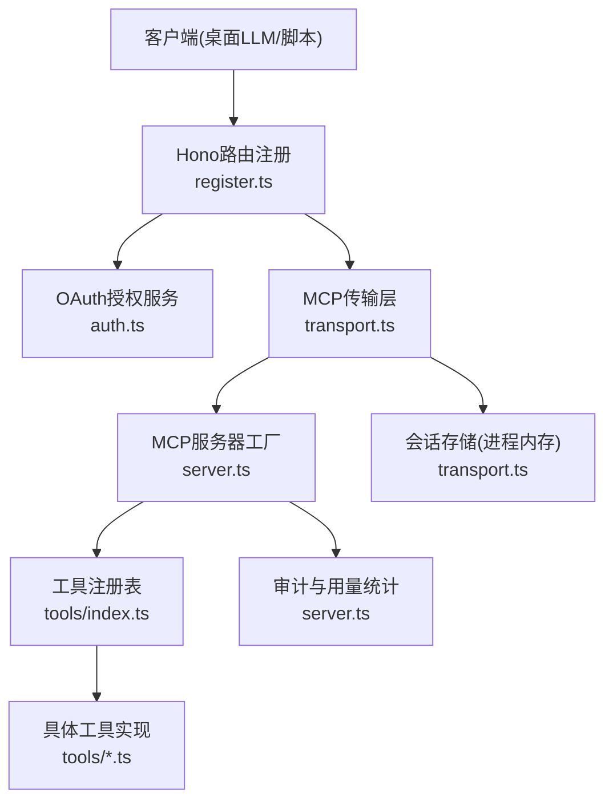
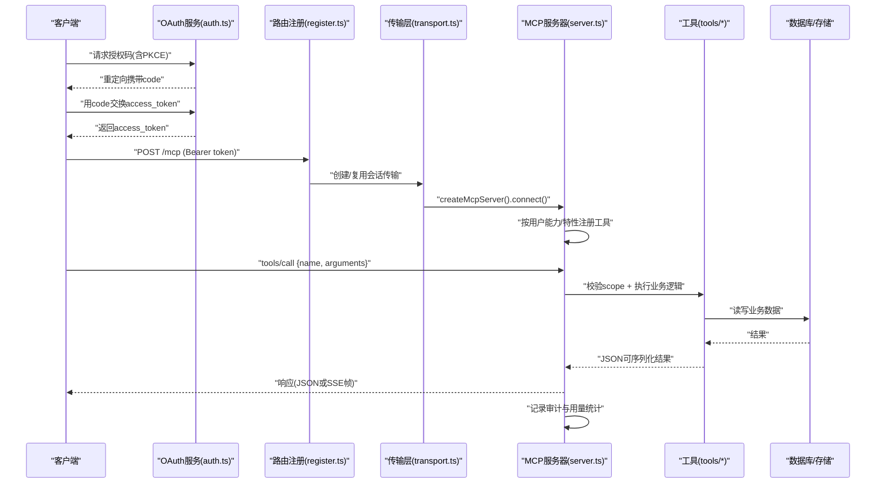
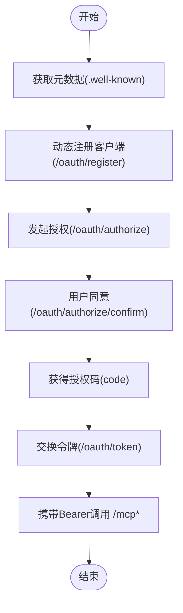
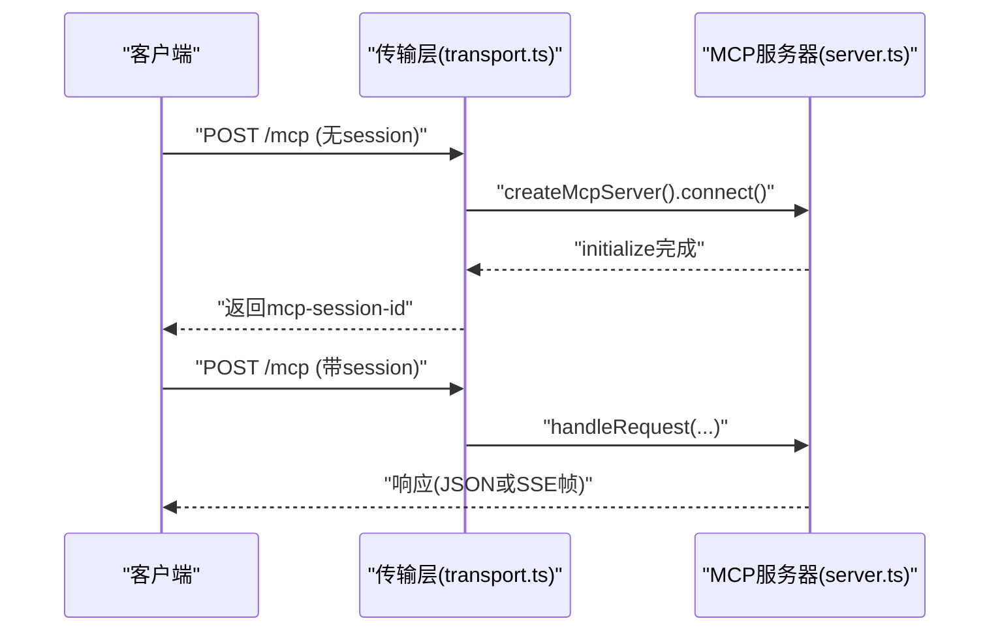
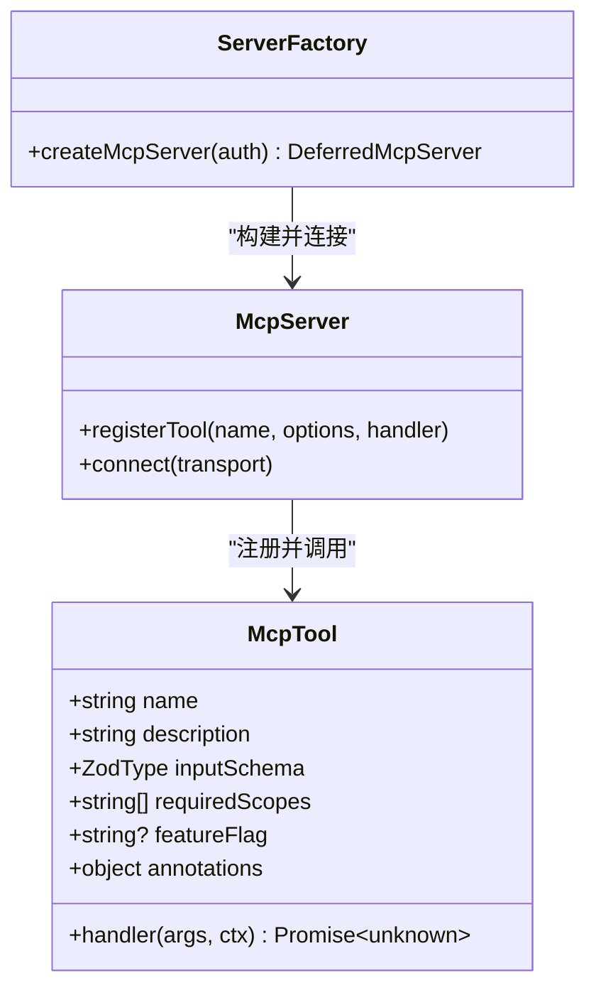
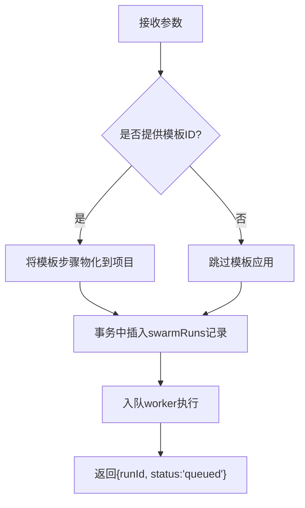
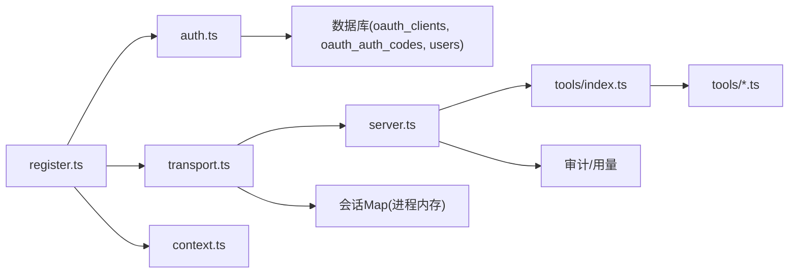

# MCP服务器文档

<cite>
**本文档引用的文件**
- [api/mcp/server.ts](file://api/mcp/server.ts)
- [api/mcp/auth.ts](file://api/mcp/auth.ts)
- [api/mcp/transport.ts](file://api/mcp/transport.ts)
- [api/mcp/register.ts](file://api/mcp/register.ts)
- [api/mcp/types.ts](file://api/mcp/types.ts)
- [api/mcp/context.ts](file://api/mcp/context.ts)
- [api/mcp/redirectUri.ts](file://api/mcp/redirectUri.ts)
- [api/mcp/tools/index.ts](file://api/mcp/tools/index.ts)
- [api/mcp/tools/help.ts](file://api/mcp/tools/help.ts)
- [api/mcp/tools/runPipeline.ts](file://api/mcp/tools/runPipeline.ts)
- [api/mcp/tools/memory.ts](file://api/mcp/tools/memory.ts)
- [api/mcp/tools/projectContext.ts](file://api/mcp/tools/projectContext.ts)
- [api/mcp/tools/_shared.ts](file://api/mcp/tools/_shared.ts)
- [scripts/mcp-call.mjs](file://scripts/mcp-call.mjs)
- [scripts/oauth-test-client.mjs](file://scripts/oauth-test-client.mjs)
</cite>

## 目录
1. [简介](#简介)
2. [项目结构](#项目结构)
3. [核心组件](#核心组件)
4. [架构总览](#架构总览)
5. [详细组件分析](#详细组件分析)
6. [依赖关系分析](#依赖关系分析)
7. [性能与可扩展性](#性能与可扩展性)
8. [故障排查指南](#故障排查指南)
9. [结论](#结论)
10. [附录：工具清单与使用示例](#附录工具清单与使用示例)

## 简介
本文件为DeeWaanAI的MCP（Model Context Protocol）服务器提供完整技术文档，覆盖协议规范、认证流程、传输机制、内置工具能力、自定义工具开发指南、桌面LLM应用集成方式、OAuth 2.1授权流程、版本化API契约以及扩展机制。目标读者包括后端工程师、平台集成者、以及希望基于MCP构建桌面端智能体集成的开发者。

## 项目结构
MCP相关代码集中在 api/mcp 目录下，按职责划分为：
- 路由与注册：register.ts 统一挂载 OAuth 与 /mcp* 路由，并施加鉴权与限流中间件
- 传输层：transport.ts 实现流式HTTP与兼容SSE两种传输模式，管理会话生命周期
- 服务端：server.ts 创建每会话McpServer实例，注册工具、执行权限检查、审计与用量统计
- 认证：auth.ts 实现OAuth 2.1授权码+PKCE流程；context.ts 解析Bearer令牌生成McpAuthContext
- 类型契约：types.ts 定义McpTool、McpAuthContext等跨模块共享契约
- 工具集合：tools/* 提供具体业务能力（流水线、记忆、项目上下文、市场、团队等），index.ts 集中注册

图表来源
- [api/mcp/register.ts:144-164](file://api/mcp/register.ts#L144-L164)
- [api/mcp/auth.ts:147-427](file://api/mcp/auth.ts#L147-L427)
- [api/mcp/transport.ts:74-234](file://api/mcp/transport.ts#L74-L234)
- [api/mcp/server.ts:135-209](file://api/mcp/server.ts#L135-L209)
- [api/mcp/tools/index.ts:45-94](file://api/mcp/tools/index.ts#L45-L94)

章节来源
- [api/mcp/register.ts:1-165](file://api/mcp/register.ts#L1-L165)
- [api/mcp/transport.ts:1-234](file://api/mcp/transport.ts#L1-L234)
- [api/mcp/server.ts:1-209](file://api/mcp/server.ts#L1-L209)
- [api/mcp/auth.ts:1-428](file://api/mcp/auth.ts#L1-L428)
- [api/mcp/tools/index.ts:1-95](file://api/mcp/tools/index.ts#L1-L95)

## 核心组件
- 路由与鉴权中间件：对 /mcp* 路径强制要求有效Bearer令牌，返回标准WWW-Authenticate挑战；同时按客户层级进行速率限制
- 传输层：支持MCP 2025-03-26流式HTTP（POST/GET/DELETE /mcp）与兼容旧版SSE（/mcp/sse, /mcp/messages），维护进程内会话映射
- 服务器工厂：为每个会话创建独立McpServer，按用户能力与特性开关动态注册工具，封装参数校验、权限、审计与用量统计
- 认证服务：实现RFC 8414/9728元数据、RFC 7591动态注册、授权码+PKCE(S256)、刷新令牌；支持本地回环回调与HTTPS回调
- 工具契约：统一的McpTool接口，包含名称、描述、输入Schema、所需作用域、特性开关、注解与处理器

章节来源
- [api/mcp/register.ts:89-164](file://api/mcp/register.ts#L89-L164)
- [api/mcp/transport.ts:74-234](file://api/mcp/transport.ts#L74-L234)
- [api/mcp/server.ts:84-209](file://api/mcp/server.ts#L84-L209)
- [api/mcp/auth.ts:147-427](file://api/mcp/auth.ts#L147-L427)
- [api/mcp/types.ts:9-44](file://api/mcp/types.ts#L9-L44)

## 架构总览
下图展示从客户端到工具执行的端到端调用链，涵盖OAuth授权、传输握手、工具注册与执行、审计与用量统计。

图表来源
- [api/mcp/auth.ts:229-427](file://api/mcp/auth.ts#L229-L427)
- [api/mcp/register.ts:144-164](file://api/mcp/register.ts#L144-L164)
- [api/mcp/transport.ts:74-141](file://api/mcp/transport.ts#L74-L141)
- [api/mcp/server.ts:135-209](file://api/mcp/server.ts#L135-L209)

## 详细组件分析

### 认证与授权（OAuth 2.1 + PKCE）
- 公开元数据：/.well-known/oauth-protected-resource 与 /.well-known/oauth-authorization-server 暴露资源与授权服务器信息
- 动态注册：/oauth/register 接受 client_name 与 redirect_uris，仅允许https或本地回环http
- 授权端点：/oauth/authorize 校验response_type=code、client_id、redirect_uri、PKCE(S256)，跳转到同意页
- 同意确认：/oauth/authorize/confirm 校验会话，写入一次性授权码（10分钟过期，单用）
- 令牌交换：/oauth/token 支持 authorization_code 与 refresh_token，严格校验PKCE、重定向URI与作用域交集
- 访问控制：/mcp* 路径通过中间件验证Bearer令牌，失败时返回401与WWW-Authenticate头

图表来源
- [api/mcp/auth.ts:147-427](file://api/mcp/auth.ts#L147-L427)
- [api/mcp/redirectUri.ts:1-28](file://api/mcp/redirectUri.ts#L1-L28)
- [api/mcp/register.ts:90-142](file://api/mcp/register.ts#L90-L142)

章节来源
- [api/mcp/auth.ts:147-427](file://api/mcp/auth.ts#L147-L427)
- [api/mcp/redirectUri.ts:1-28](file://api/mcp/redirectUri.ts#L1-L28)
- [api/mcp/register.ts:90-142](file://api/mcp/register.ts#L90-L142)

### 传输与会话管理
- 流式HTTP（推荐）：POST/GET/DELETE /mcp，首次POST建立会话，后续请求携带 mcp-session-id 头
- 兼容SSE（旧版）：GET /mcp/sse 打开SSE流，POST /mcp/messages?sessionId=... 发送消息
- 会话生命周期：进程内Map维护，支持自动清理（TTL 24小时），关闭事件清理
- 采样桥接：在会话初始化后注入 runtime.sample 与 samplingSupported，供工具反向调用桌面客户端能力

图表来源
- [api/mcp/transport.ts:74-141](file://api/mcp/transport.ts#L74-L141)
- [api/mcp/server.ts:135-209](file://api/mcp/server.ts#L135-L209)

章节来源
- [api/mcp/transport.ts:1-234](file://api/mcp/transport.ts#L1-L234)
- [api/mcp/server.ts:135-209](file://api/mcp/server.ts#L135-L209)

### 服务器与工具注册
- 每会话独立McpServer：隔离认证上下文与传输
- 工具注册策略：遍历 TOOLS 列表，按 featureFlag 过滤，再注册到服务器
- 参数校验：SDK直接消费Zod v4对象schema，非法参数返回InvalidParams
- 权限检查：每个工具声明 requiredScopes，未满足则拒绝并记录审计
- 审计与用量：每次调用记录延迟、状态、错误，并累加月度用量计数器

图表来源
- [api/mcp/server.ts:84-209](file://api/mcp/server.ts#L84-L209)
- [api/mcp/types.ts:33-44](file://api/mcp/types.ts#L33-L44)
- [api/mcp/tools/index.ts:45-94](file://api/mcp/tools/index.ts#L45-L94)

章节来源
- [api/mcp/server.ts:1-209](file://api/mcp/server.ts#L1-L209)
- [api/mcp/types.ts:1-45](file://api/mcp/types.ts#L1-L45)
- [api/mcp/tools/index.ts:1-95](file://api/mcp/tools/index.ts#L1-L95)

### 关键工具详解

#### run_pipeline（运行流水线）
- 功能：为指定项目启动一次AI流水线执行，异步入队，立即返回runId与状态提示
- 参数：projectId、input、可选templateId/stateless/chain
- 权限：需要 mcp:run 作用域
- 行为：模板应用到项目步骤、原子插入运行记录、入队worker处理

图表来源
- [api/mcp/tools/runPipeline.ts:15-156](file://api/mcp/tools/runPipeline.ts#L15-L156)

章节来源
- [api/mcp/tools/runPipeline.ts:1-156](file://api/mcp/tools/runPipeline.ts#L1-L156)

#### memory_get / memory_append（项目记忆）
- 功能：读取最近交互片段与结构化状态摘要；追加笔记到项目记忆
- 权限：memory_get 需 mcp:read；memory_append 需 mcp:write
- 存储：磁盘持久化的片段与状态，受最大条目限制与截断保护

章节来源
- [api/mcp/tools/memory.ts:1-92](file://api/mcp/tools/memory.ts#L1-L92)

#### project_context（项目上下文）
- 功能：获取项目“智能卡片”（类型、框架、文件树、实体、端点、TODO等），可选根据查询返回最相关的文件内容
- 权限：mcp:read
- 行为：裁剪大数组输出，按需检索并截断文件内容

章节来源
- [api/mcp/tools/projectContext.ts:1-130](file://api/mcp/tools/projectContext.ts#L1-L130)

#### deewaanai_help（帮助）
- 功能：根据当前用户能力、作用域、特性开关与设置，生成个性化操作指南
- 权限：mcp:read
- 行为：聚合能力与特性开关，输出可操作建议

章节来源
- [api/mcp/tools/help.ts:1-47](file://api/mcp/tools/help.ts#L1-L47)

### 自定义工具开发指南
- 开发规范
  - 使用Zod v4对象作为 inputSchema，由SDK直接校验
  - 明确 requiredScopes（mcp:read / mcp:run / mcp:write）
  - 标注 readOnlyHint 与 destructiveHint，便于客户端提示
  - 如需灰度发布，设置 featureFlag，未启用时工具不可见且调用失败
- 注册机制
  - 在 tools/index.ts 中导出并加入 TOOLS 数组
  - 服务器在会话初始化时按用户能力与特性开关决定是否注册
- 示例要点
  - 参考 runPipeline、memory、projectContext 的实现风格
  - 使用 _shared.ts 中的 requireProjectAccess 确保项目级访问控制
  - 所有IO与异常均保持幂等与可观测性（日志、审计）

章节来源
- [api/mcp/tools/_shared.ts:1-67](file://api/mcp/tools/_shared.ts#L1-L67)
- [api/mcp/tools/index.ts:45-94](file://api/mcp/tools/index.ts#L45-L94)
- [api/mcp/server.ts:84-177](file://api/mcp/server.ts#L84-L177)

### 与桌面LLM应用的集成
- Claude Desktop、ChatGPT、Qwen Code、Kimi 等桌面端可通过MCP协议接入
- 推荐传输：流式HTTP（/mcp），具备更好的会话管理与双向通信能力
- 旧版兼容：SSE（/mcp/sse + /mcp/messages）用于老客户端
- 认证：使用OAuth 2.1 + PKCE(S256)获取access_token，并在请求头携带Bearer
- 采样能力：若客户端支持sampling，工具可通过 runtime.sample 向桌面端发起消息

章节来源
- [api/mcp/transport.ts:107-116](file://api/mcp/transport.ts#L107-L116)
- [api/mcp/transport.ts:191-200](file://api/mcp/transport.ts#L191-L200)
- [api/mcp/types.ts:15-30](file://api/mcp/types.ts#L15-L30)

## 依赖关系分析
- 路由层依赖：register.ts 依赖 auth.ts、transport.ts、context.ts
- 传输层依赖：transport.ts 依赖 server.ts、logger、types
- 服务器依赖：server.ts 依赖 tools/index.ts、featureFlags、审计与用量
- 工具依赖：各工具依赖 services、db schema、_shared 等
- 外部依赖：@modelcontextprotocol/sdk、hono、drizzle-orm、crypto

图表来源
- [api/mcp/register.ts:144-164](file://api/mcp/register.ts#L144-L164)
- [api/mcp/transport.ts:74-234](file://api/mcp/transport.ts#L74-L234)
- [api/mcp/server.ts:135-209](file://api/mcp/server.ts#L135-L209)
- [api/mcp/auth.ts:147-427](file://api/mcp/auth.ts#L147-L427)

章节来源
- [api/mcp/register.ts:1-165](file://api/mcp/register.ts#L1-L165)
- [api/mcp/transport.ts:1-234](file://api/mcp/transport.ts#L1-L234)
- [api/mcp/server.ts:1-209](file://api/mcp/server.ts#L1-L209)
- [api/mcp/auth.ts:1-428](file://api/mcp/auth.ts#L1-L428)

## 性能与可扩展性
- 会话管理：进程内Map，单节点部署；多节点需粘性路由（基于mcp-session-id）
- 工具注册：按会话动态注册，避免全局状态污染；特性开关减少不必要注册
- 参数校验：SDK侧Zod校验，降低无效请求进入业务层的成本
- 审计与用量：fire-and-forget写入，不阻塞主流程；月度计数去重更新
- 速率限制：按客户层级缓存解析结果，降低DB压力
- 扩展建议
  - 新增工具仅需在 index.ts 注册，遵循McpTool契约
  - 对高并发场景考虑将会话迁移至分布式存储（如Redis）
  - 引入更细粒度的限流策略（按工具/作用域）

[本节为通用指导，无需特定文件引用]

## 故障排查指南
- 401 Unauthorized
  - 检查Authorization头格式是否为 Bearer <token>
  - 确认token未过期且scopes包含所需作用域
  - 查看WWW-Authenticate头以定位问题
- 400 InvalidRequest/InvalidParams
  - 检查传入参数是否符合工具inputSchema
  - 确认PKCE方法为S256且code_verifier正确
- 404 Session not found
  - 确认携带正确的mcp-session-id头（流式HTTP）或sessionId参数（SSE）
- 429 Rate limit exceeded
  - 根据Retry-After等待重试；检查客户层级与配额
- 工具不可见或调用失败
  - 检查特性开关是否启用；确认requiredScopes是否满足

章节来源
- [api/mcp/register.ts:90-142](file://api/mcp/register.ts#L90-L142)
- [api/mcp/transport.ts:59-64](file://api/mcp/transport.ts#L59-L64)
- [api/mcp/auth.ts:229-427](file://api/mcp/auth.ts#L229-L427)

## 结论
本MCP服务器实现了标准化的OAuth 2.1授权、双传输模式（流式HTTP与SSE）、严格的工具注册与权限控制、完善的审计与用量统计，并提供丰富的内置工具与清晰的扩展机制。通过特性开关与分层限流，系统具备良好的可演进性与生产可用性。

[本节为总结，无需特定文件引用]

## 附录：工具清单与使用示例

### 内置工具概览
- 流水线：run_pipeline、list_pipelines、get_pipeline、create_pipeline、update_pipeline、design_pipeline
- 运行状态：get_run_status、approve_step
- 项目与记忆：project_context、memory_get、memory_append
- 提供商与设置：suggest_providers、add_provider、get_settings、set_default_model
- 市场与升级：search_marketplace、publish_to_marketplace、submit_for_review、get_listing_status、my_marketplace_listings、my_purchases、upgrade_tier
- 评审：enroll_reviewer、get_next_review_task、submit_review_task
- 可移植性：export_pipeline、export_my_data、sync_to_github、export_run
- 批处理：run_batch、batch_status、resume_batch、export_batch_results
- 团队（特性开关）：team_context_get、team_memory_append、team_runs_list、team_run_resume、team_handoff、team_feedback_submit、team_skills_list、team_skill_use
- 帮助：deewaanai_help

章节来源
- [api/mcp/tools/index.ts:45-94](file://api/mcp/tools/index.ts#L45-L94)

### 最小调用示例（脚本）
- OAuth测试客户端：准备阶段生成verifier与challenge，注册客户端并打印同意URL；捕获回调后交换令牌并保存
- MCP调用脚本：使用refresh_token刷新access_token，初始化会话，列出工具或调用工具

章节来源
- [scripts/oauth-test-client.mjs:1-67](file://scripts/oauth-test-client.mjs#L1-L67)
- [scripts/mcp-call.mjs:1-73](file://scripts/mcp-call.mjs#L1-L73)