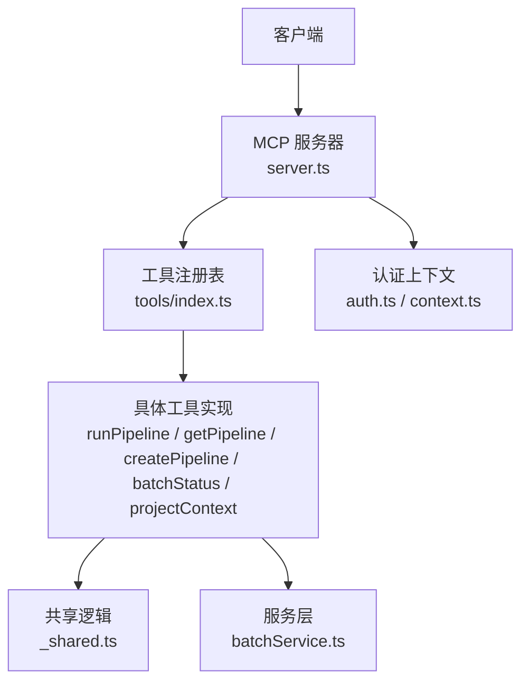
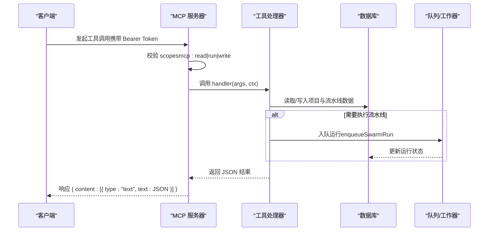
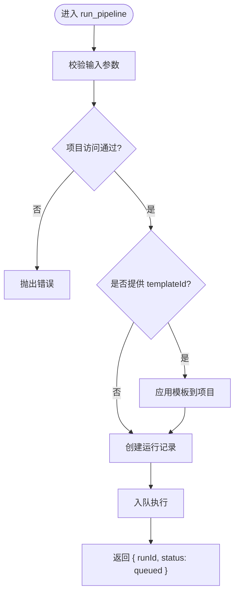
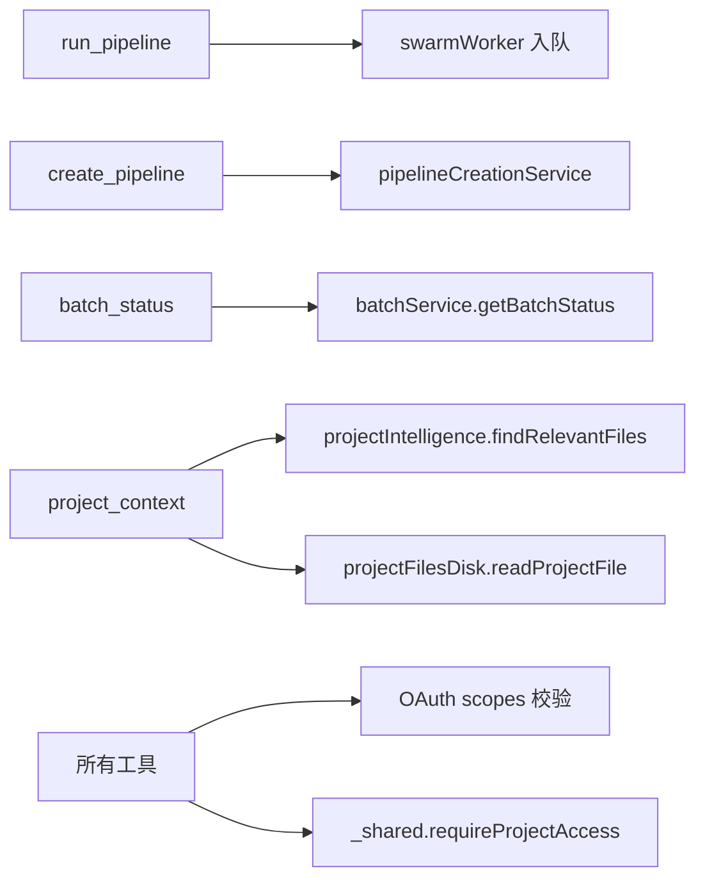
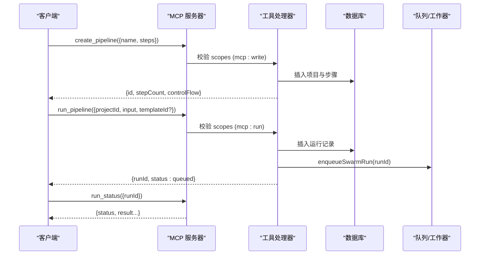
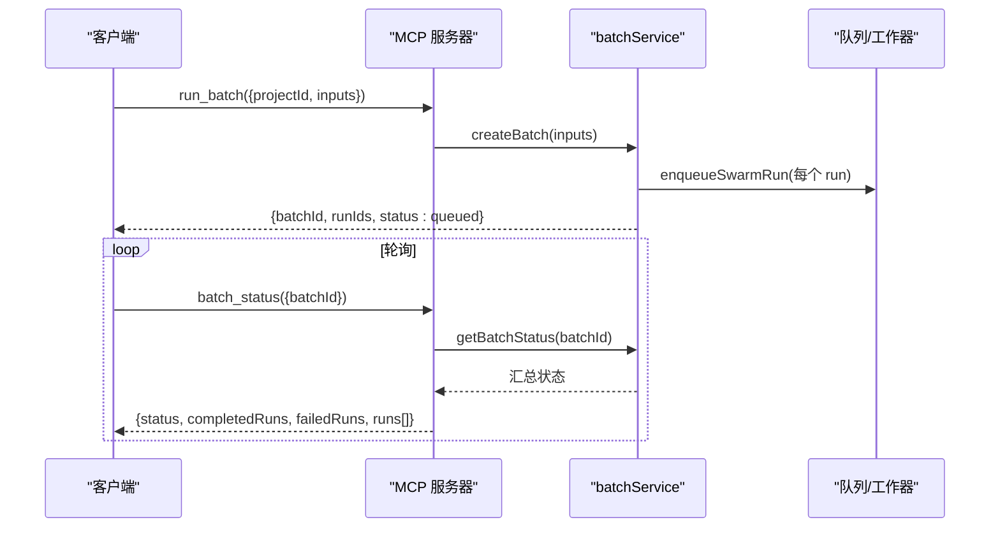
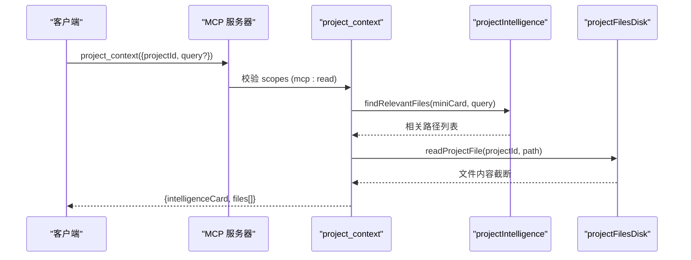

# 内置工具

<cite>
**本文引用的文件**
- [api/mcp/tools/index.ts](file://api/mcp/tools/index.ts)
- [api/mcp/server.ts](file://api/mcp/server.ts)
- [api/mcp/types.ts](file://api/mcp/types.ts)
- [api/mcp/auth.ts](file://api/mcp/auth.ts)
- [api/mcp/context.ts](file://api/mcp/context.ts)
- [api/mcp/tools/runPipeline.ts](file://api/mcp/tools/runPipeline.ts)
- [api/mcp/tools/getPipeline.ts](file://api/mcp/tools/getPipeline.ts)
- [api/mcp/tools/createPipeline.ts](file://api/mcp/tools/createPipeline.ts)
- [api/mcp/tools/batchStatus.ts](file://api/mcp/tools/batchStatus.ts)
- [api/mcp/tools/projectContext.ts](file://api/mcp/tools/projectContext.ts)
- [api/mcp/tools/_shared.ts](file://api/mcp/tools/_shared.ts)
- [api/services/batchService.ts](file://api/services/batchService.ts)
</cite>

## 目录
1. [简介](#简介)
2. [项目结构](#项目结构)
3. [核心组件](#核心组件)
4. [架构总览](#架构总览)
5. [详细组件分析](#详细组件分析)
6. [依赖关系分析](#依赖关系分析)
7. [性能考虑](#性能考虑)
8. [故障排查指南](#故障排查指南)
9. [结论](#结论)
10. [附录：集成与示例](#附录：集成与示例)

## 简介
本文件为 DeeWaanAI 的 MCP（Model Context Protocol）内置工具提供权威文档，聚焦以下四类能力：
- 流水线执行工具：run_pipeline
- 流水线管理工具：get_pipeline、create_pipeline
- 批量处理工具：batch_status
- 项目上下文工具：project_context

文档涵盖每个工具的输入/输出格式、权限要求、错误处理、最佳实践、性能考量与故障排查方法，并提供端到端集成步骤与调用序列图。

## 项目结构
MCP 工具以“注册表 + 服务器”模式组织：
- 工具注册表集中声明所有可用工具及其元数据（名称、描述、输入校验 schema、所需权限范围等）。
- 服务器在会话级构建 McpServer，按权限和特性开关过滤并注册工具，统一处理鉴权、审计与遥测。
- 各工具通过共享模块进行项目访问控制与输出压缩，保证一致的安全与可观测性。

图表来源
- [api/mcp/server.ts:84-176](file://api/mcp/server.ts#L84-L176)
- [api/mcp/tools/index.ts:45-94](file://api/mcp/tools/index.ts#L45-L94)
- [api/mcp/tools/_shared.ts:36-60](file://api/mcp/tools/_shared.ts#L36-L60)
- [api/services/batchService.ts:144-186](file://api/services/batchService.ts#L144-L186)

章节来源
- [api/mcp/server.ts:1-209](file://api/mcp/server.ts#L1-L209)
- [api/mcp/tools/index.ts:1-95](file://api/mcp/tools/index.ts#L1-L95)

## 核心组件
- 工具契约：每个工具暴露 name、description、inputSchema、requiredScopes、annotations 与 handler。
- 权限模型：基于 OAuth 2.1 的 scopes（mcp:read、mcp:run、mcp:write），由服务器在每次调用前校验。
- 项目访问控制：所有涉及项目的工具在执行前调用 requireProjectAccess，确保仅项目所有者或团队成员可访问。
- 审计与用量：每次工具调用记录审计日志与月度用量计数，失败不阻塞主流程。

章节来源
- [api/mcp/types.ts:9-44](file://api/mcp/types.ts#L9-L44)
- [api/mcp/auth.ts:34-66](file://api/mcp/auth.ts#L34-L66)
- [api/mcp/server.ts:84-124](file://api/mcp/server.ts#L84-L124)
- [api/mcp/tools/_shared.ts:36-60](file://api/mcp/tools/_shared.ts#L36-L60)

## 架构总览
下图展示从客户端到工具执行的完整链路，包括鉴权、权限检查、业务处理与结果返回。

图表来源
- [api/mcp/server.ts:84-124](file://api/mcp/server.ts#L84-L124)
- [api/mcp/tools/runPipeline.ts:119-153](file://api/mcp/tools/runPipeline.ts#L119-L153)
- [api/services/batchService.ts:45-105](file://api/services/batchService.ts#L45-L105)

## 详细组件分析

### 流水线执行工具：run_pipeline
- 功能：为指定项目启动一次新的 AI 流水线运行，创建运行记录并立即返回；后续通过 run_status 轮询进度与最终结果。
- 输入参数
  - projectId: 正整数
  - input: 非空字符串，最大长度限制
  - templateId: 可选的正整数，用于将模板步骤应用到项目
  - stateless: 可选布尔值
  - chain: 可选对象，包含 targetProjectId 与可选 inputTemplate
- 输出字段
  - runId: 新创建的运行 ID
  - status: "queued"
  - streamHint: 提示使用 run_status 轮询
- 权限要求：mcp:run
- 错误处理
  - 项目不存在：抛出错误
  - 模板应用失败：抛出错误（例如模板不存在或非项目所有者）
  - 权限不足：由服务器返回 InvalidRequest
- 最佳实践
  - 先调用 get_pipeline 确认流水线配置
  - 如需链式执行，合理设置 chain 参数
  - 使用 run_status 轮询直至完成
- 性能与并发
  - 入队即返回，避免长连接阻塞
  - 注意并发重复提交时幂等性由后端保障

图表来源
- [api/mcp/tools/runPipeline.ts:15-24](file://api/mcp/tools/runPipeline.ts#L15-L24)
- [api/mcp/tools/runPipeline.ts:104-153](file://api/mcp/tools/runPipeline.ts#L104-L153)

章节来源
- [api/mcp/tools/runPipeline.ts:1-156](file://api/mcp/tools/runPipeline.ts#L1-L156)

### 流水线管理工具：get_pipeline
- 功能：获取单个项目的完整流水线详情，包括基本信息、默认模型、执行配置以及有序的步骤列表（agent/if/while/approval）。
- 输入参数
  - id: 项目 ID（来自 list_pipelines）
- 输出字段
  - id、name、description（截断）、defaultModel、pipelineConfig、pipelineTemplateId
  - stepCount、steps（每项含 order、name、role、stepType、systemPrompt 截断、model、temperature、maxTokens、ifConfig、whileConfig、isEnabled）
- 权限要求：mcp:read
- 错误处理
  - 项目不存在：抛出错误
  - 权限不足：由服务器拒绝
- 最佳实践
  - 在 update_pipeline 之前先调用此工具获取当前配置
  - 注意 steps 中的 if/while 需要特定层级权限

章节来源
- [api/mcp/tools/getPipeline.ts:1-60](file://api/mcp/tools/getPipeline.ts#L1-L60)

### 流水线管理工具：create_pipeline
- 功能：一次性创建项目并可附带完整的步骤定义；支持顺序执行与条件/循环控制流（需具备 custom-pipeline 层级权限）。
- 输入参数
  - name: 项目名称
  - description: 可选描述
  - defaultModel: 可选默认模型
  - defaultProviderId: 可选提供者 ID（必须属于当前用户）
  - pipelineConfig: 可选执行配置
  - steps: 可选步骤数组（支持 agent/if/while/approval）
- 输出字段
  - id、name、stepCount、controlFlow（是否包含控制流步骤）
  - next: 建议下一步操作
- 权限要求：mcp:write
- 权限与层级检查
  - 若步骤包含 if/while，需具备 pipeline:custom 能力，否则报错
  - 若指定 defaultProviderId，必须属于当前用户
- 错误处理
  - while 目标错误：抛出错误
  - 缺少层级权限：抛出错误
  - 提供者不存在：抛出错误
- 最佳实践
  - 首次创建建议使用最小步骤集验证
  - 复杂控制流分步迭代完善

章节来源
- [api/mcp/tools/createPipeline.ts:1-108](file://api/mcp/tools/createPipeline.ts#L1-L108)

### 批量处理工具：batch_status
- 功能：查询研究模式的批量运行状态，包括总体进度、各运行状态与累计 token 使用量。建议在 run_batch 后轮询。
- 输入参数
  - batchId: 正整数
- 输出字段
  - batchId、name、status、totalRuns、completedRuns、failedRuns、totalTokensUsed
  - createdAt、completedAt
  - runs: 每个运行的 id、status、inputPreview、totalTokensUsed
- 权限要求：mcp:read
- 错误处理
  - 批量不存在：抛出错误
  - 权限不足：由服务器拒绝
- 最佳实践
  - 轮询间隔建议指数退避，避免高频请求
  - 关注 failedRuns 与 error 字段定位问题

章节来源
- [api/mcp/tools/batchStatus.ts:1-53](file://api/mcp/tools/batchStatus.ts#L1-L53)
- [api/services/batchService.ts:144-186](file://api/services/batchService.ts#L144-L186)

### 项目上下文工具：project_context
- 功能：获取项目的“智能卡片”（类型、框架、文件树、实体、API 端点、TODO 等），并在提供 query 时返回最相关的若干文件内容。
- 输入参数
  - projectId: 正整数
  - query: 可选查询字符串，用于检索相关文件
- 输出字段
  - projectId、projectName
  - intelligenceCard（版本、生成时间、项目类型、主要语言、框架、文件数、架构、入口点、实体、数据库表、API 端点、TODO、文件树等，已做裁剪）
  - files: 最多 3 个相关文件的 path、language、content（截断）、truncated
- 权限要求：mcp:read
- 错误处理
  - 项目不存在：抛出错误
  - 未生成智能卡片：返回 null 并给出导入提示
  - 权限不足：由服务器拒绝
- 最佳实践
  - 提供精准 query 以提高相关性
  - 注意文件内容截断策略，必要时分段查询

章节来源
- [api/mcp/tools/projectContext.ts:1-130](file://api/mcp/tools/projectContext.ts#L1-L130)

## 依赖关系分析
- 工具与服务
  - run_pipeline 依赖 swarm worker 入队执行；create_pipeline 依赖 pipelineCreationService 完成收尾；batch_status 依赖 batchService 查询状态；project_context 依赖 projectIntelligence 与 projectFilesDisk。
- 安全与权限
  - 所有工具均受 server.ts 的 scope 校验保护；涉及项目的工具通过 _shared.ts 的 requireProjectAccess 进行细粒度访问控制。
- 数据一致性
  - 创建运行与入队采用事务与幂等键，避免重复执行；批量进度更新使用原子 SQL 增量。

图表来源
- [api/mcp/tools/runPipeline.ts:119-153](file://api/mcp/tools/runPipeline.ts#L119-L153)
- [api/mcp/tools/createPipeline.ts:71-97](file://api/mcp/tools/createPipeline.ts#L71-L97)
- [api/mcp/tools/batchStatus.ts:20-50](file://api/mcp/tools/batchStatus.ts#L20-L50)
- [api/mcp/tools/projectContext.ts:74-120](file://api/mcp/tools/projectContext.ts#L74-L120)
- [api/mcp/server.ts:84-124](file://api/mcp/server.ts#L84-L124)
- [api/mcp/tools/_shared.ts:36-60](file://api/mcp/tools/_shared.ts#L36-L60)

章节来源
- [api/mcp/server.ts:84-176](file://api/mcp/server.ts#L84-L176)
- [api/mcp/tools/_shared.ts:1-67](file://api/mcp/tools/_shared.ts#L1-L67)

## 性能考虑
- 异步执行：run_pipeline 立即返回，适合高吞吐场景；配合轮询降低服务端压力。
- 批量优化：batch_status 聚合统计信息，减少多次查询；建议合理轮询间隔。
- 输出压缩：对大文本与数组进行截断，避免响应过大影响网络与解析。
- 审计与指标：审计与用量计数为“fire-and-forget”，不影响主路径延迟。

[本节为通用指导，无需引用具体文件]

## 故障排查指南
- 权限不足
  - 现象：InvalidRequest 错误，提示缺少 scopes
  - 排查：确认客户端申请的 scopes 包含 mcp:read|mcp:run|mcp:write 中对应项
- 项目不存在或无访问权限
  - 现象：抛出“项目不存在”错误
  - 排查：确认 projectId 正确且当前用户为项目所有者或团队成员
- 模板应用失败
  - 现象：模板不存在或非项目所有者
  - 排查：检查 templateId 是否存在且属于当前用户；确认项目归属
- 批量不存在
  - 现象：batch_status 返回“批量不存在”
  - 排查：确认 batchId 有效且属于当前用户
- 控制流权限不足
  - 现象：create_pipeline 报需 custom-pipeline 层级
  - 排查：升级计划或改用顺序步骤

章节来源
- [api/mcp/server.ts:94-124](file://api/mcp/server.ts#L94-L124)
- [api/mcp/tools/_shared.ts:36-60](file://api/mcp/tools/_shared.ts#L36-L60)
- [api/mcp/tools/createPipeline.ts:43-52](file://api/mcp/tools/createPipeline.ts#L43-L52)
- [api/mcp/tools/batchStatus.ts:20-25](file://api/mcp/tools/batchStatus.ts#L20-L25)

## 结论
DeeWaanAI 的 MCP 内置工具提供了统一的流水线执行与管理、批量处理与项目上下文能力。通过严格的权限模型、项目访问控制与完善的错误处理，确保了安全性与稳定性。建议在生产环境中结合轮询与批处理策略，以获得最佳性能与用户体验。

[本节为总结，无需引用具体文件]

## 附录：集成与示例

### 认证与授权
- 使用 OAuth 2.1 获取 access_token，scopes 至少包含所需权限（mcp:read、mcp:run、mcp:write）。
- 在每次 MCP 调用时，通过 Authorization: Bearer <token> 传递令牌。

章节来源
- [api/mcp/auth.ts:147-173](file://api/mcp/auth.ts#L147-L173)
- [api/mcp/auth.ts:337-426](file://api/mcp/auth.ts#L337-L426)
- [api/mcp/context.ts:17-29](file://api/mcp/context.ts#L17-L29)

### 典型调用序列：创建并运行流水线

图表来源
- [api/mcp/tools/createPipeline.ts:71-97](file://api/mcp/tools/createPipeline.ts#L71-L97)
- [api/mcp/tools/runPipeline.ts:119-153](file://api/mcp/tools/runPipeline.ts#L119-L153)

### 批量运行与状态查询

图表来源
- [api/services/batchService.ts:45-105](file://api/services/batchService.ts#L45-L105)
- [api/services/batchService.ts:144-186](file://api/services/batchService.ts#L144-L186)
- [api/mcp/tools/batchStatus.ts:20-50](file://api/mcp/tools/batchStatus.ts#L20-L50)

### 项目上下文与文件检索

图表来源
- [api/mcp/tools/projectContext.ts:74-120](file://api/mcp/tools/projectContext.ts#L74-L120)