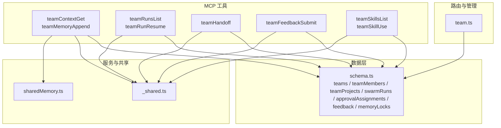
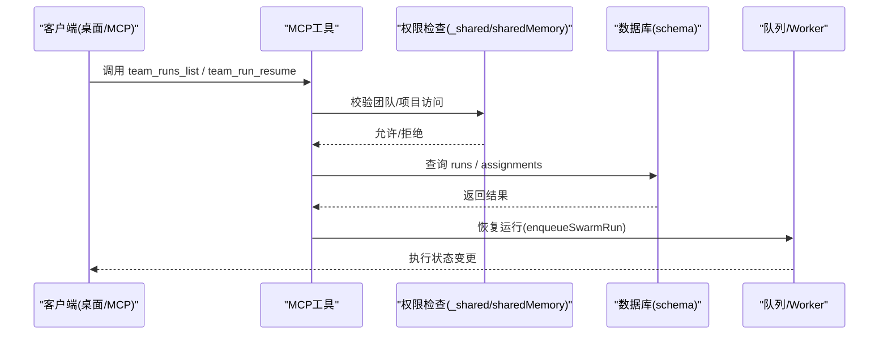
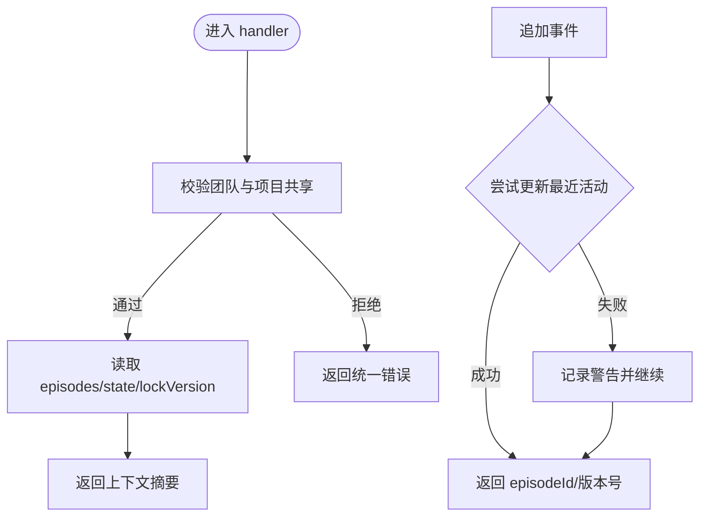
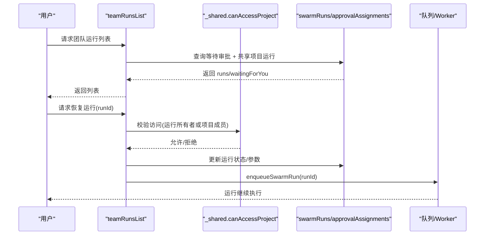
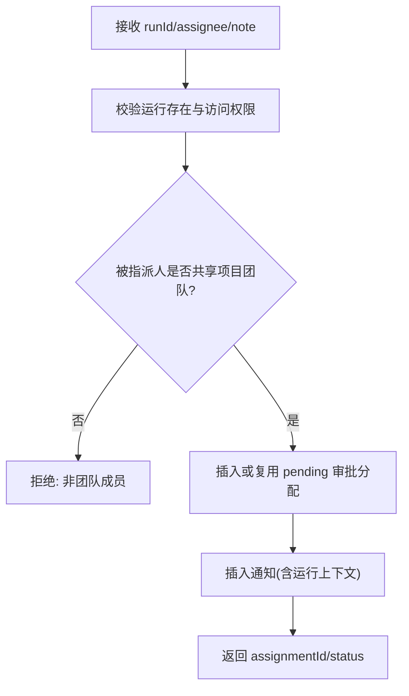
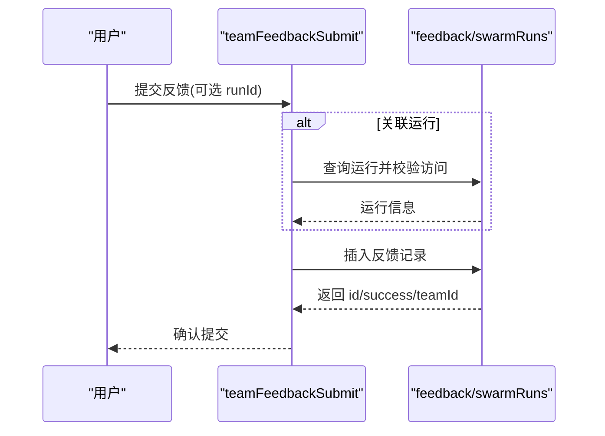
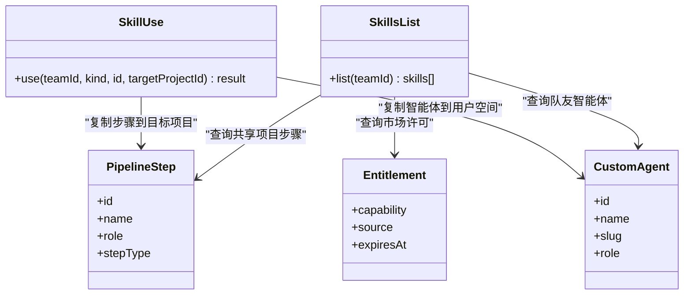
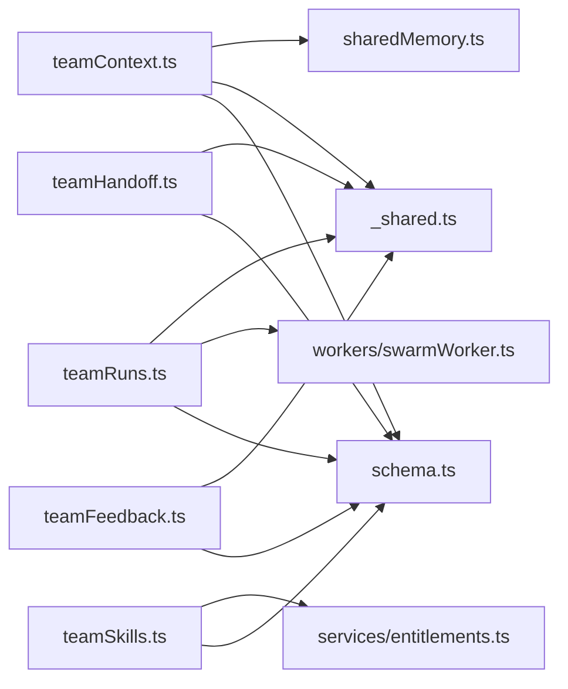
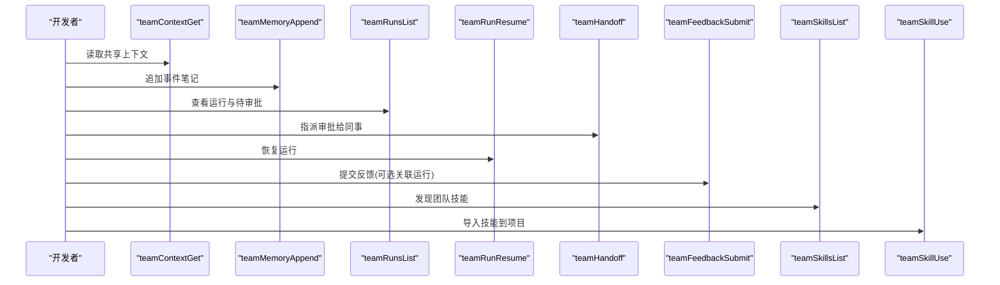

# 团队协作工具

<cite>
**本文引用的文件**
- [teamContext.ts](file://api/mcp/tools/team/teamContext.ts)
- [teamRuns.ts](file://api/mcp/tools/team/teamRuns.ts)
- [teamHandoff.ts](file://api/mcp/tools/team/teamHandoff.ts)
- [teamFeedback.ts](file://api/mcp/tools/team/teamFeedback.ts)
- [teamSkills.ts](file://api/mcp/tools/team/teamSkills.ts)
- [sharedMemory.ts](file://api/services/sharedMemory.ts)
- [_shared.ts](file://api/mcp/tools/_shared.ts)
- [team.ts](file://api/routers/team.ts)
- [schema.ts](file://db/schema.ts)
</cite>

## 目录
1. [简介](#简介)
2. [项目结构](#项目结构)
3. [核心组件](#核心组件)
4. [架构总览](#架构总览)
5. [详细组件分析](#详细组件分析)
6. [依赖关系分析](#依赖关系分析)
7. [性能考虑](#性能考虑)
8. [故障排查指南](#故障排查指南)
9. [结论](#结论)
10. [附录](#附录)

## 简介
本文件为 DeeWaanAI 的“团队协作工具”提供完整技术文档，覆盖以下 MCP 工具：
- 团队上下文工具：teamContextGet、teamMemoryAppend
- 团队运行工具：teamRunsList、teamRunResume
- 团队交接工具：teamHandoff
- 团队反馈工具：teamFeedbackSubmit
- 团队技能工具：teamSkillsList、teamSkillUse

文档将系统阐述团队协作的工作流程、资源共享机制、任务分配与进度跟踪，并说明权限模型、实时协作与数据同步策略。同时给出最佳实践、安全注意事项与性能优化建议，帮助开发者在桌面端（Claude Desktop/ChatGPT/Qwen/Kimi）等环境中实现跨应用的团队协作。

## 项目结构
围绕团队协作的核心代码位于 api/mcp/tools/team 目录下，每个工具对应一个独立模块；共享能力由 services 和 mcp/tools/_shared 提供；路由层 api/routers/team.ts 提供团队管理 API；数据库模式定义于 db/schema.ts。

图表来源
- [teamContext.ts:1-157](file://api/mcp/tools/team/teamContext.ts#L1-L157)
- [teamRuns.ts:1-187](file://api/mcp/tools/team/teamRuns.ts#L1-L187)
- [teamHandoff.ts:1-117](file://api/mcp/tools/team/teamHandoff.ts#L1-L117)
- [teamFeedback.ts:1-95](file://api/mcp/tools/team/teamFeedback.ts#L1-L95)
- [teamSkills.ts:1-261](file://api/mcp/tools/team/teamSkills.ts#L1-L261)
- [sharedMemory.ts:1-207](file://api/services/sharedMemory.ts#L1-L207)
- [_shared.ts:1-67](file://api/mcp/tools/_shared.ts#L1-L67)
- [team.ts:1-721](file://api/routers/team.ts#L1-L721)
- [schema.ts:785-800](file://db/schema.ts#L785-L800)

章节来源
- [teamContext.ts:1-157](file://api/mcp/tools/team/teamContext.ts#L1-L157)
- [teamRuns.ts:1-187](file://api/mcp/tools/team/teamRuns.ts#L1-L187)
- [teamHandoff.ts:1-117](file://api/mcp/tools/team/teamHandoff.ts#L1-L117)
- [teamFeedback.ts:1-95](file://api/mcp/tools/team/teamFeedback.ts#L1-L95)
- [teamSkills.ts:1-261](file://api/mcp/tools/team/teamSkills.ts#L1-L261)
- [sharedMemory.ts:1-207](file://api/services/sharedMemory.ts#L1-L207)
- [_shared.ts:1-67](file://api/mcp/tools/_shared.ts#L1-L67)
- [team.ts:1-721](file://api/routers/team.ts#L1-L721)
- [schema.ts:785-800](file://db/schema.ts#L785-L800)

## 核心组件
- 团队上下文（teamContextGet、teamMemoryAppend）
  - 读取团队共享项目的“记忆”（最近片段、结构化状态、锁版本），追加笔记到事件型记忆，并通过乐观锁更新最近活动。
- 团队运行（teamRunsList、teamRunResume）
  - 列出团队共享项目上的流水线运行记录及待审批任务；支持从任意应用恢复暂停的运行。
- 团队交接（teamHandoff）
  - 将待审批任务指派给同团队成员，生成通知并在其应用中可见。
- 团队反馈（teamFeedbackSubmit）
  - 提交产品反馈（缺陷/建议/表扬/困惑），可关联运行上下文。
- 团队技能（teamSkillsList、teamSkillUse）
  - 发现团队共享的流水线步骤、自定义智能体以及市场许可的流水线；可将技能导入到自有项目中（默认禁用）。

章节来源
- [teamContext.ts:56-157](file://api/mcp/tools/team/teamContext.ts#L56-L157)
- [teamRuns.ts:34-187](file://api/mcp/tools/team/teamRuns.ts#L34-L187)
- [teamHandoff.ts:22-117](file://api/mcp/tools/team/teamHandoff.ts#L22-L117)
- [teamFeedback.ts:20-95](file://api/mcp/tools/team/teamFeedback.ts#L20-L95)
- [teamSkills.ts:41-261](file://api/mcp/tools/team/teamSkills.ts#L41-L261)

## 架构总览
团队协作基于“团队-项目-成员”的权限边界，所有 MCP 工具在执行前进行访问校验，确保仅对共享项目开放。共享内存通过磁盘存储与乐观锁（memory_locks）保证并发一致性；运行与审批通过 swarmRuns 与 approvalAssignments 表驱动；技能共享通过 pipelineSteps 与 customAgents 表实现复制式复用。

图表来源
- [teamRuns.ts:34-187](file://api/mcp/tools/team/teamRuns.ts#L34-L187)
- [_shared.ts:36-54](file://api/mcp/tools/_shared.ts#L36-L54)
- [schema.ts:173-237](file://db/schema.ts#L173-L237)

## 详细组件分析

### 团队上下文工具：teamContextGet、teamMemoryAppend
- 功能要点
  - teamContextGet：读取共享项目的“事件记忆”与“结构化状态”，返回锁版本用于后续写入冲突检测。
  - teamMemoryAppend：追加一条事件型笔记，并尝试更新最近活动（乐观锁失败不阻断主操作）。
- 权限与安全
  - 强制要求调用者为团队成员且项目已共享至该团队；错误信息统一化避免泄露。
- 数据流
  - 读取：loadEpisodes + loadState + readLockVersion
  - 写入：appendSharedEpisode（追加不可变事件）+ bumpSharedStateActivity（乐观锁更新最近活动）
- 并发与一致性
  - 事件追加无锁；状态更新使用 version 乐观锁，冲突时提示重读重试。

图表来源
- [teamContext.ts:35-96](file://api/mcp/tools/team/teamContext.ts#L35-L96)
- [teamContext.ts:99-157](file://api/mcp/tools/team/teamContext.ts#L99-L157)
- [sharedMemory.ts:86-129](file://api/services/sharedMemory.ts#L86-L129)
- [sharedMemory.ts:158-207](file://api/services/sharedMemory.ts#L158-L207)

章节来源
- [teamContext.ts:1-157](file://api/mcp/tools/team/teamContext.ts#L1-L157)
- [sharedMemory.ts:1-207](file://api/services/sharedMemory.ts#L1-L207)

### 团队运行工具：teamRunsList、teamRunResume
- 功能要点
  - teamRunsList：列出团队共享项目上的运行记录，以及当前用户有待处理的审批任务。
  - teamRunResume：恢复暂停的运行（如人机审批后），持久化 worker 重入参数并重新入队。
- 权限与安全
  - 列表需为团队成员；恢复需为运行所有者或对该运行所属项目有访问权限。
- 数据流
  - 查询审批分配表与运行表，聚合项目名称、状态、当前步骤等信息。
  - 恢复时将运行状态置为 running，设置 runParams，再调用 enqueueSwarmRun。

图表来源
- [teamRuns.ts:34-127](file://api/mcp/tools/team/teamRuns.ts#L34-L127)
- [teamRuns.ts:129-187](file://api/mcp/tools/team/teamRuns.ts#L129-L187)
- [_shared.ts:36-54](file://api/mcp/tools/_shared.ts#L36-L54)
- [schema.ts:173-237](file://db/schema.ts#L173-L237)

章节来源
- [teamRuns.ts:1-187](file://api/mcp/tools/team/teamRuns.ts#L1-L187)
- [_shared.ts:1-67](file://api/mcp/tools/_shared.ts#L1-L67)

### 团队交接工具：teamHandoff
- 功能要点
  - 将运行中的待审批任务指派给同团队成员，创建 pending 的审批分配记录，并发送通知。
- 权限与安全
  - 调用者需拥有运行或项目访问权；被指派人必须与运行项目属于同一团队。
- 数据流
  - 插入/复用 approvalAssignments（run+assignee 唯一 pending 行），插入 notifications。

图表来源
- [teamHandoff.ts:22-117](file://api/mcp/tools/team/teamHandoff.ts#L22-L117)
- [schema.ts:173-237](file://db/schema.ts#L173-L237)

章节来源
- [teamHandoff.ts:1-117](file://api/mcp/tools/team/teamHandoff.ts#L1-L117)

### 团队反馈工具：teamFeedbackSubmit
- 功能要点
  - 提交产品反馈，可选关联运行以提供上下文；自动推断团队（若关联运行）。
- 权限与安全
  - 若关联运行，需对运行或其项目有访问权限。
- 数据流
  - 插入 feedback 表，contextJson 包含 clientId、activeStep、url 等上下文。

图表来源
- [teamFeedback.ts:20-95](file://api/mcp/tools/team/teamFeedback.ts#L20-L95)
- [schema.ts:173-237](file://db/schema.ts#L173-L237)

章节来源
- [teamFeedback.ts:1-95](file://api/mcp/tools/team/teamFeedback.ts#L1-L95)

### 团队技能工具：teamSkillsList、teamSkillUse
- 功能要点
  - teamSkillsList：汇总三类技能——团队共享项目的流水线步骤、其他团队成员的自定义智能体、用户的市场许可流水线。
  - teamSkillUse：将技能复制到目标项目（流水线步骤默认禁用；智能体 slug 冲突加后缀）。
- 权限与安全
  - 列表需为团队成员；导入需为目标项目所有者。
- 数据流
  - 列表：聚合 pipelineSteps/customAgents/entitlements。
  - 导入：复制 step 或 agent 到目标项目/用户空间。

图表来源
- [teamSkills.ts:41-156](file://api/mcp/tools/team/teamSkills.ts#L41-L156)
- [teamSkills.ts:158-261](file://api/mcp/tools/team/teamSkills.ts#L158-L261)
- [schema.ts:785-800](file://db/schema.ts#L785-L800)

章节来源
- [teamSkills.ts:1-261](file://api/mcp/tools/team/teamSkills.ts#L1-L261)

## 依赖关系分析
- 工具层依赖
  - teamContext.ts → sharedMemory.ts（读取/追加共享记忆）、_shared.ts（截断输出）
  - teamRuns.ts → _shared.ts（项目访问校验）、workers/swarmWorker（恢复运行）
  - teamHandoff.ts → _shared.ts（项目访问校验）、schema（approvalAssignments/notifications）
  - teamFeedback.ts → schema（feedback/swarmRuns）
  - teamSkills.ts → entitlements（市场许可）、schema（pipelineSteps/customAgents/projects/users）
- 数据层依赖
  - teams/teamMembers/teamProjects：团队与项目共享关系
  - swarmRuns/approvalAssignments：运行与审批流转
  - feedback：反馈记录
  - memoryLocks：共享状态乐观锁
  - projects/pipelineSteps/customAgents：技能资源

图表来源
- [teamContext.ts:1-157](file://api/mcp/tools/team/teamContext.ts#L1-L157)
- [teamRuns.ts:1-187](file://api/mcp/tools/team/teamRuns.ts#L1-L187)
- [teamHandoff.ts:1-117](file://api/mcp/tools/team/teamHandoff.ts#L1-L117)
- [teamFeedback.ts:1-95](file://api/mcp/tools/team/teamFeedback.ts#L1-L95)
- [teamSkills.ts:1-261](file://api/mcp/tools/team/teamSkills.ts#L1-L261)
- [sharedMemory.ts:1-207](file://api/services/sharedMemory.ts#L1-L207)
- [_shared.ts:1-67](file://api/mcp/tools/_shared.ts#L1-L67)
- [schema.ts:785-800](file://db/schema.ts#L785-L800)

章节来源
- [teamContext.ts:1-157](file://api/mcp/tools/team/teamContext.ts#L1-L157)
- [teamRuns.ts:1-187](file://api/mcp/tools/team/teamRuns.ts#L1-L187)
- [teamHandoff.ts:1-117](file://api/mcp/tools/team/teamHandoff.ts#L1-L117)
- [teamFeedback.ts:1-95](file://api/mcp/tools/team/teamFeedback.ts#L1-L95)
- [teamSkills.ts:1-261](file://api/mcp/tools/team/teamSkills.ts#L1-L261)
- [sharedMemory.ts:1-207](file://api/services/sharedMemory.ts#L1-L207)
- [_shared.ts:1-67](file://api/mcp/tools/_shared.ts#L1-L67)
- [schema.ts:785-800](file://db/schema.ts#L785-L800)

## 性能考虑
- 列表分页与限制
  - teamRunsList 支持 limit（默认 20，最大 50），避免大结果集。
  - 共享记忆读取限制 episodes 数量与长度，减少传输开销。
- 并发控制
  - 共享状态更新采用乐观锁（version），冲突时快速失败，避免长事务。
  - 事件追加为 append-only，无需锁，提升高并发写入吞吐。
- I/O 优化
  - 共享状态文件路径固定，批量读取 episodes/state/lockVersion 并行化。
  - 输出文本统一截断，降低 JSON 体积。
- 队列与恢复
  - 运行恢复通过队列异步处理，避免阻塞请求线程。

[本节为通用性能指导，不直接分析具体文件]

## 故障排查指南
- 常见错误与定位
  - “Team not found”：调用方未加入指定团队，检查 teamMembers 表。
  - “Project is not shared with this team”：项目未共享至团队，检查 teamProjects。
  - “Run not found”：运行不存在或无访问权限，检查 swarmRuns 与 canAccessProject。
  - “No execution state to resume”：运行无执行状态，无法恢复。
  - “Shared project state changed since your last read”：乐观锁冲突，需重读上下文后重试。
- 日志与追踪
  - 各工具均记录 requestId/clientId/userId，便于链路追踪。
  - 共享状态更新失败会记录警告，不影响事件追加。
- 审批与通知
  - 交接后应检查 approvalAssignments 与 notifications 是否正确创建。
  - 待办列表 waitingForYou 依赖 assigneeUserId 与 status=pending。

章节来源
- [teamContext.ts:35-96](file://api/mcp/tools/team/teamContext.ts#L35-L96)
- [teamRuns.ts:129-187](file://api/mcp/tools/team/teamRuns.ts#L129-L187)
- [teamHandoff.ts:30-117](file://api/mcp/tools/team/teamHandoff.ts#L30-L117)
- [sharedMemory.ts:158-207](file://api/services/sharedMemory.ts#L158-L207)

## 结论
DeeWaanAI 的团队协作工具通过清晰的权限边界、可靠的并发控制与统一的工具接口，实现了跨应用的团队上下文共享、运行可视与恢复、任务交接、反馈收集与技能复用。建议在集成中遵循最小权限原则、合理使用乐观锁重试、并对关键路径添加监控与告警，以确保团队协作的稳定性和可扩展性。

[本节为总结性内容，不直接分析具体文件]

## 附录

### 团队协作工作流程（示例）
- 共享项目上下文
  - 使用 teamContextGet 获取最新共享状态与事件记忆。
  - 使用 teamMemoryAppend 追加笔记，触发最近活动更新。
- 运行与审批
  - 使用 teamRunsList 查看运行与待审批任务。
  - 使用 teamHandoff 将审批指派给同事。
  - 使用 teamRunResume 恢复运行。
- 反馈与技能
  - 使用 teamFeedbackSubmit 提交反馈（可关联运行）。
  - 使用 teamSkillsList 发现可用技能，使用 teamSkillUse 导入到自有项目。

图表来源
- [teamContext.ts:56-157](file://api/mcp/tools/team/teamContext.ts#L56-L157)
- [teamRuns.ts:34-187](file://api/mcp/tools/team/teamRuns.ts#L34-L187)
- [teamHandoff.ts:22-117](file://api/mcp/tools/team/teamHandoff.ts#L22-L117)
- [teamFeedback.ts:20-95](file://api/mcp/tools/team/teamFeedback.ts#L20-L95)
- [teamSkills.ts:41-261](file://api/mcp/tools/team/teamSkills.ts#L41-L261)

### 权限与数据同步策略
- 权限模型
  - 团队-项目-成员三层关系：只有共享项目才可被团队读写。
  - 运行恢复与审批需满足“运行所有者或项目成员”。
- 数据同步
  - 共享状态通过 memory_locks 乐观锁保证一致性。
  - 事件记忆为追加型，天然幂等且无冲突。
  - 审批与通知通过数据库表持久化，跨应用可见。

章节来源
- [_shared.ts:36-54](file://api/mcp/tools/_shared.ts#L36-L54)
- [sharedMemory.ts:49-80](file://api/services/sharedMemory.ts#L49-L80)
- [schema.ts:785-800](file://db/schema.ts#L785-L800)