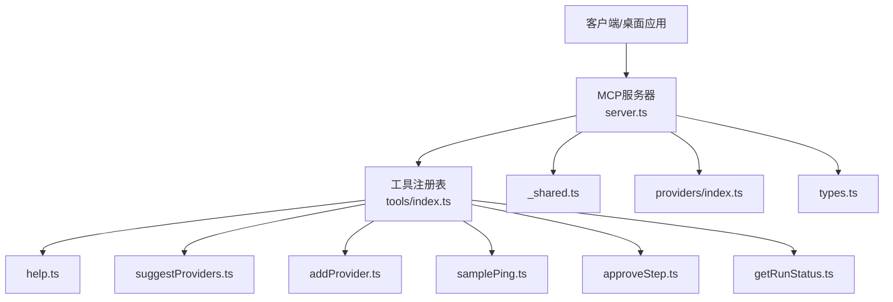
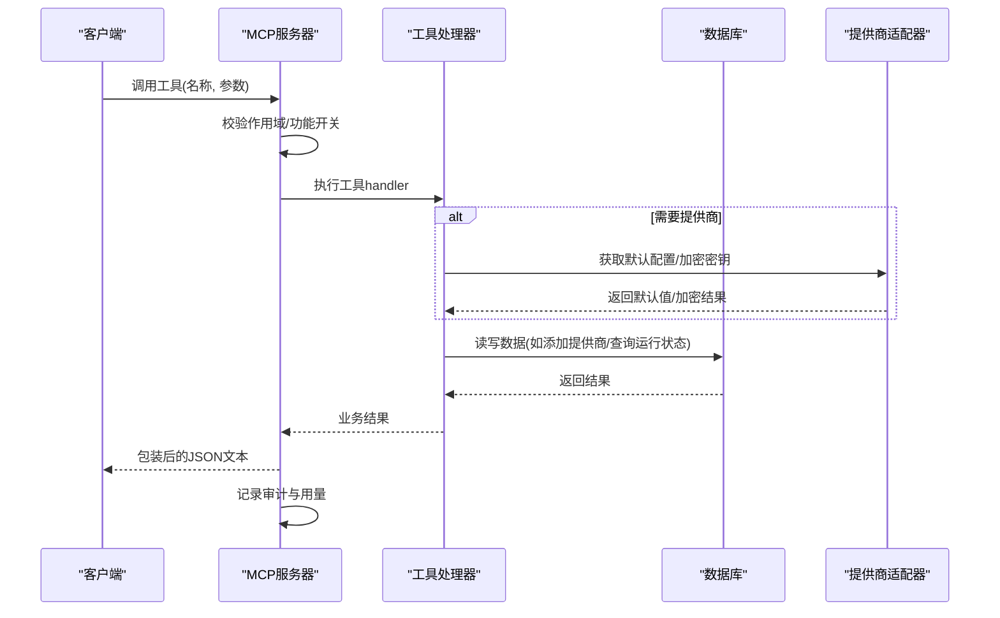
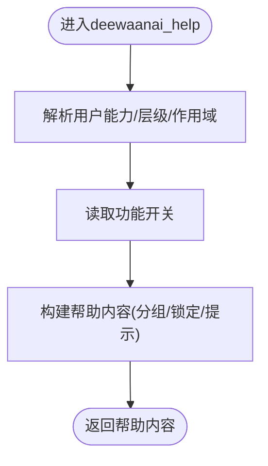
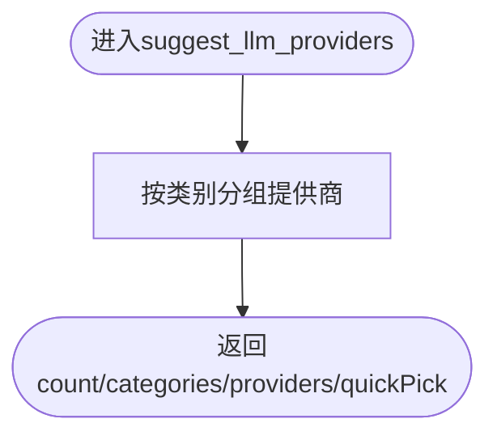
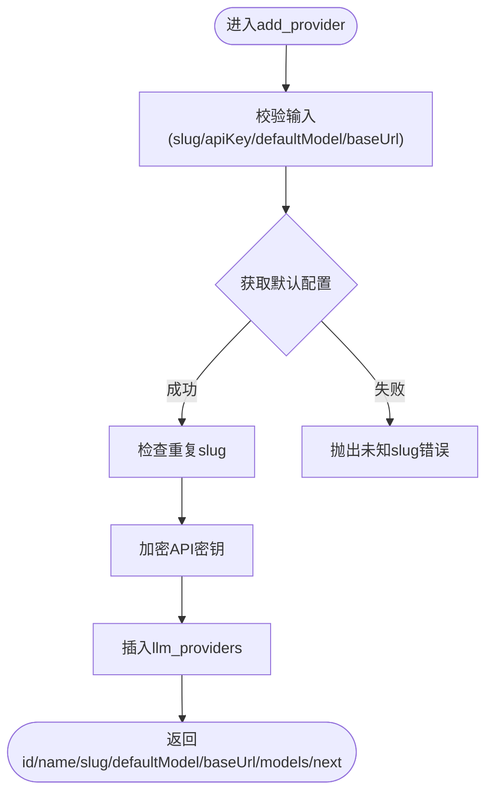
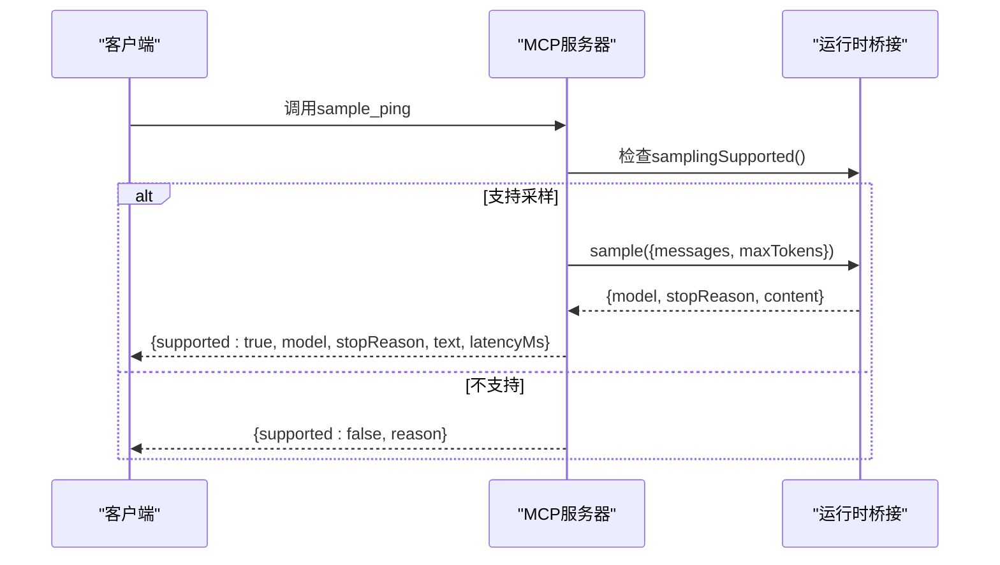
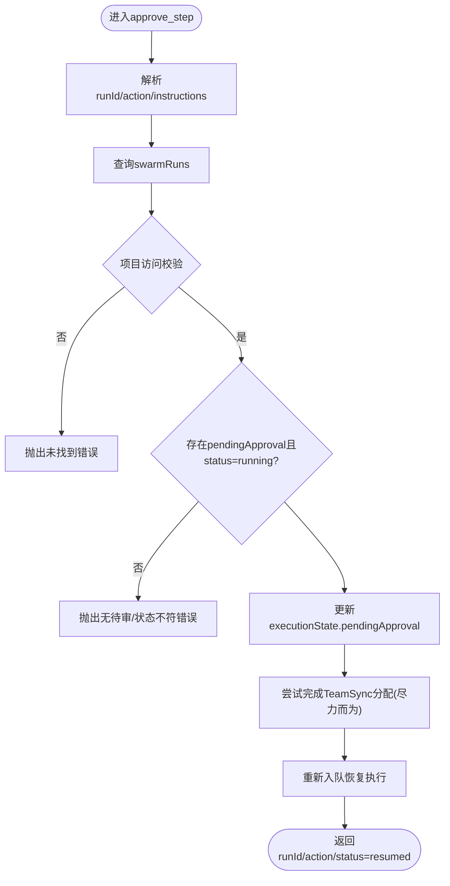
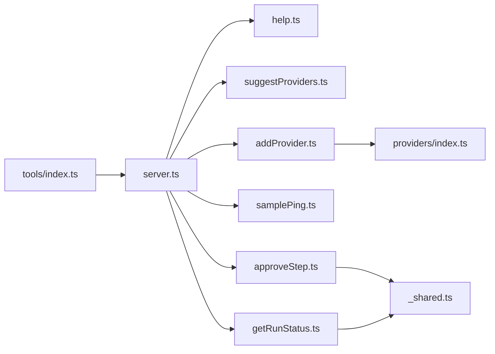

# 实用工具

<cite>
**本文引用的文件**
- [api/mcp/tools/help.ts](file://api/mcp/tools/help.ts)
- [api/mcp/tools/suggestProviders.ts](file://api/mcp/tools/suggestProviders.ts)
- [api/mcp/tools/addProvider.ts](file://api/mcp/tools/addProvider.ts)
- [api/mcp/tools/samplePing.ts](file://api/mcp/tools/samplePing.ts)
- [api/mcp/tools/approveStep.ts](file://api/mcp/tools/approveStep.ts)
- [api/mcp/tools/getRunStatus.ts](file://api/mcp/tools/getRunStatus.ts)
- [api/mcp/tools/index.ts](file://api/mcp/tools/index.ts)
- [api/mcp/tools/helpContent.ts](file://api/mcp/tools/helpContent.ts)
- [api/mcp/tools/_shared.ts](file://api/mcp/tools/_shared.ts)
- [api/lib/providers/index.ts](file://api/lib/providers/index.ts)
- [api/mcp/server.ts](file://api/mcp/server.ts)
- [api/mcp/types.ts](file://api/mcp/types.ts)
</cite>

## 目录
1. [简介](#简介)
2. [项目结构](#项目结构)
3. [核心组件](#核心组件)
4. [架构总览](#架构总览)
5. [详细组件分析](#详细组件分析)
6. [依赖关系分析](#依赖关系分析)
7. [性能考虑](#性能考虑)
8. [故障排查指南](#故障排查指南)
9. [结论](#结论)
10. [附录](#附录)

## 简介
本章节面向DeeWaanAI的MCP（Model Context Protocol）侧“实用工具”，聚焦以下六个工具：帮助工具、提供商建议工具、提供商添加工具、测试工具、步骤审批工具和运行状态工具。文档将逐一说明每个工具的功能、使用场景、参数与校验、错误处理、配置选项、集成方式，并给出完整的调用流程示意和最佳实践建议。这些工具通过统一的MCP服务器注册与执行框架暴露给桌面端或客户端，支持按权限、能力与功能开关进行细粒度控制。

## 项目结构
- 工具实现位于 api/mcp/tools 目录下，每个工具一个文件，统一导出到索引中供MCP服务器注册。
- 公共类型定义在 api/mcp/types.ts，定义了MCP工具接口与认证上下文。
- MCP服务器在 api/mcp/server.ts 负责工具注册、鉴权、特性开关过滤、审计与用量统计。
- 辅助模块包括 helpContent.ts（帮助内容构建）、_shared.ts（项目访问检查与输出截断）、providers/index.ts（提供商默认配置）。



图表来源
- [api/mcp/server.ts:84-186](file://api/mcp/server.ts#L84-L186)
- [api/mcp/tools/index.ts:45-94](file://api/mcp/tools/index.ts#L45-L94)

章节来源
- [api/mcp/tools/index.ts:1-94](file://api/mcp/tools/index.ts#L1-L94)
- [api/mcp/server.ts:1-200](file://api/mcp/server.ts#L1-L200)
- [api/mcp/types.ts:1-45](file://api/mcp/types.ts#L1-L45)

## 核心组件
- 帮助工具 deewaanai_help：根据用户层级、能力、作用域与功能开关生成个性化指南，提示可用工具与当前环境限制。
- 提供商建议工具 suggest_llm_providers：提供静态整理的免费/低价/本地提供商列表，含注册链接、推荐模型与设置说明。
- 提供商添加工具 add_provider：从聊天直接添加LLM提供商，自动填充默认值，加密API密钥并写入数据库。
- 测试工具 sample_ping：诊断桌面端是否支持MCP采样，返回模型、延迟与响应文本，用于验证采样路径。
- 步骤审批工具 approve_step：对暂停的人工审核步骤进行批准/拒绝/修改，并重新入队以恢复流水线执行。
- 运行状态工具 run_status：查询流水线运行的当前步骤、各步进度、用量汇总与最终响应，并进行项目访问权限校验。

章节来源
- [api/mcp/tools/help.ts:1-47](file://api/mcp/tools/help.ts#L1-L47)
- [api/mcp/tools/suggestProviders.ts:1-115](file://api/mcp/tools/suggestProviders.ts#L1-L115)
- [api/mcp/tools/addProvider.ts:1-101](file://api/mcp/tools/addProvider.ts#L1-L101)
- [api/mcp/tools/samplePing.ts:1-56](file://api/mcp/tools/samplePing.ts#L1-L56)
- [api/mcp/tools/approveStep.ts:1-100](file://api/mcp/tools/approveStep.ts#L1-L100)
- [api/mcp/tools/getRunStatus.ts:1-81](file://api/mcp/tools/getRunStatus.ts#L1-L81)

## 架构总览
MCP服务器为每个会话创建独立实例，按用户作用域与功能开关注册工具。工具调用时先校验所需作用域，再执行业务逻辑；结果被包装为JSON文本返回，同时记录审计日志与用量计数。工具之间通过共享模块访问数据库、加密服务与提供商默认配置。



图表来源
- [api/mcp/server.ts:84-186](file://api/mcp/server.ts#L84-L186)
- [api/mcp/tools/addProvider.ts:22-98](file://api/mcp/tools/addProvider.ts#L22-L98)
- [api/mcp/tools/getRunStatus.ts:26-79](file://api/mcp/tools/getRunStatus.ts#L26-L79)

## 详细组件分析

### 帮助工具 deewaanai_help
- 功能：基于用户的层级、能力、作用域与功能开关，生成个性化帮助内容，列出当前可用的工具与提示。
- 输入：无参数。
- 输出：包含概览、分组的可用工具、锁定工具、升级建议与提示。
- 权限：需要 mcp:read。
- 特性开关：读取 teamsync、mcp_sampling、batch_mode 等开关。
- 集成要点：结合 helpContent.ts 的 HELP_CATALOG 与 buildHelp 函数，动态过滤可见工具与锁定项。



图表来源
- [api/mcp/tools/help.ts:25-45](file://api/mcp/tools/help.ts#L25-L45)
- [api/mcp/tools/helpContent.ts:280-368](file://api/mcp/tools/helpContent.ts#L280-L368)

章节来源
- [api/mcp/tools/help.ts:1-47](file://api/mcp/tools/help.ts#L1-L47)
- [api/mcp/tools/helpContent.ts:1-369](file://api/mcp/tools/helpContent.ts#L1-L369)

### 提供商建议工具 suggest_llm_providers
- 功能：展示预置的免费、低价与本地提供商列表，包含注册链接、推荐模型、费用估算与设置说明。
- 输入：无参数。
- 输出：提供商数量、分类、完整列表与快速选择项（免费层）。
- 权限：需要 mcp:read。
- 使用场景：新用户或缺少API key时，快速选择合适的提供商并引导注册。



图表来源
- [api/mcp/tools/suggestProviders.ts:102-113](file://api/mcp/tools/suggestProviders.ts#L102-L113)

章节来源
- [api/mcp/tools/suggestProviders.ts:1-115](file://api/mcp/tools/suggestProviders.ts#L1-L115)

### 提供商添加工具 add_provider
- 功能：从聊天直接添加LLM提供商，校验slug、加密API key、写入数据库，并返回新提供商信息。
- 输入：
  - slug：提供商标识（如 gemini、deepseek、openai、together、aliyun、mistral）。
  - apiKey：API密钥（不会回显）。
  - defaultModel：可选，默认模型，未提供则取提供商第一个已知模型。
  - baseUrl：可选，覆盖默认基础URL（例如Ollama本地地址）。
- 权限：需要 mcp:write。
- 校验与错误：
  - 未知slug会抛出错误并提示使用建议工具。
  - 同一用户重复slug会被阻止，需通过Web设置页面更新或删除。
  - API密钥使用系统主密钥加密后存储。
- 集成要点：
  - 使用 providers/index.ts 的 getProviderDefaults 获取默认配置。
  - 使用 cryptoService 的 encrypt 与 getMasterKey 加密密钥。
  - 插入 llm_providers 表并返回新增ID与下一步指引。



图表来源
- [api/mcp/tools/addProvider.ts:15-98](file://api/mcp/tools/addProvider.ts#L15-L98)
- [api/lib/providers/index.ts:24-94](file://api/lib/providers/index.ts#L24-L94)

章节来源
- [api/mcp/tools/addProvider.ts:1-101](file://api/mcp/tools/addProvider.ts#L1-L101)
- [api/lib/providers/index.ts:1-97](file://api/lib/providers/index.ts#L1-L97)

### 测试工具 sample_ping
- 功能：诊断桌面端是否支持MCP采样，发送最小请求并返回模型、停止原因、响应文本与延迟。
- 输入：无参数。
- 权限：需要 mcp:read。
- 特性开关：受 mcp_sampling 功能开关控制。
- 行为：
  - 若无运行时桥接，返回不支持及原因。
  - 若客户端不支持采样，捕获特定错误并返回原因。
  - 正常情况返回 supported=true 与采样结果。
- 使用场景：在自动设计器启用前验证采样路径是否可用。



图表来源
- [api/mcp/tools/samplePing.ts:20-55](file://api/mcp/tools/samplePing.ts#L20-L55)
- [api/mcp/types.ts:9-31](file://api/mcp/types.ts#L9-L31)

章节来源
- [api/mcp/tools/samplePing.ts:1-56](file://api/mcp/tools/samplePing.ts#L1-L56)
- [api/mcp/types.ts:1-45](file://api/mcp/types.ts#L1-L45)

### 步骤审批工具 approve_step
- 功能：对暂停的人工审核步骤进行批准、拒绝或修改，并重新入队以恢复流水线执行。
- 输入：
  - runId：运行ID（正整数）。
  - action：枚举值 approve/reject/modify。
  - instructions：可选，最多5000字符，用于指导上一步代理进行修改。
- 权限：需要 mcp:write。
- 校验与错误：
  - 运行不存在或无待审状态会报错。
  - 非运行中的运行无法审批。
  - 项目访问权限校验（拥有者或团队成员）。
- 副作用：
  - 更新 executionState.pendingApproval。
  - 尝试完成TeamSync中的审批分配（失败不影响主流程）。
  - 重新入队以恢复执行。



图表来源
- [api/mcp/tools/approveStep.ts:14-98](file://api/mcp/tools/approveStep.ts#L14-L98)
- [api/mcp/tools/_shared.ts:36-54](file://api/mcp/tools/_shared.ts#L36-L54)

章节来源
- [api/mcp/tools/approveStep.ts:1-100](file://api/mcp/tools/approveStep.ts#L1-L100)
- [api/mcp/tools/_shared.ts:1-67](file://api/mcp/tools/_shared.ts#L1-L67)

### 运行状态工具 getRunStatus
- 功能：查询流水线运行的状态、当前步骤、各步代理进度、用量汇总与最终响应。
- 输入：runId（正整数）。
- 权限：需要 mcp:read。
- 安全：在返回任何数据前进行项目访问权限校验。
- 输出：
  - 运行ID、状态、当前步骤、总用量。
  - 每步代理的名称、角色、状态、token使用与延迟。
  - 若完成且有最终响应，返回截断后的响应内容。
  - 若失败，附加错误提示。

```mermaid
flowchart TD
Start(["进入run_status"]) --> Parse["解析runId"]
Parse --> QueryRun["查询swarmRuns"]
QueryRun --> Access{"项目访问校验"}
Access --> |否| ErrAccess["抛出未找到错误"]
Access --> |是| Steps["查询agentRuns(限制MAX_STEPS)"]
Steps --> FinalResp{"completed且有finalResponseId?"}
FinalResp --> |是| LoadResp["加载并截断最终响应"]
FinalResp --> |否| SkipResp["跳过最终响应"]
LoadResp --> Return(["返回运行状态与步骤详情])
SkipResp --> Return
```

图表来源
- [api/mcp/tools/getRunStatus.ts:12-79](file://api/mcp/tools/getRunStatus.ts#L12-L79)
- [api/mcp/tools/_shared.ts:36-54](file://api/mcp/tools/_shared.ts#L36-L54)

章节来源
- [api/mcp/tools/getRunStatus.ts:1-81](file://api/mcp/tools/getRunStatus.ts#L1-L81)
- [api/mcp/tools/_shared.ts:1-67](file://api/mcp/tools/_shared.ts#L1-L67)

## 依赖关系分析
- 工具注册：所有工具在 tools/index.ts 中集中注册，MCP服务器在 server.ts 中按会话构建并注册。
- 权限与作用域：server.ts 在执行前校验 requiredScopes，未满足则返回无效请求错误。
- 功能开关：server.ts 对声明 featureFlag 的工具进行运行时检查，未启用则隐藏该工具。
- 提供商默认配置：addProvider 依赖 providers/index.ts 的 getProviderDefaults，确保slug有效并获取baseUrl与models。
- 项目访问：approveStep 与 getRunStatus 使用 _shared.ts 的 canAccessProject 进行权限校验。
- 审计与用量：server.ts 在每次工具调用后记录审计日志与月度用量计数。



图表来源
- [api/mcp/tools/index.ts:45-94](file://api/mcp/tools/index.ts#L45-L94)
- [api/mcp/server.ts:84-186](file://api/mcp/server.ts#L84-L186)
- [api/mcp/tools/addProvider.ts:15-98](file://api/mcp/tools/addProvider.ts#L15-L98)
- [api/mcp/tools/approveStep.ts:27-98](file://api/mcp/tools/approveStep.ts#L27-L98)
- [api/mcp/tools/getRunStatus.ts:26-79](file://api/mcp/tools/getRunStatus.ts#L26-L79)

章节来源
- [api/mcp/tools/index.ts:1-94](file://api/mcp/tools/index.ts#L1-L94)
- [api/mcp/server.ts:1-200](file://api/mcp/server.ts#L1-L200)

## 性能考虑
- 批量限制：getRunStatus 限制步骤查询数量（MAX_STEPS），避免大响应导致传输与序列化开销。
- 输出截断：最终响应使用 truncate 限制最大字符数，保证MCP消息体积可控。
- 异步审计：审计与用量计数采用fire-and-forget策略，不阻塞工具执行。
- 重试与幂等：approve_step 重新入队时依赖per-run claim机制，重复入队安全。
- 加密成本：add_provider 对API密钥进行加密存储，注意主密钥管理与加密开销。

[本节为通用性能讨论，不直接分析具体文件]

## 故障排查指南
- 权限不足：若收到无效请求错误，检查调用作用域是否包含 requiredScopes。
- 功能开关未启用：对于声明 featureFlag 的工具，确认对应功能开关已为用户启用。
- 提供商slug未知：使用 suggest_llm_providers 查看支持的slug列表，并确保传入正确的slug。
- 重复提供商：若添加失败提示已有相同slug，需在Web设置页面删除或更新后再试。
- 采样不支持：sample_ping 返回不支持时，检查桌面端是否连接并通过MCP端点初始化会话，以及是否具备采样能力。
- 运行状态异常：getRunStatus 报未找到时，确认runId正确且当前用户对项目有访问权限。
- 审批失败：approve_step 报无待审或状态不符，确认运行处于等待人工审核且状态为 running。

章节来源
- [api/mcp/server.ts:84-186](file://api/mcp/server.ts#L84-L186)
- [api/mcp/tools/addProvider.ts:34-98](file://api/mcp/tools/addProvider.ts#L34-L98)
- [api/mcp/tools/samplePing.ts:28-55](file://api/mcp/tools/samplePing.ts#L28-L55)
- [api/mcp/tools/getRunStatus.ts:26-79](file://api/mcp/tools/getRunStatus.ts#L26-L79)
- [api/mcp/tools/approveStep.ts:27-98](file://api/mcp/tools/approveStep.ts#L27-L98)

## 结论
上述六个实用工具覆盖了从帮助与引导、提供商管理、运行监控到人工审批的全链路需求。通过统一的MCP服务器框架，它们具备严格的权限控制、功能开关隔离与审计追踪能力。建议在开发中优先使用帮助工具了解可用能力，借助建议工具快速接入低成本提供商，利用运行状态与审批工具保障流水线质量与可观测性，并通过测试工具验证采样路径可用性。

[本节为总结性内容，不直接分析具体文件]

## 附录
- 工具注册清单：参考 tools/index.ts 中的 TOOLS 数组，确认工具是否已注册。
- 提供商默认配置：参考 providers/index.ts 的 getProviderDefaults，了解支持的slug、baseUrl与模型列表。
- 帮助内容构建：参考 helpContent.ts 的 HELP_CATALOG 与 buildHelp，理解工具分组、能力与开关过滤逻辑。

章节来源
- [api/mcp/tools/index.ts:45-94](file://api/mcp/tools/index.ts#L45-L94)
- [api/lib/providers/index.ts:24-94](file://api/lib/providers/index.ts#L24-L94)
- [api/mcp/tools/helpContent.ts:86-278](file://api/mcp/tools/helpContent.ts#L86-L278)