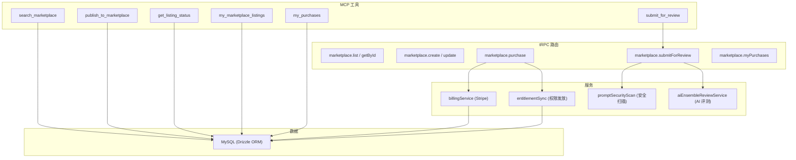
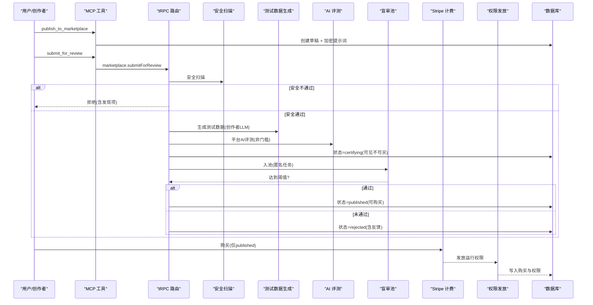
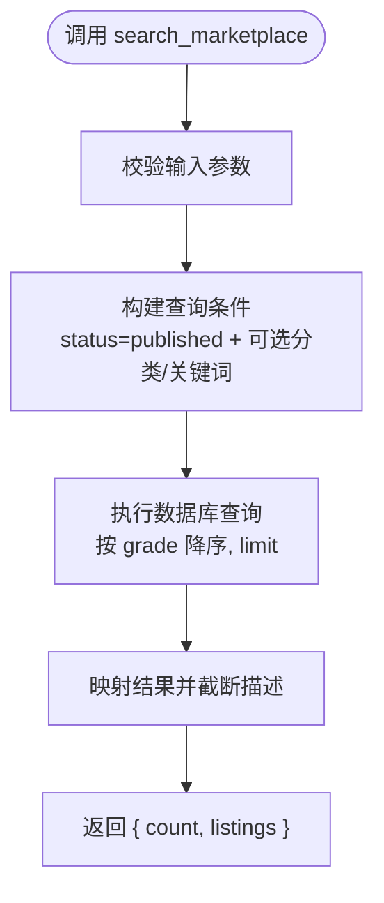
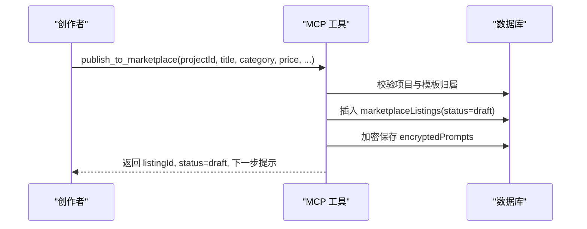
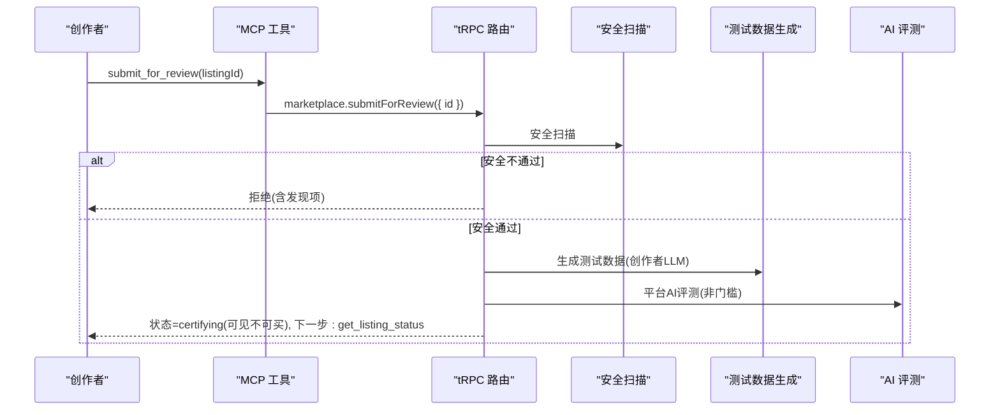
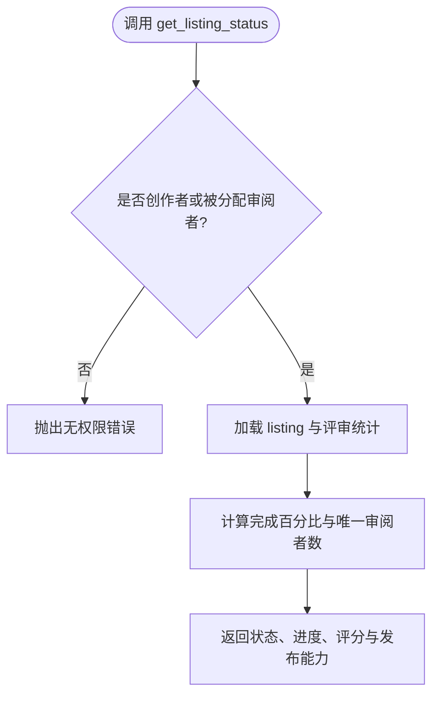
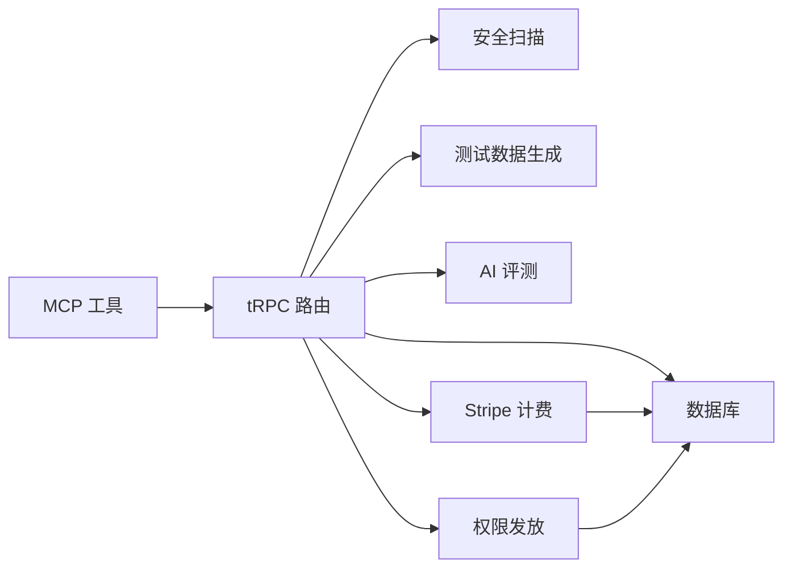

# 市场工具

<cite>
**本文引用的文件**
- [searchMarketplace.ts](file://api/mcp/tools/searchMarketplace.ts)
- [marketplaceTools.ts](file://api/mcp/tools/marketplaceTools.ts)
- [marketplace.ts](file://api/routers/marketplace.ts)
- [billingService.ts](file://api/services/billingService.ts)
- [entitlementSync.ts](file://api/services/entitlementSync.ts)
- [schema.ts](file://db/schema.ts)
- [MARKETPLACE-TRUST-SPEC.md](file://DeeWaanAI-Next/MARKETPLACE-TRUST-SPEC.md)
- [MARKETPLACE-TRUST-PHASE0-PLAN.md](file://DeeWaanAI-Next/MARKETPLACE-TRUST-PHASE0-PLAN.md)
</cite>

## 目录
1. [简介](#简介)
2. [项目结构](#项目结构)
3. [核心组件](#核心组件)
4. [架构总览](#架构总览)
5. [详细组件分析](#详细组件分析)
6. [依赖关系分析](#依赖关系分析)
7. [性能与可靠性](#性能与可靠性)
8. [故障排查指南](#故障排查指南)
9. [结论](#结论)
10. [附录：API 参考与数据模型](#附录api-参考与数据模型)

## 简介
本文件面向开发者与创作者，系统性说明 DeeWaanAI 市场工具的能力与用法，覆盖以下能力：
- 搜索已发布的 AI 工具（MCP 工具 search_marketplace）
- 发布自定义流水线到市场（publish_to_marketplace）
- 提交审核并进入认证流程（submit_for_review）
- 查询商品状态与进度（get_listing_status）
- 查看我的商品列表（my_marketplace_listings）
- 查看购买记录（my_purchases）

同时涵盖市场 API 调用方式、数据格式规范、认证授权、计费处理、市场规则、审核标准与常见问题。

## 项目结构
市场功能由三层组成：
- MCP 工具层：对外暴露可被 AI 助手调用的工具方法（search_marketplace、publish_to_marketplace、submit_for_review、get_listing_status、my_marketplace_listings、my_purchases）。
- tRPC 路由层：提供 Web/客户端可直接调用的 REST-like 接口（浏览、详情、创建、更新、提交审核、购买、我的购买等）。
- 服务与基础设施：计费（Stripe）、权限（Entitlements）、安全扫描、AI 评测、数据库访问与加密存储。

图表来源
- [marketplaceTools.ts:1-349](file://api/mcp/tools/marketplaceTools.ts#L1-L349)
- [marketplace.ts:919-1200](file://api/routers/marketplace.ts#L919-L1200)
- [billingService.ts:80-120](file://api/services/billingService.ts#L80-L120)
- [entitlementSync.ts:21-60](file://api/services/entitlementSync.ts#L21-L60)

章节来源
- [marketplaceTools.ts:1-349](file://api/mcp/tools/marketplaceTools.ts#L1-L349)
- [marketplace.ts:919-1200](file://api/routers/marketplace.ts#L919-L1200)

## 核心组件
- search_marketplace：按关键词与分类检索已发布商品，返回精简信息并按评分排序。
- publish_to_marketplace：基于流水线模板创建商品草稿，加密保存系统提示词。
- submit_for_review：触发认证流程（安全扫描→生成测试数据→AI 评测→可见不可买→盲审→通过则发布）。
- get_listing_status：查询商品当前状态、评审进度、评分与是否可发布。
- my_marketplace_listings：列出我创建的商品及其状态。
- my_purchases：列出我已购买并可运行的流水线。

章节来源
- [searchMarketplace.ts:1-75](file://api/mcp/tools/searchMarketplace.ts#L1-L75)
- [marketplaceTools.ts:29-104](file://api/mcp/tools/marketplaceTools.ts#L29-L104)
- [marketplaceTools.ts:114-169](file://api/mcp/tools/marketplaceTools.ts#L114-L169)
- [marketplaceTools.ts:179-266](file://api/mcp/tools/marketplaceTools.ts#L179-L266)
- [marketplaceTools.ts:272-308](file://api/mcp/tools/marketplaceTools.ts#L272-L308)
- [marketplaceTools.ts:314-349](file://api/mcp/tools/marketplaceTools.ts#L314-L349)

## 架构总览
市场工具遵循“聊天优先”的契约：MCP 工具与 Web 端走相同后端逻辑，确保行为一致。认证流程为：
- 草稿 → 提交审核 → 安全扫描（失败即拒绝） → 自动生成测试数据（使用创作者配置的 LLM） → AI 评测（非门槛） → 进入 certifying（可见但不可购买） → 盲审池（匿名任务） → 达到阈值后发布（可购买）。

图表来源
- [marketplace.ts:1135-1200](file://api/routers/marketplace.ts#L1135-L1200)
- [billingService.ts:80-120](file://api/services/billingService.ts#L80-L120)
- [entitlementSync.ts:21-60](file://api/services/entitlementSync.ts#L21-L60)
- [MARKETPLACE-TRUST-SPEC.md:25-45](file://DeeWaanAI-Next/MARKETPLACE-TRUST-SPEC.md#L25-L45)

## 详细组件分析

### 搜索市场（search_marketplace）
- 作用：按关键词（标题/描述）与分类检索已发布商品，返回精简字段并按评分降序。
- 输入参数：query（可选，最长200字符）、category（枚举）、limit（1-20，默认10）。
- 输出：count 与 listings 数组（id、title、category、price、isSubscription、grade、kappaScore、description）。
- 安全：对 LIKE 通配符进行转义，防止注入扩大匹配范围。
- 权限：需要 mcp:read 范围。

图表来源
- [searchMarketplace.ts:11-74](file://api/mcp/tools/searchMarketplace.ts#L11-L74)

章节来源
- [searchMarketplace.ts:1-75](file://api/mcp/tools/searchMarketplace.ts#L1-L75)

### 发布商品（publish_to_marketplace）
- 作用：从流水线模板创建商品草稿，设置价格与描述；加密保存流水线步骤的系统提示词。
- 输入参数：projectId、title、description（可选）、category（默认 other）、price、isSubscription（可选）、subscriptionPrice（可选）。
- 权限：需要 mcp:write 范围。
- 后续：需调用 submit_for_review 启动认证。

图表来源
- [marketplaceTools.ts:32-104](file://api/mcp/tools/marketplaceTools.ts#L32-L104)

章节来源
- [marketplaceTools.ts:29-104](file://api/mcp/tools/marketplaceTools.ts#L29-L104)

### 提交审核（submit_for_review）
- 作用：启动认证流程（安全扫描→生成测试数据→AI 评测→可见不可买→盲审→发布或拒绝）。
- 输入参数：listingId。
- 权限：需要 mcp:write 范围。
- 行为：内部委托给 tRPC 的 marketplace.submitForReview，保证与 Web 端一致。

图表来源
- [marketplaceTools.ts:114-169](file://api/mcp/tools/marketplaceTools.ts#L114-L169)
- [marketplace.ts:1135-1200](file://api/routers/marketplace.ts#L1135-L1200)

章节来源
- [marketplaceTools.ts:106-169](file://api/mcp/tools/marketplaceTools.ts#L106-L169)
- [marketplace.ts:1135-1200](file://api/routers/marketplace.ts#L1135-L1200)

### 查询商品状态（get_listing_status）
- 作用：查看商品当前状态、评审完成度、评分、是否可发布。
- 输入参数：listingId。
- 权限：mcp:read；仅创作者或被分配审阅者可查看。
- 输出：listingId、title、status、grade、aiReview（如有）、reviewProgress（completed/needed/percentage/uniqueReviewers）、canPublish/published。

图表来源
- [marketplaceTools.ts:179-266](file://api/mcp/tools/marketplaceTools.ts#L179-L266)

章节来源
- [marketplaceTools.ts:171-266](file://api/mcp/tools/marketplaceTools.ts#L171-L266)

### 我的商品列表（my_marketplace_listings）
- 作用：列出我创建的所有商品及状态、价格、评分、销量、评论数、创建时间。
- 权限：mcp:read。

章节来源
- [marketplaceTools.ts:272-308](file://api/mcp/tools/marketplaceTools.ts#L272-L308)

### 我的购买记录（my_purchases）
- 作用：列出我已购买并可运行的流水线（包含购买金额、状态、时间、商品标题）。
- 权限：mcp:read。

章节来源
- [marketplaceTools.ts:314-349](file://api/mcp/tools/marketplaceTools.ts#L314-L349)

## 依赖关系分析
- MCP 工具依赖 tRPC 路由以复用认证流程（如 submit_for_review）。
- 路由层依赖服务层：安全扫描、AI 评测、计费、权限发放。
- 数据层使用 Drizzle ORM 访问 MySQL，涉及 marketplaceListings、encryptedPrompts、testPrompts、blindReviewTasks、listingReviews、marketplacePurchases、users、llmProviders 等表。

图表来源
- [marketplaceTools.ts:1-349](file://api/mcp/tools/marketplaceTools.ts#L1-L349)
- [marketplace.ts:919-1200](file://api/routers/marketplace.ts#L919-L1200)
- [billingService.ts:80-120](file://api/services/billingService.ts#L80-L120)
- [entitlementSync.ts:21-60](file://api/services/entitlementSync.ts#L21-L60)

章节来源
- [marketplace.ts:919-1200](file://api/routers/marketplace.ts#L919-L1200)

## 性能与可靠性
- 搜索与浏览：支持缓存控制头，减少重复查询压力。
- 测试数据生成：每步调用 LLM 带超时与重试，避免长时间阻塞；遇到额度不足立即报错，不重试。
- 盲审池：随机抽取任务，避免热点垄断；原子性领取与并发保护。
- 计费：Stripe 会话创建与 Webhook 处理具备幂等性与防重放。

[本节为通用指导，无需特定文件引用]

## 故障排查指南
- 提交审核失败（无 LLM 提供商）：需先配置至少一个 LLM 提供商用于生成测试数据。
- 安全扫描拒绝：根据 aiFeedback 中的发现项修复流水线提示词或逻辑后重新提交。
- 购买失败（非 published）：仅 published 商品可购买；若处于 certifying 将被拒绝。
- 权限未生效：确认 Stripe Webhook 已正确配置且回调成功；检查 entitlements 中是否发放了 pipeline:run:{listingId} 能力。

章节来源
- [marketplaceTools.ts:156-169](file://api/mcp/tools/marketplaceTools.ts#L156-L169)
- [marketplace.ts:1164-1185](file://api/routers/marketplace.ts#L1164-L1185)
- [entitlementSync.ts:21-60](file://api/services/entitlementSync.ts#L21-L60)
- [billingService.ts:463-489](file://api/services/billingService.ts#L463-L489)

## 结论
DeeWaanAI 市场工具提供了从搜索、发布、审核到购买与权限发放的完整闭环。通过 MCP 工具与 tRPC 路由的统一实现，确保了跨端一致性；结合安全扫描、AI 评测与盲审机制，保障商品质量与可信度；借助 Stripe 与 Entitlements，实现可靠的计费与权限管理。建议创作者在发布前充分测试流水线，并确保配置正确的 LLM 提供商与安全合规的提示词。

[本节为总结，无需特定文件引用]

## 附录：API 参考与数据模型

### MCP 工具接口摘要
- search_marketplace
  - 输入：query（可选，≤200）、category（枚举）、limit（1-20，默认10）
  - 输出：{ count, listings[] }
  - 权限：mcp:read
- publish_to_marketplace
  - 输入：projectId、title、description（可选）、category（默认 other）、price、isSubscription（可选）、subscriptionPrice（可选）
  - 输出：{ listingId, status="draft", message, next }
  - 权限：mcp:write
- submit_for_review
  - 输入：listingId
  - 输出：{ listingId, status, promptsCount, message, next }
  - 权限：mcp:write
- get_listing_status
  - 输入：listingId
  - 输出：{ listingId, title, status, grade, aiReview?, reviewProgress, canPublish, published, message }
  - 权限：mcp:read
- my_marketplace_listings
  - 输入：无
  - 输出：{ count, listings[] }
  - 权限：mcp:read
- my_purchases
  - 输入：无
  - 输出：{ count, purchases[] }
  - 权限：mcp:read

章节来源
- [searchMarketplace.ts:11-74](file://api/mcp/tools/searchMarketplace.ts#L11-L74)
- [marketplaceTools.ts:32-104](file://api/mcp/tools/marketplaceTools.ts#L32-L104)
- [marketplaceTools.ts:114-169](file://api/mcp/tools/marketplaceTools.ts#L114-L169)
- [marketplaceTools.ts:179-266](file://api/mcp/tools/marketplaceTools.ts#L179-L266)
- [marketplaceTools.ts:272-308](file://api/mcp/tools/marketplaceTools.ts#L272-L308)
- [marketplaceTools.ts:314-349](file://api/mcp/tools/marketplaceTools.ts#L314-L349)

### tRPC 路由要点
- marketplace.list：公开浏览，支持分类、排序、状态过滤（published/certifying），返回商品列表与创建者名称。
- marketplace.getById：获取商品详情与样例测试提示。
- marketplace.create/update：创建/更新草稿（仅 draft/rejected 可编辑）。
- marketplace.submitForReview：提交审核（fire-and-forget），后台生成测试数据与评测。
- marketplace.purchase：创建 Stripe 结账会话（仅 published 商品）。
- marketplace.myPurchases：查询我的购买记录。

章节来源
- [marketplace.ts:919-1200](file://api/routers/marketplace.ts#L919-L1200)
- [marketplace.ts:2112-2130](file://api/routers/marketplace.ts#L2112-L2130)

### 计费与权限
- 计费：createMarketplaceCheckoutSession 创建 Stripe 支付会话；Webhook checkout.session.completed 触发 fulfillMarketplacePurchase，写入购买记录并授予运行权限。
- 权限：purchaseCapability("pipeline:run:{listingId}") 作为能力标识，购买成功后写入 entitlements。

章节来源
- [billingService.ts:80-120](file://api/services/billingService.ts#L80-L120)
- [billingService.ts:463-489](file://api/services/billingService.ts#L463-L489)
- [entitlementSync.ts:21-60](file://api/services/entitlementSync.ts#L21-L60)

### 数据模型（关键表）
- marketplaceListings：商品主表（id、creatorId、templateId、title、description、category、price、isSubscription、subscriptionPrice、status、grade、reviewCount、kappaScore、salesCount、createdAt 等）
- encryptedPrompts：加密保存流水线步骤的系统提示词（listingId、agentIndex、encryptedPrompt、iv）
- testPrompts：生成的测试输入（listingId、promptIndex、category、inputText、actualOutput）
- blindReviewTasks：盲审任务池（listingId、promptIndex、reviewerId、status、assignedAt、completedAt）
- listingReviews：评审打分（listingId、reviewerId、promptIndex、各维度评分、weightedScore、reviewTime）
- marketplacePurchases：购买记录（buyerId、listingId、amountPaid、platformFee、creatorEarnings、isSubscription、subscriptionEnd、status、createdAt）
- users、llmProviders：用户与 LLM 提供商配置

章节来源
- [schema.ts:1-200](file://db/schema.ts#L1-L200)
- [schema.ts:800-1200](file://db/schema.ts#L800-L1200)
- [db/migrations/meta/0000_snapshot.json:2351-2488](file://db/migrations/meta/0000_snapshot.json#L2351-L2488)

### 市场规则与审核标准
- 生命周期：draft → 提交审核 → 安全扫描（失败即 rejected） → 生成测试数据 → AI 评测（非门槛） → certifying（可见不可买） → 盲审 → 达到阈值后 published（可购买）。
- 审核阈值：加权平均分 ≥ 3.5，通过率 ≥ 80%；Kappa 仍计算并记录。
- 可见性：certifying 商品在浏览中可见，但购买会被拒绝。
- 安全：首次安全扫描失败会直接拒绝并记录发现项。

章节来源
- [MARKETPLACE-TRUST-SPEC.md:25-45](file://DeeWaanAI-Next/MARKETPLACE-TRUST-SPEC.md#L25-L45)
- [marketplace.ts:512-543](file://api/routers/marketplace.ts#L512-L543)
- [marketplace.ts:825-917](file://api/routers/marketplace.ts#L825-L917)

### 常见示例路径（代码片段位置）
- 搜索商品：见 [searchMarketplace.ts:22-74](file://api/mcp/tools/searchMarketplace.ts#L22-L74)
- 发布商品：见 [marketplaceTools.ts:42-104](file://api/mcp/tools/marketplaceTools.ts#L42-L104)
- 提交审核：见 [marketplaceTools.ts:114-169](file://api/mcp/tools/marketplaceTools.ts#L114-L169)
- 查询状态：见 [marketplaceTools.ts:179-266](file://api/mcp/tools/marketplaceTools.ts#L179-L266)
- 我的商品：见 [marketplaceTools.ts:272-308](file://api/mcp/tools/marketplaceTools.ts#L272-L308)
- 我的购买：见 [marketplaceTools.ts:314-349](file://api/mcp/tools/marketplaceTools.ts#L314-L349)
- 创建结账会话：见 [billingService.ts:80-120](file://api/services/billingService.ts#L80-L120)
- 购买履约与权限发放：见 [entitlementSync.ts:21-60](file://api/services/entitlementSync.ts#L21-L60)