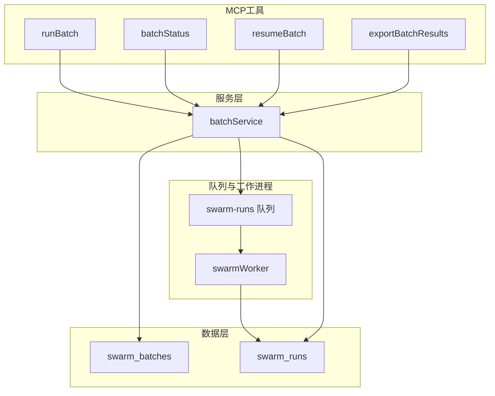
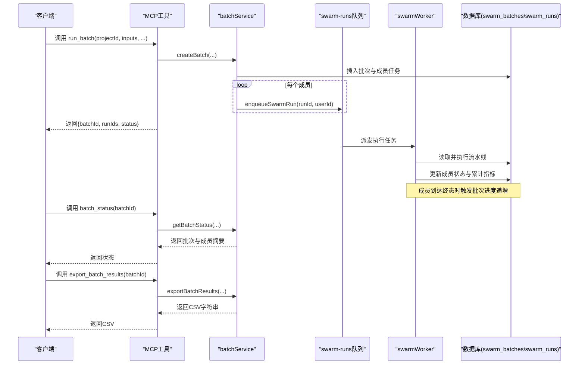
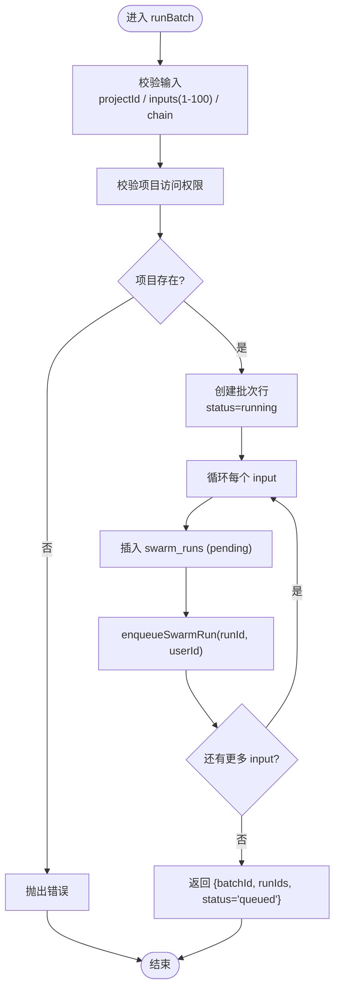
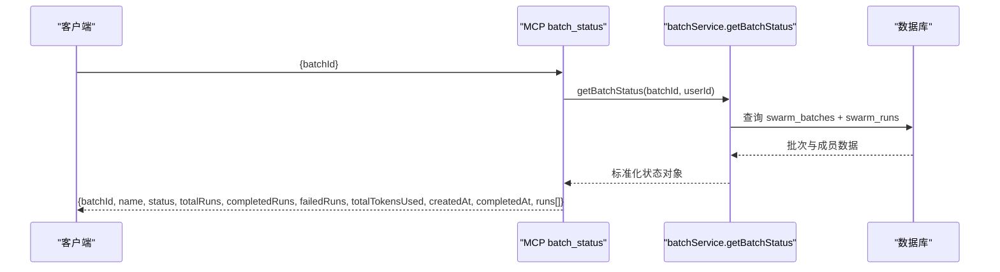
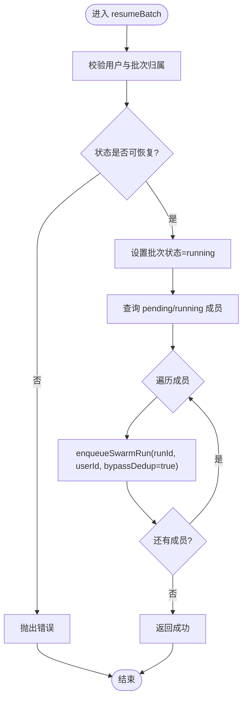
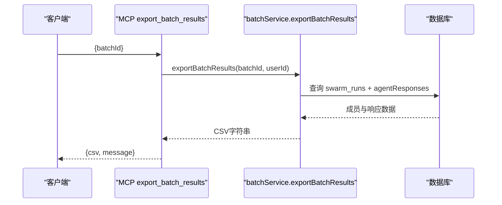
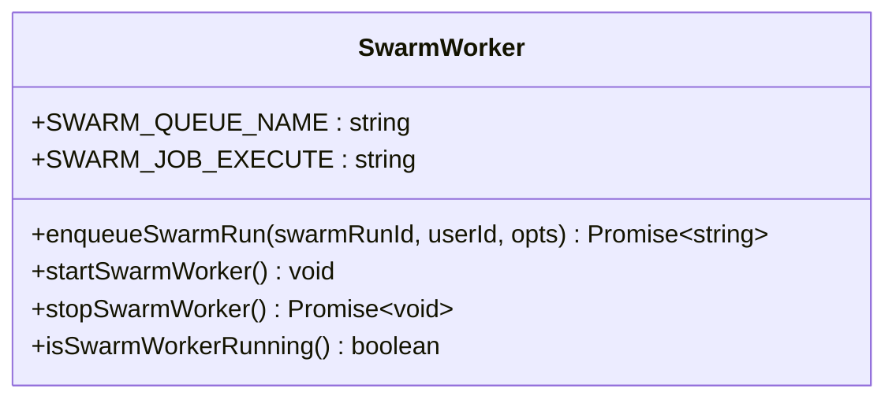
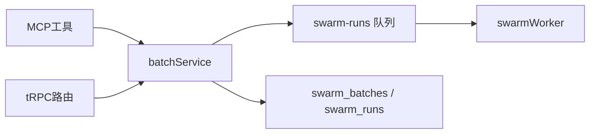

# 批量处理工具

<cite>
**本文引用的文件**
- [api/mcp/tools/runBatch.ts](file://api/mcp/tools/runBatch.ts)
- [api/mcp/tools/batchStatus.ts](file://api/mcp/tools/batchStatus.ts)
- [api/mcp/tools/resumeBatch.ts](file://api/mcp/tools/resumeBatch.ts)
- [api/mcp/tools/exportBatchResults.ts](file://api/mcp/tools/exportBatchResults.ts)
- [api/services/batchService.ts](file://api/services/batchService.ts)
- [api/workers/swarmWorker.ts](file://api/workers/swarmWorker.ts)
- [api/routers/swarm.ts](file://api/routers/swarm.ts)
- [db/schema.ts](file://db/schema.ts)
- [db/migrations/019_research_mode.sql](file://db/migrations/019_research_mode.sql)
- [scripts/smoke-batch.mjs](file://scripts/smoke-batch.mjs)
- [DeeWaanAI-Next/BATCH-FEATURE-AUDIT-HANDOFF.md](file://DeeWaanAI-Next/BATCH-FEATURE-AUDIT-HANDOFF.md)
</cite>

## 目录
1. [简介](#简介)
2. [项目结构](#项目结构)
3. [核心组件](#核心组件)
4. [架构总览](#架构总览)
5. [详细组件分析](#详细组件分析)
6. [依赖关系分析](#依赖关系分析)
7. [性能与调优](#性能与调优)
8. [故障排查指南](#故障排查指南)
9. [结论](#结论)
10. [附录：使用示例与最佳实践](#附录使用示例与最佳实践)

## 简介
本文件面向DeeWaanAI的“研究模式”批量处理能力，围绕四个MCP工具与后端服务展开：
- run_batch：创建并启动一个包含1–100个任务的批量任务，立即返回，后续通过轮询状态获取进度。
- batch_status：查询批量任务的整体进度、每个子任务的状态与资源消耗。
- resume_batch：恢复因额度耗尽或服务中断而暂停的批量任务，重新入队未完成的任务。
- export_batch_results：将已完成批次的结果导出为CSV，便于离线分析与归档。

文档涵盖参数配置、执行策略、错误处理、性能调优、限制与最佳实践，并提供端到端的使用流程与代码级图示。

## 项目结构
批量能力由“MCP工具层 → 服务层 → 队列/工作进程 → 数据库”构成：
- MCP工具层：runBatch、batchStatus、resumeBatch、exportBatchResults，负责输入校验、鉴权与调用服务。
- 服务层：batchService实现批量生命周期管理（创建、状态聚合、恢复、导出）。
- 队列与工作进程：swarmWorker消费swarm-runs队列，执行具体流水线任务。
- 数据层：swarm_batches与swarm_runs表记录批次与成员任务；迁移脚本提供必要的字段与索引。

图表来源
- [api/mcp/tools/runBatch.ts:1-65](file://api/mcp/tools/runBatch.ts#L1-L65)
- [api/mcp/tools/batchStatus.ts:1-53](file://api/mcp/tools/batchStatus.ts#L1-L53)
- [api/mcp/tools/resumeBatch.ts:1-36](file://api/mcp/tools/resumeBatch.ts#L1-L36)
- [api/mcp/tools/exportBatchResults.ts:1-37](file://api/mcp/tools/exportBatchResults.ts#L1-L37)
- [api/services/batchService.ts:1-321](file://api/services/batchService.ts#L1-L321)
- [api/workers/swarmWorker.ts:1-75](file://api/workers/swarmWorker.ts#L1-L75)
- [db/schema.ts:239-260](file://db/schema.ts#L239-L260)
- [db/migrations/019_research_mode.sql:1-27](file://db/migrations/019_research_mode.sql#L1-L27)

章节来源
- [api/mcp/tools/runBatch.ts:1-65](file://api/mcp/tools/runBatch.ts#L1-L65)
- [api/services/batchService.ts:45-105](file://api/services/batchService.ts#L45-L105)
- [api/workers/swarmWorker.ts:24-59](file://api/workers/swarmWorker.ts#L24-L59)
- [db/schema.ts:239-260](file://db/schema.ts#L239-L260)
- [db/migrations/019_research_mode.sql:1-27](file://db/migrations/019_research_mode.sql#L1-L27)

## 核心组件
- runBatch（MCP）：接收projectId、inputs（1–100条）、可选name/templateId/chain，校验权限后调用服务创建批次并立即返回。
- batchStatus（MCP）：根据batchId与userId查询批次整体状态与成员摘要。
- resumeBatch（MCP）：对处于暂停状态的批次进行恢复，重入队未完成成员。
- exportBatchResults（MCP）：按用户维度导出批次结果为CSV字符串。
- batchService：实现createBatch、getBatchStatus、listBatches、cancelBatch、resumeBatch、exportBatchResults等核心逻辑。
- swarmWorker：消费swarm-runs队列，执行具体流水线任务，支持延迟重试与去重控制。

章节来源
- [api/mcp/tools/runBatch.ts:13-65](file://api/mcp/tools/runBatch.ts#L13-L65)
- [api/mcp/tools/batchStatus.ts:9-53](file://api/mcp/tools/batchStatus.ts#L9-L53)
- [api/mcp/tools/resumeBatch.ts:9-36](file://api/mcp/tools/resumeBatch.ts#L9-L36)
- [api/mcp/tools/exportBatchResults.ts:9-37](file://api/mcp/tools/exportBatchResults.ts#L9-L37)
- [api/services/batchService.ts:14-43](file://api/services/batchService.ts#L14-L43)
- [api/services/batchService.ts:45-105](file://api/services/batchService.ts#L45-L105)
- [api/services/batchService.ts:144-186](file://api/services/batchService.ts#L144-L186)
- [api/services/batchService.ts:233-273](file://api/services/batchService.ts#L233-L273)
- [api/services/batchService.ts:275-321](file://api/services/batchService.ts#L275-L321)
- [api/workers/swarmWorker.ts:24-59](file://api/workers/swarmWorker.ts#L24-L59)

## 架构总览
批量任务从提交到完成的关键路径如下：
- 客户端调用MCP工具runBatch，服务端校验并创建批次与成员任务，逐条入队swarm-runs。
- swarmWorker消费队列，执行流水线任务，完成后更新成员状态与批次累计指标。
- 当所有成员达到终态时，批次标记为完成或“部分失败完成”。
- 客户端通过batchStatus轮询进度，最终通过exportBatchResults导出CSV。

图表来源
- [api/mcp/tools/runBatch.ts:31-65](file://api/mcp/tools/runBatch.ts#L31-L65)
- [api/services/batchService.ts:45-105](file://api/services/batchService.ts#L45-L105)
- [api/workers/swarmWorker.ts:37-59](file://api/workers/swarmWorker.ts#L37-L59)
- [api/services/batchService.ts:107-142](file://api/services/batchService.ts#L107-L142)
- [api/mcp/tools/batchStatus.ts:20-53](file://api/mcp/tools/batchStatus.ts#L20-L53)
- [api/mcp/tools/exportBatchResults.ts:20-37](file://api/mcp/tools/exportBatchResults.ts#L20-L37)

## 详细组件分析

### runBatch（批量创建与入队）
- 输入校验：projectId正整数；inputs为1–100条字符串（单条长度上限20000）；可选name、templateId、chain（目标项目与输入模板）。
- 权限与存在性：要求具备项目访问权限，验证项目存在。
- 批次创建：写入swarm_batches，初始状态running；为每个input创建swarm_runs（状态pending），并立即入队执行。
- 幂等与重试：首次入队使用idempotencyKey防止重复提交；内部重试可通过bypassDedup绕过去重。
- 链式执行：可选chain将当前批次输出作为下一项目输入的模板，支持深度与血缘追踪。

图表来源
- [api/mcp/tools/runBatch.ts:13-65](file://api/mcp/tools/runBatch.ts#L13-L65)
- [api/services/batchService.ts:45-105](file://api/services/batchService.ts#L45-L105)

章节来源
- [api/mcp/tools/runBatch.ts:13-65](file://api/mcp/tools/runBatch.ts#L13-L65)
- [api/services/batchService.ts:45-105](file://api/services/batchService.ts#L45-L105)

### batchStatus（批量状态查询）
- 输入：batchId正整数。
- 行为：按用户隔离查询swarm_batches与swarm_runs，返回整体状态、计数、累计token、时间戳以及成员摘要（含输入预览与token使用）。
- 错误：未找到批次时抛出错误。

图表来源
- [api/mcp/tools/batchStatus.ts:9-53](file://api/mcp/tools/batchStatus.ts#L9-L53)
- [api/services/batchService.ts:144-186](file://api/services/batchService.ts#L144-L186)

章节来源
- [api/mcp/tools/batchStatus.ts:9-53](file://api/mcp/tools/batchStatus.ts#L9-L53)
- [api/services/batchService.ts:144-186](file://api/services/batchService.ts#L144-L186)

### resumeBatch（批量恢复）
- 输入：batchId正整数。
- 前置条件：批次必须处于暂停状态（如credit耗尽或服务中断导致的paused）。
- 行为：将批次状态重置为running，查找所有非终态成员（pending/running）并重新入队执行（允许绕过去重以支持内部重试）。
- 日志：记录恢复操作与重入队数量。

图表来源
- [api/mcp/tools/resumeBatch.ts:9-36](file://api/mcp/tools/resumeBatch.ts#L9-L36)
- [api/services/batchService.ts:233-273](file://api/services/batchService.ts#L233-L273)

章节来源
- [api/mcp/tools/resumeBatch.ts:9-36](file://api/mcp/tools/resumeBatch.ts#L9-L36)
- [api/services/batchService.ts:233-273](file://api/services/batchService.ts#L233-L273)

### exportBatchResults（批量结果导出）
- 输入：batchId正整数。
- 行为：按用户维度查询批次与成员，组装CSV字符串，包含列：run_id、input_preview、status、final_response、error、total_tokens_used、total_latency_ms。
- 注意：CSV转义需遵循RFC-4180（引号内双引号转义为两个引号，换行替换为空格）。

图表来源
- [api/mcp/tools/exportBatchResults.ts:9-37](file://api/mcp/tools/exportBatchResults.ts#L9-L37)
- [api/services/batchService.ts:275-321](file://api/services/batchService.ts#L275-L321)

章节来源
- [api/mcp/tools/exportBatchResults.ts:9-37](file://api/mcp/tools/exportBatchResults.ts#L9-L37)
- [api/services/batchService.ts:275-321](file://api/services/batchService.ts#L275-L321)

### 队列与工作进程（swarmWorker）
- 队列名：swarm-runs；作业名：execute。
- 入队：enqueueSwarmRun支持idempotencyKey与delayMs；内部重试可使用bypassDedup避免被去重丢弃。
- 执行：worker拉取任务后执行executeSwarmRun；若遇到限流等临时错误，回调延迟并重入队。
- 健康：startSwarmWorker注册一次；stopSwarmWorker优雅关闭。

图表来源
- [api/workers/swarmWorker.ts:11-75](file://api/workers/swarmWorker.ts#L11-L75)

章节来源
- [api/workers/swarmWorker.ts:11-75](file://api/workers/swarmWorker.ts#L11-L75)

## 依赖关系分析
- MCP工具依赖batchService进行业务编排；batchService依赖数据库模型与队列；队列驱动worker执行实际任务。
- 数据模型：swarm_batches与swarm_runs通过batch_id关联；迁移脚本确保字段与索引存在。
- 路由层：tRPC路由暴露批量相关接口，并在调用前检查功能开关（batch_mode）。

图表来源
- [api/mcp/tools/*.ts:1-65](file://api/mcp/tools/runBatch.ts#L1-L65)
- [api/services/batchService.ts:1-321](file://api/services/batchService.ts#L1-L321)
- [api/workers/swarmWorker.ts:1-75](file://api/workers/swarmWorker.ts#L1-L75)
- [api/routers/swarm.ts:600-655](file://api/routers/swarm.ts#L600-L655)
- [db/schema.ts:239-260](file://db/schema.ts#L239-L260)
- [db/migrations/019_research_mode.sql:1-27](file://db/migrations/019_research_mode.sql#L1-L27)

章节来源
- [api/routers/swarm.ts:600-655](file://api/routers/swarm.ts#L600-L655)
- [db/schema.ts:239-260](file://db/schema.ts#L239-L260)
- [db/migrations/019_research_mode.sql:1-27](file://db/migrations/019_research_mode.sql#L1-L27)

## 性能与调优
- 并发度：有效并发由SWARM_WORKER_CONCURRENCY决定（默认较低），并非批次大小。大规模测试需逐步提升该值。
- 入队策略：createBatch会立即将所有成员入队，worker按并发度消费；在高并发下需关注队列积压与限流。
- 幂等与重试：内部重试应绕过去重键以避免丢失；客户端提交保留去重以防止重复提交。
- 资源监控：通过batch_status跟踪totalTokensUsed与completed/failed计数，结合CSV导出进行离线分析。
- 存储与I/O：导出CSV时注意大响应体的转义与内存占用；必要时分页或分片导出。

[本节为通用指导，不直接分析具体文件]

## 故障排查指南
- 常见问题
  - 批次未找到：检查batchId与userId是否匹配，确认功能开关已启用。
  - 任务卡住：检查worker是否运行、队列是否有积压；必要时重启worker或修复DB-heal。
  - 恢复无效：确认批次状态为暂停态；内部重试需绕过去重键。
  - CSV异常：确保转义符合RFC-4180；检查响应中是否包含引号与换行。
- 定位步骤
  - 使用batch_status查看成员状态与错误摘要。
  - 使用exportBatchResults导出CSV，核对每行的status与error字段。
  - 检查队列与worker日志，确认任务是否被消费与重试。
  - 核查数据库迁移与索引，确保swarm_batches与swarm_runs结构正确。

章节来源
- [api/services/batchService.ts:144-186](file://api/services/batchService.ts#L144-L186)
- [api/services/batchService.ts:275-321](file://api/services/batchService.ts#L275-L321)
- [api/workers/swarmWorker.ts:37-59](file://api/workers/swarmWorker.ts#L37-L59)
- [db/migrations/019_research_mode.sql:1-27](file://db/migrations/019_research_mode.sql#L1-L27)

## 结论
DeeWaanAI的批量处理工具提供了完整的“创建—监控—恢复—导出”闭环，适用于研究模式下的多任务并行执行。通过MCP工具与batchService的配合，结合队列与工作进程，实现了可扩展且可观测的批量处理能力。为确保在生产环境稳定运行，需关注并发度配置、幂等与重试策略、错误可见性与CSV质量，并按审计建议完善运行时协调器与数据完整性保障。

[本节为总结，不直接分析具体文件]

## 附录：使用示例与最佳实践
- 端到端流程
  - 创建批次：调用runBatch传入projectId与inputs（1–100），获取batchId与runIds。
  - 轮询状态：周期性调用batchStatus，直到批次完成或部分失败完成。
  - 恢复任务：如遇暂停，调用resumeBatch重新入队未完成成员。
  - 导出数据：调用exportBatchResults获取CSV，保存至文件或导入分析工具。
- 参考脚本
  - smoke-batch.mjs演示了通过tRPC调用swarm.runBatch、swarm.getBatchStatus、swarm.exportBatchResults与swarm.listBatches的完整流程。
- 最佳实践
  - 合理设置inputs规模与名称，便于追踪。
  - 在批量模式下默认stateless以避免跨任务污染（按审计建议）。
  - 高并发场景下调整SWARM_WORKER_CONCURRENCY，并监控队列与worker健康。
  - 导出CSV后进行格式校验，确保下游工具可解析。

章节来源
- [scripts/smoke-batch.mjs:1-134](file://scripts/smoke-batch.mjs#L1-L134)
- [DeeWaanAI-Next/BATCH-FEATURE-AUDIT-HANDOFF.md:1-130](file://DeeWaanAI-Next/BATCH-FEATURE-AUDIT-HANDOFF.md#L1-L130)