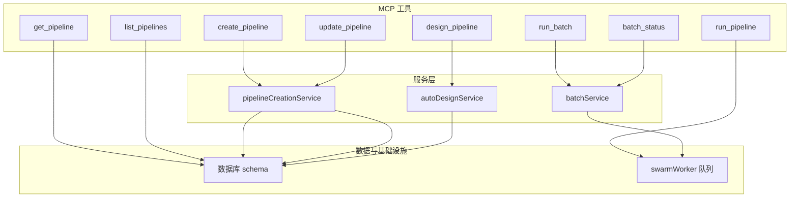
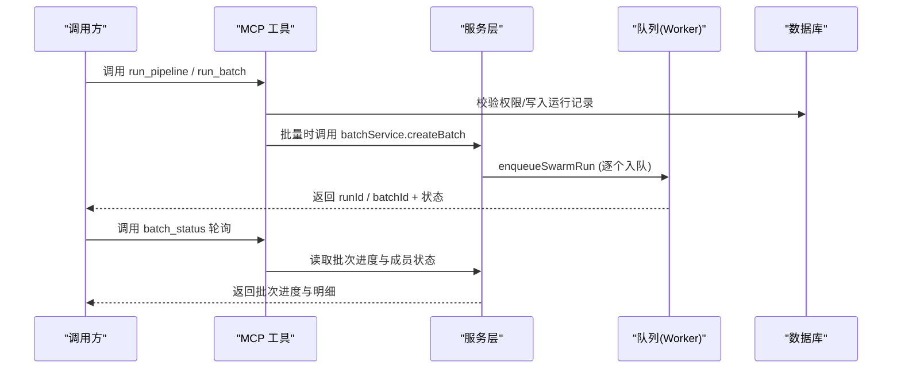
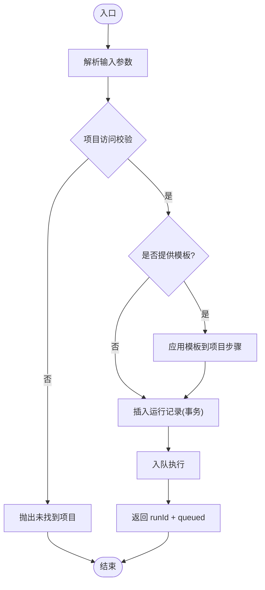
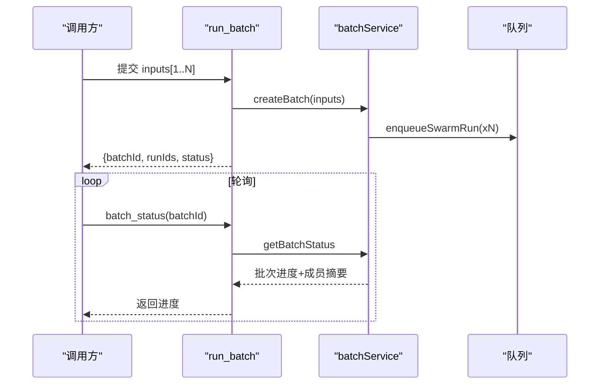
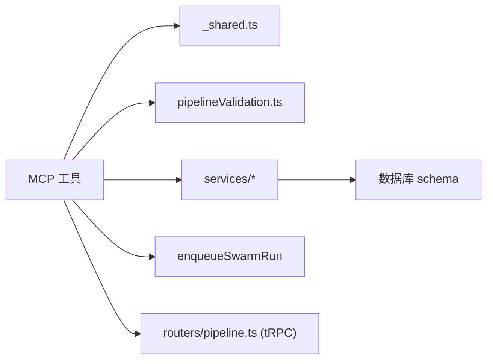

# 流水线工具

<cite>
**本文引用的文件**
- [runPipeline.ts](file://api/mcp/tools/runPipeline.ts)
- [getPipeline.ts](file://api/mcp/tools/getPipeline.ts)
- [listPipelines.ts](file://api/mcp/tools/listPipelines.ts)
- [createPipeline.ts](file://api/mcp/tools/createPipeline.ts)
- [updatePipeline.ts](file://api/mcp/tools/updatePipeline.ts)
- [designPipeline.ts](file://api/mcp/tools/designPipeline.ts)
- [_shared.ts](file://api/mcp/tools/_shared.ts)
- [pipelineValidation.ts](file://api/mcp/tools/pipelineValidation.ts)
- [pipelineCreationService.ts](file://api/services/pipelineCreationService.ts)
- [autoDesignService.ts](file://api/services/autoDesignService.ts)
- [batchStatus.ts](file://api/mcp/tools/batchStatus.ts)
- [runBatch.ts](file://api/mcp/tools/runBatch.ts)
- [batchService.ts](file://api/services/batchService.ts)
- [pipeline.ts](file://api/routers/pipeline.ts)
</cite>

## 目录
1. [简介](#简介)
2. [项目结构](#项目结构)
3. [核心组件](#核心组件)
4. [架构总览](#架构总览)
5. [详细组件分析](#详细组件分析)
6. [依赖关系分析](#依赖关系分析)
7. [性能考量](#性能考量)
8. [故障排查指南](#故障排查指南)
9. [结论](#结论)
10. [附录](#附录)

## 简介
本文件为 DeeWaanAI 的“流水线管理工具”提供完整技术文档，覆盖以下 MCP 工具：
- 执行与批量执行：run_pipeline、run_batch、batch_status
- 查询与列举：get_pipeline、list_pipelines
- 创建与更新：create_pipeline、update_pipeline
- 设计：design_pipeline（自动设计）

文档包含每个工具的参数格式、返回值结构、权限要求、错误处理机制、使用场景、性能优化建议与故障排查方法，并提供端到端工作流图示。

## 项目结构
MCP 工具位于 api/mcp/tools 下，按职责拆分；共享校验逻辑在 pipelineValidation.ts；数据库访问通过 getDb()；服务层封装在 services/；路由层在 routers/ 提供 tRPC 接口（如 pipeline.set）。

图表来源
- [runPipeline.ts:97-154](file://api/mcp/tools/runPipeline.ts#L97-L154)
- [runBatch.ts:24-63](file://api/mcp/tools/runBatch.ts#L24-L63)
- [batchStatus.ts:13-51](file://api/mcp/tools/batchStatus.ts#L13-L51)
- [getPipeline.ts:15-59](file://api/mcp/tools/getPipeline.ts#L15-L59)
- [listPipelines.ts:25-105](file://api/mcp/tools/listPipelines.ts#L25-L105)
- [createPipeline.ts:33-107](file://api/mcp/tools/createPipeline.ts#L33-L107)
- [updatePipeline.ts:34-119](file://api/mcp/tools/updatePipeline.ts#L34-L119)
- [designPipeline.ts:26-85](file://api/mcp/tools/designPipeline.ts#L26-L85)
- [batchService.ts:45-105](file://api/services/batchService.ts#L45-L105)
- [autoDesignService.ts:35-319](file://api/services/autoDesignService.ts#L35-L319)
- [pipelineCreationService.ts:20-116](file://api/services/pipelineCreationService.ts#L20-L116)

章节来源
- [runPipeline.ts:97-154](file://api/mcp/tools/runPipeline.ts#L97-L154)
- [runBatch.ts:24-63](file://api/mcp/tools/runBatch.ts#L24-L63)
- [batchStatus.ts:13-51](file://api/mcp/tools/batchStatus.ts#L13-L51)
- [getPipeline.ts:15-59](file://api/mcp/tools/getPipeline.ts#L15-L59)
- [listPipelines.ts:25-105](file://api/mcp/tools/listPipelines.ts#L25-L105)
- [createPipeline.ts:33-107](file://api/mcp/tools/createPipeline.ts#L33-L107)
- [updatePipeline.ts:34-119](file://api/mcp/tools/updatePipeline.ts#L34-L119)
- [designPipeline.ts:26-85](file://api/mcp/tools/designPipeline.ts#L26-L85)
- [batchService.ts:45-105](file://api/services/batchService.ts#L45-L105)
- [autoDesignService.ts:35-319](file://api/services/autoDesignService.ts#L35-L319)
- [pipelineCreationService.ts:20-116](file://api/services/pipelineCreationService.ts#L20-L116)

## 核心组件
- run_pipeline：为指定项目创建一次运行并入队，返回 runId 与状态提示。
- run_batch：为项目批量创建 1–100 个运行，返回 batchId 与成员 runIds。
- batch_status：查询批次进度、各成员状态与累计 token 用量。
- get_pipeline：获取项目的完整配置与有序步骤。
- list_pipelines：列出当前用户可运行的项目、模板与已购市场流水线。
- create_pipeline：创建项目并可一次性写入完整步骤链（支持 agent/if/while/approval）。
- update_pipeline：更新项目设置或原子替换步骤链。
- design_pipeline：基于自然语言目标自动生成最优流水线（需高级能力）。

章节来源
- [runPipeline.ts:97-154](file://api/mcp/tools/runPipeline.ts#L97-L154)
- [runBatch.ts:24-63](file://api/mcp/tools/runBatch.ts#L24-L63)
- [batchStatus.ts:13-51](file://api/mcp/tools/batchStatus.ts#L13-L51)
- [getPipeline.ts:15-59](file://api/mcp/tools/getPipeline.ts#L15-L59)
- [listPipelines.ts:25-105](file://api/mcp/tools/listPipelines.ts#L25-L105)
- [createPipeline.ts:33-107](file://api/mcp/tools/createPipeline.ts#L33-L107)
- [updatePipeline.ts:34-119](file://api/mcp/tools/updatePipeline.ts#L34-L119)
- [designPipeline.ts:26-85](file://api/mcp/tools/designPipeline.ts#L26-L85)

## 架构总览
下图展示从调用 MCP 工具到持久化与执行的端到端流程，包括批量执行与状态查询。

图表来源
- [runPipeline.ts:104-154](file://api/mcp/tools/runPipeline.ts#L104-L154)
- [runBatch.ts:31-63](file://api/mcp/tools/runBatch.ts#L31-L63)
- [batchService.ts:45-105](file://api/services/batchService.ts#L45-L105)
- [batchStatus.ts:20-51](file://api/mcp/tools/batchStatus.ts#L20-L51)

## 详细组件分析

### run_pipeline（执行单条流水线）
- 功能：为项目创建一次运行并立即入队，返回 runId 与状态提示，供后续轮询。
- 输入参数
  - projectId: 正整数
  - input: 字符串（1–20000）
  - templateId: 可选的正整数（将模板步骤应用到项目）
  - stateless: 可选布尔
  - chain: 可选对象 { targetProjectId, inputTemplate }
- 返回
  - runId: 数字
  - status: "queued"
  - streamHint: "poll run_status"
- 权限
  - requiredScopes: ["mcp:run"]
  - 项目访问控制：必须拥有该项目或为团队成员
- 错误处理
  - 项目不存在、模板不存在、仅所有者可应用模板等
- 使用场景
  - 单次任务执行；配合 get_run_status 轮询结果
- 关键实现要点
  - 事务内插入运行记录并回读 id
  - 可选应用模板到项目步骤
  - 入队后记录日志

图表来源
- [runPipeline.ts:104-154](file://api/mcp/tools/runPipeline.ts#L104-L154)
- [_shared.ts:36-60](file://api/mcp/tools/_shared.ts#L36-L60)

章节来源
- [runPipeline.ts:15-24](file://api/mcp/tools/runPipeline.ts#L15-L24)
- [runPipeline.ts:97-154](file://api/mcp/tools/runPipeline.ts#L97-L154)
- [_shared.ts:36-60](file://api/mcp/tools/_shared.ts#L36-L60)

### run_batch（批量执行）与 batch_status（批次状态）
- run_batch
  - 输入：projectId、inputs（1–100）、name（可选）、templateId（可选）、chain（可选）
  - 返回：batchId、runIds、status="queued"、message
  - 权限：["mcp:run"]，项目访问控制
  - 行为：创建批次、为每个输入插入 swarmRuns 并逐一入队
- batch_status
  - 输入：batchId
  - 返回：批次总体状态、完成/失败计数、累计 token、每条运行摘要
  - 权限：["mcp:read"]
- 使用场景
  - 研究模式批量评测、A/B 对比、回归测试
- 错误处理
  - 输入数量越界、批次不存在、无权限

图表来源
- [runBatch.ts:24-63](file://api/mcp/tools/runBatch.ts#L24-L63)
- [batchService.ts:45-105](file://api/services/batchService.ts#L45-L105)
- [batchStatus.ts:13-51](file://api/mcp/tools/batchStatus.ts#L13-L51)

章节来源
- [runBatch.ts:13-22](file://api/mcp/tools/runBatch.ts#L13-L22)
- [runBatch.ts:24-63](file://api/mcp/tools/runBatch.ts#L24-L63)
- [batchService.ts:45-105](file://api/services/batchService.ts#L45-L105)
- [batchStatus.ts:13-51](file://api/mcp/tools/batchStatus.ts#L13-L51)

### get_pipeline（获取流水线详情）
- 输入：id（项目ID）
- 返回：项目基本信息、默认模型、执行配置、步骤列表（含 if/while/approval 配置）
- 权限：["mcp:read"]，项目访问控制
- 用途：在执行前检查当前流水线结构与参数

章节来源
- [getPipeline.ts:11-59](file://api/mcp/tools/getPipeline.ts#L11-L59)
- [_shared.ts:36-60](file://api/mcp/tools/_shared.ts#L36-L60)

### list_pipelines（列举可用流水线）
- 输入：无
- 返回：count 与 pipelines 数组，每项包含 kind（project/template/marketplace）、id、name、description、stepCount（部分）
- 权限：["mcp:read"]
- 数据来源：
  - 用户拥有的项目（非归档）
  - 用户保存的模板
  - 已购买的市场流水线（基于 entitlements 能力）

章节来源
- [listPipelines.ts:13-105](file://api/mcp/tools/listPipelines.ts#L13-L105)

### create_pipeline（创建流水线）
- 输入
  - name、description（可选）、defaultModel（可选）、defaultProviderId（可选）
  - pipelineConfig（可选）
  - steps（可选）：agent/if/while/approval 有序链
- 返回：id、name、stepCount、controlFlow（是否含 if/while）、next 提示
- 权限：["mcp:write"]
- 校验与限制
  - while 目标必须指向自身或更早步骤
  - 若包含 if/while，需要 pipeline:custom 能力
  - defaultProviderId 必须是用户已配置的提供者
- 副作用
  - 创建项目与步骤
  - 生成 customAgents 与可复用模板，便于 Web UI 显示

章节来源
- [createPipeline.ts:20-31](file://api/mcp/tools/createPipeline.ts#L20-L31)
- [createPipeline.ts:33-107](file://api/mcp/tools/createPipeline.ts#L33-L107)
- [pipelineValidation.ts:16-59](file://api/mcp/tools/pipelineValidation.ts#L16-L59)
- [pipelineCreationService.ts:20-116](file://api/services/pipelineCreationService.ts#L20-L116)

### update_pipeline（更新流水线）
- 输入
  - id（必填）
  - name/description/defaultModel/defaultProviderId/pipelineConfig/steps（均可选）
- 行为
  - 仅更新提供的字段
  - 若提供 steps，则先删除旧步骤再原子插入新步骤，并重建 agents 与模板
- 权限：["mcp:write"]
- 校验：同 create_pipeline（if/while 能力、while 目标合法性、提供者归属）

章节来源
- [updatePipeline.ts:20-32](file://api/mcp/tools/updatePipeline.ts#L20-L32)
- [updatePipeline.ts:34-119](file://api/mcp/tools/updatePipeline.ts#L34-L119)
- [pipelineValidation.ts:67-84](file://api/mcp/tools/pipelineValidation.ts#L67-L84)
- [pipelineCreationService.ts:20-116](file://api/services/pipelineCreationService.ts#L20-L116)

### design_pipeline（自动设计流水线）
- 输入
  - name、task（1–5000）、description（可选）、providerId（可选）
- 行为
  - 校验 pipeline:autodesign 能力
  - 创建项目，调用 autoDesignService 生成最优多智能体流水线（agents、steps、模板）
  - 优先使用桌面端 MCP sampling（若启用），否则回退到配置的 LLM 提供者
- 返回：项目 id、name、设计结果（agentsCreated、stepsCreated、explanation、pipeline、designedBy）、next 提示
- 权限：["mcp:write"]，且需 pipeline:autodesign 能力

章节来源
- [designPipeline.ts:15-20](file://api/mcp/tools/designPipeline.ts#L15-L20)
- [designPipeline.ts:26-85](file://api/mcp/tools/designPipeline.ts#L26-L85)
- [autoDesignService.ts:35-319](file://api/services/autoDesignService.ts#L35-L319)

## 依赖关系分析
- 工具层依赖
  - 权限与访问控制：_shared.ts 的 requireProjectAccess/canAccessProject
  - 步骤与配置校验：pipelineValidation.ts
  - 服务层：batchService、autoDesignService、pipelineCreationService
  - 队列：enqueueSwarmRun（来自 workers/swarmWorker）
- 数据层
  - projects、pipelineSteps、pipelineTemplates、customAgents、llmProviders、entitlements、marketplaceListings、swarmBatches、swarmRuns、agentResponses
- 路由层
  - pipeline.ts 提供 tRPC 接口（如 set、createDefault、availableProviders），用于 Web 编辑器与批量代理

图表来源
- [_shared.ts:1-67](file://api/mcp/tools/_shared.ts#L1-L67)
- [pipelineValidation.ts:1-84](file://api/mcp/tools/pipelineValidation.ts#L1-L84)
- [batchService.ts:1-321](file://api/services/batchService.ts#L1-L321)
- [autoDesignService.ts:1-320](file://api/services/autoDesignService.ts#L1-L320)
- [pipelineCreationService.ts:1-116](file://api/services/pipelineCreationService.ts#L1-L116)
- [pipeline.ts:82-327](file://api/routers/pipeline.ts#L82-L327)

章节来源
- [_shared.ts:1-67](file://api/mcp/tools/_shared.ts#L1-L67)
- [pipelineValidation.ts:1-84](file://api/mcp/tools/pipelineValidation.ts#L1-L84)
- [batchService.ts:1-321](file://api/services/batchService.ts#L1-L321)
- [autoDesignService.ts:1-320](file://api/services/autoDesignService.ts#L1-L320)
- [pipelineCreationService.ts:1-116](file://api/services/pipelineCreationService.ts#L1-L116)
- [pipeline.ts:82-327](file://api/routers/pipeline.ts#L82-L327)

## 性能考量
- 批量执行
  - run_batch 支持 1–100 个输入，内部循环插入并逐一入队，适合研究模式批处理
  - 建议使用 batch_status 轮询，避免频繁拉取导致压力
- 步骤链长度
  - 最大步骤数受限于 MAX_STEPS（20），while 迭代上限 MAX_WHILE_ITERATIONS（10）
- 提供者限制
  - Web 路由对同一流水线不同 LLM 提供者数量有限制（最多 3 个），有助于控制并发与成本
- 模板应用
  - 应用模板会清空并重建步骤，注意在批量执行前完成模板应用
- 缓存与去重
  - 入队具备幂等键（idempotencyKey）防止重复入队

章节来源
- [runBatch.ts:13-22](file://api/mcp/tools/runBatch.ts#L13-L22)
- [pipelineValidation.ts:13-14](file://api/mcp/tools/pipelineValidation.ts#L13-L14)
- [pipeline.ts:162-170](file://api/routers/pipeline.ts#L162-L170)
- [runPipeline.ts:115-117](file://api/mcp/tools/runPipeline.ts#L115-L117)

## 故障排查指南
- 常见错误
  - 项目不存在：权限不足或 ID 错误（get_pipeline、run_pipeline、run_batch）
  - 模板不存在：仅模板所有者可应用（run_pipeline）
  - 缺少自定义流水线能力：使用 if/while 但无 pipeline:custom（create/update）
  - 自动设计失败：LLM 返回非 JSON 或结构不完整（design_pipeline）
  - 批次不存在：batch_id 错误或无权限（batch_status）
  - 提供者无效：defaultProviderId 不属于当前用户（create/update）
- 定位建议
  - 先调用 list_pipelines 确认目标存在
  - 用 get_pipeline 检查步骤链与配置
  - 对 run_batch 使用 batch_status 轮询，关注 failedRuns 与 error 字段
  - 查看日志关键字：[mcp:run_pipeline]、[mcp:run_batch]、[batchService]、[autoDesign]
- 恢复策略
  - 重新应用模板或修正步骤链后重试
  - 升级计划以解锁 if/while 或自动设计能力
  - 确保至少配置一个 LLM 提供者或使用桌面端 MCP sampling

章节来源
- [runPipeline.ts:115-117](file://api/mcp/tools/runPipeline.ts#L115-L117)
- [createPipeline.ts:43-52](file://api/mcp/tools/createPipeline.ts#L43-L52)
- [updatePipeline.ts:53-62](file://api/mcp/tools/updatePipeline.ts#L53-L62)
- [autoDesignService.ts:137-171](file://api/services/autoDesignService.ts#L137-L171)
- [batchStatus.ts:20-51](file://api/mcp/tools/batchStatus.ts#L20-L51)
- [batchService.ts:145-186](file://api/services/batchService.ts#L145-L186)

## 结论
DeeWaanAI 的流水线工具提供了从设计、创建、更新到执行与监控的完整闭环。通过 MCP 工具与服务层的解耦，既支持单次执行也支持大规模批量运行，并通过权限与能力门控保障安全与合规。建议在生产环境中结合模板化与批量执行，配合轮询与导出能力，形成稳定高效的 AI 流水线工作流。

## 附录

### 工具参数与返回速查表
- run_pipeline
  - 输入：{ projectId, input, templateId?, stateless?, chain? }
  - 返回：{ runId, status: "queued", streamHint: "poll run_status" }
  - 权限：["mcp:run"]
- run_batch
  - 输入：{ projectId, inputs[], name?, templateId?, chain? }
  - 返回：{ batchId, runIds[], status: "queued", message }
  - 权限：["mcp:run"]
- batch_status
  - 输入：{ batchId }
  - 返回：{ batchId, name, status, totalRuns, completedRuns, failedRuns, totalTokensUsed, createdAt, completedAt, runs[] }
  - 权限：["mcp:read"]
- get_pipeline
  - 输入：{ id }
  - 返回：{ id, name, description, defaultModel, pipelineConfig, pipelineTemplateId, stepCount, steps[] }
  - 权限：["mcp:read"]
- list_pipelines
  - 输入：无
  - 返回：{ count, pipelines[] }
  - 权限：["mcp:read"]
- create_pipeline
  - 输入：{ name, description?, defaultModel?, defaultProviderId?, pipelineConfig?, steps? }
  - 返回：{ id, name, stepCount, controlFlow, next }
  - 权限：["mcp:write"]
- update_pipeline
  - 输入：{ id, name?, description?, defaultModel?, defaultProviderId?, pipelineConfig?, steps? }
  - 返回：{ id, updated[], stepCount, controlFlow? }
  - 权限：["mcp:write"]
- design_pipeline
  - 输入：{ name, task, description?, providerId? }
  - 返回：{ id, name, agentsCreated, stepsCreated, explanation, pipeline, designedBy, next }
  - 权限：["mcp:write"]，且需 pipeline:autodesign

章节来源
- [runPipeline.ts:15-24](file://api/mcp/tools/runPipeline.ts#L15-L24)
- [runPipeline.ts:97-154](file://api/mcp/tools/runPipeline.ts#L97-L154)
- [runBatch.ts:13-22](file://api/mcp/tools/runBatch.ts#L13-L22)
- [runBatch.ts:24-63](file://api/mcp/tools/runBatch.ts#L24-L63)
- [batchStatus.ts:9-51](file://api/mcp/tools/batchStatus.ts#L9-L51)
- [getPipeline.ts:11-59](file://api/mcp/tools/getPipeline.ts#L11-L59)
- [listPipelines.ts:13-105](file://api/mcp/tools/listPipelines.ts#L13-L105)
- [createPipeline.ts:20-31](file://api/mcp/tools/createPipeline.ts#L20-L31)
- [createPipeline.ts:33-107](file://api/mcp/tools/createPipeline.ts#L33-L107)
- [updatePipeline.ts:20-32](file://api/mcp/tools/updatePipeline.ts#L20-L32)
- [updatePipeline.ts:34-119](file://api/mcp/tools/updatePipeline.ts#L34-L119)
- [designPipeline.ts:15-20](file://api/mcp/tools/designPipeline.ts#L15-L20)
- [designPipeline.ts:26-85](file://api/mcp/tools/designPipeline.ts#L26-L85)