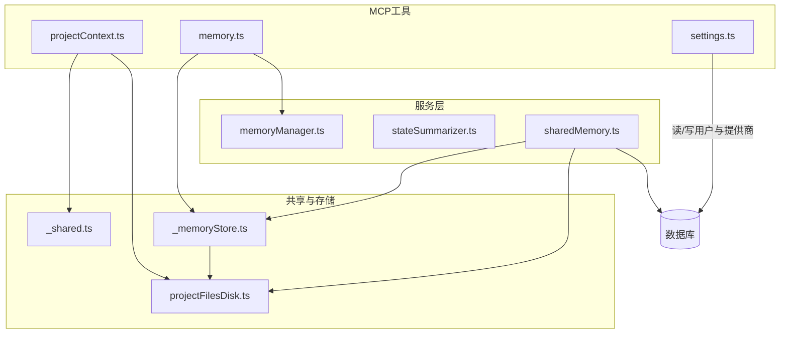
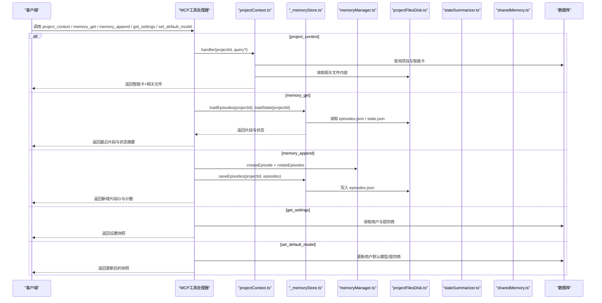
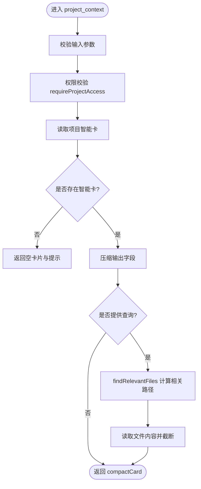
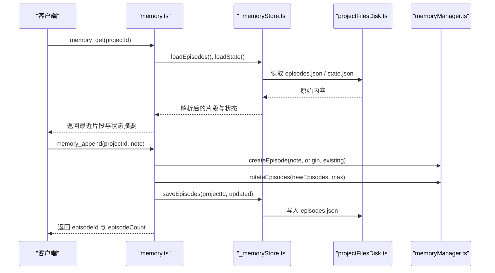
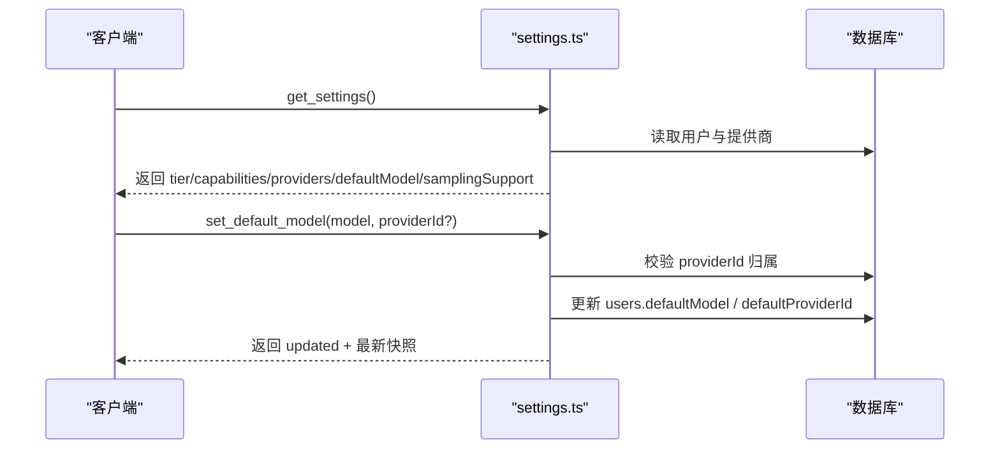
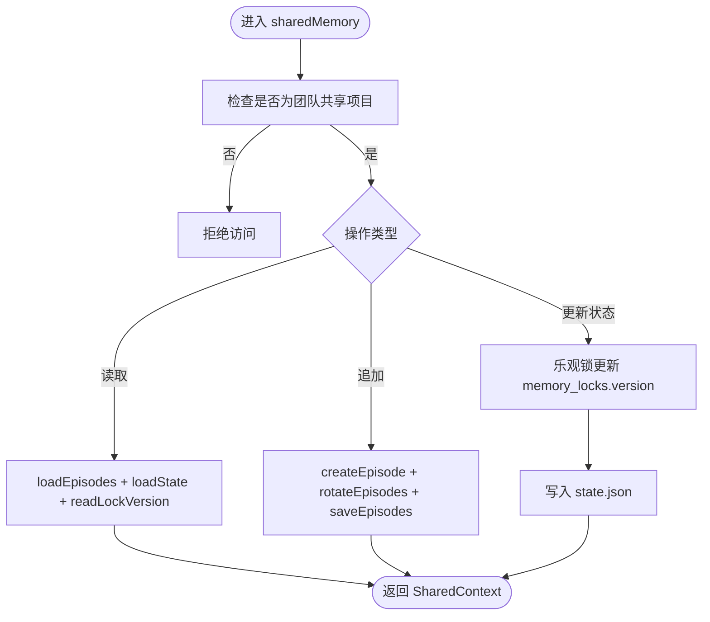
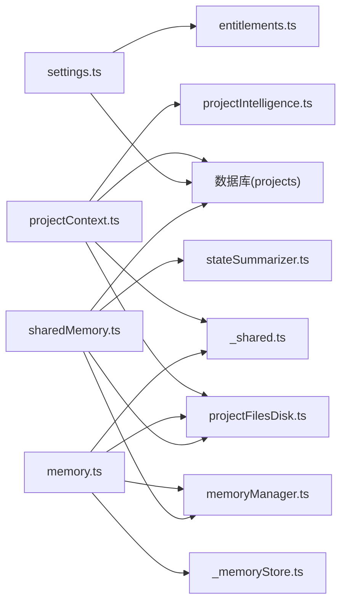

# 项目上下文工具

<cite>
**本文引用的文件**
- [projectContext.ts](file://api/mcp/tools/projectContext.ts)
- [memory.ts](file://api/mcp/tools/memory.ts)
- [settings.ts](file://api/mcp/tools/settings.ts)
- [_memoryStore.ts](file://api/mcp/tools/_memoryStore.ts)
- [sharedMemory.ts](file://api/services/sharedMemory.ts)
- [memoryManager.ts](file://api/services/memoryManager.ts)
- [stateSummarizer.ts](file://api/services/stateSummarizer.ts)
- [projectFilesDisk.ts](file://api/services/projectFilesDisk.ts)
- [_shared.ts](file://api/mcp/tools/_shared.ts)
</cite>

## 目录
1. [简介](#简介)
2. [项目结构](#项目结构)
3. [核心组件](#核心组件)
4. [架构总览](#架构总览)
5. [详细组件分析](#详细组件分析)
6. [依赖关系分析](#依赖关系分析)
7. [性能与缓存](#性能与缓存)
8. [故障排查指南](#故障排查指南)
9. [结论](#结论)
10. [附录：使用示例与最佳实践](#附录使用示例与最佳实践)

## 简介
本文件面向DeeWaanAI的MCP工具层，聚焦三类能力：
- 项目上下文获取：通过 project_context 工具读取项目的“智能卡”（Intelligence Card）并可选返回最相关的文件内容。
- 内存管理：通过 memory_get、memory_append 读写项目的“情景记忆”和结构化状态摘要，数据持久化到本地磁盘的项目目录下。
- 设置管理：通过 get_settings、set_default_model 读取/更新用户账户设置（默认模型、提供商等），用于流水线设计与运行。

文档将说明数据如何获取与存储、访问控制、错误处理、性能优化与数据安全策略，并提供在MCP工具中使用的完整示例路径。

## 项目结构
围绕目标工具的代码组织如下：
- MCP工具定义位于 api/mcp/tools 下，每个工具一个文件，统一通过 McpTool 接口暴露 name、description、inputSchema、requiredScopes、handler 等元信息。
- 共享辅助逻辑在 _shared.ts（项目访问校验、输出截断）。
- 内存相关工具 memory.ts 调用 _memoryStore.ts 进行磁盘存取，并复用 memoryManager.ts 的片段管理与压缩。
- 项目上下文工具 projectContext.ts 复用 projectIntelligence 的相关性评分与 projectFilesDisk 的文件读取。
- 设置工具 settings.ts 直接操作数据库中的用户与LLM提供商表，并聚合能力与桌面端采样支持信息。
- 团队共享内存扩展 sharedMemory.ts 提供乐观锁与并发安全。

图表来源
- [projectContext.ts:25-129](file://api/mcp/tools/projectContext.ts#L25-L129)
- [memory.ts:24-91](file://api/mcp/tools/memory.ts#L24-L91)
- [settings.ts:15-104](file://api/mcp/tools/settings.ts#L15-L104)
- [_memoryStore.ts:15-37](file://api/mcp/tools/_memoryStore.ts#L15-L37)
- [projectFilesDisk.ts:42-99](file://api/services/projectFilesDisk.ts#L42-L99)
- [memoryManager.ts:80-123](file://api/services/memoryManager.ts#L80-L123)
- [stateSummarizer.ts:12-18](file://api/services/stateSummarizer.ts#L12-L18)
- [sharedMemory.ts:86-207](file://api/services/sharedMemory.ts#L86-L207)

章节来源
- [projectContext.ts:25-129](file://api/mcp/tools/projectContext.ts#L25-L129)
- [memory.ts:24-91](file://api/mcp/tools/memory.ts#L24-L91)
- [settings.ts:15-104](file://api/mcp/tools/settings.ts#L15-L104)
- [_memoryStore.ts:15-37](file://api/mcp/tools/_memoryStore.ts#L15-L37)
- [projectFilesDisk.ts:42-99](file://api/services/projectFilesDisk.ts#L42-L99)
- [memoryManager.ts:80-123](file://api/services/memoryManager.ts#L80-L123)
- [stateSummarizer.ts:12-18](file://api/services/stateSummarizer.ts#L12-L18)
- [sharedMemory.ts:86-207](file://api/services/sharedMemory.ts#L86-L207)

## 核心组件
- project_context：读取项目智能卡，并在有查询时返回最多3个相关文件内容（按相关性排序），同时限制树节点数量与文件大小。
- memory_get：读取最近的情景记忆条目与结构化状态摘要，按时间倒序返回，并对内容进行截断。
- memory_append：追加一条笔记到情景记忆，自动去重与旋转保留最新条目。
- get_settings：返回当前用户的计划层级、能力、已配置提供商列表（不含密钥）、默认模型以及桌面端是否支持MCP采样。
- set_default_model：设置默认模型并可切换默认提供商ID，写入用户表并返回最新快照。

章节来源
- [projectContext.ts:25-129](file://api/mcp/tools/projectContext.ts#L25-L129)
- [memory.ts:24-91](file://api/mcp/tools/memory.ts#L24-L91)
- [settings.ts:51-104](file://api/mcp/tools/settings.ts#L51-L104)

## 架构总览
下图展示了从MCP工具到存储与服务层的调用链路与数据流向。

图表来源
- [projectContext.ts:32-129](file://api/mcp/tools/projectContext.ts#L32-L129)
- [memory.ts:31-91](file://api/mcp/tools/memory.ts#L31-L91)
- [_memoryStore.ts:18-37](file://api/mcp/tools/_memoryStore.ts#L18-L37)
- [memoryManager.ts:80-123](file://api/services/memoryManager.ts#L80-L123)
- [projectFilesDisk.ts:42-99](file://api/services/projectFilesDisk.ts#L42-L99)
- [stateSummarizer.ts:12-18](file://api/services/stateSummarizer.ts#L12-L18)
- [settings.ts:15-104](file://api/mcp/tools/settings.ts#L15-L104)

## 详细组件分析

### 项目上下文工具（project_context）
- 输入校验：projectId 必填且为正整数；query 可选，长度限制。
- 访问控制：调用 requireProjectAccess 确保调用者拥有项目或属于团队。
- 智能卡读取：从 projects 表读取 intelligenceCard，若不存在则返回提示。
- 输出压缩：对大数组（入口点、实体、数据库表、API端点、TODO、文件树）进行裁剪，避免过大响应。
- 相关文件检索：当提供 query 时，基于 findRelevantFiles 计算最相关路径，最多返回3个文件内容，并按语言映射填充 language，内容截断至固定字符数。
- 错误处理：项目不存在抛出错误；文件读取失败跳过该文件。

图表来源
- [projectContext.ts:32-129](file://api/mcp/tools/projectContext.ts#L32-L129)
- [_shared.ts:36-60](file://api/mcp/tools/_shared.ts#L36-L60)

章节来源
- [projectContext.ts:25-129](file://api/mcp/tools/projectContext.ts#L25-L129)
- [_shared.ts:36-60](file://api/mcp/tools/_shared.ts#L36-L60)

### 内存管理工具（memory_get、memory_append）
- 输入校验：memory_get 需要 projectId；memory_append 需要 projectId 与 note（长度限制）。
- 访问控制：同样先执行 requireProjectAccess。
- 读取流程：并行加载 episodes.json 与 state.json，按时间倒序取最近若干条，并对 summary 与状态字段进行截断。
- 写入流程：使用 memoryManager.createEpisode 生成新片段，rotateEpisodes 保持上限，_memoryStore.saveEpisodes 持久化到磁盘。
- 日志记录：记录追加操作的审计信息（projectId、episodeId、userId、clientId、requestId）。

图表来源
- [memory.ts:31-91](file://api/mcp/tools/memory.ts#L31-L91)
- [_memoryStore.ts:18-37](file://api/mcp/tools/_memoryStore.ts#L18-L37)
- [memoryManager.ts:80-123](file://api/services/memoryManager.ts#L80-L123)
- [projectFilesDisk.ts:42-99](file://api/services/projectFilesDisk.ts#L42-L99)

章节来源
- [memory.ts:24-91](file://api/mcp/tools/memory.ts#L24-L91)
- [_memoryStore.ts:15-37](file://api/mcp/tools/_memoryStore.ts#L15-L37)
- [memoryManager.ts:80-123](file://api/services/memoryManager.ts#L80-L123)

### 设置管理工具（get_settings、set_default_model）
- get_settings：
  - 读取用户能力与层级（resolveCapabilities）。
  - 读取用户默认模型与默认提供商ID。
  - 列出用户配置的LLM提供商（不包含密钥）。
  - 附加桌面端采样支持信息（来自运行时回调）。
- set_default_model：
  - 校验 model 字符串长度与格式。
  - 如指定 providerId，需验证该提供商属于当前用户。
  - 更新 users.defaultModel 与可选 defaultProviderId。
  - 返回更新后的设置快照。

图表来源
- [settings.ts:15-104](file://api/mcp/tools/settings.ts#L15-L104)

章节来源
- [settings.ts:51-104](file://api/mcp/tools/settings.ts#L51-L104)

### 团队共享内存（Phase 2 TeamSync）
- 仅允许团队共享项目访问，个人项目不可用。
- 读取共享上下文：合并 episodes、state 与 lockVersion。
- 追加共享片段：append-only，无需锁。
- 更新共享状态活动：使用 memory_locks 表的乐观锁，冲突时抛出错误并要求重试。

图表来源
- [sharedMemory.ts:49-207](file://api/services/sharedMemory.ts#L49-L207)

章节来源
- [sharedMemory.ts:86-207](file://api/services/sharedMemory.ts#L86-L207)

## 依赖关系分析
- projectContext 依赖：
  - 数据库连接与项目表（projects）。
  - 项目智能服务（projectIntelligence.findRelevantFiles）。
  - 磁盘文件服务（projectFilesDisk.readProjectFile）。
  - 共享访问校验（requireProjectAccess）。
- memory 工具依赖：
  - 片段管理器（memoryManager.createEpisode、rotateEpisodes）。
  - 磁盘存储（_memoryStore.load/saveEpisodes、loadState）。
  - 共享访问校验。
- settings 工具依赖：
  - 数据库（users、llmProviders）。
  - 能力解析（entitlements.resolveCapabilities）。
- sharedMemory 依赖：
  - 数据库（memory_locks、projects、teamMembers、teamProjects）。
  - 磁盘存储（projectFilesDisk.saveFile）。
  - 片段与状态管理（memoryManager、stateSummarizer）。

图表来源
- [projectContext.ts:32-129](file://api/mcp/tools/projectContext.ts#L32-L129)
- [memory.ts:31-91](file://api/mcp/tools/memory.ts#L31-L91)
- [settings.ts:15-104](file://api/mcp/tools/settings.ts#L15-L104)
- [sharedMemory.ts:86-207](file://api/services/sharedMemory.ts#L86-L207)

章节来源
- [projectContext.ts:32-129](file://api/mcp/tools/projectContext.ts#L32-L129)
- [memory.ts:31-91](file://api/mcp/tools/memory.ts#L31-L91)
- [settings.ts:15-104](file://api/mcp/tools/settings.ts#L15-L104)
- [sharedMemory.ts:86-207](file://api/services/sharedMemory.ts#L86-L207)

## 性能与缓存
- 项目上下文：
  - 智能卡输出进行裁剪（entryPoints、entities、databaseTables、apiEndpoints、todos、fileTree），减少响应体积。
  - 相关文件读取限制为最多3个，单文件内容截断至固定字符数，避免大响应。
  - 文件树条目限制为固定数量，超出时返回 truncated 标记。
- 内存管理：
  - 片段按时间排序并限制返回数量（最近若干条）。
  - 片段创建与旋转使用内存操作，避免频繁I/O。
  - 状态摘要字段截断，保证JSON可序列化与大小可控。
- 设置管理：
  - 单次数据库查询聚合用户与提供商信息，减少往返。
  - 设置更新后直接返回最新快照，避免二次查询。
- 共享内存：
  - 读取并行化（episodes、state、lockVersion）。
  - 状态更新采用乐观锁，冲突时快速失败并提示重试，避免长时间阻塞。

[本节为通用性能建议，不直接分析具体文件]

## 故障排查指南
- 项目未找到：
  - projectContext 与 memory 工具在访问校验失败时抛出“Project not found”。请确认 projectId 正确且调用者具备访问权限。
- 智能卡未生成：
  - 若项目未导入或未生成智能卡，projectContext 会返回 null 并附带提示。请先导入项目文件夹以生成智能卡。
- 文件读取失败：
  - projectContext 在读取相关文件时若失败会跳过该文件。检查文件路径与磁盘权限。
- 状态文件损坏：
  - _memoryStore.loadState 在解析失败时视为不存在。请检查 state.json 格式。
- 共享状态冲突：
  - sharedMemory.bumpSharedStateActivity 在乐观锁冲突时抛出错误，要求重新读取并重试。请实现重试逻辑。
- 提供商ID无效：
  - set_default_model 在 providerId 不属于当前用户时会报错。请先调用 get_settings 获取有效提供商ID。

章节来源
- [_shared.ts:56-60](file://api/mcp/tools/_shared.ts#L56-L60)
- [projectContext.ts:41-52](file://api/mcp/tools/projectContext.ts#L41-L52)
- [_memoryStore.ts:28-37](file://api/mcp/tools/_memoryStore.ts#L28-L37)
- [sharedMemory.ts:158-180](file://api/services/sharedMemory.ts#L158-L180)
- [settings.ts:79-90](file://api/mcp/tools/settings.ts#L79-L90)

## 结论
本项目上下文工具提供了统一的MCP接口，覆盖项目智能卡读取、情景记忆与状态管理、以及用户设置读写。通过严格的访问控制、输出压缩与磁盘持久化，保证了安全性与性能。团队共享内存通过乐观锁机制保障并发一致性。建议在集成时遵循输入校验、权限检查、错误处理与重试策略，以获得稳定可靠的体验。

[本节为总结，不直接分析具体文件]

## 附录：使用示例与最佳实践
以下示例展示如何在MCP工具中使用项目上下文、管理共享内存与配置系统设置。为避免泄露敏感信息，示例仅给出调用结构与参数约束，具体实现请参考对应文件路径。

- 获取项目上下文
  - 调用：project_context
  - 参数：
    - projectId: 正整数
    - query: 可选字符串，长度不超过上限
  - 行为：
    - 校验权限后读取智能卡，必要时返回最多3个相关文件内容。
  - 参考路径：
    - [projectContext.ts:25-129](file://api/mcp/tools/projectContext.ts#L25-L129)

- 读取项目记忆
  - 调用：memory_get
  - 参数：
    - projectId: 正整数
  - 行为：
    - 并行读取 episodes.json 与 state.json，返回最近片段与状态摘要。
  - 参考路径：
    - [memory.ts:24-61](file://api/mcp/tools/memory.ts#L24-L61)
    - [_memoryStore.ts:18-37](file://api/mcp/tools/_memoryStore.ts#L18-L37)

- 追加项目记忆
  - 调用：memory_append
  - 参数：
    - projectId: 正整数
    - note: 非空字符串，长度不超过上限
  - 行为：
    - 创建新片段，旋转保留最新条目，持久化到磁盘。
  - 参考路径：
    - [memory.ts:64-91](file://api/mcp/tools/memory.ts#L64-L91)
    - [memoryManager.ts:80-123](file://api/services/memoryManager.ts#L80-L123)

- 获取设置
  - 调用：get_settings
  - 参数：无
  - 行为：
    - 返回 tier、capabilities、providers、defaultModel、desktop sampling 支持情况。
  - 参考路径：
    - [settings.ts:51-59](file://api/mcp/tools/settings.ts#L51-L59)

- 设置默认模型
  - 调用：set_default_model
  - 参数：
    - model: 非空字符串，长度不超过上限
    - providerId: 可选正整数，必须属于当前用户
  - 行为：
    - 校验提供商归属后更新用户默认模型与可选提供商ID，返回最新快照。
  - 参考路径：
    - [settings.ts:61-104](file://api/mcp/tools/settings.ts#L61-L104)

- 团队共享内存（进阶）
  - 读取共享上下文：sharedMemory.getSharedContext
  - 追加共享片段：sharedMemory.appendSharedEpisode
  - 更新共享状态活动：sharedMemory.bumpSharedStateActivity（含乐观锁冲突处理）
  - 参考路径：
    - [sharedMemory.ts:86-207](file://api/services/sharedMemory.ts#L86-L207)

最佳实践
- 始终在执行任何数据读取或写入前进行项目访问校验。
- 对长文本输出进行截断，避免响应过大。
- 对共享状态更新实现重试逻辑，处理乐观锁冲突。
- 使用 get_settings 获取有效的提供商ID后再进行 set_default_model。
- 监控日志输出，定位问题（如 memory_append 的审计日志）。

[本节为使用指导，不直接分析具体文件]