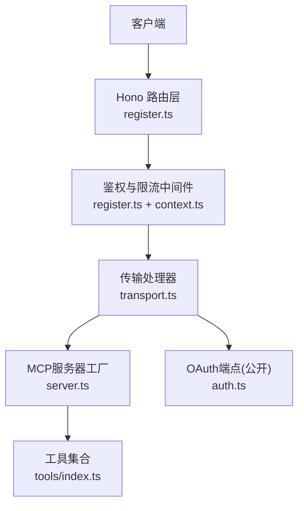
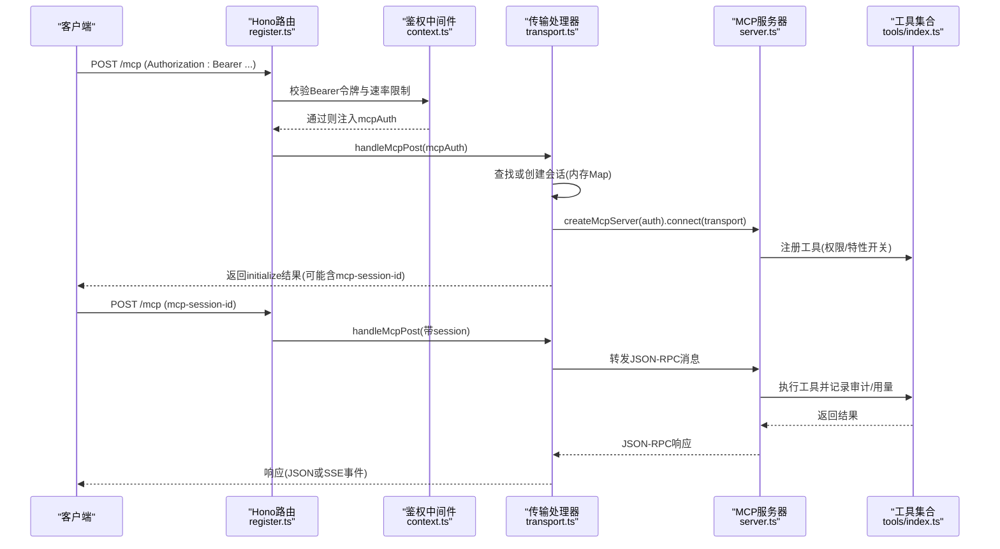
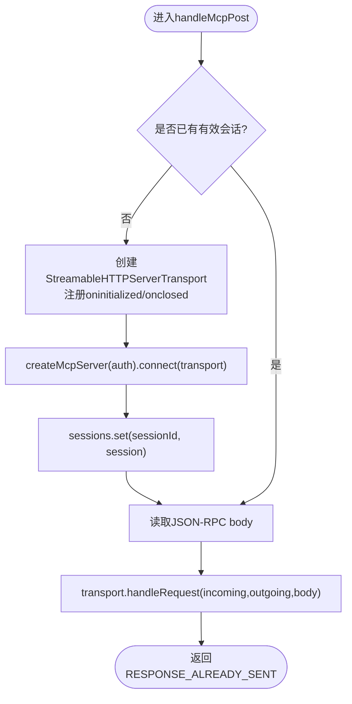
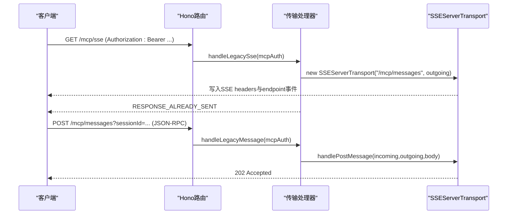
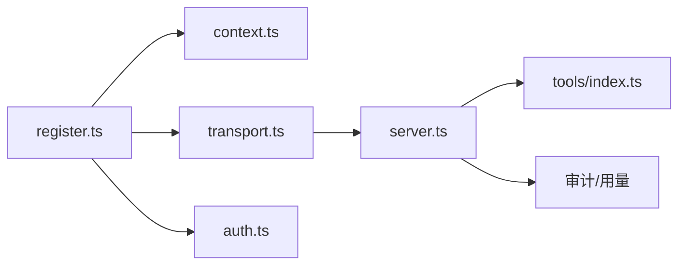

# 传输层配置

<cite>
**本文引用的文件**
- [transport.ts](file://api/mcp/transport.ts)
- [server.ts](file://api/mcp/server.ts)
- [register.ts](file://api/mcp/register.ts)
- [auth.ts](file://api/mcp/auth.ts)
- [context.ts](file://api/mcp/context.ts)
- [tools/index.ts](file://api/mcp/tools/index.ts)
- [help.ts](file://api/mcp/tools/help.ts)
</cite>

## 目录
1. [简介](#简介)
2. [项目结构](#项目结构)
3. [核心组件](#核心组件)
4. [架构总览](#架构总览)
5. [详细组件分析](#详细组件分析)
6. [依赖关系分析](#依赖关系分析)
7. [性能考虑](#性能考虑)
8. [故障排查指南](#故障排查指南)
9. [结论](#结论)
10. [附录：客户端配置与最佳实践](#附录客户端配置与最佳实践)

## 简介
本文件面向DeeWaanAI的MCP（Model Context Protocol）传输层，聚焦两种传输协议：
- Streamable HTTP（MCP 2025-03-26）：基于HTTP的流式JSON-RPC，支持服务端向客户端推送事件。
- Legacy SSE（MCP 2024-11-05）：传统SSE长连接，用于兼容旧版桌面客户端。

文档涵盖：
- 会话管理机制、连接建立流程、消息交换格式
- HTTP端点 /mcp 与 /mcp/sse 的使用方法（请求头、参数、响应）
- 会话生命周期管理、超时处理、错误恢复机制
- 不同客户端的传输层配置示例与最佳实践
- 性能优化建议与故障排查指南

## 项目结构
MCP传输层位于 api/mcp 目录下，关键文件职责如下：
- transport.ts：实现Streamable HTTP与Legacy SSE两种传输的处理器、会话存储与清理、鉴权上下文注入。
- server.ts：按会话创建McpServer实例，注册工具并执行权限与特性开关控制，封装connect接口。
- register.ts：注册路由与全局鉴权中间件，统一限流策略。
- auth.ts：OAuth 2.1授权服务器端点（公开），提供令牌签发能力。
- context.ts：从Bearer令牌解析MCP鉴权上下文（用户ID、scopes、locale等）。
- tools/index.ts：工具清单注册入口，供server.ts在会话中动态注册。
- help.ts：示例工具，展示如何根据用户能力与特性开关生成帮助内容。

图表来源
- [register.ts:144-164](file://api/mcp/register.ts#L144-L164)
- [transport.ts:74-170](file://api/mcp/transport.ts#L74-L170)
- [server.ts:135-208](file://api/mcp/server.ts#L135-L208)
- [auth.ts:147-173](file://api/mcp/auth.ts#L147-L173)

章节来源
- [register.ts:144-164](file://api/mcp/register.ts#L144-L164)
- [transport.ts:1-23](file://api/mcp/transport.ts#L1-L23)
- [server.ts:1-22](file://api/mcp/server.ts#L1-L22)

## 核心组件
- 传输处理器（transport.ts）
  - 维护进程内会话Map，键为SDK生成的sessionId，值为传输对象、类型、用户ID与创建时间。
  - 定期清理过期会话（默认TTL 24小时）。
  - 分别处理Streamable HTTP与Legacy SSE的请求与响应。
- MCP服务器工厂（server.ts）
  - 每个会话创建一个独立的McpServer实例，绑定认证上下文。
  - 动态注册工具，支持权限范围检查与特性开关隐藏。
  - 将工具调用结果包装为标准JSON-RPC文本内容。
- 路由与鉴权（register.ts, context.ts, auth.ts）
  - 所有/mcp*路径受Bearer令牌保护，失败返回401并附带WWW-Authenticate提示。
  - 支持按客户分层的速率限制，超限返回429并携带Retry-After。
  - 公开OAuth端点用于客户端获取访问令牌。

章节来源
- [transport.ts:38-57](file://api/mcp/transport.ts#L38-L57)
- [server.ts:84-124](file://api/mcp/server.ts#L84-L124)
- [register.ts:90-142](file://api/mcp/register.ts#L90-L142)
- [context.ts:17-41](file://api/mcp/context.ts#L17-L41)
- [auth.ts:147-173](file://api/mcp/auth.ts#L147-L173)

## 架构总览
下图展示了从客户端到MCP服务器的完整调用链，包括鉴权、路由、传输、会话管理与工具执行。

图表来源
- [register.ts:154-161](file://api/mcp/register.ts#L154-L161)
- [transport.ts:76-141](file://api/mcp/transport.ts#L76-L141)
- [server.ts:135-208](file://api/mcp/server.ts#L135-L208)
- [tools/index.ts:45-94](file://api/mcp/tools/index.ts#L45-L94)

## 详细组件分析

### Streamable HTTP传输（/mcp）
- 端点与方法
  - POST /mcp：发送JSON-RPC消息；首次初始化会创建会话并返回mcp-session-id；后续请求需携带该Header。
  - GET /mcp：独立SSE流，用于服务端向客户端推送消息（如通知）。
  - DELETE /mcp：关闭指定会话。
- 请求头
  - Authorization: Bearer <access_token>（必需）
  - mcp-session-id：会话标识（非首次POST时必需）
  - Accept：application/json, text/event-stream（影响响应格式）
- 响应
  - 首次POST initialize成功后，响应头包含mcp-session-id。
  - 后续请求可能返回202 Accepted（异步处理）或SSE事件流。
- 会话管理
  - 进程内Map存储，键为sessionId，值包含transport、kind、userId、createdAt。
  - 后台扫描清理超过TTL的会话（默认24小时）。
- 错误处理
  - 缺少mcp-session-id：返回400。
  - 会话不存在或类型不匹配：返回404 JSON-RPC错误。
  - 解析失败：返回-32700 Parse error。
  - 传输异常：返回500错误（若未发送headers）。

图表来源
- [transport.ts:76-141](file://api/mcp/transport.ts#L76-L141)
- [transport.ts:143-170](file://api/mcp/transport.ts#L143-L170)

章节来源
- [transport.ts:74-170](file://api/mcp/transport.ts#L74-L170)

### Legacy SSE传输（/mcp/sse与/mcp/messages）
- 端点与方法
  - GET /mcp/sse：打开SSE流，服务端写入endpoint事件，建立会话。
  - POST /mcp/messages?sessionId=...：客户端发送JSON-RPC消息，服务端以202 Accepted响应。
- 会话管理
  - 使用SSEServerTransport，sessionId由SDK生成，存储在进程内Map。
  - onclose回调删除会话并记录日志。
- 错误处理
  - 会话不存在或类型不匹配：返回404 JSON-RPC错误。
  - 解析失败：返回-32700 Parse error。
  - 传输异常：返回500错误（若未发送headers）。

图表来源
- [transport.ts:174-233](file://api/mcp/transport.ts#L174-L233)
- [register.ts:159-161](file://api/mcp/register.ts#L159-L161)

章节来源
- [transport.ts:172-233](file://api/mcp/transport.ts#L172-L233)

### 会话生命周期与超时
- 生命周期
  - 创建：首次POST /mcp initialize成功，或GET /mcp/sse成功。
  - 活跃：后续POST /mcp或POST /mcp/messages携带sessionId。
  - 关闭：DELETE /mcp或传输onclose触发。
- 超时清理
  - 每轮请求前执行sweepSessions，删除超过SESSION_TTL_MS（默认24小时）的会话并关闭transport。
- 多节点部署注意
  - 当前会话Map为进程内，多节点需粘性路由（按mcp-session-id或sessionId路由到同一节点）。

章节来源
- [transport.ts:45-57](file://api/mcp/transport.ts#L45-L57)
- [transport.ts:17-22](file://api/mcp/transport.ts#L17-L22)

### 消息交换格式
- JSON-RPC 2.0
  - 方法：initialize、notifications/initialized、tools/call等。
  - 参数：由工具inputSchema定义，SDK进行安全校验，非法参数返回InvalidParams。
  - 结果：工具返回的对象被包装为{ content: [{ type: "text", text: JSON }] }。
- 错误码
  - -32700：Parse error（JSON解析失败）。
  - -32001：Session not found（会话不存在）。
  - -32600：InvalidRequest（权限不足）。
  - 其他MCP错误由SDK抛出。

章节来源
- [server.ts:84-124](file://api/mcp/server.ts#L84-L124)
- [transport.ts:126-141](file://api/mcp/transport.ts#L126-L141)

### 工具注册与权限控制
- 工具清单
  - tools/index.ts集中导出所有可用工具，server.ts在会话中逐个注册。
- 权限范围
  - 每个工具声明requiredScopes，调用前检查ctx.scopes，缺失则返回InvalidRequest。
- 特性开关
  - 工具可声明featureFlag，仅在isFeatureEnabled为true时注册，否则对客户端不可见且调用报未知工具。
- 审计与用量
  - 每次工具调用记录mcp_audit_log与usageCounters（fire-and-forget，不影响主流程）。

章节来源
- [tools/index.ts:45-94](file://api/mcp/tools/index.ts#L45-L94)
- [server.ts:84-124](file://api/mcp/server.ts#L84-L124)
- [server.ts:46-82](file://api/mcp/server.ts#L46-L82)

## 依赖关系分析
- 路由层（register.ts）依赖：
  - 鉴权中间件（context.ts）验证Bearer令牌并构建McpAuthContext。
  - 传输处理器（transport.ts）处理具体协议逻辑。
  - OAuth端点（auth.ts）提供令牌签发能力。
- 传输层（transport.ts）依赖：
  - SDK的StreamableHTTPServerTransport与SSEServerTransport。
  - 服务器工厂（server.ts）创建McpServer并连接传输。
- 服务器层（server.ts）依赖：
  - 工具清单（tools/index.ts）与工具实现。
  - 特性开关与权限系统。
  - 数据库审计与用量统计。

图表来源
- [register.ts:144-164](file://api/mcp/register.ts#L144-L164)
- [transport.ts:24-33](file://api/mcp/transport.ts#L24-L33)
- [server.ts:23-33](file://api/mcp/server.ts#L23-L33)

章节来源
- [register.ts:144-164](file://api/mcp/register.ts#L144-L164)
- [transport.ts:24-33](file://api/mcp/transport.ts#L24-L33)
- [server.ts:23-33](file://api/mcp/server.ts#L23-L33)

## 性能考虑
- 会话清理
  - 使用sweepSessions定期清理过期会话，避免内存泄漏。
- 工具注册开销
  - 每个会话创建独立McpServer，但工具注册轻量；可通过特性开关减少不必要工具注册。
- 网络I/O
  - Streamable HTTP支持SSE推送，减少轮询开销；Legacy SSE适合旧客户端。
- 速率限制
  - 按客户分层限制，超限返回429并携带Retry-After，避免雪崩。
- 审计与用量
  - 异步插入审计与用量计数，不阻塞主流程。

[本节为通用指导，无需特定文件引用]

## 故障排查指南
- 401 Unauthorized
  - 检查Authorization头是否为Bearer令牌，确认令牌有效且未被吊销。
  - 参考鉴权中间件返回的WWW-Authenticate提示。
- 400 Bad Request
  - 检查mcp-session-id是否缺失（Streamable HTTP非首次请求必需）。
  - 检查JSON-RPC body是否合法。
- 404 Not Found
  - 检查sessionId是否存在且类型为streamable（Streamable HTTP）或sse（Legacy SSE）。
- 429 Too Many Requests
  - 检查Retry-After头部，等待后重试；确认客户层级与配额。
- 500 Internal Server Error
  - 检查传输层异常日志，确认服务端是否已发送headers。
- 工具调用失败
  - 检查requiredScopes是否满足，确认特性开关是否启用。
  - 查看审计日志与用量计数器，定位延迟与错误。

章节来源
- [register.ts:90-142](file://api/mcp/register.ts#L90-L142)
- [transport.ts:126-170](file://api/mcp/transport.ts#L126-L170)
- [server.ts:84-124](file://api/mcp/server.ts#L84-L124)

## 结论
DeeWaanAI的MCP传输层提供了两种协议支持：现代Streamable HTTP与兼容Legacy SSE。通过统一的鉴权与限流中间件，确保安全性与稳定性。会话管理采用进程内Map，配合TTL清理机制，避免资源泄漏。工具注册支持权限与特性开关，便于功能渐进式发布。建议在生产环境使用Streamable HTTP以获得更好的性能与扩展性。

[本节为总结，无需特定文件引用]

## 附录：客户端配置与最佳实践

### Streamable HTTP客户端
- 初始化
  - POST /mcp，携带Authorization: Bearer <token>与Accept: application/json, text/event-stream。
  - 从响应头获取mcp-session-id，并在后续请求中携带。
- 发送消息
  - POST /mcp，携带mcp-session-id与JSON-RPC消息。
  - 可能返回202 Accepted或SSE事件流。
- 关闭会话
  - DELETE /mcp，携带mcp-session-id。

章节来源
- [transport.ts:76-141](file://api/mcp/transport.ts#L76-L141)
- [transport.ts:143-170](file://api/mcp/transport.ts#L143-L170)

### Legacy SSE客户端
- 建立连接
  - GET /mcp/sse，携带Authorization: Bearer <token>。
  - 服务端写入endpoint事件，包含/mcp/messages路径。
- 发送消息
  - POST /mcp/messages?sessionId=<id>，携带JSON-RPC消息。
  - 服务端返回202 Accepted。

章节来源
- [transport.ts:174-233](file://api/mcp/transport.ts#L174-L233)

### 最佳实践
- 始终使用Bearer令牌进行鉴权，避免无状态会话。
- 合理设置Accept头以选择响应格式（JSON或SSE）。
- 实现重试与退避策略，应对临时网络错误与429限流。
- 在多节点部署中使用粘性路由，确保会话一致性。
- 监控审计日志与用量计数器，评估工具使用与性能。

[本节为通用指导，无需特定文件引用]