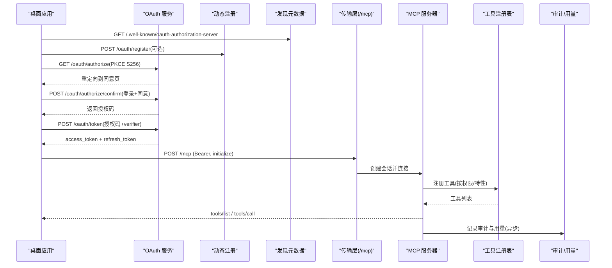
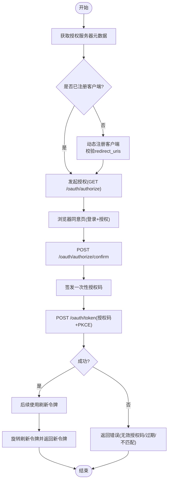
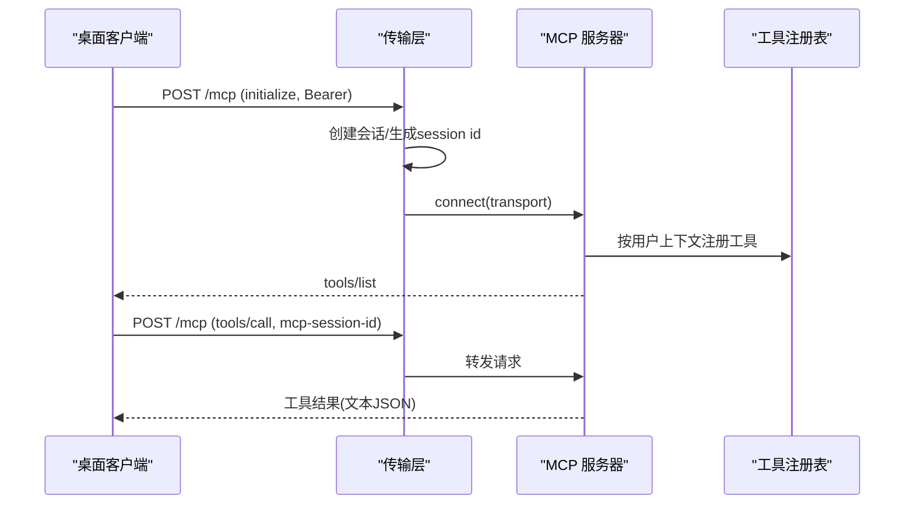
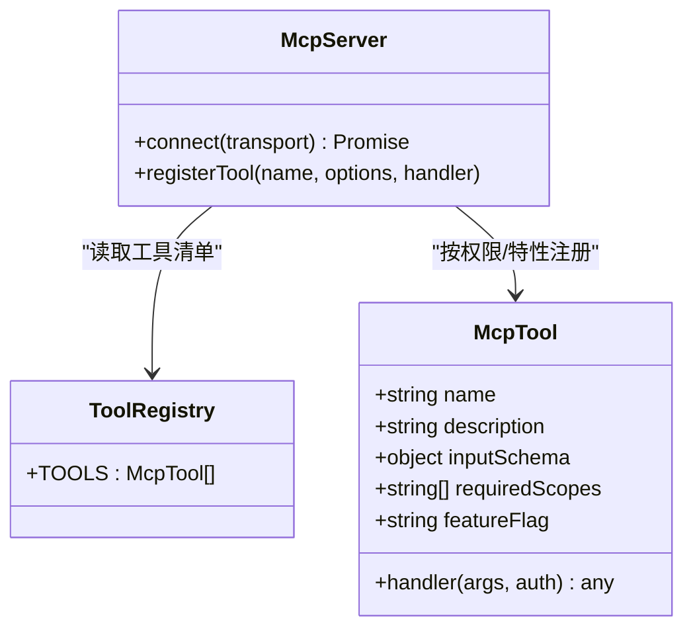
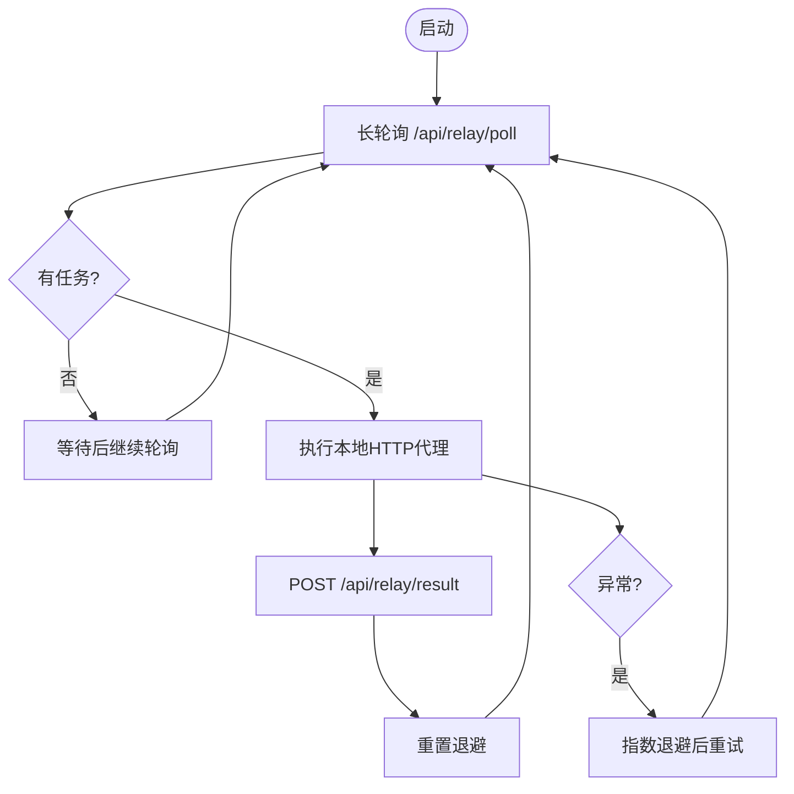
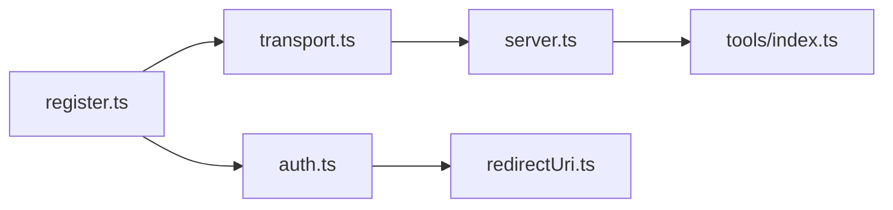

# 客户端集成

<cite>
**本文引用的文件**
- [api/mcp/server.ts](file://api/mcp/server.ts)
- [api/mcp/transport.ts](file://api/mcp/transport.ts)
- [api/mcp/auth.ts](file://api/mcp/auth.ts)
- [api/mcp/register.ts](file://api/mcp/register.ts)
- [api/mcp/redirectUri.ts](file://api/mcp/redirectUri.ts)
- [api/mcp/tools/index.ts](file://api/mcp/tools/index.ts)
- [relay/connector.mjs](file://relay/connector.mjs)
- [scripts/mcp-call.mjs](file://scripts/mcp-call.mjs)
- [src/pages/Connect.tsx](file://src/pages/Connect.tsx)
- [src/locales/en/connect.json](file://src/locales/en/connect.json)
- [src/locales/zh/connect.json](file://src/locales/zh/connect.json)
</cite>

## 目录
1. [简介](#简介)
2. [项目结构](#项目结构)
3. [核心组件](#核心组件)
4. [架构总览](#架构总览)
5. [详细组件分析](#详细组件分析)
6. [依赖关系分析](#依赖关系分析)
7. [性能与可靠性](#性能与可靠性)
8. [故障排查指南](#故障排查指南)
9. [结论](#结论)
10. [附录：各平台集成示例与配置](#附录：各平台集成示例与配置)

## 简介
本文件面向需要在桌面 LLM 应用（Claude Desktop、ChatGPT、Qwen Code、Kimi）中集成 DeeWaanAI 的 MCP 客户端，提供端到端集成说明。内容涵盖传输层配置、连接建立与消息交换、OAuth 认证流程、令牌管理与安全考虑、错误处理与重试机制、监控方法，以及中继连接器（relay connector）的使用与配置。

## 项目结构
MCP 相关能力由以下模块组成：
- 路由注册与鉴权中间件：负责挂载 OAuth 发现元数据、动态客户端注册、授权码流程、令牌交换，以及对 /mcp* 路径的统一鉴权与限流。
- 传输层：实现流式 HTTP（MCP 2025-03-26）与兼容旧版 SSE（MCP 2024-11-05）两种传输方式，维护进程内会话映射。
- 服务器工厂：为每个会话创建独立的 McpServer，按用户上下文注册工具，支持特性开关隐藏工具。
- 工具注册表：集中声明可用工具集合，供服务器在会话建立时按需注册。
- 重定向校验：严格限制 OAuth 回调地址，仅允许 https 或本地回环 http。
- 中继连接器：出站-only 的 on-prem 代理，用于企业内网穿透场景。
- 前端连接页：展示 MCP 端点与各桌面应用的接入步骤。

```mermaid
graph TB
subgraph "客户端"
C1["Claude Desktop"]
C2["ChatGPT"]
C3["Qwen Code"]
C4["Kimi"]
end
subgraph "DeeWaanAI 服务"
R["路由注册<br/>register.ts"]
A["OAuth 服务<br/>auth.ts"]
T["传输层<br/>transport.ts"]
S["MCP 服务器<br/>server.ts"]
U["工具注册表<br/>tools/index.ts"]
end
subgraph "外部系统"
DB["数据库"]
RL["速率限制/配额"]
end
C1 --> |POST /mcp (Bearer)| R
C2 --> |POST /mcp (Bearer)| R
C3 --> |POST /mcp (Bearer)| R
C4 --> |POST /mcp (Bearer)| R
R --> A
R --> T
T --> S
S --> U
S --> DB
R --> RL
```

图表来源
- [api/mcp/register.ts:144-164](file://api/mcp/register.ts#L144-L164)
- [api/mcp/auth.ts:147-427](file://api/mcp/auth.ts#L147-L427)
- [api/mcp/transport.ts:74-233](file://api/mcp/transport.ts#L74-L233)
- [api/mcp/server.ts:135-208](file://api/mcp/server.ts#L135-L208)
- [api/mcp/tools/index.ts:45-94](file://api/mcp/tools/index.ts#L45-L94)

章节来源
- [api/mcp/register.ts:144-164](file://api/mcp/register.ts#L144-L164)
- [api/mcp/auth.ts:147-427](file://api/mcp/auth.ts#L147-L427)
- [api/mcp/transport.ts:74-233](file://api/mcp/transport.ts#L74-L233)
- [api/mcp/server.ts:135-208](file://api/mcp/server.ts#L135-L208)
- [api/mcp/tools/index.ts:45-94](file://api/mcp/tools/index.ts#L45-L94)

## 核心组件
- OAuth 授权服务器：提供 RFC 8414/9728 发现、RFC 7591 动态客户端注册、授权码+PKCE(S256)、刷新令牌等能力。
- 传输层：支持流式 HTTP（POST/GET/DELETE /mcp）与遗留 SSE（/mcp/sse、/mcp/messages），维护进程内会话并自动清理过期会话。
- MCP 服务器：每会话独立实例，按用户权限与特性开关注册工具；调用审计与用量计数。
- 工具注册表：统一暴露流水线、市场、团队、可移植性等工具。
- 重定向校验：仅允许 https 或本地回环 http，符合原生应用安全规范。
- 中继连接器：出站 HTTPS 轮询云端任务，执行本地服务后回传结果，无需开放入站端口。

章节来源
- [api/mcp/auth.ts:147-427](file://api/mcp/auth.ts#L147-L427)
- [api/mcp/transport.ts:74-233](file://api/mcp/transport.ts#L74-L233)
- [api/mcp/server.ts:135-208](file://api/mcp/server.ts#L135-L208)
- [api/mcp/tools/index.ts:45-94](file://api/mcp/tools/index.ts#L45-L94)
- [api/mcp/redirectUri.ts:1-28](file://api/mcp/redirectUri.ts#L1-L28)
- [relay/connector.mjs:1-150](file://relay/connector.mjs#L1-L150)

## 架构总览
下图展示了从桌面应用到 DeeWaanAI 的完整交互链路，包括 OAuth 授权、传输握手、工具调用与审计。



图表来源
- [api/mcp/auth.ts:147-427](file://api/mcp/auth.ts#L147-L427)
- [api/mcp/transport.ts:74-233](file://api/mcp/transport.ts#L74-L233)
- [api/mcp/server.ts:135-208](file://api/mcp/server.ts#L135-L208)
- [api/mcp/tools/index.ts:45-94](file://api/mcp/tools/index.ts#L45-L94)

## 详细组件分析

### OAuth 认证流程与令牌管理
- 发现与注册：
  - 提供 RFC 8414/9728 元数据，便于客户端自动发现。
  - 支持动态客户端注册，要求 redirect_uris 必须通过白名单校验（https 或本地回环 http）。
- 授权码+PKCE：
  - 强制使用 PKCE S256，拒绝明文或缺失 challenge。
  - 授权页面无服务端会话强校验，同意确认阶段才校验登录态。
- 令牌颁发与刷新：
  - 授权码一次性使用，校验 client_id、redirect_uri、code_verifier。
  - 访问令牌有效期固定，刷新令牌支持轮换。
- 作用域控制：
  - 限定 mcp:read、mcp:run、mcp:write，请求作用域需与已授权作用域交集。



图表来源
- [api/mcp/auth.ts:147-427](file://api/mcp/auth.ts#L147-L427)
- [api/mcp/redirectUri.ts:1-28](file://api/mcp/redirectUri.ts#L1-L28)

章节来源
- [api/mcp/auth.ts:147-427](file://api/mcp/auth.ts#L147-L427)
- [api/mcp/redirectUri.ts:1-28](file://api/mcp/redirectUri.ts#L1-L28)

### 传输层配置与连接建立
- 支持的传输：
  - 流式 HTTP（推荐）：POST/GET/DELETE /mcp，首次 POST 建立会话，后续携带 mcp-session-id。
  - 遗留 SSE：GET /mcp/sse 打开 SSE 流，POST /mcp/messages?sessionId=… 发送消息。
- 会话管理：
  - 进程内 Map 维护会话，带 TTL 清理；支持 session initialized/closed 钩子。
  - 首次连接时注入采样桥接能力（若客户端支持）。
- 鉴权与限流：
  - 所有 /mcp* 需要 Bearer token，未认证返回 401 与 WWW-Authenticate。
  - 基于客户层级（solo/team/admin）进行每分钟速率限制，超限返回 429 与 Retry-After。



图表来源
- [api/mcp/transport.ts:74-233](file://api/mcp/transport.ts#L74-L233)
- [api/mcp/server.ts:135-208](file://api/mcp/server.ts#L135-L208)
- [api/mcp/register.ts:90-164](file://api/mcp/register.ts#L90-L164)

章节来源
- [api/mcp/transport.ts:74-233](file://api/mcp/transport.ts#L74-L233)
- [api/mcp/register.ts:90-164](file://api/mcp/register.ts#L90-L164)

### 工具与权限控制
- 工具注册：
  - 集中定义工具清单，包含名称、描述、输入 schema、所需作用域与可选特性开关。
  - 服务器在会话建立时根据用户上下文与特性开关决定是否注册。
- 权限校验：
  - 每次工具调用前检查作用域，缺失则返回 InvalidRequest。
- 审计与计量：
  - 每次调用记录审计日志与月度用量计数器，失败也记录状态与错误信息。



图表来源
- [api/mcp/tools/index.ts:45-94](file://api/mcp/tools/index.ts#L45-L94)
- [api/mcp/server.ts:84-124](file://api/mcp/server.ts#L84-L124)

章节来源
- [api/mcp/tools/index.ts:45-94](file://api/mcp/tools/index.ts#L45-L94)
- [api/mcp/server.ts:84-124](file://api/mcp/server.ts#L84-L124)

### 中继连接器（relay connector）
- 用途：在企业防火墙/内网环境中，以出站 HTTPS 长轮询方式从云端拉取任务，执行本地服务后将结果回传，无需开放入站端口。
- 环境变量：
  - CLOUD_URL：云应用域名
  - RELAY_TOKEN：从云端注册的令牌
  - LOCAL_URL：本地服务基址（默认 localhost:3000）
  - POLL_WAIT：轮询等待秒数
  - MAX_BACKOFF：错误退避上限
- 工作流：
  - 循环长轮询 /api/relay/poll，收到任务后执行 http_proxy 类型请求，将结果 POST 至 /api/relay/result。
  - 错误指数退避，成功重置退避。



图表来源
- [relay/connector.mjs:1-150](file://relay/connector.mjs#L1-L150)

章节来源
- [relay/connector.mjs:1-150](file://relay/connector.mjs#L1-L150)

## 依赖关系分析
- 路由注册依赖：
  - register.ts 挂载 OAuth 路由与 /mcp* 路由，并应用鉴权与限流中间件。
- 传输层依赖：
  - transport.ts 使用 SDK 的 StreamableHTTPServerTransport 与 SSEServerTransport，维护会话生命周期。
- 服务器依赖：
  - server.ts 构建 McpServer，按用户上下文注册工具，记录审计与用量。
- 工具依赖：
  - tools/index.ts 汇总所有工具，供服务器在会话中注册。
- 安全依赖：
  - redirectUri.ts 校验回调地址，确保仅 https 或本地回环 http。



图表来源
- [api/mcp/register.ts:144-164](file://api/mcp/register.ts#L144-L164)
- [api/mcp/auth.ts:147-427](file://api/mcp/auth.ts#L147-L427)
- [api/mcp/transport.ts:74-233](file://api/mcp/transport.ts#L74-L233)
- [api/mcp/server.ts:135-208](file://api/mcp/server.ts#L135-L208)
- [api/mcp/redirectUri.ts:1-28](file://api/mcp/redirectUri.ts#L1-L28)

章节来源
- [api/mcp/register.ts:144-164](file://api/mcp/register.ts#L144-L164)
- [api/mcp/auth.ts:147-427](file://api/mcp/auth.ts#L147-L427)
- [api/mcp/transport.ts:74-233](file://api/mcp/transport.ts#L74-L233)
- [api/mcp/server.ts:135-208](file://api/mcp/server.ts#L135-L208)
- [api/mcp/redirectUri.ts:1-28](file://api/mcp/redirectUri.ts#L1-L28)

## 性能与可靠性
- 会话清理：进程内会话 Map 定期扫描，超过 TTL 自动关闭并删除，防止内存泄漏。
- 速率限制：按客户层级限制每分钟请求数，超限返回 429 与 Retry-After，避免滥用。
- 容错与重试：
  - 传输层捕获异常并返回通用错误；客户端应实现指数退避重试。
  - 脚本示例中包含对网络错误与空响应的识别与重试策略。
- 审计与监控：
  - 每次工具调用记录审计日志与月度用量，便于追踪延迟、状态与错误。
  - 建议结合结构化日志与指标采集系统进行告警与可视化。

章节来源
- [api/mcp/transport.ts:45-64](file://api/mcp/transport.ts#L45-L64)
- [api/mcp/register.ts:112-138](file://api/mcp/register.ts#L112-L138)
- [api/mcp/server.ts:46-82](file://api/mcp/server.ts#L46-L82)
- [research/orchestration-economics/code/main_run.mjs:45-73](file://research/orchestration-economics/code/main_run.mjs#L45-L73)

## 故障排查指南
- 401 未认证：
  - 检查是否携带有效的 Bearer token；确认 token 未过期且作用域包含所需范围。
  - 查看 WWW-Authenticate 头中的资源元数据 URL，确认客户端能正确发现授权端点。
- 429 速率限制：
  - 遵循 Retry-After 头进行退避重试；检查当前客户层级配额。
- 会话丢失：
  - 确保后续请求携带 mcp-session-id 头；检查服务端会话是否被清理。
- 工具不可用：
  - 检查工具是否需要特定作用域或特性开关；确认该工具在当前用户上下文中可见。
- 传输错误：
  - 检查 JSON-RPC 请求体格式；确认 Accept 头支持 event-stream；查看服务端日志定位具体错误。

章节来源
- [api/mcp/register.ts:90-138](file://api/mcp/register.ts#L90-L138)
- [api/mcp/transport.ts:126-162](file://api/mcp/transport.ts#L126-L162)
- [api/mcp/server.ts:84-124](file://api/mcp/server.ts#L84-L124)

## 结论
DeeWaanAI 的 MCP 客户端集成提供了标准化的 OAuth 2.1 授权、双传输模式（流式 HTTP 与 SSE）、细粒度权限与作用域控制、完善的审计与计量、以及企业级中继连接器。通过遵循本文的配置与最佳实践，可在 Claude Desktop、ChatGPT、Qwen Code、Kimi 等桌面应用中稳定接入并调用流水线与市场等工具。

## 附录：各平台集成示例与配置
- Claude Desktop：
  - 添加自定义连接器，填入 MCP 服务器地址；首次使用时浏览器完成 OAuth 授权。
  - 参考前端连接页的步骤指引。
- ChatGPT：
  - 启用开发者模式，创建应用并将 MCP 服务器地址作为连接器端点；按提示完成 OAuth。
- Qwen Code：
  - 通过 CLI 添加服务器，保存至配置文件；首次使用触发浏览器 OAuth。
- Kimi：
  - 在设置中添加 MCP 服务器，选择 streamable HTTP 传输，粘贴地址并完成授权。

章节来源
- [src/pages/Connect.tsx:108-147](file://src/pages/Connect.tsx#L108-L147)
- [src/locales/en/connect.json:28-58](file://src/locales/en/connect.json#L28-L58)
- [src/locales/zh/connect.json:28-58](file://src/locales/zh/connect.json#L28-L58)