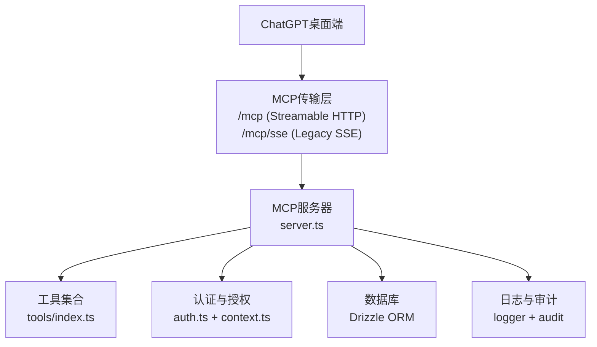
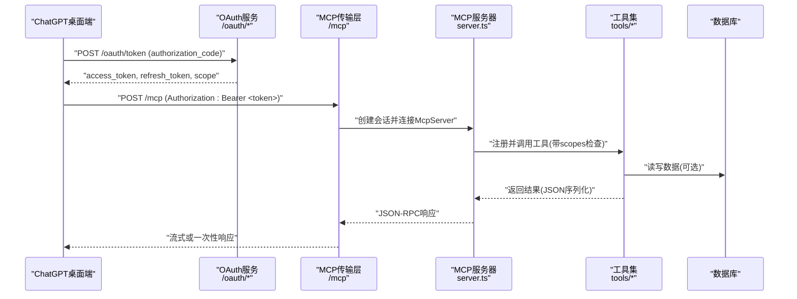
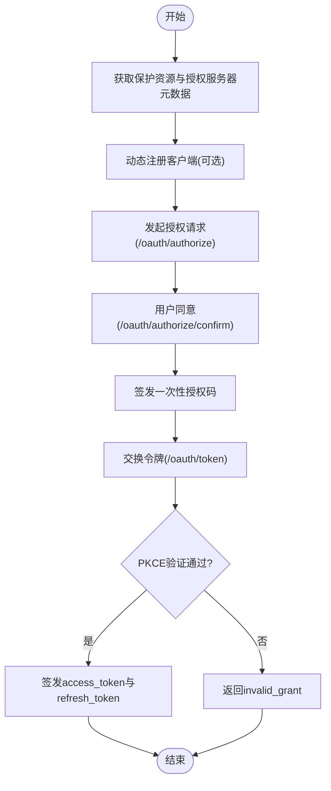
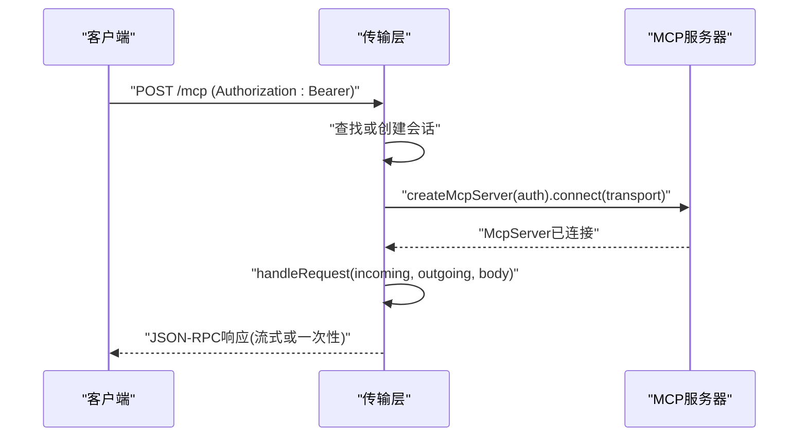
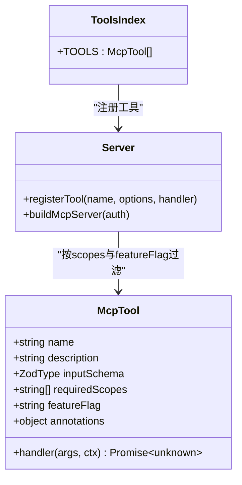
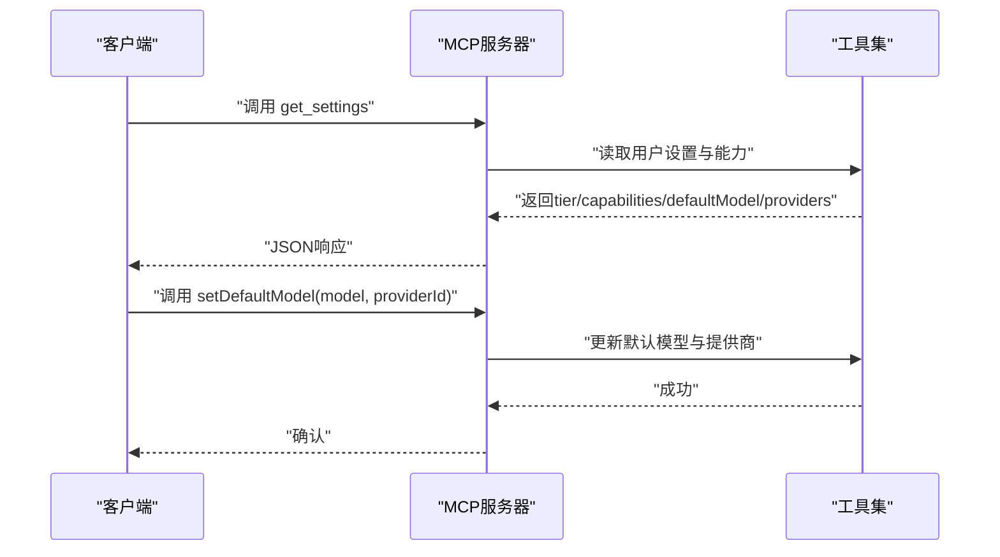
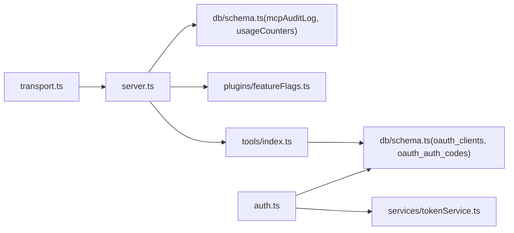

# ChatGPT桌面版集成

<cite>
**本文引用的文件**
- [README.md](file://README.md)
- [api/mcp/server.ts](file://api/mcp/server.ts)
- [api/mcp/auth.ts](file://api/mcp/auth.ts)
- [api/mcp/transport.ts](file://api/mcp/transport.ts)
- [api/mcp/types.ts](file://api/mcp/types.ts)
- [api/mcp/context.ts](file://api/mcp/context.ts)
- [api/mcp/register.ts](file://api/mcp/register.ts)
- [api/lib/env.ts](file://api/lib/env.ts)
- [src/pages/Connect.tsx](file://src/pages/Connect.tsx)
- [api/mcp/tools/index.ts](file://api/mcp/tools/index.ts)
- [api/mcp/tools/help.ts](file://api/mcp/tools/help.ts)
- [api/mcp/tools/settings.ts](file://api/mcp/tools/settings.ts)
- [api/mcp/tools/samplePing.ts](file://api/mcp/tools/samplePing.ts)
</cite>

## 目录
1. [简介](#简介)
2. [项目结构](#项目结构)
3. [核心组件](#核心组件)
4. [架构总览](#架构总览)
5. [详细组件分析](#详细组件分析)
6. [依赖关系分析](#依赖关系分析)
7. [性能考虑](#性能考虑)
8. [故障排查指南](#故障排查指南)
9. [结论](#结论)
10. [附录](#附录)

## 简介
本指南面向在ChatGPT桌面版中启用并集成DeeWaanAI的MCP（Model Context Protocol）能力。内容涵盖：
- 如何在ChatGPT桌面端启用MCP、配置API端点与认证信息
- 支持的模型版本与兼容性说明
- 插件安装步骤与权限配置
- 错误处理机制与性能优化建议
- 与云端服务的通信协议与数据传输格式

本项目提供统一的MCP服务端，支持流式HTTP与SSE两种传输方式，并通过OAuth 2.1进行鉴权。客户端（如ChatGPT桌面版）通过标准JSON-RPC调用工具，实现运行流水线、查询设置、采样对话等能力。

**章节来源**
- [README.md:1-18](file://README.md#L1-L18)

## 项目结构
- MCP服务器位于 api/mcp 目录，包含认证、传输、工具注册与类型定义
- 路由注册在 api/mcp/register.ts，暴露 /mcp 与兼容的 /mcp/sse 接口
- 环境变量与运行时配置在 api/lib/env.ts
- 前端连接引导页在 src/pages/Connect.tsx，用于生成并复制MCP端点URL
- 工具集在 api/mcp/tools/index.ts 统一注册

**图表来源**
- [api/mcp/transport.ts:1-23](file://api/mcp/transport.ts#L1-L23)
- [api/mcp/server.ts:126-208](file://api/mcp/server.ts#L126-L208)
- [api/mcp/register.ts:154-164](file://api/mcp/register.ts#L154-L164)
- [api/mcp/auth.ts:147-173](file://api/mcp/auth.ts#L147-L173)
- [api/mcp/context.ts:1-29](file://api/mcp/context.ts#L1-L29)

**章节来源**
- [api/mcp/register.ts:154-164](file://api/mcp/register.ts#L154-L164)
- [api/mcp/transport.ts:1-23](file://api/mcp/transport.ts#L1-L23)
- [api/mcp/server.ts:126-208](file://api/mcp/server.ts#L126-L208)
- [api/mcp/auth.ts:147-173](file://api/mcp/auth.ts#L147-L173)
- [api/mcp/context.ts:1-29](file://api/mcp/context.ts#L1-L29)
- [src/pages/Connect.tsx:33-45](file://src/pages/Connect.tsx#L33-L45)

## 核心组件
- 传输层：支持MCP 2025-03-26的流式HTTP（/mcp）与旧版SSE（/mcp/sse），维护会话映射与清理
- 认证层：OAuth 2.1授权码+PKCE流程，颁发访问令牌与刷新令牌；每个请求校验Bearer令牌
- 服务器：按会话创建McpServer实例，动态注册工具，支持特性开关与权限范围控制
- 工具集：流水线运行、设置读取、市场搜索、团队同步、批处理等工具，均受scopes与featureFlag约束
- 上下文：从Bearer令牌解析用户、作用域、语言环境，注入到工具处理器

**章节来源**
- [api/mcp/transport.ts:74-170](file://api/mcp/transport.ts#L74-L170)
- [api/mcp/auth.ts:147-427](file://api/mcp/auth.ts#L147-L427)
- [api/mcp/server.ts:84-186](file://api/mcp/server.ts#L84-L186)
- [api/mcp/tools/index.ts:45-94](file://api/mcp/tools/index.ts#L45-L94)
- [api/mcp/context.ts:17-29](file://api/mcp/context.ts#L17-L29)

## 架构总览
下图展示了ChatGPT桌面端通过OAuth获取令牌后，使用MCP流式HTTP与后端交互的整体流程。

**图表来源**
- [api/mcp/auth.ts:337-427](file://api/mcp/auth.ts#L337-L427)
- [api/mcp/transport.ts:74-141](file://api/mcp/transport.ts#L74-L141)
- [api/mcp/server.ts:135-186](file://api/mcp/server.ts#L135-L186)
- [api/mcp/tools/index.ts:45-94](file://api/mcp/tools/index.ts#L45-L94)

## 详细组件分析

### OAuth认证与令牌管理
- 公开元数据：/.well-known/oauth-protected-resource 与 /.well-known/oauth-authorization-server 声明支持的scope与方法
- 动态客户端注册：/oauth/register 接受client_name与redirect_uris，校验HTTPS与本地回环白名单
- 授权端点：/oauth/authorize 要求response_type=code、PKCE S256，重定向至同意页面
- 同意确认：/oauth/authorize/confirm 校验会话与参数，存储一次性授权码
- 令牌交换：/oauth/token 支持authorization_code与refresh_token，校验PKCE与scope交集，签发访问令牌与刷新令牌

**图表来源**
- [api/mcp/auth.ts:147-173](file://api/mcp/auth.ts#L147-L173)
- [api/mcp/auth.ts:175-227](file://api/mcp/auth.ts#L175-L227)
- [api/mcp/auth.ts:229-335](file://api/mcp/auth.ts#L229-L335)
- [api/mcp/auth.ts:337-427](file://api/mcp/auth.ts#L337-L427)

**章节来源**
- [api/mcp/auth.ts:147-427](file://api/mcp/auth.ts#L147-L427)

### MCP传输与会话管理
- 流式HTTP：POST/GET/DELETE /mcp，维护进程内会话Map，自动清理过期会话
- 旧版SSE：GET /mcp/sse 打开SSE流，POST /mcp/messages?sessionId=... 发送消息
- 会话初始化：为每个会话创建独立McpServer，绑定认证上下文，注入采样桥接能力
- 错误处理：解析失败、会话不存在、传输异常时返回明确的JSON-RPC错误

**图表来源**
- [api/mcp/transport.ts:74-141](file://api/mcp/transport.ts#L74-L141)
- [api/mcp/server.ts:135-186](file://api/mcp/server.ts#L135-L186)

**章节来源**
- [api/mcp/transport.ts:74-170](file://api/mcp/transport.ts#L74-L170)
- [api/mcp/server.ts:135-186](file://api/mcp/server.ts#L135-L186)

### 工具注册与权限控制
- 工具清单：在 tools/index.ts 集中注册，包含流水线、设置、市场、团队、批处理等能力
- 权限范围：每个工具声明requiredScopes（如 mcp:read、mcp:run、mcp:write），未满足则拒绝
- 特性开关：部分工具通过featureFlag控制可见性与可用性，检查失败默认隐藏
- 输入校验：使用zod schema对参数进行安全解析，非法输入返回InvalidParams

**图表来源**
- [api/mcp/types.ts:33-44](file://api/mcp/types.ts#L33-L44)
- [api/mcp/tools/index.ts:45-94](file://api/mcp/tools/index.ts#L45-L94)
- [api/mcp/server.ts:84-186](file://api/mcp/server.ts#L84-L186)

**章节来源**
- [api/mcp/tools/index.ts:45-94](file://api/mcp/tools/index.ts#L45-L94)
- [api/mcp/server.ts:84-186](file://api/mcp/server.ts#L84-L186)
- [api/mcp/types.ts:33-44](file://api/mcp/types.ts#L33-L44)

### 设置与模型选择
- 获取设置：get_settings返回计划层级、能力、默认模型、提供商列表以及桌面端是否支持采样
- 设置默认模型：setDefaultModel允许切换默认模型与提供商ID
- 采样诊断：sample_ping检测桌面端是否支持MCP采样，返回模型与延迟等信息

**图表来源**
- [api/mcp/tools/settings.ts:35-66](file://api/mcp/tools/settings.ts#L35-L66)
- [api/mcp/tools/samplePing.ts:20-55](file://api/mcp/tools/samplePing.ts#L20-L55)

**章节来源**
- [api/mcp/tools/settings.ts:35-66](file://api/mcp/tools/settings.ts#L35-L66)
- [api/mcp/tools/samplePing.ts:20-55](file://api/mcp/tools/samplePing.ts#L20-L55)

### 帮助与能力发现
- deewaanai_help根据当前用户的计划、能力、作用域与特性开关生成个性化指南
- 帮助内容仅展示当前会话可用的工具与提示，避免无效操作

**章节来源**
- [api/mcp/tools/help.ts:1-47](file://api/mcp/tools/help.ts#L1-L47)

## 依赖关系分析
- 传输层依赖服务器工厂与日志模块
- 服务器依赖工具注册表、特性开关、数据库审计与用量统计
- 认证层依赖数据库中的客户端与授权码表，以及令牌服务
- 工具依赖数据库、能力解析与特性开关

**图表来源**
- [api/mcp/transport.ts:74-170](file://api/mcp/transport.ts#L74-L170)
- [api/mcp/server.ts:135-186](file://api/mcp/server.ts#L135-L186)
- [api/mcp/auth.ts:147-427](file://api/mcp/auth.ts#L147-L427)

**章节来源**
- [api/mcp/transport.ts:74-170](file://api/mcp/transport.ts#L74-L170)
- [api/mcp/server.ts:135-186](file://api/mcp/server.ts#L135-L186)
- [api/mcp/auth.ts:147-427](file://api/mcp/auth.ts#L147-L427)

## 性能考虑
- 会话清理：进程内会话Map定期扫描，超过TTL自动关闭并释放资源
- 异步审计：工具调用记录采用fire-and-forget写入，不阻塞主流程
- 限流与并发：可通过环境变量配置SWARM_WORKER_CONCURRENCY与PROVIDER_THROTTLE控制并发与节流
- 传输优化：优先使用流式HTTP以获得更低延迟与更好的背压处理
- 缓存与只读：只读工具标注readOnlyHint，便于客户端缓存策略

**章节来源**
- [api/mcp/transport.ts:45-57](file://api/mcp/transport.ts#L45-L57)
- [api/mcp/server.ts:46-82](file://api/mcp/server.ts#L46-L82)
- [api/lib/env.ts:86-88](file://api/lib/env.ts#L86-L88)

## 故障排查指南
- 认证失败：检查Authorization头是否为Bearer格式，确认access_token有效且未被撤销
- 会话不存在：确保携带mcp-session-id头或使用正确的legacy sessionId参数
- 工具不可用：检查requiredScopes与featureFlag，确认用户具备相应权限与特性开关
- 传输错误：查看日志中的“MCP transport error”或“session not found”，确认网络与代理配置
- 令牌刷新：使用refresh_token重新获取access_token，注意有效期与作用域交集

**章节来源**
- [api/mcp/context.ts:17-29](file://api/mcp/context.ts#L17-L29)
- [api/mcp/transport.ts:59-64](file://api/mcp/transport.ts#L59-L64)
- [api/mcp/auth.ts:337-427](file://api/mcp/auth.ts#L337-L427)

## 结论
通过在ChatGPT桌面端启用MCP并与DeeWaanAI后端对接，可以实现安全的流水线运行、设置管理与采样对话等能力。系统基于OAuth 2.1与JSON-RPC协议，提供稳定的传输层与完善的权限控制。建议在生产环境中合理配置环境变量、开启限流与监控，并使用流式HTTP以获得最佳性能。

[本节为总结性内容，不直接分析具体文件]

## 附录

### 在ChatGPT桌面版中启用MCP的步骤
- 获取MCP端点URL：从前端连接页复制当前origin下的/mcp地址
- 完成OAuth授权：使用授权码流程获取access_token与refresh_token
- 配置认证头：在后续请求中携带Authorization: Bearer <token>
- 建立会话：首次POST /mcp以初始化会话，后续请求可复用mcp-session-id
- 调用工具：通过JSON-RPC调用所需工具（如get_settings、run_pipeline等）

**章节来源**
- [src/pages/Connect.tsx:33-45](file://src/pages/Connect.tsx#L33-L45)
- [api/mcp/auth.ts:229-335](file://api/mcp/auth.ts#L229-L335)
- [api/mcp/transport.ts:74-141](file://api/mcp/transport.ts#L74-L141)

### API端点与认证信息
- 元数据端点：/.well-known/oauth-protected-resource、/.well-known/oauth-authorization-server
- 授权端点：/oauth/authorize（需PKCE S256）、/oauth/authorize/confirm
- 令牌端点：/oauth/token（支持authorization_code与refresh_token）
- MCP端点：/mcp（流式HTTP）、/mcp/sse（旧版SSE）

**章节来源**
- [api/mcp/auth.ts:147-173](file://api/mcp/auth.ts#L147-L173)
- [api/mcp/auth.ts:229-427](file://api/mcp/auth.ts#L229-L427)
- [api/mcp/register.ts:154-164](file://api/mcp/register.ts#L154-L164)

### 支持的模型版本与兼容性
- 桌面端采样能力：通过sample_ping检测是否支持MCP采样，若不支持则需配置提供商API密钥
- 默认模型：可通过setDefaultModel切换模型与提供商，示例包括gemini-2.0-flash、gpt-4o-mini、deepseek-chat
- 兼容性：MCP服务器版本0.1.0，遵循MCP 2025-03-26规范，同时兼容旧版SSE

**章节来源**
- [api/mcp/tools/samplePing.ts:20-55](file://api/mcp/tools/samplePing.ts#L20-L55)
- [api/mcp/tools/settings.ts:35-66](file://api/mcp/tools/settings.ts#L35-L66)
- [api/mcp/server.ts:35-37](file://api/mcp/server.ts#L35-L37)

### 插件安装与权限配置
- 插件即工具：所有能力以工具形式提供，无需额外安装
- 权限范围：mcp:read（只读）、mcp:run（执行）、mcp:write（写入）
- 特性开关：TeamSync、MCP采样、批处理等功能通过featureFlag控制，需在服务端启用

**章节来源**
- [api/mcp/tools/index.ts:45-94](file://api/mcp/tools/index.ts#L45-L94)
- [api/mcp/auth.ts:35-37](file://api/mcp/auth.ts#L35-L37)
- [api/mcp/tools/help.ts:25-44](file://api/mcp/tools/help.ts#L25-L44)

### 错误处理机制
- JSON-RPC错误：解析失败返回-32700，会话不存在返回-32001，工具未知返回-32601
- 权限不足：缺少requiredScopes时返回InvalidRequest并提示缺失范围
- 特性开关失败：默认隐藏工具，避免暴露未启用功能
- 传输异常：捕获并记录错误，必要时返回通用错误消息

**章节来源**
- [api/mcp/transport.ts:59-64](file://api/mcp/transport.ts#L59-L64)
- [api/mcp/server.ts:99-122](file://api/mcp/server.ts#L99-L122)
- [api/mcp/server.ts:151-176](file://api/mcp/server.ts#L151-L176)

### 与云端服务的通信协议与数据传输格式
- 协议：OAuth 2.1（授权码+PKCE）+ JSON-RPC 2.0（MCP）
- 传输：流式HTTP（推荐）与SSE（兼容）
- 数据格式：JSON对象，content数组包含text字段，工具返回JSON序列化的结果
- 头部：Authorization: Bearer <token>，mcp-session-id用于会话保持

**章节来源**
- [api/mcp/auth.ts:147-173](file://api/mcp/auth.ts#L147-L173)
- [api/mcp/transport.ts:1-23](file://api/mcp/transport.ts#L1-L23)
- [api/mcp/server.ts:111-114](file://api/mcp/server.ts#L111-L114)