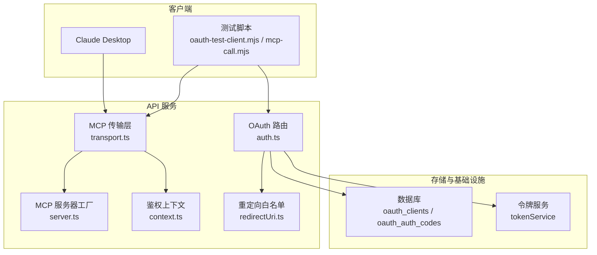
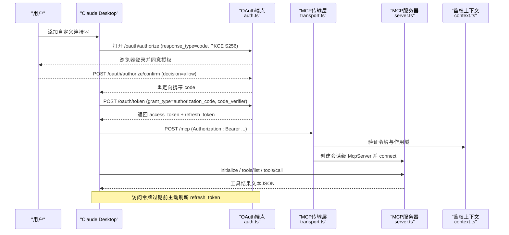
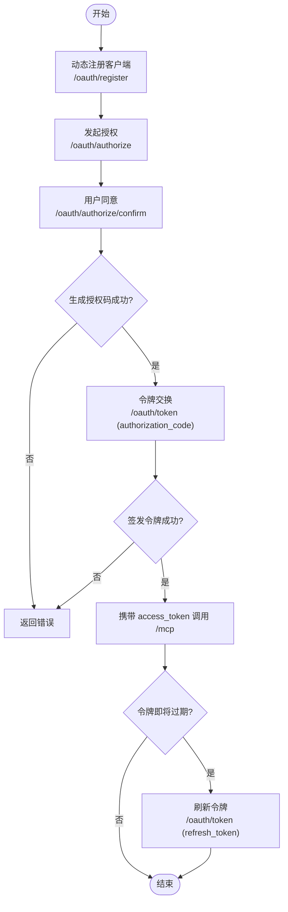
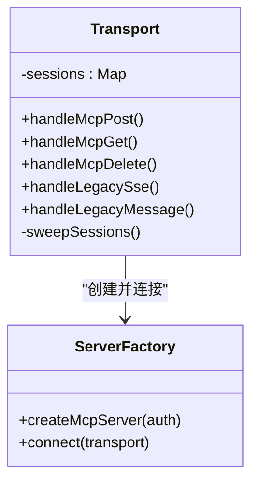
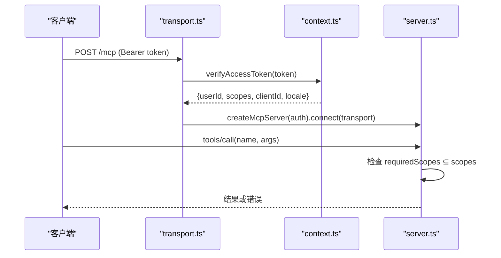
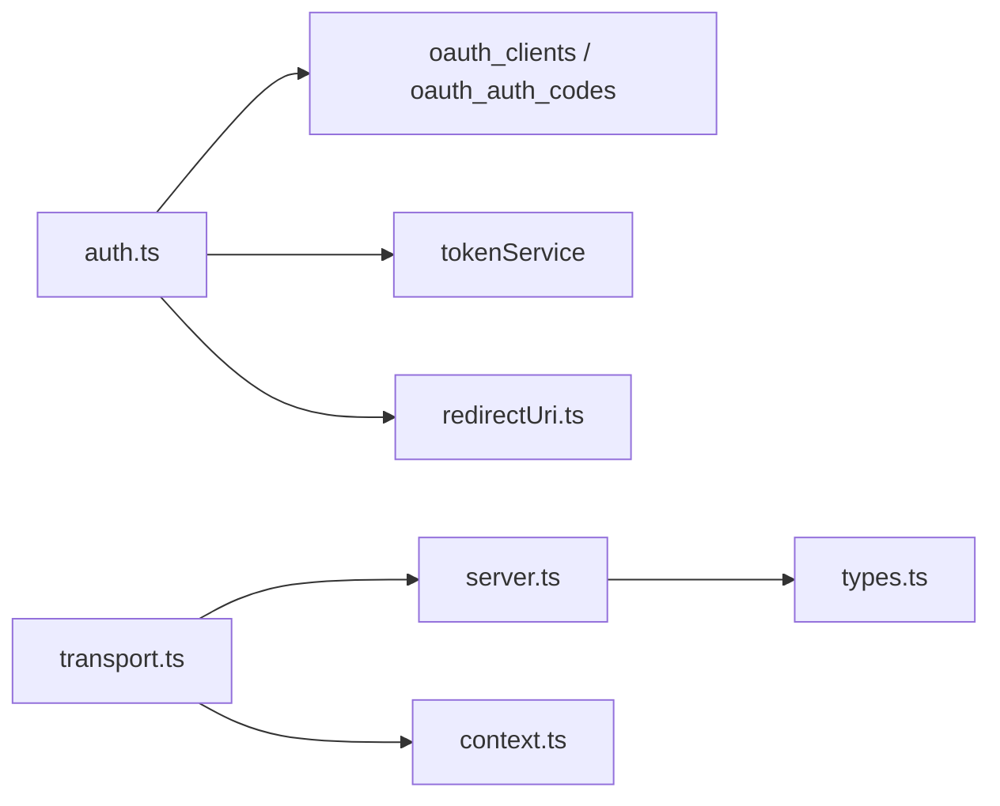

# Claude Desktop集成

<cite>
**本文引用的文件**
- [api/mcp/auth.ts](file://api/mcp/auth.ts)
- [api/mcp/transport.ts](file://api/mcp/transport.ts)
- [api/mcp/server.ts](file://api/mcp/server.ts)
- [api/mcp/context.ts](file://api/mcp/context.ts)
- [api/mcp/types.ts](file://api/mcp/types.ts)
- [api/mcp/redirectUri.ts](file://api/mcp/redirectUri.ts)
- [scripts/oauth-test-client.mjs](file://scripts/oauth-test-client.mjs)
- [scripts/mcp-call.mjs](file://scripts/mcp-call.mjs)
- [api/lib/env.ts](file://api/lib/env.ts)
- [.env.example](file://.env.example)
- [src/locales/en/connect.json](file://src/locales/en/connect.json)
- [src/locales/zh/connect.json](file://src/locales/zh/connect.json)
</cite>

## 目录
1. [简介](#简介)
2. [项目结构](#项目结构)
3. [核心组件](#核心组件)
4. [架构总览](#架构总览)
5. [详细组件分析](#详细组件分析)
6. [依赖关系分析](#依赖关系分析)
7. [性能与可靠性](#性能与可靠性)
8. [故障排查指南](#故障排查指南)
9. [结论](#结论)
10. [附录：配置与脚本示例](#附录配置与脚本示例)

## 简介
本文件面向在Claude Desktop桌面应用中集成DeeWaanAI的MCP（Model Context Protocol）服务，提供从OAuth 2.1授权、令牌获取与刷新、到MCP连接与安全配置的完整说明。文档涵盖环境变量、连接参数、安全选项、配置文件与启动脚本示例，并给出常见问题的排查方法与调试技巧，同时强调数据安全与隐私保护措施。

## 项目结构
本项目将MCP能力以独立的模块组织，核心包括：
- OAuth授权服务器端点：/.well-known/*、/oauth/*
- MCP传输层：/mcp（流式HTTP）、/mcp/sse（兼容旧版SSE）
- 工具注册与执行：按会话创建McpServer，动态注册工具并审计调用
- 鉴权上下文：对每个/mcp请求校验Bearer令牌并解析作用域
- 客户端脚本：用于测试OAuth流程与MCP调用的Node脚本

图表来源
- [api/mcp/auth.ts:147-427](file://api/mcp/auth.ts#L147-L427)
- [api/mcp/transport.ts:74-233](file://api/mcp/transport.ts#L74-L233)
- [api/mcp/server.ts:126-208](file://api/mcp/server.ts#L126-L208)
- [api/mcp/context.ts:17-29](file://api/mcp/context.ts#L17-L29)
- [api/mcp/redirectUri.ts:14-27](file://api/mcp/redirectUri.ts#L14-L27)

章节来源
- [api/mcp/auth.ts:147-427](file://api/mcp/auth.ts#L147-L427)
- [api/mcp/transport.ts:74-233](file://api/mcp/transport.ts#L74-L233)
- [api/mcp/server.ts:126-208](file://api/mcp/server.ts#L126-L208)
- [api/mcp/context.ts:17-29](file://api/mcp/context.ts#L17-L29)
- [api/mcp/redirectUri.ts:14-27](file://api/mcp/redirectUri.ts#L14-L27)

## 核心组件
- OAuth授权服务器（auth.ts）
  - 实现RFC 8414/9728元数据、DCR动态注册、授权码+PKCE、令牌交换与刷新
  - 支持scope过滤（mcp:read、mcp:run、mcp:write），单使用授权码，10分钟过期
  - 重定向URI严格校验，仅允许https或本地回环http
- MCP传输层（transport.ts）
  - 提供流式HTTP（/mcp）与兼容SSE（/mcp/sse + /mcp/messages）两种传输
  - 维护进程内会话映射，自动清理超时会话，注入采样桥接能力
- MCP服务器工厂（server.ts）
  - 为每个会话构建独立McpServer，按用户特性开关动态注册工具
  - 每调用记录审计日志与用量计数，失败不中断主流程
- 鉴权上下文（context.ts）
  - 解析Authorization Bearer头，验证访问令牌，返回作用域与用户信息
- 类型契约（types.ts）
  - 定义McpAuthContext与McpTool接口，统一工具签名与作用域要求
- 重定向白名单（redirectUri.ts）
  - 限制合法回调地址，防止开放重定向风险

章节来源
- [api/mcp/auth.ts:147-427](file://api/mcp/auth.ts#L147-L427)
- [api/mcp/transport.ts:74-233](file://api/mcp/transport.ts#L74-L233)
- [api/mcp/server.ts:126-208](file://api/mcp/server.ts#L126-L208)
- [api/mcp/context.ts:17-29](file://api/mcp/context.ts#L17-L29)
- [api/mcp/types.ts:9-44](file://api/mcp/types.ts#L9-L44)
- [api/mcp/redirectUri.ts:14-27](file://api/mcp/redirectUri.ts#L14-L27)

## 架构总览
下图展示Claude Desktop通过MCP协议与DeeWaanAI后端交互的整体流程，包含OAuth授权、令牌刷新、MCP会话建立与工具调用。

图表来源
- [api/mcp/auth.ts:229-427](file://api/mcp/auth.ts#L229-L427)
- [api/mcp/transport.ts:74-141](file://api/mcp/transport.ts#L74-L141)
- [api/mcp/server.ts:126-208](file://api/mcp/server.ts#L126-L208)
- [api/mcp/context.ts:17-29](file://api/mcp/context.ts#L17-L29)

## 详细组件分析

### OAuth授权与令牌生命周期
- 动态客户端注册（/oauth/register）
  - 校验client_name与redirect_uris，仅允许https或本地回环http
  - 生成唯一clientId并持久化
- 授权端点（/oauth/authorize）
  - 强制response_type=code，校验client_id、redirect_uri、PKCE S256
  - 跳转到同意页（/oauth/consent）
- 同意确认（/oauth/authorize/confirm）
  - 需要当前会话用户身份，校验redirect_uri与scope
  - 生成一次性授权码（10分钟过期），写入数据库
- 令牌交换（/oauth/token）
  - authorization_code：校验code、client_id、redirect_uri、code_verifier，标记已用，签发access_token与refresh_token
  - refresh_token：旋转刷新令牌并返回新令牌对
- 元数据与保护资源发现
  - /.well-known/oauth-authorization-server、/.well-known/oauth-protected-resource

图表来源
- [api/mcp/auth.ts:176-427](file://api/mcp/auth.ts#L176-L427)
- [api/mcp/redirectUri.ts:14-27](file://api/mcp/redirectUri.ts#L14-L27)

章节来源
- [api/mcp/auth.ts:176-427](file://api/mcp/auth.ts#L176-L427)
- [api/mcp/redirectUri.ts:14-27](file://api/mcp/redirectUri.ts#L14-L27)

### MCP传输与会话管理
- 流式HTTP传输（/mcp）
  - 首次POST创建会话，服务端分配sessionId并缓存transport
  - 后续请求携带mcp-session-id复用会话
  - GET/DELETE用于SSE流与关闭会话
- 兼容SSE传输（/mcp/sse + /mcp/messages）
  - 适用于旧版桌面客户端
- 会话清理
  - 进程内Map维护，定时扫描超过TTL的会话并关闭
- 采样桥接
  - 会话初始化后注入sampling能力探测与createMessage调用

图表来源
- [api/mcp/transport.ts:74-233](file://api/mcp/transport.ts#L74-L233)
- [api/mcp/server.ts:126-208](file://api/mcp/server.ts#L126-L208)

章节来源
- [api/mcp/transport.ts:74-233](file://api/mcp/transport.ts#L74-L233)
- [api/mcp/server.ts:126-208](file://api/mcp/server.ts#L126-L208)

### 鉴权与作用域控制
- 每个/mcp请求必须携带Authorization: Bearer <access_token>
- 上下文解析并验证令牌有效性与作用域
- 工具执行前检查requiredScopes，缺失则拒绝并记录审计
- 所有工具调用记录审计日志与月度用量计数

图表来源
- [api/mcp/context.ts:17-29](file://api/mcp/context.ts#L17-L29)
- [api/mcp/server.ts:84-124](file://api/mcp/server.ts#L84-L124)

章节来源
- [api/mcp/context.ts:17-29](file://api/mcp/context.ts#L17-L29)
- [api/mcp/server.ts:84-124](file://api/mcp/server.ts#L84-L124)

### 工具注册与特性开关
- 工具声明包含name、description、inputSchema、requiredScopes、annotations、featureFlag
- 构建服务器时根据用户特性开关决定是否注册工具
- 未注册的工具在tools/list中不可见，tools/call会作为未知工具被拒绝

章节来源
- [api/mcp/types.ts:33-44](file://api/mcp/types.ts#L33-L44)
- [api/mcp/server.ts:149-177](file://api/mcp/server.ts#L149-L177)

## 依赖关系分析
- OAuth模块依赖数据库表oauth_clients、oauth_auth_codes以及tokenService进行令牌签发与刷新
- 传输层依赖server工厂创建会话级McpServer，并在会话初始化后注入采样能力
- 鉴权上下文依赖tokenService验证访问令牌
- 重定向URI校验模块确保回调地址安全

图表来源
- [api/mcp/auth.ts:147-427](file://api/mcp/auth.ts#L147-L427)
- [api/mcp/transport.ts:74-233](file://api/mcp/transport.ts#L74-L233)
- [api/mcp/server.ts:126-208](file://api/mcp/server.ts#L126-L208)
- [api/mcp/context.ts:17-29](file://api/mcp/context.ts#L17-L29)
- [api/mcp/redirectUri.ts:14-27](file://api/mcp/redirectUri.ts#L14-L27)

章节来源
- [api/mcp/auth.ts:147-427](file://api/mcp/auth.ts#L147-L427)
- [api/mcp/transport.ts:74-233](file://api/mcp/transport.ts#L74-L233)
- [api/mcp/server.ts:126-208](file://api/mcp/server.ts#L126-L208)
- [api/mcp/context.ts:17-29](file://api/mcp/context.ts#L17-L29)
- [api/mcp/redirectUri.ts:14-27](file://api/mcp/redirectUri.ts#L14-L27)

## 性能与可靠性
- 会话TTL与清理：进程内会话默认24小时，后台扫描释放资源
- 审计与计量：每次工具调用异步记录审计与用量，不影响主流程
- 令牌有效期：访问令牌1小时，建议客户端在接近过期时主动刷新
- 传输选择：优先使用流式HTTP以获得更好的实时性与稳定性；SSE用于兼容旧客户端
- 特性开关：按用户维度隐藏或暴露工具，降低无效调用与负载

[本节为通用指导，无需特定文件引用]

## 故障排查指南
- 无法发现OAuth端点
  - 检查反向代理是否正确转发x-forwarded-proto/x-forwarded-host
  - 确认/.well-known/oauth-authorization-server可访问
- 授权码交换失败
  - 确认PKCE method=S256且code_verifier正确
  - 检查redirect_uri是否已注册且匹配
  - 授权码只能使用一次且10分钟内有效
- 令牌刷新失败
  - 确认refresh_token未过期且未被撤销
  - 检查客户端ID一致
- MCP连接失败
  - 确认Authorization头格式为“Bearer <token>”
  - 首次POST后使用返回的mcp-session-id进行后续请求
  - 若使用SSE，确保GET /mcp和POST /mcp/messages均携带正确会话标识
- 工具权限不足
  - 检查授权scope是否包含工具requiredScopes
  - 查看审计日志定位具体工具与错误原因

章节来源
- [api/mcp/auth.ts:229-427](file://api/mcp/auth.ts#L229-L427)
- [api/mcp/transport.ts:74-233](file://api/mcp/transport.ts#L74-L233)
- [api/mcp/server.ts:84-124](file://api/mcp/server.ts#L84-L124)

## 结论
通过OAuth 2.1与PKCE的安全授权流程，结合MCP流式HTTP传输与会话管理，Claude Desktop可以安全、稳定地调用DeeWaanAI提供的工具能力。建议在客户端实现令牌自动刷新、会话保持与错误重试策略，并遵循最小权限原则申请scope。生产环境务必配置强密钥、启用审计与监控，定期轮换令牌与密钥。

[本节为总结性内容，无需特定文件引用]

## 附录：配置与脚本示例

### 环境变量与关键配置
- 必需环境变量（生产）
  - APP_ID、APP_SECRET、DATABASE_URL、AI_SWARM_MASTER_KEY、MARKETPLACE_MASTER_KEY
- 可选基础设施
  - REDIS_URL、STRIPE_*、SENTRY_DSN、AUDIT_EXPORT_KEY、S3_*、BACKUP_TOKEN等
- 公共应用URL
  - PUBLIC_APP_URL用于生成绝对链接

章节来源
- [api/lib/env.ts:21-95](file://api/lib/env.ts#L21-L95)
- [.env.example:1-88](file://.env.example#L1-L88)

### Claude Desktop连接步骤
- 在设置中添加自定义连接器，名称可为“AI Swarm Studio”
- 粘贴MCP服务器地址（例如 https://your-domain.com/mcp）
- 点击连接后，浏览器窗口打开完成OAuth授权
- 授权通过后，工具列表可用（如list_pipelines、run_pipeline等）

章节来源
- [src/locales/en/connect.json:21-28](file://src/locales/en/connect.json#L21-L28)
- [src/locales/zh/connect.json:21-27](file://src/locales/zh/connect.json#L21-L27)

### OAuth测试与MCP调用脚本
- 准备阶段
  - 运行prepare模式，动态注册客户端并打印授权URL
  - 在浏览器完成登录与授权
- 捕获回调与换取令牌
  - 运行capture模式，监听本地端口接收回调，换取access_token与refresh_token
- 调用MCP工具
  - 使用mcp-call脚本，自动处理令牌刷新与会话保持
  - 支持列出工具与调用指定工具

章节来源
- [scripts/oauth-test-client.mjs:1-67](file://scripts/oauth-test-client.mjs#L1-L67)
- [scripts/mcp-call.mjs:1-73](file://scripts/mcp-call.mjs#L1-L73)

### 安全与隐私要点
- 重定向URI白名单：仅允许https或本地回环http，防止开放重定向
- 授权码一次性与短时效：减少中间人攻击面
- 访问令牌短期有效：建议客户端在接近过期时刷新
- 最小权限scope：仅申请所需读写能力
- 审计与计量：所有工具调用记录审计日志与用量，便于追踪与分析
- 敏感密钥管理：生产环境禁止使用开发默认值，定期轮换

章节来源
- [api/mcp/redirectUri.ts:14-27](file://api/mcp/redirectUri.ts#L14-L27)
- [api/mcp/auth.ts:35-38](file://api/mcp/auth.ts#L35-L38)
- [api/mcp/server.ts:46-82](file://api/mcp/server.ts#L46-L82)
- [api/lib/env.ts:11-23](file://api/lib/env.ts#L11-L23)