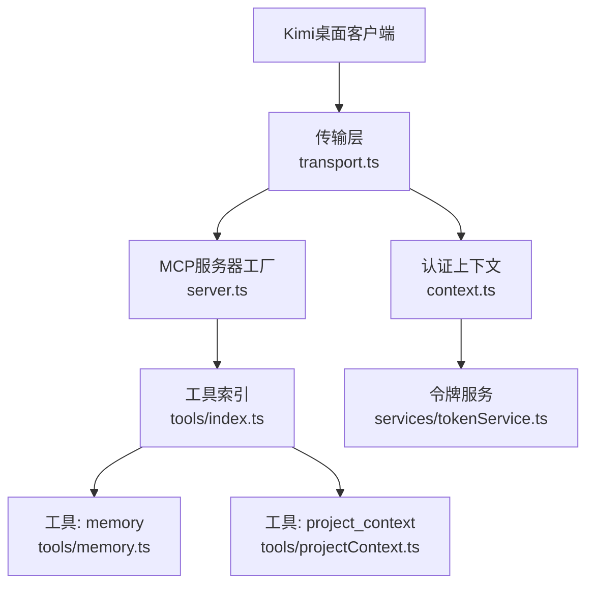
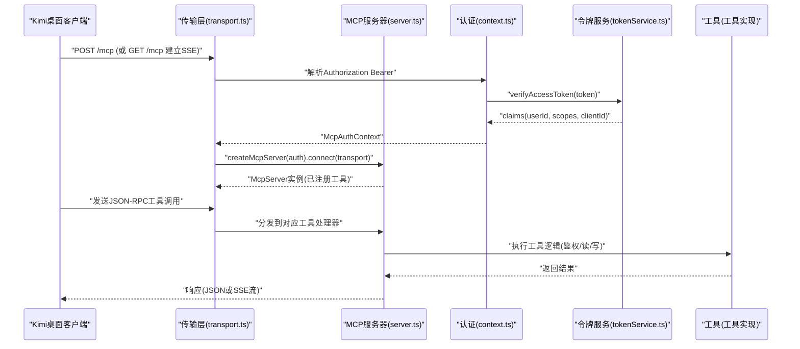
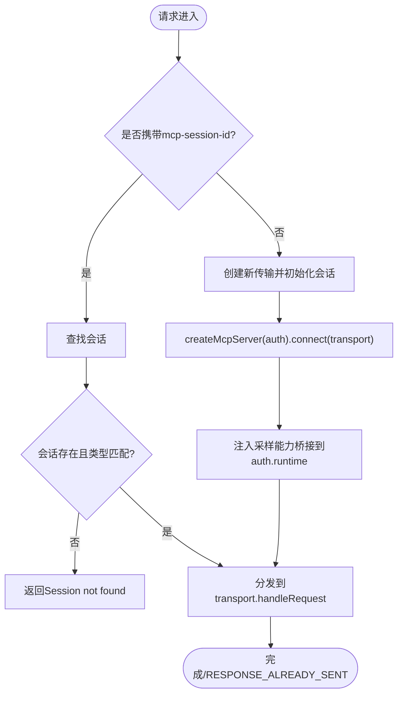
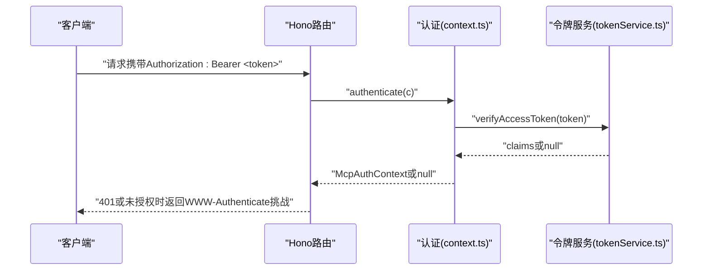
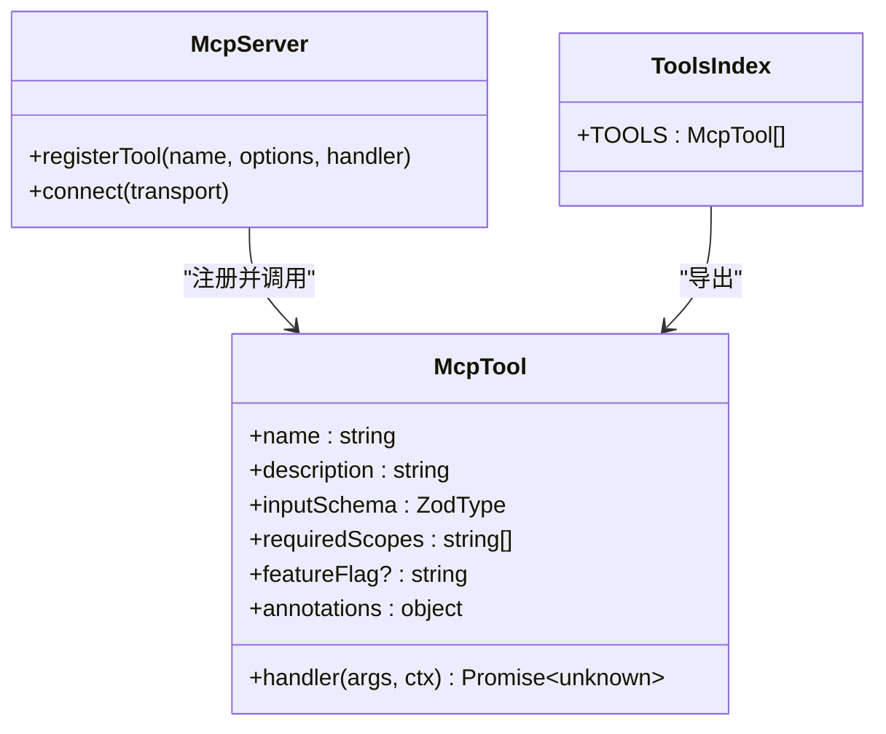
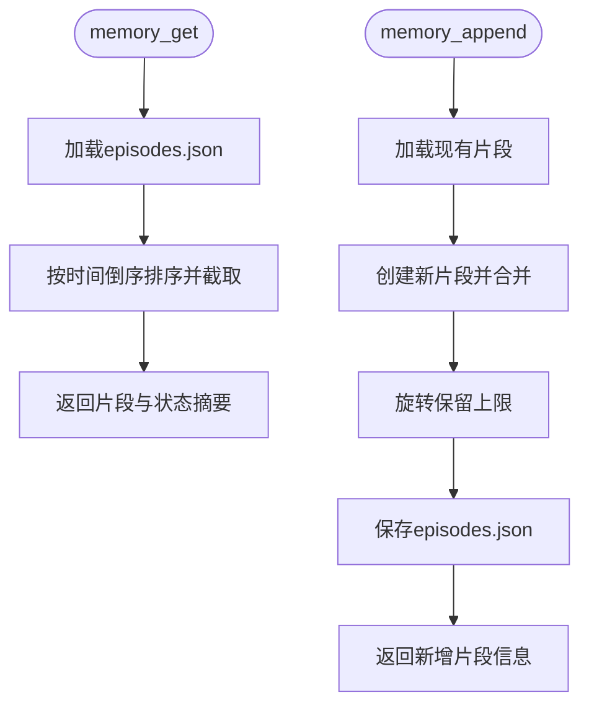
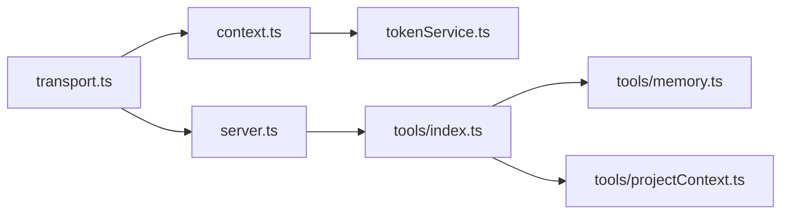

# Kimi桌面版集成

<cite>
**本文引用的文件**
- [api/mcp/server.ts](file://api/mcp/server.ts)
- [api/mcp/transport.ts](file://api/mcp/transport.ts)
- [api/mcp/context.ts](file://api/mcp/context.ts)
- [api/mcp/types.ts](file://api/mcp/types.ts)
- [api/mcp/tools/index.ts](file://api/mcp/tools/index.ts)
- [api/mcp/tools/memory.ts](file://api/mcp/tools/memory.ts)
- [api/mcp/tools/projectContext.ts](file://api/mcp/tools/projectContext.ts)
- [api/mcp/tools/_memoryStore.ts](file://api/mcp/tools/_memoryStore.ts)
- [api/services/tokenService.ts](file://api/services/tokenService.ts)
</cite>

## 目录
1. [简介](#简介)
2. [项目结构](#项目结构)
3. [核心组件](#核心组件)
4. [架构总览](#架构总览)
5. [详细组件分析](#详细组件分析)
6. [依赖关系分析](#依赖关系分析)
7. [性能考虑](#性能考虑)
8. [故障排查指南](#故障排查指南)
9. [结论](#结论)
10. [附录：集成示例与配置模板](#附录集成示例与配置模板)

## 简介
本指南面向Kimi桌面应用，说明如何与DeeWaanAI的MCP（Model Context Protocol）服务集成。内容涵盖：
- MCP客户端与服务端的连接建立过程（流式HTTP与SSE两种传输）
- 上下文管理、会话状态维护与消息传递协议
- 工具注册、鉴权与权限控制
- 数据同步机制（本地磁盘为主）与冲突处理建议
- 网络异常处理与重连策略
- 集成示例代码路径与配置模板

## 项目结构
MCP相关实现集中在后端API的mcp模块中，包含服务端工厂、传输层、认证上下文、类型定义以及工具注册与实现。关键文件如下：
- 服务端工厂：按会话创建McpServer并注册工具
- 传输层：提供流式HTTP与SSE两种传输，维护进程内会话映射
- 认证上下文：从Authorization头解析Bearer令牌并校验
- 类型定义：统一MCP工具与认证上下文契约
- 工具索引：集中注册所有可用工具
- 工具实现：如记忆、项目上下文等，体现数据读写与同步方式

图表来源
- [api/mcp/transport.ts:1-234](file://api/mcp/transport.ts#L1-L234)
- [api/mcp/server.ts:1-209](file://api/mcp/server.ts#L1-L209)
- [api/mcp/tools/index.ts:1-95](file://api/mcp/tools/index.ts#L1-L95)
- [api/mcp/context.ts:1-42](file://api/mcp/context.ts#L1-L42)
- [api/services/tokenService.ts:1-129](file://api/services/tokenService.ts#L1-L129)

章节来源
- [api/mcp/transport.ts:1-234](file://api/mcp/transport.ts#L1-L234)
- [api/mcp/server.ts:1-209](file://api/mcp/server.ts#L1-L209)
- [api/mcp/tools/index.ts:1-95](file://api/mcp/tools/index.ts#L1-L95)
- [api/mcp/context.ts:1-42](file://api/mcp/context.ts#L1-L42)
- [api/services/tokenService.ts:1-129](file://api/services/tokenService.ts#L1-L129)

## 核心组件
- 认证上下文（context.ts）：从请求头提取Bearer令牌，调用令牌服务验证，生成包含用户ID、作用域、客户端ID、请求ID、语言环境的认证上下文。
- 传输层（transport.ts）：维护进程内会话Map，支持流式HTTP（POST/GET/DELETE /mcp）与SSE（/mcp/sse与/mcp/messages），在会话初始化时注入采样能力桥接。
- 服务端工厂（server.ts）：为每个会话构建独立的McpServer实例，按会话动态注册工具，执行权限检查、功能开关过滤、审计与用量统计。
- 类型契约（types.ts）：定义McpAuthContext与McpTool接口，约束工具输入Schema、所需作用域、注解与处理器签名。
- 工具索引（tools/index.ts）：集中导出所有McpTool实例，供服务端工厂注册。
- 工具实现（memory.ts、projectContext.ts）：展示读取/写入项目记忆与项目智能卡，使用磁盘存储作为主持久化。

章节来源
- [api/mcp/context.ts:1-42](file://api/mcp/context.ts#L1-L42)
- [api/mcp/transport.ts:1-234](file://api/mcp/transport.ts#L1-L234)
- [api/mcp/server.ts:1-209](file://api/mcp/server.ts#L1-L209)
- [api/mcp/types.ts:1-45](file://api/mcp/types.ts#L1-L45)
- [api/mcp/tools/index.ts:1-95](file://api/mcp/tools/index.ts#L1-L95)
- [api/mcp/tools/memory.ts:1-92](file://api/mcp/tools/memory.ts#L1-L92)
- [api/mcp/tools/projectContext.ts:1-130](file://api/mcp/tools/projectContext.ts#L1-L130)

## 架构总览
下图展示了Kimi桌面客户端通过MCP传输层与服务端交互的整体流程，包括会话建立、工具调用、鉴权与数据访问。

图表来源
- [api/mcp/transport.ts:74-170](file://api/mcp/transport.ts#L74-L170)
- [api/mcp/server.ts:135-186](file://api/mcp/server.ts#L135-L186)
- [api/mcp/context.ts:17-41](file://api/mcp/context.ts#L17-L41)
- [api/services/tokenService.ts:50-66](file://api/services/tokenService.ts#L50-L66)

## 详细组件分析

### 连接建立与会话管理（transport.ts）
- 支持两种传输：
  - 流式HTTP：POST /mcp用于发送消息；GET /mcp用于服务端→客户端SSE；DELETE /mcp关闭会话。
  - 传统SSE：GET /mcp/sse打开SSE并返回端点事件；POST /mcp/messages?sessionId=…发送消息。
- 进程内会话Map：以SDK生成的sessionId为键，保存transport、会话类型、userId与创建时间；定期清理过期会话。
- 会话生命周期：
  - 首次POST /mcp时创建StreamableHTTPServerTransport，设置session初始化与关闭回调，将transport加入sessions Map。
  - 在initialize成功后，向auth.runtime注入采样能力桥接（samplingSupported与sample）。
  - SSE模式同理，但使用SSEServerTransport。
- 错误处理：
  - 解析失败返回JSON-RPC Parse error。
  - 未找到会话返回Session not found。
  - 传输层异常记录日志并返回通用错误。

图表来源
- [api/mcp/transport.ts:74-170](file://api/mcp/transport.ts#L74-L170)
- [api/mcp/transport.ts:174-233](file://api/mcp/transport.ts#L174-L233)

章节来源
- [api/mcp/transport.ts:1-234](file://api/mcp/transport.ts#L1-L234)

### 认证与上下文（context.ts + tokenService.ts）
- 认证流程：
  - 从Authorization头提取Bearer令牌。
  - 调用verifyAccessToken进行JWT校验，返回claims（userId、scopes、clientId）。
  - 构造McpAuthContext，包含用户ID、作用域集合、客户端ID、请求ID与语言环境。
- 令牌服务：
  - 签发与验证HS256 JWT访问令牌。
  - 签发与轮换不透明刷新令牌（哈希存储于数据库）。
  - 提供作用域常量，便于工具声明所需权限。

图表来源
- [api/mcp/context.ts:17-41](file://api/mcp/context.ts#L17-L41)
- [api/services/tokenService.ts:50-66](file://api/services/tokenService.ts#L50-L66)

章节来源
- [api/mcp/context.ts:1-42](file://api/mcp/context.ts#L1-L42)
- [api/services/tokenService.ts:1-129](file://api/services/tokenService.ts#L1-L129)

### 工具注册与调用（server.ts + tools/index.ts）
- 工具注册：
  - 服务端工厂为每个会话创建独立McpServer实例。
  - 遍历工具索引，根据功能开关决定是否注册该工具。
  - 对每个工具注册处理器，执行权限检查（requiredScopes）、参数校验（zod schema）、调用业务逻辑并包装结果。
- 审计与用量：
  - 每次工具调用记录审计日志（latency、status、error）。
  - 月度用量计数器自增，失败不影响工具调用。
- 工具列表：
  - 仅暴露当前会话可用的工具（受功能开关与权限影响）。

图表来源
- [api/mcp/server.ts:84-124](file://api/mcp/server.ts#L84-L124)
- [api/mcp/tools/index.ts:45-94](file://api/mcp/tools/index.ts#L45-L94)

章节来源
- [api/mcp/server.ts:1-209](file://api/mcp/server.ts#L1-L209)
- [api/mcp/tools/index.ts:1-95](file://api/mcp/tools/index.ts#L1-L95)

### 数据同步与冲突处理（memory.ts + _memoryStore.ts）
- 存储位置：
  - 项目记忆与状态存储在本地磁盘（{PROJECT_FILES_DIR}/{projectId}/memory/），作为主持久化。
  - episodes.json与state.json分别承载片段记忆与结构化状态摘要。
- 读取与写入：
  - memory_get：读取最近片段与状态摘要，限制返回数量与长度。
  - memory_append：追加笔记，生成片段并旋转保留上限，保存到磁盘。
- 冲突处理建议：
  - 由于当前为单节点部署，进程内会话隔离，避免多写冲突。
  - 若未来扩展为多节点，建议引入基于文件的锁或版本戳（例如episodes.json的ETag/版本号）进行乐观并发控制。

图表来源
- [api/mcp/tools/memory.ts:24-91](file://api/mcp/tools/memory.ts#L24-L91)
- [api/mcp/tools/_memoryStore.ts:18-36](file://api/mcp/tools/_memoryStore.ts#L18-L36)

章节来源
- [api/mcp/tools/memory.ts:1-92](file://api/mcp/tools/memory.ts#L1-L92)
- [api/mcp/tools/_memoryStore.ts:1-37](file://api/mcp/tools/_memoryStore.ts#L1-L37)

### 项目上下文（projectContext.ts）
- 功能：获取项目的“智能卡”（类型、框架、文件树、实体、端点、待办等），可选返回最相关的文件内容。
- 数据源：
  - 数据库中的projects表获取智能卡。
  - 通过项目智能服务计算相关文件路径，再读取磁盘文件内容。
- 输出限制：对大数组进行截断，避免响应过大。

章节来源
- [api/mcp/tools/projectContext.ts:1-130](file://api/mcp/tools/projectContext.ts#L1-L130)

## 依赖关系分析
- transport.ts依赖server.ts创建MCP服务器，依赖context.ts进行认证，依赖tokenService.ts验证令牌。
- server.ts依赖tools/index.ts注册工具，依赖logger与messages进行审计与国际化。
- 工具实现依赖项目文件服务与内存管理器，遵循统一的McpTool接口。

图表来源
- [api/mcp/transport.ts:1-234](file://api/mcp/transport.ts#L1-L234)
- [api/mcp/server.ts:1-209](file://api/mcp/server.ts#L1-L209)
- [api/mcp/context.ts:1-42](file://api/mcp/context.ts#L1-L42)
- [api/services/tokenService.ts:1-129](file://api/services/tokenService.ts#L1-L129)
- [api/mcp/tools/index.ts:1-95](file://api/mcp/tools/index.ts#L1-L95)
- [api/mcp/tools/memory.ts:1-92](file://api/mcp/tools/memory.ts#L1-L92)
- [api/mcp/tools/projectContext.ts:1-130](file://api/mcp/tools/projectContext.ts#L1-L130)

章节来源
- [api/mcp/transport.ts:1-234](file://api/mcp/transport.ts#L1-L234)
- [api/mcp/server.ts:1-209](file://api/mcp/server.ts#L1-L209)
- [api/mcp/context.ts:1-42](file://api/mcp/context.ts#L1-L42)
- [api/services/tokenService.ts:1-129](file://api/services/tokenService.ts#L1-L129)
- [api/mcp/tools/index.ts:1-95](file://api/mcp/tools/index.ts#L1-L95)

## 性能考虑
- 会话清理：定期扫描并关闭过期会话，防止内存泄漏。
- 工具调用审计：异步记录审计与用量，避免阻塞主流程。
- 响应大小控制：对大数组与长文本进行截断，减少网络开销。
- 传输选择：优先使用流式HTTP以获得更好的实时性与资源利用。

[本节为通用指导，无需特定文件引用]

## 故障排查指南
- 认证失败：
  - 检查Authorization头格式与作用域是否满足工具要求。
  - 确认令牌未过期且由可信发行者签发。
- 会话未找到：
  - 确保请求携带正确的mcp-session-id（流式HTTP）或sessionId（SSE）。
  - 检查会话是否已过期或被清理。
- 工具调用失败：
  - 查看工具处理器抛出的错误信息。
  - 检查功能开关是否启用，权限是否足够。
- 传输错误：
  - 检查服务端日志中的transport错误。
  - 确认客户端正确解析SSE流或JSON-RPC响应。

章节来源
- [api/mcp/transport.ts:59-64](file://api/mcp/transport.ts#L59-L64)
- [api/mcp/transport.ts:126-140](file://api/mcp/transport.ts#L126-L140)
- [api/mcp/server.ts:46-82](file://api/mcp/server.ts#L46-L82)

## 结论
本指南系统说明了Kimi桌面应用与DeeWaanAI MCP服务的集成要点：通过流式HTTP与SSE建立会话，使用Bearer令牌进行鉴权，按会话注册工具并执行权限控制；数据以本地磁盘为主进行同步，建议在多节点场景引入并发控制；结合审计与用量统计保障可观测性。按照本文提供的流程图与示例路径，可快速完成端到端集成与调试。

[本节为总结，无需特定文件引用]

## 附录：集成示例与配置模板
- 连接建立（流式HTTP）：
  - POST /mcp：发送JSON-RPC消息，携带Authorization: Bearer <token>与mcp-session-id（首次无则服务端创建）。
  - GET /mcp：接收服务端→客户端SSE流。
  - DELETE /mcp：关闭会话。
- 连接建立（SSE）：
  - GET /mcp/sse：打开SSE并返回端点事件。
  - POST /mcp/messages?sessionId=…：发送JSON-RPC消息。
- 工具调用示例路径：
  - 读取项目记忆：参考[memory_get:24-62](file://api/mcp/tools/memory.ts#L24-L62)
  - 追加项目记忆：参考[memory_append:64-91](file://api/mcp/tools/memory.ts#L64-L91)
  - 获取项目上下文：参考[project_context:25-128](file://api/mcp/tools/projectContext.ts#L25-L128)
- 配置模板（环境变量与令牌）：
  - 访问令牌：使用HS256 JWT，作用域包含mcp:read、mcp:run、mcp:write等。
  - 刷新令牌：不透明字符串，哈希存储，支持轮换。
  - 参考令牌服务接口：[issueAccessToken:34-48](file://api/services/tokenService.ts#L34-L48)、[verifyAccessToken:50-66](file://api/services/tokenService.ts#L50-L66)、[rotateRefreshToken:96-128](file://api/services/tokenService.ts#L96-L128)

章节来源
- [api/mcp/transport.ts:74-170](file://api/mcp/transport.ts#L74-L170)
- [api/mcp/transport.ts:174-233](file://api/mcp/transport.ts#L174-L233)
- [api/mcp/tools/memory.ts:24-91](file://api/mcp/tools/memory.ts#L24-L91)
- [api/mcp/tools/projectContext.ts:25-128](file://api/mcp/tools/projectContext.ts#L25-L128)
- [api/services/tokenService.ts:34-128](file://api/services/tokenService.ts#L34-L128)