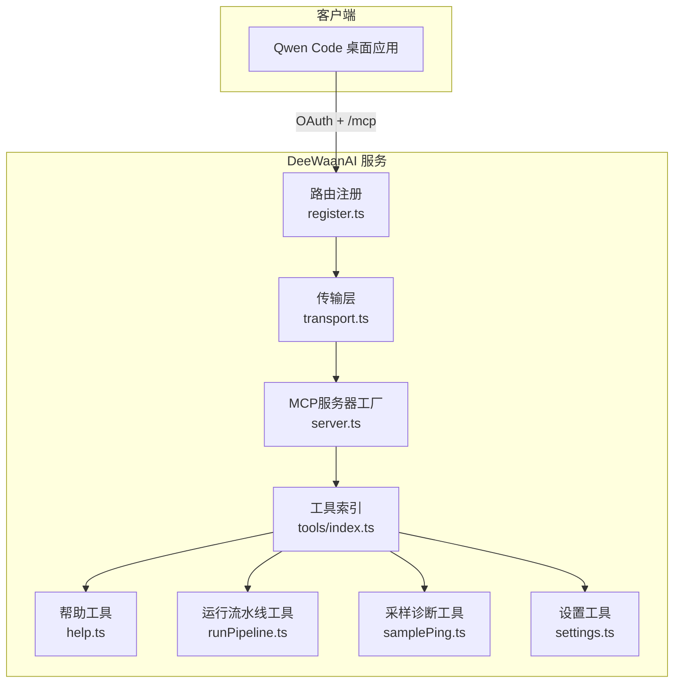
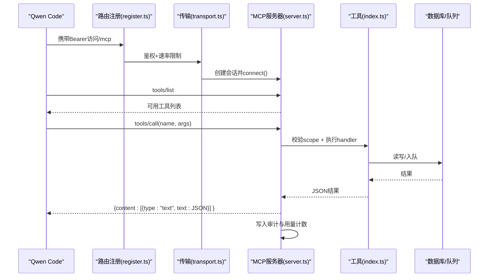
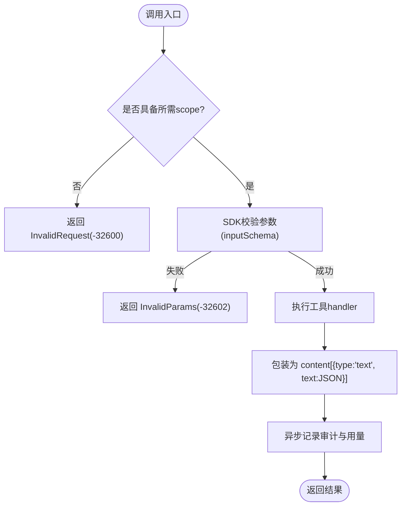
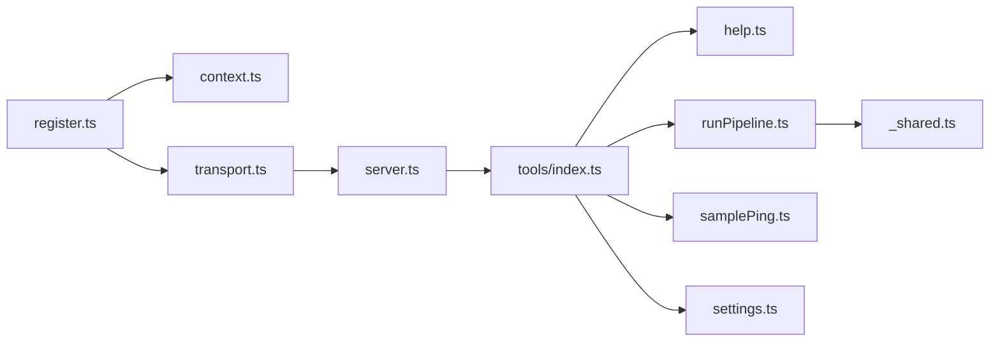

# Qwen Code集成

<cite>
**本文引用的文件**
- [README.md](file://README.md)
- [api/mcp/server.ts](file://api/mcp/server.ts)
- [api/mcp/register.ts](file://api/mcp/register.ts)
- [api/mcp/transport.ts](file://api/mcp/transport.ts)
- [api/mcp/context.ts](file://api/mcp/context.ts)
- [api/mcp/types.ts](file://api/mcp/types.ts)
- [api/mcp/tools/index.ts](file://api/mcp/tools/index.ts)
- [api/mcp/tools/help.ts](file://api/mcp/tools/help.ts)
- [api/mcp/tools/runPipeline.ts](file://api/mcp/tools/runPipeline.ts)
- [api/mcp/tools/samplePing.ts](file://api/mcp/tools/samplePing.ts)
- [api/mcp/tools/settings.ts](file://api/mcp/tools/settings.ts)
- [api/mcp/tools/_shared.ts](file://api/mcp/tools/_shared.ts)
- [scripts/mcp-call.mjs](file://scripts/mcp-call.mjs)
- [src/pages/Connect.tsx](file://src/pages/Connect.tsx)
</cite>

## 目录
1. [简介](#简介)
2. [项目结构](#项目结构)
3. [核心组件](#核心组件)
4. [架构总览](#架构总览)
5. [详细组件分析](#详细组件分析)
6. [依赖关系分析](#依赖关系分析)
7. [性能与可观测性](#性能与可观测性)
8. [故障排查指南](#故障排查指南)
9. [结论](#结论)
10. [附录：工具清单与调用示例](#附录工具清单与调用示例)

## 简介
本文件面向在Qwen Code桌面应用中集成DeeWaanAI的开发者，说明如何通过MCP（Model Context Protocol）发现并调用DeeWaanAI提供的工具，涵盖认证、传输、工具注册与发现、参数校验、返回值格式、错误码规范、自定义工具扩展、性能监控与日志收集，以及与其他AI工具的协作模式。

## 项目结构
DeeWaanAI以Hono为HTTP框架，提供OAuth 2.1授权服务与MCP端点；MCP服务器按会话创建，动态注册工具并通过流式HTTP或SSE传输与客户端交互。Qwen Code通过“添加MCP”方式连接至服务端，使用Bearer令牌鉴权后调用工具。

图表来源
- [api/mcp/register.ts:144-164](file://api/mcp/register.ts#L144-L164)
- [api/mcp/transport.ts:74-170](file://api/mcp/transport.ts#L74-L170)
- [api/mcp/server.ts:135-186](file://api/mcp/server.ts#L135-L186)
- [api/mcp/tools/index.ts:45-94](file://api/mcp/tools/index.ts#L45-L94)

章节来源
- [README.md:1-18](file://README.md#L1-L18)
- [api/mcp/register.ts:144-164](file://api/mcp/register.ts#L144-L164)

## 核心组件
- OAuth与路由注册：统一入口，保护所有/mcp*路径，解析客户层级与速率限制。
- 传输层：支持流式HTTP（推荐）与兼容旧版SSE，维护会话生命周期。
- MCP服务器工厂：按会话构建McpServer，基于功能开关与权限过滤工具。
- 工具注册表：集中声明所有可用工具及其输入Schema、权限范围、注解与处理器。
- 认证上下文：从Bearer令牌解析用户、作用域、请求ID与本地化信息。

章节来源
- [api/mcp/register.ts:144-164](file://api/mcp/register.ts#L144-L164)
- [api/mcp/transport.ts:74-170](file://api/mcp/transport.ts#L74-L170)
- [api/mcp/server.ts:135-186](file://api/mcp/server.ts#L135-L186)
- [api/mcp/tools/index.ts:45-94](file://api/mcp/tools/index.ts#L45-L94)
- [api/mcp/context.ts:17-41](file://api/mcp/context.ts#L17-L41)

## 架构总览
下图展示Qwen Code到DeeWaanAI的完整调用链路：从OAuth获取令牌，建立MCP会话，列举工具，调用具体工具，再到结果返回与审计记录。

图表来源
- [api/mcp/register.ts:90-142](file://api/mcp/register.ts#L90-L142)
- [api/mcp/transport.ts:74-170](file://api/mcp/transport.ts#L74-L170)
- [api/mcp/server.ts:84-124](file://api/mcp/server.ts#L84-L124)
- [api/mcp/tools/index.ts:45-94](file://api/mcp/tools/index.ts#L45-L94)

## 详细组件分析

### 认证与鉴权
- 所有/mcp*路径需Bearer令牌，缺失或无效时返回401并附带WWW-Authenticate头。
- 认证中间件会解析令牌、提取userId、scopes、clientId、requestId与locale，并注入后续处理。
- 每请求一次计算客户层级（solo/team/admin），用于速率限制策略。

章节来源
- [api/mcp/register.ts:90-142](file://api/mcp/register.ts#L90-L142)
- [api/mcp/context.ts:17-41](file://api/mcp/context.ts#L17-L41)

### 传输与会话管理
- 流式HTTP（推荐）：POST/GET/DELETE /mcp，首次POST建立会话，后续复用mcp-session-id。
- 兼容SSE：GET /mcp/sse打开SSE流，POST /mcp/messages发送消息。
- 进程内会话Map，带TTL清理；失败时返回统一错误。

章节来源
- [api/mcp/transport.ts:74-170](file://api/mcp/transport.ts#L74-L170)
- [api/mcp/transport.ts:172-234](file://api/mcp/transport.ts#L172-L234)

### 工具发现机制
- 每个会话新建McpServer，遍历工具索引，根据功能开关决定是否注册。
- 工具列表由SDK暴露，Qwen Code可通过tools/list获取当前会话可见的工具集合。
- 未启用功能的工具不会出现在列表中，调用时会作为未知工具被拒绝。

章节来源
- [api/mcp/server.ts:135-186](file://api/mcp/server.ts#L135-L186)
- [api/mcp/tools/index.ts:45-94](file://api/mcp/tools/index.ts#L45-L94)

### 工具调用流程与参数校验
- 调用前进行scope检查，缺少必需scope将返回InvalidRequest错误。
- 参数由SDK基于工具的inputSchema（Zod对象）自动校验，非法参数返回InvalidParams。
- 处理器返回任意可JSON序列化的值，最终包装为content数组中的文本字段。

图表来源
- [api/mcp/server.ts:84-124](file://api/mcp/server.ts#L84-L124)

章节来源
- [api/mcp/server.ts:84-124](file://api/mcp/server.ts#L84-L124)

### 关键工具示例
- deewaanai_help：根据用户能力、计划、功能开关与配置生成个性化帮助。
- run_pipeline：创建流水线运行任务并立即返回，建议轮询状态。
- sample_ping：诊断当前客户端是否支持MCP采样，并回显模型与延迟。
- get_settings/set_default_model：查看与修改默认模型与提供者。

章节来源
- [api/mcp/tools/help.ts:18-46](file://api/mcp/tools/help.ts#L18-L46)
- [api/mcp/tools/runPipeline.ts:97-155](file://api/mcp/tools/runPipeline.ts#L97-L155)
- [api/mcp/tools/samplePing.ts:20-55](file://api/mcp/tools/samplePing.ts#L20-L55)
- [api/mcp/tools/settings.ts:51-66](file://api/mcp/tools/settings.ts#L51-L66)

### 自定义工具扩展指南
- 新增工具步骤：
  1) 在tools目录下实现一个符合McpTool接口的对象（name、description、inputSchema、requiredScopes、annotations、handler）。
  2) 在tools/index.ts中导入并加入TOOLS数组。
  3) 如需灰度发布，设置featureFlag字段，由服务器按用户维度控制可见性。
- 安全与访问控制：
  - 对资源访问（如项目）必须调用共享校验函数，确保仅所有者或团队成员可操作。
  - 所有敏感数据不得泄露给非授权方。
- 输出约定：
  - handler返回可JSON序列化的值，将被自动包装为content文本。
  - 长文本建议使用截断辅助函数，避免过大响应。

章节来源
- [api/mcp/types.ts:33-44](file://api/mcp/types.ts#L33-L44)
- [api/mcp/tools/_shared.ts:36-66](file://api/mcp/tools/_shared.ts#L36-L66)
- [api/mcp/tools/index.ts:45-94](file://api/mcp/tools/index.ts#L45-L94)

### 与Qwen Code的集成方式
- 在Qwen Code中添加MCP端点：使用“qwen mcp add --transport http <MCP_URL>”命令。
- 端点地址可在Web界面“连接”页复制，或通过环境变量构造。
- 首次连接后，Qwen Code将调用tools/list获取可用工具，再按需调用tools/call。

章节来源
- [src/pages/Connect.tsx:133-140](file://src/pages/Connect.tsx#L133-L140)
- [README.md:6-8](file://README.md#L6-L8)

## 依赖关系分析
- 路由注册依赖认证中间件与传输层，统一保护/mcp*。
- 传输层依赖MCP服务器工厂，负责会话生命周期与采样桥接。
- 服务器工厂依赖工具索引，按功能开关与权限注册工具。
- 工具模块依赖数据库、队列与服务，完成业务逻辑。

图表来源
- [api/mcp/register.ts:144-164](file://api/mcp/register.ts#L144-L164)
- [api/mcp/transport.ts:74-170](file://api/mcp/transport.ts#L74-L170)
- [api/mcp/server.ts:135-186](file://api/mcp/server.ts#L135-L186)
- [api/mcp/tools/index.ts:45-94](file://api/mcp/tools/index.ts#L45-L94)

章节来源
- [api/mcp/register.ts:144-164](file://api/mcp/register.ts#L144-L164)
- [api/mcp/transport.ts:74-170](file://api/mcp/transport.ts#L74-L170)
- [api/mcp/server.ts:135-186](file://api/mcp/server.ts#L135-L186)
- [api/mcp/tools/index.ts:45-94](file://api/mcp/tools/index.ts#L45-L94)

## 性能与可观测性
- 速率限制：按客户层级（solo/team/admin）限制MCP调用频率，超限返回429并提示重试时间。
- 审计与用量：每次工具调用异步记录审计日志（耗时、状态、错误）与月度用量计数，不影响主流程。
- 会话清理：进程内会话Map定期扫描过期会话，释放资源。
- 日志：关键节点（会话初始化、关闭、错误）均有日志输出，便于定位问题。

章节来源
- [api/mcp/register.ts:90-142](file://api/mcp/register.ts#L90-L142)
- [api/mcp/server.ts:46-82](file://api/mcp/server.ts#L46-L82)
- [api/mcp/transport.ts:48-57](file://api/mcp/transport.ts#L48-L57)

## 故障排查指南
- 401未授权：检查Authorization头是否包含有效Bearer令牌；确认OAuth流程已完成。
- 429速率限制：根据Retry-After等待后重试；必要时升级客户层级。
- 参数错误：核对inputSchema定义，确保类型与必填项正确。
- 权限不足：确认令牌scopes包含工具requiredScopes。
- 工具不可见：检查功能开关是否对该用户启用；查看服务器日志中的隐藏计数。
- 采样不支持：sample_ping返回supported=false且reason提示；确认客户端能力与连接方式。

章节来源
- [api/mcp/register.ts:90-142](file://api/mcp/register.ts#L90-L142)
- [api/mcp/server.ts:84-124](file://api/mcp/server.ts#L84-L124)
- [api/mcp/tools/samplePing.ts:20-55](file://api/mcp/tools/samplePing.ts#L20-L55)

## 结论
通过在Qwen Code中接入DeeWaanAI的MCP端点，可以安全、可控地调用丰富的AI工具，包括流水线编排、市场检索、团队协同等。系统提供完善的鉴权、传输、工具注册与发现、参数校验、错误处理、性能监控与日志采集能力，满足生产环境要求。

## 附录：工具清单与调用示例
- 工具清单：详见工具索引文件，包含流水线、设置、市场、团队、批处理等工具。
- 列出工具：Qwen Code调用tools/list获取当前会话可见工具。
- 调用工具：Qwen Code调用tools/call，传入工具名与参数；结果为content中文本字段的JSON字符串。
- 测试脚本：可使用内置脚本进行工具调用与列表查询，便于本地验证。

章节来源
- [api/mcp/tools/index.ts:45-94](file://api/mcp/tools/index.ts#L45-L94)
- [scripts/mcp-call.mjs:64-72](file://scripts/mcp-call.mjs#L64-L72)