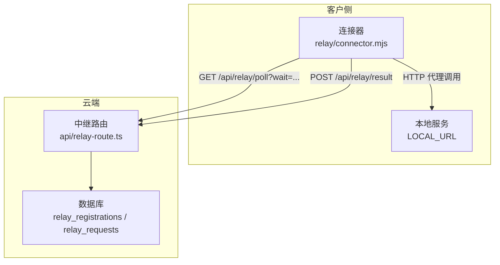
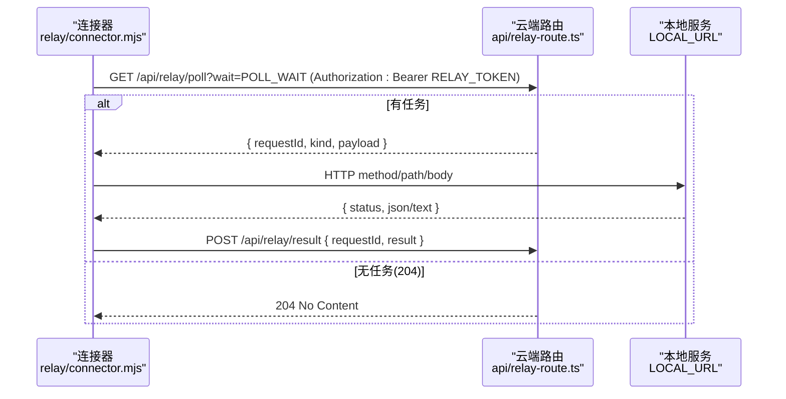
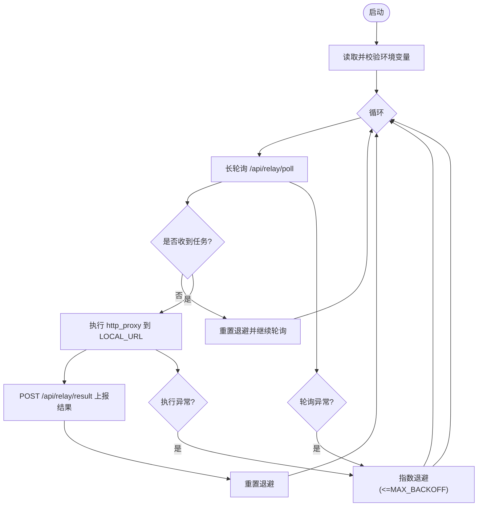
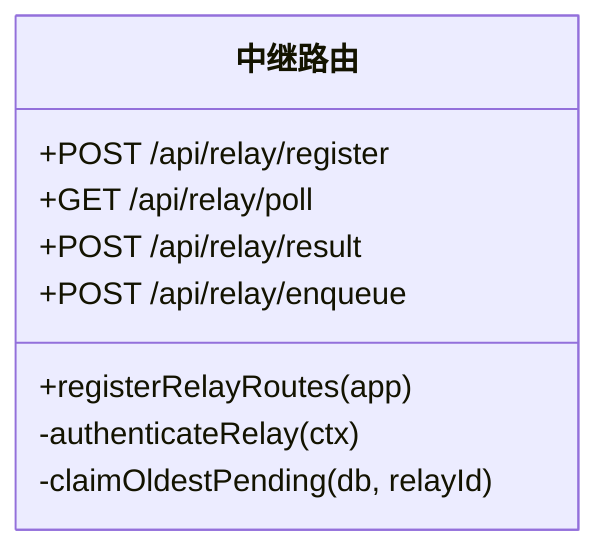
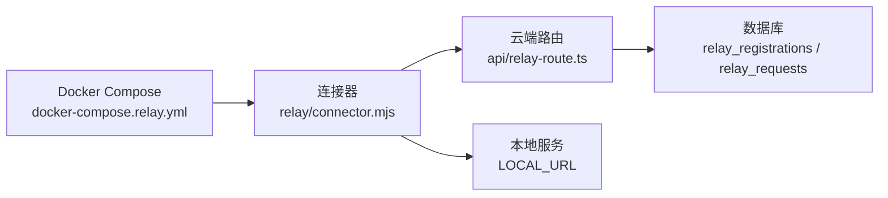

# 中继连接器

<cite>
**本文引用的文件**
- [relay/connector.mjs](file://relay/connector.mjs)
- [api/relay-route.ts](file://api/relay-route.ts)
- [docker-compose.relay.yml](file://docker-compose.relay.yml)
- [scripts/smoke-relay-loop.mjs](file://scripts/smoke-relay-loop.mjs)
</cite>

## 目录
1. [简介](#简介)
2. [项目结构](#项目结构)
3. [核心组件](#核心组件)
4. [架构总览](#架构总览)
5. [详细组件分析](#详细组件分析)
6. [依赖关系分析](#依赖关系分析)
7. [性能与调优](#性能与调优)
8. [故障诊断指南](#故障诊断指南)
9. [结论](#结论)
10. [附录：部署与环境配置](#附录部署与环境配置)

## 简介
本技术文档面向DeeWaanAI的“中继连接器”（On-Prem Relay Connector），用于在数据驻留或严格出站网络环境下，将云端应用与本地服务安全连接。连接器以纯Node脚本运行，仅发起出站HTTPS请求，不暴露任何入站端口；通过长轮询从云端拉取任务，按任务类型在本地执行HTTP代理调用，并将结果回传云端。该设计满足合规、NAT穿透与零信任出站场景。

## 项目结构
与中继连接器直接相关的代码与配置如下：
- 连接器脚本：relay/connector.mjs
- 云端路由与认证：api/relay-route.ts
- 容器编排示例：docker-compose.relay.yml
- 端到端冒烟测试：scripts/smoke-relay-loop.mjs

图表来源
- [relay/connector.mjs:52-105](file://relay/connector.mjs#L52-L105)
- [api/relay-route.ts:212-294](file://api/relay-route.ts#L212-L294)

章节来源
- [relay/connector.mjs:1-150](file://relay/connector.mjs#L1-L150)
- [api/relay-route.ts:1-354](file://api/relay-route.ts#L1-L354)
- [docker-compose.relay.yml:1-38](file://docker-compose.relay.yml#L1-L38)
- [scripts/smoke-relay-loop.mjs:1-223](file://scripts/smoke-relay-loop.mjs#L1-L223)

## 核心组件
- 连接器进程（relay/connector.mjs）
  - 启动时读取环境变量并校验必填项
  - 无限循环：长轮询 → 执行任务 → 上报结果 → 错误重试退避
- 云端中继路由（api/relay-route.ts）
  - 注册中继（admin）→ 颁发一次性令牌
  - 长轮询接口（poll）→ 原子认领最旧的pending请求
  - 结果上报（result）→ 更新请求状态与结果
  - 入队接口（enqueue，测试/冒烟用）
- 容器编排（docker-compose.relay.yml）
  - 无入站端口，仅挂载连接器脚本，注入环境变量
- 冒烟测试（scripts/smoke-relay-loop.mjs）
  - 端到端验证：注册 → 启动连接器 → 入队 → 完成 → 校验DB状态

章节来源
- [relay/connector.mjs:24-48](file://relay/connector.mjs#L24-L48)
- [api/relay-route.ts:158-350](file://api/relay-route.ts#L158-L350)
- [docker-compose.relay.yml:21-38](file://docker-compose.relay.yml#L21-L38)
- [scripts/smoke-relay-loop.mjs:119-169](file://scripts/smoke-relay-loop.mjs#L119-L169)

## 架构总览
连接器采用“出站-only”的单向通信模型：
- 认证：Bearer Token（由云端注册接口返回，仅一次可见）
- 拉取任务：GET /api/relay/poll?wait=N（长轮询，N秒内若无任务返回204）
- 执行任务：kind="http_proxy"时，对LOCAL_URL发起HTTP调用
- 上报结果：POST /api/relay/result（携带requestId与结果/错误）
- 错误处理：指数退避，上限受MAX_BACKOFF限制

图表来源
- [relay/connector.mjs:52-105](file://relay/connector.mjs#L52-L105)
- [api/relay-route.ts:212-294](file://api/relay-route.ts#L212-L294)

## 详细组件分析

### 连接器（relay/connector.mjs）
- 环境变量
  - CLOUD_URL：云端应用源地址（必填）
  - RELAY_TOKEN：中继令牌（必填）
  - LOCAL_URL：本地服务基址（可选，默认 http://localhost:3000）
  - POLL_WAIT：长轮询等待秒数（可选，默认25，范围0-60）
  - MAX_BACKOFF：错误重试最大退避毫秒（可选，默认30000，范围1000-120000）
- 关键流程
  - poll()：带超时信号的长轮询，204表示空闲
  - executeHttpProxy()：根据payload.method/path/body向LOCAL_URL发起HTTP请求，自动解析JSON或返回文本
  - postResult()：将结果或错误上报云端
  - 主循环：成功重置退避，失败指数退避并记录日志
- 健壮性
  - 所有外部调用均设置超时信号
  - 错误路径统一捕获并输出结构化日志（包含时间戳）

图表来源
- [relay/connector.mjs:52-143](file://relay/connector.mjs#L52-L143)

章节来源
- [relay/connector.mjs:24-48](file://relay/connector.mjs#L24-L48)
- [relay/connector.mjs:52-143](file://relay/connector.mjs#L52-L143)

### 云端中继路由（api/relay-route.ts）
- 功能开关：enterprise_relay特性标志控制整个中继表面
- 管理员认证：支持x-local-auth-token或Authorization: Bearer JWT，需admin角色
- 中继认证：Bearer RELAY_TOKEN，校验active状态并异步刷新lastSeenAt
- 核心接口
  - POST /api/relay/register：生成随机token并SHA-256哈希存储，返回原始token一次
  - GET /api/relay/poll：原子认领最旧pending请求，否则wait窗口后返回204
  - POST /api/relay/result：仅允许所属relay更新其请求，写入completed/failed及结果/错误
  - POST /api/relay/enqueue：测试/冒烟入队（kind=http_proxy）
- 并发与一致性：使用条件更新确保同一请求只被一个连接器认领

图表来源
- [api/relay-route.ts:53-151](file://api/relay-route.ts#L53-L151)
- [api/relay-route.ts:158-350](file://api/relay-route.ts#L158-L350)

章节来源
- [api/relay-route.ts:53-151](file://api/relay-route.ts#L53-L151)
- [api/relay-route.ts:158-350](file://api/relay-route.ts#L158-L350)

### 容器编排（docker-compose.relay.yml）
- 镜像：node:20-alpine
- 卷挂载：./relay:/relay:ro（只读）
- 命令：node connector.mjs
- 环境变量：CLOUD_URL、RELAY_TOKEN、LOCAL_URL、POLL_WAIT
- 网络：无ports块，仅出站；extra_hosts映射host.docker.internal以便访问宿主机服务
- 重启策略：unless-stopped

章节来源
- [docker-compose.relay.yml:1-38](file://docker-compose.relay.yml#L1-L38)

### 冒烟测试（scripts/smoke-relay-loop.mjs）
- 启用enterprise_relay特性标志
- 以admin身份注册中继，获取token与relayId
- 启动真实连接器子进程（CLOUD_URL与LOCAL_URL均指向本地应用）
- 通过enqueue入队http_proxy任务，轮询DB直到completed/failed
- 校验结果与连接器日志，最终清理或保留fixtures

章节来源
- [scripts/smoke-relay-loop.mjs:94-183](file://scripts/smoke-relay-loop.mjs#L94-L183)

## 依赖关系分析
- 连接器依赖
  - Node 18+ 全局fetch
  - 环境变量：CLOUD_URL、RELAY_TOKEN、LOCAL_URL、POLL_WAIT、MAX_BACKOFF
- 云端路由依赖
  - Hono框架、Drizzle ORM、数据库表relay_registrations/relay_requests
  - 本地管理员认证（verifyLocalToken）
  - 特性标志（isFeatureEnabled）
- 编排依赖
  - Docker Compose、Node 20镜像
  - host.docker.internal（Linux下通过extra_hosts映射）

图表来源
- [relay/connector.mjs:52-105](file://relay/connector.mjs#L52-L105)
- [api/relay-route.ts:212-294](file://api/relay-route.ts#L212-L294)
- [docker-compose.relay.yml:21-38](file://docker-compose.relay.yml#L21-L38)

章节来源
- [relay/connector.mjs:24-48](file://relay/connector.mjs#L24-L48)
- [api/relay-route.ts:96-151](file://api/relay-route.ts#L96-L151)
- [docker-compose.relay.yml:21-38](file://docker-compose.relay.yml#L21-L38)

## 性能与调优
- 长轮询参数
  - POLL_WAIT：建议根据网络延迟与业务SLA调整，默认25秒，范围0-60
  - 连接器为poll设置超时(POLL_WAIT+15)秒，避免挂起
- 错误重试退避
  - 初始退避1s，每次失败翻倍，上限MAX_BACKOFF（默认30000ms，范围1000-120000）
  - 成功或空闲(204)时重置退避
- 本地服务响应
  - 确保LOCAL_URL服务具备合理的超时与限流，避免阻塞连接器循环
- 监控指标建议
  - 连接器侧：每周期日志包含timestamp、msg、error/backoffMs等字段，便于聚合统计
  - 云端侧：关注poll空转率、claimed未完成的请求数、result上报失败次数
  - 数据库：观察relay_requests的状态分布（pending/claimed/completed/failed）

[本节提供通用指导，无需特定文件引用]

## 故障诊断指南
- 常见错误与定位
  - 401 Unauthorized：RELAY_TOKEN无效或已失效；检查注册流程与令牌是否正确注入
  - 404 Not Found：enterprise_relay特性关闭或路由未挂载；确认特性标志开启
  - 204持续：无待处理任务；检查是否有enqueue或上游触发
  - 本地服务不可达：LOCAL_URL配置错误或网络不通；检查DNS与防火墙出站规则
- 日志与排错步骤
  - 查看连接器stdout JSON日志，关注“job received”“job completed”“error”条目
  - 云端日志关注“Relay request resolved”“Relay: token lookup failed”等
  - 查询DB中relay_requests对应requestId的status、result_json、error字段
- 快速验证
  - 使用冒烟脚本进行端到端验证：scripts/smoke-relay-loop.mjs <baseUrl> [--keep]

章节来源
- [relay/connector.mjs:109-143](file://relay/connector.mjs#L109-L143)
- [api/relay-route.ts:212-294](file://api/relay-route.ts#L212-L294)
- [scripts/smoke-relay-loop.mjs:119-183](file://scripts/smoke-relay-loop.mjs#L119-L183)

## 结论
中继连接器以极简实现实现了高可靠的数据驻留与出站-only通信模式。通过长轮询与指数退避，结合云端原子认领与结果落库，形成闭环的任务执行链路。配合Docker编排与冒烟测试，可快速落地与验证。生产环境建议结合监控与告警，持续优化POLL_WAIT与MAX_BACKOFF等参数，保障低延迟与高可用。

## 附录：部署与环境配置

- 环境变量说明
  - CLOUD_URL：云端应用源地址（必填）
  - RELAY_TOKEN：中继令牌（必填，来自POST /api/relay/register）
  - LOCAL_URL：本地服务基址（可选，默认 http://localhost:3000）
  - POLL_WAIT：长轮询等待秒数（可选，默认25，范围0-60）
  - MAX_BACKOFF：错误重试最大退避毫秒（可选，默认30000，范围1000-120000）

- 本地运行方式
  - 直接运行：设置环境变量后执行 node relay/connector.mjs
  - 参考冒烟脚本中的子进程启动方式，便于调试与观测

- Docker容器化部署
  - 使用 docker-compose.relay.yml，确保设置CLOUD_URL、RELAY_TOKEN、LOCAL_URL
  - Linux下如需访问宿主机服务，可通过extra_hosts映射host.docker.internal
  - 容器无入站端口，仅出站通信

- 云端注册与入队（测试/冒烟）
  - 管理员调用POST /api/relay/register获取token与relayId
  - 通过POST /api/relay/enqueue入队http_proxy任务，指定method/path/body

章节来源
- [relay/connector.mjs:17-31](file://relay/connector.mjs#L17-L31)
- [docker-compose.relay.yml:9-38](file://docker-compose.relay.yml#L9-L38)
- [api/relay-route.ts:158-350](file://api/relay-route.ts#L158-L350)
- [scripts/smoke-relay-loop.mjs:119-169](file://scripts/smoke-relay-loop.mjs#L119-L169)