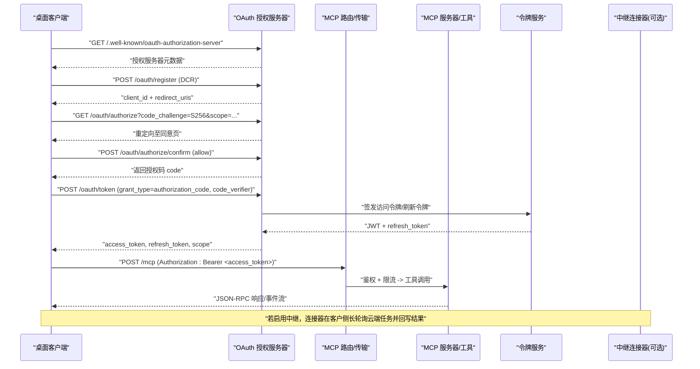
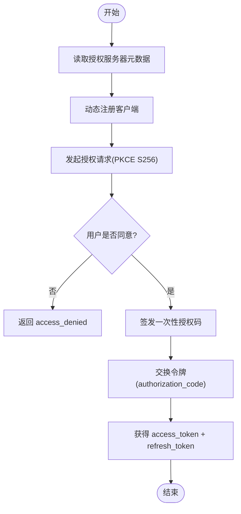
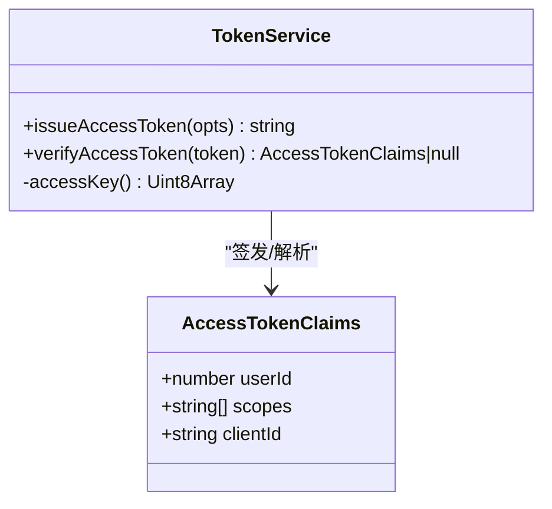
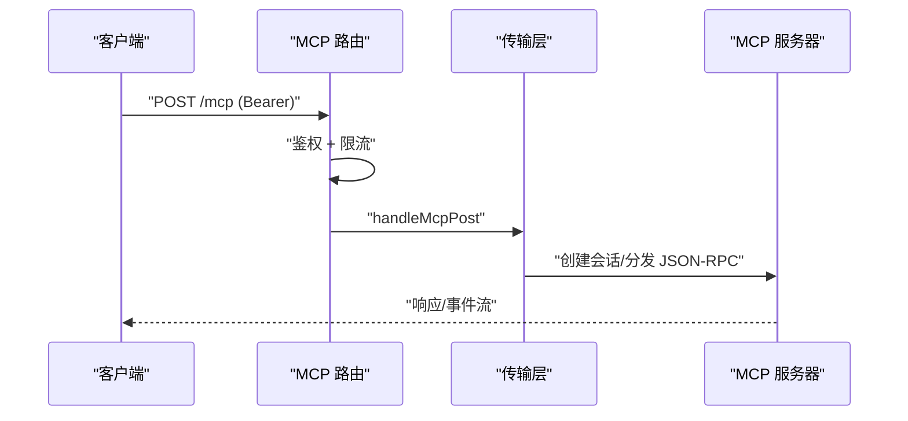
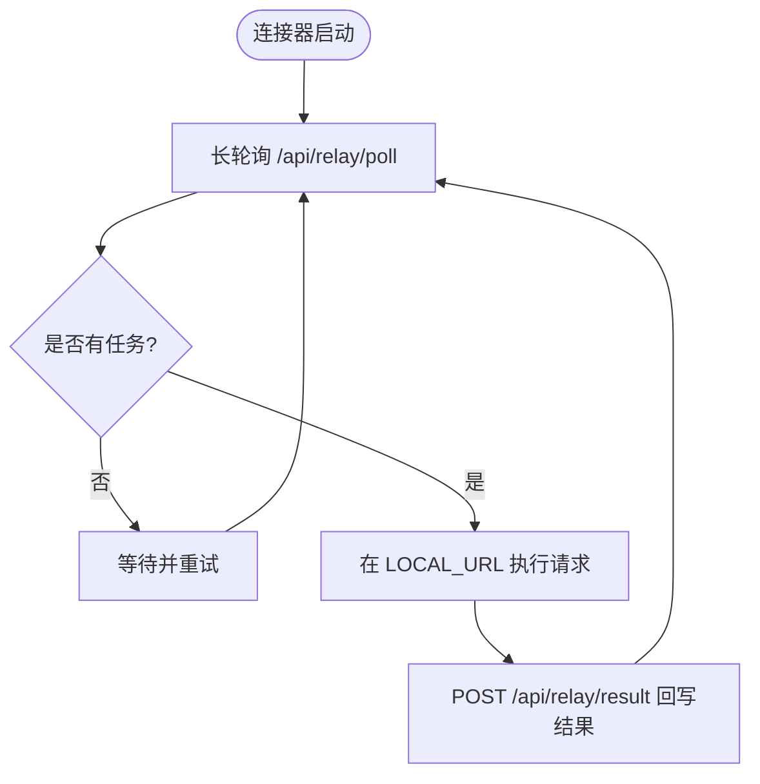
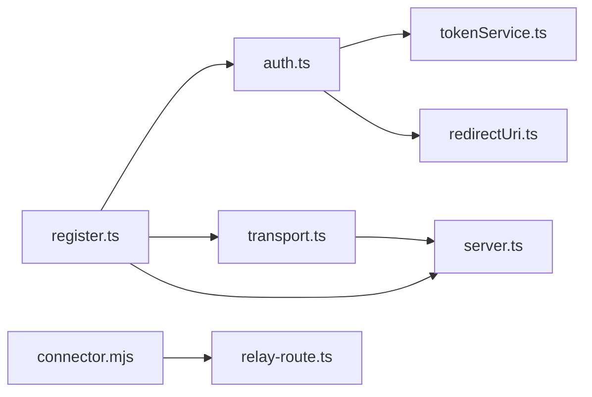

# 桌面客户端集成

<cite>
**本文引用的文件**
- [api/mcp/auth.ts](file://api/mcp/auth.ts)
- [api/mcp/register.ts](file://api/mcp/register.ts)
- [api/mcp/transport.ts](file://api/mcp/transport.ts)
- [api/mcp/server.ts](file://api/mcp/server.ts)
- [api/mcp/redirectUri.ts](file://api/mcp/redirectUri.ts)
- [api/services/tokenService.ts](file://api/services/tokenService.ts)
- [api/lib/env.ts](file://api/lib/env.ts)
- [src/pages/Connect.tsx](file://src/pages/Connect.tsx)
- [src/locales/en/connect.json](file://src/locales/en/connect.json)
- [relay/connector.mjs](file://relay/connector.mjs)
- [api/relay-route.ts](file://api/relay-route.ts)
- [docker-compose.relay.yml](file://docker-compose.relay.yml)
- [scripts/smoke-mcp-help-settings.mjs](file://scripts/smoke-mcp-help-settings.mjs)
- [DeeWaanAI-Next/PROGRESS.md](file://DeeWaanAI-Next/PROGRESS.md)
</cite>

## 目录
1. [简介](#简介)
2. [项目结构](#项目结构)
3. [核心组件](#核心组件)
4. [架构总览](#架构总览)
5. [详细组件分析](#详细组件分析)
6. [依赖关系分析](#依赖关系分析)
7. [性能考量](#性能考量)
8. [故障排查指南](#故障排查指南)
9. [结论](#结论)
10. [附录](#附录)

## 简介
本文件面向将 Claude Desktop、ChatGPT、Qwen Code、Kimi 等桌面 LLM 应用接入 DeeWaanAI 的开发者与运维人员，提供端到端的集成说明：OAuth 认证流程、令牌获取与管理、各平台配置步骤与环境变量、连接参数、示例调用方式、常见问题与调试技巧、安全与权限管理，以及中继连接器（on-prem relay connector）的使用方法与自定义选项。

## 项目结构
- MCP 服务暴露 OAuth 2.1 授权服务器能力与 /mcp* 端点，支持流式 HTTP 与遗留 SSE 传输。
- 前端 Connect 页面提供多平台接入指引与一键复制 MCP 服务端点。
- 中继连接器以“仅出站”的方式在客户侧运行，通过长轮询从云端拉取任务并回写结果。

```mermaid
graph TB
subgraph "桌面客户端"
A["Claude Desktop"]
B["ChatGPT"]
C["Qwen Code"]
D["Kimi"]
end
subgraph "DeeWaanAI 后端"
E["MCP 路由注册<br/>register.ts"]
F["OAuth 授权服务器<br/>auth.ts"]
G["传输层<br/>transport.ts"]
H["工具与服务<br/>server.ts"]
I["令牌服务<br/>tokenService.ts"]
J["环境变量<br/>env.ts"]
end
subgraph "中继连接器(可选)"
K["connector.mjs"]
L["中继路由<br/>relay-route.ts"]
end
A --> |发现/.well-known/*| F
B --> |发现/.well-known/*| F
C --> |发现/.well-known/*| F
D --> |发现/.well-known/*| F
A --> |POST /mcp (Bearer)| E
B --> |POST /mcp (Bearer)| E
C --> |POST /mcp (Bearer)| E
D --> |POST /mcp (Bearer)| E
E --> F
E --> G
G --> H
H --> I
F --> I
H --> J
K --> L
```

图表来源
- [api/mcp/register.ts:144-164](file://api/mcp/register.ts#L144-L164)
- [api/mcp/auth.ts:147-173](file://api/mcp/auth.ts#L147-L173)
- [api/mcp/transport.ts:164-172](file://api/mcp/transport.ts#L164-L172)
- [api/mcp/server.ts:188-208](file://api/mcp/server.ts#L188-L208)
- [api/services/tokenService.ts:28-66](file://api/services/tokenService.ts#L28-L66)
- [api/lib/env.ts:21-95](file://api/lib/env.ts#L21-L95)
- [relay/connector.mjs:24-31](file://relay/connector.mjs#L24-L31)
- [api/relay-route.ts:154-157](file://api/relay-route.ts#L154-L157)

章节来源
- [api/mcp/register.ts:144-164](file://api/mcp/register.ts#L144-L164)
- [api/mcp/auth.ts:147-173](file://api/mcp/auth.ts#L147-L173)
- [api/mcp/transport.ts:164-172](file://api/mcp/transport.ts#L164-L172)
- [api/mcp/server.ts:188-208](file://api/mcp/server.ts#L188-L208)
- [api/services/tokenService.ts:28-66](file://api/services/tokenService.ts#L28-L66)
- [api/lib/env.ts:21-95](file://api/lib/env.ts#L21-L95)
- [relay/connector.mjs:24-31](file://relay/connector.mjs#L24-L31)
- [api/relay-route.ts:154-157](file://api/relay-route.ts#L154-L157)

## 核心组件
- OAuth 授权服务器：实现 RFC 9728/8414 发现、RFC 7591 动态客户端注册、授权码+PKCE(S256)、同意页确认、令牌交换与刷新。
- MCP 路由与传输：统一挂载 /mcp（POST/GET/DELETE）与遗留 SSE；对每个请求进行鉴权与按客户限流。
- 令牌服务：HS256 JWT 访问令牌与可旋转的刷新令牌，作用域控制 mcp:read/run/write。
- 重定向校验：仅允许 https 或本地回环地址 http://localhost/127.0.0.1/[::1]，符合原生应用规范。
- 中继连接器：仅出站 HTTPS 到云端，长轮询拉取任务，执行后回写结果，满足数据驻留与严格出网策略。

章节来源
- [api/mcp/auth.ts:147-428](file://api/mcp/auth.ts#L147-L428)
- [api/mcp/register.ts:39-142](file://api/mcp/register.ts#L39-L142)
- [api/services/tokenService.ts:1-70](file://api/services/tokenService.ts#L1-L70)
- [api/mcp/redirectUri.ts:1-28](file://api/mcp/redirectUri.ts#L1-L28)
- [relay/connector.mjs:52-143](file://relay/connector.mjs#L52-L143)
- [api/relay-route.ts:154-353](file://api/relay-route.ts#L154-L353)

## 架构总览
下图展示桌面客户端通过 MCP 协议与 DeeWaanAI 集成的完整链路，包括 OAuth 授权、令牌使用、工具调用与可选的中继通道。



图表来源
- [api/mcp/auth.ts:147-428](file://api/mcp/auth.ts#L147-L428)
- [api/mcp/register.ts:144-164](file://api/mcp/register.ts#L144-L164)
- [api/services/tokenService.ts:28-66](file://api/services/tokenService.ts#L28-L66)
- [relay/connector.mjs:52-143](file://relay/connector.mjs#L52-L143)
- [api/relay-route.ts:212-294](file://api/relay-route.ts#L212-L294)

## 详细组件分析

### OAuth 认证流程（授权码+PKCE）
- 发现：客户端读取 /.well-known/oauth-protected-resource 与 /.well-known/oauth-authorization-server。
- 动态注册：POST /oauth/register 提交 client_name 与 redirect_uris，仅允许 https 或本地回环。
- 授权：GET /oauth/authorize 携带 response_type=code、code_challenge_method=S256、scope。
- 同意：POST /oauth/authorize/confirm 需当前会话登录，决策 allow 后写入一次性授权码。
- 令牌：POST /oauth/token 用 authorization_code + code_verifier 换取 access_token 与 refresh_token。
- 刷新：refresh_token 支持旋转，过期或失效时拒绝。



图表来源
- [api/mcp/auth.ts:147-428](file://api/mcp/auth.ts#L147-L428)
- [api/mcp/redirectUri.ts:14-27](file://api/mcp/redirectUri.ts#L14-L27)

章节来源
- [api/mcp/auth.ts:147-428](file://api/mcp/auth.ts#L147-L428)
- [api/mcp/redirectUri.ts:14-27](file://api/mcp/redirectUri.ts#L14-L27)

### 令牌获取与管理
- 访问令牌：HS256 JWT，包含 scope、client_id、sub(userId)，默认 1 小时有效期。
- 刷新令牌：不透明随机串，哈希存储，支持旋转与撤销。
- 作用域：mcp:read、mcp:run、mcp:write，由授权服务器过滤与下发。
- 验证：服务端统一验签，失败返回 null 并记录日志。



图表来源
- [api/services/tokenService.ts:28-66](file://api/services/tokenService.ts#L28-L66)

章节来源
- [api/services/tokenService.ts:1-70](file://api/services/tokenService.ts#L1-L70)

### MCP 路由与传输
- 路由挂载：/mcp（POST/GET/DELETE）与遗留 SSE（/mcp/sse、/mcp/messages）。
- 鉴权与限流：所有 /mcp* 需要 Bearer token；按客户维度限流，超限返回 429 与 Retry-After。
- 传输：优先使用流式 HTTP；兼容旧版 SSE。



图表来源
- [api/mcp/register.ts:144-164](file://api/mcp/register.ts#L144-L164)
- [api/mcp/transport.ts:164-172](file://api/mcp/transport.ts#L164-L172)
- [api/mcp/server.ts:188-208](file://api/mcp/server.ts#L188-L208)

章节来源
- [api/mcp/register.ts:39-164](file://api/mcp/register.ts#L39-L164)
- [api/mcp/transport.ts:164-172](file://api/mcp/transport.ts#L164-L172)
- [api/mcp/server.ts:126-208](file://api/mcp/server.ts#L126-L208)

### 各平台集成步骤与配置
- Claude Desktop
  - 添加远程 MCP 服务器，指向部署后的 /mcp。
  - 首次使用时浏览器打开完成 OAuth 同意；令牌缓存于本地。
  - 在对话中提及已连接的应用即可列出并运行管道。
- ChatGPT
  - 开启开发者模式（Apps & Connectors → Advanced settings）。
  - 新建应用并将 MCP 服务器 URL 作为连接器端点。
  - ChatGPT 自动发现 OAuth 流程，提示时登录授权。
- Qwen Code
  - 终端中添加服务器，设置保存在 ~/.qwen/settings.json。
  - 首次使用会打开浏览器完成 OAuth 授权。
  - 直接让 Qwen Code 运行管道，调用工具。
- Kimi
  - 设置 → MCP Servers → Add Server，选择 streamable HTTP 传输。
  - 粘贴 MCP 服务器 URL，保存后点击 Authorize 完成 OAuth。
  - 新对话中即可看到可用工具。

章节来源
- [src/pages/Connect.tsx:29-45](file://src/pages/Connect.tsx#L29-L45)
- [src/locales/en/connect.json:28-58](file://src/locales/en/connect.json#L28-L58)
- [DeeWaanAI-Next/PROGRESS.md:112-113](file://DeeWaanAI-Next/PROGRESS.md#L112-L113)

### 环境变量与连接参数
- 必需
  - APP_SECRET：用于签名访问令牌（生产环境禁止默认值）。
  - DATABASE_URL：数据库连接字符串。
  - AI_SWARM_MASTER_KEY、MARKETPLACE_MASTER_KEY：平台密钥。
- 可选
  - REDIS_URL、STRIPE_*、S3_*、SCREENSHOT_DIR、TRUSTED_PROXY、SENTRY_DSN、BACKUP_TOKEN、PUBLIC_APP_URL 等。
- 中继连接器
  - CLOUD_URL、RELAY_TOKEN、LOCAL_URL、POLL_WAIT、MAX_BACKOFF。

章节来源
- [api/lib/env.ts:21-95](file://api/lib/env.ts#L21-L95)
- [relay/connector.mjs:24-31](file://relay/connector.mjs#L24-L31)

### 中继连接器使用方法与自定义
- 用途：在客户侧以“仅出站”方式运行，避免开放入站端口，满足数据驻留与严格出网策略。
- 启动方式：通过 docker-compose.relay.yml 或直接 node relay/connector.mjs。
- 工作流：长轮询 /api/relay/poll 拉取任务 → 在 LOCAL_URL 执行 → POST /api/relay/result 回写结果。
- 自定义项：POLL_WAIT（轮询等待秒数）、MAX_BACKOFF（错误退避上限）、LOCAL_URL（本地服务基址）。



图表来源
- [relay/connector.mjs:52-143](file://relay/connector.mjs#L52-L143)
- [api/relay-route.ts:212-294](file://api/relay-route.ts#L212-L294)
- [docker-compose.relay.yml:1-38](file://docker-compose.relay.yml#L1-L38)

章节来源
- [relay/connector.mjs:24-143](file://relay/connector.mjs#L24-L143)
- [api/relay-route.ts:154-353](file://api/relay-route.ts#L154-L353)
- [docker-compose.relay.yml:1-38](file://docker-compose.relay.yml#L1-L38)

### 示例调用与脚本参考
- 使用刷新令牌获取新的访问令牌并调用 /mcp（JSON-RPC），适用于自动化与测试。
- 参考脚本展示了如何维护 token 文件、自动刷新、附加 session-id 头并发送 JSON-RPC 请求。

章节来源
- [scripts/smoke-mcp-help-settings.mjs:33-59](file://scripts/smoke-mcp-help-settings.mjs#L33-L59)

## 依赖关系分析
- 模块耦合
  - register.ts 聚合 auth.ts、transport.ts、server.ts，承担路由挂载与鉴权限流。
  - auth.ts 依赖 tokenService.ts 签发/验证令牌，依赖 redirectUri.ts 校验回调地址。
  - transport.ts 与 server.ts 协作处理会话与工具调度。
  - relay 相关：connector.mjs 与 relay-route.ts 构成云-边协同闭环。
- 外部依赖
  - jose（JWT）、drizzle-orm（DB 访问）、hono（HTTP 框架）、Redis/BullMQ（可选限流与队列）。



图表来源
- [api/mcp/register.ts:144-164](file://api/mcp/register.ts#L144-L164)
- [api/mcp/auth.ts:147-428](file://api/mcp/auth.ts#L147-L428)
- [api/mcp/transport.ts:164-172](file://api/mcp/transport.ts#L164-L172)
- [api/mcp/server.ts:188-208](file://api/mcp/server.ts#L188-L208)
- [api/services/tokenService.ts:28-66](file://api/services/tokenService.ts#L28-L66)
- [api/mcp/redirectUri.ts:14-27](file://api/mcp/redirectUri.ts#L14-L27)
- [relay/connector.mjs:52-143](file://relay/connector.mjs#L52-L143)
- [api/relay-route.ts:154-353](file://api/relay-route.ts#L154-L353)

章节来源
- [api/mcp/register.ts:144-164](file://api/mcp/register.ts#L144-L164)
- [api/mcp/auth.ts:147-428](file://api/mcp/auth.ts#L147-L428)
- [api/mcp/transport.ts:164-172](file://api/mcp/transport.ts#L164-L172)
- [api/mcp/server.ts:188-208](file://api/mcp/server.ts#L188-L208)
- [api/services/tokenService.ts:28-66](file://api/services/tokenService.ts#L28-L66)
- [api/mcp/redirectUri.ts:14-27](file://api/mcp/redirectUri.ts#L14-L27)
- [relay/connector.mjs:52-143](file://relay/connector.mjs#L52-L143)
- [api/relay-route.ts:154-353](file://api/relay-route.ts#L154-L353)

## 性能考量
- 每客户限流：基于客户层级（solo/team/admin）进行速率限制，超限返回 429 与 Retry-After。
- 令牌缓存：访问令牌短期有效，刷新令牌支持旋转，减少频繁鉴权开销。
- 传输优化：优先使用流式 HTTP，降低首包延迟；SSE 兼容旧客户端。
- 中继连接器：长轮询与指数退避平衡网络负载与实时性。

章节来源
- [api/mcp/register.ts:39-142](file://api/mcp/register.ts#L39-L142)
- [api/services/tokenService.ts:28-66](file://api/services/tokenService.ts#L28-L66)
- [relay/connector.mjs:107-143](file://relay/connector.mjs#L107-L143)

## 故障排查指南
- 无法发现授权服务器
  - 检查 /.well-known/oauth-authorization-server 与 /.well-known/oauth-protected-resource 是否可达。
- 动态注册被拒
  - 确保 redirect_uris 为 https 或本地回环地址（localhost/127.0.0.1/[::1]）。
- 授权码无效或已使用
  - 授权码一次性有效且有时效；重复使用或过期将失败。
- 令牌刷新失败
  - 检查 refresh_token 是否有效、未过期或被撤销；必要时重新走授权流程。
- MCP 调用 401
  - 确认 Authorization: Bearer 头携带有效 access_token；注意 WWW-Authenticate 提示。
- 429 限流
  - 根据 Retry-After 重试；检查客户层级与配额。
- 中继连接器无任务
  - 检查 /api/relay/poll 返回 204 是否为空；确认 RELAY_TOKEN 与 CLOUD_URL 正确。
- 本地回环回调问题
  - 桌面客户端需在本地监听端口接收授权码；确保防火墙放行。

章节来源
- [api/mcp/auth.ts:147-428](file://api/mcp/auth.ts#L147-L428)
- [api/mcp/register.ts:90-142](file://api/mcp/register.ts#L90-L142)
- [api/mcp/redirectUri.ts:14-27](file://api/mcp/redirectUri.ts#L14-L27)
- [relay/connector.mjs:52-143](file://relay/connector.mjs#L52-L143)
- [api/relay-route.ts:212-294](file://api/relay-route.ts#L212-L294)

## 结论
通过标准化的 OAuth 2.1 与 MCP 协议，DeeWaanAI 能够以最小集成成本对接主流桌面 LLM 应用。结合按客户限流、令牌管理与可选中继连接器，既保证了安全性与合规性，也兼顾了性能与可扩展性。建议在生产环境中严格配置环境变量、启用限流与审计，并通过中继连接器满足数据驻留与网络策略要求。

## 附录
- 快速检查清单
  - 部署后可访问 /.well-known 元数据。
  - 动态注册成功且 redirect_uri 合法。
  - OAuth 授权码交换成功并获得 access_token。
  - /mcp 调用携带 Bearer 头并通过鉴权与限流。
  - 如启用中继，连接器能长轮询并回写结果。
- 参考脚本
  - 使用刷新令牌获取新令牌并调用 /mcp 的示例见脚本文件。

章节来源
- [scripts/smoke-mcp-help-settings.mjs:33-59](file://scripts/smoke-mcp-help-settings.mjs#L33-L59)