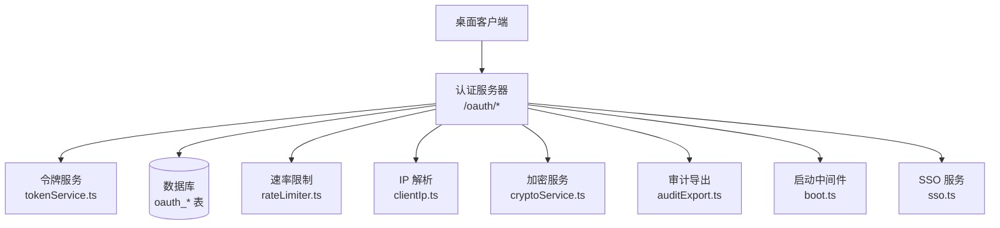
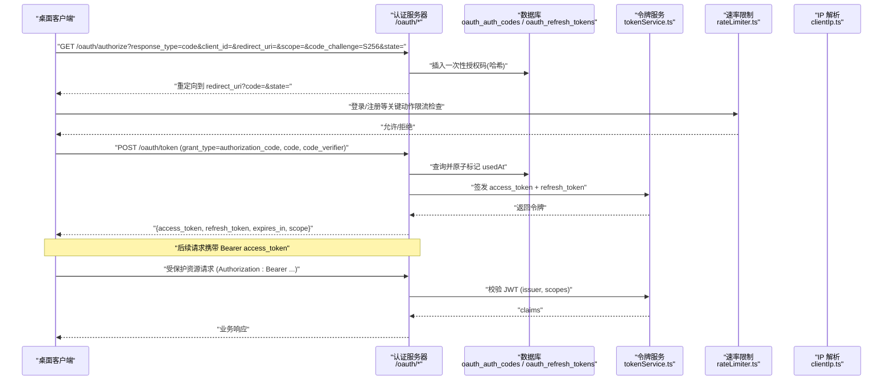
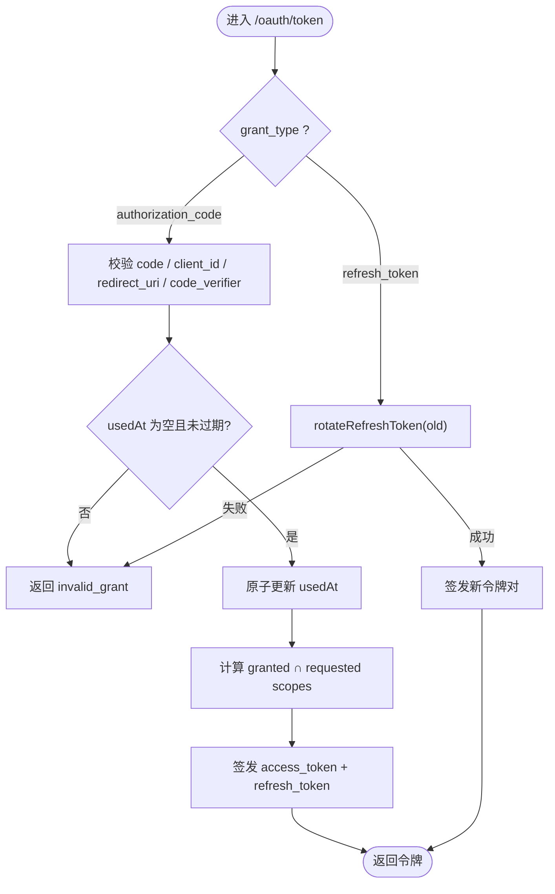
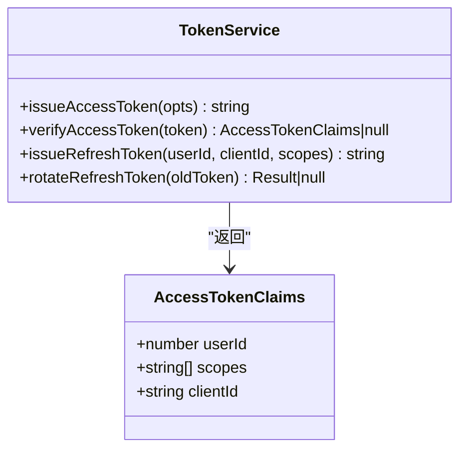
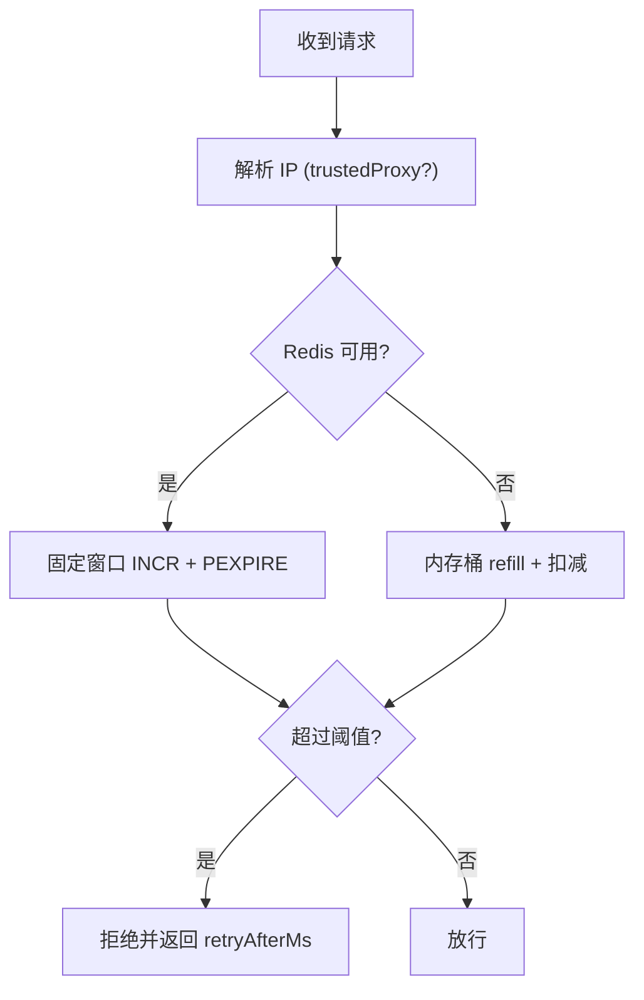
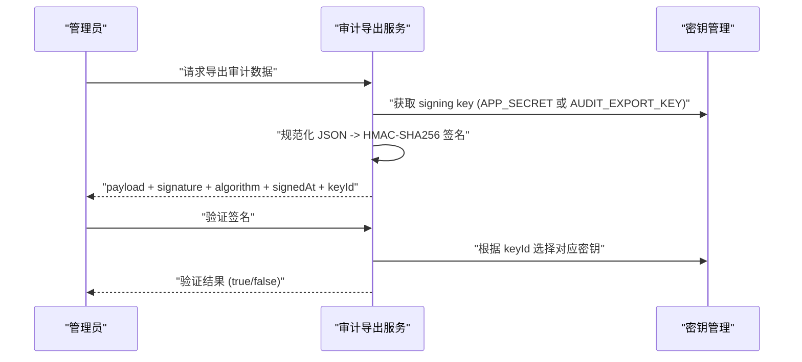
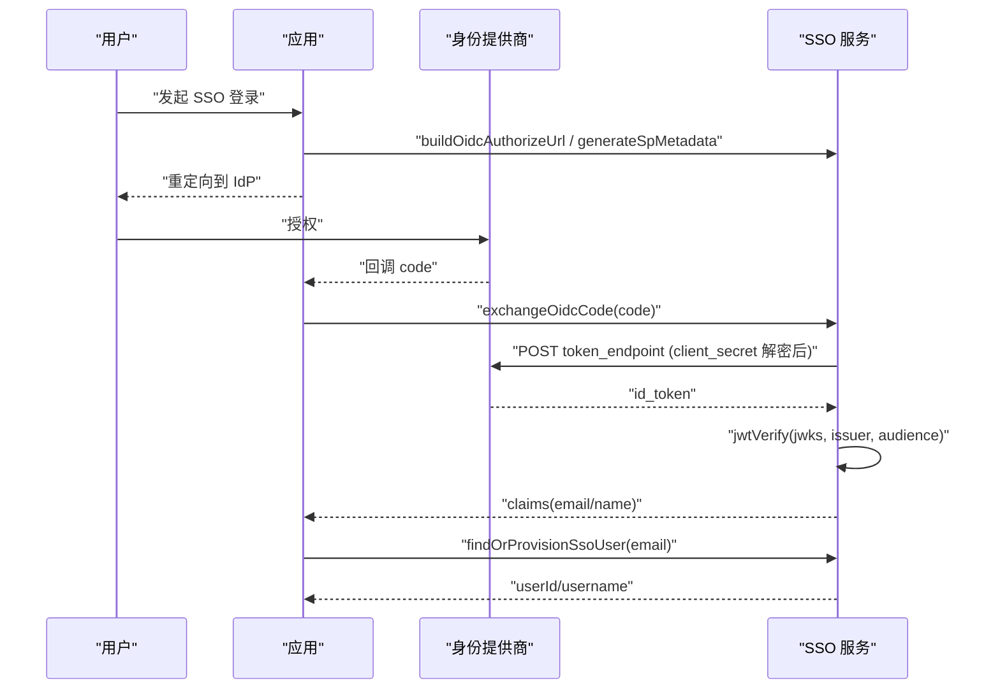
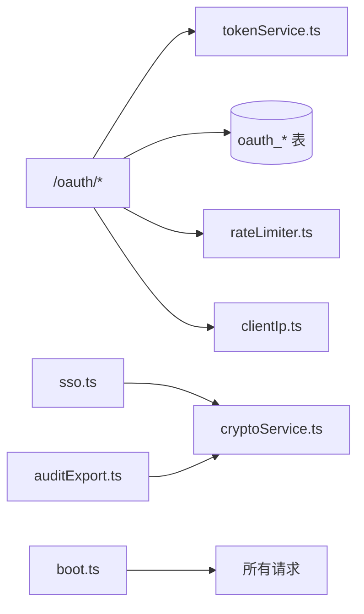

# 认证与安全

<cite>
**本文引用的文件**
- [api/mcp/auth.ts](file://api/mcp/auth.ts)
- [api/services/tokenService.ts](file://api/services/tokenService.ts)
- [db/schema.ts](file://db/schema.ts)
- [api/lib/clientIp.ts](file://api/lib/clientIp.ts)
- [api/lib/rateLimiter.ts](file://api/lib/rateLimiter.ts)
- [api/services/cryptoService.ts](file://api/services/cryptoService.ts)
- [api/services/auditExport.ts](file://api/services/auditExport.ts)
- [api/services/sso.ts](file://api/services/sso.ts)
- [api/lib/env.ts](file://api/lib/env.ts)
- [api/boot.ts](file://api/boot.ts)
- [api/routers/localAuth.ts](file://api/routers/localAuth.ts)
- [api/middleware.ts](file://api/middleware.ts)
- [api/lib/logger.ts](file://api/lib/logger.ts)
</cite>

## 目录
1. [简介](#简介)
2. [项目结构](#项目结构)
3. [核心组件](#核心组件)
4. [架构总览](#架构总览)
5. [详细组件分析](#详细组件分析)
6. [依赖关系分析](#依赖关系分析)
7. [性能考量](#性能考量)
8. [故障排查指南](#故障排查指南)
9. [结论](#结论)
10. [附录](#附录)

## 简介
本文件面向桌面客户端集成，系统性说明 OAuth 2.1 认证流程（授权码模式 + PKCE）、令牌管理与安全存储、IP 地址验证与请求频率限制、防攻击措施、数据传输加密与签名完整性校验、安全配置最佳实践与合规性要求，以及安全审计日志与威胁检测机制。文档基于代码仓库中的实际实现进行梳理，确保可落地与可审计。

## 项目结构
围绕认证与安全的关键模块分布如下：
- 认证与授权端点：OAuth 授权码流程、动态客户端注册、令牌交换、刷新令牌
- 令牌服务：访问令牌（JWT HS256）签发与校验；刷新令牌哈希存储与轮换
- 安全存储与加密：AES-256-GCM 对称加密、主密钥管理、审计导出 HMAC-SHA256 签名
- 速率限制与 IP 解析：Redis 固定窗口与内存桶降级、可信代理开关
- SSO：OIDC 发现、JWKS 校验、SAML 响应校验、用户自动供应
- 安全头与传输安全：HSTS、X-Content-Type-Options 等
- 日志与审计：结构化日志、审计导出签名与验签

图表来源
- [api/mcp/auth.ts:159-427](file://api/mcp/auth.ts#L159-L427)
- [api/services/tokenService.ts:1-129](file://api/services/tokenService.ts#L1-L129)
- [db/schema.ts:1153-1179](file://db/schema.ts#L1153-L1179)
- [api/lib/rateLimiter.ts:1-216](file://api/lib/rateLimiter.ts#L1-L216)
- [api/lib/clientIp.ts:1-36](file://api/lib/clientIp.ts#L1-L36)
- [api/services/cryptoService.ts:1-79](file://api/services/cryptoService.ts#L1-L79)
- [api/services/auditExport.ts:512-571](file://api/services/auditExport.ts#L512-L571)
- [api/services/sso.ts:1-369](file://api/services/sso.ts#L1-L369)
- [api/boot.ts:37-59](file://api/boot.ts#L37-L59)

章节来源
- [api/mcp/auth.ts:159-427](file://api/mcp/auth.ts#L159-L427)
- [api/services/tokenService.ts:1-129](file://api/services/tokenService.ts#L1-L129)
- [db/schema.ts:1153-1179](file://db/schema.ts#L1153-L1179)
- [api/lib/rateLimiter.ts:1-216](file://api/lib/rateLimiter.ts#L1-L216)
- [api/lib/clientIp.ts:1-36](file://api/lib/clientIp.ts#L1-L36)
- [api/services/cryptoService.ts:1-79](file://api/services/cryptoService.ts#L1-L79)
- [api/services/auditExport.ts:512-571](file://api/services/auditExport.ts#L512-L571)
- [api/services/sso.ts:1-369](file://api/services/sso.ts#L1-L369)
- [api/boot.ts:37-59](file://api/boot.ts#L37-L59)

## 核心组件
- OAuth 授权码 + PKCE：支持 /.well-known/oauth-authorization-server、/oauth/register、/oauth/authorize、/oauth/token，强制使用 S256 挑战与一次性授权码，严格校验 client_id、redirect_uri、code_verifier，并记录审计日志。
- 令牌管理：访问令牌为 HS256 JWT，包含 scope、client_id、sub；刷新令牌为不透明随机串，服务端以 SHA-256 哈希存储，支持轮换（旧令牌失效，发放新对）。
- 安全存储与加密：敏感数据采用 AES-256-GCM 加密，主密钥通过环境变量注入；审计导出使用 HMAC-SHA256 签名与时间戳，支持密钥轮换兼容历史导出。
- 速率限制与 IP 解析：按 IP 维度进行登录/注册限流；支持 Redis 固定窗口与内存桶降级；TRUSTED_PROXY 控制是否信任 x-forwarded-for/x-real-ip。
- SSO：支持 OIDC 发现与 JWKS 校验、SAML 响应校验；客户端密钥落库前加密，仅在交换时解密；提供无状态 CSRF/nonce 状态 JWT。
- 传输安全：全局设置安全响应头，生产环境启用 HSTS；统一请求 ID 透传便于追踪。

章节来源
- [api/mcp/auth.ts:159-427](file://api/mcp/auth.ts#L159-L427)
- [api/services/tokenService.ts:1-129](file://api/services/tokenService.ts#L1-L129)
- [api/services/cryptoService.ts:1-79](file://api/services/cryptoService.ts#L1-L79)
- [api/services/auditExport.ts:512-571](file://api/services/auditExport.ts#L512-L571)
- [api/lib/rateLimiter.ts:1-216](file://api/lib/rateLimiter.ts#L1-L216)
- [api/lib/clientIp.ts:1-36](file://api/lib/clientIp.ts#L1-L36)
- [api/services/sso.ts:1-369](file://api/services/sso.ts#L1-L369)
- [api/boot.ts:37-59](file://api/boot.ts#L37-L59)

## 架构总览
下图展示桌面客户端通过 OAuth 2.1 授权码模式完成认证的端到端流程，包括 PKCE 校验、授权码一次性使用、令牌签发与刷新、以及速率限制与 IP 解析的防护。

图表来源
- [api/mcp/auth.ts:159-427](file://api/mcp/auth.ts#L159-L427)
- [api/services/tokenService.ts:1-129](file://api/services/tokenService.ts#L1-L129)
- [db/schema.ts:1153-1179](file://db/schema.ts#L1153-L1179)
- [api/lib/rateLimiter.ts:1-216](file://api/lib/rateLimiter.ts#L1-L216)
- [api/lib/clientIp.ts:1-36](file://api/lib/clientIp.ts#L1-L36)

## 详细组件分析

### OAuth 2.1 授权码模式（含 PKCE）
- 元数据与端点：/.well-known/oauth-authorization-server 声明支持的 response_types、grant_types、code_challenge_methods、scopes。
- 动态客户端注册：/oauth/register 接收 client_name 与 redirect_uris，持久化至 oauth_clients。
- 授权端点：/oauth/authorize 生成一次性授权码，存储其 SHA-256 哈希及 code_challenge（S256），并设置过期时间。
- 令牌端点：/oauth/token 校验 grant_type、client_id、redirect_uri、code_verifier（PKCE S256），原子标记 usedAt 防止重放，计算授予范围，签发 access_token 与 refresh_token。
- 刷新令牌：支持 grant_type=refresh_token，调用 rotateRefreshToken 撤销旧令牌并发放新对。

图表来源
- [api/mcp/auth.ts:337-427](file://api/mcp/auth.ts#L337-L427)
- [api/services/tokenService.ts:91-129](file://api/services/tokenService.ts#L91-L129)
- [db/schema.ts:1162-1179](file://db/schema.ts#L1162-L1179)

章节来源
- [api/mcp/auth.ts:159-427](file://api/mcp/auth.ts#L159-L427)
- [api/services/tokenService.ts:1-129](file://api/services/tokenService.ts#L1-L129)
- [db/schema.ts:1153-1179](file://db/schema.ts#L1153-L1179)

### 令牌管理与安全存储
- 访问令牌：HS256 JWT，包含 sub(user)、scope、client_id，由 APP_SECRET 派生密钥签发与校验。
- 刷新令牌：不透明随机串，服务端仅存储其 SHA-256 哈希；轮换时撤销旧令牌并发放新对。
- 作用域控制：令牌中携带 scope，服务端可按需校验最小权限原则。
- 安全存储：敏感字段（如 SSO 客户端密钥）使用 AES-256-GCM 加密存储，主密钥从环境变量读取，运行时解密，不落盘明文。

图表来源
- [api/services/tokenService.ts:1-129](file://api/services/tokenService.ts#L1-L129)

章节来源
- [api/services/tokenService.ts:1-129](file://api/services/tokenService.ts#L1-L129)
- [api/services/cryptoService.ts:1-79](file://api/services/cryptoService.ts#L1-L79)

### IP 地址验证与请求频率限制
- IP 解析：getClientIp 根据 TRUSTED_PROXY 决定是否信任 x-forwarded-for/x-real-ip；不可信时回退到 socket 地址，缺失则归入 unknown 共享桶（fail-closed）。
- 速率限制：
  - 登录/注册等关键路径使用 checkRateLimitAsync，优先走 Redis 固定窗口计数，失败降级到内存桶。
  - 预置 auth/execute/batch/read 等配额策略，便于不同接口差异化限流。
  - 客户分级限速（solo/team/admin）用于 MCP 层，同样具备 Redis 降级能力。

图表来源
- [api/lib/clientIp.ts:1-36](file://api/lib/clientIp.ts#L1-L36)
- [api/lib/rateLimiter.ts:1-216](file://api/lib/rateLimiter.ts#L1-L216)

章节来源
- [api/lib/clientIp.ts:1-36](file://api/lib/clientIp.ts#L1-L36)
- [api/lib/rateLimiter.ts:1-216](file://api/lib/rateLimiter.ts#L1-L216)

### 数据传输加密、签名验证与完整性检查
- 对称加密：AES-256-GCM 提供机密性与完整性；支持向后兼容 CBC 格式解密；主密钥通过环境变量注入，生产环境强制要求。
- 审计导出签名：使用 HMAC-SHA256 对规范化 JSON 负载签名，支持 keyId 区分新旧密钥，验证时使用时序安全比较，避免侧信道泄露。
- 安全头：全局设置 X-Content-Type-Options、X-Frame-Options、Referrer-Policy，生产环境启用 HSTS。

图表来源
- [api/services/cryptoService.ts:1-79](file://api/services/cryptoService.ts#L1-L79)
- [api/services/auditExport.ts:512-571](file://api/services/auditExport.ts#L512-L571)
- [api/boot.ts:47-59](file://api/boot.ts#L47-L59)

章节来源
- [api/services/cryptoService.ts:1-79](file://api/services/cryptoService.ts#L1-L79)
- [api/services/auditExport.ts:512-571](file://api/services/auditExport.ts#L512-L571)
- [api/boot.ts:47-59](file://api/boot.ts#L47-L59)

### 企业单点登录（SSO）
- OIDC：发现文档缓存 1 小时；构建授权 URL；交换授权码时解密客户端密钥（仅内存中使用）；使用 jose createRemoteJWKSet 校验 id_token（issuer、audience）。
- SAML：按连接实例化 SAML 处理器，接受响应或断言任一签名；NameID 必须为邮箱；支持 SP 元数据生成。
- 用户供应：按邮箱匹配或创建新用户（密码哈希留空，禁止本地密码登录）；并发安全处理用户名冲突。
- 无状态 CSRF/nonce：使用 HS256 签发短期状态 JWT，防止跨站请求伪造。

图表来源
- [api/services/sso.ts:61-181](file://api/services/sso.ts#L61-L181)
- [api/services/sso.ts:226-299](file://api/services/sso.ts#L226-L299)
- [api/services/sso.ts:301-357](file://api/services/sso.ts#L301-L357)

章节来源
- [api/services/sso.ts:1-369](file://api/services/sso.ts#L1-L369)

### 本地认证与鉴权中间件
- 本地登录/注册：bcrypt 哈希密码，弱口令黑名单；登录/注册按 IP 限流；首次用户或指定用户名自动提升为管理员（开发便利）。
- 中间件：tRPC 路由层 requireAuth/requireRole 保证上下文用户存在与角色权限；错误码标准化。

章节来源
- [api/routers/localAuth.ts:1-216](file://api/routers/localAuth.ts#L1-L216)
- [api/middleware.ts:1-51](file://api/middleware.ts#L1-L51)

## 依赖关系分析
- OAuth 端点依赖令牌服务、数据库 schema、速率限制与 IP 解析。
- 令牌服务依赖数据库（刷新令牌存储）与环境变量（APP_SECRET）。
- 加密服务依赖环境变量（AI_SWARM_MASTER_KEY）与 Node crypto。
- 审计导出依赖环境变量（AUDIT_EXPORT_KEY 或 APP_SECRET）与 crypto。
- SSO 依赖加密服务、jose、数据库与外部 IdP。
- 启动中间件提供安全头与请求 ID 透传，贯穿所有请求。

图表来源
- [api/mcp/auth.ts:159-427](file://api/mcp/auth.ts#L159-L427)
- [api/services/tokenService.ts:1-129](file://api/services/tokenService.ts#L1-L129)
- [api/services/sso.ts:1-369](file://api/services/sso.ts#L1-L369)
- [api/services/cryptoService.ts:1-79](file://api/services/cryptoService.ts#L1-L79)
- [api/services/auditExport.ts:512-571](file://api/services/auditExport.ts#L512-L571)
- [api/boot.ts:37-59](file://api/boot.ts#L37-L59)

章节来源
- [api/mcp/auth.ts:159-427](file://api/mcp/auth.ts#L159-L427)
- [api/services/tokenService.ts:1-129](file://api/services/tokenService.ts#L1-L129)
- [api/services/sso.ts:1-369](file://api/services/sso.ts#L1-L369)
- [api/services/cryptoService.ts:1-79](file://api/services/cryptoService.ts#L1-L79)
- [api/services/auditExport.ts:512-571](file://api/services/auditExport.ts#L512-L571)
- [api/boot.ts:37-59](file://api/boot.ts#L37-L59)

## 性能考量
- 速率限制：Redis 固定窗口在分布式部署下共享预算；不可用时降级到进程内内存桶，保证可用性但跨节点不一致。
- 令牌校验：JWT 无状态校验，开销低；刷新令牌轮换减少长生命周期令牌暴露风险。
- 加密：AES-GCM 加解密高效；PBKDF2 迭代次数较高，适合密钥派生场景。
- SSO：JWKS 与发现文档缓存降低外部依赖延迟。

## 故障排查指南
- 授权码无效/已用：检查 code_verifier 与 code_challenge 是否匹配；确认授权码未被重复兑换；查看 usedAt 与 expiresAt。
- 刷新令牌失败：确认令牌未过期、未被撤销；检查 rotateRefreshToken 返回值。
- IP 限流误判：核对 TRUSTED_PROXY 配置；在直连互联网时应设为 false，避免伪造 XFF 绕过限流。
- 审计导出验签失败：确认 keyId 与当前密钥一致；检查规范化 JSON 与算法；比对时序安全比较结果。
- SSO 登录失败：检查 OIDC 发现文档与 JWKS；确认 id_token 的 issuer/audience；核对 NameID 是否为邮箱。

章节来源
- [api/mcp/auth.ts:337-427](file://api/mcp/auth.ts#L337-L427)
- [api/services/tokenService.ts:91-129](file://api/services/tokenService.ts#L91-L129)
- [api/lib/clientIp.ts:1-36](file://api/lib/clientIp.ts#L1-L36)
- [api/services/auditExport.ts:512-571](file://api/services/auditExport.ts#L512-L571)
- [api/services/sso.ts:61-181](file://api/services/sso.ts#L61-L181)

## 结论
该实现提供了符合 OAuth 2.1 的授权码 + PKCE 流程，配合严格的令牌管理、安全的敏感数据存储、可靠的速率限制与 IP 解析、以及完善的审计签名与传输安全头，满足桌面客户端集成的安全基线。建议在生产环境中严格配置环境变量（APP_SECRET、AI_SWARM_MASTER_KEY、AUDIT_EXPORT_KEY、TRUSTED_PROXY），并结合监控与告警持续优化。

## 附录

### 安全配置最佳实践与合规性要求
- 环境变量
  - APP_SECRET：强随机值，生产环境禁止默认值。
  - AI_SWARM_MASTER_KEY：用于敏感数据加密，生产环境必填。
  - AUDIT_EXPORT_KEY：独立于 APP_SECRET，便于密钥轮换不影响历史审计导出。
  - TRUSTED_PROXY：若应用直接暴露于公网，请设置为 false，避免伪造转发头绕过限流。
- 传输安全
  - 生产环境启用 HSTS；保持 X-Content-Type-Options、X-Frame-Options、Referrer-Policy 等安全头。
- 令牌与权限
  - 遵循最小权限原则，按需申请 scope；定期轮换刷新令牌。
- 审计与合规
  - 使用 HMAC-SHA256 对审计导出签名，保留 keyId 与 signedAt；定期核验签名有效性。
  - 结合结构化日志（logger）与请求 ID（x-request-id）进行全链路追踪。

章节来源
- [api/lib/env.ts:1-105](file://api/lib/env.ts#L1-L105)
- [api/boot.ts:37-59](file://api/boot.ts#L37-L59)
- [api/services/auditExport.ts:512-571](file://api/services/auditExport.ts#L512-L571)
- [api/lib/logger.ts:1-32](file://api/lib/logger.ts#L1-L32)