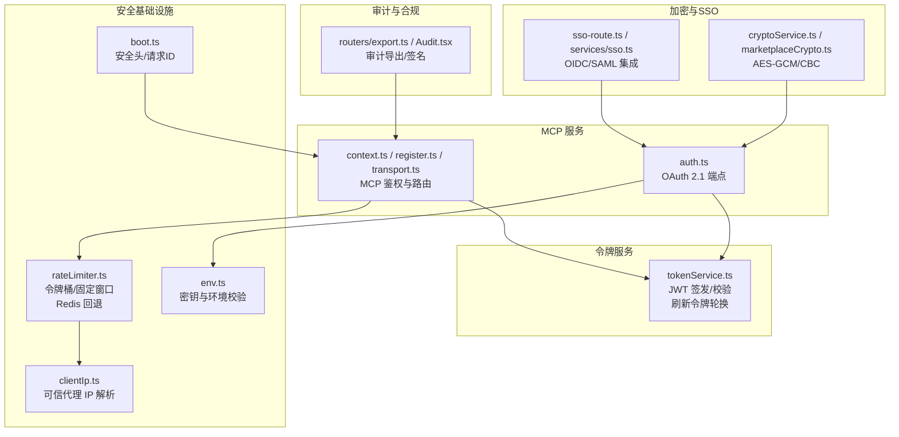
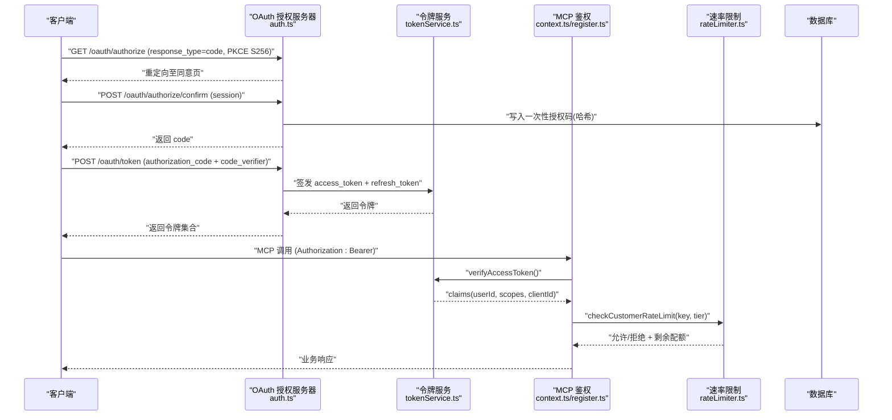
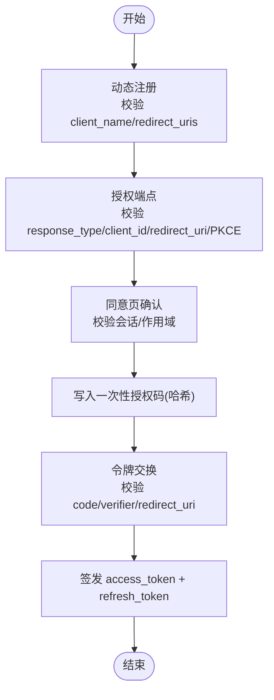
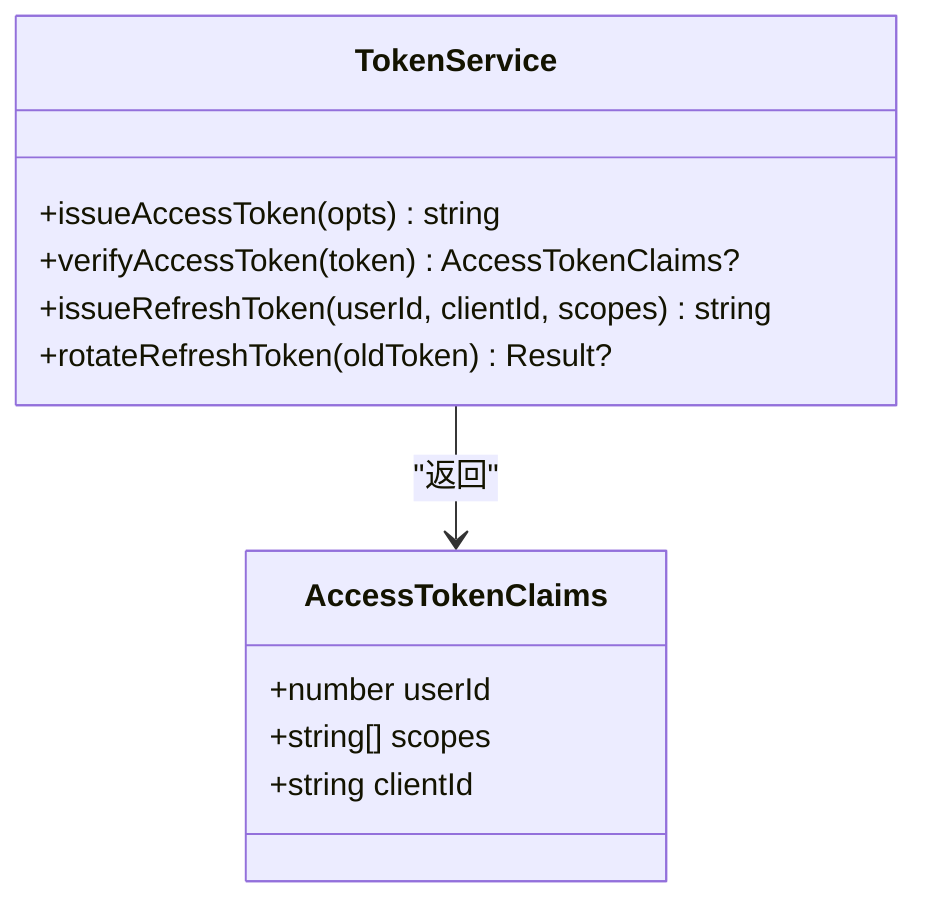
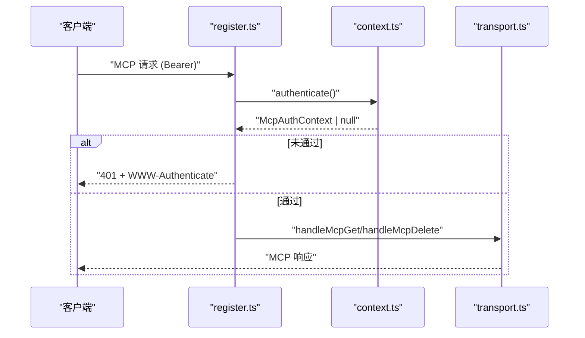
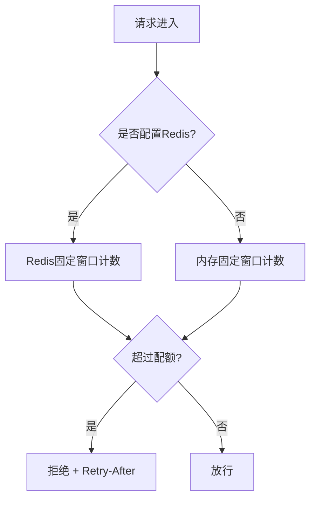
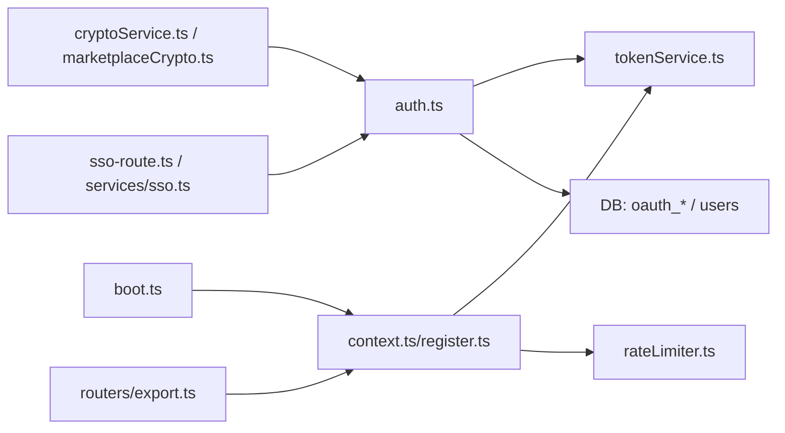

# 认证与安全

<cite>
**本文引用的文件**
- [api/mcp/auth.ts](file://api/mcp/auth.ts)
- [api/services/tokenService.ts](file://api/services/tokenService.ts)
- [api/mcp/context.ts](file://api/mcp/context.ts)
- [api/mcp/register.ts](file://api/mcp/register.ts)
- [api/mcp/transport.ts](file://api/mcp/transport.ts)
- [api/lib/rateLimiter.ts](file://api/lib/rateLimiter.ts)
- [api/lib/clientIp.ts](file://api/lib/clientIp.ts)
- [api/lib/env.ts](file://api/lib/env.ts)
- [api/boot.ts](file://api/boot.ts)
- [api/middleware.ts](file://api/middleware.ts)
- [api/services/cryptoService.ts](file://api/services/cryptoService.ts)
- [api/lib/marketplaceCrypto.ts](file://api/lib/marketplaceCrypto.ts)
- [api/sso-route.ts](file://api/sso-route.ts)
- [src/pages/Audit.tsx](file://src/pages/Audit.tsx)
- [api/routers/export.ts](file://api/routers/export.ts)
</cite>

## 目录
1. [简介](#简介)
2. [项目结构](#项目结构)
3. [核心组件](#核心组件)
4. [架构总览](#架构总览)
5. [详细组件分析](#详细组件分析)
6. [依赖关系分析](#依赖关系分析)
7. [性能考虑](#性能考虑)
8. [故障排查指南](#故障排查指南)
9. [结论](#结论)
10. [附录](#附录)

## 简介
本文件面向DeeWaanAI的MCP（Model Context Protocol）服务，系统化说明其认证与安全机制。内容覆盖OAuth 2.1授权码流程与PKCE、JWT访问令牌签发与校验、客户端身份验证与会话管理、权限控制、IP地址解析与速率限制、敏感信息处理与加密、传输安全、配置最佳实践、审计日志与监控告警，以及第三方服务集成的安全考量与访问控制策略。

## 项目结构
围绕认证与安全的关键代码主要分布在以下模块：
- OAuth 2.1 授权服务器端点与动态注册：api/mcp/auth.ts
- JWT 访问令牌与刷新令牌服务：api/services/tokenService.ts
- MCP请求鉴权上下文构建：api/mcp/context.ts、api/mcp/register.ts、api/mcp/transport.ts
- 速率限制与按客户分层限流：api/lib/rateLimiter.ts
- 客户端IP解析（受可信代理开关控制）：api/lib/clientIp.ts
- 环境变量与密钥校验：api/lib/env.ts
- 全局安全头与请求ID透传：api/boot.ts
- tRPC中间件与角色权限：api/middleware.ts
- 数据加密（AES-GCM/CBC）与主密钥管理：api/services/cryptoService.ts、api/lib/marketplaceCrypto.ts
- SSO/OIDC集成与状态保护：api/sso-route.ts、api/services/sso.ts
- 审计导出与合规签名：api/routers/export.ts、src/pages/Audit.tsx

图表来源
- [api/mcp/auth.ts:147-427](file://api/mcp/auth.ts#L147-L427)
- [api/services/tokenService.ts:34-129](file://api/services/tokenService.ts#L34-L129)
- [api/mcp/context.ts:17-41](file://api/mcp/context.ts#L17-L41)
- [api/lib/rateLimiter.ts:31-216](file://api/lib/rateLimiter.ts#L31-L216)
- [api/lib/clientIp.ts:19-36](file://api/lib/clientIp.ts#L19-L36)
- [api/lib/env.ts:21-62](file://api/lib/env.ts#L21-L62)
- [api/boot.ts:37-59](file://api/boot.ts#L37-L59)
- [api/services/cryptoService.ts:14-79](file://api/services/cryptoService.ts#L14-L79)
- [api/lib/marketplaceCrypto.ts:7-81](file://api/lib/marketplaceCrypto.ts#L7-L81)
- [api/sso-route.ts:55-89](file://api/sso-route.ts#L55-L89)
- [api/routers/export.ts:360-377](file://api/routers/export.ts#L360-L377)

章节来源
- [api/mcp/auth.ts:147-427](file://api/mcp/auth.ts#L147-L427)
- [api/services/tokenService.ts:34-129](file://api/services/tokenService.ts#L34-L129)
- [api/mcp/context.ts:17-41](file://api/mcp/context.ts#L17-L41)
- [api/lib/rateLimiter.ts:31-216](file://api/lib/rateLimiter.ts#L31-L216)
- [api/lib/clientIp.ts:19-36](file://api/lib/clientIp.ts#L19-L36)
- [api/lib/env.ts:21-62](file://api/lib/env.ts#L21-L62)
- [api/boot.ts:37-59](file://api/boot.ts#L37-L59)
- [api/services/cryptoService.ts:14-79](file://api/services/cryptoService.ts#L14-L79)
- [api/lib/marketplaceCrypto.ts:7-81](file://api/lib/marketplaceCrypto.ts#L7-L81)
- [api/sso-route.ts:55-89](file://api/sso-route.ts#L55-L89)
- [api/routers/export.ts:360-377](file://api/routers/export.ts#L360-L377)

## 核心组件
- OAuth 2.1 授权服务器
  - 动态客户端注册（DCR）、授权码端点、同意页确认、令牌交换与刷新令牌轮换；强制使用 PKCE S256，严格校验 redirect_uri 白名单。
- JWT 访问令牌服务
  - HS256 签发与校验，包含用户ID、作用域、客户端ID；刷新令牌为不透明随机串，存储哈希并支持轮换。
- MCP 鉴权上下文
  - 从 Authorization: Bearer 提取并校验访问令牌，构造 McpAuthContext（userId、scopes、clientId、requestId、locale）。
- 速率限制
  - 内存令牌桶 + Redis 固定窗口计数器；支持按客户层级（solo/team/admin）差异化配额；失败时优雅降级。
- 客户端IP解析
  - 基于 TRUSTED_PROXY 决定是否信任 x-forwarded-for/x-real-ip；未配置或不可信时回退到直连地址。
- 加密与密钥
  - AES-256-GCM（新）与 AES-256-CBC（兼容旧格式），PBKDF2 派生密钥；市场与Swarm分别维护独立主密钥。
- 传输安全与全局防护
  - 统一安全响应头、HSTS（生产环境）、请求ID透传、请求体大小限制。
- 审计与合规
  - 管理员可导出带HMAC签名的审计账本，用于企业合规审查。

章节来源
- [api/mcp/auth.ts:147-427](file://api/mcp/auth.ts#L147-L427)
- [api/services/tokenService.ts:34-129](file://api/services/tokenService.ts#L34-L129)
- [api/mcp/context.ts:17-41](file://api/mcp/context.ts#L17-L41)
- [api/lib/rateLimiter.ts:31-216](file://api/lib/rateLimiter.ts#L31-L216)
- [api/lib/clientIp.ts:19-36](file://api/lib/clientIp.ts#L19-L36)
- [api/services/cryptoService.ts:14-79](file://api/services/cryptoService.ts#L14-L79)
- [api/lib/marketplaceCrypto.ts:7-81](file://api/lib/marketplaceCrypto.ts#L7-L81)
- [api/boot.ts:37-59](file://api/boot.ts#L37-L59)
- [api/routers/export.ts:360-377](file://api/routers/export.ts#L360-L377)

## 架构总览
下图展示了MCP认证与安全的核心交互：客户端通过OAuth 2.1获取JWT访问令牌，后续所有MCP调用均携带Bearer令牌进行鉴权；服务端在MCP层校验令牌并注入会话上下文，同时应用速率限制与IP策略；敏感数据通过AES-GCM加密存储；审计导出提供合规证据。

图表来源
- [api/mcp/auth.ts:229-427](file://api/mcp/auth.ts#L229-L427)
- [api/services/tokenService.ts:34-129](file://api/services/tokenService.ts#L34-L129)
- [api/mcp/context.ts:17-41](file://api/mcp/context.ts#L17-L41)
- [api/lib/rateLimiter.ts:198-216](file://api/lib/rateLimiter.ts#L198-L216)

## 详细组件分析

### OAuth 2.1 授权流程（含PKCE）
- 动态注册：校验 client_name 与 redirect_uris，仅允许 https 或本地回环 http；生成唯一 client_id。
- 授权端点：强制 response_type=code，校验 client_id、redirect_uri 白名单，强制 PKCE S256；将请求重定向至同意页。
- 同意确认：要求当前Web会话有效；校验参数与作用域交集；生成一次性授权码并记录哈希、过期时间、作用域。
- 令牌交换：校验授权码存在且未使用、未过期、client_id/redirect_uri/PKCE匹配；原子标记已使用；签发JWT访问令牌与刷新令牌。
- 刷新令牌：校验并旋转旧刷新令牌，签发新的访问+刷新令牌对。

图表来源
- [api/mcp/auth.ts:175-427](file://api/mcp/auth.ts#L175-L427)

章节来源
- [api/mcp/auth.ts:175-427](file://api/mcp/auth.ts#L175-L427)
- [api/mcp/redirectUri.ts:1-28](file://api/mcp/redirectUri.ts#L1-L28)

### JWT 令牌签发与验证
- 访问令牌：HS256，载荷包含 scope、client_id，subject 为用户ID，issuer 固定；TTL默认1小时。
- 刷新令牌：不透明随机串，存储SHA-256哈希；支持轮换（撤销旧令牌并签发新对）。
- 验证：校验签名、发行者、必要字段；失败返回空而非抛错，便于上层统一处理。

图表来源
- [api/services/tokenService.ts:28-129](file://api/services/tokenService.ts#L28-L129)

章节来源
- [api/services/tokenService.ts:28-129](file://api/services/tokenService.ts#L28-L129)

### MCP 客户端身份验证与会话管理
- 每个MCP请求需携带 Authorization: Bearer <access_token>。
- context.ts 解析并验证令牌，构造 McpAuthContext（userId、scopes、clientId、requestId、locale）。
- register.ts 作为MCP网关：未通过鉴权时返回401并附带WWW-Authenticate提示；通过后设置mcpAuth标志避免重复计费。
- transport.ts 暴露MCP会话处理入口（GET/DELETE等）。

图表来源
- [api/mcp/register.ts:90-110](file://api/mcp/register.ts#L90-L110)
- [api/mcp/context.ts:17-41](file://api/mcp/context.ts#L17-L41)
- [api/mcp/transport.ts:164-172](file://api/mcp/transport.ts#L164-L172)

章节来源
- [api/mcp/register.ts:90-110](file://api/mcp/register.ts#L90-L110)
- [api/mcp/context.ts:17-41](file://api/mcp/context.ts#L17-L41)
- [api/mcp/transport.ts:164-172](file://api/mcp/transport.ts#L164-L172)

### 权限控制与作用域
- OAuth 作用域限定为 mcp:read、mcp:run、mcp:write；令牌交换时将请求作用域与用户同意作用域取交集。
- tRPC 层提供 requireAuth 与 requireRole("admin") 中间件，用于API级权限控制。

章节来源
- [api/mcp/auth.ts:35-66](file://api/mcp/auth.ts#L35-L66)
- [api/middleware.ts:17-51](file://api/middleware.ts#L17-L51)

### IP地址验证与速率限制
- IP解析：当TRUSTED_PROXY为true时信任x-forwarded-for/x-real-ip；否则仅使用直连remoteAddress；缺失时回退为“unknown”以启用共享限速。
- 速率限制：
  - 通用：内存令牌桶 + Redis固定窗口（失败回退内存）。
  - 按客户分层：solo/team/admin 不同配额；Redis优先，失败回退内存。
  - 预置配置：auth、execute、batch、read、截图上传/服务等。

图表来源
- [api/lib/rateLimiter.ts:64-93](file://api/lib/rateLimiter.ts#L64-L93)
- [api/lib/rateLimiter.ts:198-216](file://api/lib/rateLimiter.ts#L198-L216)

章节来源
- [api/lib/clientIp.ts:19-36](file://api/lib/clientIp.ts#L19-L36)
- [api/lib/rateLimiter.ts:31-216](file://api/lib/rateLimiter.ts#L31-L216)

### 敏感信息处理、数据加密与传输安全
- 数据加密：
  - AES-256-GCM（新）与 AES-256-CBC（兼容旧格式），PBKDF2 派生密钥，输出 salt:iv:authTag:encrypted 或 legacy 三段式。
  - 市场模块按 listingId 派生密钥，实现条目级隔离。
- 传输安全：
  - 全局安全头：X-Content-Type-Options、X-Frame-Options、Referrer-Policy，生产环境启用HSTS。
  - 请求体大小限制（50MB）。
  - 请求ID透传（x-request-id），便于链路追踪。
- 密钥管理：
  - APP_SECRET 用于JWT签名；生产环境禁止使用已知弱值。
  - 独立主密钥：AI_SWARM_MASTER_KEY、MARKETPLACE_MASTER_KEY。

章节来源
- [api/services/cryptoService.ts:14-79](file://api/services/cryptoService.ts#L14-L79)
- [api/lib/marketplaceCrypto.ts:7-81](file://api/lib/marketplaceCrypto.ts#L7-L81)
- [api/boot.ts:37-59](file://api/boot.ts#L37-L59)
- [api/lib/env.ts:21-62](file://api/lib/env.ts#L21-L62)

### 第三方服务集成安全与访问控制
- SSO/OIDC：
  - 使用远端JWKS验证id_token，校验issuer与audience；生成并校验HS256状态的state JWT（短时效、nonce）。
  - next参数仅允许同源的/oauth/路径，防止开放重定向。
- 其他集成：
  - Stripe Webhook 使用专用密钥校验（配置项）。
  - AI Triage 可选配置，未配置时跳过，不影响主流程。

章节来源
- [api/services/sso.ts:146-226](file://api/services/sso.ts#L146-L226)
- [api/sso-route.ts:55-89](file://api/sso-route.ts#L55-L89)
- [api/lib/env.ts:37-84](file://api/lib/env.ts#L37-L84)

### 安全审计日志与监控告警
- 审计导出：管理员可通过tRPC接口导出带HMAC签名的审计账本（JSON/CSV），用于合规审查。
- 前端审计页面：展示运行历史、响应链、指标，并提供合规导出入口。
- 监控：Sentry DSN 可选配置；全局请求ID便于关联日志。

章节来源
- [api/routers/export.ts:360-377](file://api/routers/export.ts#L360-L377)
- [src/pages/Audit.tsx:425-459](file://src/pages/Audit.tsx#L425-L459)
- [api/lib/env.ts:63-64](file://api/lib/env.ts#L63-L64)

## 依赖关系分析
- OAuth 授权服务器依赖：
  - 数据库表 oauth_clients、oauth_auth_codes、oauth_refresh_tokens、users。
  - 令牌服务 tokenService 签发/校验JWT与刷新令牌。
- MCP 鉴权依赖：
  - 令牌服务 verifyAccessToken。
  - 速率限制 checkCustomerRateLimit。
  - 全局安全头与请求ID由 boot.ts 注入。
- 加密与密钥：
  - cryptoService 与 marketplaceCrypto 分别服务于不同领域的主密钥。
- 第三方集成：
  - SSO 依赖远端JWKS与OIDC元数据；next参数同源校验。

图表来源
- [api/mcp/auth.ts:147-427](file://api/mcp/auth.ts#L147-L427)
- [api/services/tokenService.ts:34-129](file://api/services/tokenService.ts#L34-L129)
- [api/mcp/context.ts:17-41](file://api/mcp/context.ts#L17-L41)
- [api/lib/rateLimiter.ts:198-216](file://api/lib/rateLimiter.ts#L198-L216)
- [api/boot.ts:37-59](file://api/boot.ts#L37-L59)
- [api/services/cryptoService.ts:14-79](file://api/services/cryptoService.ts#L14-L79)
- [api/lib/marketplaceCrypto.ts:7-81](file://api/lib/marketplaceCrypto.ts#L7-L81)
- [api/sso-route.ts:55-89](file://api/sso-route.ts#L55-L89)
- [api/routers/export.ts:360-377](file://api/routers/export.ts#L360-L377)

## 性能考虑
- 令牌交换与刷新采用并发签发（Promise.all）减少延迟。
- 速率限制优先使用Redis固定窗口，跨节点共享预算；Redis不可用时自动降级到内存模式，保证可用性。
- 授权码一次性使用并通过原子更新避免竞态条件。
- 请求体大小限制防止过大负载影响服务稳定性。

[本节为通用指导，无需特定文件引用]

## 故障排查指南
- 常见OAuth错误
  - invalid_request：缺少必要参数或参数格式错误（如response_type非code、PKCE方法非S256）。
  - invalid_grant：授权码不存在/已使用/过期、client_id或redirect_uri不匹配、PKCE校验失败。
  - unsupported_grant_type：不支持的grant类型。
- 令牌校验失败
  - verifyAccessToken 返回null时，检查APP_SECRET是否正确、JWT是否被篡改或过期。
- 速率限制触发
  - 检查key维度（通常为userId或IP）、Redis连接状态与配额配置；关注retryAfterMs。
- IP解析异常
  - 若TRUSTED_PROXY=false，x-forwarded-for将被忽略；确保反向代理正确设置或调整配置。
- 加密解密失败
  - 检查主密钥是否配置、密文格式是否为四段（GCM）或三段（CBC）。

章节来源
- [api/mcp/auth.ts:358-427](file://api/mcp/auth.ts#L358-L427)
- [api/services/tokenService.ts:50-66](file://api/services/tokenService.ts#L50-L66)
- [api/lib/rateLimiter.ts:64-93](file://api/lib/rateLimiter.ts#L64-L93)
- [api/lib/clientIp.ts:19-36](file://api/lib/clientIp.ts#L19-L36)
- [api/services/cryptoService.ts:33-67](file://api/services/cryptoService.ts#L33-L67)

## 结论
DeeWaanAI的MCP认证与安全机制遵循OAuth 2.1与PKCE最佳实践，结合JWT作用域化令牌、严格的客户端重定向白名单、细粒度速率限制与IP解析策略，提供了健壮的访问控制与抗滥用能力。通过AES-GCM加密与独立主密钥管理保障数据安全，配合全局安全头与请求ID提升传输与可观测性。审计导出与SSO集成进一步完善了合规与企业级集成能力。建议在生产环境中严格配置密钥与TRUSTED_PROXY，并持续监控速率限制与令牌交换成功率。

[本节为总结，无需特定文件引用]

## 附录
- 关键环境变量
  - APP_SECRET：JWT签名密钥（生产环境禁止使用默认值）。
  - AI_SWARM_MASTER_KEY、MARKETPLACE_MASTER_KEY：领域主密钥。
  - REDIS_URL：可选，用于分布式速率限制。
  - TRUSTED_PROXY：是否信任x-forwarded-for/x-real-ip。
  - SENTRY_DSN：可选，启用Sentry监控。
  - BACKUP_TOKEN：备份接口鉴权令牌。
- 推荐配置
  - 生产环境启用HSTS、关闭调试、限制请求体大小。
  - 为MCP客户端注册严格https或本地回环redirect_uri。
  - 为高价值操作（批量、执行）配置更严格的速率限制。
  - 定期轮换刷新令牌并监控异常登录与令牌交换失败率。

章节来源
- [api/lib/env.ts:21-84](file://api/lib/env.ts#L21-L84)
- [api/boot.ts:47-59](file://api/boot.ts#L47-L59)
- [api/mcp/redirectUri.ts:1-28](file://api/mcp/redirectUri.ts#L1-L28)
- [api/lib/rateLimiter.ts:96-124](file://api/lib/rateLimiter.ts#L96-L124)