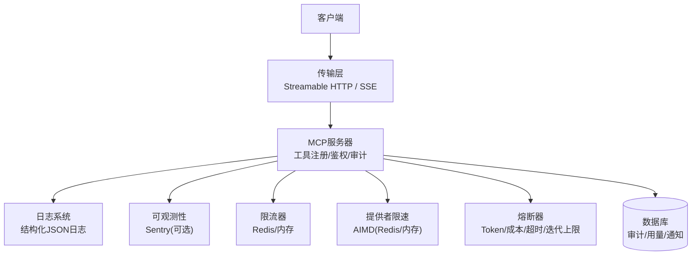
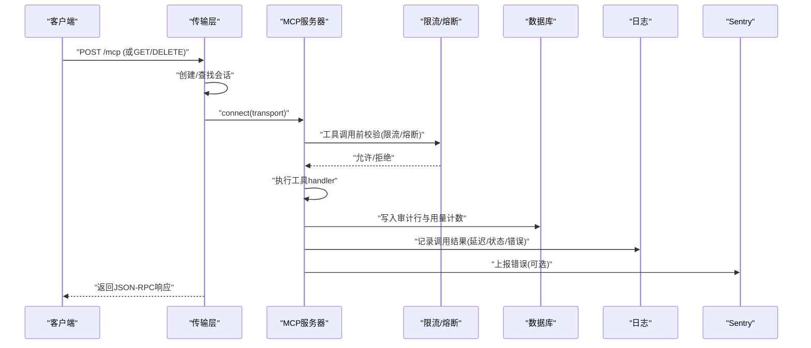
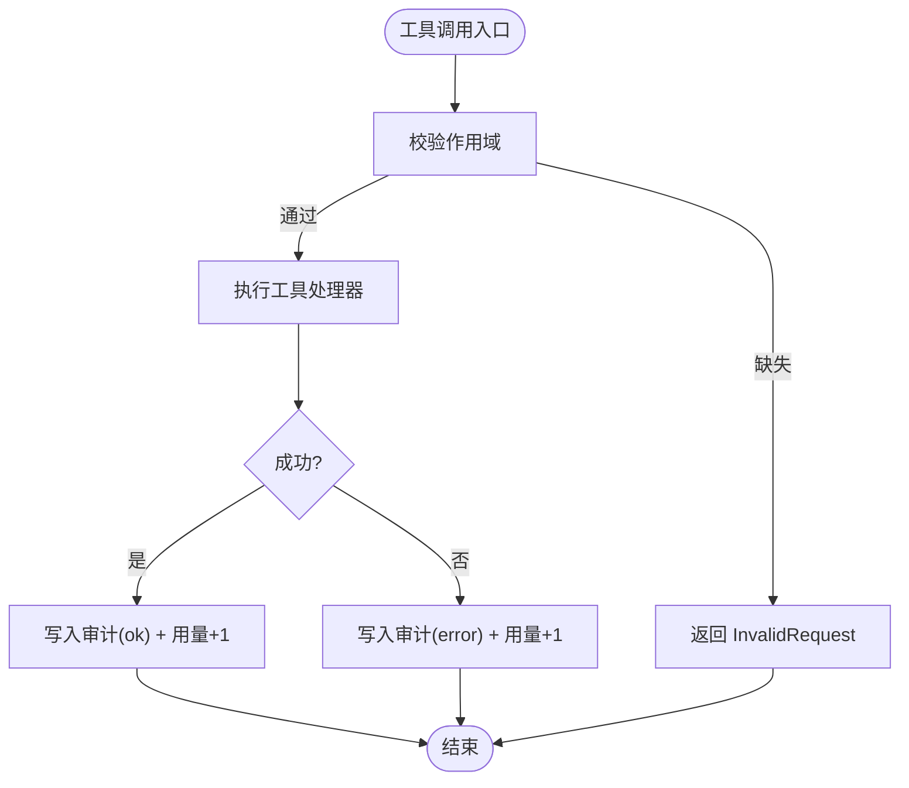
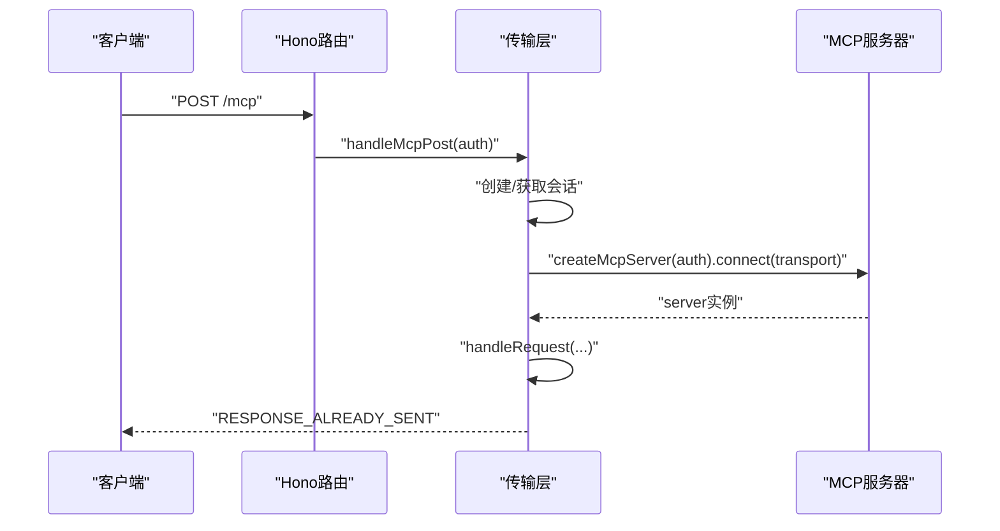
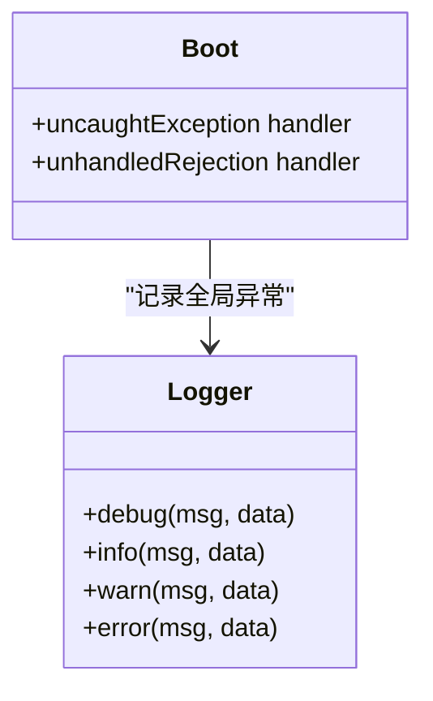
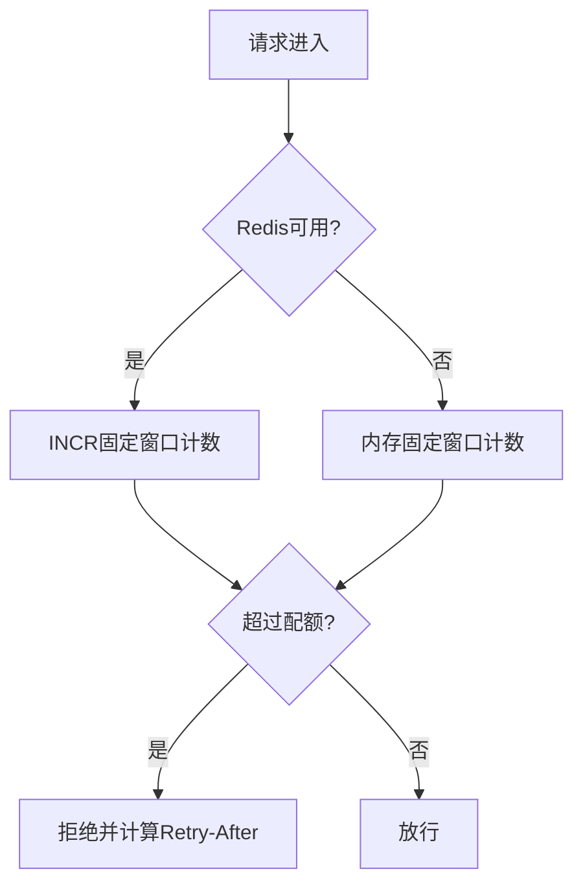
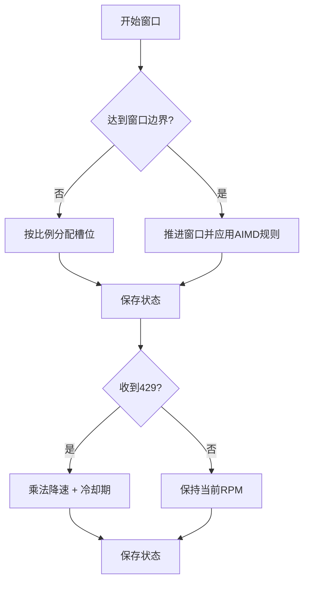
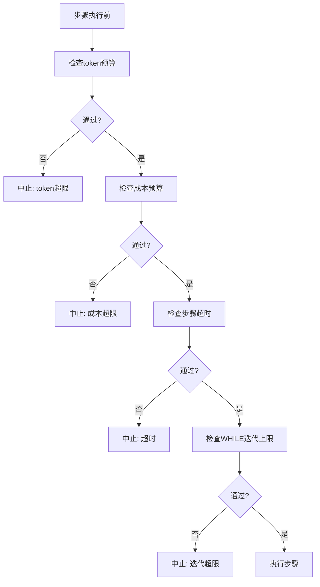
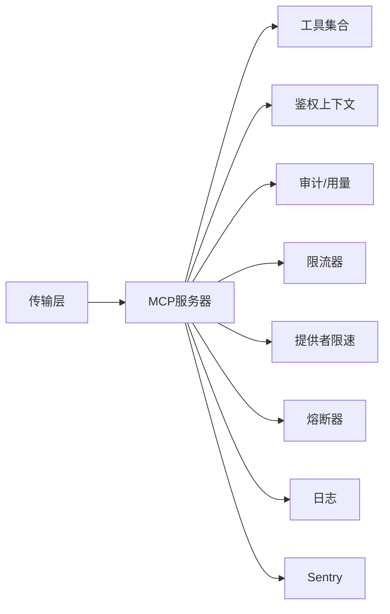

# 错误处理与监控

<cite>
**本文引用的文件**
- [api/mcp/server.ts](file://api/mcp/server.ts)
- [api/mcp/transport.ts](file://api/mcp/transport.ts)
- [api/lib/logger.ts](file://api/lib/logger.ts)
- [api/lib/observability.ts](file://api/lib/observability.ts)
- [api/lib/rateLimiter.ts](file://api/lib/rateLimiter.ts)
- [api/lib/providerThrottle.ts](file://api/lib/providerThrottle.ts)
- [api/plugins/circuit-breaker/index.ts](file://api/plugins/circuit-breaker/index.ts)
- [contracts/errors.ts](file://contracts/errors.ts)
- [api/boot.ts](file://api/boot.ts)
- [db/schema.ts](file://db/schema.ts)
- [api/routers/debug.ts](file://api/routers/debug.ts)
- [src/components/ErrorBoundary.tsx](file://src/components/ErrorBoundary.tsx)
</cite>

## 目录
1. [简介](#简介)
2. [项目结构](#项目结构)
3. [核心组件](#核心组件)
4. [架构总览](#架构总览)
5. [详细组件分析](#详细组件分析)
6. [依赖关系分析](#依赖关系分析)
7. [性能考量](#性能考量)
8. [故障排查指南](#故障排查指南)
9. [结论](#结论)
10. [附录](#附录)

## 简介
本文件面向DeeWaanAI的MCP客户端集成，系统化说明错误处理与监控体系：错误类型分类、异常捕获与处理策略；日志规范、级别配置与格式标准；监控指标收集、性能追踪与可用性监控；告警规则、通知机制与故障响应流程；错误诊断工具与调试技巧；以及生产环境的监控部署与运维最佳实践。内容严格基于仓库现有实现进行归纳与可视化。

## 项目结构
围绕MCP的错误处理与监控涉及以下关键模块：
- MCP服务器与传输层：会话管理、工具调用审计与遥测、SSE/HTTP流式传输
- 日志与可观测性：结构化日志、Sentry上报（可选）
- 限流与熔断：按客户/提供者维度的速率限制、AIMD自适应限速、管线熔断保护
- 数据模型：审计日志、使用计数、通知等持久化存储
- 前端错误边界：捕获并展示运行时错误

图表来源
- [api/mcp/transport.ts:1-234](file://api/mcp/transport.ts#L1-L234)
- [api/mcp/server.ts:1-209](file://api/mcp/server.ts#L1-L209)
- [api/lib/logger.ts:1-32](file://api/lib/logger.ts#L1-L32)
- [api/lib/observability.ts:1-33](file://api/lib/observability.ts#L1-L33)
- [api/lib/rateLimiter.ts:1-216](file://api/lib/rateLimiter.ts#L1-L216)
- [api/lib/providerThrottle.ts:1-275](file://api/lib/providerThrottle.ts#L1-L275)
- [api/plugins/circuit-breaker/index.ts:1-186](file://api/plugins/circuit-breaker/index.ts#L1-L186)
- [db/schema.ts:1040-1104](file://db/schema.ts#L1040-L1104)

章节来源
- [api/mcp/transport.ts:1-234](file://api/mcp/transport.ts#L1-L234)
- [api/mcp/server.ts:1-209](file://api/mcp/server.ts#L1-L209)
- [api/lib/logger.ts:1-32](file://api/lib/logger.ts#L1-L32)
- [api/lib/observability.ts:1-33](file://api/lib/observability.ts#L1-L33)
- [api/lib/rateLimiter.ts:1-216](file://api/lib/rateLimiter.ts#L1-L216)
- [api/lib/providerThrottle.ts:1-275](file://api/lib/providerThrottle.ts#L1-L275)
- [api/plugins/circuit-breaker/index.ts:1-186](file://api/plugins/circuit-breaker/index.ts#L1-L186)
- [db/schema.ts:1040-1104](file://db/schema.ts#L1040-L1104)

## 核心组件
- MCP服务器与工具调用审计：每个会话构建独立McpServer，工具调用前后记录延迟、状态与错误信息，并写入审计表与月度用量计数器。
- 传输层与会话管理：支持Streamable HTTP与Legacy SSE两种传输，维护进程内会话映射，自动清理过期会话。
- 日志系统：统一结构化JSON日志，支持DEBUG/INFO/WARN/ERROR四级，通过环境变量控制输出级别。
- 可观测性：Sentry按需初始化，失败不影响服务启动与运行。
- 限流器：提供令牌桶与固定窗口两种模式，支持Redis分布式与内存降级。
- 提供者限速：AIMD算法动态调整RPM，结合Redis与内存状态，对429等信号做乘法降速与冷却期。
- 熔断器：在管线执行前检查token/成本/超时/循环次数上限，防止失控消耗。
- 数据模型：审计日志、用量计数、通知等表用于持久化指标与事件。

章节来源
- [api/mcp/server.ts:41-82](file://api/mcp/server.ts#L41-L82)
- [api/mcp/transport.ts:45-57](file://api/mcp/transport.ts#L45-L57)
- [api/lib/logger.ts:1-32](file://api/lib/logger.ts#L1-L32)
- [api/lib/observability.ts:1-33](file://api/lib/observability.ts#L1-L33)
- [api/lib/rateLimiter.ts:31-93](file://api/lib/rateLimiter.ts#L31-L93)
- [api/lib/providerThrottle.ts:168-235](file://api/lib/providerThrottle.ts#L168-L235)
- [api/plugins/circuit-breaker/index.ts:44-110](file://api/plugins/circuit-breaker/index.ts#L44-L110)
- [db/schema.ts:1040-1104](file://db/schema.ts#L1040-L1104)

## 架构总览
下图展示了从客户端到MCP服务器的请求路径，以及错误与监控在各层的落点。

图表来源
- [api/mcp/transport.ts:76-140](file://api/mcp/transport.ts#L76-L140)
- [api/mcp/server.ts:84-124](file://api/mcp/server.ts#L84-L124)
- [api/lib/rateLimiter.ts:198-216](file://api/lib/rateLimiter.ts#L198-L216)
- [api/plugins/circuit-breaker/index.ts:62-110](file://api/plugins/circuit-breaker/index.ts#L62-L110)
- [db/schema.ts:1095-1104](file://db/schema.ts#L1095-L1104)
- [api/lib/logger.ts:12-24](file://api/lib/logger.ts#L12-L24)
- [api/lib/observability.ts:17-33](file://api/lib/observability.ts#L17-L33)

## 详细组件分析

### MCP服务器与工具调用审计
- 会话级服务器：每次连接创建独立McpServer，确保认证上下文与作用域隔离。
- 工具注册与特性开关：按用户特性开关决定是否注册工具，未启用时隐藏并在调用时报未知工具。
- 权限校验：工具调用前校验所需作用域，缺失则返回InvalidRequest。
- 审计与用量：每次调用记录延迟、状态(ok/error/denied)、错误摘要，并原子递增月度用量计数器。
- 容错：审计与用量写入为“fire-and-forget”，失败仅记录警告，不中断主流程。

图表来源
- [api/mcp/server.ts:84-124](file://api/mcp/server.ts#L84-L124)
- [api/mcp/server.ts:47-82](file://api/mcp/server.ts#L47-L82)

章节来源
- [api/mcp/server.ts:84-124](file://api/mcp/server.ts#L84-L124)
- [api/mcp/server.ts:47-82](file://api/mcp/server.ts#L47-L82)

### 传输层与会话管理
- 双传输支持：Streamable HTTP(/mcp)与Legacy SSE(/mcp/sse, /mcp/messages)。
- 会话生命周期：进程内Map维护会话，支持自动清理过期会话；初始化时注入采样能力桥接。
- 错误处理：解析失败、会话不存在、传输异常均返回明确的JSON-RPC错误或通用错误，并记录日志。

图表来源
- [api/mcp/transport.ts:76-140](file://api/mcp/transport.ts#L76-L140)
- [api/mcp/server.ts:200-208](file://api/mcp/server.ts#L200-L208)

章节来源
- [api/mcp/transport.ts:76-140](file://api/mcp/transport.ts#L76-L140)
- [api/mcp/transport.ts:174-233](file://api/mcp/transport.ts#L174-L233)

### 日志规范与级别配置
- 日志格式：单行JSON对象，包含时间戳、级别、消息与附加字段。
- 级别控制：通过环境变量LOG_LEVEL过滤输出，默认info。
- 输出通道：error/warn分别走stderr/stdout，其他走stdout，便于日志采集。
- 应用级全局异常：捕获未捕获异常与未处理拒绝，统一记录。

图表来源
- [api/lib/logger.ts:1-32](file://api/lib/logger.ts#L1-L32)
- [api/boot.ts:375-381](file://api/boot.ts#L375-L381)

章节来源
- [api/lib/logger.ts:1-32](file://api/lib/logger.ts#L1-L32)
- [api/boot.ts:375-381](file://api/boot.ts#L375-L381)

### 可观测性与错误上报
- Sentry初始化：当配置DSN时动态加载SDK并初始化环境；失败仅记录警告，不影响服务。
- 适用场景：生产环境建议开启，用于集中错误聚合与堆栈追踪。

章节来源
- [api/lib/observability.ts:1-33](file://api/lib/observability.ts#L1-L33)

### 限流器（按客户/通用）
- 令牌桶：通用checkRateLimit，适合短时突发控制。
- 固定窗口：checkCustomerRateLimit，按客户分层(solo/team/admin)，支持Redis分布式与内存降级。
- 降级策略：Redis不可用时回退到内存，保证可用性。

图表来源
- [api/lib/rateLimiter.ts:198-216](file://api/lib/rateLimiter.ts#L198-L216)
- [api/lib/rateLimiter.ts:64-93](file://api/lib/rateLimiter.ts#L64-L93)

章节来源
- [api/lib/rateLimiter.ts:31-93](file://api/lib/rateLimiter.ts#L31-L93)
- [api/lib/rateLimiter.ts:198-216](file://api/lib/rateLimiter.ts#L198-L216)

### 提供者限速（AIMD）
- 目标：根据提供者反馈动态调整RPM，避免雪崩与过度限流。
- 机制：慢启动→加法增长；遇429触发乘法降速与冷却期；状态持久化至Redis，失败回退内存。
- 指标：暴露当前RPM、窗口计数、是否处于慢启动。

图表来源
- [api/lib/providerThrottle.ts:135-162](file://api/lib/providerThrottle.ts#L135-L162)
- [api/lib/providerThrottle.ts:168-235](file://api/lib/providerThrottle.ts#L168-L235)

章节来源
- [api/lib/providerThrottle.ts:168-235](file://api/lib/providerThrottle.ts#L168-L235)

### 熔断器（管线安全）
- 目的：防止管线失控导致token/成本/时间/循环次数超限。
- 检查点：在执行每步前评估估计值，超限时中止并返回明确原因。
- 统计：记录实际用量与迭代次数，支持查询当前用量。

图表来源
- [api/plugins/circuit-breaker/index.ts:62-110](file://api/plugins/circuit-breaker/index.ts#L62-L110)

章节来源
- [api/plugins/circuit-breaker/index.ts:62-110](file://api/plugins/circuit-breaker/index.ts#L62-L110)

### 错误类型与统一表示
- 应用错误：以tagged union形式定义HTTP语义错误（4xx/5xx），便于上层统一处理。
- tRPC错误：中间件抛出UNAUTHORIZED/FORBIDDEN等标准化错误码。
- MCP错误：工具权限不足等场景返回InvalidRequest等协议错误。

章节来源
- [contracts/errors.ts:1-15](file://contracts/errors.ts#L1-L15)
- [api/middleware.ts:17-51](file://api/middleware.ts#L17-L51)
- [api/mcp/server.ts:99-108](file://api/mcp/server.ts#L99-L108)

### 前端错误边界
- 捕获渲染阶段异常，展示友好提示并提供重载按钮。
- 适用于React组件树局部崩溃恢复。

章节来源
- [src/components/ErrorBoundary.tsx:13-53](file://src/components/ErrorBoundary.tsx#L13-L53)

## 依赖关系分析
- 传输层依赖服务器工厂，服务器依赖工具集合、鉴权上下文、特性开关、审计与用量写入。
- 限流器与提供者限速共享Redis/内存状态，作为外部依赖影响整体稳定性。
- 熔断器与业务管线耦合，需配合调用方在每步执行前后正确记录。
- 日志与可观测性贯穿各层，保障问题定位与线上可见性。

图表来源
- [api/mcp/transport.ts:76-140](file://api/mcp/transport.ts#L76-L140)
- [api/mcp/server.ts:84-124](file://api/mcp/server.ts#L84-L124)
- [api/lib/rateLimiter.ts:198-216](file://api/lib/rateLimiter.ts#L198-L216)
- [api/lib/providerThrottle.ts:168-235](file://api/lib/providerThrottle.ts#L168-L235)
- [api/plugins/circuit-breaker/index.ts:62-110](file://api/plugins/circuit-breaker/index.ts#L62-L110)
- [api/lib/logger.ts:12-24](file://api/lib/logger.ts#L12-L24)
- [api/lib/observability.ts:17-33](file://api/lib/observability.ts#L17-L33)

## 性能考量
- 审计与用量写入采用异步“fire-and-forget”模式，避免阻塞主路径。
- 限流与限速优先使用Redis分布式计数，失败自动降级到内存，保障高可用。
- AIMD限速避免过度保守导致的吞吐下降，同时防止雪崩。
- 熔断器在每步执行前快速短路，减少无效资源消耗。
- 建议：
  - 合理设置AIMD初始RPM与地板值，避免冷启动过慢或过激。
  - 定期清理过期会话与内存窗口，防止内存泄漏。
  - 在高并发下关注Redis连接池与超时配置。

[本节为通用指导，无需特定文件引用]

## 故障排查指南
- 快速定位：
  - 查看MCP审计表与用量计数器，确认调用是否落地、延迟与错误摘要。
  - 检查提供者限速状态，确认是否处于降速或冷却期。
  - 审查日志级别与关键字段，如session初始化、工具注册数量、传输错误。
- 常见问题：
  - 会话丢失：确认mcp-session-id是否正确传递，服务端是否已清理过期会话。
  - 工具不可用：检查特性开关与权限作用域。
  - 频繁429：观察AIMD降速曲线与冷却期，必要时调整提供者配置。
  - 审计写入失败：关注警告日志，必要时临时关闭审计以提升吞吐。
- 调试技巧：
  - 将LOG_LEVEL设为debug，抓取更详细的上下文。
  - 使用调试接口汇总运行统计（如延迟、token、标记数）。
  - 前端ErrorBoundary捕获UI错误，结合浏览器控制台与后端日志联动。

章节来源
- [api/mcp/server.ts:47-82](file://api/mcp/server.ts#L47-L82)
- [api/lib/providerThrottle.ts:240-275](file://api/lib/providerThrottle.ts#L240-L275)
- [api/routers/debug.ts:125-173](file://api/routers/debug.ts#L125-L173)
- [src/components/ErrorBoundary.tsx:19-25](file://src/components/ErrorBoundary.tsx#L19-L25)

## 结论
该错误处理与监控体系以MCP为核心，结合结构化日志、可选Sentry上报、细粒度限流与AIMD自适应限速、以及熔断保护，形成端到端的健壮性保障。通过审计与用量持久化，既满足合规与计费需求，也为容量规划与性能优化提供依据。生产环境建议开启Sentry、合理配置日志级别与限流参数，并建立基于审计与指标的告警与响应流程。

[本节为总结，无需特定文件引用]

## 附录

### 监控指标与数据来源
- 调用审计：mcp_audit_log（userId、clientId、toolName、latencyMs、status、error）
- 用量计数：usage_counters（subjectId、metric、period、count）
- 通知：notifications（pipeline_error等事件）
- 调试统计：routers/debug提供的聚合指标（运行数、响应数、token、延迟、角色维度统计、标记数）

章节来源
- [db/schema.ts:1040-1104](file://db/schema.ts#L1040-L1104)
- [api/routers/debug.ts:125-173](file://api/routers/debug.ts#L125-L173)

### 告警规则与通知机制（建议）
- 基于审计表的错误率阈值：例如某工具error占比突增或denied比例异常。
- 基于用量计数器的突增检测：短时间内mcp_tool_call激增。
- 提供者限速告警：AIMD持续降速或长时间处于冷却期。
- 熔断触发告警：频繁因token/成本/超时/迭代超限被中止。
- 通知渠道：通过notifications表或外部系统集成邮件/IM通知。

[本节为通用建议，无需特定文件引用]

### 生产部署与运维最佳实践
- 日志：统一JSON格式，集中采集；按环境设置合适级别；保留必要上下文。
- 可观测性：生产环境启用Sentry；非关键路径失败不阻断主流程。
- 限流与限速：优先Redis分布式；配置合理的窗口与配额；监控降级情况。
- 熔断：为高风险操作设置严格上限；定期复盘阈值。
- 会话与资源：定期清理过期会话；监控内存与Redis占用。
- 变更管理：特性开关灰度发布；变更后观察审计与指标变化。

[本节为通用建议，无需特定文件引用]