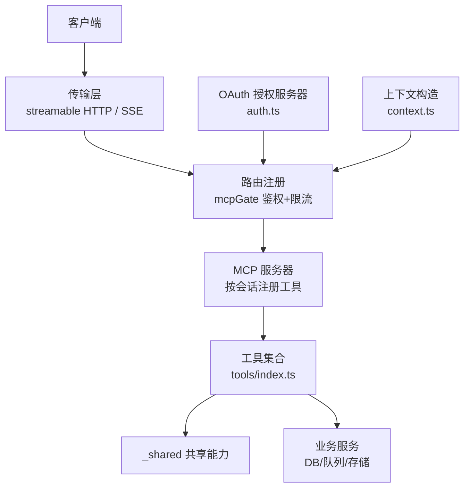
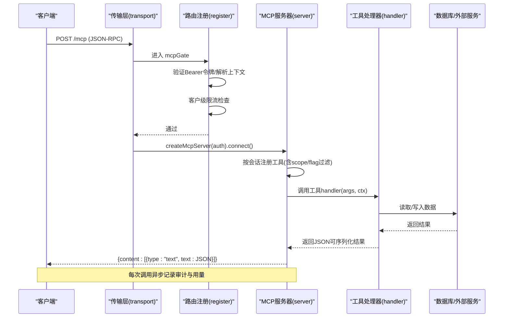
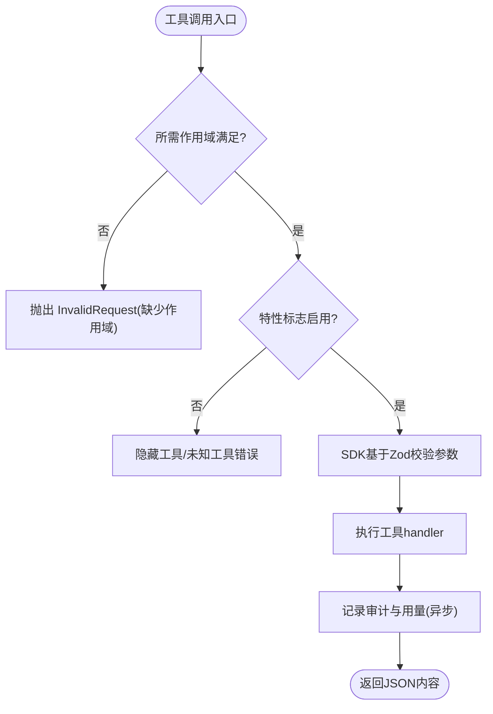
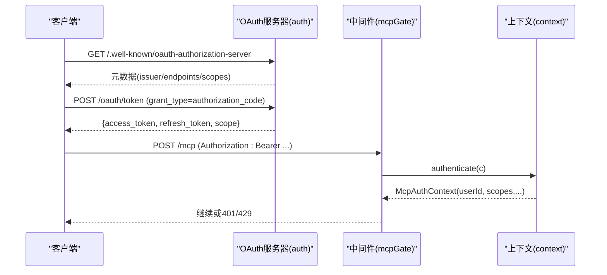
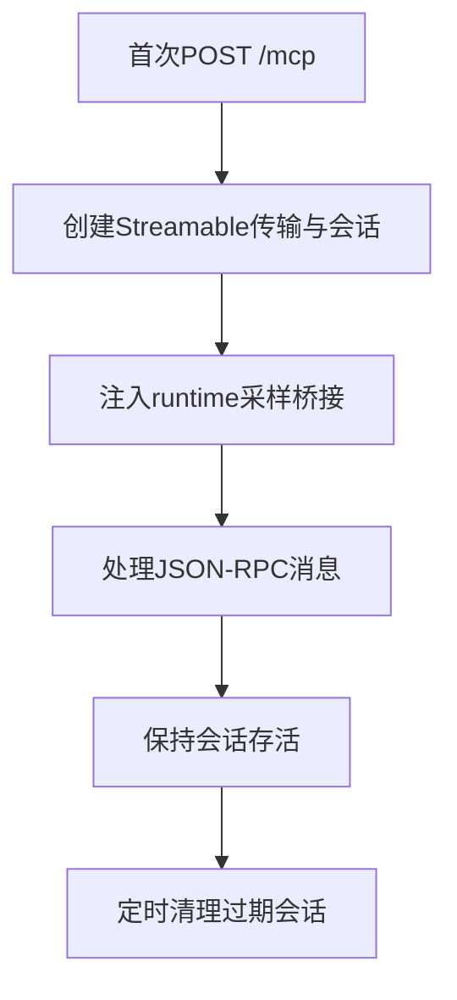
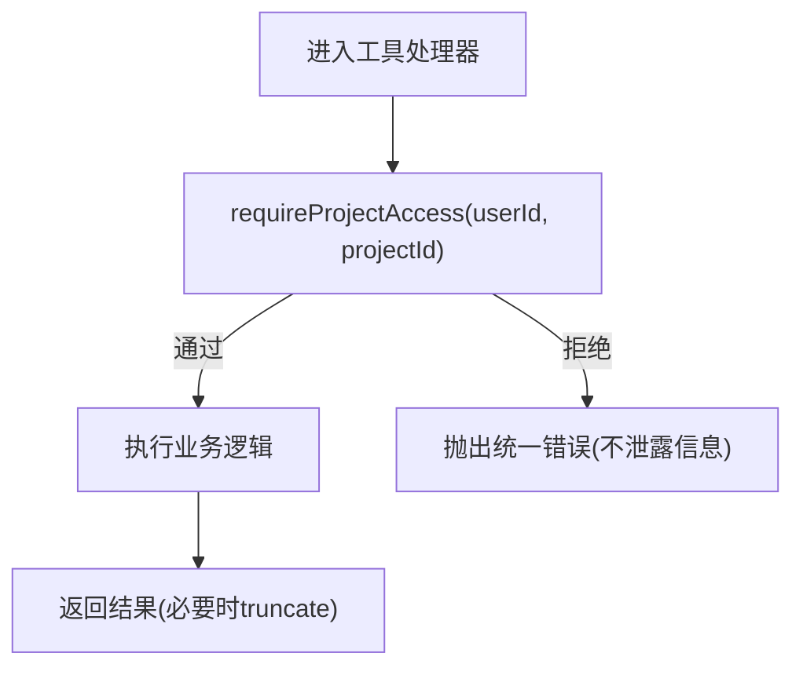
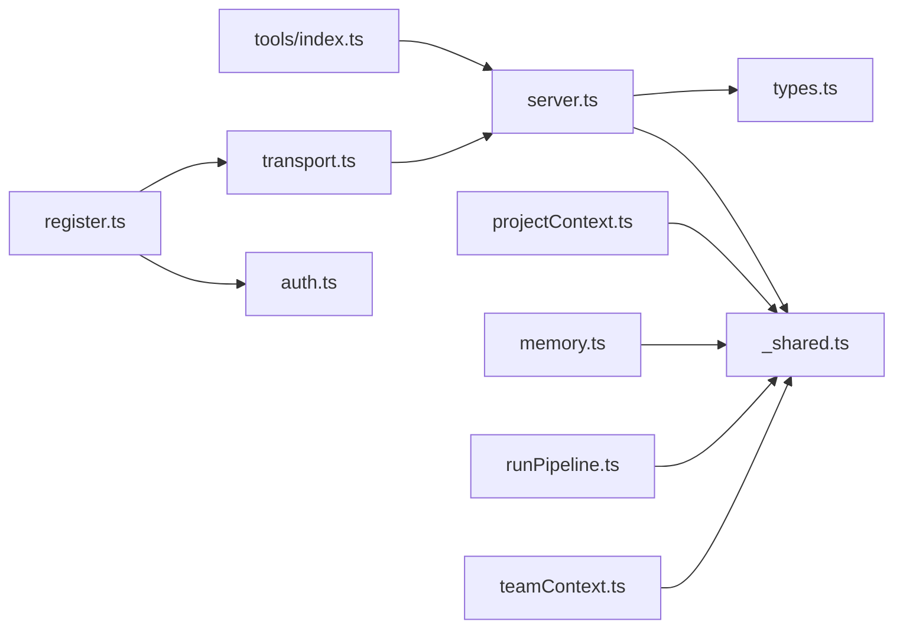

# 工具开发指南

<cite>
**本文引用的文件**
- [api/mcp/tools/index.ts](file://api/mcp/tools/index.ts)
- [api/mcp/server.ts](file://api/mcp/server.ts)
- [api/mcp/types.ts](file://api/mcp/types.ts)
- [api/mcp/auth.ts](file://api/mcp/auth.ts)
- [api/mcp/context.ts](file://api/mcp/context.ts)
- [api/mcp/transport.ts](file://api/mcp/transport.ts)
- [api/mcp/register.ts](file://api/mcp/register.ts)
- [api/mcp/tools/_shared.ts](file://api/mcp/tools/_shared.ts)
- [api/mcp/tools/projectContext.ts](file://api/mcp/tools/projectContext.ts)
- [api/mcp/tools/runPipeline.ts](file://api/mcp/tools/runPipeline.ts)
- [api/mcp/tools/memory.ts](file://api/mcp/tools/memory.ts)
- [api/mcp/tools/help.ts](file://api/mcp/tools/help.ts)
- [api/mcp/tools/team/teamContext.ts](file://api/mcp/tools/team/teamContext.ts)
- [api/mcp/tools/pipelineValidation.ts](file://api/mcp/tools/pipelineValidation.ts)
- [api/lib/messages.ts](file://api/lib/messages.ts)
</cite>

## 目录
1. [简介](#简介)
2. [项目结构](#项目结构)
3. [核心组件](#核心组件)
4. [架构总览](#架构总览)
5. [详细组件分析](#详细组件分析)
6. [依赖关系分析](#依赖关系分析)
7. [性能考虑](#性能考虑)
8. [故障排查指南](#故障排查指南)
9. [结论](#结论)
10. [附录：完整工具开发流程](#附录：完整工具开发流程)

## 简介
本指南面向在 DeeWaanAI 中开发 MCP（Model Context Protocol）自定义工具的工程师与产品实现者。文档覆盖工具的基本结构、文件组织规范、命名约定、接口定义、参数校验机制、错误处理模式、访问权限检查、用户认证与数据安全最佳实践，以及共享模块（如 insertProjectSteps、canAccessProject）的使用方法。同时提供从需求到实现的端到端流程、性能优化建议与调试技巧，帮助快速、安全地交付高质量工具。

## 项目结构
MCP 子系统位于 api/mcp 目录下，采用“协议层 + 传输层 + 鉴权层 + 工具注册”的分层设计：
- 协议与类型：types.ts 定义 McpTool、McpAuthContext 等契约；server.ts 负责按会话构建并注册工具；register.ts 挂载路由与中间件；transport.ts 管理流式 HTTP 与 SSE 传输与会话生命周期。
- 鉴权与上下文：auth.ts 实现 OAuth 2.1 授权服务器；context.ts 解析 Bearer Token 为 McpAuthContext；register.ts 的 mcpGate 中间件统一鉴权与限流。
- 工具集合：tools/index.ts 集中注册所有工具；各工具遵循统一的输入 schema、权限范围与注解；_shared.ts 提供跨工具共享能力（项目访问控制、步骤插入、文本截断）。
- 团队与特性开关：team/* 下的工具通过 featureFlag 进行灰度控制；help.ts 根据能力与特性生成个性化帮助。

图表来源
- [api/mcp/register.ts:90-165](file://api/mcp/register.ts#L90-L165)
- [api/mcp/transport.ts:74-234](file://api/mcp/transport.ts#L74-L234)
- [api/mcp/server.ts:84-186](file://api/mcp/server.ts#L84-L186)
- [api/mcp/tools/index.ts:45-94](file://api/mcp/tools/index.ts#L45-L94)
- [api/mcp/auth.ts:147-428](file://api/mcp/auth.ts#L147-L428)
- [api/mcp/context.ts:17-42](file://api/mcp/context.ts#L17-L42)

章节来源
- [api/mcp/register.ts:90-165](file://api/mcp/register.ts#L90-L165)
- [api/mcp/transport.ts:74-234](file://api/mcp/transport.ts#L74-L234)
- [api/mcp/server.ts:84-186](file://api/mcp/server.ts#L84-L186)
- [api/mcp/tools/index.ts:45-94](file://api/mcp/tools/index.ts#L45-L94)
- [api/mcp/auth.ts:147-428](file://api/mcp/auth.ts#L147-L428)
- [api/mcp/context.ts:17-42](file://api/mcp/context.ts#L17-L42)

## 核心组件
- McpTool 契约：每个工具必须声明 name、description、inputSchema（Zod）、requiredScopes、annotations（readOnlyHint/destructiveHint），可选 featureFlag；handler 接收已校验的参数与认证上下文。
- 服务器注册：server.ts 对每个工具执行 scope 校验、feature flag 过滤、参数校验、结果包装与审计记录。
- 认证与上下文：auth.ts 提供 OAuth 2.1 全流程；context.ts 将 Bearer Token 解析为 McpAuthContext（userId、scopes、clientId、requestId、locale、runtime）。
- 传输与会话：transport.ts 维护进程内会话表，支持流式 HTTP 与 SSE，注入 runtime（采样桥接）。
- 路由与中间件：register.ts 挂载 OAuth 与 /mcp* 路由，统一鉴权、限流与 WWW-Authenticate 挑战。
- 共享能力：_shared.ts 提供 insertProjectSteps、canAccessProject、requireProjectAccess、truncate。

章节来源
- [api/mcp/types.ts:9-44](file://api/mcp/types.ts#L9-L44)
- [api/mcp/server.ts:84-186](file://api/mcp/server.ts#L84-L186)
- [api/mcp/auth.ts:147-428](file://api/mcp/auth.ts#L147-L428)
- [api/mcp/context.ts:17-42](file://api/mcp/context.ts#L17-L42)
- [api/mcp/transport.ts:74-234](file://api/mcp/transport.ts#L74-L234)
- [api/mcp/register.ts:90-165](file://api/mcp/register.ts#L90-L165)
- [api/mcp/tools/_shared.ts:11-67](file://api/mcp/tools/_shared.ts#L11-L67)

## 架构总览
下图展示一次工具调用的端到端流程：客户端发起请求 → 传输层建立会话 → 路由中间件鉴权与限流 → 服务器按会话注册工具 → 工具处理器执行业务逻辑 → 审计与用量统计。

图表来源
- [api/mcp/transport.ts:74-141](file://api/mcp/transport.ts#L74-L141)
- [api/mcp/register.ts:90-165](file://api/mcp/register.ts#L90-L165)
- [api/mcp/server.ts:135-186](file://api/mcp/server.ts#L135-L186)
- [api/mcp/server.ts:46-82](file://api/mcp/server.ts#L46-L82)

## 详细组件分析

### 工具契约与注册机制
- 工具契约：name 使用永久 snake_case；inputSchema 使用 Zod v4 对象 schema；requiredScopes 限制最小权限；annotations 标注只读/破坏性；featureFlag 用于特性门控。
- 注册流程：server.ts 遍历 TOOLS，先做 featureFlag 判断（失败则隐藏），再注册 handler；handler 内部先校验 requiredScopes，再执行业务逻辑；结果统一包装为 content 数组。
- 审计与用量：每次调用记录 mcp_audit_log 与 usageCounters（fire-and-forget，不影响主流程）。

图表来源
- [api/mcp/server.ts:84-124](file://api/mcp/server.ts#L84-L124)
- [api/mcp/server.ts:149-177](file://api/mcp/server.ts#L149-L177)
- [api/mcp/server.ts:46-82](file://api/mcp/server.ts#L46-L82)

章节来源
- [api/mcp/types.ts:33-44](file://api/mcp/types.ts#L33-L44)
- [api/mcp/server.ts:84-186](file://api/mcp/server.ts#L84-L186)

### 认证与上下文
- OAuth 2.1：/.well-known/* 元数据、/oauth/register 动态注册、/oauth/authorize 授权码+PKCE、/oauth/token 换发令牌；支持 refresh_token。
- 上下文构造：context.ts 解析 Authorization: Bearer，校验 access token，提取 userId、scopes、clientId、requestId、locale。
- 路由中间件：register.ts 的 mcpGate 统一鉴权、限流与 WWW-Authenticate 挑战；未通过返回 401。

图表来源
- [api/mcp/auth.ts:147-428](file://api/mcp/auth.ts#L147-L428)
- [api/mcp/context.ts:17-42](file://api/mcp/context.ts#L17-L42)
- [api/mcp/register.ts:90-165](file://api/mcp/register.ts#L90-L165)

章节来源
- [api/mcp/auth.ts:147-428](file://api/mcp/auth.ts#L147-L428)
- [api/mcp/context.ts:17-42](file://api/mcp/context.ts#L17-L42)
- [api/mcp/register.ts:90-165](file://api/mcp/register.ts#L90-L165)

### 传输与会话
- 流式 HTTP：POST/GET/DELETE /mcp，首次 POST 创建 StreamableHTTPServerTransport 并注册会话；后续 GET/DELETE 复用会话。
- 兼容 SSE：/mcp/sse 打开 SSE 流，/mcp/messages 发送消息；保留给旧版桌面客户端。
- 会话治理：进程内 Map 维护会话，定期清理过期会话；注入 runtime.samplingSupported/sample 供工具回推消息。

图表来源
- [api/mcp/transport.ts:74-141](file://api/mcp/transport.ts#L74-L141)
- [api/mcp/transport.ts:174-234](file://api/mcp/transport.ts#L174-L234)

章节来源
- [api/mcp/transport.ts:74-234](file://api/mcp/transport.ts#L74-L234)

### 共享模块与项目访问控制
- insertProjectSteps：批量插入 pipeline_steps，stepOrder 从 1 开始，自动填充 role/systemPrompt/model/temperature/maxTokens/ifConfig/whileConfig/enabled。
- canAccessProject：判断用户是否为项目所有者或通过 teamMembers×teamProjects 关联拥有团队访问权限。
- requireProjectAccess：封装访问检查，失败抛出不泄露信息的错误。
- truncate：输出压缩，避免过大响应。

图表来源
- [api/mcp/tools/_shared.ts:11-67](file://api/mcp/tools/_shared.ts#L11-L67)

章节来源
- [api/mcp/tools/_shared.ts:11-67](file://api/mcp/tools/_shared.ts#L11-L67)

### 典型工具实现

#### project_context
- 功能：获取项目的 Intelligence Card（类型、框架、文件树、实体、API 端点、TODO），可选查询最相关的文件内容。
- 权限：mcp:read；只读。
- 关键点：先进行项目访问检查；按需计算相关文件路径并读取内容；对大字段进行截断与裁剪。

章节来源
- [api/mcp/tools/projectContext.ts:16-129](file://api/mcp/tools/projectContext.ts#L16-L129)

#### run_pipeline
- 功能：为项目启动新的 AI 流水线运行，创建 run 行并入队 worker，立即返回；后续通过 run_status 轮询。
- 权限：mcp:run；标记为破坏性操作。
- 关键点：可选应用模板到项目（仅项目所有者）；原子事务插入 run；入队 swarm worker；记录日志。

章节来源
- [api/mcp/tools/runPipeline.ts:15-156](file://api/mcp/tools/runPipeline.ts#L15-L156)

#### memory_get / memory_append
- 功能：读取项目片段记忆与结构化状态摘要；追加笔记到片段记忆。
- 权限：memory_get 为 mcp:read；memory_append 为 mcp:write（破坏性）。
- 关键点：访问检查前置；最近片段排序与限制；状态摘要截断；持久化到磁盘存储。

章节来源
- [api/mcp/tools/memory.ts:13-92](file://api/mcp/tools/memory.ts#L13-L92)

#### deewaanai_help
- 功能：根据当前用户的计划、能力、作用域与特性标志，生成个性化帮助指南。
- 权限：mcp:read；只读。
- 关键点：查询 llmProviders；组合 teamsync/mcp_sampling/batch_mode 特性；结合 runtime.samplingSupported 提示可用能力。

章节来源
- [api/mcp/tools/help.ts:16-47](file://api/mcp/tools/help.ts#L16-L47)

#### team_context_get / team_memory_append
- 功能：读取/追加团队共享项目的记忆与状态。
- 权限：team:read / team:write；需团队成员且项目已共享给该团队。
- 关键点：访问门控 requireTeamMembershipAndShare；追加片段后尝试乐观更新状态（失败不阻塞主流程）。

章节来源
- [api/mcp/tools/team/teamContext.ts:19-157](file://api/mcp/tools/team/teamContext.ts#L19-L157)

### 参数校验与错误处理
- 参数校验：所有工具使用 Zod 定义 inputSchema；SDK 在 server.ts 中执行 safeParseAsync，非法参数直接返回 InvalidParams。
- 作用域校验：server.ts 在 handler 前检查 requiredScopes，缺失时返回 InvalidRequest。
- 特性标志：tool.featureFlag 由 isFeatureEnabled 判定；失败时隐藏工具，避免暴露未授权能力。
- 错误模式：统一非泄露错误（如“项目不存在”）；OAuth 错误遵循 RFC 6749；WWW-Authenticate 提示客户端重新认证。

章节来源
- [api/mcp/server.ts:84-124](file://api/mcp/server.ts#L84-L124)
- [api/mcp/auth.ts:76-84](file://api/mcp/auth.ts#L76-L84)
- [api/mcp/register.ts:90-142](file://api/mcp/register.ts#L90-L142)

### 国际化与本地化
- 消息系统：lib/messages.ts 提供 msg(key, locale, params) 与 resolveLocale(reqHeaders, userPrefs)，支持 en/zh 双语言与占位符插值。
- 用法：server.ts 在作用域不足时使用 msg 生成多语言错误；context.ts 解析请求头确定 locale。

章节来源
- [api/lib/messages.ts:13-57](file://api/lib/messages.ts#L13-L57)
- [api/mcp/server.ts:99-108](file://api/mcp/server.ts#L99-L108)
- [api/mcp/context.ts:34-40](file://api/mcp/context.ts#L34-L40)

## 依赖关系分析
- 工具与共享：projectContext、memory、runPipeline 等均依赖 _shared 的访问控制与截断能力。
- 工具与服务：runPipeline 依赖 swarmWorker 入队；memory 依赖 memoryManager 与 _memoryStore；team 工具依赖 sharedMemory。
- 服务器与注册：server.ts 依赖 tools/index.ts 的工具列表；register.ts 依赖 transport.ts 与 auth.ts；transport.ts 依赖 server.ts。

图表来源
- [api/mcp/tools/index.ts:45-94](file://api/mcp/tools/index.ts#L45-L94)
- [api/mcp/server.ts:84-186](file://api/mcp/server.ts#L84-L186)
- [api/mcp/register.ts:90-165](file://api/mcp/register.ts#L90-L165)
- [api/mcp/transport.ts:74-234](file://api/mcp/transport.ts#L74-L234)

章节来源
- [api/mcp/tools/index.ts:45-94](file://api/mcp/tools/index.ts#L45-L94)
- [api/mcp/server.ts:84-186](file://api/mcp/server.ts#L84-L186)
- [api/mcp/register.ts:90-165](file://api/mcp/register.ts#L90-L165)
- [api/mcp/transport.ts:74-234](file://api/mcp/transport.ts#L74-L234)

## 性能考虑
- 会话复用：transport.ts 维护进程内会话，减少重复初始化成本；定期清理过期会话防止内存泄漏。
- 异步审计：server.ts 的 recordToolCall 使用 fire-and-forget 写入审计与用量，避免阻塞主流程。
- 输出压缩：_shared.ts 的 truncate 限制响应大小；工具中对大数组/树进行裁剪（如 projectContext 的文件树与实体）。
- 限流与降级：register.ts 的客户级限流失败时允许请求（graceful degradation），保障可用性。
- 批量写入：insertProjectSteps 循环插入，适合小批量；如需更高吞吐可考虑批处理 API 或事务合并。

[本节为通用指导，无需特定文件引用]

## 故障排查指南
- 401 未认证：检查 Authorization 头格式与 access token 有效性；确认 mcpGate 正确设置 WWW-Authenticate。
- 429 限流：查看客户级限流配置与重试间隔；关注 tier 解析是否成功。
- 工具不可见：检查 tool.featureFlag 是否启用；确认 isFeatureEnabled 返回值与日志。
- 参数校验失败：核对 inputSchema 约束（长度、枚举、必填项）；参考 pipelineValidation.ts 的复杂规则。
- 项目访问被拒：确认 canAccessProject 逻辑（所有者或团队成员）；检查 teamMembers 与 teamProjects 关联。
- 审计/用量未记录：检查数据库写入异常与日志；确认 getDb 连接正常。

章节来源
- [api/mcp/register.ts:90-142](file://api/mcp/register.ts#L90-L142)
- [api/mcp/server.ts:46-82](file://api/mcp/server.ts#L46-L82)
- [api/mcp/tools/_shared.ts:36-60](file://api/mcp/tools/_shared.ts#L36-L60)
- [api/mcp/tools/pipelineValidation.ts:26-84](file://api/mcp/tools/pipelineValidation.ts#L26-L84)

## 结论
DeeWaanAI 的 MCP 工具体系以清晰的契约、严格的鉴权与灵活的传输层为基础，提供了可扩展、可观测、可审计的工具生态。通过共享模块与标准化流程，开发者可以快速实现安全、高性能的工具，并通过特性标志与国际化提升用户体验。建议在新增工具时严格遵循本文档的结构与最佳实践，确保一致性与可维护性。

## 附录：完整工具开发流程
- 需求分析
  - 明确工具目标、输入输出、权限范围与作用域（mcp:read/write/run 或 team:*）。
  - 评估是否需要特性标志（featureFlag）与团队访问控制。
- 设计契约
  - 定义 McpTool：name、description、inputSchema（Zod）、requiredScopes、annotations、可选 featureFlag。
  - 设计错误处理与国际化文案（使用 messages.ts）。
- 实现工具
  - 在 tools/ 下新建文件，实现 handler；优先调用 requireProjectAccess 或团队访问门控。
  - 使用 _shared.ts 的 insertProjectSteps、truncate 等能力。
  - 如需流水线步骤，参考 pipelineValidation.ts 的约束。
- 注册与测试
  - 在 tools/index.ts 中导出并加入 TOOLS 列表。
  - 本地联调：通过 OAuth 获取 access token，调用 /mcp 端点；检查工具可见性与行为。
  - 单元测试：针对 inputSchema 与复杂校验（pipelineValidation）编写用例。
- 上线与监控
  - 开启特性标志（如需要）；观察审计日志与用量计数器。
  - 监控限流与错误率；必要时调整参数上限与输出压缩策略。

章节来源
- [api/mcp/tools/index.ts:45-94](file://api/mcp/tools/index.ts#L45-L94)
- [api/mcp/tools/pipelineValidation.ts:26-84](file://api/mcp/tools/pipelineValidation.ts#L26-L84)
- [api/mcp/server.ts:46-82](file://api/mcp/server.ts#L46-L82)
- [api/lib/messages.ts:13-57](file://api/lib/messages.ts#L13-L57)