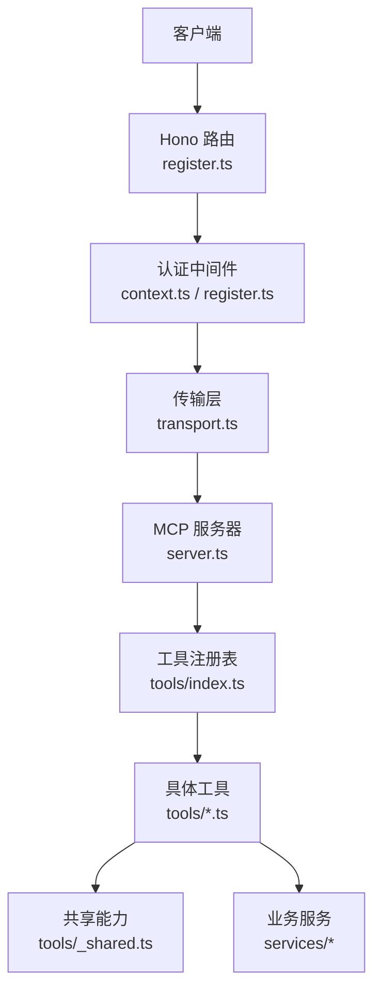
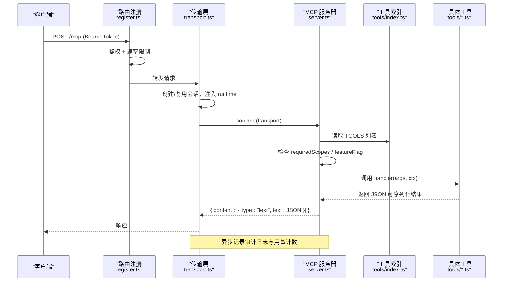
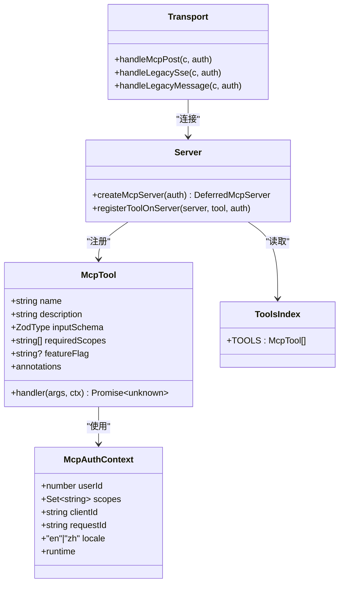
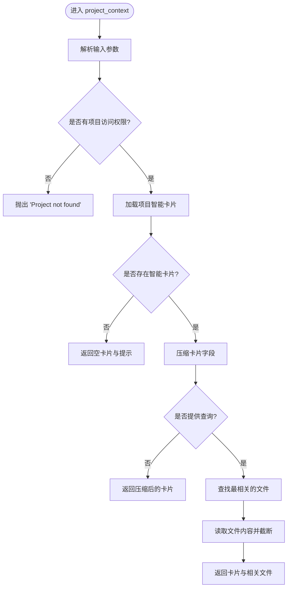
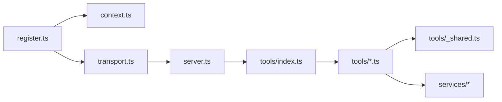

# 工具结构和规范

<cite>
**本文引用的文件**
- [api/mcp/tools/index.ts](file://api/mcp/tools/index.ts)
- [api/mcp/types.ts](file://api/mcp/types.ts)
- [api/mcp/server.ts](file://api/mcp/server.ts)
- [api/mcp/register.ts](file://api/mcp/register.ts)
- [api/mcp/transport.ts](file://api/mcp/transport.ts)
- [api/mcp/context.ts](file://api/mcp/context.ts)
- [api/mcp/auth.ts](file://api/mcp/auth.ts)
- [api/mcp/tools/_shared.ts](file://api/mcp/tools/_shared.ts)
- [api/mcp/tools/samplePing.ts](file://api/mcp/tools/samplePing.ts)
- [api/mcp/tools/help.ts](file://api/mcp/tools/help.ts)
- [api/mcp/tools/projectContext.ts](file://api/mcp/tools/projectContext.ts)
- [api/mcp/tools/memory.ts](file://api/mcp/tools/memory.ts)
</cite>

## 目录
1. [简介](#简介)
2. [项目结构](#项目结构)
3. [核心组件](#核心组件)
4. [架构总览](#架构总览)
5. [详细组件分析](#详细组件分析)
6. [依赖关系分析](#依赖关系分析)
7. [性能考虑](#性能考虑)
8. [故障排查指南](#故障排查指南)
9. [结论](#结论)
10. [附录：工具模板与最佳实践](#附录工具模板与最佳实践)

## 简介
本文件为 DeeWaanAI 的 MCP（Model Context Protocol）工具提供结构与规范文档，覆盖工具的组织方式、命名约定、标准接口定义、参数校验、返回值格式、错误处理模式、共享模块使用方式、工具注册机制与依赖管理，并给出新工具的模板与最佳实践示例，确保新增工具符合项目规范与代码质量标准。

## 项目结构
MCP 子系统位于 api/mcp 目录下，采用“协议层 + 传输层 + 认证层 + 工具集”的分层组织：
- 协议与类型：types.ts 定义 McpTool、McpAuthContext 等跨模块契约
- 服务器与注册：server.ts 构建 McpServer 并注册工具；register.ts 挂载路由与鉴权中间件
- 传输与会话：transport.ts 实现流式 HTTP 与 SSE 两种传输，维护会话生命周期
- 认证上下文：context.ts 解析 Bearer Token 生成 McpAuthContext
- OAuth 授权服务：auth.ts 提供 OAuth 2.1 端点（注册、授权码、令牌交换）
- 工具集合：tools/* 每个文件一个工具，index.ts 集中导出 TOOLS 列表

图表来源
- [api/mcp/register.ts:144-164](file://api/mcp/register.ts#L144-L164)
- [api/mcp/transport.ts:76-141](file://api/mcp/transport.ts#L76-L141)
- [api/mcp/server.ts:135-186](file://api/mcp/server.ts#L135-L186)
- [api/mcp/tools/index.ts:45-94](file://api/mcp/tools/index.ts#L45-L94)

章节来源
- [api/mcp/register.ts:144-164](file://api/mcp/register.ts#L144-L164)
- [api/mcp/transport.ts:76-141](file://api/mcp/transport.ts#L76-L141)
- [api/mcp/server.ts:135-186](file://api/mcp/server.ts#L135-L186)
- [api/mcp/tools/index.ts:45-94](file://api/mcp/tools/index.ts#L45-L94)

## 核心组件
- McpTool 接口：统一描述工具名称、描述、输入 schema、所需权限范围、可选功能开关、注解与处理器
- McpAuthContext：携带用户标识、权限范围、客户端标识、请求标识、本地化语言以及运行时桥接能力（如采样）
- 服务器工厂：按会话创建 McpServer，基于功能开关动态隐藏/暴露工具，并对每次调用进行审计与用量统计
- 传输层：维护进程内会话映射，支持流式 HTTP 与 SSE，注入 session-scoped runtime 能力
- 认证与授权：OAuth 2.1 授权码流程 + PKCE，Barear 令牌验证，作用域控制
- 共享工具：项目访问校验、步骤插入、文本截断等通用能力

章节来源
- [api/mcp/types.ts:9-44](file://api/mcp/types.ts#L9-L44)
- [api/mcp/server.ts:46-82](file://api/mcp/server.ts#L46-L82)
- [api/mcp/transport.ts:38-57](file://api/mcp/transport.ts#L38-L57)
- [api/mcp/auth.ts:147-427](file://api/mcp/auth.ts#L147-L427)
- [api/mcp/tools/_shared.ts:11-66](file://api/mcp/tools/_shared.ts#L11-L66)

## 架构总览
下图展示一次工具调用的端到端流程：从 HTTP 请求进入路由，经鉴权与限流，到传输层建立会话并连接 MCP 服务器，再由服务器根据作用域与功能开关选择工具执行，最后返回结果并记录审计与用量。

图表来源
- [api/mcp/register.ts:90-142](file://api/mcp/register.ts#L90-L142)
- [api/mcp/transport.ts:76-141](file://api/mcp/transport.ts#L76-L141)
- [api/mcp/server.ts:84-124](file://api/mcp/server.ts#L84-L124)
- [api/mcp/tools/index.ts:45-94](file://api/mcp/tools/index.ts#L45-L94)

## 详细组件分析

### 工具标准接口与参数校验
- 输入校验：每个工具通过 zod 对象定义 inputSchema，由 SDK 在调用前安全解析，非法参数将返回 InvalidParams
- 权限控制：requiredScopes 指定所需作用域，未满足时返回 InvalidRequest
- 功能开关：featureFlag 用于灰度或隐藏工具，不满足时将不会出现在 tools/list 中
- 返回值：handler 必须返回 JSON 可序列化的值，服务器会包装为 { content: [{ type:"text", text:JSON.stringify(result) }] }
- 注解：readOnlyHint/descriptiveHint 帮助客户端理解工具行为

章节来源
- [api/mcp/types.ts:33-44](file://api/mcp/types.ts#L33-L44)
- [api/mcp/server.ts:84-124](file://api/mcp/server.ts#L84-L124)

### 工具注册机制与依赖管理
- 集中注册：所有工具在 tools/index.ts 中以数组形式导出 TOOLS，便于统一管理与过滤
- 动态注册：server.ts 遍历 TOOLS，按功能开关决定是否注册，失败时记录日志但不影响启动
- 依赖注入：McpAuthContext 在 transport.ts 中注入 runtime 能力（如 sampling），供工具按需使用
- 审计与用量：每次调用都会异步写入审计日志与月度用量计数器，失败不影响主流程

章节来源
- [api/mcp/tools/index.ts:45-94](file://api/mcp/tools/index.ts#L45-L94)
- [api/mcp/server.ts:135-186](file://api/mcp/server.ts#L135-L186)
- [api/mcp/server.ts:46-82](file://api/mcp/server.ts#L46-L82)
- [api/mcp/transport.ts:104-116](file://api/mcp/transport.ts#L104-L116)

### 认证与授权
- 入口鉴权：register.ts 中的 mcpGate 中间件对 /mcp* 路径强制要求 Bearer Token，否则返回 401 与 WWW-Authenticate
- 令牌验证：context.ts 解析 Authorization 头并通过 tokenService 验证，生成 McpAuthContext
- OAuth 流程：auth.ts 提供完整 OAuth 2.1 端点（受保护资源元数据、授权服务器元数据、动态注册、授权码、令牌交换）
- 作用域：MCP 限定作用域集合，授权码与令牌交换均校验 scope

章节来源
- [api/mcp/register.ts:90-142](file://api/mcp/register.ts#L90-L142)
- [api/mcp/context.ts:17-41](file://api/mcp/context.ts#L17-L41)
- [api/mcp/auth.ts:147-427](file://api/mcp/auth.ts#L147-L427)

### 共享模块使用方式
- insertProjectSteps：批量插入流水线步骤，自动设置 stepOrder、role、系统提示词与模型参数
- canAccessProject / requireProjectAccess：校验用户对项目的访问权限（项目所有者或团队成员），拒绝时抛出统一错误
- truncate：输出压缩，避免过大文本导致响应膨胀

章节来源
- [api/mcp/tools/_shared.ts:11-66](file://api/mcp/tools/_shared.ts#L11-L66)

### 典型工具实现模式
- sample_ping：诊断采样能力，检测客户端是否支持 sampling，返回模型、延迟与内容摘要
- deewaanai_help：根据用户能力、作用域与功能开关生成个性化帮助
- project_context：获取项目智能卡片与相关文件片段，先做权限校验再返回数据
- memory_get / memory_append：读写项目记忆，追加笔记并旋转历史条目

章节来源
- [api/mcp/tools/samplePing.ts:20-55](file://api/mcp/tools/samplePing.ts#L20-L55)
- [api/mcp/tools/help.ts:18-46](file://api/mcp/tools/help.ts#L18-L46)
- [api/mcp/tools/projectContext.ts:25-129](file://api/mcp/tools/projectContext.ts#L25-L129)
- [api/mcp/tools/memory.ts:24-91](file://api/mcp/tools/memory.ts#L24-L91)

### 类图：核心类型与关系

图表来源
- [api/mcp/types.ts:9-44](file://api/mcp/types.ts#L9-L44)
- [api/mcp/server.ts:84-124](file://api/mcp/server.ts#L84-L124)
- [api/mcp/transport.ts:76-141](file://api/mcp/transport.ts#L76-L141)
- [api/mcp/tools/index.ts:45-94](file://api/mcp/tools/index.ts#L45-L94)

### 流程图：项目上下文工具逻辑

图表来源
- [api/mcp/tools/projectContext.ts:25-129](file://api/mcp/tools/projectContext.ts#L25-L129)
- [api/mcp/tools/_shared.ts:36-66](file://api/mcp/tools/_shared.ts#L36-L66)

## 依赖关系分析
- 工具与服务器：server.ts 依赖 tools/index.ts 的工具列表，按作用域与功能开关注册
- 传输与服务器：transport.ts 负责会话与传输，调用 server.ts 创建并连接 MCP 服务器
- 认证与路由：register.ts 将认证中间件挂载到 /mcp*，并调用 context.ts 解析令牌
- 共享模块：工具普遍依赖 _shared.ts 的权限校验与输出压缩
- 外部服务：部分工具依赖 services/*（如项目智能、文件存储、记忆管理等）

图表来源
- [api/mcp/register.ts:144-164](file://api/mcp/register.ts#L144-L164)
- [api/mcp/transport.ts:76-141](file://api/mcp/transport.ts#L76-L141)
- [api/mcp/server.ts:135-186](file://api/mcp/server.ts#L135-L186)
- [api/mcp/tools/index.ts:45-94](file://api/mcp/tools/index.ts#L45-L94)

章节来源
- [api/mcp/register.ts:144-164](file://api/mcp/register.ts#L144-L164)
- [api/mcp/transport.ts:76-141](file://api/mcp/transport.ts#L76-L141)
- [api/mcp/server.ts:135-186](file://api/mcp/server.ts#L135-L186)
- [api/mcp/tools/index.ts:45-94](file://api/mcp/tools/index.ts#L45-L94)

## 性能考虑
- 会话清理：transport.ts 定期扫描并关闭过期会话，防止内存泄漏
- 功能开关缓存：register.ts 中对客户层级进行短期缓存，降低高频请求的数据库压力
- 输出压缩：_shared.ts 的 truncate 避免大文本响应，减少带宽与序列化开销
- 异步审计：server.ts 的审计与用量统计为 fire-and-forget，不阻塞主流程

章节来源
- [api/mcp/transport.ts:48-57](file://api/mcp/transport.ts#L48-L57)
- [api/mcp/register.ts:39-88](file://api/mcp/register.ts#L39-L88)
- [api/mcp/tools/_shared.ts:62-66](file://api/mcp/tools/_shared.ts#L62-L66)
- [api/mcp/server.ts:46-82](file://api/mcp/server.ts#L46-L82)

## 故障排查指南
- 401 未授权：检查 Authorization 头是否为有效的 Bearer Token；确认 OAuth 流程正确完成
- 429 速率限制：查看重试间隔与层级信息；确认当前客户的速率配额
- 工具不可用：检查 requiredScopes 与 featureFlag；确认功能开关已启用
- 项目访问被拒：确认用户为项目所有者或团队成员；检查 canAccessProject/requireProjectAccess 的使用
- 采样不支持：检查客户端是否声明 sampling 能力；samplePing 可用于诊断

章节来源
- [api/mcp/register.ts:90-142](file://api/mcp/register.ts#L90-L142)
- [api/mcp/server.ts:84-124](file://api/mcp/server.ts#L84-L124)
- [api/mcp/tools/_shared.ts:36-66](file://api/mcp/tools/_shared.ts#L36-L66)
- [api/mcp/tools/samplePing.ts:20-55](file://api/mcp/tools/samplePing.ts#L20-L55)

## 结论
DeeWaanAI 的 MCP 工具体系以清晰的类型契约、统一的注册机制、严格的权限与作用域控制、健壮的传输与会话管理为核心。通过共享模块与标准化接口，新增工具可以快速集成并保持高质量一致性。建议遵循本文档的模板与实践，确保工具的可维护性与可扩展性。

## 附录：工具模板与最佳实践
- 文件命名：tools/<toolName>.ts，保持小写蛇形命名
- 输入校验：使用 zod 定义 inputSchema，严格约束参数类型与范围
- 权限控制：明确 requiredScopes，并在必要时结合 canAccessProject/requireProjectAccess
- 功能开关：如需灰度或隐藏，设置 featureFlag
- 返回值：仅返回 JSON 可序列化数据，避免包含函数或循环引用
- 日志与审计：利用 server.ts 的审计与用量统计，无需手动记录
- 错误处理：抛出 Error 或 McpError，消息简洁且不泄露敏感信息
- 输出压缩：对长文本使用 truncate，控制响应大小
- 示例参考：
  - 简单只读工具：[help.ts](file://api/mcp/tools/help.ts)
  - 带权限校验的工具：[projectContext.ts](file://api/mcp/tools/projectContext.ts)
  - 写入型工具：[memory.ts](file://api/mcp/tools/memory.ts)
  - 能力探测工具：[samplePing.ts](file://api/mcp/tools/samplePing.ts)

章节来源
- [api/mcp/tools/help.ts:18-46](file://api/mcp/tools/help.ts#L18-L46)
- [api/mcp/tools/projectContext.ts:25-129](file://api/mcp/tools/projectContext.ts#L25-L129)
- [api/mcp/tools/memory.ts:24-91](file://api/mcp/tools/memory.ts#L24-L91)
- [api/mcp/tools/samplePing.ts:20-55](file://api/mcp/tools/samplePing.ts#L20-L55)