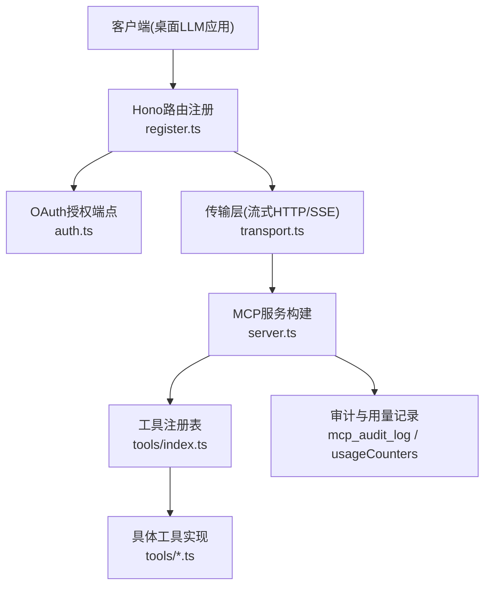
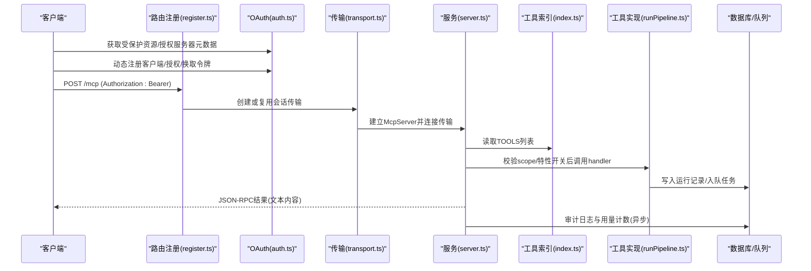
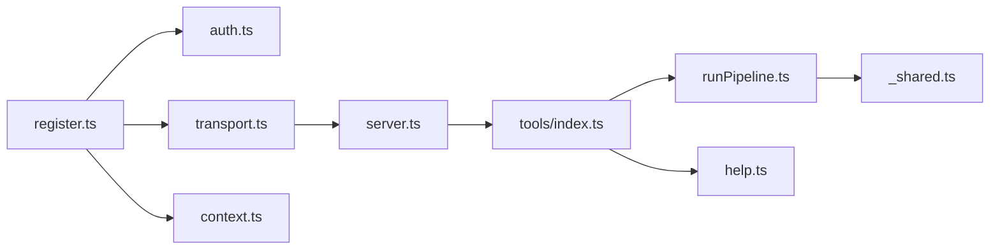
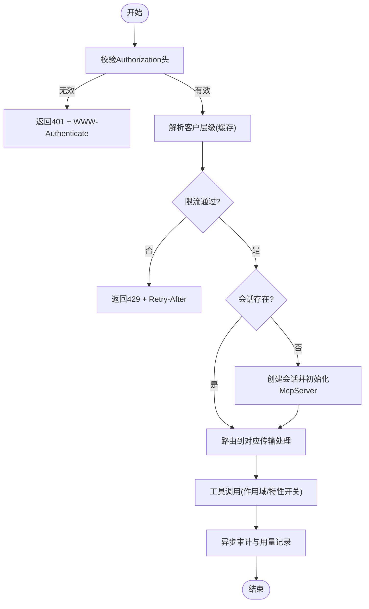

# 开发工作流程

<cite>
**本文引用的文件**
- [README.md](file://README.md)
- [ENGINEERING.md](file://ENGINEERING.md)
- [api/mcp/register.ts](file://api/mcp/register.ts)
- [api/mcp/server.ts](file://api/mcp/server.ts)
- [api/mcp/transport.ts](file://api/mcp/transport.ts)
- [api/mcp/auth.ts](file://api/mcp/auth.ts)
- [api/mcp/context.ts](file://api/mcp/context.ts)
- [api/mcp/types.ts](file://api/mcp/types.ts)
- [api/mcp/tools/index.ts](file://api/mcp/tools/index.ts)
- [api/mcp/tools/runPipeline.ts](file://api/mcp/tools/runPipeline.ts)
- [api/mcp/tools/help.ts](file://api/mcp/tools/help.ts)
- [api/mcp/tools/_shared.ts](file://api/mcp/tools/_shared.ts)
- [scripts/smoke-mcp-authoring.mjs](file://scripts/smoke-mcp-authoring.mjs)
</cite>

## 目录
1. [简介](#简介)
2. [项目结构](#项目结构)
3. [核心组件](#核心组件)
4. [架构总览](#架构总览)
5. [详细组件分析](#详细组件分析)
6. [依赖关系分析](#依赖关系分析)
7. [性能与可观测性](#性能与可观测性)
8. [调试与故障排查](#调试与故障排查)
9. [代码审查与质量保证](#代码审查与质量保证)
10. [环境配置、依赖与版本控制最佳实践](#环境配置依赖与版本控制最佳实践)
11. [结论](#结论)

## 简介
本指南面向DeeWaanAI的MCP工具开发者，覆盖从需求分析到工具上线的完整工作流：工具设计、接口定义、实现、测试验证、注册机制与生命周期管理；并提供调试技巧、错误追踪、性能监控、代码审查标准与质量保证流程，以及开发环境配置、依赖管理与版本控制的最佳实践。MCP作为桌面端LLM应用（如Claude Desktop、ChatGPT、Qwen Code、Kimi）连接后端的公共API契约，遵循“只增不改”的稳定性原则。

## 项目结构
MCP子系统位于 api/mcp 下，包含路由注册、OAuth授权服务器、传输层、会话与服务构建、鉴权上下文、类型契约与工具集合。工具以模块形式组织在 tools/ 中，并通过统一索引注册。

图表来源
- [api/mcp/register.ts:144-164](file://api/mcp/register.ts#L144-L164)
- [api/mcp/auth.ts:147-173](file://api/mcp/auth.ts#L147-L173)
- [api/mcp/transport.ts:74-170](file://api/mcp/transport.ts#L74-L170)
- [api/mcp/server.ts:135-186](file://api/mcp/server.ts#L135-L186)
- [api/mcp/tools/index.ts:45-94](file://api/mcp/tools/index.ts#L45-L94)

章节来源
- [README.md:1-18](file://README.md#L1-L18)
- [ENGINEERING.md:47-58](file://ENGINEERING.md#L47-L58)

## 核心组件
- 路由与网关：挂载OAuth与/mcp端点，执行每客户限流与层级解析。
- OAuth授权服务器：提供发现、动态客户端注册、授权码+PKCE、令牌发放。
- 传输层：维护会话映射，支持流式HTTP与遗留SSE两种协议。
- 服务构建：按会话创建McpServer，基于特性开关与权限过滤工具。
- 鉴权上下文：从Bearer令牌解析用户、作用域、语言等上下文。
- 工具契约：统一的McpTool接口，描述名称、输入Schema、权限与作用域、注解与处理器。
- 工具注册表：集中导出所有可用工具，供服务构建阶段加载。

章节来源
- [api/mcp/register.ts:90-164](file://api/mcp/register.ts#L90-L164)
- [api/mcp/auth.ts:147-428](file://api/mcp/auth.ts#L147-L428)
- [api/mcp/transport.ts:1-234](file://api/mcp/transport.ts#L1-L234)
- [api/mcp/server.ts:1-209](file://api/mcp/server.ts#L1-L209)
- [api/mcp/context.ts:1-42](file://api/mcp/context.ts#L1-L42)
- [api/mcp/types.ts:1-45](file://api/mcp/types.ts#L1-L45)
- [api/mcp/tools/index.ts:1-95](file://api/mcp/tools/index.ts#L1-L95)

## 架构总览
下图展示一次完整的MCP工具调用链路：从OAuth发现到工具执行与审计。

图表来源
- [api/mcp/auth.ts:147-428](file://api/mcp/auth.ts#L147-L428)
- [api/mcp/register.ts:144-164](file://api/mcp/register.ts#L144-L164)
- [api/mcp/transport.ts:74-170](file://api/mcp/transport.ts#L74-L170)
- [api/mcp/server.ts:84-186](file://api/mcp/server.ts#L84-L186)
- [api/mcp/tools/runPipeline.ts:97-156](file://api/mcp/tools/runPipeline.ts#L97-L156)

## 详细组件分析

### 路由与网关（register.ts）
- 职责：挂载OAuth与/mcp端点；对每个请求执行认证、每客户限流与层级解析；将认证上下文注入后续处理。
- 关键点：
  - 每客户限流使用Redis固定窗口，失败时降级放行并记录告警。
  - 层级解析缓存（60s），避免高频查询DB。
  - 同时支持精确路径与通配路径，内部幂等防止重复计费。

章节来源
- [api/mcp/register.ts:39-142](file://api/mcp/register.ts#L39-L142)
- [api/mcp/register.ts:144-164](file://api/mcp/register.ts#L144-L164)

### OAuth授权服务器（auth.ts）
- 职责：实现RFC 9728/8414/7591，提供受保护资源与授权服务器元数据、动态客户端注册、授权码流程（含PKCE）、令牌交换与刷新。
- 关键点：
  - 仅允许S256 PKCE，严格校验重定向URI白名单。
  - 授权码一次性使用，并发安全更新usedAt。
  - 令牌作用域限制为mcp:read/mcp:run/mcp:write。

章节来源
- [api/mcp/auth.ts:34-84](file://api/mcp/auth.ts#L34-L84)
- [api/mcp/auth.ts:147-173](file://api/mcp/auth.ts#L147-L173)
- [api/mcp/auth.ts:175-227](file://api/mcp/auth.ts#L175-L227)
- [api/mcp/auth.ts:229-335](file://api/mcp/auth.ts#L229-L335)
- [api/mcp/auth.ts:337-428](file://api/mcp/auth.ts#L337-L428)

### 传输层与会话管理（transport.ts）
- 职责：维护进程内会话映射，支持流式HTTP（POST/GET/DELETE /mcp）与遗留SSE（/mcp/sse, /mcp/messages）。
- 关键点：
  - 首次POST创建会话并初始化McpServer，后续GET/DELETE通过会话ID路由。
  - 会话TTL清理，防止内存泄漏。
  - 将运行时桥（采样能力探测、createMessage）注入认证上下文。

章节来源
- [api/mcp/transport.ts:18-23](file://api/mcp/transport.ts#L18-L23)
- [api/mcp/transport.ts:45-72](file://api/mcp/transport.ts#L45-L72)
- [api/mcp/transport.ts:74-170](file://api/mcp/transport.ts#L74-L170)
- [api/mcp/transport.ts:172-234](file://api/mcp/transport.ts#L172-L234)

### MCP服务构建（server.ts）
- 职责：为每个会话构建McpServer，按作用域与特性开关注册工具，包装调用结果，记录审计与用量。
- 关键点：
  - 工具注册前检查requiredScopes与featureFlag。
  - 每次调用记录延迟、状态与错误信息（异步，不影响主流程）。
  - 空工具列表视为有效可调试状态，不阻断启动。

章节来源
- [api/mcp/server.ts:1-22](file://api/mcp/server.ts#L1-L22)
- [api/mcp/server.ts:46-82](file://api/mcp/server.ts#L46-L82)
- [api/mcp/server.ts:84-124](file://api/mcp/server.ts#L84-L124)
- [api/mcp/server.ts:135-186](file://api/mcp/server.ts#L135-L186)
- [api/mcp/server.ts:188-209](file://api/mcp/server.ts#L188-L209)

### 鉴权上下文（context.ts）
- 职责：从Authorization头提取并验证Bearer令牌，生成McpAuthContext（userId、scopes、clientId、requestId、locale）。
- 关键点：
  - 任何失败返回null，由上层统一返回401与WWW-Authenticate挑战。

章节来源
- [api/mcp/context.ts:1-42](file://api/mcp/context.ts#L1-L42)

### 工具契约与注册（types.ts + tools/index.ts）
- McpTool契约：name、description、inputSchema(zod)、requiredScopes、featureFlag、annotations、handler。
- 工具注册表：集中导入并导出TOOLS数组，供服务构建阶段遍历注册。

章节来源
- [api/mcp/types.ts:1-45](file://api/mcp/types.ts#L1-L45)
- [api/mcp/tools/index.ts:1-95](file://api/mcp/tools/index.ts#L1-L95)

### 示例工具：run_pipeline（runPipeline.ts）
- 职责：为项目创建新的流水线运行，入队至worker，立即返回runId与状态。
- 关键点：
  - 参数校验使用zod schema。
  - 模板应用到项目需所有者权限。
  - 事务插入运行记录并回写pipelineVersion与agentsUsed。
  - 入队后记录审计日志（含clientId/requestId）。

章节来源
- [api/mcp/tools/runPipeline.ts:15-24](file://api/mcp/tools/runPipeline.ts#L15-L24)
- [api/mcp/tools/runPipeline.ts:32-95](file://api/mcp/tools/runPipeline.ts#L32-L95)
- [api/mcp/tools/runPipeline.ts:97-156](file://api/mcp/tools/runPipeline.ts#L97-L156)

### 示例工具：help（help.ts）
- 职责：根据当前用户的能力、作用域、特性开关与设置，生成个性化帮助指南。
- 关键点：
  - 查询用户能力与特性开关（teamsync、mcp_sampling、batch_mode）。
  - 结合运行时采样能力提示。

章节来源
- [api/mcp/tools/help.ts:1-47](file://api/mcp/tools/help.ts#L1-L47)

### 共享访问控制（_shared.ts）
- 职责：项目访问校验与输出压缩，确保MCP工具在返回数据前进行鉴权。
- 关键点：
  - canAccessProject支持项目拥有者与团队成员访问。
  - requireProjectAccess抛出统一非泄露错误。

章节来源
- [api/mcp/tools/_shared.ts:1-67](file://api/mcp/tools/_shared.ts#L1-L67)

## 依赖关系分析
- register.ts依赖auth.ts（OAuth）、transport.ts（传输）、context.ts（鉴权）、lib/logger与rateLimiter。
- transport.ts依赖server.ts（服务构建）与SDK传输实现。
- server.ts依赖tools/index.ts（工具列表）、featureFlags、审计与用量表。
- 工具实现依赖_db/schema、services/entitlements、workers/swarmWorker等。

图表来源
- [api/mcp/register.ts:144-164](file://api/mcp/register.ts#L144-L164)
- [api/mcp/transport.ts:74-170](file://api/mcp/transport.ts#L74-L170)
- [api/mcp/server.ts:135-186](file://api/mcp/server.ts#L135-L186)
- [api/mcp/tools/index.ts:45-94](file://api/mcp/tools/index.ts#L45-L94)
- [api/mcp/tools/runPipeline.ts:97-156](file://api/mcp/tools/runPipeline.ts#L97-L156)
- [api/mcp/tools/help.ts:18-47](file://api/mcp/tools/help.ts#L18-L47)
- [api/mcp/tools/_shared.ts:36-60](file://api/mcp/tools/_shared.ts#L36-L60)

章节来源
- [ENGINEERING.md:47-58](file://ENGINEERING.md#L47-L58)

## 性能与可观测性
- 限流与层级缓存：每客户限流使用Redis固定窗口；层级解析缓存60s，降低DB压力。
- 审计与用量：每次工具调用异步写入审计日志与月度用量计数器，失败不影响主流程。
- 会话清理：进程内会话TTL清理，避免内存泄漏。
- 健康检查：/api/health用于存活检测，/api/ready用于就绪检测（含Redis可达性）。

章节来源
- [api/mcp/register.ts:39-88](file://api/mcp/register.ts#L39-L88)
- [api/mcp/server.ts:46-82](file://api/mcp/server.ts#L46-L82)
- [api/mcp/transport.ts:45-57](file://api/mcp/transport.ts#L45-L57)
- [ENGINEERING.md:329-358](file://ENGINEERING.md#L329-L358)

## 调试与故障排查
- 常见错误定位：
  - 401未授权：检查Authorization头格式与令牌有效性；确认OAuth流程正确完成。
  - 429限流超限：查看Retry-After与tier信息；检查Redis可用性。
  - 工具未知/隐藏：确认工具是否被特性开关隐藏；检查tools/list返回。
  - 会话丢失：确认mcp-session-id是否正确传递；检查会话TTL与清理逻辑。
- 日志与追踪：
  - 审计日志：mcp_audit_log记录toolName、latencyMs、status、error。
  - 用量计数：usageCounters按月聚合，便于成本核算。
  - 结构化日志：logger.info/warn/error包含userId、clientId、requestId等上下文。
- 端到端冒烟：
  - 使用脚本模拟完整MCP流：注册客户端、授权、换令牌、调用工具、清理数据。

图表来源
- [api/mcp/context.ts:17-42](file://api/mcp/context.ts#L17-L42)
- [api/mcp/register.ts:90-142](file://api/mcp/register.ts#L90-L142)
- [api/mcp/transport.ts:74-170](file://api/mcp/transport.ts#L74-L170)
- [api/mcp/server.ts:84-124](file://api/mcp/server.ts#L84-L124)

章节来源
- [scripts/smoke-mcp-authoring.mjs:1-248](file://scripts/smoke-mcp-authoring.mjs#L1-L248)

## 代码审查与质量保证
- 新增MCP工具的步骤：
  - 在api/mcp/tools/<name>.ts实现McpTool，明确name、description、inputSchema、requiredScopes、annotations与handler。
  - 在api/mcp/tools/index.ts的TOOLS数组中注册。
  - 如需新作用域，扩展tokenService中的作用域（仅加法变更）。
- 质量门禁：
  - 类型检查：npm run check
  - i18n一致性：npm run i18n:check
  - 单元测试：npm test（纯函数测试）
  - 构建：npm run build
  - 冒烟测试：scripts/smoke-*.mjs（集成场景）
- 特性开关埋藏：当功能达到100%且验收完成，移除开关与分支代码，更新文档与测试。

章节来源
- [ENGINEERING.md:229-297](file://ENGINEERING.md#L229-L297)
- [ENGINEERING.md:313-328](file://ENGINEERING.md#L313-L328)

## 环境配置、依赖与版本控制最佳实践
- 环境变量：
  - 必需：APP_ID、APP_SECRET、DATABASE_URL、VITE_APP_ID。
  - 可选：REDIS_URL、STRIPE_*、SENTRY_DSN、BACKUP_TOKEN、TRUSTED_PROXY、AI_TRIAGE_*、PUBLIC_APP_URL。
- 本地开发：
  - docker compose up -d（MySQL + Redis）
  - cp .env.example .env并编辑
  - npm ci → npm run db:push → npm run dev
- 生产运行：
  - npm run build → npm start（NODE_ENV=production）
  - 健康检查：GET /api/health
- 依赖与部署：
  - Docker多阶段构建，非root用户，暴露PORT=3000。
  - PM2单实例，内存上限与自动重启。
  - CI流水线：check → i18n:check → test → build，集成作业含MySQL/Redis服务容器。
- 版本控制：
  - 数据库迁移：db:generate/db:migrate或手工SQL；保持schema同步。
  - 提交前自检：lint/format、i18n检查、测试与构建。

章节来源
- [README.md:20-69](file://README.md#L20-L69)
- [README.md:71-103](file://README.md#L71-L103)
- [ENGINEERING.md:298-310](file://ENGINEERING.md#L298-L310)
- [ENGINEERING.md:367-372](file://ENGINEERING.md#L367-L372)

## 结论
本指南系统化梳理了DeeWaanAI的MCP工具开发全流程，涵盖架构、组件、数据流、注册与生命周期、调试与排障、质量保障与环境配置。遵循“只增不改”的契约原则、严格的鉴权与限流、完善的审计与可观测性，以及CI/CD质量门禁，可确保MCP工具稳定、安全、可演进地服务于桌面端LLM生态。