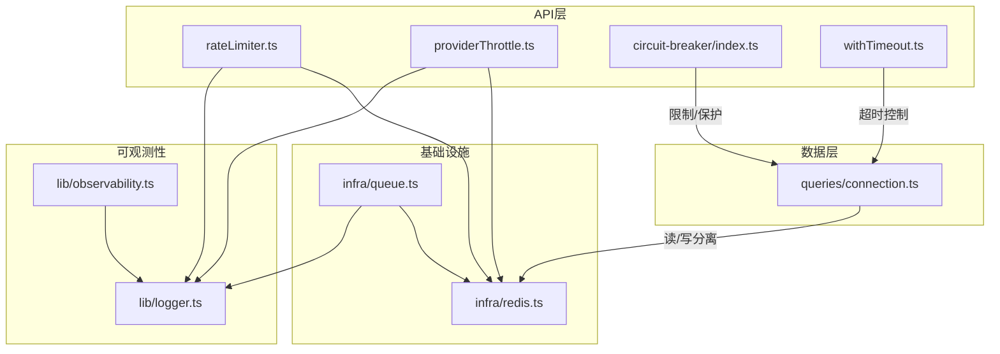
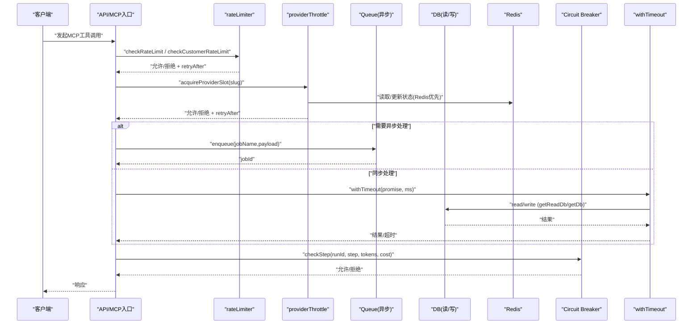
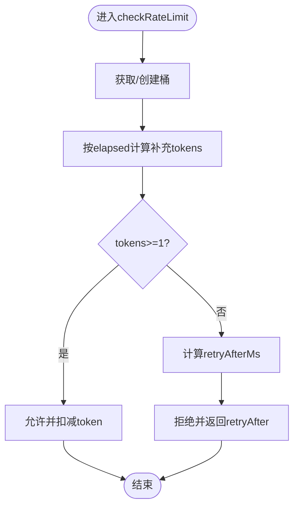
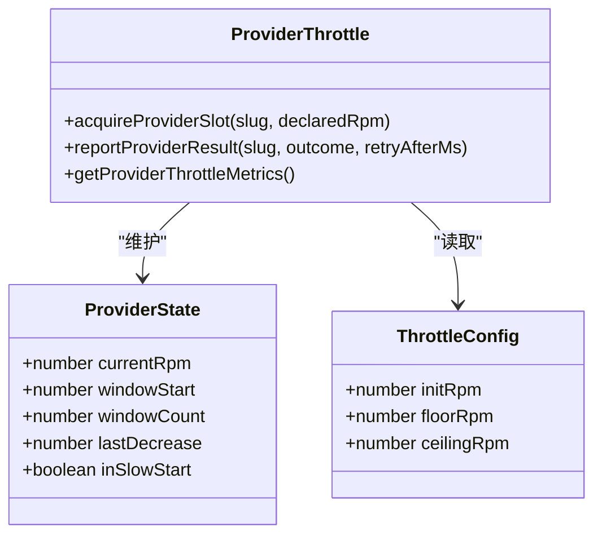
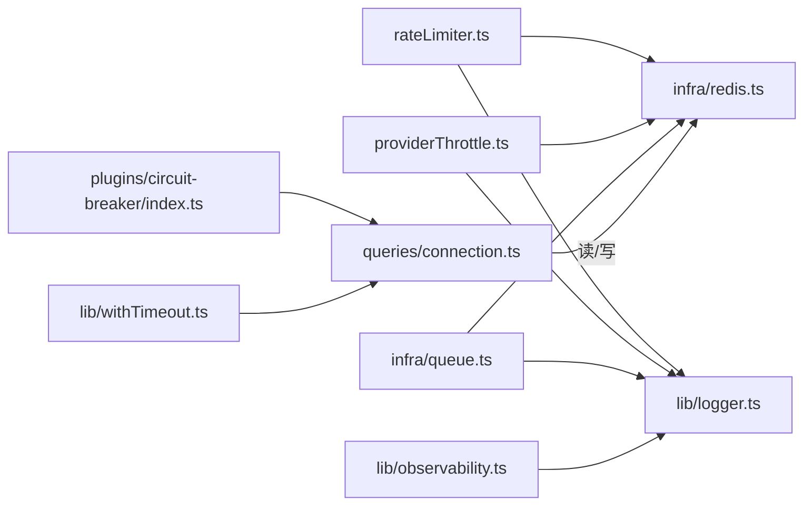

# 性能优化和最佳实践

<cite>
**本文引用的文件**
- [api/lib/rateLimiter.ts](file://api/lib/rateLimiter.ts)
- [api/lib/providerThrottle.ts](file://api/lib/providerThrottle.ts)
- [api/infra/redis.ts](file://api/infra/redis.ts)
- [api/queries/connection.ts](file://api/queries/connection.ts)
- [api/lib/withTimeout.ts](file://api/lib/withTimeout.ts)
- [api/services/memoryManager.ts](file://api/services/memoryManager.ts)
- [api/plugins/circuit-breaker/index.ts](file://api/plugins/circuit-breaker/index.ts)
- [api/infra/queue.ts](file://api/infra/queue.ts)
- [api/lib/logger.ts](file://api/lib/logger.ts)
- [api/lib/observability.ts](file://api/lib/observability.ts)
- [DeeWaanAI-Next/LIMITER-FIX-HANDOFF.md](file://DeeWaanAI-Next/LIMITER-FIX-HANDOFF.md)
</cite>

## 目录
1. [简介](#简介)
2. [项目结构](#项目结构)
3. [核心组件](#核心组件)
4. [架构总览](#架构总览)
5. [详细组件分析](#详细组件分析)
6. [依赖关系分析](#依赖关系分析)
7. [性能考量](#性能考量)
8. [故障排查指南](#故障排查指南)
9. [结论](#结论)
10. [附录](#附录)

## 简介
本指南面向DeeWaanAI的MCP工具开发，聚焦性能优化与最佳实践。内容涵盖数据库查询优化、缓存机制、异步处理、限流与节流、内存管理与资源释放、错误处理与异常恢复、性能监控指标与调优建议，以及代码质量检查与静态分析工具的集成方法。所有建议均基于仓库中现有实现进行提炼与扩展，确保可落地且与系统行为一致。

## 项目结构
围绕性能优化的关键模块分布在以下路径：
- 限流与节流：rate limiter（令牌桶/固定窗口）、provider throttle（AIMD自适应）
- 缓存与持久化：Redis客户端封装、队列抽象（BullMQ/内存）
- 数据库访问：读写分离连接、只读副本路由
- 超时与保护：withTimeout、circuit breaker（熔断器）
- 内存管理：记忆片段压缩与轮转
- 可观测性：日志、Sentry初始化
- 文档与修复记录：LIMITER FIX HANDOFF

**图表来源**
- [api/lib/rateLimiter.ts:1-216](file://api/lib/rateLimiter.ts#L1-L216)
- [api/lib/providerThrottle.ts:1-275](file://api/lib/providerThrottle.ts#L1-L275)
- [api/infra/redis.ts:1-88](file://api/infra/redis.ts#L1-L88)
- [api/infra/queue.ts:1-334](file://api/infra/queue.ts#L1-L334)
- [api/queries/connection.ts:1-42](file://api/queries/connection.ts#L1-L42)
- [api/plugins/circuit-breaker/index.ts:1-186](file://api/plugins/circuit-breaker/index.ts#L1-L186)
- [api/lib/withTimeout.ts:1-18](file://api/lib/withTimeout.ts#L1-L18)
- [api/lib/logger.ts:1-32](file://api/lib/logger.ts#L1-L32)
- [api/lib/observability.ts:1-34](file://api/lib/observability.ts#L1-L34)

**章节来源**
- [api/lib/rateLimiter.ts:1-216](file://api/lib/rateLimiter.ts#L1-L216)
- [api/lib/providerThrottle.ts:1-275](file://api/lib/providerThrottle.ts#L1-L275)
- [api/infra/redis.ts:1-88](file://api/infra/redis.ts#L1-L88)
- [api/infra/queue.ts:1-334](file://api/infra/queue.ts#L1-L334)
- [api/queries/connection.ts:1-42](file://api/queries/connection.ts#L1-L42)
- [api/plugins/circuit-breaker/index.ts:1-186](file://api/plugins/circuit-breaker/index.ts#L1-L186)
- [api/lib/withTimeout.ts:1-18](file://api/lib/withTimeout.ts#L1-L18)
- [api/lib/logger.ts:1-32](file://api/lib/logger.ts#L1-L32)
- [api/lib/observability.ts:1-34](file://api/lib/observability.ts#L1-L34)

## 核心组件
- 限流器（rateLimiter）
  - 令牌桶与固定窗口两种策略，支持Redis分布式计数与进程内内存降级，提供按客户分层的配额（solo/team/admin）。
  - 关键点：窗口键包含时间索引避免碰撞；失败时自动回退到内存实现，保证可用性。
- 提供者节流（providerThrottle）
  - AIMD算法（TCP拥塞控制思想），根据429等信号动态调整RPM，支持慢启动、冷却期、Redis持久化状态与内存回退。
  - 关键点：通过reportProviderResult反馈结果，advanceWindow在窗口边界做加法增长或乘法下降。
- Redis客户端（infra/redis）
  - 懒加载、指数退避重试、连接失败后全局标记gaveUp并返回null，所有上层组件据此选择内存降级。
- 队列抽象（infra/queue）
  - 统一接口，后端可选BullMQ（多节点持久）或内存队列（本地开发友好），具备幂等去重、延迟执行、优雅关闭。
- 数据库连接（queries/connection）
  - 读写分离：getReadDb在有只读副本时路由读请求，否则回退主库；写与一致性读必须使用getDb。
- 超时控制（withTimeout）
  - 为可能挂起的Promise设置硬截止，避免事件循环被长任务阻塞。
- 熔断器（plugins/circuit-breaker）
  - 对流水线步骤施加token预算、花费上限、步骤超时、WHILE迭代次数限制，防止失控消耗。
- 内存管理（services/memoryManager）
  - 关键词检索的记忆片段压缩、轮转与序列化，减少上下文体积，提升响应速度。
- 可观测性（logger, observability）
  - 结构化日志、Sentry按需初始化，确保可观测能力不成为单点故障。

**章节来源**
- [api/lib/rateLimiter.ts:1-216](file://api/lib/rateLimiter.ts#L1-L216)
- [api/lib/providerThrottle.ts:1-275](file://api/lib/providerThrottle.ts#L1-L275)
- [api/infra/redis.ts:1-88](file://api/infra/redis.ts#L1-L88)
- [api/infra/queue.ts:1-334](file://api/infra/queue.ts#L1-L334)
- [api/queries/connection.ts:1-42](file://api/queries/connection.ts#L1-L42)
- [api/lib/withTimeout.ts:1-18](file://api/lib/withTimeout.ts#L1-L18)
- [api/plugins/circuit-breaker/index.ts:1-186](file://api/plugins/circuit-breaker/index.ts#L1-L186)
- [api/services/memoryManager.ts:1-123](file://api/services/memoryManager.ts#L1-L123)
- [api/lib/logger.ts:1-32](file://api/lib/logger.ts#L1-L32)
- [api/lib/observability.ts:1-34](file://api/lib/observability.ts#L1-L34)

## 架构总览
下图展示了MCP工具调用链路中的性能与安全护栏：请求进入后先经过限流/节流，再进入业务逻辑，必要时走队列异步处理；数据库访问采用读写分离；外部调用受超时与熔断保护；所有关键路径输出结构化日志并可上报至Sentry。

**图表来源**
- [api/lib/rateLimiter.ts:31-93](file://api/lib/rateLimiter.ts#L31-L93)
- [api/lib/rateLimiter.ts:198-215](file://api/lib/rateLimiter.ts#L198-L215)
- [api/lib/providerThrottle.ts:168-199](file://api/lib/providerThrottle.ts#L168-L199)
- [api/infra/queue.ts:272-319](file://api/infra/queue.ts#L272-L319)
- [api/queries/connection.ts:10-42](file://api/queries/connection.ts#L10-L42)
- [api/plugins/circuit-breaker/index.ts:62-110](file://api/plugins/circuit-breaker/index.ts#L62-L110)
- [api/lib/withTimeout.ts:9-17](file://api/lib/withTimeout.ts#L9-L17)

## 详细组件分析

### 限流器（rateLimiter）
- 设计要点
  - 令牌桶：checkRateLimit用于通用限流，支持清理过期bucket，避免内存泄漏。
  - 固定窗口：checkRateLimitAsync与checkCustomerRateLimit使用Redis INCR+PEXPIRE实现跨节点共享配额；无Redis时回退到进程内Map。
  - 分层配额：CUSTOMER_RATE_LIMITS区分solo/team/admin，便于商业化配额管理。
- 复杂度与性能
  - Redis路径O(1)操作；内存路径Map存取O(1)。
  - 定期清理（setInterval）降低内存占用。
- 错误处理
  - Redis异常捕获并降级到内存实现，保证服务可用。
- 监控与指标
  - 可通过日志记录拒绝率与retryAfter分布，结合Sentry追踪热点key。

**图表来源**
- [api/lib/rateLimiter.ts:31-55](file://api/lib/rateLimiter.ts#L31-L55)

**章节来源**
- [api/lib/rateLimiter.ts:1-216](file://api/lib/rateLimiter.ts#L1-L216)

### 提供者节流（providerThrottle）
- 设计要点
  - AIMD：慢启动阶段倍增，达到上限后进入加法增长；遇到429触发乘法下降并进入冷却期。
  - 状态存储：Redis哈希持久化，失败回退到内存Map；窗口滚动时推进状态。
  - 指标暴露：getProviderThrottleMetrics可用于批处理状态与管理员面板。
- 复杂度与性能
  - 每次请求O(1)读取/写入；窗口推进仅在过期时发生。
- 错误处理
  - Redis不可用时降级到内存；报告“rate_limited”时正确设置windowStart以遵从Retry-After。
- 调优建议
  - 合理配置initRpm/floorRpm/ceilingRpm；生产环境建议显式declaredRpm以避免过慢启动。

**图表来源**
- [api/lib/providerThrottle.ts:17-35](file://api/lib/providerThrottle.ts#L17-L35)
- [api/lib/providerThrottle.ts:88-133](file://api/lib/providerThrottle.ts#L88-L133)
- [api/lib/providerThrottle.ts:168-235](file://api/lib/providerThrottle.ts#L168-L235)
- [api/lib/providerThrottle.ts:240-274](file://api/lib/providerThrottle.ts#L240-L274)

**章节来源**
- [api/lib/providerThrottle.ts:1-275](file://api/lib/providerThrottle.ts#L1-L275)

### Redis客户端（infra/redis）
- 设计要点
  - 懒连接、最多3次尝试、指数退避；连接成功后复用单例；失败则标记gaveUp并返回null。
  - 所有上层组件据此选择内存降级，确保整体韧性。
- 性能与可靠性
  - maxRetriesPerRequest=1，避免请求风暴；enableOfflineQueue=false，防止积压放大延迟。
- 监控
  - 连接错误与成功日志，便于健康检查与告警。

**章节来源**
- [api/infra/redis.ts:1-88](file://api/infra/redis.ts#L1-L88)

### 队列抽象（infra/queue）
- 设计要点
  - 双后端：BullMQ（持久、多节点）与内存队列（本地开发）；首次使用时决定后端并缓存。
  - 幂等：idempotencyKey在24小时内去重（Redis SET NX EX或内存Map TTL）。
  - 优雅关闭：closeAllQueues关闭worker与队列，断开BullMQ连接。
- 性能
  - BullMQ worker并发由环境变量控制；内存队列通过定时器批量drain减少调度开销。
- 监控
  - 失败事件记录jobId与错误信息，便于定位问题。

**章节来源**
- [api/infra/queue.ts:1-334](file://api/infra/queue.ts#L1-L334)

### 数据库连接（queries/connection）
- 设计要点
  - getDb：主库实例，负责写与一致性读。
  - getReadDb：当配置了只读副本时，将读请求路由到副本，减轻主库压力。
- 性能
  - 读多写少场景下显著降低主库负载；注意复制延迟容忍度。
- 最佳实践
  - 仅对浏览/搜索/公开报表等读多、可容忍延迟的场景使用getReadDb。

**章节来源**
- [api/queries/connection.ts:1-42](file://api/queries/connection.ts#L1-L42)

### 超时控制（withTimeout）
- 设计要点
  - 为可能挂起的Promise设定硬截止时间，避免事件循环被无限等待的任务拖垮。
- 使用建议
  - 对外部HTTP/流式调用、数据库查询、第三方API调用包裹withTimeout，并记录label以便定位。

**章节来源**
- [api/lib/withTimeout.ts:1-18](file://api/lib/withTimeout.ts#L1-L18)

### 熔断器（plugins/circuit-breaker）
- 设计要点
  - 每步执行前检查token预算、花费上限、步骤超时、WHILE迭代次数，超限即中止，防止成本失控。
  - 运行时计数器按runId隔离，结束后清理。
- 监控与运维
  - 提供tRPC接口查询当前用量与限制；管理员可动态调整默认限制。

**章节来源**
- [api/plugins/circuit-breaker/index.ts:1-186](file://api/plugins/circuit-breaker/index.ts#L1-L186)

### 内存管理（services/memoryManager）
- 设计要点
  - 关键词提取与匹配，快速检索相关记忆片段；支持序列化和解析，便于持久化。
  - rotateEpisodes保持最近N条，控制上下文大小。
- 性能
  - 纯内存操作，复杂度O(n)，适合小规模上下文；Pro Designer可升级向量检索。

**章节来源**
- [api/services/memoryManager.ts:1-123](file://api/services/memoryManager.ts#L1-L123)

### 可观测性（logger, observability）
- 设计要点
  - 结构化JSON日志，级别可控；Sentry按需加载，初始化失败不影响服务。
- 监控建议
  - 在限流、节流、队列、数据库、外部调用处埋点，采集拒绝率、延迟、错误率等指标。

**章节来源**
- [api/lib/logger.ts:1-32](file://api/lib/logger.ts#L1-L32)
- [api/lib/observability.ts:1-34](file://api/lib/observability.ts#L1-L34)

## 依赖关系分析
- rateLimiter与providerThrottle均依赖Redis进行分布式状态共享，并在不可用时回退到内存。
- queue抽象屏蔽底层差异，向上提供统一enqueue/close接口。
- database连接模块提供读写分离，配合circuit breaker与withTimeout形成完整保护链。
- logger与observability贯穿各模块，提供一致的日志与错误上报能力。

**图表来源**
- [api/lib/rateLimiter.ts:1-216](file://api/lib/rateLimiter.ts#L1-L216)
- [api/lib/providerThrottle.ts:1-275](file://api/lib/providerThrottle.ts#L1-L275)
- [api/infra/redis.ts:1-88](file://api/infra/redis.ts#L1-L88)
- [api/infra/queue.ts:1-334](file://api/infra/queue.ts#L1-L334)
- [api/queries/connection.ts:1-42](file://api/queries/connection.ts#L1-L42)
- [api/plugins/circuit-breaker/index.ts:1-186](file://api/plugins/circuit-breaker/index.ts#L1-L186)
- [api/lib/withTimeout.ts:1-18](file://api/lib/withTimeout.ts#L1-L18)
- [api/lib/logger.ts:1-32](file://api/lib/logger.ts#L1-L32)
- [api/lib/observability.ts:1-34](file://api/lib/observability.ts#L1-L34)

**章节来源**
- [api/lib/rateLimiter.ts:1-216](file://api/lib/rateLimiter.ts#L1-L216)
- [api/lib/providerThrottle.ts:1-275](file://api/lib/providerThrottle.ts#L1-L275)
- [api/infra/redis.ts:1-88](file://api/infra/redis.ts#L1-L88)
- [api/infra/queue.ts:1-334](file://api/infra/queue.ts#L1-L334)
- [api/queries/connection.ts:1-42](file://api/queries/connection.ts#L1-L42)
- [api/plugins/circuit-breaker/index.ts:1-186](file://api/plugins/circuit-breaker/index.ts#L1-L186)
- [api/lib/withTimeout.ts:1-18](file://api/lib/withTimeout.ts#L1-L18)
- [api/lib/logger.ts:1-32](file://api/lib/logger.ts#L1-L32)
- [api/lib/observability.ts:1-34](file://api/lib/observability.ts#L1-L34)

## 性能考量
- 数据库查询优化
  - 读多写少场景使用getReadDb分流到只读副本，降低主库压力。
  - 对高频查询建立合适索引（参考db/migrations与schema定义），避免全表扫描。
  - 使用事务与批量操作减少往返次数。
- 缓存机制
  - 利用Redis作为分布式缓存与限流/节流状态存储；对热点数据增加短TTL缓存。
  - 队列使用BullMQ持久化，避免重启丢失；内存队列用于开发调试。
- 异步处理
  - 将耗时任务（如批处理、导出、外部调用）入队，使用createWorker消费，提高吞吐。
  - 合理设置worker并发度（环境变量swarmWorkerConcurrency），避免过载。
- 限流与节流
  - 使用checkRateLimit与checkCustomerRateLimit保护API；providerThrottle自适应外部提供者限制。
  - 关注429信号，遵循Retry-After，避免雪崩。
- 内存管理与资源释放
  - 定期清理过期bucket与窗口（rateLimiter、customerWindows）。
  - 队列与worker在关闭时释放定时器与连接（closeAllQueues）。
  - 记忆片段rotateEpisodes控制上下文大小。
- 错误处理与异常恢复
  - withTimeout防止长时间阻塞；circuit breaker防止成本失控。
  - Redis不可用自动降级，保证服务可用。
- 监控指标与调优建议
  - 采集限流拒绝率、节流RPM变化、队列积压与失败率、数据库延迟与连接数、外部调用超时率。
  - 结合Sentry与日志聚合平台进行分析；对热点key与瓶颈路径进行专项优化。

[本节为通用指导，无需特定文件引用]

## 故障排查指南
- 常见问题
  - 自限流导致批次卡顿：确认是否将429误判为信用耗尽，避免暂停整个批次；检查providerThrottle是否正确减半并尊重Retry-After。
  - Redis不可用：确认连接配置与网络；观察日志中“Redis unavailable after retries”，确认已降级到内存实现。
  - 队列堆积：检查worker是否注册、并发度是否足够；查看BullMQ失败日志与内存队列drain情况。
  - 数据库慢查询：使用getReadDb分流读请求；检查索引与查询计划。
  - 外部调用超时：为每个外部调用包裹withTimeout，并记录label以便定位。
- 诊断步骤
  - 查看日志中的限流/节流决策与错误堆栈。
  - 使用getProviderThrottleMetrics与队列后端状态判断当前运行模式。
  - 通过Sentry定位异常热点与调用链。

**章节来源**
- [DeeWaanAI-Next/LIMITER-FIX-HANDOFF.md:1-107](file://DeeWaanAI-Next/LIMITER-FIX-HANDOFF.md#L1-L107)
- [api/lib/providerThrottle.ts:207-235](file://api/lib/providerThrottle.ts#L207-L235)
- [api/infra/redis.ts:65-82](file://api/infra/redis.ts#L65-L82)
- [api/infra/queue.ts:248-256](file://api/infra/queue.ts#L248-L256)
- [api/lib/withTimeout.ts:9-17](file://api/lib/withTimeout.ts#L9-L17)

## 结论
本指南基于仓库现有实现，总结了MCP工具的性能优化与最佳实践。通过合理的限流/节流、读写分离、异步队列、超时与熔断保护、内存管理与可观测性建设，可在保障稳定性的同时显著提升吞吐与用户体验。建议在上线前完成指标接入与压测验证，持续监控并迭代调优。

[本节为总结性内容，无需特定文件引用]

## 附录
- 代码质量检查与静态分析工具集成建议
  - 在CI流程中集成ESLint与TypeScript类型检查，确保代码规范与类型安全。
  - 使用Prettier统一格式化，减少风格争议。
  - 引入单元测试与集成测试（如vitest），覆盖限流、节流、队列、数据库等关键路径。
  - 在PR阶段加入lint与类型检查门禁，防止低质量代码合并。

[本节为通用指导，无需特定文件引用]