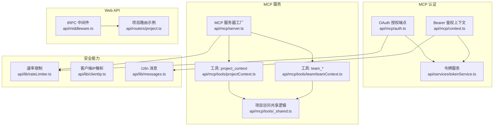
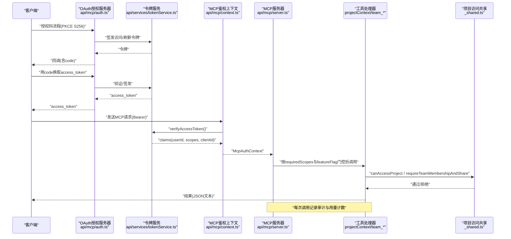
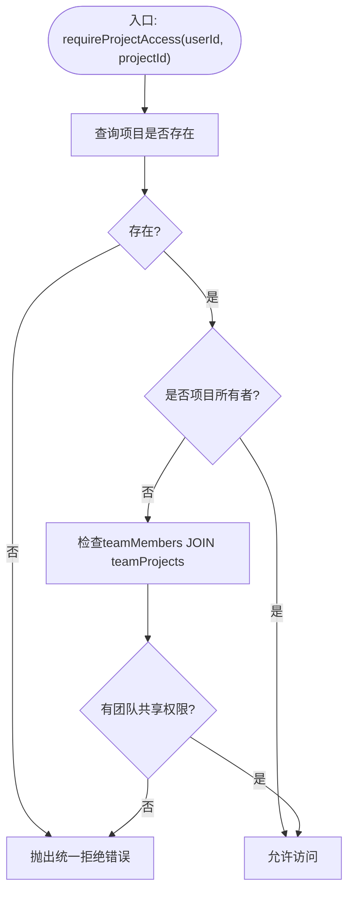
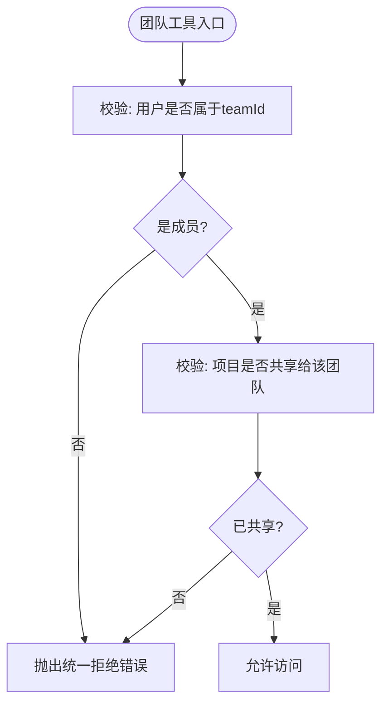
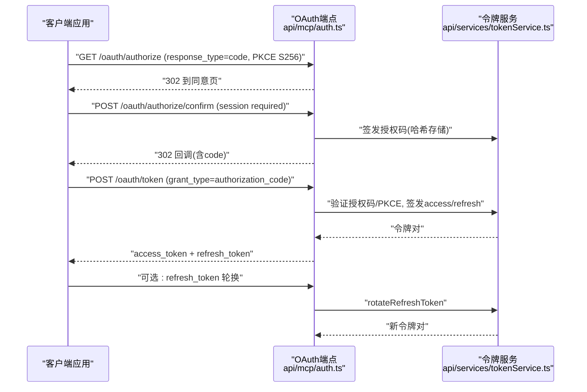
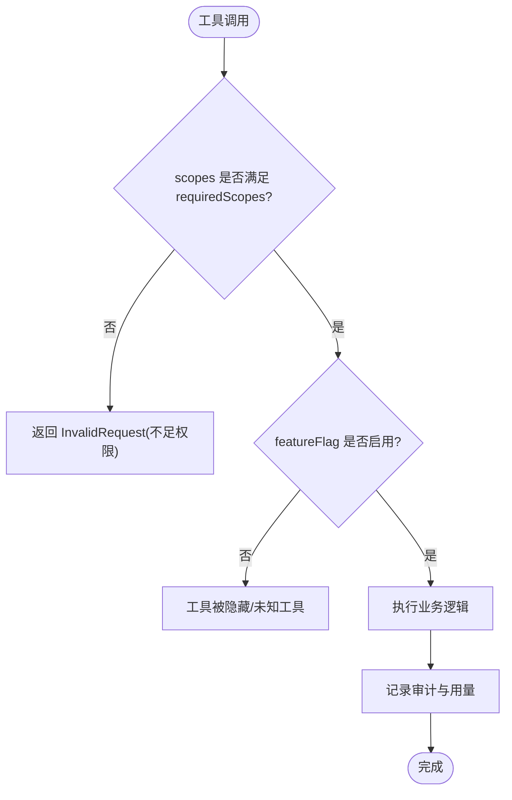
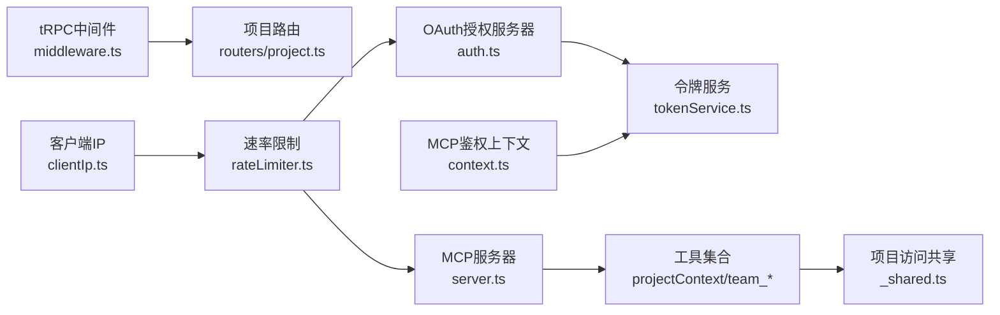

# 权限和安全控制

<cite>
**本文引用的文件**
- [api/mcp/auth.ts](file://api/mcp/auth.ts)
- [api/mcp/context.ts](file://api/mcp/context.ts)
- [api/mcp/server.ts](file://api/mcp/server.ts)
- [api/services/tokenService.ts](file://api/services/tokenService.ts)
- [api/mcp/tools/_shared.ts](file://api/mcp/tools/_shared.ts)
- [api/mcp/tools/projectContext.ts](file://api/mcp/tools/projectContext.ts)
- [api/mcp/tools/team/teamContext.ts](file://api/mcp/tools/team/teamContext.ts)
- [api/routers/project.ts](file://api/routers/project.ts)
- [api/middleware.ts](file://api/middleware.ts)
- [api/lib/messages.ts](file://api/lib/messages.ts)
- [api/lib/rateLimiter.ts](file://api/lib/rateLimiter.ts)
- [api/lib/clientIp.ts](file://api/lib/clientIp.ts)
</cite>

## 目录
1. [简介](#简介)
2. [项目结构](#项目结构)
3. [核心组件](#核心组件)
4. [架构总览](#架构总览)
5. [详细组件分析](#详细组件分析)
6. [依赖关系分析](#依赖关系分析)
7. [性能考虑](#性能考虑)
8. [故障排查指南](#故障排查指南)
9. [结论](#结论)
10. [附录](#附录)

## 简介
本指南面向DeeWaanAI的MCP工具开发，聚焦权限与安全控制：项目访问权限检查（canAccessProject、requireProjectAccess）、用户认证与令牌验证、会话管理、团队项目访问控制、细粒度权限（scopes）与功能开关、输入校验与输出压缩、速率限制与防暴力破解、以及安全编码规范与常见漏洞防护。文档以代码级实现为依据，提供流程图与时序图帮助理解数据流与控制流。

## 项目结构
MCP安全相关的关键位置与职责：
- OAuth授权服务器与端点：api/mcp/auth.ts
- Bearer令牌解析与鉴权上下文：api/mcp/context.ts
- MCP服务构建、工具注册与权限门控：api/mcp/server.ts
- 令牌签发/验证/刷新：api/services/tokenService.ts
- 项目访问权限共享逻辑：api/mcp/tools/_shared.ts
- 具体MCP工具的输入校验与访问控制：api/mcp/tools/projectContext.ts、api/mcp/tools/team/teamContext.ts
- Web API层认证中间件与路由示例：api/middleware.ts、api/routers/project.ts
- 国际化消息与本地化：api/lib/messages.ts
- 速率限制与按客户分层限流：api/lib/rateLimiter.ts
- 客户端IP解析（受信任代理模式）：api/lib/clientIp.ts

图表来源
- [api/mcp/auth.ts:147-427](file://api/mcp/auth.ts#L147-L427)
- [api/mcp/context.ts:17-41](file://api/mcp/context.ts#L17-L41)
- [api/mcp/server.ts:84-186](file://api/mcp/server.ts#L84-L186)
- [api/services/tokenService.ts:34-129](file://api/services/tokenService.ts#L34-L129)
- [api/mcp/tools/_shared.ts:36-60](file://api/mcp/tools/_shared.ts#L36-L60)
- [api/mcp/tools/projectContext.ts:25-129](file://api/mcp/tools/projectContext.ts#L25-L129)
- [api/mcp/tools/team/teamContext.ts:30-157](file://api/mcp/tools/team/teamContext.ts#L30-L157)
- [api/middleware.ts:17-51](file://api/middleware.ts#L17-L51)
- [api/routers/project.ts:11-101](file://api/routers/project.ts#L11-L101)
- [api/lib/rateLimiter.ts:31-216](file://api/lib/rateLimiter.ts#L31-L216)
- [api/lib/clientIp.ts:19-36](file://api/lib/clientIp.ts#L19-L36)
- [api/lib/messages.ts:32-56](file://api/lib/messages.ts#L32-L56)

章节来源
- [api/mcp/auth.ts:147-427](file://api/mcp/auth.ts#L147-L427)
- [api/mcp/context.ts:17-41](file://api/mcp/context.ts#L17-L41)
- [api/mcp/server.ts:84-186](file://api/mcp/server.ts#L84-L186)
- [api/services/tokenService.ts:34-129](file://api/services/tokenService.ts#L34-L129)
- [api/mcp/tools/_shared.ts:36-60](file://api/mcp/tools/_shared.ts#L36-L60)
- [api/mcp/tools/projectContext.ts:25-129](file://api/mcp/tools/projectContext.ts#L25-L129)
- [api/mcp/tools/team/teamContext.ts:30-157](file://api/mcp/tools/team/teamContext.ts#L30-L157)
- [api/middleware.ts:17-51](file://api/middleware.ts#L17-L51)
- [api/routers/project.ts:11-101](file://api/routers/project.ts#L11-L101)
- [api/lib/rateLimiter.ts:31-216](file://api/lib/rateLimiter.ts#L31-L216)
- [api/lib/clientIp.ts:19-36](file://api/lib/clientIp.ts#L19-L36)
- [api/lib/messages.ts:32-56](file://api/lib/messages.ts#L32-L56)

## 核心组件
- OAuth授权服务器（MCP专用）：提供受保护资源元数据、授权服务器元数据、动态客户端注册、授权码流程（PKCE S256）、令牌交换与刷新。所有重定向URI严格白名单校验；授权码一次性使用并记录usedAt；支持scope过滤与最小权限原则。
- Bearer鉴权上下文：从Authorization头提取并验证JWT访问令牌，返回包含userId、scopes、clientId、requestId、locale的上下文对象。
- MCP服务器工厂：为每个会话构建独立McpServer，按requiredScopes进行作用域门控，结合featureFlag隐藏或暴露工具；每次调用记录审计日志与用量计数。
- 令牌服务：HS256 JWT访问令牌（带scope与client_id），不透明刷新令牌（存储哈希，支持旋转）。
- 项目访问权限：canAccessProject判断“所有者或团队成员”；requireProjectAccess统一抛错，避免信息泄露。
- 团队项目访问：要求同时满足“是团队成员且项目已共享给该团队”。
- tRPC中间件：统一认证与角色校验，用于Web API层。
- 速率限制：通用令牌桶与固定窗口限流，支持Redis分布式与内存降级；按客户分层（solo/team/admin）。
- 客户端IP解析：在可信代理模式下读取x-forwarded-for，否则忽略不可信头部，防止伪造。
- i18n消息：错误与提示采用本地化模板，避免敏感信息泄露到响应中。

章节来源
- [api/mcp/auth.ts:147-427](file://api/mcp/auth.ts#L147-L427)
- [api/mcp/context.ts:17-41](file://api/mcp/context.ts#L17-L41)
- [api/mcp/server.ts:84-186](file://api/mcp/server.ts#L84-L186)
- [api/services/tokenService.ts:34-129](file://api/services/tokenService.ts#L34-L129)
- [api/mcp/tools/_shared.ts:36-60](file://api/mcp/tools/_shared.ts#L36-L60)
- [api/mcp/tools/team/teamContext.ts:30-157](file://api/mcp/tools/team/teamContext.ts#L30-L157)
- [api/middleware.ts:17-51](file://api/middleware.ts#L17-L51)
- [api/lib/rateLimiter.ts:31-216](file://api/lib/rateLimiter.ts#L31-L216)
- [api/lib/clientIp.ts:19-36](file://api/lib/clientIp.ts#L19-L36)
- [api/lib/messages.ts:32-56](file://api/lib/messages.ts#L32-L56)

## 架构总览
下图展示MCP工具调用的完整安全链路：客户端携带OAuth访问令牌发起请求，MCP上下文解析并验证令牌，MCP服务器根据工具声明的作用域与特性开关进行门控，随后进入工具处理器执行项目/团队访问校验与业务逻辑，最终返回结果并记录审计与用量。

图表来源
- [api/mcp/auth.ts:147-427](file://api/mcp/auth.ts#L147-L427)
- [api/services/tokenService.ts:34-129](file://api/services/tokenService.ts#L34-L129)
- [api/mcp/context.ts:17-41](file://api/mcp/context.ts#L17-L41)
- [api/mcp/server.ts:84-186](file://api/mcp/server.ts#L84-L186)
- [api/mcp/tools/projectContext.ts:25-129](file://api/mcp/tools/projectContext.ts#L25-L129)
- [api/mcp/tools/team/teamContext.ts:30-157](file://api/mcp/tools/team/teamContext.ts#L30-L157)
- [api/mcp/tools/_shared.ts:36-60](file://api/mcp/tools/_shared.ts#L36-L60)

## 详细组件分析

### 项目访问权限检查：canAccessProject 与 requireProjectAccess
- canAccessProject：查询项目是否存在；若userId等于项目所有者则放行；否则通过teamMembers与teamProjects关联表判断是否属于共享项目的团队成员。
- requireProjectAccess：封装统一拒绝语义，抛出非泄漏错误（如“项目不存在”），避免暴露真实原因。
- 使用方式：在工具处理函数入口处尽早调用，确保未授权时不返回任何数据。

图表来源
- [api/mcp/tools/_shared.ts:36-60](file://api/mcp/tools/_shared.ts#L36-L60)

章节来源
- [api/mcp/tools/_shared.ts:36-60](file://api/mcp/tools/_shared.ts#L36-L60)
- [api/mcp/tools/projectContext.ts:25-129](file://api/mcp/tools/projectContext.ts#L25-L129)

### 团队项目访问控制：成员资格与项目共享双重校验
- 团队上下文工具（team_context_get、team_memory_append）在进入前必须同时满足：
  - 调用者是指定团队的成员
  - 目标项目已共享给该团队
- 失败时统一抛出非泄漏错误，避免泄露“成员缺失”或“未共享”的具体原因。

图表来源
- [api/mcp/tools/team/teamContext.ts:30-54](file://api/mcp/tools/team/teamContext.ts#L30-L54)

章节来源
- [api/mcp/tools/team/teamContext.ts:30-157](file://api/mcp/tools/team/teamContext.ts#L30-L157)

### 用户认证流程、令牌验证与会话管理
- OAuth授权码+PKCE S256：强制S256，禁止明文；授权码一次性使用，过期时间固定；重定向URI严格白名单。
- 令牌签发与验证：访问令牌为HS256 JWT，携带userId、scopes、clientId；刷新令牌为不透明字符串，存储其SHA-256哈希，支持旋转。
- 会话恢复：授权确认页通过本地会话Cookie或Header恢复当前用户，确保同意流程安全。

图表来源
- [api/mcp/auth.ts:147-427](file://api/mcp/auth.ts#L147-L427)
- [api/services/tokenService.ts:34-129](file://api/services/tokenService.ts#L34-L129)

章节来源
- [api/mcp/auth.ts:147-427](file://api/mcp/auth.ts#L147-L427)
- [api/services/tokenService.ts:34-129](file://api/services/tokenService.ts#L34-L129)

### MCP工具作用域与功能开关
- 作用域门控：每个工具声明requiredScopes，MCP服务器在调用前检查ctx.scopes是否包含所需范围，否则返回InvalidRequest并记录审计。
- 功能开关：工具可声明featureFlag，仅在启用时注册；检查失败默认隐藏（fail closed），避免意外暴露。
- 审计与用量：每次调用记录mcp_audit_log与usageCounters，便于追踪与计费。

图表来源
- [api/mcp/server.ts:84-186](file://api/mcp/server.ts#L84-L186)

章节来源
- [api/mcp/server.ts:84-186](file://api/mcp/server.ts#L84-L186)

### 输入验证与输出压缩
- 输入验证：所有工具使用zod schema进行参数校验，非法输入由SDK直接返回InvalidParams，避免后端处理脏数据。
- 输出压缩：对大字段进行截断（如文件内容、树节点、状态摘要），防止响应过大与潜在信息泄露。
- 国际化：错误消息通过本地化模板返回，避免将内部细节暴露给客户端。

章节来源
- [api/mcp/tools/projectContext.ts:16-23](file://api/mcp/tools/projectContext.ts#L16-L23)
- [api/mcp/tools/projectContext.ts:54-71](file://api/mcp/tools/projectContext.ts#L54-L71)
- [api/mcp/tools/projectContext.ts:110-118](file://api/mcp/tools/projectContext.ts#L110-L118)
- [api/mcp/tools/team/teamContext.ts:19-28](file://api/mcp/tools/team/teamContext.ts#L19-L28)
- [api/mcp/tools/team/teamContext.ts:81-94](file://api/mcp/tools/team/teamContext.ts#L81-L94)
- [api/lib/messages.ts:32-56](file://api/lib/messages.ts#L32-L56)

### Web API层认证与项目列表/详情
- tRPC中间件：统一认证与角色校验，未认证返回UNAUTHORIZED，角色不足返回FORBIDDEN。
- 项目列表/详情：先查用户自有项目，再查用户所属团队共享的项目，合并去重返回；详情同样支持“所有者或团队共享”两种路径。

章节来源
- [api/middleware.ts:17-51](file://api/middleware.ts#L17-L51)
- [api/routers/project.ts:11-101](file://api/routers/project.ts#L11-L101)

### 速率限制与防暴力破解
- 通用限流：令牌桶算法，支持Redis分布式与内存降级。
- 按客户分层限流：基于固定窗口计数器，区分solo/team/admin配额；Redis不可用时自动降级到进程内内存。
- 客户端IP：在可信代理模式下读取x-forwarded-for，否则忽略不可信头部，防止伪造攻击。

章节来源
- [api/lib/rateLimiter.ts:31-216](file://api/lib/rateLimiter.ts#L31-L216)
- [api/lib/clientIp.ts:19-36](file://api/lib/clientIp.ts#L19-L36)

## 依赖关系分析
- OAuth授权服务器依赖令牌服务进行签发与验证，并在授权码交换阶段进行PKCE校验与一次性使用约束。
- MCP鉴权上下文依赖令牌服务验证访问令牌，并将claims映射为McpAuthContext。
- MCP服务器依赖工具集合与功能开关，按作用域与特性开关注册工具。
- 工具处理器依赖项目访问共享逻辑进行资源级权限校验。
- Web API层通过tRPC中间件进行认证与角色校验，项目路由实现“所有者或团队共享”的访问策略。
- 速率限制与客户端IP解析作为横切关注点，服务于各入口。

图表来源
- [api/mcp/auth.ts:147-427](file://api/mcp/auth.ts#L147-L427)
- [api/services/tokenService.ts:34-129](file://api/services/tokenService.ts#L34-L129)
- [api/mcp/context.ts:17-41](file://api/mcp/context.ts#L17-L41)
- [api/mcp/server.ts:84-186](file://api/mcp/server.ts#L84-L186)
- [api/mcp/tools/projectContext.ts:25-129](file://api/mcp/tools/projectContext.ts#L25-L129)
- [api/mcp/tools/team/teamContext.ts:30-157](file://api/mcp/tools/team/teamContext.ts#L30-L157)
- [api/mcp/tools/_shared.ts:36-60](file://api/mcp/tools/_shared.ts#L36-L60)
- [api/middleware.ts:17-51](file://api/middleware.ts#L17-L51)
- [api/routers/project.ts:11-101](file://api/routers/project.ts#L11-L101)
- [api/lib/rateLimiter.ts:31-216](file://api/lib/rateLimiter.ts#L31-L216)
- [api/lib/clientIp.ts:19-36](file://api/lib/clientIp.ts#L19-L36)

## 性能考虑
- 令牌验证与数据库查询尽量并发执行（如签发access与refresh令牌时使用Promise.all）。
- 审计与用量统计采用“fire-and-forget”写入，避免阻塞主流程。
- 速率限制优先使用Redis固定窗口计数器，保证多实例一致性；无Redis时回退到内存方案，保障可用性。
- 输出压缩减少网络传输与序列化开销，降低大对象带来的性能压力。

[本节为通用指导，无需特定文件引用]

## 故障排查指南
- 授权码无效或已使用：检查授权码是否过期、是否重复使用、redirect_uri与client_id是否匹配、PKCE验证是否通过。
- 访问令牌验证失败：确认Authorization头格式正确、令牌未过期、issuer与签名密钥一致。
- 项目访问被拒：确认用户是否为项目所有者或团队成员，且项目已共享给该团队；检查数据库关联是否正确。
- 工具被隐藏：检查工具是否声明了featureFlag且当前未启用；查看MCP服务器创建日志中的hidden计数。
- 速率限制触发：检查当前tier配额、Redis连接状态与key生成逻辑；必要时调整配额或优化调用频率。
- 客户端IP异常：确认TRUSTED_PROXY配置与反向代理设置，避免x-forwarded-for被伪造。

章节来源
- [api/mcp/auth.ts:337-427](file://api/mcp/auth.ts#L337-L427)
- [api/mcp/context.ts:17-41](file://api/mcp/context.ts#L17-L41)
- [api/mcp/server.ts:149-186](file://api/mcp/server.ts#L149-L186)
- [api/lib/rateLimiter.ts:198-216](file://api/lib/rateLimiter.ts#L198-L216)
- [api/lib/clientIp.ts:19-36](file://api/lib/clientIp.ts#L19-L36)

## 结论
本项目在MCP工具层面实现了严格的权限与安全控制：基于OAuth 2.1与PKCE的授权流程、JWT访问令牌与作用域最小权限、项目与团队的双重访问校验、工具级功能开关、输入校验与输出压缩、审计与用量统计、以及健壮的速率限制与客户端IP解析。遵循本文档的实践可有效防范越权访问、注入攻击、暴力破解与信息泄露等常见安全风险。

[本节为总结性内容，无需特定文件引用]

## 附录
- 安全编码规范建议
  - 始终在工具入口处进行资源访问校验（canAccessProject/requireTeamMembershipAndShare）。
  - 使用zod进行输入校验，拒绝非法参数。
  - 对外错误消息使用本地化模板，避免泄露内部细节。
  - 对所有外部IO（DB、Redis、第三方API）进行错误捕获与降级处理。
  - 对敏感数据（令牌、密码、密钥）不得出现在日志或响应中。
  - 使用HTTPS与可信代理，谨慎处理x-forwarded-for等头部。
  - 定期轮换刷新令牌，及时撤销可疑令牌。
  - 对高频接口实施速率限制，按客户分层配额。
  - 对工具注册进行防御性编程，模块加载失败不应影响服务启动。

[本节为通用指导，无需特定文件引用]