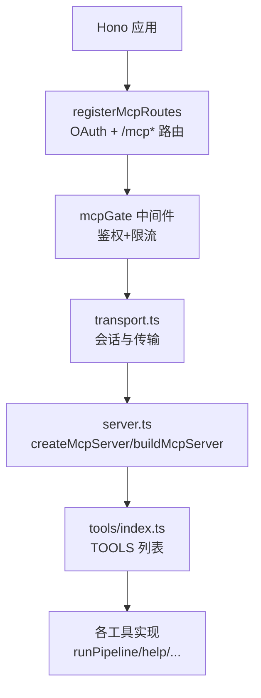
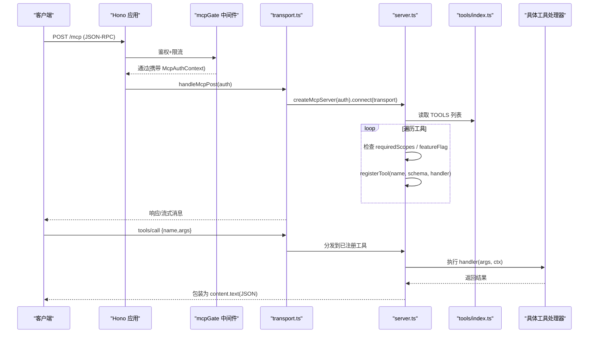
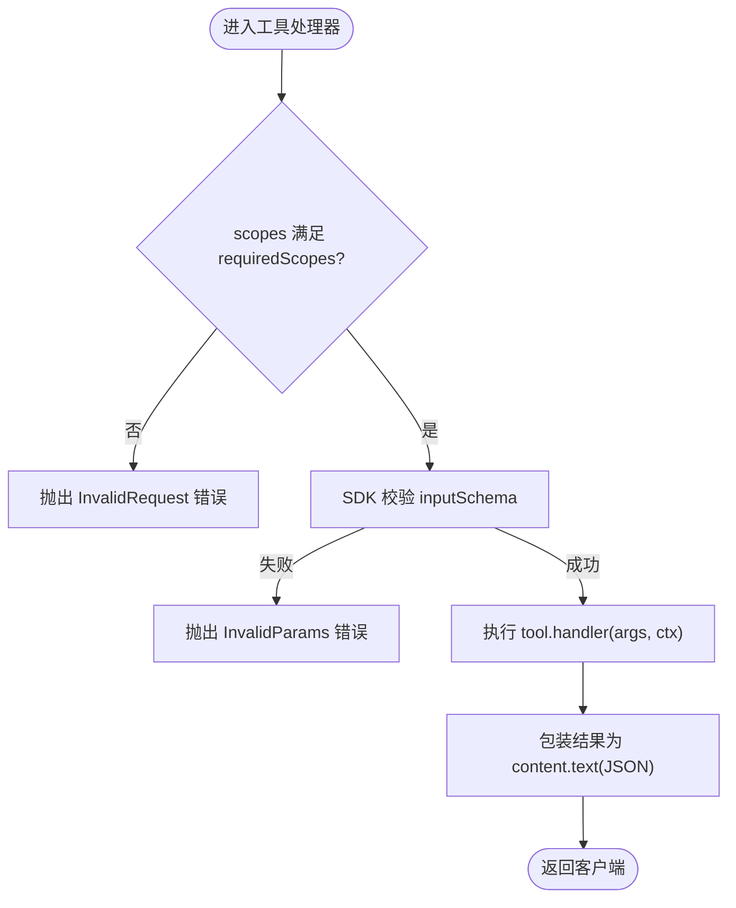
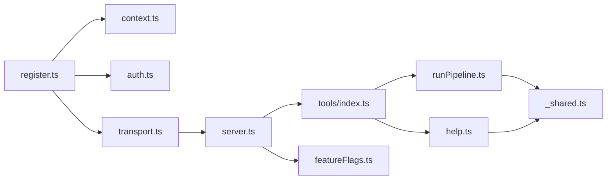

# 工具注册机制

<cite>
**本文引用的文件**
- [api/mcp/register.ts](file://api/mcp/register.ts)
- [api/mcp/server.ts](file://api/mcp/server.ts)
- [api/mcp/transport.ts](file://api/mcp/transport.ts)
- [api/mcp/types.ts](file://api/mcp/types.ts)
- [api/mcp/context.ts](file://api/mcp/context.ts)
- [api/mcp/auth.ts](file://api/mcp/auth.ts)
- [api/mcp/tools/index.ts](file://api/mcp/tools/index.ts)
- [api/mcp/tools/help.ts](file://api/mcp/tools/help.ts)
- [api/mcp/tools/runPipeline.ts](file://api/mcp/tools/runPipeline.ts)
- [api/mcp/tools/_shared.ts](file://api/mcp/tools/_shared.ts)
- [api/plugins/featureFlags.ts](file://api/plugins/featureFlags.ts)
</cite>

## 目录
1. [简介](#简介)
2. [项目结构](#项目结构)
3. [核心组件](#核心组件)
4. [架构总览](#架构总览)
5. [详细组件分析](#详细组件分析)
6. [依赖关系分析](#依赖关系分析)
7. [性能考量](#性能考量)
8. [故障排查指南](#故障排查指南)
9. [结论](#结论)
10. [附录](#附录)

## 简介
本文件系统性说明 DeeWaanAI 的 MCP（Model Context Protocol）工具注册机制，覆盖工具发现、加载与注册流程；记录工具元数据定义、版本管理与依赖处理；介绍工具索引系统的构建与维护方法；并阐述工具热重载、动态加载与生命周期管理。同时提供最佳实践、常见问题解决方案，以及工具间通信与状态共享方式。

## 项目结构
MCP 子系统位于 api/mcp 目录下，围绕“路由注册—传输层—服务器工厂—工具集合”分层组织：
- 路由注册：将 OAuth 与 /mcp* 端点挂载到 Hono 应用，统一鉴权与限流。
- 传输层：维护会话与两种传输（可流式 HTTP 与遗留 SSE），负责创建 McpServer 实例。
- 服务器工厂：按会话构建 McpServer，依据权限和特性开关过滤并注册工具。
- 工具集合：集中导出所有可用工具，每个工具以统一的 McpTool 接口声明元数据与处理器。

图表来源
- [api/mcp/register.ts:144-164](file://api/mcp/register.ts#L144-L164)
- [api/mcp/transport.ts:76-141](file://api/mcp/transport.ts#L76-L141)
- [api/mcp/server.ts:135-186](file://api/mcp/server.ts#L135-L186)
- [api/mcp/tools/index.ts:45-94](file://api/mcp/tools/index.ts#L45-L94)

章节来源
- [api/mcp/register.ts:1-165](file://api/mcp/register.ts#L1-L165)
- [api/mcp/transport.ts:1-234](file://api/mcp/transport.ts#L1-L234)
- [api/mcp/server.ts:1-209](file://api/mcp/server.ts#L1-L209)
- [api/mcp/tools/index.ts:1-95](file://api/mcp/tools/index.ts#L1-L95)

## 核心组件
- 路由与鉴权：register.ts 挂载 OAuth 与 /mcp* 路由，并通过 mcpGate 中间件完成 Bearer Token 校验、客户层级解析与速率限制。
- 传输与会话：transport.ts 维护进程内会话表，支持 StreamableHTTP 与 SSE 两种传输，并在会话初始化时注入运行时桥接能力（如采样）。
- 服务器工厂：server.ts 为每个会话创建独立 McpServer，遍历 TOOLS 列表，基于 scopes 与 featureFlag 进行过滤后注册工具，并对每次调用进行审计与用量统计。
- 工具契约：types.ts 定义 McpAuthContext 与 McpTool 接口，约束工具元数据、输入校验 schema、权限范围、注解与处理器签名。
- 工具索引：tools/index.ts 集中导入并导出 TOOLS 数组，作为服务器构建时的唯一来源。
- 特性开关：plugins/featureFlags.ts 提供 isFeatureEnabled，用于按用户维度控制功能可见性。

章节来源
- [api/mcp/register.ts:90-164](file://api/mcp/register.ts#L90-L164)
- [api/mcp/transport.ts:38-57](file://api/mcp/transport.ts#L38-L57)
- [api/mcp/server.ts:84-186](file://api/mcp/server.ts#L84-L186)
- [api/mcp/types.ts:9-44](file://api/mcp/types.ts#L9-L44)
- [api/mcp/tools/index.ts:45-94](file://api/mcp/tools/index.ts#L45-L94)
- [api/plugins/featureFlags.ts:22-73](file://api/plugins/featureFlags.ts#L22-L73)

## 架构总览
下图展示从客户端请求到工具调用的完整链路，包括鉴权、会话建立、工具注册与执行。

图表来源
- [api/mcp/register.ts:144-164](file://api/mcp/register.ts#L144-L164)
- [api/mcp/transport.ts:76-141](file://api/mcp/transport.ts#L76-L141)
- [api/mcp/server.ts:135-186](file://api/mcp/server.ts#L135-L186)
- [api/mcp/tools/index.ts:45-94](file://api/mcp/tools/index.ts#L45-L94)

## 详细组件分析

### 工具发现与加载
- 工具发现：server.ts 在 buildMcpServer 中读取 tools/index.ts 导出的 TOOLS 数组。该数组是单一事实来源，便于集中管理与扩展。
- 加载策略：每会话新建 McpServer 实例，避免跨会话上下文污染；对每个工具尝试注册，失败仅记录日志不影响整体启动。
- 防御性设计：若 tools/index 缺失或为空，会记录警告但继续运行，保证系统可用性。

章节来源
- [api/mcp/server.ts:135-186](file://api/mcp/server.ts#L135-L186)
- [api/mcp/tools/index.ts:45-94](file://api/mcp/tools/index.ts#L45-L94)

### 工具注册与权限控制
- 元数据：每个工具通过 McpTool 声明 name、description、inputSchema（Zod）、requiredScopes、annotations、handler 等。
- 权限门控：注册后的 handler 在执行前检查 auth.scopes 是否包含 requiredScopes，否则返回 InvalidRequest。
- 特性开关：若工具声明 featureFlag，则在注册阶段调用 isFeatureEnabled(flag, userId)，未启用则隐藏该工具（不可见且不可调用）。
- 参数校验：SDK 使用 inputSchema 自动校验入参，非法参数直接返回 InvalidParams。

图表来源
- [api/mcp/server.ts:84-124](file://api/mcp/server.ts#L84-L124)
- [api/mcp/types.ts:33-44](file://api/mcp/types.ts#L33-L44)

章节来源
- [api/mcp/server.ts:84-124](file://api/mcp/server.ts#L84-L124)
- [api/mcp/types.ts:33-44](file://api/mcp/types.ts#L33-L44)

### 工具元数据、版本与依赖
- 元数据：name 为永久 snake_case；description 面向用户；annotations 标记只读/破坏性提示；inputSchema 使用 Zod v4 对象 schema。
- 版本管理：服务器名称与版本在 server.ts 中集中声明（SERVER_NAME/SERVER_VERSION），对外暴露给客户端能力协商。
- 依赖关系：工具通过 import 引入数据库连接、业务服务与共享辅助函数；工具之间不直接耦合，依赖通过 McpAuthContext 与共享模块解耦。

章节来源
- [api/mcp/server.ts:35-37](file://api/mcp/server.ts#L35-L37)
- [api/mcp/types.ts:33-44](file://api/mcp/types.ts#L33-L44)
- [api/mcp/tools/runPipeline.ts:1-156](file://api/mcp/tools/runPipeline.ts#L1-L156)

### 工具索引系统的构建与维护
- 索引位置：tools/index.ts 集中导出 TOOLS 数组，作为服务器构建的唯一入口。
- 维护方式：新增工具只需在 index.ts 中导入并加入数组；无需修改服务器逻辑。
- 分组与注释：团队相关工具集中在 team 子目录，通过 index.ts 统一聚合，便于按特性开关控制。

章节来源
- [api/mcp/tools/index.ts:1-95](file://api/mcp/tools/index.ts#L1-L95)

### 工具热重载与动态加载
- 当前实现：工具列表在进程启动时静态导入，非热重载模式。
- 动态加载点：buildMcpServer 每会话重新遍历 TOOLS，因此可在同一进程内通过替换模块引用实现“伪热重载”（需配合进程级模块缓存策略）。
- 建议方案：如需真正的热重载，可在 transport 层增加“刷新工具列表”的 RPC，或在进程内维护可更新的工具注册表，并在会话重建时生效。

章节来源
- [api/mcp/server.ts:135-186](file://api/mcp/server.ts#L135-L186)

### 生命周期管理
- 会话生命周期：transport.ts 维护进程内 sessions Map，支持 GET/POST/DELETE 生命周期操作；空闲会话按 TTL 清理。
- 服务器生命周期：每个会话创建独立的 McpServer，连接 transport 后即绑定到该会话；关闭时清理资源。
- 运行时桥接：会话初始化后将 sessionId、samplingSupported、sample 注入 auth.runtime，供工具回调至客户端。

章节来源
- [api/mcp/transport.ts:38-57](file://api/mcp/transport.ts#L38-L57)
- [api/mcp/transport.ts:76-141](file://api/mcp/transport.ts#L76-L141)
- [api/mcp/types.ts:15-31](file://api/mcp/types.ts#L15-L31)

### 工具间的通信机制与状态共享
- 会话级状态：auth.runtime.sessionId 标识当前会话，可用于关联上下文。
- 客户端回推：通过 runtime.sample(params) 向桌面客户端发起采样/消息请求，前提是客户端支持 sampling 能力。
- 共享内存：工具可通过 _memoryStore 等共享存储（由工具内部实现）进行轻量状态共享；跨工具持久化应通过数据库或外部存储。

章节来源
- [api/mcp/transport.ts:104-116](file://api/mcp/transport.ts#L104-L116)
- [api/mcp/types.ts:15-31](file://api/mcp/types.ts#L15-L31)

### 典型工具示例
- run_pipeline：演示了输入校验、项目访问检查、模板应用、写入运行记录、入队执行与返回结构化结果。
- deewaanai_help：根据用户能力、特性开关与设置生成个性化帮助内容，体现工具元数据与运行时能力的结合。

章节来源
- [api/mcp/tools/runPipeline.ts:1-156](file://api/mcp/tools/runPipeline.ts#L1-L156)
- [api/mcp/tools/help.ts:1-47](file://api/mcp/tools/help.ts#L1-L47)

## 依赖关系分析
- 路由层依赖：register.ts 依赖 context.ts（鉴权）、auth.ts（OAuth 路由）、transport.ts（传输处理）。
- 传输层依赖：transport.ts 依赖 server.ts（服务器工厂）与 types.ts（认证上下文）。
- 服务器层依赖：server.ts 依赖 tools/index.ts（工具列表）、plugins/featureFlags.ts（特性开关）、数据库与日志。
- 工具层依赖：各工具依赖 _shared.ts（项目访问校验）、数据库模型与服务模块。

图表来源
- [api/mcp/register.ts:144-164](file://api/mcp/register.ts#L144-L164)
- [api/mcp/transport.ts:76-141](file://api/mcp/transport.ts#L76-L141)
- [api/mcp/server.ts:135-186](file://api/mcp/server.ts#L135-L186)
- [api/mcp/tools/index.ts:45-94](file://api/mcp/tools/index.ts#L45-L94)

章节来源
- [api/mcp/register.ts:144-164](file://api/mcp/register.ts#L144-L164)
- [api/mcp/transport.ts:76-141](file://api/mcp/transport.ts#L76-L141)
- [api/mcp/server.ts:135-186](file://api/mcp/server.ts#L135-L186)
- [api/mcp/tools/index.ts:45-94](file://api/mcp/tools/index.ts#L45-L94)

## 性能考量
- 会话清理：transport.ts 定期扫描并清理过期会话，防止内存泄漏。
- 特性开关缓存：featureFlags.ts 使用 60 秒缓存减少数据库查询压力。
- 审计与用量：server.ts 异步记录审计与用量计数，采用 fire-and-forget 策略，避免阻塞主路径。
- 限流与降级：register.ts 的速率限制在异常时放行请求，确保系统弹性。

章节来源
- [api/mcp/transport.ts:48-57](file://api/mcp/transport.ts#L48-L57)
- [api/plugins/featureFlags.ts:22-46](file://api/plugins/featureFlags.ts#L22-L46)
- [api/mcp/server.ts:46-82](file://api/mcp/server.ts#L46-L82)
- [api/mcp/register.ts:112-138](file://api/mcp/register.ts#L112-L138)

## 故障排查指南
- 401 未授权：检查 Authorization 头格式与 token 有效性；确认 mcpGate 正确返回 WWW-Authenticate 挑战。
- 429 速率限制：查看重试间隔与层级信息；确认客户层级解析正常。
- 工具不可见：检查工具是否声明 featureFlag 且对用户启用；查看服务器日志中的 hidden 计数。
- 参数校验失败：核对工具 inputSchema 与传入参数类型；SDK 会返回 InvalidParams。
- 权限不足：确认 token scopes 包含 requiredScopes；必要时调整 OAuth 授权范围。
- 会话丢失：确认 mcp-session-id 头部或查询参数正确；检查会话是否被清理。

章节来源
- [api/mcp/register.ts:90-142](file://api/mcp/register.ts#L90-L142)
- [api/mcp/server.ts:149-177](file://api/mcp/server.ts#L149-L177)
- [api/mcp/transport.ts:59-72](file://api/mcp/transport.ts#L59-L72)

## 结论
DeeWaanAI 的 MCP 工具注册机制以“集中索引 + 会话级服务器工厂 + 严格权限与特性开关”为核心，实现了安全、可扩展且可观测的工具生态。通过统一的 McpTool 契约、Zod 参数校验与异步审计，系统在易用性与可靠性之间取得平衡。未来可进一步增强热重载与跨会话状态共享能力，以满足更复杂的协作场景。

## 附录

### 工具注册最佳实践
- 明确声明 requiredScopes，遵循最小权限原则。
- 使用 Zod 定义严格的 inputSchema，避免隐式类型转换。
- 对敏感操作标注 destructiveHint，便于客户端提示。
- 通过 featureFlag 渐进发布新功能，默认关闭，逐步放量。
- 在工具中复用 _shared.ts 的项目访问校验，确保安全一致。

章节来源
- [api/mcp/types.ts:33-44](file://api/mcp/types.ts#L33-L44)
- [api/mcp/tools/_shared.ts:36-60](file://api/mcp/tools/_shared.ts#L36-L60)

### 常见问题解决方案
- 工具未出现在 tools/list：检查 featureFlag 配置与用户权限；查看服务器日志中的 hidden 计数。
- 调用报 Unknown tool：确认工具名与大小写；检查是否在 TOOLS 列表中。
- 参数校验失败：对照 inputSchema 修正请求体；关注必填字段与类型。
- 会话断开重连：重新获取 mcp-session-id；确保服务端会话仍存在。

章节来源
- [api/mcp/server.ts:149-177](file://api/mcp/server.ts#L149-L177)
- [api/mcp/transport.ts:143-170](file://api/mcp/transport.ts#L143-L170)