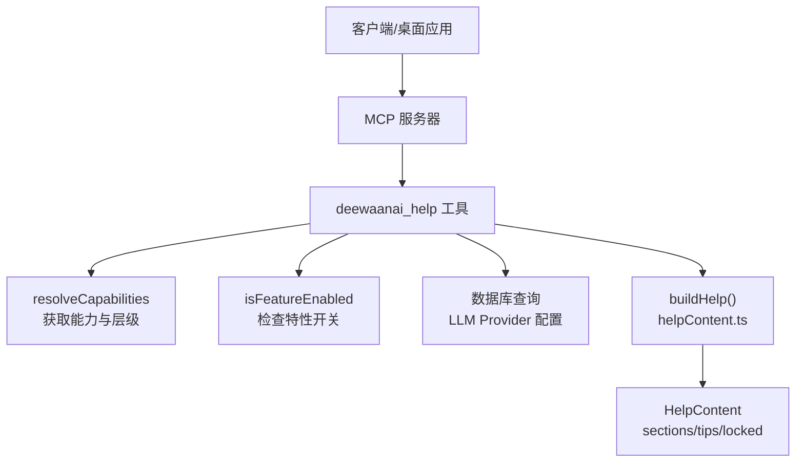
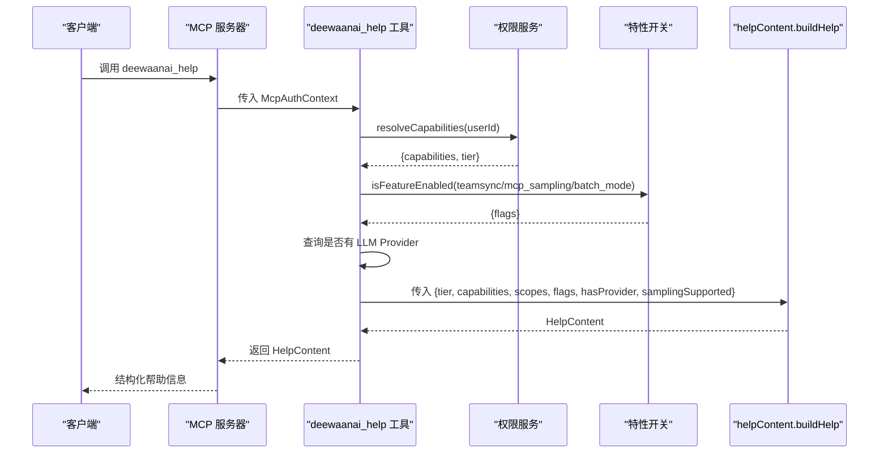
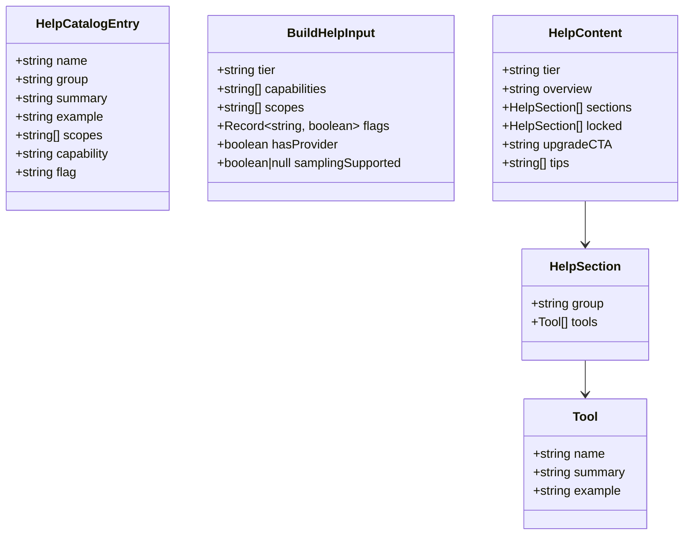
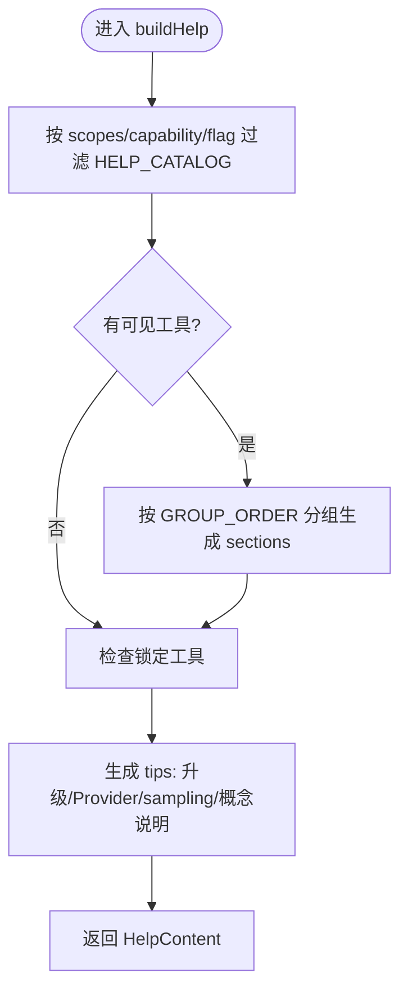
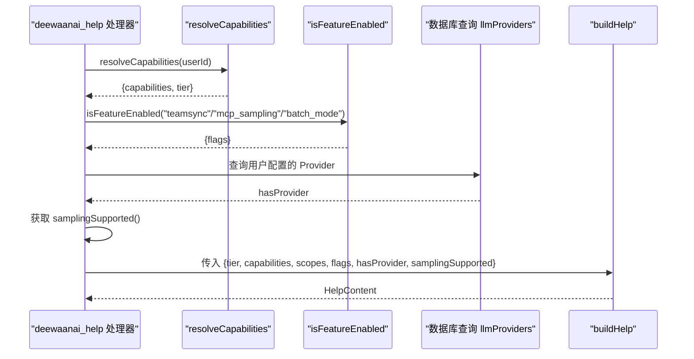
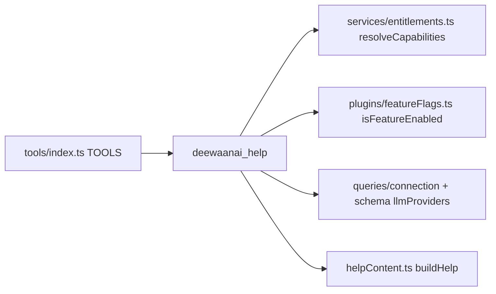

# Help帮助工具

<cite>
**本文引用的文件**
- [api/mcp/tools/help.ts](file://api/mcp/tools/help.ts)
- [api/mcp/tools/helpContent.ts](file://api/mcp/tools/helpContent.ts)
- [api/mcp/tools/helpContent.test.ts](file://api/mcp/tools/helpContent.test.ts)
- [api/mcp/tools/index.ts](file://api/mcp/tools/index.ts)
- [api/services/entitlements.ts](file://api/services/entitlements.ts)
- [api/plugins/featureFlags.ts](file://api/plugins/featureFlags.ts)
- [api/mcp/types.ts](file://api/mcp/types.ts)
</cite>

## 目录
1. [简介](#简介)
2. [项目结构](#项目结构)
3. [核心组件](#核心组件)
4. [架构总览](#架构总览)
5. [详细组件分析](#详细组件分析)
6. [依赖关系分析](#依赖关系分析)
7. [性能考虑](#性能考虑)
8. [故障排查指南](#故障排查指南)
9. [结论](#结论)
10. [附录：使用示例与扩展指南](#附录使用示例与扩展指南)

## 简介
本文件为“Help帮助工具”的完整实现文档，聚焦于帮助系统的架构设计、动态内容生成机制、多语言支持现状、帮助内容数据结构组织与管理方式，以及查询类型与参数处理流程。同时提供具体使用示例（基本帮助查询、分类浏览、搜索）和扩展机制说明，指导开发者如何添加新的帮助主题与自定义帮助内容。

## 项目结构
帮助工具由两部分组成：
- 工具入口：MCP 工具 deewaanai_help，负责鉴权、能力与特性开关解析，并调用纯函数构建帮助内容。
- 内容构建器：helpContent 模块，维护帮助目录（HELP_CATALOG），根据用户层级、能力、作用域与特性开关过滤出可见工具，并生成结构化帮助响应。

图表来源
- [api/mcp/tools/help.ts:18-45](file://api/mcp/tools/help.ts#L18-L45)
- [api/mcp/tools/helpContent.ts:280-368](file://api/mcp/tools/helpContent.ts#L280-L368)
- [api/services/entitlements.ts:165-207](file://api/services/entitlements.ts#L165-L207)
- [api/plugins/featureFlags.ts:51-55](file://api/plugins/featureFlags.ts#L51-L55)

章节来源
- [api/mcp/tools/help.ts:1-47](file://api/mcp/tools/help.ts#L1-L47)
- [api/mcp/tools/helpContent.ts:1-369](file://api/mcp/tools/helpContent.ts#L1-L369)
- [api/mcp/tools/index.ts:1-95](file://api/mcp/tools/index.ts#L1-L95)

## 核心组件
- deewaanai_help 工具：定义工具元信息、输入模式、所需作用域，并在处理器中组装上下文（层级、能力、作用域、特性开关、是否已配置 LLM 提供者、采样支持），然后调用 buildHelp 生成帮助内容。
- helpContent 模块：
  - HELP_CATALOG：声明式帮助目录，每个条目包含名称、分组、摘要、可选示例、所需作用域、可选能力与特性开关。
  - buildHelp：基于输入上下文过滤可见工具、生成分组、锁定项、升级提示与个性化建议，返回统一结构 HelpContent。
- 权限与特性系统：
  - resolveCapabilities：聚合显式授权、订阅计划、层级与券兑换的能力集合。
  - isFeatureEnabled：按全局启用、灰度比例、白名单用户判断特性开关。

章节来源
- [api/mcp/tools/help.ts:18-45](file://api/mcp/tools/help.ts#L18-L45)
- [api/mcp/tools/helpContent.ts:7-41](file://api/mcp/tools/helpContent.ts#L7-L41)
- [api/mcp/tools/helpContent.ts:86-278](file://api/mcp/tools/helpContent.ts#L86-L278)
- [api/mcp/tools/helpContent.ts:280-368](file://api/mcp/tools/helpContent.ts#L280-L368)
- [api/services/entitlements.ts:165-207](file://api/services/entitlements.ts#L165-L207)
- [api/plugins/featureFlags.ts:51-55](file://api/plugins/featureFlags.ts#L51-L55)

## 架构总览
帮助系统采用“工具入口 + 纯内容构建”的分层设计：
- 工具入口仅负责收集运行时上下文（用户 ID、作用域、能力、特性开关、Provider 状态、采样支持）。
- 内容构建器是纯函数，无 I/O，便于单元测试与可移植性。
- 权限与特性系统作为外部依赖，通过服务层与插件层注入到构建过程。

图表来源
- [api/mcp/tools/help.ts:25-44](file://api/mcp/tools/help.ts#L25-L44)
- [api/services/entitlements.ts:165-207](file://api/services/entitlements.ts#L165-L207)
- [api/plugins/featureFlags.ts:51-55](file://api/plugins/featureFlags.ts#L51-L55)
- [api/mcp/tools/helpContent.ts:280-368](file://api/mcp/tools/helpContent.ts#L280-L368)

## 详细组件分析

### 帮助目录与数据结构
- HELP_CATALOG：集中管理所有帮助主题，按组（Discover/Run/Research/Author/Marketplace/Account/Your data/Team/Diagnostics）组织，每个条目声明：
  - name：工具名（snake_case）
  - group：分组
  - summary：简要说明
  - example：可选示例语句
  - scopes：所需作用域（如 mcp:read/mcp:run/mcp:write/team:read/team:write）
  - capability：可选能力门控（如 pipeline:autodesign、marketplace:publish）
  - flag：可选特性开关（如 batch_mode、teamsync、mcp_sampling）
- BuildHelpInput：构建帮助所需的输入上下文，包括层级、能力列表、作用域、特性开关映射、是否已配置 LLM 提供者、采样支持情况。
- HelpSection/HelpContent：输出结构，包含分层 sections、locked 锁定项、upgradeCTA 升级引导、tips 个性化建议。

图表来源
- [api/mcp/tools/helpContent.ts:7-41](file://api/mcp/tools/helpContent.ts#L7-L41)
- [api/mcp/tools/helpContent.ts:280-368](file://api/mcp/tools/helpContent.ts#L280-L368)

章节来源
- [api/mcp/tools/helpContent.ts:7-41](file://api/mcp/tools/helpContent.ts#L7-L41)
- [api/mcp/tools/helpContent.ts:86-278](file://api/mcp/tools/helpContent.ts#L86-L278)
- [api/mcp/tools/helpContent.ts:280-368](file://api/mcp/tools/helpContent.ts#L280-L368)

### 帮助内容生成逻辑
buildHelp 的核心流程：
- 过滤可见工具：依据 scopes、capability、flag 三项条件筛选 HELP_CATALOG。
- 生成分组 sections：按固定顺序遍历 GROUP_ORDER，将可见工具按组聚合，空组不输出。
- 生成锁定项 locked：对具备 scope 但缺少 capability 的工具单独分组，用于展示升级引导。
- 生成 tips：
  - 根据 tier 显示升级信息与解锁能力。
  - 若未配置 LLM Provider，提示建议 providers 与添加 provider。
  - 若支持 MCP sampling，提示可在本地运行自动设计。
  - 解释流水线基本概念与质量门控等。
- 返回 HelpContent：包含 tier、overview、sections、locked、upgradeCTA、tips。

图表来源
- [api/mcp/tools/helpContent.ts:280-368](file://api/mcp/tools/helpContent.ts#L280-L368)

章节来源
- [api/mcp/tools/helpContent.ts:280-368](file://api/mcp/tools/helpContent.ts#L280-L368)

### 工具入口与上下文装配
deewaanai_help 工具处理器：
- 解析用户能力与层级：调用 resolveCapabilities。
- 读取特性开关：teamsync、mcp_sampling、batch_mode。
- 查询 LLM Provider 配置：判断是否已配置至少一个 Provider。
- 获取采样支持：从 runtime.samplingSupported() 探测客户端能力。
- 调用 buildHelp：传入上述上下文，得到结构化帮助内容。

图表来源
- [api/mcp/tools/help.ts:25-44](file://api/mcp/tools/help.ts#L25-L44)
- [api/services/entitlements.ts:165-207](file://api/services/entitlements.ts#L165-L207)
- [api/plugins/featureFlags.ts:51-55](file://api/plugins/featureFlags.ts#L51-L55)

章节来源
- [api/mcp/tools/help.ts:18-45](file://api/mcp/tools/help.ts#L18-L45)

### 多语言支持现状
- 当前帮助内容以英文为主，HELP_CATALOG 中的 summary/example 均为英文文案。
- McpAuthContext 包含 locale 字段（"en" | "zh"），但 buildHelp 尚未根据 locale 切换文案；如需多语言，需在 HELP_CATALOG 或 buildHelp 中引入本地化映射。
- 测试用例覆盖行为断言，不包含多语言分支验证。

章节来源
- [api/mcp/tools/helpContent.ts:86-278](file://api/mcp/tools/helpContent.ts#L86-L278)
- [api/mcp/types.ts:9-31](file://api/mcp/types.ts#L9-L31)
- [api/mcp/tools/helpContent.test.ts:1-240](file://api/mcp/tools/helpContent.test.ts#L1-240)

## 依赖关系分析
- 工具注册：TOOLS 列表中包含 deewaanai_help，供 MCP 服务器暴露。
- 权限与特性：
  - resolveCapabilities 聚合多层级能力来源（显式授权、订阅计划、层级、券兑换）。
  - isFeatureEnabled 基于数据库 featureFlags 表与缓存进行判定。
- 数据访问：
  - 查询 llmProviders 表判断是否已配置 Provider。
  - 数据库连接通过 getDb 获取。

图表来源
- [api/mcp/tools/index.ts:45-94](file://api/mcp/tools/index.ts#L45-L94)
- [api/mcp/tools/help.ts:25-44](file://api/mcp/tools/help.ts#L25-L44)
- [api/services/entitlements.ts:165-207](file://api/services/entitlements.ts#L165-L207)
- [api/plugins/featureFlags.ts:51-55](file://api/plugins/featureFlags.ts#L51-L55)

章节来源
- [api/mcp/tools/index.ts:1-95](file://api/mcp/tools/index.ts#L1-L95)
- [api/mcp/tools/help.ts:18-45](file://api/mcp/tools/help.ts#L18-L45)
- [api/services/entitlements.ts:165-207](file://api/services/entitlements.ts#L165-L207)
- [api/plugins/featureFlags.ts:51-55](file://api/plugins/featureFlags.ts#L51-L55)

## 性能考虑
- 能力与特性开关解析：
  - resolveCapabilities 涉及多次数据库查询，建议在高频调用场景下结合缓存策略（例如会话级缓存）。
  - isFeatureEnabled 已有内存缓存（60秒 TTL），减少频繁读库。
- 帮助内容构建：
  - buildHelp 为纯函数，时间复杂度与 HELP_CATALOG 规模线性相关，开销较小。
  - 避免在每次请求中重复加载 catalog，保持单例或模块级常量即可。
- 数据库查询：
  - 查询 llmProviders 使用 limit 1，降低负载。
  - 若未来扩展更多上下文查询，建议批量合并以减少往返次数。

[本节为通用性能讨论，无需特定文件引用]

## 故障排查指南
- 帮助内容缺失工具：
  - 检查 scopes 是否满足（如 mcp:run/mcp:write）。
  - 检查 capability 是否具备（如 pipeline:autodesign）。
  - 检查 flag 是否开启（如 batch_mode/teamsync/mcp_sampling）。
- 无 LLM Provider 提示：
  - 确认 hasProvider 为 false 时，tips 会提示 suggest_llm_providers 与 add_provider。
- 采样功能未生效：
  - 需同时满足 mcp_sampling 特性开关开启且客户端 samplingSupported 为 true。
- 升级引导不正确：
  - 检查 tier 与 capabilities 是否正确聚合，确保 TIER_CAPABILITIES 与 PLAN_CAPABILITIES 配置一致。

章节来源
- [api/mcp/tools/helpContent.ts:280-368](file://api/mcp/tools/helpContent.ts#L280-L368)
- [api/services/entitlements.ts:165-207](file://api/services/entitlements.ts#L165-L207)
- [api/plugins/featureFlags.ts:51-55](file://api/plugins/featureFlags.ts#L51-L55)

## 结论
Help 帮助工具通过“工具入口 + 纯内容构建”的清晰分层，实现了基于用户能力、作用域与特性开关的动态帮助内容生成。其目录化管理与结构化输出便于扩展与维护。当前多语言支持尚未落地，可通过本地化映射扩展。整体设计具备良好的可测试性与可扩展性，适合持续演进。

[本节为总结性内容，无需特定文件引用]

## 附录：使用示例与扩展指南

### 基本帮助查询
- 调用 deewaanai_help 工具，无需额外参数。
- 返回 HelpContent，包含 overview、sections、locked、upgradeCTA、tips。
- 适用场景：新用户入门、快速了解可用功能与限制。

章节来源
- [api/mcp/tools/help.ts:18-45](file://api/mcp/tools/help.ts#L18-L45)
- [api/mcp/tools/helpContent.ts:280-368](file://api/mcp/tools/helpContent.ts#L280-L368)

### 分类浏览
- 根据 sections.group 浏览不同类别：Discover、Run、Research、Author、Marketplace、Account、Your data、Team、Diagnostics。
- 每个 section 包含该组下的工具名称、摘要与可选示例。
- 适用场景：按功能域查找工具，提升导航效率。

章节来源
- [api/mcp/tools/helpContent.ts:280-368](file://api/mcp/tools/helpContent.ts#L280-L368)

### 搜索功能
- 当前帮助系统未内置搜索接口；可在客户端对 HelpContent.sections 与 tips 进行本地检索。
- 建议实现关键词匹配（工具名、摘要、示例），以提升用户体验。

[本节为概念性内容，无需特定文件引用]

### 扩展机制：添加新帮助主题
步骤：
1. 在 HELP_CATALOG 中添加条目：
   - 指定 name、group、summary、example（可选）、scopes、capability（可选）、flag（可选）。
2. 确保对应工具已在 TOOLS 列表中注册。
3. 若需要特性开关控制，新增 flag 并在 isFeatureEnabled 中配置默认值。
4. 更新测试用例，覆盖新增条目的可见性与分组行为。

章节来源
- [api/mcp/tools/helpContent.ts:86-278](file://api/mcp/tools/helpContent.ts#L86-L278)
- [api/mcp/tools/index.ts:45-94](file://api/mcp/tools/index.ts#L45-L94)
- [api/plugins/featureFlags.ts:87-107](file://api/plugins/featureFlags.ts#L87-L107)
- [api/mcp/tools/helpContent.test.ts:1-240](file://api/mcp/tools/helpContent.test.ts#L1-240)

### 扩展机制：自定义帮助内容
- 在 buildHelp 中根据 hasProvider、samplingSupported、tier 等上下文动态调整 tips。
- 如需多语言，可在 HELP_CATALOG 或 buildHelp 中引入本地化映射，依据 McpAuthContext.locale 选择文案。
- 如需更细粒度分组，可调整 GROUP_ORDER 或在 HelpSection 中增加自定义字段。

章节来源
- [api/mcp/tools/helpContent.ts:280-368](file://api/mcp/tools/helpContent.ts#L280-L368)
- [api/mcp/types.ts:9-31](file://api/mcp/types.ts#L9-L31)