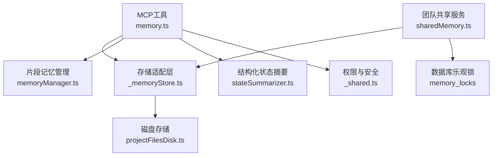
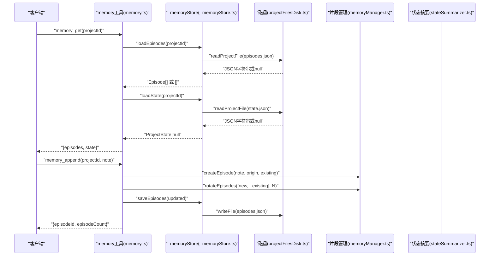
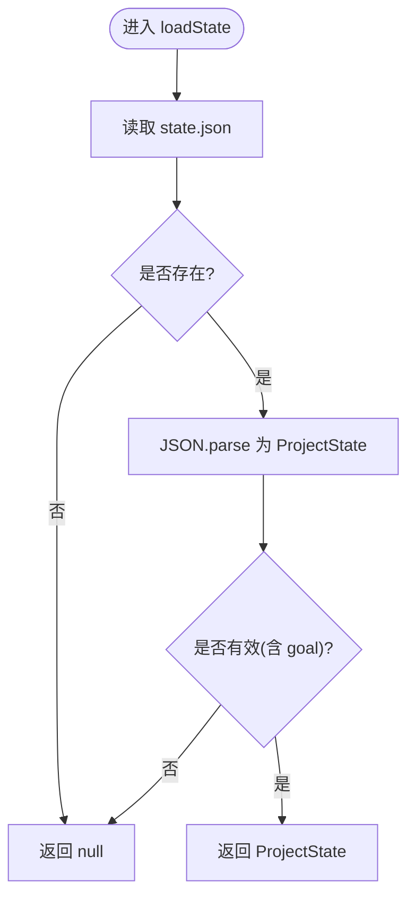
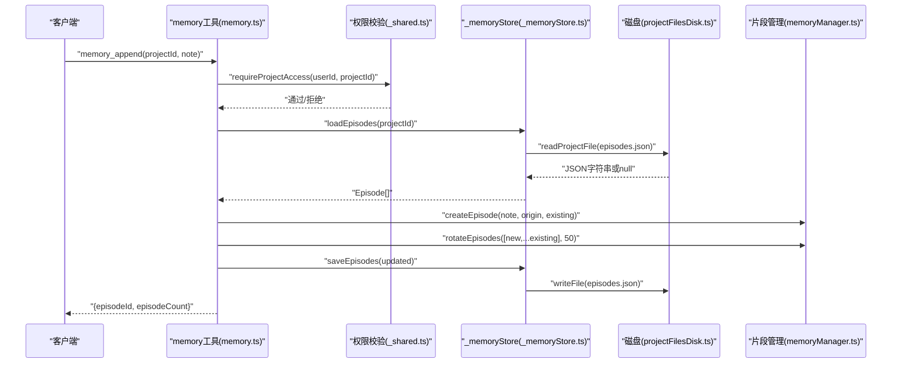
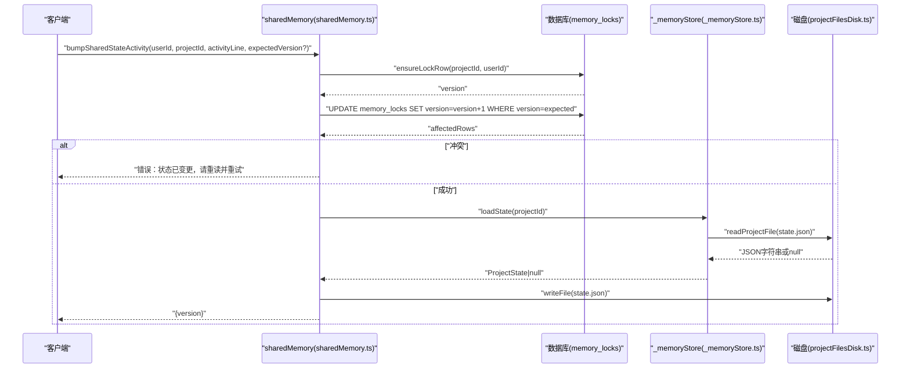
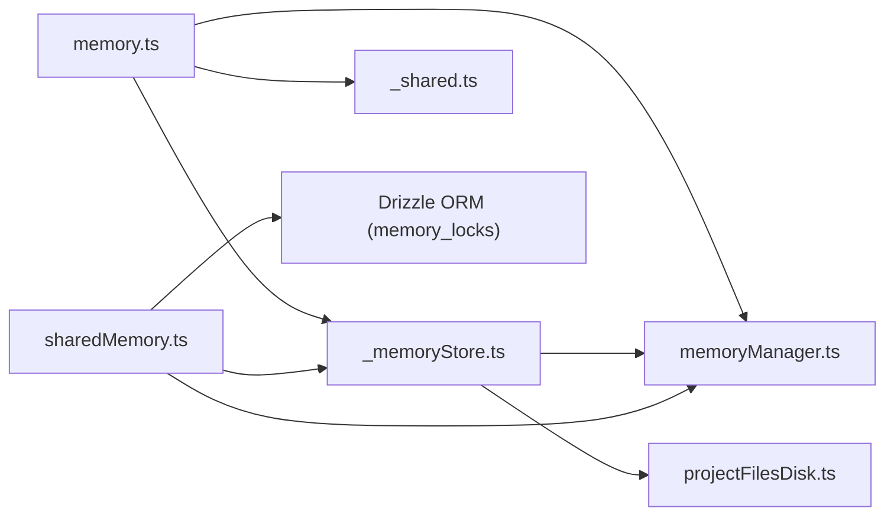

# Memory存储工具

<cite>
**本文引用的文件**
- [api/mcp/tools/memory.ts](file://api/mcp/tools/memory.ts)
- [api/mcp/tools/_memoryStore.ts](file://api/mcp/tools/_memoryStore.ts)
- [api/services/memoryManager.ts](file://api/services/memoryManager.ts)
- [api/services/stateSummarizer.ts](file://api/services/stateSummarizer.ts)
- [api/services/sharedMemory.ts](file://api/services/sharedMemory.ts)
- [api/services/projectFilesDisk.ts](file://api/services/projectFilesDisk.ts)
- [api/mcp/tools/_shared.ts](file://api/mcp/tools/_shared.ts)
</cite>

## 目录
1. [简介](#简介)
2. [项目结构](#项目结构)
3. [核心组件](#核心组件)
4. [架构总览](#架构总览)
5. [详细组件分析](#详细组件分析)
6. [依赖关系分析](#依赖关系分析)
7. [性能与并发特性](#性能与并发特性)
8. [故障排查指南](#故障排查指南)
9. [结论](#结论)
10. [附录：使用示例与最佳实践](#附录使用示例与最佳实践)

## 简介
本文件面向MCP（Model Context Protocol）工具的内存存储子系统，系统性说明其设计模式、实现机制与使用方式。该子系统通过“磁盘持久化 + 结构化状态 + 片段记忆”的三层方案，为不同MCP工具提供跨调用共享上下文的能力，并支持团队级协作时的乐观锁并发控制。文档重点解析_memoryStore模块的内部实现，包括数据存储结构、生命周期管理、并发访问控制，以及memory工具暴露的CRUD接口；同时给出数据序列化、版本兼容性与性能优化策略，并提供最佳实践与使用示例。

## 项目结构
围绕内存存储的核心代码分布在以下位置：
- MCP工具层：memory.ts 暴露 memory_get / memory_append 两个工具
- 存储适配层：_memoryStore.ts 封装 episodes.json 与 state.json 的读写
- 服务层：
  - memoryManager.ts：片段记忆（Episode）的创建、检索、旋转压缩与序列化/反序列化
  - stateSummarizer.ts：结构化状态（ProjectState）的构建、压缩与Markdown序列化/解析
  - sharedMemory.ts：团队共享场景下的上下文读取、追加片段与乐观锁更新
  - projectFilesDisk.ts：本地磁盘文件读写（实际落盘路径 PROJECT_FILES_DIR/{projectId}/...）
- 安全与共享辅助：_shared.ts 提供项目访问校验与输出截断

图表来源
- [api/mcp/tools/memory.ts:1-92](file://api/mcp/tools/memory.ts#L1-L92)
- [api/mcp/tools/_memoryStore.ts:1-37](file://api/mcp/tools/_memoryStore.ts#L1-L37)
- [api/services/memoryManager.ts:1-123](file://api/services/memoryManager.ts#L1-L123)
- [api/services/stateSummarizer.ts:1-312](file://api/services/stateSummarizer.ts#L1-L312)
- [api/services/sharedMemory.ts:1-207](file://api/services/sharedMemory.ts#L1-L207)
- [api/services/projectFilesDisk.ts:1-143](file://api/services/projectFilesDisk.ts#L1-L143)
- [api/mcp/tools/_shared.ts:1-67](file://api/mcp/tools/_shared.ts#L1-L67)

章节来源
- [api/mcp/tools/memory.ts:1-92](file://api/mcp/tools/memory.ts#L1-L92)
- [api/mcp/tools/_memoryStore.ts:1-37](file://api/mcp/tools/_memoryStore.ts#L1-L37)
- [api/services/memoryManager.ts:1-123](file://api/services/memoryManager.ts#L1-L123)
- [api/services/stateSummarizer.ts:1-312](file://api/services/stateSummarizer.ts#L1-L312)
- [api/services/sharedMemory.ts:1-207](file://api/services/sharedMemory.ts#L1-L207)
- [api/services/projectFilesDisk.ts:1-143](file://api/services/projectFilesDisk.ts#L1-L143)
- [api/mcp/tools/_shared.ts:1-67](file://api/mcp/tools/_shared.ts#L1-L67)

## 核心组件
- _memoryStore：对 episodes.json 与 state.json 的读/写封装，负责将JSON字符串与领域对象互转，并对损坏状态进行容错处理。
- memoryManager：片段记忆（Episode）的关键词提取、检索排序、创建与轮转裁剪，以及序列化和反序列化。
- stateSummarizer：结构化状态（ProjectState）的构建、压缩策略（保守/平衡/激进）、Markdown序列化与解析。
- sharedMemory：在团队共享项目中提供上下文读取、片段追加与基于 memory_locks 表的乐观锁更新。
- projectFilesDisk：本地文件系统存取，包含路径规范化、子目录创建、批量写入与删除等能力。
- _shared：统一的项目访问校验与输出截断工具。

章节来源
- [api/mcp/tools/_memoryStore.ts:1-37](file://api/mcp/tools/_memoryStore.ts#L1-L37)
- [api/services/memoryManager.ts:1-123](file://api/services/memoryManager.ts#L1-L123)
- [api/services/stateSummarizer.ts:1-312](file://api/services/stateSummarizer.ts#L1-L312)
- [api/services/sharedMemory.ts:1-207](file://api/services/sharedMemory.ts#L1-L207)
- [api/services/projectFilesDisk.ts:1-143](file://api/services/projectFilesDisk.ts#L1-L143)
- [api/mcp/tools/_shared.ts:1-67](file://api/mcp/tools/_shared.ts#L1-L67)

## 架构总览
系统采用“三层记忆”架构：
- 工作记忆：当前查询与最近响应（每轮对话内临时存在）
- 压缩记忆：结构化状态（目标、关键决策、近期活动），以 JSON 或 Markdown 形式持久化
- 片段记忆：按时间顺序保存的历史交互片段，支持关键词检索

数据流概览：
- 读取：memory_get 并行加载 episodes.json 与 state.json，返回最近的片段与结构化状态摘要
- 写入：memory_append 创建新片段，合并后轮转保留最新N条，落盘 episodes.json
- 团队共享：sharedMemory 在追加片段时同样走 _memoryStore；更新结构化状态时使用 memory_locks 表进行乐观锁

图表来源
- [api/mcp/tools/memory.ts:24-91](file://api/mcp/tools/memory.ts#L24-L91)
- [api/mcp/tools/_memoryStore.ts:18-36](file://api/mcp/tools/_memoryStore.ts#L18-L36)
- [api/services/memoryManager.ts:80-123](file://api/services/memoryManager.ts#L80-L123)
- [api/services/projectFilesDisk.ts:42-99](file://api/services/projectFilesDisk.ts#L42-L99)

## 详细组件分析

### _memoryStore 模块内部实现
- 存储位置：每个项目的 memory/ 目录下存放 episodes.json 与 state.json
- 数据结构：
  - Episode：id、promptKeywords、summary、timestamp
  - ProjectState：goal、keyDecisions、recentActivity、openReferences、longTermSummaries
- 生命周期管理：
  - loadEpisodes：读取 episodes.json，若不存在返回空数组；否则解析为 Episode[]
  - saveEpisodes：将 Episode[] 序列化为 JSON 字符串并写入磁盘
  - loadState：读取 state.json，尝试解析为 ProjectState；若解析失败或字段不完整则视为不存在
- 并发访问控制：
  - 片段追加为只增操作，无需锁
  - 结构化状态更新由 sharedMemory 通过 memory_locks 表进行乐观锁控制

图表来源
- [api/mcp/tools/_memoryStore.ts:28-36](file://api/mcp/tools/_memoryStore.ts#L28-L36)

章节来源
- [api/mcp/tools/_memoryStore.ts:1-37](file://api/mcp/tools/_memoryStore.ts#L1-L37)
- [api/services/memoryManager.ts:9-14](file://api/services/memoryManager.ts#L9-L14)
- [api/services/stateSummarizer.ts:12-18](file://api/services/stateSummarizer.ts#L12-L18)

### memory 工具提供的CRUD接口
- 读取（Read）：memory_get
  - 输入：projectId
  - 行为：并行加载 episodes.json 与 state.json，返回最近片段（默认最多10条）与结构化状态摘要（截断保护）
  - 权限：需具备 mcp:read 范围，并在返回前校验项目访问权限
- 创建/追加（Create/Append）：memory_append
  - 输入：projectId、note（长度限制）
  - 行为：创建新片段，合并到现有片段列表，轮转保留最新N条（默认50），写入 episodes.json
  - 权限：需具备 mcp:write 范围，并在写入前校验项目访问权限
- 更新（Update）：通过 sharedMemory.bumpSharedStateActivity 更新结构化状态的 recentActivity
  - 输入：userId、projectId、activityLine、expectedVersion（可选）
  - 行为：先获取/初始化 memory_locks 行，执行乐观锁更新 version+1，再写入 state.json
- 删除（Delete）：当前未暴露直接删除片段或状态的API；可通过外部清理脚本或扩展工具实现

图表来源
- [api/mcp/tools/memory.ts:64-91](file://api/mcp/tools/memory.ts#L64-L91)
- [api/mcp/tools/_memoryStore.ts:18-26](file://api/mcp/tools/_memoryStore.ts#L18-L26)
- [api/services/memoryManager.ts:80-104](file://api/services/memoryManager.ts#L80-L104)
- [api/services/projectFilesDisk.ts:42-54](file://api/services/projectFilesDisk.ts#L42-L54)
- [api/mcp/tools/_shared.ts:57-60](file://api/mcp/tools/_shared.ts#L57-L60)

章节来源
- [api/mcp/tools/memory.ts:13-91](file://api/mcp/tools/memory.ts#L13-L91)
- [api/mcp/tools/_shared.ts:36-60](file://api/mcp/tools/_shared.ts#L36-L60)

### 团队共享与并发控制（sharedMemory）
- 适用范围：仅团队共享项目可读写；个人项目不在此范围内
- 片段追加：appendSharedEpisode 与 memory_append 类似，但 origin 会记录来源（如 MCP clientId）
- 结构化状态更新：bumpSharedStateActivity
  - 首次写入：确保 memory_locks 行存在（version=1）
  - 乐观锁：UPDATE ... WHERE version=?，affectedRows=0 表示冲突，要求调用方重新读取并重试
  - 写入 state.json：维护 recentActivity 列表（最多5条），并记录日志

图表来源
- [api/services/sharedMemory.ts:137-206](file://api/services/sharedMemory.ts#L137-L206)
- [api/mcp/tools/_memoryStore.ts:28-36](file://api/mcp/tools/_memoryStore.ts#L28-L36)
- [api/services/projectFilesDisk.ts:42-54](file://api/services/projectFilesDisk.ts#L42-L54)

章节来源
- [api/services/sharedMemory.ts:1-207](file://api/services/sharedMemory.ts#L1-L207)

### 数据结构与算法复杂度
- Episode：
  - 字段：id、promptKeywords、summary、timestamp
  - 创建：O(k) 关键词提取（k为文本词数）
  - 检索：retrieveEpisodes 对 episodes 做 O(n) 扫描并按分数排序，最终取 top-m
- ProjectState：
  - 字段：goal、keyDecisions、recentActivity、openReferences、longTermSummaries
  - 压缩：triggerCompressionIfNeeded 根据阈值滚动裁剪，时间复杂度 O(n)
  - 序列化/解析：serializeStateToMarkdown / parseStateFromMarkdown 线性遍历

章节来源
- [api/services/memoryManager.ts:39-75](file://api/services/memoryManager.ts#L39-L75)
- [api/services/stateSummarizer.ts:150-192](file://api/services/stateSummarizer.ts#L150-L192)
- [api/services/stateSummarizer.ts:247-311](file://api/services/stateSummarizer.ts#L247-L311)

## 依赖关系分析
- memory.ts 依赖：
  - _memoryStore：读取/写入 episodes.json 与 state.json
  - memoryManager：创建片段、轮转裁剪
  - _shared：项目访问校验与输出截断
- _memoryStore 依赖：
  - projectFilesDisk：底层文件读写
  - memoryManager：片段序列化/反序列化
  - stateSummarizer：ProjectState 类型定义
- sharedMemory 依赖：
  - _memoryStore：片段与状态读写
  - memoryManager：片段创建与轮转
  - Drizzle ORM：访问 memory_locks、projects、teamMembers、teamProjects
- projectFilesDisk 依赖：
  - fs/promises：文件系统操作
  - path：路径拼接与规范化

图表来源
- [api/mcp/tools/memory.ts:1-92](file://api/mcp/tools/memory.ts#L1-L92)
- [api/mcp/tools/_memoryStore.ts:1-37](file://api/mcp/tools/_memoryStore.ts#L1-L37)
- [api/services/memoryManager.ts:1-123](file://api/services/memoryManager.ts#L1-L123)
- [api/services/sharedMemory.ts:1-207](file://api/services/sharedMemory.ts#L1-L207)
- [api/services/projectFilesDisk.ts:1-143](file://api/services/projectFilesDisk.ts#L1-L143)
- [api/mcp/tools/_shared.ts:1-67](file://api/mcp/tools/_shared.ts#L1-L67)

章节来源
- [api/mcp/tools/memory.ts:1-92](file://api/mcp/tools/memory.ts#L1-L92)
- [api/mcp/tools/_memoryStore.ts:1-37](file://api/mcp/tools/_memoryStore.ts#L1-L37)
- [api/services/memoryManager.ts:1-123](file://api/services/memoryManager.ts#L1-L123)
- [api/services/sharedMemory.ts:1-207](file://api/services/sharedMemory.ts#L1-L207)
- [api/services/projectFilesDisk.ts:1-143](file://api/services/projectFilesDisk.ts#L1-L143)
- [api/mcp/tools/_shared.ts:1-67](file://api/mcp/tools/_shared.ts#L1-L67)

## 性能与并发特性
- 性能特征：
  - 片段检索为关键词匹配，无向量库，开销低（<10ms级别）
  - 状态压缩按阈值触发，避免状态膨胀影响提示词大小
  - 磁盘I/O为同步阻塞式写入，适合单机进程内使用；高并发写入建议结合队列或批处理
- 并发控制：
  - 片段追加为只增操作，天然无冲突
  - 结构化状态更新使用乐观锁（memory_locks.version），冲突时抛出明确错误并要求重试
- 容量与裁剪：
  - 片段数量上限默认50条，超出时按时间排序裁剪
  - 结构化状态中 recentActivity 默认保留最近若干条，长期摘要滚动保存

章节来源
- [api/services/memoryManager.ts:54-75](file://api/services/memoryManager.ts#L54-L75)
- [api/services/memoryManager.ts:96-104](file://api/services/memoryManager.ts#L96-L104)
- [api/services/stateSummarizer.ts:150-192](file://api/services/stateSummarizer.ts#L150-L192)
- [api/services/sharedMemory.ts:158-206](file://api/services/sharedMemory.ts#L158-L206)

## 故障排查指南
- 读取不到状态：
  - 检查 state.json 是否存在且格式正确；_memoryStore.loadState 对损坏文件返回 null
- 写入失败：
  - 检查磁盘路径权限与可用空间；projectFilesDisk.saveFile 会创建必要子目录
- 团队共享状态冲突：
  - bumpSharedStateActivity 返回冲突错误时，需重新读取上下文并携带新的 expectedVersion 重试
- 权限问题：
  - memory_get / memory_append 会在操作前调用 requireProjectAccess；若无权限将抛出统一错误
- 输出过大：
  - 使用 truncate 对长文本进行截断，避免响应体过大

章节来源
- [api/mcp/tools/_memoryStore.ts:28-36](file://api/mcp/tools/_memoryStore.ts#L28-L36)
- [api/services/projectFilesDisk.ts:42-54](file://api/services/projectFilesDisk.ts#L42-L54)
- [api/services/sharedMemory.ts:176-180](file://api/services/sharedMemory.ts#L176-L180)
- [api/mcp/tools/_shared.ts:57-60](file://api/mcp/tools/_shared.ts#L57-L60)
- [api/mcp/tools/memory.ts:43-59](file://api/mcp/tools/memory.ts#L43-L59)

## 结论
Memory存储工具通过“片段记忆 + 结构化状态 + 磁盘持久化”的组合，为MCP工具提供了轻量、高效、可扩展的上下文共享能力。_memoryStore作为存储适配层，屏蔽了底层文件系统的复杂性；memoryManager与stateSummarizer分别负责片段与状态的智能管理与压缩；sharedMemory则在团队共享场景中引入乐观锁，保证一致性。整体设计兼顾性能与可靠性，适用于多工具协作与跨调用状态共享。

## 附录：使用示例与最佳实践

### 使用示例
- 读取项目记忆与状态
  - 调用 memory_get(projectId)，返回最近片段与结构化状态摘要
  - 适用场景：在多步任务中恢复上下文、展示历史活动
- 追加片段记忆
  - 调用 memory_append(projectId, note)，新增一条用户备注或中间结果
  - 适用场景：记录关键信息、阶段性结论或待办事项
- 团队共享状态更新
  - 调用 sharedMemory.bumpSharedStateActivity(userId, projectId, activityLine, expectedVersion?)
  - 适用场景：团队协作中记录最近活动，避免静默覆盖

章节来源
- [api/mcp/tools/memory.ts:24-61](file://api/mcp/tools/memory.ts#L24-L61)
- [api/mcp/tools/memory.ts:64-91](file://api/mcp/tools/memory.ts#L64-L91)
- [api/services/sharedMemory.ts:158-206](file://api/services/sharedMemory.ts#L158-L206)

### 最佳实践
- 数据模型
  - 片段（Episode）用于短期历史回溯；结构化状态（ProjectState）用于中长期目标与决策追踪
  - 合理设置片段上限与状态压缩阈值，避免数据膨胀
- 并发与一致性
  - 片段追加为只增操作，无需额外锁
  - 结构化状态更新必须使用乐观锁流程，遇到冲突立即重试
- 安全性
  - 所有读写前进行项目访问校验，防止越权
  - 路径规范化与子目录创建，避免目录穿越风险
- 性能优化
  - 使用 retrieveEpisodes 进行关键词检索，减少不必要的全量扫描
  - 对大文本输出进行截断，降低网络与序列化开销
- 可维护性
  - 保持 episodes.json 与 state.json 的结构稳定，必要时增加版本兼容逻辑
  - 记录关键操作的日志，便于问题定位与审计

章节来源
- [api/services/memoryManager.ts:54-75](file://api/services/memoryManager.ts#L54-L75)
- [api/services/stateSummarizer.ts:150-192](file://api/services/stateSummarizer.ts#L150-L192)
- [api/services/projectFilesDisk.ts:24-28](file://api/services/projectFilesDisk.ts#L24-L28)
- [api/mcp/tools/_shared.ts:36-60](file://api/mcp/tools/_shared.ts#L36-L60)