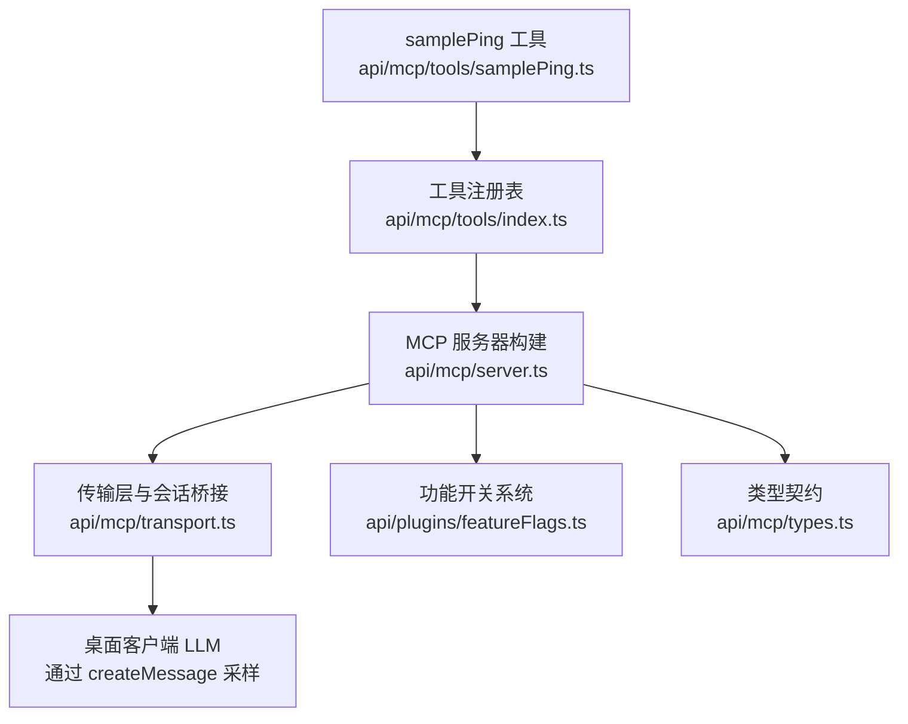
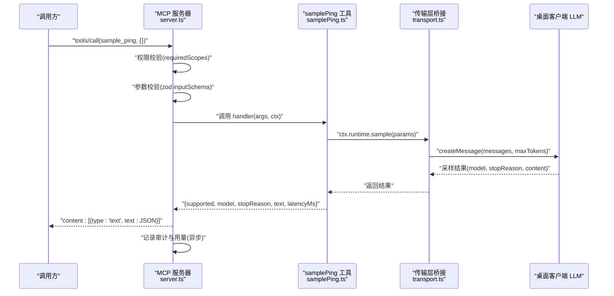
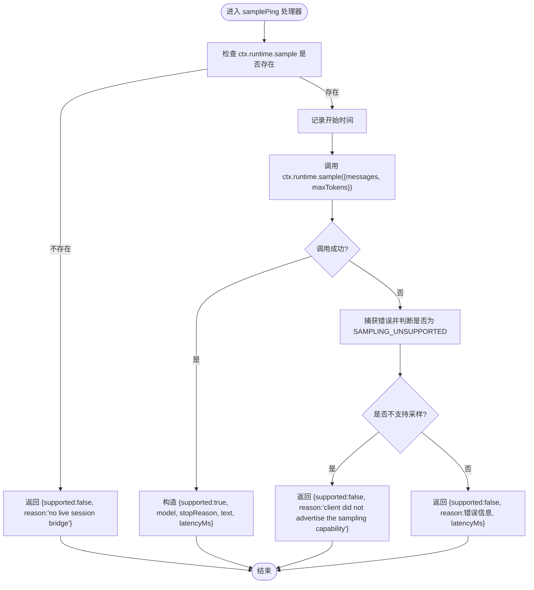
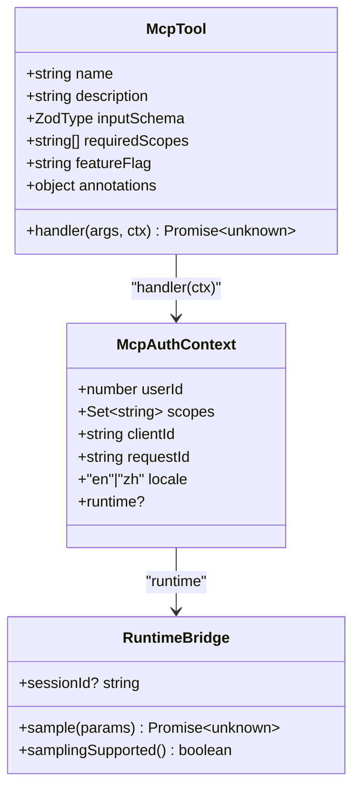
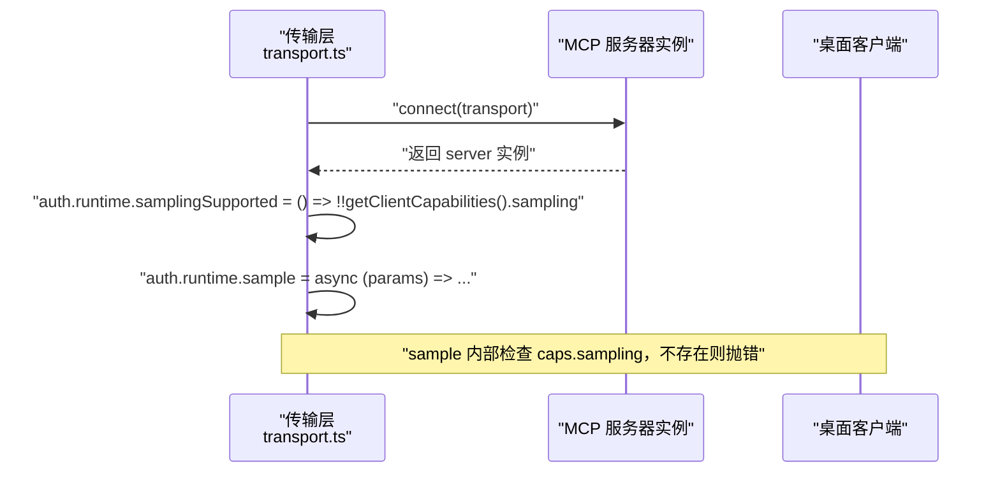
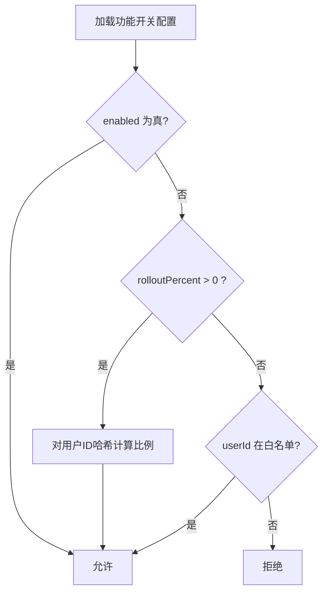
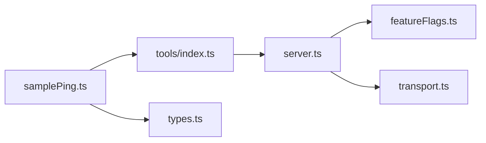

# SamplePing诊断工具

<cite>
**本文引用的文件**
- [api/mcp/tools/samplePing.ts](file://api/mcp/tools/samplePing.ts)
- [api/mcp/tools/index.ts](file://api/mcp/tools/index.ts)
- [api/mcp/server.ts](file://api/mcp/server.ts)
- [api/mcp/transport.ts](file://api/mcp/transport.ts)
- [api/mcp/types.ts](file://api/mcp/types.ts)
- [api/plugins/featureFlags.ts](file://api/plugins/featureFlags.ts)
</cite>

## 目录
1. [简介](#简介)
2. [项目结构](#项目结构)
3. [核心组件](#核心组件)
4. [架构总览](#架构总览)
5. [详细组件分析](#详细组件分析)
6. [依赖关系分析](#依赖关系分析)
7. [性能考量](#性能考量)
8. [故障排查指南](#故障排查指南)
9. [结论](#结论)
10. [附录](#附录)

## 简介
SamplePing 是一个用于验证 MCP 采样路径的基础诊断工具。它通过当前会话的运行时桥接，向已连接的桌面客户端发起一次最小化的采样请求（调用客户端自身的 LLM），并返回是否支持采样、使用的模型、停止原因、响应文本与耗时等诊断信息。该工具受功能开关控制（mcp_sampling），仅在启用时注册并可被调用。

## 项目结构
- 工具定义：位于 api/mcp/tools/samplePing.ts，声明工具元数据、输入校验 schema、权限范围、功能开关以及处理器逻辑。
- 工具注册：位于 api/mcp/tools/index.ts，将 sample_ping 加入全局工具列表，供服务器构建时注册。
- 服务器构建：位于 api/mcp/server.ts，负责按会话创建 McpServer，应用功能开关过滤、权限校验、参数校验、结果包装与审计记录。
- 传输层与运行时桥接：位于 api/mcp/transport.ts，在会话建立后注入 runtime.sample 与 samplingSupported，实现“工具→MCP会话→桌面客户端LLM”的回调通道。
- 类型契约：位于 api/mcp/types.ts，定义 McpTool、McpAuthContext 等跨模块共享类型，包括 runtime 接口约定。
- 功能开关：位于 api/plugins/featureFlags.ts，提供 isFeatureEnabled 能力，决定工具是否对当前用户可见/可调用。

图表来源
- [api/mcp/tools/samplePing.ts:20-55](file://api/mcp/tools/samplePing.ts#L20-L55)
- [api/mcp/tools/index.ts:45-57](file://api/mcp/tools/index.ts#L45-L57)
- [api/mcp/server.ts:84-123](file://api/mcp/server.ts#L84-L123)
- [api/mcp/transport.ts:104-116](file://api/mcp/transport.ts#L104-L116)
- [api/plugins/featureFlags.ts:51-73](file://api/plugins/featureFlags.ts#L51-L73)
- [api/mcp/types.ts:9-31](file://api/mcp/types.ts#L9-L31)

章节来源
- [api/mcp/tools/index.ts:45-57](file://api/mcp/tools/index.ts#L45-L57)
- [api/mcp/server.ts:135-186](file://api/mcp/server.ts#L135-L186)
- [api/mcp/transport.ts:76-141](file://api/mcp/transport.ts#L76-L141)

## 核心组件
- 工具定义（samplePing）
  - 名称：sample_ping
  - 描述：诊断用途，通过 MCP 采样询问桌面客户端 LLM 回复，报告支持情况、模型、延迟与文本
  - 输入参数：空对象（无必需参数）
  - 权限范围：["mcp:read"]
  - 功能开关：mcp_sampling
  - 处理器：检查运行时桥接是否存在；若存在则发送最小采样消息；捕获异常并区分“不支持采样”与其他错误；返回结构化诊断结果
- 服务器构建与注册
  - 按会话创建 McpServer，遍历工具列表，根据功能开关决定是否注册
  - 调用前进行权限校验（scopes）、参数校验（zod schema）、结果包装为 JSON 文本
  - 每次调用记录审计日志与用量计数（fire-and-forget）
- 传输层桥接
  - 在会话初始化后，向 auth.runtime 注入 samplingSupported 与 sample
  - sample 会先检查客户端能力，若无 sampling 能力则抛出特定错误
  - 通过 createMessage 将消息转发给桌面客户端的 LLM
- 类型契约
  - McpAuthContext 包含 userId、scopes、clientId、requestId、locale 以及可选的 runtime（含 sessionId、sample、samplingSupported）
  - McpTool 定义 name、description、inputSchema、requiredScopes、featureFlag、annotations、handler

章节来源
- [api/mcp/tools/samplePing.ts:20-55](file://api/mcp/tools/samplePing.ts#L20-L55)
- [api/mcp/server.ts:84-123](file://api/mcp/server.ts#L84-L123)
- [api/mcp/transport.ts:104-116](file://api/mcp/transport.ts#L104-L116)
- [api/mcp/types.ts:9-45](file://api/mcp/types.ts#L9-L45)

## 架构总览
下图展示了从工具调用到客户端 LLM 采样的完整时序，包括功能开关、权限校验、参数校验、结果包装与审计记录。

图表来源
- [api/mcp/server.ts:84-123](file://api/mcp/server.ts#L84-L123)
- [api/mcp/tools/samplePing.ts:28-53](file://api/mcp/tools/samplePing.ts#L28-L53)
- [api/mcp/transport.ts:104-116](file://api/mcp/transport.ts#L104-L116)

## 详细组件分析

### 工具定义与处理流程（samplePing）
- 输入参数：空对象，由 zod 校验，无需额外字段
- 权限要求：需要 mcp:read 作用域
- 功能开关：仅当 mcp_sampling 开启时注册
- 处理逻辑：
  - 检查 ctx.runtime?.sample 是否存在（即是否有活跃会话桥接）
  - 记录开始时间
  - 调用 ctx.runtime.sample 发送最小化采样消息（角色 user，文本提示要求回复固定词，maxTokens=16）
  - 成功时返回 supported=true，附带 model、stopReason、text、latencyMs
  - 失败时捕获错误：
    - 若错误消息包含“SAMPLING_UNSUPPORTED”，返回 supported=false，reason 说明客户端未声明采样能力
    - 其他错误返回 supported=false，reason 为错误信息，并附带 latencyMs
- 返回值：JSON 可序列化对象，最终由服务器包装为 content.text 字符串

图表来源
- [api/mcp/tools/samplePing.ts:28-53](file://api/mcp/tools/samplePing.ts#L28-L53)

章节来源
- [api/mcp/tools/samplePing.ts:20-55](file://api/mcp/tools/samplePing.ts#L20-L55)

### 服务器构建与注册流程
- 工具注册：遍历 TOOLS 列表，若工具声明了 featureFlag，则调用 isFeatureEnabled 检查；未启用则隐藏该工具
- 权限校验：调用前检查 requiredScopes 是否在 auth.scopes 中；缺失则返回 InvalidRequest
- 参数校验：SDK 使用 zod schema 安全解析，非法输入返回 InvalidParams
- 结果包装：处理器返回的对象会被包装为 content:[{type:"text", text: JSON.stringify(result)}]
- 审计记录：每次调用记录 mcp_audit_log 与 usageCounters（fire-and-forget，不影响主流程）

图表来源
- [api/mcp/types.ts:9-45](file://api/mcp/types.ts#L9-L45)
- [api/mcp/server.ts:84-123](file://api/mcp/server.ts#L84-L123)

章节来源
- [api/mcp/server.ts:84-123](file://api/mcp/server.ts#L84-L123)
- [api/mcp/server.ts:135-186](file://api/mcp/server.ts#L135-L186)

### 传输层桥接与采样能力探测
- 会话初始化后，向 auth.runtime 注入：
  - samplingSupported：查询客户端能力中的 sampling 标志
  - sample：若客户端未声明 sampling 能力，抛出 Error("SAMPLING_UNSUPPORTED")；否则通过 createMessage 将消息转发至桌面客户端 LLM
- 两种传输方式均支持此桥接：
  - Streamable HTTP（/mcp）
  - 遗留 SSE（/mcp/sse）

图表来源
- [api/mcp/transport.ts:104-116](file://api/mcp/transport.ts#L104-L116)
- [api/mcp/transport.ts:187-200](file://api/mcp/transport.ts#L187-L200)

章节来源
- [api/mcp/transport.ts:76-141](file://api/mcp/transport.ts#L76-L141)
- [api/mcp/transport.ts:174-210](file://api/mcp/transport.ts#L174-L210)

### 功能开关与运行时环境检查
- 工具级开关：samplePing 声明 featureFlag="mcp_sampling"，仅在 isFeatureEnabled("mcp_sampling", userId) 为真时注册
- 运行时检查：
  - 若 ctx.runtime.sample 不存在，直接返回不支持且原因
  - 若客户端未声明 sampling 能力，sample 抛出特定错误，工具将其识别为“客户端未声明采样能力”
- 功能开关加载与评估：
  - 从数据库加载 flags，缓存 60 秒
  - 评估顺序：完全启用 → 按比例 rollout → 白名单用户 → 拒绝

图表来源
- [api/plugins/featureFlags.ts:27-73](file://api/plugins/featureFlags.ts#L27-L73)

章节来源
- [api/plugins/featureFlags.ts:51-73](file://api/plugins/featureFlags.ts#L51-L73)
- [api/mcp/server.ts:149-168](file://api/mcp/server.ts#L149-L168)

## 依赖关系分析
- samplePing 依赖：
  - types.McpTool、types.McpAuthContext（类型契约）
  - server.ts 的工具注册与权限/参数校验流程
  - transport.ts 提供的 runtime.sample 与 samplingSupported
  - featureFlags.ts 的功能开关控制
- 工具注册表 index.ts 将 sample_ping 纳入全局列表，供 server.ts 构建时遍历注册

图表来源
- [api/mcp/tools/index.ts:45-57](file://api/mcp/tools/index.ts#L45-L57)
- [api/mcp/server.ts:135-186](file://api/mcp/server.ts#L135-L186)
- [api/mcp/transport.ts:104-116](file://api/mcp/transport.ts#L104-L116)
- [api/mcp/types.ts:9-45](file://api/mcp/types.ts#L9-L45)
- [api/plugins/featureFlags.ts:51-73](file://api/plugins/featureFlags.ts#L51-L73)

章节来源
- [api/mcp/tools/index.ts:45-57](file://api/mcp/tools/index.ts#L45-L57)
- [api/mcp/server.ts:135-186](file://api/mcp/server.ts#L135-L186)

## 性能考量
- 采样请求极小（maxTokens=16），适合快速诊断
- 服务器侧审计与用量统计采用 fire-and-forget 模式，不阻塞主流程
- 功能开关配置有 60 秒内存缓存，减少频繁 DB 读取
- 传输层会话具备清理机制，避免资源泄漏

[本节为通用指导，不直接分析具体文件]

## 故障排查指南
- 现象：返回 supported=false，reason 为 “no live session bridge”
  - 可能原因：未在 MCP 端点建立会话，或会话尚未初始化完成
  - 解决：确保通过 /mcp 或 /mcp/sse 建立连接并完成 initialize 握手
- 现象：返回 supported=false，reason 为 “client did not advertise the sampling capability”
  - 可能原因：桌面客户端未声明 sampling 能力，或客户端版本不支持
  - 解决：升级客户端或确认其实现了 MCP sampling 能力
- 现象：返回 supported=false，reason 为其他错误信息
  - 可能原因：采样过程中发生网络、协议或客户端内部错误
  - 解决：查看服务端日志与客户端日志，定位具体错误；必要时重试
- 现象：工具不可见或调用报未知工具
  - 可能原因：功能开关 mcp_sampling 未启用
  - 解决：在服务端配置中启用对应 flag，或通过 rollout/白名单策略开放
- 现象：权限不足
  - 可能原因：调用方缺少 mcp:read 作用域
  - 解决：调整授权范围，确保包含所需 scope

章节来源
- [api/mcp/tools/samplePing.ts:28-53](file://api/mcp/tools/samplePing.ts#L28-L53)
- [api/mcp/transport.ts:104-116](file://api/mcp/transport.ts#L104-L116)
- [api/mcp/server.ts:99-123](file://api/mcp/server.ts#L99-L123)
- [api/plugins/featureFlags.ts:51-73](file://api/plugins/featureFlags.ts#L51-L73)

## 结论
SamplePing 以极简的方式验证 MCP 采样路径的有效性，帮助开发者在自动化设计器或其他高级特性启用之前，确认桌面客户端的采样能力与通信链路是否正常。其设计遵循清晰的职责分离：工具定义、服务器构建、传输桥接、功能开关与类型契约相互解耦，便于扩展与维护。

[本节为总结性内容，不直接分析具体文件]

## 附录

### 工具注册与调用示例（概念性步骤）
- 工具注册
  - 在 tools/index.ts 中将 sample_ping 加入 TOOLS 列表
  - 服务器构建时根据功能开关决定是否注册
- 调用方法
  - 通过 MCP 端点建立会话
  - 调用 tools/call，工具名 sample_ping，参数为空对象
  - 解析返回的 content[0].text 为 JSON，得到诊断结果
- 结果解析
  - supported：布尔值，表示是否支持采样
  - model：字符串或 null
  - stopReason：字符串或 null
  - text：字符串或 null
  - latencyMs：数字（毫秒）
  - reason：字符串（当 supported=false 时）

[本节为概念性说明，不直接分析具体文件]