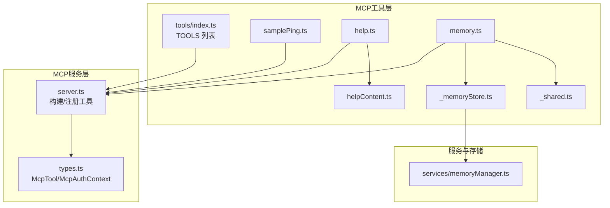
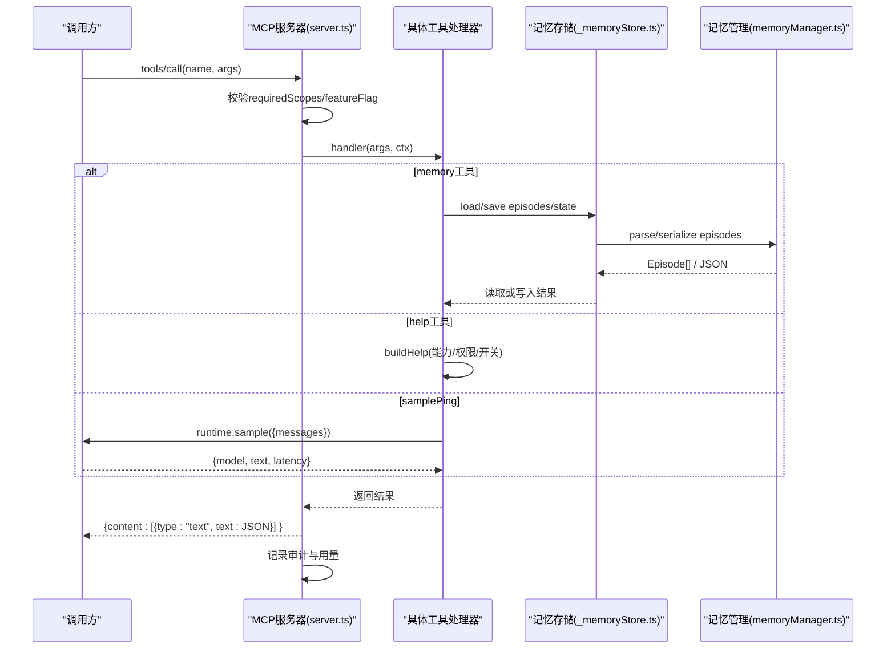
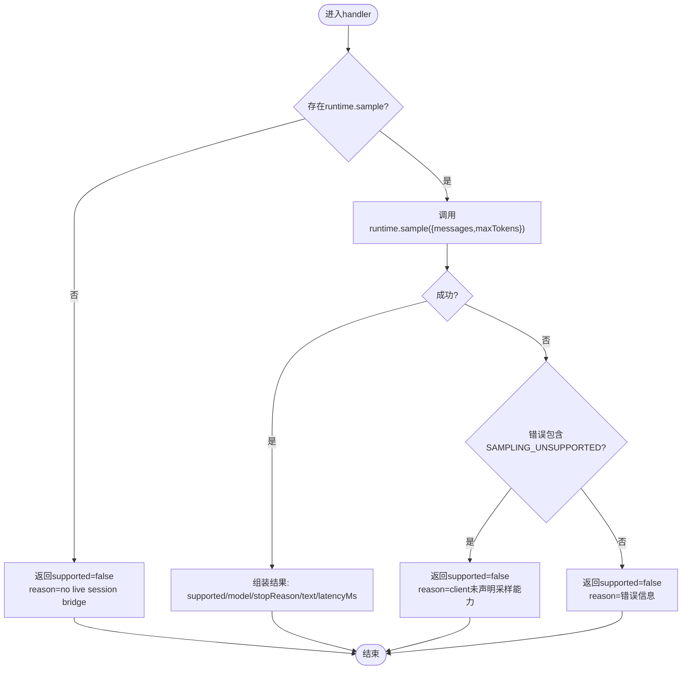
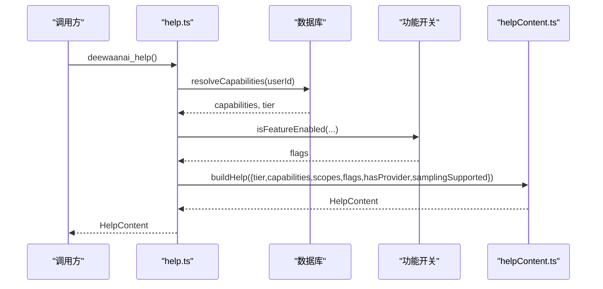
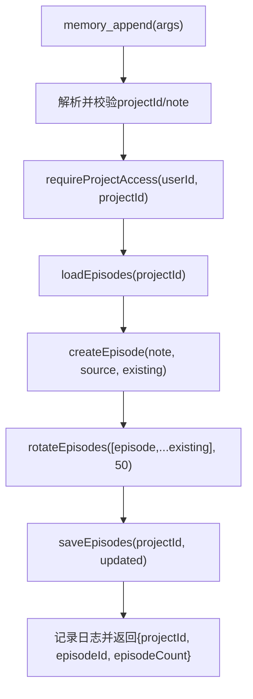
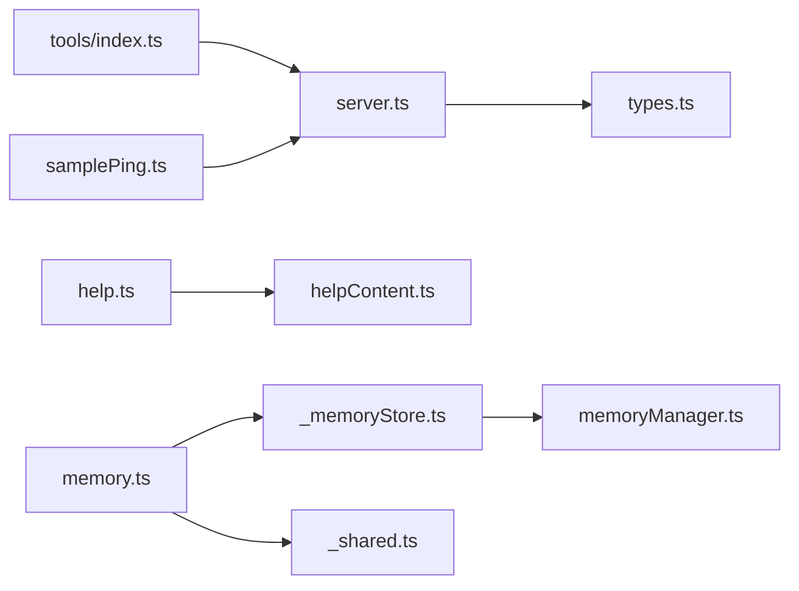

# 工具示例实现

<cite>
**本文引用的文件**
- [api/mcp/tools/samplePing.ts](file://api/mcp/tools/samplePing.ts)
- [api/mcp/tools/help.ts](file://api/mcp/tools/help.ts)
- [api/mcp/tools/memory.ts](file://api/mcp/tools/memory.ts)
- [api/mcp/tools/_memoryStore.ts](file://api/mcp/tools/_memoryStore.ts)
- [api/mcp/tools/index.ts](file://api/mcp/tools/index.ts)
- [api/mcp/tools/helpContent.ts](file://api/mcp/tools/helpContent.ts)
- [api/mcp/types.ts](file://api/mcp/types.ts)
- [api/mcp/server.ts](file://api/mcp/server.ts)
- [api/services/memoryManager.ts](file://api/services/memoryManager.ts)
- [api/mcp/tools/_shared.ts](file://api/mcp/tools/_shared.ts)
</cite>

## 目录
1. [简介](#简介)
2. [项目结构](#项目结构)
3. [核心组件](#核心组件)
4. [架构总览](#架构总览)
5. [详细组件分析](#详细组件分析)
6. [依赖关系分析](#依赖关系分析)
7. [性能考量](#性能考量)
8. [故障排查指南](#故障排查指南)
9. [结论](#结论)
10. [附录：扩展指导与使用方式](#附录：扩展指导与使用方式)

## 简介
本文件提供DeeWaanAI MCP工具的完整实现示例，聚焦以下三个典型工具：
- samplePing：最小化采样探测工具，用于验证桌面客户端是否支持MCP采样能力。
- help：动态生成帮助内容，基于用户权限、功能开关和配置，提供“所见即所得”的工具清单与提示。
- memory：项目级片段记忆读写，持久化到磁盘，并维护结构化状态摘要。

文档从简单到复杂逐步展开，包含代码路径引用、调用时序图、数据流图和扩展建议，帮助开发者快速掌握MCP工具开发方法。

## 项目结构
MCP工具以模块化的方式组织在 api/mcp/tools 下，每个工具导出一个符合 McpTool 接口的对象；所有工具统一注册到 index.ts 的 TOOLS 数组中，由 server.ts 在每个会话中按权限和功能开关进行过滤后注册到MCP服务器。

图表来源
- [api/mcp/tools/index.ts:45-94](file://api/mcp/tools/index.ts#L45-L94)
- [api/mcp/server.ts:84-186](file://api/mcp/server.ts#L84-L186)
- [api/mcp/tools/memory.ts:1-92](file://api/mcp/tools/memory.ts#L1-L92)
- [api/mcp/tools/_memoryStore.ts:1-37](file://api/mcp/tools/_memoryStore.ts#L1-L37)
- [api/mcp/tools/help.ts:1-47](file://api/mcp/tools/help.ts#L1-L47)
- [api/mcp/tools/helpContent.ts:1-369](file://api/mcp/tools/helpContent.ts#L1-L369)
- [api/mcp/types.ts:9-44](file://api/mcp/types.ts#L9-L44)

章节来源
- [api/mcp/tools/index.ts:45-94](file://api/mcp/tools/index.ts#L45-L94)
- [api/mcp/server.ts:84-186](file://api/mcp/server.ts#L84-L186)

## 核心组件
- McpTool 接口：定义工具的名称、描述、输入校验Schema、所需权限范围、可选功能开关、注解（只读/破坏性）以及处理器函数。
- McpAuthContext：携带当前会话的用户ID、权限范围、客户端标识、请求ID、语言环境，以及运行时桥接能力（如采样）。
- 工具注册中心：集中导出所有工具，供服务端按会话上下文动态注册。
- 帮助内容生成器：纯函数，根据用户能力、权限、功能开关等生成个性化帮助。
- 记忆存储：基于磁盘的项目片段记忆与状态摘要，配合内存管理器进行压缩、检索与轮转。

章节来源
- [api/mcp/types.ts:9-44](file://api/mcp/types.ts#L9-L44)
- [api/mcp/tools/index.ts:45-94](file://api/mcp/tools/index.ts#L45-L94)
- [api/mcp/tools/helpContent.ts:7-41](file://api/mcp/tools/helpContent.ts#L7-L41)
- [api/services/memoryManager.ts:9-14](file://api/services/memoryManager.ts#L9-L14)

## 架构总览
MCP工具执行流程包括：参数校验、权限检查、功能开关过滤、处理器执行、结果包装与审计记录。

图表来源
- [api/mcp/server.ts:84-186](file://api/mcp/server.ts#L84-L186)
- [api/mcp/tools/memory.ts:24-91](file://api/mcp/tools/memory.ts#L24-L91)
- [api/mcp/tools/_memoryStore.ts:18-36](file://api/mcp/tools/_memoryStore.ts#L18-L36)
- [api/services/memoryManager.ts:80-123](file://api/services/memoryManager.ts#L80-L123)
- [api/mcp/tools/help.ts:25-44](file://api/mcp/tools/help.ts#L25-L44)
- [api/mcp/tools/samplePing.ts:28-54](file://api/mcp/tools/samplePing.ts#L28-L54)

## 详细组件分析

### samplePing：基础工具结构与注册方式
- 目标：通过MCP采样能力向连接的桌面客户端发起一次最小化消息，验证其是否支持采样、返回模型信息、停止原因、文本内容与耗时。
- 关键特性：
  - 输入Schema为空对象，表示无需参数。
  - 需要 mcp:read 权限。
  - 受功能开关 mcp_sampling 控制。
  - 通过 McpAuthContext.runtime.sample 调用客户端采样能力。
  - 错误处理区分“不支持采样”与一般异常。
- 注册方式：在 tools/index.ts 的 TOOLS 数组中导出并被 server.ts 注册。

图表来源
- [api/mcp/tools/samplePing.ts:20-55](file://api/mcp/tools/samplePing.ts#L20-L55)
- [api/mcp/types.ts:15-30](file://api/mcp/types.ts#L15-L30)

章节来源
- [api/mcp/tools/samplePing.ts:20-55](file://api/mcp/tools/samplePing.ts#L20-L55)
- [api/mcp/tools/index.ts:57-57](file://api/mcp/tools/index.ts#L57-L57)
- [api/mcp/server.ts:84-186](file://api/mcp/server.ts#L84-L186)

使用方法
- 调用前确保已启用 mcp_sampling 功能开关，并通过MCP端点建立会话以注入 runtime.sample。
- 期望返回字段：supported、model、stopReason、text、latencyMs。

扩展指导
- 可添加更多诊断信息（如客户端能力探测），或在失败时提供更详细的诊断步骤。
- 可在上层封装重试与超时策略，提升鲁棒性。

### help：动态帮助内容的生成与多语言支持
- 目标：根据当前用户的层级、能力、权限范围、功能开关与配置，生成个性化的使用指南，仅展示当前可用的工具并提供情境化提示。
- 关键特性：
  - 解析用户能力与层级，查询功能开关（teamsync、mcp_sampling、batch_mode）与LLM提供者配置。
  - 调用纯函数 buildHelp 生成 HelpContent，包含可见工具分组、锁定工具分组、升级提示与建议。
  - 支持 locale（en/zh）国际化上下文，便于后续扩展本地化文案。
- 帮助内容构建逻辑：
  - HELP_CATALOG 列出全部工具条目及其元数据（名称、分组、摘要、示例、所需权限、能力要求、功能开关）。
  - buildHelp 根据 scopes、capabilities、flags 过滤可见工具与锁定工具，并按固定顺序输出分组。
  - tips 根据层级与配置生成个性化建议（如未配置LLM提供者时的引导）。

图表来源
- [api/mcp/tools/help.ts:25-44](file://api/mcp/tools/help.ts#L25-L44)
- [api/mcp/tools/helpContent.ts:280-368](file://api/mcp/tools/helpContent.ts#L280-L368)

章节来源
- [api/mcp/tools/help.ts:1-47](file://api/mcp/tools/help.ts#L1-L47)
- [api/mcp/tools/helpContent.ts:7-41](file://api/mcp/tools/helpContent.ts#L7-L41)
- [api/mcp/tools/helpContent.ts:86-278](file://api/mcp/tools/helpContent.ts#L86-L278)
- [api/mcp/tools/helpContent.ts:280-368](file://api/mcp/tools/helpContent.ts#L280-L368)

使用方法
- 直接调用 deewaanai_help，获取当前账户可用工具清单与操作建议。
- 若未配置LLM提供者，将收到引导提示，可通过 suggest_llm_providers 与 add_provider 完成配置。

扩展指导
- 可将 tips 与工具摘要文案抽离为多语言资源，结合 McpAuthContext.locale 切换显示语言。
- 可增加“新手引导”与“进阶技巧”分支，依据用户历史行为动态调整。

### memory：数据存储与管理机制
- 目标：为项目提供片段式记忆（episodic memory）与结构化状态摘要的读写能力，跨会话持久化。
- 关键特性：
  - memory_get：读取最近片段与状态摘要，按时间倒序返回，限制数量与长度。
  - memory_append：追加笔记到片段记忆，自动轮转保留最新N条，并记录日志。
  - 访问控制：任何读写前必须通过 requireProjectAccess 校验项目访问权限。
  - 持久化：episodes.json 与 state.json 存储在项目目录下 memory/ 子目录。
  - 序列化/解析：通过 memoryManager 提供的 serializeEpisodes/parseEpisodes 与 createEpisode/rotateEpisodes。

图表来源
- [api/mcp/tools/memory.ts:64-91](file://api/mcp/tools/memory.ts#L64-L91)
- [api/mcp/tools/_memoryStore.ts:18-26](file://api/mcp/tools/_memoryStore.ts#L18-L26)
- [api/services/memoryManager.ts:80-104](file://api/services/memoryManager.ts#L80-L104)

章节来源
- [api/mcp/tools/memory.ts:1-92](file://api/mcp/tools/memory.ts#L1-L92)
- [api/mcp/tools/_memoryStore.ts:1-37](file://api/mcp/tools/_memoryStore.ts#L1-L37)
- [api/services/memoryManager.ts:9-14](file://api/services/memoryManager.ts#L9-L14)
- [api/services/memoryManager.ts:80-123](file://api/services/memoryManager.ts#L80-L123)
- [api/mcp/tools/_shared.ts:36-60](file://api/mcp/tools/_shared.ts#L36-L60)

使用方法
- memory_get：传入 projectId，获取最近片段与状态摘要。
- memory_append：传入 projectId 与 note，追加一条记忆并返回新增片段ID与总数。

扩展指导
- 可为状态摘要增加版本控制与变更追踪。
- 可引入关键词检索或轻量向量索引以提升检索效率（当前为关键词匹配）。
- 可增加团队共享记忆（参考 teamMemoryAppend）。

## 依赖关系分析
- 工具注册与执行：
  - tools/index.ts 汇总所有工具，server.ts 按会话上下文进行权限与功能开关过滤后注册。
  - 每个工具处理器依赖 types.ts 中的 McpTool 与 McpAuthContext。
- 帮助内容：
  - help.ts 依赖 helpContent.ts 的 HELP_CATALOG 与 buildHelp 纯函数，结合 entitlements 与 featureFlags 生成内容。
- 记忆存储：
  - memory.ts 依赖 _memoryStore.ts 进行磁盘读写，依赖 memoryManager.ts 进行片段创建与轮转，依赖 _shared.ts 进行项目访问校验。

图表来源
- [api/mcp/tools/index.ts:45-94](file://api/mcp/tools/index.ts#L45-L94)
- [api/mcp/server.ts:84-186](file://api/mcp/server.ts#L84-L186)
- [api/mcp/tools/help.ts:1-47](file://api/mcp/tools/help.ts#L1-L47)
- [api/mcp/tools/helpContent.ts:86-278](file://api/mcp/tools/helpContent.ts#L86-L278)
- [api/mcp/tools/memory.ts:1-92](file://api/mcp/tools/memory.ts#L1-L92)
- [api/mcp/tools/_memoryStore.ts:1-37](file://api/mcp/tools/_memoryStore.ts#L1-L37)
- [api/services/memoryManager.ts:80-123](file://api/services/memoryManager.ts#L80-L123)
- [api/mcp/tools/_shared.ts:36-60](file://api/mcp/tools/_shared.ts#L36-L60)
- [api/mcp/types.ts:9-44](file://api/mcp/types.ts#L9-L44)

章节来源
- [api/mcp/tools/index.ts:45-94](file://api/mcp/tools/index.ts#L45-L94)
- [api/mcp/server.ts:84-186](file://api/mcp/server.ts#L84-L186)
- [api/mcp/tools/help.ts:1-47](file://api/mcp/tools/help.ts#L1-L47)
- [api/mcp/tools/memory.ts:1-92](file://api/mcp/tools/memory.ts#L1-L92)

## 性能考量
- 参数校验：使用Zod schema在服务端进行安全快速的输入校验，避免无效请求进入业务逻辑。
- 权限与功能开关：在注册阶段进行过滤，减少不必要的授权检查与调用开销。
- 记忆存储：
  - 片段轮转限制最大条目数，避免文件膨胀。
  - 读取时截断摘要与活动记录，降低传输体积。
  - 关键词检索复杂度与片段规模线性相关，适合中小规模场景。
- 审计与度量：每次工具调用异步记录审计与用量，不影响主流程性能。

[本节为通用性能讨论，不直接分析具体文件]

## 故障排查指南
- samplePing失败：
  - 若返回 supported=false 且 reason 包含“no live session bridge”，说明未建立MCP会话或未注入 runtime.sample。
  - 若 reason 包含“SAMPLING_UNSUPPORTED”，说明客户端未声明采样能力。
- help无可用工具：
  - 检查 scopes、capabilities、featureFlags 是否正确配置。
  - 确认 hasProvider 是否为真，若无LLM提供者，需先配置 provider。
- memory读写异常：
  - 确认 requireProjectAccess 是否通过，若失败会抛出“Project not found”。
  - 检查磁盘路径 memory/episodes.json 与 memory/state.json 是否存在与可读/可写。
  - 若 state.json 损坏，loadState 会返回 null，视为无状态。

章节来源
- [api/mcp/tools/samplePing.ts:28-54](file://api/mcp/tools/samplePing.ts#L28-L54)
- [api/mcp/tools/help.ts:25-44](file://api/mcp/tools/help.ts#L25-L44)
- [api/mcp/tools/memory.ts:31-61](file://api/mcp/tools/memory.ts#L31-L61)
- [api/mcp/tools/_memoryStore.ts:28-36](file://api/mcp/tools/_memoryStore.ts#L28-L36)
- [api/mcp/tools/_shared.ts:56-60](file://api/mcp/tools/_shared.ts#L56-L60)

## 结论
通过对 samplePing、help、memory 三个工具的深入分析，可以看到DeeWaanAI MCP工具体系具备清晰的模块化设计、严格的权限与功能开关控制、以及可扩展的帮助与记忆机制。开发者可以基于现有模式快速实现新工具，遵循统一的注册与执行流程，并利用已有的存储与校验能力保障稳定性与安全性。

[本节为总结性内容，不直接分析具体文件]

## 附录：扩展指导与使用方式

### 如何新增一个MCP工具
- 在 api/mcp/tools 下新建工具文件，导出符合 McpTool 的对象。
- 在 api/mcp/tools/index.ts 的 TOOLS 数组中添加该工具。
- 如需功能开关控制，设置 featureFlag；如需权限控制，设置 requiredScopes。
- 在 helpContent.ts 的 HELP_CATALOG 中添加条目，以便 help 工具能展示。

章节来源
- [api/mcp/tools/index.ts:45-94](file://api/mcp/tools/index.ts#L45-L94)
- [api/mcp/tools/helpContent.ts:86-278](file://api/mcp/tools/helpContent.ts#L86-L278)

### 使用示例
- samplePing：
  - 调用 sample_ping，验证客户端采样能力。
  - 预期返回包含 supported、model、stopReason、text、latencyMs。
- help：
  - 调用 deewaanai_help，获取当前账户可用工具与操作建议。
- memory：
  - memory_get：传入 projectId，读取片段与状态摘要。
  - memory_append：传入 projectId 与 note，追加记忆并返回新增片段ID与总数。

章节来源
- [api/mcp/tools/samplePing.ts:20-55](file://api/mcp/tools/samplePing.ts#L20-L55)
- [api/mcp/tools/help.ts:18-44](file://api/mcp/tools/help.ts#L18-L44)
- [api/mcp/tools/memory.ts:24-91](file://api/mcp/tools/memory.ts#L24-L91)