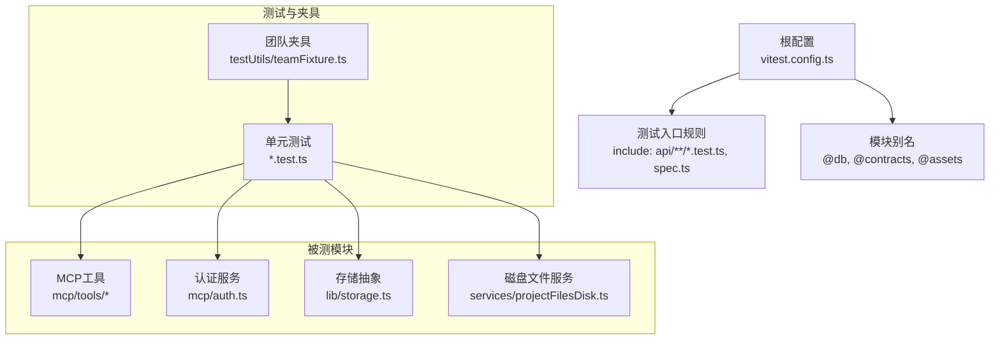
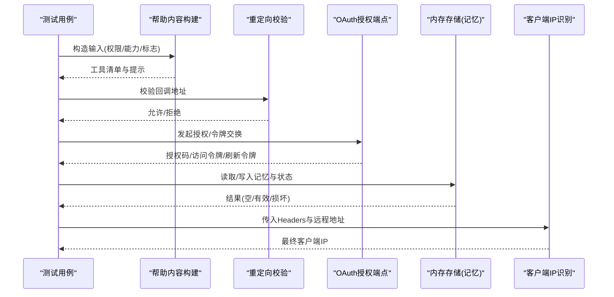
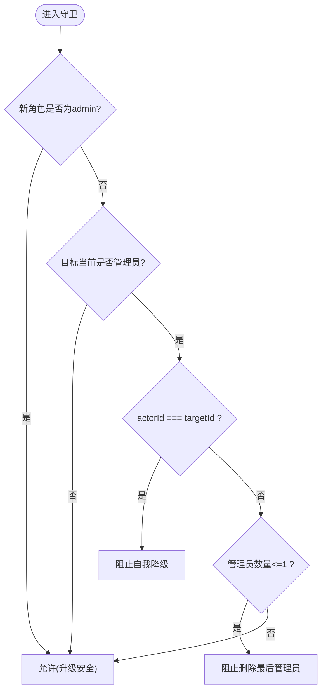
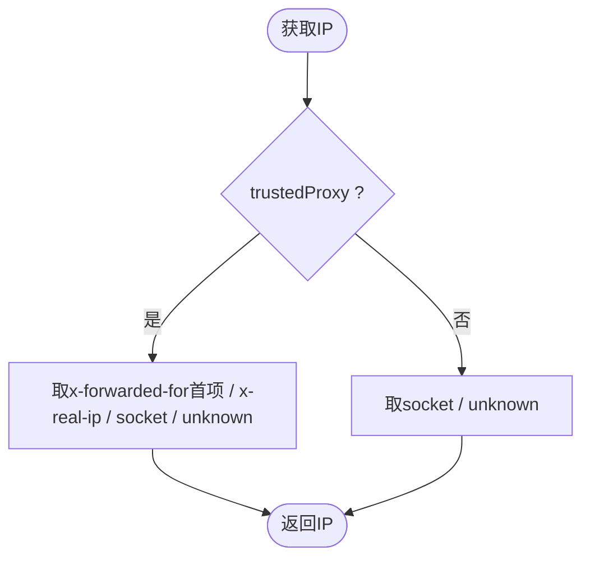
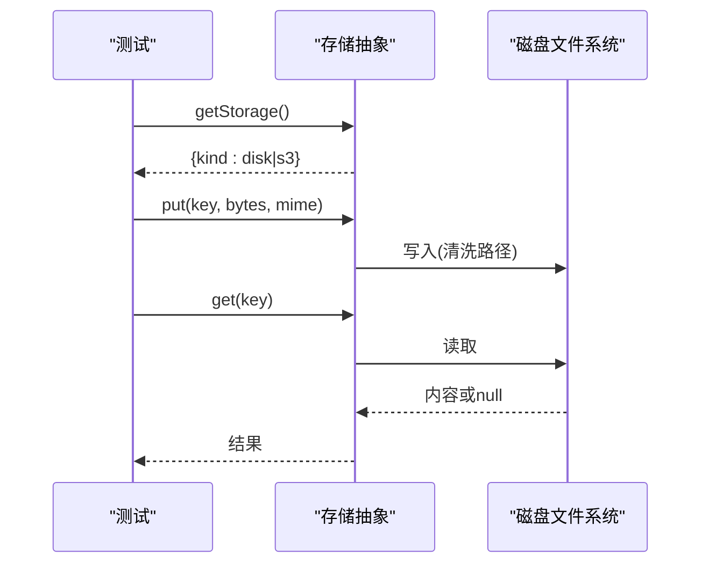
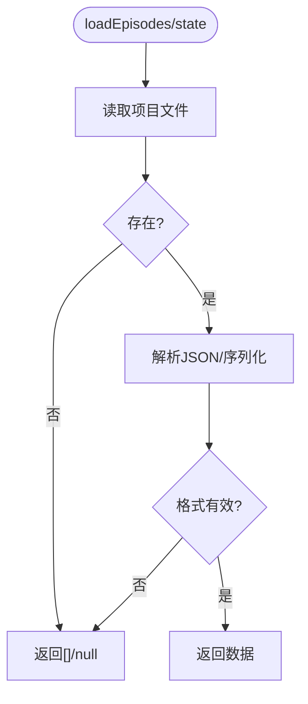
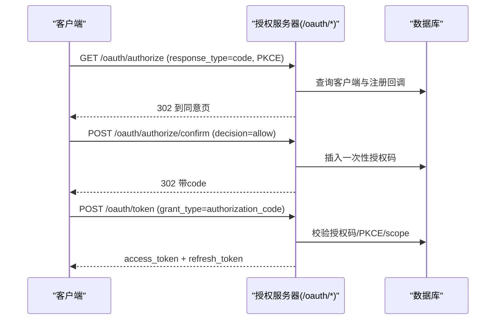
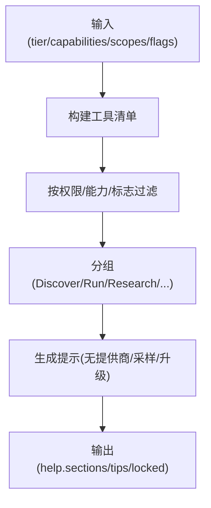
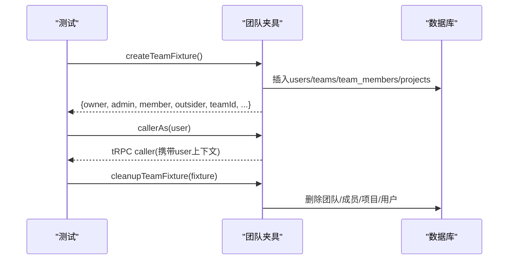
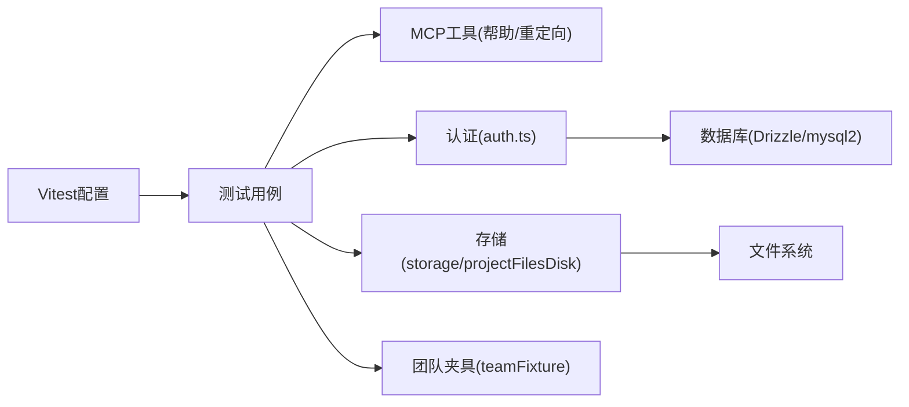

# 单元测试

<cite>
**本文引用的文件**
- [vitest.config.ts](file://vitest.config.ts)
- [adminGuards.test.ts](file://api/lib/adminGuards.test.ts)
- [clientIp.test.ts](file://api/lib/clientIp.test.ts)
- [storage.test.ts](file://api/lib/storage.test.ts)
- [teamFixture.ts](file://api/testUtils/teamFixture.ts)
- [_memoryStore.ts](file://api/mcp/tools/_memoryStore.ts)
- [auth.ts](file://api/mcp/auth.ts)
- [redirectUri.test.ts](file://api/mcp/redirectUri.test.ts)
- [helpContent.test.ts](file://api/mcp/tools/helpContent.test.ts)
- [projectFilesDisk.ts](file://api/services/projectFilesDisk.ts)
</cite>

## 目录
1. [简介](#简介)
2. [项目结构](#项目结构)
3. [核心组件](#核心组件)
4. [架构总览](#架构总览)
5. [详细组件分析](#详细组件分析)
6. [依赖分析](#依赖分析)
7. [性能考虑](#性能考虑)
8. [故障排查指南](#故障排查指南)
9. [结论](#结论)
10. [附录](#附录)

## 简介
本文件面向DeeWaanAI的MCP工具与周边能力，提供基于Vitest的单元测试实践指南。内容覆盖：
- 如何编写MCP工具的单测用例（含帮助内容、重定向校验等）
- 测试夹具的创建与使用（团队夹具与模拟数据准备）
- 内存存储机制、认证守卫、客户端IP识别等核心功能的测试策略
- 异步操作、错误处理与边界条件的测试方法
- 覆盖率要求与最佳实践
- 具体断言模式与示例路径指引

## 项目结构
本项目采用Node环境运行Vitest，测试文件统一位于api目录下，按功能模块组织。根级配置定义了别名与环境，便于在测试中直接引用源码模块。

图表来源
- [vitest.config.ts:1-21](file://vitest.config.ts#L1-L21)

章节来源
- [vitest.config.ts:1-21](file://vitest.config.ts#L1-L21)

## 核心组件
- 认证守卫：以纯函数形式暴露角色降级保护逻辑，便于单测验证边界条件。
- 客户端IP识别：根据可信代理开关选择不同策略，确保限流与审计准确。
- 存储后端选择：根据环境变量动态选择S3或磁盘后端；磁盘后端通过临时目录隔离测试。
- MCP帮助内容生成：根据权限、能力、标志位组合生成工具清单与提示，适合无外部依赖的纯函数测试。
- 重定向URI校验：严格允许https与本地回环http，防止开放重定向风险。
- 内存存储：基于项目文件磁盘持久化“记忆片段”和“状态”，读写时进行路径清洗与容错解析。
- 团队夹具：通过原始SQL快速构建用户、团队、成员、项目等关系，并返回tRPC调用者上下文。

章节来源
- [adminGuards.test.ts:1-35](file://api/lib/adminGuards.test.ts#L1-L35)
- [clientIp.test.ts:1-44](file://api/lib/clientIp.test.ts#L1-L44)
- [storage.test.ts:1-71](file://api/lib/storage.test.ts#L1-L71)
- [helpContent.test.ts:1-240](file://api/mcp/tools/helpContent.test.ts#L1-L240)
- [redirectUri.test.ts:1-33](file://api/mcp/redirectUri.test.ts#L1-L33)
- [_memoryStore.ts:1-37](file://api/mcp/tools/_memoryStore.ts#L1-L37)
- [teamFixture.ts:1-145](file://api/testUtils/teamFixture.ts#L1-L145)

## 架构总览
下图展示MCP工具相关测试所覆盖的核心流程：帮助内容生成、重定向校验、认证授权、存储读写与IP识别。

图表来源
- [helpContent.test.ts:1-240](file://api/mcp/tools/helpContent.test.ts#L1-L240)
- [redirectUri.test.ts:1-33](file://api/mcp/redirectUri.test.ts#L1-L33)
- [auth.ts:147-428](file://api/mcp/auth.ts#L147-L428)
- [_memoryStore.ts:18-37](file://api/mcp/tools/_memoryStore.ts#L18-L37)
- [clientIp.test.ts:1-44](file://api/lib/clientIp.test.ts#L1-L44)

## 详细组件分析

### 认证守卫（AdminDemotionError）
- 目标：防止管理员自我降级或删除最后一个管理员导致系统不可达。
- 测试要点：
  - 自我降级应被阻止
  - 删除最后一个管理员应被阻止
  - 降级非管理员为幂等操作
  - 升级管理员无条件允许
- 断言模式：期望返回错误消息字符串或null。

图表来源
- [adminGuards.ts:17-28](file://api/lib/adminGuards.ts#L17-L28)

章节来源
- [adminGuards.test.ts:1-35](file://api/lib/adminGuards.test.ts#L1-L35)
- [adminGuards.ts:1-29](file://api/lib/adminGuards.ts#L1-L29)

### 客户端IP识别（getClientIp）
- 目标：在可信代理模式下从转发头提取真实IP，否则忽略伪造头并使用套接字地址。
- 测试要点：
  - 可信代理：优先x-forwarded-for首项，其次x-real-ip，再回退socket地址，最后unknown
  - 非可信代理：忽略转发头，仅用socket地址；缺失则unknown
- 断言模式：期望精确匹配IP字符串或unknown。

图表来源
- [clientIp.ts:19-36](file://api/lib/clientIp.ts#L19-L36)

章节来源
- [clientIp.test.ts:1-44](file://api/lib/clientIp.test.ts#L1-L44)
- [clientIp.ts:1-37](file://api/lib/clientIp.ts#L1-L37)

### 存储后端选择与磁盘后端
- 目标：根据环境变量选择S3或磁盘后端；磁盘后端需支持put/get/roundtrip与路径清洗。
- 测试要点：
  - 未配置S3时默认disk
  - 仅当bucket/key/secret全部设置时才选s3
  - 磁盘后端put→get字节一致
  - 缺失对象返回null
  - 路径穿越被清洗，只保留基名
- 断言模式：比较kind、Buffer相等性、存在性。

图表来源
- [storage.test.ts:18-70](file://api/lib/storage.test.ts#L18-L70)
- [projectFilesDisk.ts:24-54](file://api/services/projectFilesDisk.ts#L24-L54)

章节来源
- [storage.test.ts:1-71](file://api/lib/storage.test.ts#L1-L71)
- [projectFilesDisk.ts:1-143](file://api/services/projectFilesDisk.ts#L1-L143)

### 内存存储（记忆与状态）
- 目标：为MCP memory工具提供基于项目文件的持久化，包含片段与状态读写。
- 测试要点：
  - 读取不存在文件返回空数组/null
  - 写入后读取可恢复
  - 状态文件损坏时视为不存在
- 断言模式：期望空集合、null或有效结构。

图表来源
- [_memoryStore.ts:18-37](file://api/mcp/tools/_memoryStore.ts#L18-L37)
- [projectFilesDisk.ts:87-99](file://api/services/projectFilesDisk.ts#L87-L99)

章节来源
- [_memoryStore.ts:1-37](file://api/mcp/tools/_memoryStore.ts#L1-L37)
- [projectFilesDisk.ts:1-143](file://api/services/projectFilesDisk.ts#L1-L143)

### OAuth授权与重定向校验
- 目标：实现RFC 6749/8414/9728相关端点，严格校验重定向URI与PKCE。
- 测试要点：
  - 重定向URI允许https与本地回环http，拒绝非回环http与其他协议
  - 授权端点强制code_challenge_method=S256
  - 令牌端点校验授权码唯一性、过期、PKCE、scope交集
- 断言模式：期望特定错误类型或成功响应字段。

图表来源
- [auth.ts:147-428](file://api/mcp/auth.ts#L147-L428)
- [redirectUri.test.ts:1-33](file://api/mcp/redirectUri.test.ts#L1-L33)

章节来源
- [auth.ts:1-428](file://api/mcp/auth.ts#L1-L428)
- [redirectUri.test.ts:1-33](file://api/mcp/redirectUri.test.ts#L1-L33)

### 帮助内容生成（buildHelp）
- 目标：根据tier、capabilities、scopes、flags等组合生成工具清单与提示，屏蔽受限工具。
- 测试要点：
  - 基础工具可见性
  - 能力门控（如autodesign）
  - 团队工具门控（teamsync flag）
  - 研究工具门控（batch_mode flag）
  - 权限门控（mcp:read/run/write）
  - 无提供商时的引导提示
  - 分组顺序稳定且无空组
  - 锁定工具单独分组与升级CTA
- 断言模式：包含/不包含工具名、tips文本片段、分组顺序。

图表来源
- [helpContent.test.ts:1-240](file://api/mcp/tools/helpContent.test.ts#L1-L240)

章节来源
- [helpContent.test.ts:1-240](file://api/mcp/tools/helpContent.test.ts#L1-L240)

### 团队夹具（TeamFixture）
- 目标：通过原始SQL快速创建用户、团队、成员、项目，并提供按用户认证的tRPC调用者。
- 使用方式：
  - createTeamFixture：初始化数据并返回fixture
  - cleanupTeamFixture：清理团队、成员、项目与用户
  - callerAs(user)：构造以指定用户身份调用的tRPC caller
- 适用场景：集成测试中需要多角色权限矩阵的场景。

图表来源
- [teamFixture.ts:28-145](file://api/testUtils/teamFixture.ts#L28-L145)

章节来源
- [teamFixture.ts:1-145](file://api/testUtils/teamFixture.ts#L1-L145)

## 依赖分析
- 测试框架：Vitest（Node环境），包含规则与别名配置。
- 被测模块依赖：
  - 认证：Hono路由、Drizzle ORM、本地令牌验证、令牌服务
  - 存储：文件系统、环境变量、日志
  - 工具：帮助内容构建器、重定向校验器
- 夹具依赖：mysql2直连数据库，绕过ORM迁移差异。

图表来源
- [vitest.config.ts:1-21](file://vitest.config.ts#L1-L21)
- [auth.ts:147-428](file://api/mcp/auth.ts#L147-L428)
- [storage.test.ts:18-70](file://api/lib/storage.test.ts#L18-L70)
- [teamFixture.ts:28-145](file://api/testUtils/teamFixture.ts#L28-L145)

章节来源
- [vitest.config.ts:1-21](file://vitest.config.ts#L1-L21)

## 性能考虑
- 避免网络IO：存储测试使用临时目录，不触发S3请求；帮助内容测试为纯函数，零I/O。
- 最小化副作用：夹具在afterAll或cleanup中清理数据，保证测试隔离。
- 并行执行：Vitest默认并行，建议将涉及共享资源的测试（如数据库）串行化或使用独立连接。
- 缓存与惰性：存储后端选择惰性加载，按需实例化，减少启动开销。

## 故障排查指南
- 重定向失败：检查isAllowedRedirectUri对http/https与回环地址的判断是否符合预期。
- 授权码重复使用：确认令牌端点更新usedAt的原子性与并发冲突处理。
- 存储路径穿越：确认sanitizePath正确剥离前缀，避免越权访问。
- 客户端IP异常：核对TRUSTED_PROXY与headers优先级，确保限流策略生效。
- 帮助内容不符：核查capabilities、scopes、flags组合是否与期望一致。

章节来源
- [redirectUri.test.ts:1-33](file://api/mcp/redirectUri.test.ts#L1-L33)
- [auth.ts:337-428](file://api/mcp/auth.ts#L337-L428)
- [projectFilesDisk.ts:24-54](file://api/services/projectFilesDisk.ts#L24-L54)
- [clientIp.test.ts:1-44](file://api/lib/clientIp.test.ts#L1-L44)
- [helpContent.test.ts:1-240](file://api/mcp/tools/helpContent.test.ts#L1-L240)

## 结论
通过对MCP工具链路的单元与集成测试，我们覆盖了认证、存储、IP识别、帮助内容生成与重定向校验等关键路径。结合团队夹具与严格的断言模式，可在无外部依赖环境下高效验证行为正确性与边界条件。建议持续补充异步超时、并发与错误注入用例，以提升鲁棒性。

## 附录

### 测试覆盖率要求与最佳实践
- 覆盖率基线
  - 语句覆盖率≥80%
  - 分支覆盖率≥75%
  - 行覆盖率≥80%
  - 函数覆盖率≥80%
- 最佳实践
  - 每个公共函数至少一个正向用例与一个异常用例
  - 边界条件：空输入、超长输入、非法字符、并发冲突
  - 异步操作：使用await并覆盖超时与重试路径
  - 错误处理：捕获并断言错误类型与消息片段
  - 隔离性：使用临时目录与夹具清理，避免跨测试污染
  - 可读性：描述性测试名称，单一职责的测试块

### 异步操作、错误处理与边界条件测试策略
- 异步
  - 使用async/await包裹测试体
  - 对可能超时的操作添加超时断言或mock延迟
- 错误处理
  - 针对无效参数、权限不足、资源不存在等场景设计用例
  - 断言错误码、错误消息关键字
- 边界条件
  - 空集合、单元素、极大值、极小值、特殊字符
  - 并发写读竞争（如授权码唯一性）

### 具体测试代码示例与断言模式（路径指引）
- 认证守卫断言
  - 参考：[adminGuards.test.ts:1-35](file://api/lib/adminGuards.test.ts#L1-L35)
- 客户端IP断言
  - 参考：[clientIp.test.ts:1-44](file://api/lib/clientIp.test.ts#L1-L44)
- 存储后端选择与磁盘读写断言
  - 参考：[storage.test.ts:1-71](file://api/lib/storage.test.ts#L1-L71)
- 帮助内容生成断言
  - 参考：[helpContent.test.ts:1-240](file://api/mcp/tools/helpContent.test.ts#L1-L240)
- 重定向URI校验断言
  - 参考：[redirectUri.test.ts:1-33](file://api/mcp/redirectUri.test.ts#L1-L33)
- 团队夹具使用
  - 参考：[teamFixture.ts:28-145](file://api/testUtils/teamFixture.ts#L28-L145)