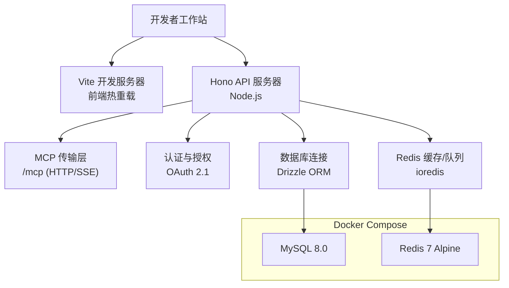
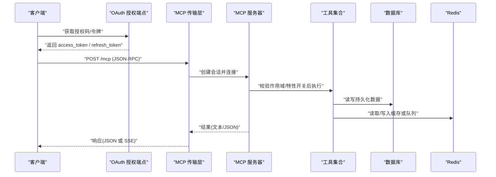
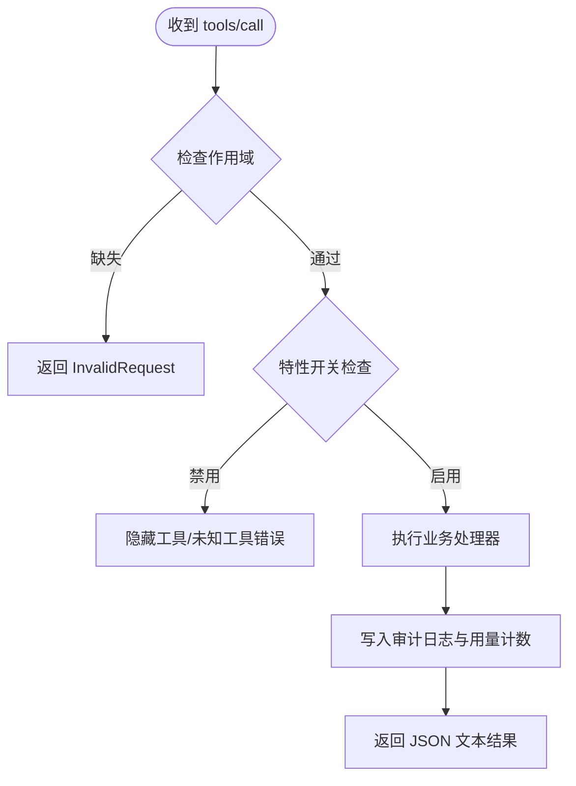
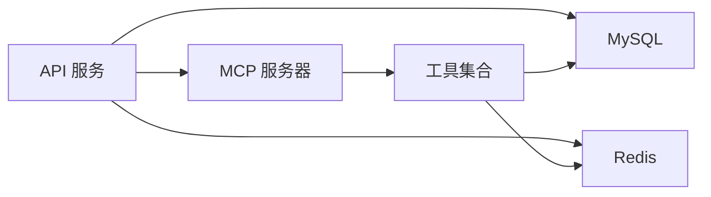

# 开发环境配置

<cite>
**本文引用的文件**
- [docker-compose.yml](file://docker-compose.yml)
- [Dockerfile](file://Dockerfile)
- [package.json](file://package.json)
- [api/lib/env.ts](file://api/lib/env.ts)
- [drizzle.config.ts](file://drizzle.config.ts)
- [api/queries/connection.ts](file://api/queries/connection.ts)
- [api/infra/redis.ts](file://api/infra/redis.ts)
- [api/mcp/server.ts](file://api/mcp/server.ts)
- [api/mcp/transport.ts](file://api/mcp/transport.ts)
- [api/mcp/auth.ts](file://api/mcp/auth.ts)
- [api/mcp/tools/index.ts](file://api/mcp/tools/index.ts)
- [scripts/mcp-call.mjs](file://scripts/mcp-call.mjs)
- [ecosystem.config.cjs](file://ecosystem.config.cjs)
</cite>

## 目录
1. [简介](#简介)
2. [项目结构](#项目结构)
3. [核心组件](#核心组件)
4. [架构总览](#架构总览)
5. [详细组件分析](#详细组件分析)
6. [依赖关系分析](#依赖关系分析)
7. [性能考虑](#性能考虑)
8. [故障排查指南](#故障排查指南)
9. [结论](#结论)
10. [附录](#附录)

## 简介
本文件面向本地开发与调试，聚焦 DeeWaanAI MCP 工具链的完整环境搭建与运行。内容涵盖：
- 使用 Docker Compose 编排 MySQL、Redis 等基础设施
- 环境变量与配置项说明（数据库、缓存、外部服务）
- MCP 服务器启动、传输层与认证流程
- 常用脚本与调试技巧（含热重载建议）
- 常见问题定位与排障步骤

## 项目结构
本项目采用前后端同仓管理，后端基于 Hono + Node.js，前端基于 Vite + React；MCP 作为独立协议服务挂载于 API 路由中，提供工具调用能力。关键目录与职责：
- api：后端 API、MCP 服务器、工具注册、认证、数据访问、缓存与队列
- db：数据库 Schema、迁移与种子数据
- scripts：运维与测试脚本（包括 MCP 客户端调用示例）
- docker-compose.yml：本地基础设施容器编排
- Dockerfile：生产镜像构建与运行
- package.json：构建、启动、数据库迁移等脚本

图表来源
- [docker-compose.yml:1-52](file://docker-compose.yml#L1-L52)
- [Dockerfile:1-39](file://Dockerfile#L1-L39)
- [api/mcp/transport.ts:1-234](file://api/mcp/transport.ts#L1-L234)
- [api/queries/connection.ts:1-43](file://api/queries/connection.ts#L1-L43)
- [api/infra/redis.ts:1-88](file://api/infra/redis.ts#L1-L88)

章节来源
- [docker-compose.yml:1-52](file://docker-compose.yml#L1-L52)
- [package.json:7-21](file://package.json#L7-L21)

## 核心组件
- 环境变量与运行时配置：集中定义必需与可选配置，包含安全校验与降级策略
- 数据库连接：单例主库与可选读库，支持只读副本
- Redis 客户端：惰性连接、指数退避重试、不可用时回退到内存模式
- MCP 服务器：按会话创建 McpServer，注册工具，鉴权与审计
- MCP 传输层：支持流式 HTTP 与遗留 SSE，维护进程内会话映射
- 认证与授权：实现 OAuth 2.1 发现、动态注册、授权码+PKCE、令牌交换
- 工具注册表：集中声明所有可用工具及权限范围

章节来源
- [api/lib/env.ts:1-105](file://api/lib/env.ts#L1-L105)
- [api/queries/connection.ts:1-43](file://api/queries/connection.ts#L1-L43)
- [api/infra/redis.ts:1-88](file://api/infra/redis.ts#L1-L88)
- [api/mcp/server.ts:1-209](file://api/mcp/server.ts#L1-L209)
- [api/mcp/transport.ts:1-234](file://api/mcp/transport.ts#L1-L234)
- [api/mcp/auth.ts:1-428](file://api/mcp/auth.ts#L1-L428)
- [api/mcp/tools/index.ts:1-95](file://api/mcp/tools/index.ts#L1-L95)

## 架构总览
下图展示从客户端到 MCP 工具的端到端调用路径，以及认证、传输、工具执行与审计的关键环节。

图表来源
- [api/mcp/auth.ts:147-428](file://api/mcp/auth.ts#L147-L428)
- [api/mcp/transport.ts:74-170](file://api/mcp/transport.ts#L74-L170)
- [api/mcp/server.ts:84-186](file://api/mcp/server.ts#L84-L186)
- [api/queries/connection.ts:10-42](file://api/queries/connection.ts#L10-L42)
- [api/infra/redis.ts:61-87](file://api/infra/redis.ts#L61-L87)

## 详细组件分析

### 环境与配置
- 必需变量：APP_ID、APP_SECRET、DATABASE_URL、AI_SWARM_MASTER_KEY、MARKETPLACE_MASTER_KEY
- 可选基础设施：REDIS_URL、S3_*、SENTRY_DSN、BACKUP_TOKEN、AI_TRIAGE_*
- 安全策略：生产环境拒绝已知弱密钥；未配置 S3 时上传走本地磁盘
- 读库支持：通过 DATABASE_READ_URL 启用只读副本，仅用于读多写少场景

章节来源
- [api/lib/env.ts:21-95](file://api/lib/env.ts#L21-L95)
- [drizzle.config.ts:1-17](file://drizzle.config.ts#L1-L17)

### 数据库连接
- 主库单例：getDb() 懒加载，统一 schema 与 relations
- 读库选择：getReadDb() 在配置存在时使用只读实例，否则回退到主库
- 迁移与生成：通过 drizzle-kit 命令操作，需设置 DATABASE_URL

章节来源
- [api/queries/connection.ts:1-43](file://api/queries/connection.ts#L1-L43)
- [drizzle.config.ts:1-17](file://drizzle.config.ts#L1-L17)

### Redis 缓存与队列
- 惰性连接：首次使用时尝试连接，最多 3 次指数退避
- 容错设计：连接失败记录日志并标记放弃，后续直接返回 null，子系统使用内存回退
- 可用性判断：isRedisEnabled() 根据 REDIS_URL 判定是否启用

章节来源
- [api/infra/redis.ts:1-88](file://api/infra/redis.ts#L1-L88)

### MCP 服务器与工具
- 会话级服务器：每个会话创建独立 McpServer，绑定认证上下文
- 工具注册：集中注册表 TOOLS，支持作用域与特性开关过滤
- 审计与计量：每次调用记录审计日志与月度用量计数，失败不影响主流程
- 采样桥接：为桌面客户端暴露 sampling 能力（若客户端支持）

图表来源
- [api/mcp/server.ts:84-186](file://api/mcp/server.ts#L84-L186)
- [api/mcp/tools/index.ts:1-95](file://api/mcp/tools/index.ts#L1-L95)

章节来源
- [api/mcp/server.ts:1-209](file://api/mcp/server.ts#L1-L209)
- [api/mcp/tools/index.ts:1-95](file://api/mcp/tools/index.ts#L1-L95)

### MCP 传输层与会话管理
- 支持两种传输：
  - 流式 HTTP：POST/GET/DELETE /mcp，自动协商 JSON 或 SSE 响应
  - 遗留 SSE：GET /mcp/sse 打开流，POST /mcp/messages?sessionId=… 发送消息
- 会话生命周期：进程内 Map 存储，带 TTL 清理；新会话在 initialize 成功后建立
- 采样能力：在会话上下文中注入 samplingSupported 与 sample 方法

章节来源
- [api/mcp/transport.ts:1-234](file://api/mcp/transport.ts#L1-L234)

### 认证与授权（OAuth 2.1）
- 公开发现端点：/.well-known/oauth-protected-resource、/.well-known/oauth-authorization-server
- 动态注册：/oauth/register（限制 redirect_uri 为 https 或本地回环）
- 授权流程：/oauth/authorize（code + PKCE S256），/oauth/authorize/confirm（需要登录态）
- 令牌交换：/oauth/token（authorization_code、refresh_token），支持 scope 交集校验

章节来源
- [api/mcp/auth.ts:147-428](file://api/mcp/auth.ts#L147-L428)

### 本地开发脚本与 MCP 客户端
- 常用脚本：
  - npm run dev：启动前端开发服务器（Vite）
  - npm run build：构建前端与后端产物（esbuild 打包）
  - npm run start：生产模式启动后端
  - npm run db:migrate / db:push / db:generate：数据库迁移与同步
- MCP 调用示例：scripts/mcp-call.mjs 演示了初始化、列出工具、调用工具的流程（含 token 刷新与 SSE 解析）

章节来源
- [package.json:7-21](file://package.json#L7-L21)
- [scripts/mcp-call.mjs:1-73](file://scripts/mcp-call.mjs#L1-L73)

## 依赖关系分析
- 应用与基础设施：
  - 数据库：MySQL（Docker Compose 提供）
  - 缓存/队列：Redis（Docker Compose 提供）
  - 对象存储：S3 兼容（可选，未配置则走本地磁盘）
- 运行时依赖：
  - Hono + @hono/node-server：HTTP 适配
  - Drizzle ORM：类型安全的数据库访问
  - ioredis：Redis 客户端
  - BullMQ：任务队列（当 Redis 可用时）
  - @modelcontextprotocol/sdk：MCP 协议实现

图表来源
- [docker-compose.yml:1-52](file://docker-compose.yml#L1-L52)
- [api/queries/connection.ts:1-43](file://api/queries/connection.ts#L1-L43)
- [api/infra/redis.ts:1-88](file://api/infra/redis.ts#L1-L88)
- [api/mcp/server.ts:1-209](file://api/mcp/server.ts#L1-L209)

章节来源
- [docker-compose.yml:1-52](file://docker-compose.yml#L1-L52)
- [package.json:23-73](file://package.json#L23-L73)

## 性能考虑
- 数据库：
  - 读多写少场景可启用只读副本（DATABASE_READ_URL）
  - 合理索引与查询优化，避免全表扫描
- Redis：
  - 连接失败自动降级，避免阻塞主流程
  - 控制 key 空间与过期策略，防止内存膨胀
- 进程与资源：
  - PM2 配置限制堆大小与内存重启阈值，避免 OOM
  - 日志轮转防止磁盘占满
- 网络与超时：
  - Redis 连接超时与重试策略已内置，避免雪崩
  - 对外部服务调用应加超时与熔断保护（如适用）

章节来源
- [ecosystem.config.cjs:1-32](file://ecosystem.config.cjs#L1-L32)
- [api/infra/redis.ts:22-59](file://api/infra/redis.ts#L22-L59)
- [api/queries/connection.ts:22-42](file://api/queries/connection.ts#L22-L42)

## 故障排查指南
- 无法连接数据库：
  - 确认 DATABASE_URL 正确且可达
  - 检查 drizzle 配置与迁移是否成功
- Redis 不可用：
  - 查看日志中的“Redis unavailable”提示
  - 确认 REDIS_URL 与防火墙/网络策略
- MCP 工具调用失败：
  - 检查作用域是否满足（mcp:read/mcp:run/mcp:write）
  - 检查特性开关是否启用
  - 查看审计日志与错误信息
- 认证问题：
  - 确认 redirect_uri 已注册且为 https（或本地回环）
  - 检查 PKCE code_challenge_method 是否为 S256
  - 刷新令牌失败时检查 refresh_token 是否有效
- 端口与健康检查：
  - 生产健康检查指向 /api/health，确保服务监听 PORT 并可达

章节来源
- [api/lib/env.ts:1-19](file://api/lib/env.ts#L1-L19)
- [api/infra/redis.ts:35-59](file://api/infra/redis.ts#L35-L59)
- [api/mcp/server.ts:46-82](file://api/mcp/server.ts#L46-L82)
- [api/mcp/auth.ts:175-227](file://api/mcp/auth.ts#L175-L227)
- [Dockerfile:35-38](file://Dockerfile#L35-L38)

## 结论
通过 Docker Compose 快速拉起 MySQL 与 Redis，配合环境变量与脚本即可完成本地开发环境的搭建。MCP 服务器以会话为单位隔离，具备完善的认证、传输、工具注册与审计机制。建议在开发阶段充分利用 Vite 热重载与 PM2 日志轮转，结合脚本进行快速验证与排障。

## 附录

### 本地开发环境搭建步骤
- 安装依赖与准备
  - 安装 Node.js 20+ 与 npm
  - 复制并填写 .env（参考环境变量清单）
- 启动基础设施
  - 使用 docker-compose 启动 MySQL 与 Redis
- 数据库初始化
  - 运行数据库迁移或推送 schema
- 启动服务
  - 前端：npm run dev
  - 后端：npm run start（或开发模式下按需启动）
- 验证
  - 访问 /api/health 确认服务就绪
  - 使用 scripts/mcp-call.mjs 测试 MCP 工具列表与调用

章节来源
- [docker-compose.yml:1-52](file://docker-compose.yml#L1-L52)
- [package.json:7-21](file://package.json#L7-L21)
- [drizzle.config.ts:1-17](file://drizzle.config.ts#L1-L17)
- [scripts/mcp-call.mjs:1-73](file://scripts/mcp-call.mjs#L1-L73)

### 环境变量清单（节选）
- 必需
  - APP_ID、APP_SECRET、DATABASE_URL、AI_SWARM_MASTER_KEY、MARKETPLACE_MASTER_KEY
- 可选
  - REDIS_URL、S3_ENDPOINT、S3_REGION、S3_BUCKET、S3_ACCESS_KEY_ID、S3_SECRET_ACCESS_KEY
  - SENTRY_DSN、BACKUP_TOKEN、AI_TRIAGE_SLUG、AI_TRIAGE_API_KEY、AI_TRIAGE_BASE_URL、AI_TRIAGE_MODEL
  - PUBLIC_APP_URL、SWARM_WORKER_CONCURRENCY、PROVIDER_THROTTLE、WAITLIST_CORS_ORIGINS

章节来源
- [api/lib/env.ts:21-95](file://api/lib/env.ts#L21-L95)

### 数据库连接与迁移
- 连接
  - 主库：getDb()
  - 读库：getReadDb()（需配置 DATABASE_READ_URL）
- 迁移
  - 生成：npm run db:generate
  - 迁移：npm run db:migrate
  - 推送：npm run db:push

章节来源
- [api/queries/connection.ts:1-43](file://api/queries/connection.ts#L1-L43)
- [drizzle.config.ts:1-17](file://drizzle.config.ts#L1-L17)
- [package.json:17-19](file://package.json#L17-L19)

### Redis 缓存与队列
- 连接与降级
  - 惰性连接，失败后回退内存模式
- 使用建议
  - 控制键空间与过期时间
  - 监控内存与慢查询

章节来源
- [api/infra/redis.ts:1-88](file://api/infra/redis.ts#L1-L88)

### MCP 服务器启动与调试
- 启动
  - 后端启动后，/mcp 端点自动可用
- 调试
  - 使用 scripts/mcp-call.mjs 列出工具或调用工具
  - 关注审计日志与错误输出
- 传输
  - 优先使用流式 HTTP；兼容遗留 SSE

章节来源
- [api/mcp/transport.ts:1-234](file://api/mcp/transport.ts#L1-L234)
- [scripts/mcp-call.mjs:1-73](file://scripts/mcp-call.mjs#L1-L73)
- [api/mcp/server.ts:1-209](file://api/mcp/server.ts#L1-L209)

### 外部服务集成
- 对象存储（S3 兼容）
  - 配置 S3_* 变量启用；未配置时走本地磁盘
- 观测性（Sentry）
  - 配置 SENTRY_DSN 启用上报
- 备份
  - 配置 BACKUP_TOKEN 与 S3_* 以启用远程备份

章节来源
- [api/lib/env.ts:47-70](file://api/lib/env.ts#L47-L70)

### 开发工具与 IDE 建议
- 代码质量
  - ESLint + Prettier 格式化与检查
- 类型检查
  - TypeScript 严格模式
- 调试
  - 使用浏览器 DevTools 调试前端
  - 使用 Node Inspector 调试后端
- 日志
  - 查看 logs 目录下的 combined/out/error 日志

章节来源
- [package.json:10-16](file://package.json#L10-L16)
- [ecosystem.config.cjs:22-30](file://ecosystem.config.cjs#L22-L30)

### 热重载与调试技巧
- 前端热重载
  - 使用 npm run dev（Vite）
- 后端调试
  - 使用 Node 调试器附加到进程
  - 利用 PM2 日志轮转与合并日志便于追踪
- 常见技巧
  - 逐步缩小问题范围（先复现最小用例）
  - 开启更详细的日志级别（如适用）

章节来源
- [package.json:8-13](file://package.json#L8-L13)
- [ecosystem.config.cjs:1-32](file://ecosystem.config.cjs#L1-L32)

### 常用开发脚本
- npm run dev：启动前端开发服务器
- npm run build：构建前端与后端产物
- npm run start：生产模式启动后端
- npm run test：运行单元测试
- npm run db:migrate / db:push / db:generate：数据库迁移与同步
- node scripts/mcp-call.mjs --list：列出可用 MCP 工具
- node scripts/mcp-call.mjs <toolName> '<jsonArgs>'：调用指定工具

章节来源
- [package.json:7-21](file://package.json#L7-L21)
- [scripts/mcp-call.mjs:1-73](file://scripts/mcp-call.mjs#L1-L73)