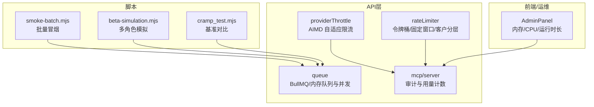
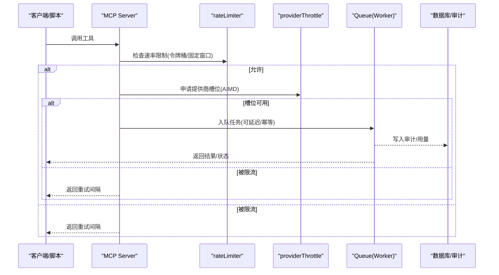
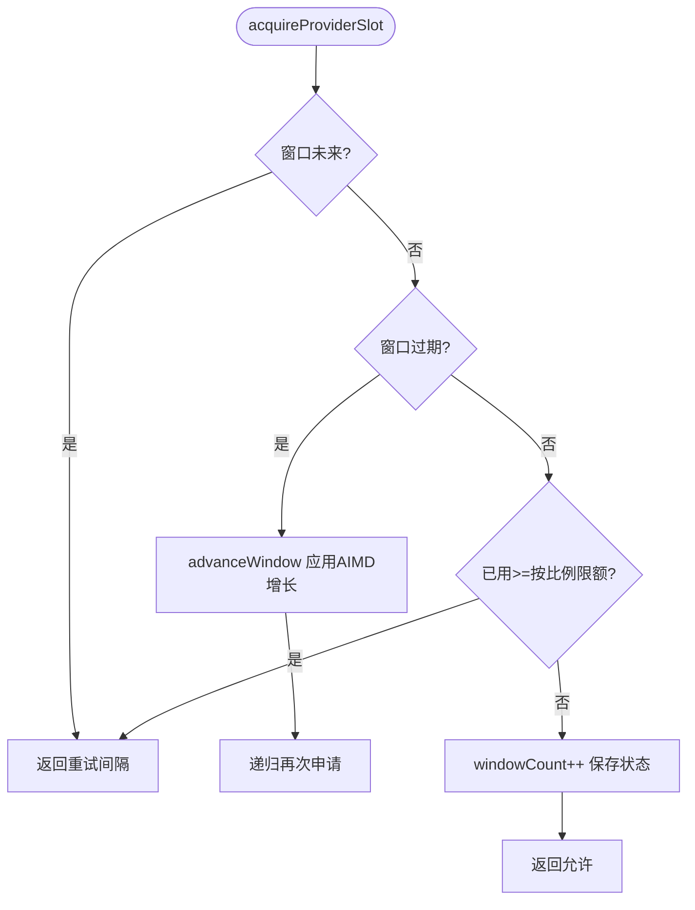
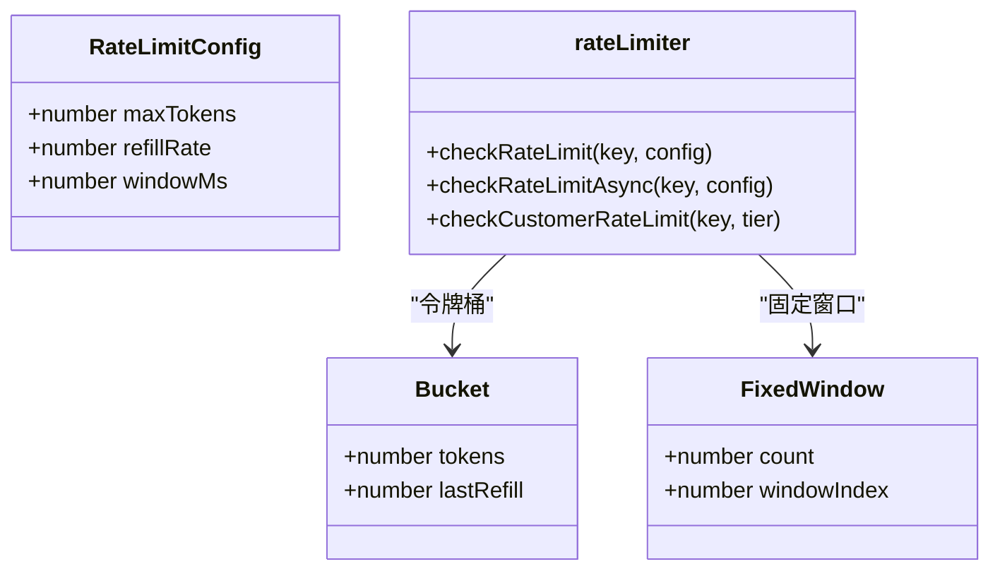
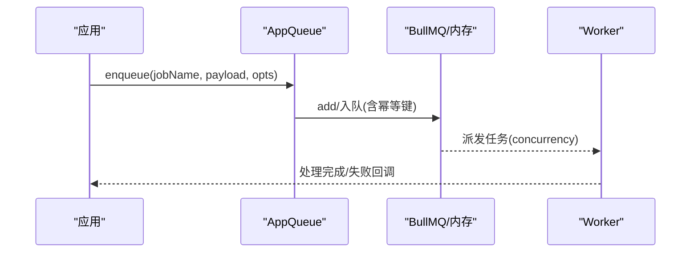
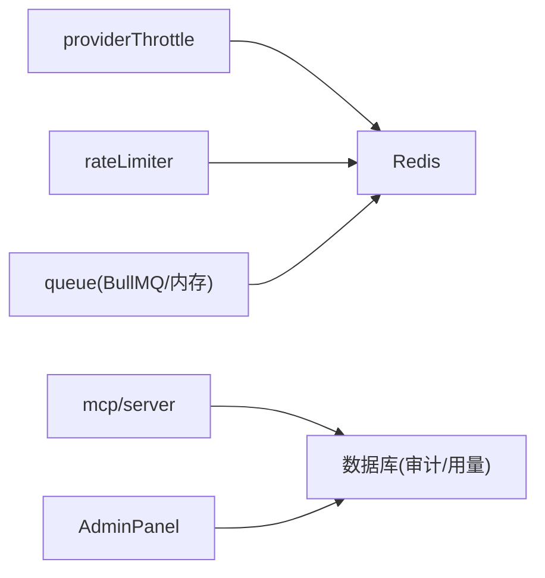

# 性能测试

<cite>
**本文引用的文件**
- [api/lib/providerThrottle.ts](file://api/lib/providerThrottle.ts)
- [api/lib/providerThrottle.test.ts](file://api/lib/providerThrottle.test.ts)
- [api/lib/rateLimiter.ts](file://api/lib/rateLimiter.ts)
- [api/lib/rateLimiter.test.ts](file://api/lib/rateLimiter.test.ts)
- [api/infra/queue.ts](file://api/infra/queue.ts)
- [api/mcp/server.ts](file://api/mcp/server.ts)
- [src/pages/AdminPanel.tsx](file://src/pages/AdminPanel.tsx)
- [scripts/smoke-batch.mjs](file://scripts/smoke-batch.mjs)
- [scripts/beta-simulation.mjs](file://scripts/beta-simulation.mjs)
- [research/orchestration-economics/code/cramp_test.mjs](file://research/orchestration-economics/code/cramp_test.mjs)
- [DeeWaanAI-Next/RESEARCH-MODE-SPEC.md](file://DeeWaanAI-Next/RESEARCH-MODE-SPEC.md)
</cite>

## 目录
1. [简介](#简介)
2. [项目结构](#项目结构)
3. [核心组件](#核心组件)
4. [架构总览](#架构总览)
5. [详细组件分析](#详细组件分析)
6. [依赖关系分析](#依赖关系分析)
7. [性能考量](#性能考量)
8. [故障排查指南](#故障排查指南)
9. [结论](#结论)
10. [附录](#附录)

## 简介
本文件面向 DeeWaanAI MCP 工具的性能测试，覆盖负载与压力测试、批量请求处理能力、并发控制、提供商限流器与速率限制器的有效性验证、性能基准指标定义、监控与瓶颈识别方法、内存与 CPU 优化建议，以及性能回归测试的自动化流程。文档基于仓库中现有的限流、队列、MCP 审计与脚本能力进行系统化说明，确保可落地执行。

## 项目结构
围绕性能测试的关键代码集中在以下位置：
- 提供商自适应限流（AIMD）：api/lib/providerThrottle.ts
- 通用与按客户分层速率限制：api/lib/rateLimiter.ts
- 队列抽象与并发控制（BullMQ/内存）：api/infra/queue.ts
- MCP 调用审计与用量统计：api/mcp/server.ts
- 管理面板系统指标展示：src/pages/AdminPanel.tsx
- 冒烟与模拟脚本（端到端/压测入口）：scripts/smoke-batch.mjs、scripts/beta-simulation.mjs
- 基准对比脚本：research/orchestration-economics/code/cramp_test.mjs
- 研究模式并发配置参考：DeeWaanAI-Next/RESEARCH-MODE-SPEC.md

图表来源
- [api/lib/providerThrottle.ts:1-275](file://api/lib/providerThrottle.ts#L1-L275)
- [api/lib/rateLimiter.ts:1-216](file://api/lib/rateLimiter.ts#L1-L216)
- [api/infra/queue.ts:1-334](file://api/infra/queue.ts#L1-L334)
- [api/mcp/server.ts:41-82](file://api/mcp/server.ts#L41-L82)
- [src/pages/AdminPanel.tsx:796-810](file://src/pages/AdminPanel.tsx#L796-L810)
- [scripts/smoke-batch.mjs:1-134](file://scripts/smoke-batch.mjs#L1-L134)
- [scripts/beta-simulation.mjs:1-294](file://scripts/beta-simulation.mjs#L1-L294)
- [research/orchestration-economics/code/cramp_test.mjs:183-195](file://research/orchestration-economics/code/cramp_test.mjs#L183-L195)

章节来源
- [api/lib/providerThrottle.ts:1-275](file://api/lib/providerThrottle.ts#L1-L275)
- [api/lib/rateLimiter.ts:1-216](file://api/lib/rateLimiter.ts#L1-L216)
- [api/infra/queue.ts:1-334](file://api/infra/queue.ts#L1-L334)
- [api/mcp/server.ts:41-82](file://api/mcp/server.ts#L41-L82)
- [src/pages/AdminPanel.tsx:796-810](file://src/pages/AdminPanel.tsx#L796-L810)
- [scripts/smoke-batch.mjs:1-134](file://scripts/smoke-batch.mjs#L1-L134)
- [scripts/beta-simulation.mjs:1-294](file://scripts/beta-simulation.mjs#L1-L294)
- [research/orchestration-economics/code/cramp_test.mjs:183-195](file://research/orchestration-economics/code/cramp_test.mjs#L183-L195)

## 核心组件
- 提供商自适应限流器（AIMD）
  - 通过每提供商状态（当前RPM、窗口起始时间、窗口内已用槽数、上次降速时间、是否处于慢启动）实现“加法增长/乘法减少”的自适应限速。
  - 支持 Redis 持久化与内存回退；提供获取所有提供商指标的接口，便于观测与压测评估。
- 速率限制器
  - 提供令牌桶（进程内）与固定窗口（Redis/内存回退）两种实现；包含预置策略与按客户分层（个人/团队/管理员）的配额。
- 队列与并发
  - 统一抽象支持 BullMQ（多节点、持久）与内存队列（开发友好）；Worker 并发度由环境变量控制，便于调节吞吐与资源占用。
- MCP 审计与用量
  - 每次工具调用异步记录审计行与月度用量计数器，用于事后分析与回归检测。
- 管理面板指标
  - 暴露系统运行时长、RSS/堆内存等指标，便于在压测期间观察资源使用。

章节来源
- [api/lib/providerThrottle.ts:17-275](file://api/lib/providerThrottle.ts#L17-L275)
- [api/lib/rateLimiter.ts:4-216](file://api/lib/rateLimiter.ts#L4-L216)
- [api/infra/queue.ts:23-334](file://api/infra/queue.ts#L23-L334)
- [api/mcp/server.ts:41-82](file://api/mcp/server.ts#L41-L82)
- [src/pages/AdminPanel.tsx:796-810](file://src/pages/AdminPanel.tsx#L796-L810)

## 架构总览
下图展示了从客户端到 MCP 工具调用的关键路径，以及限流、队列与审计的协作方式。

图表来源
- [api/lib/rateLimiter.ts:31-93](file://api/lib/rateLimiter.ts#L31-L93)
- [api/lib/providerThrottle.ts:168-235](file://api/lib/providerThrottle.ts#L168-L235)
- [api/infra/queue.ts:210-247](file://api/infra/queue.ts#L210-L247)
- [api/mcp/server.ts:47-82](file://api/mcp/server.ts#L47-L82)

## 详细组件分析

### 提供商自适应限流器（AIMD）
- 设计要点
  - 慢启动：每个干净窗口翻倍，直至达到上限或触发降速。
  - 拥塞避免：降速后冷却若干窗口再线性增长。
  - 窗口与比例限额：按 elapsed/WINDOW_MS 计算当前窗口已授权槽数，防止突发超限。
  - 状态存储：优先 Redis，失败回退到进程内存；提供 getProviderThrottleMetrics 汇总指标。
- 压测关注点
  - 通过 reportProviderResult("rate_limited") 模拟 429，观察 RPM 下降与恢复曲线。
  - 使用 declaredRpm 指定初始速率，跳过慢启动以快速进入稳态。
  - 结合 Retry-After 暂停窗口，验证重入保护。

图表来源
- [api/lib/providerThrottle.ts:168-199](file://api/lib/providerThrottle.ts#L168-L199)
- [api/lib/providerThrottle.ts:135-162](file://api/lib/providerThrottle.ts#L135-L162)

章节来源
- [api/lib/providerThrottle.ts:17-275](file://api/lib/providerThrottle.ts#L17-L275)
- [api/lib/providerThrottle.test.ts:24-103](file://api/lib/providerThrottle.test.ts#L24-L103)
- [api/lib/providerThrottle.test.ts:105-185](file://api/lib/providerThrottle.test.ts#L105-L185)

### 速率限制器（令牌桶/固定窗口/客户分层）
- 设计要点
  - checkRateLimit：进程内令牌桶，支持突发与按秒补充。
  - checkRateLimitAsync：优先 Redis 固定窗口（跨节点共享），失败回退到内存。
  - 预置策略：auth/execute/batch/read/screenshotUpload/screenshotServe。
  - 客户分层：solo/team/admin 不同每分钟配额。
- 压测关注点
  - 验证突发上限、补充速率、键隔离、无 Redis 降级行为。
  - 针对 batch 提交场景使用较低配额，避免对下游造成冲击。

图表来源
- [api/lib/rateLimiter.ts:4-216](file://api/lib/rateLimiter.ts#L4-L216)

章节来源
- [api/lib/rateLimiter.ts:31-216](file://api/lib/rateLimiter.ts#L31-L216)
- [api/lib/rateLimiter.test.ts:22-141](file://api/lib/rateLimiter.test.ts#L22-L141)

### 队列与并发控制
- 设计要点
  - 后端选择：有 Redis 则使用 BullMQ（持久、多节点），否则使用内存队列。
  - Worker 并发：BullMQ 的 concurrency 由环境变量控制，影响吞吐与资源占用。
  - 幂等性：支持 idempotencyKey 去重，避免重复入队。
- 压测关注点
  - 调整 SWARM_WORKER_CONCURRENCY 观察吞吐/延迟/资源变化。
  - 使用 delayMs 模拟延迟任务，验证调度与清理逻辑。

图表来源
- [api/infra/queue.ts:200-261](file://api/infra/queue.ts#L200-L261)
- [api/infra/queue.ts:272-319](file://api/infra/queue.ts#L272-L319)

章节来源
- [api/infra/queue.ts:1-334](file://api/infra/queue.ts#L1-L334)
- [DeeWaanAI-Next/RESEARCH-MODE-SPEC.md:83-87](file://DeeWaanAI-Next/RESEARCH-MODE-SPEC.md#L83-L87)

### MCP 审计与用量
- 设计要点
  - 每次工具调用异步写入审计表与月度用量计数器，失败不阻塞主流程。
- 压测关注点
  - 在高并发下观察审计写入是否成为瓶颈（I/O 与锁竞争）。
  - 结合管理面板指标与审计数据定位异常时段。

章节来源
- [api/mcp/server.ts:41-82](file://api/mcp/server.ts#L41-L82)
- [src/pages/AdminPanel.tsx:796-810](file://src/pages/AdminPanel.tsx#L796-L810)

## 依赖关系分析
- providerThrottle 依赖 Redis（可选）与日志/环境配置；其状态可被外部查询用于观测。
- rateLimiter 同时提供进程内与 Redis 路径，具备强降级能力。
- queue 根据运行时可用性选择后端，并通过环境变量控制并发。
- MCP server 将工具调用审计与用量写入数据库，不影响主链路。
- 脚本通过 HTTP/tRPC 驱动真实 API，串联限流、队列与业务逻辑，形成端到端压测闭环。

图表来源
- [api/lib/providerThrottle.ts:88-133](file://api/lib/providerThrottle.ts#L88-L133)
- [api/lib/rateLimiter.ts:64-93](file://api/lib/rateLimiter.ts#L64-L93)
- [api/infra/queue.ts:43-71](file://api/infra/queue.ts#L43-L71)
- [api/mcp/server.ts:47-82](file://api/mcp/server.ts#L47-L82)

章节来源
- [api/lib/providerThrottle.ts:88-133](file://api/lib/providerThrottle.ts#L88-L133)
- [api/lib/rateLimiter.ts:64-93](file://api/lib/rateLimiter.ts#L64-L93)
- [api/infra/queue.ts:43-71](file://api/infra/queue.ts#L43-L71)
- [api/mcp/server.ts:47-82](file://api/mcp/server.ts#L47-L82)

## 性能考量
- 负载与压力测试方法
  - 使用 smoke-batch.mjs 驱动 runBatch/getBatchStatus/exportBatchResults 等流程，验证批量吞吐与稳定性。
  - 使用 beta-simulation.mjs 模拟多创作者/评审者工作流，覆盖注册、模板创建、自动设计、市场提交与评审全流程，适合中高压场景。
  - 使用 cramp_test.mjs 进行基准对比，输出中位数延迟、P95 与失败率，便于回归判断。
- 并发控制测试
  - 调整 SWARM_WORKER_CONCURRENCY 改变队列并发，观察吞吐、延迟与资源占用变化。
  - 结合 rateLimiter 的 batch 策略（低配额）与 providerThrottle 的 AIMD 自适应，验证系统在接近限流边界时的自我调节能力。
- 提供商限流器有效性验证
  - 通过 reportProviderResult("rate_limited", retryAfterMs) 注入 429 信号，观察 RPM 减半与窗口暂停是否正确生效。
  - 使用 declaredRpm 快速建立稳态，缩短收敛时间。
- 指标定义
  - 吞吐：单位时间成功完成的批次数/任务数。
  - 延迟：端到端耗时分布（中位数、P95、P99）。
  - 错误率：429/超时/失败占比。
  - 资源：RSS/堆内存、CPU 利用率、队列积压、审计写入延迟。
- 监控与瓶颈识别
  - 管理面板查看内存与运行时长；结合审计日志定位高延迟工具。
  - 使用 getProviderThrottleMetrics 观察各提供商当前 RPM、窗口计数与慢启动状态。
  - 队列后端切换与并发参数变化时，对比吞吐与失败率，识别瓶颈环节。
- 内存与 CPU 优化建议
  - 合理设置 SWARM_WORKER_CONCURRENCY，避免过度并发导致上下文切换与内存抖动。
  - 在高 I/O 场景下，优先使用 BullMQ 并配合合适的重试/清理策略，降低内存堆积。
  - 关注 providerThrottle 的窗口与降速策略，避免持续 429 导致长期低效。
  - 定期清理队列历史与审计数据，避免磁盘与索引膨胀。

章节来源
- [scripts/smoke-batch.mjs:1-134](file://scripts/smoke-batch.mjs#L1-L134)
- [scripts/beta-simulation.mjs:1-294](file://scripts/beta-simulation.mjs#L1-L294)
- [research/orchestration-economics/code/cramp_test.mjs:183-195](file://research/orchestration-economics/code/cramp_test.mjs#L183-L195)
- [api/lib/providerThrottle.ts:207-235](file://api/lib/providerThrottle.ts#L207-L235)
- [api/infra/queue.ts:235-261](file://api/infra/queue.ts#L235-L261)
- [src/pages/AdminPanel.tsx:796-810](file://src/pages/AdminPanel.tsx#L796-L810)

## 故障排查指南
- 常见问题
  - 频繁 429：检查 providerThrottle 的 currentRpm 与 inSlowStart，确认是否处于降速冷却期；必要时降低并发或提高阈值。
  - 队列积压：检查 worker 并发与后端健康（Redis/BullMQ），确认是否有失败任务未清理。
  - 审计写入失败：MCP 审计为异步且吞错，若发现缺失需检查数据库连接与写入延迟。
- 诊断步骤
  - 使用 getProviderThrottleMetrics 获取实时限流状态。
  - 通过 AdminPanel 观察内存与运行时长，结合审计日志定位异常时段。
  - 使用 smoke-batch 与 beta-simulation 复现问题，逐步缩小范围。

章节来源
- [api/lib/providerThrottle.ts:237-274](file://api/lib/providerThrottle.ts#L237-L274)
- [api/mcp/server.ts:47-82](file://api/mcp/server.ts#L47-L82)
- [src/pages/AdminPanel.tsx:796-810](file://src/pages/AdminPanel.tsx#L796-L810)

## 结论
DeeWaanAI 提供了完善的限流、队列与审计能力，支撑对 MCP 工具的负载与压力测试。通过 AIMD 自适应限流、灵活的客户分层速率限制、可配置的队列并发与端到端脚本，能够系统性地评估吞吐、延迟、错误率与资源占用，并在生产环境中实现有效的性能回归检测与瓶颈定位。

## 附录
- 推荐压测流程
  - 基线：cramp_test.mjs --baseline 建立基准。
  - 冒烟：smoke-batch.mjs 验证批量流程基本正确性。
  - 模拟：beta-simulation.mjs setup/wait/review/verify/cleanup 完整演练。
  - 回归：在变更前后分别运行上述脚本，对比指标与通过率。
- 关键参数与环境
  - SWARM_WORKER_CONCURRENCY：控制队列并发。
  - PROVIDER_THROTTLE：按提供商配置 init/floor/ceiling。
  - RATE_LIMITS/CUSTOMER_RATE_LIMITS：预置与分层配额。
- 指标采集
  - 管理面板：内存 RSS/堆、运行时长。
  - 审计日志：工具调用延迟、状态、错误信息。
  - 限流指标：getProviderThrottleMetrics 输出各提供商 RPM、窗口计数与慢启动状态。