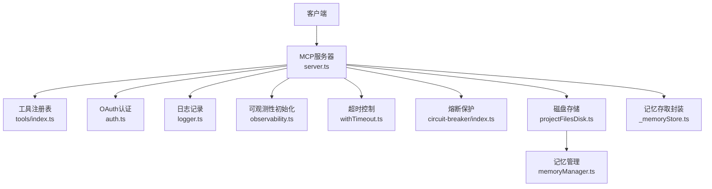
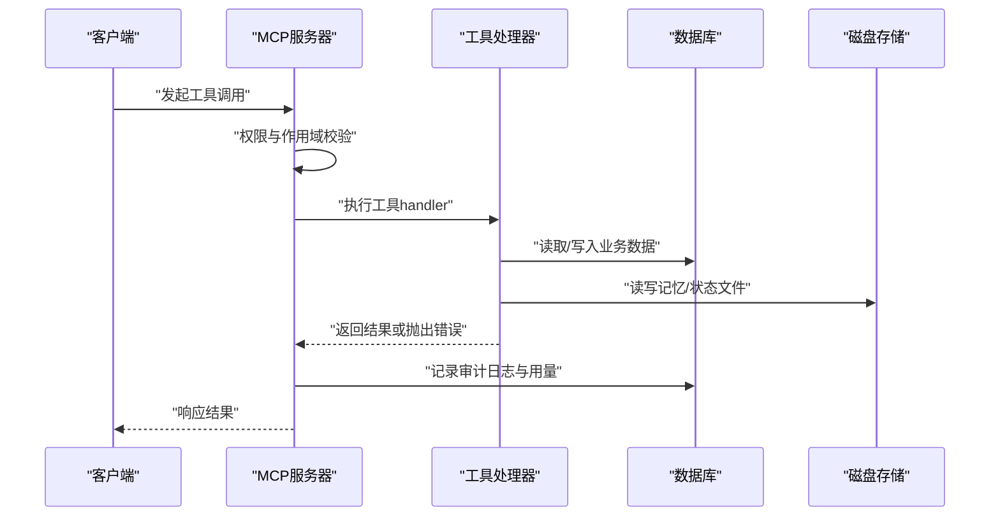
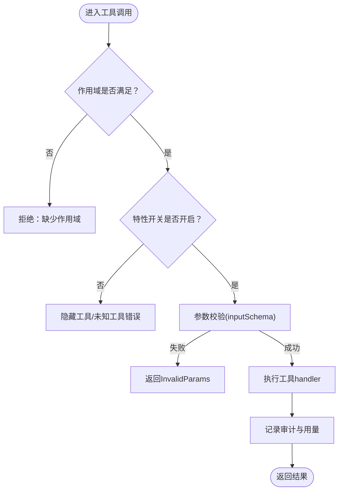
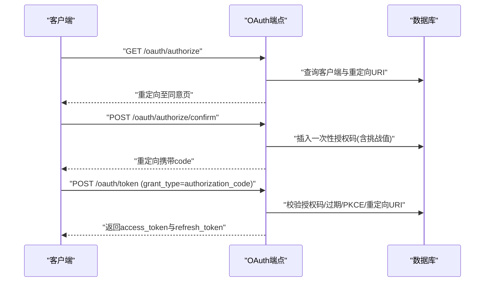
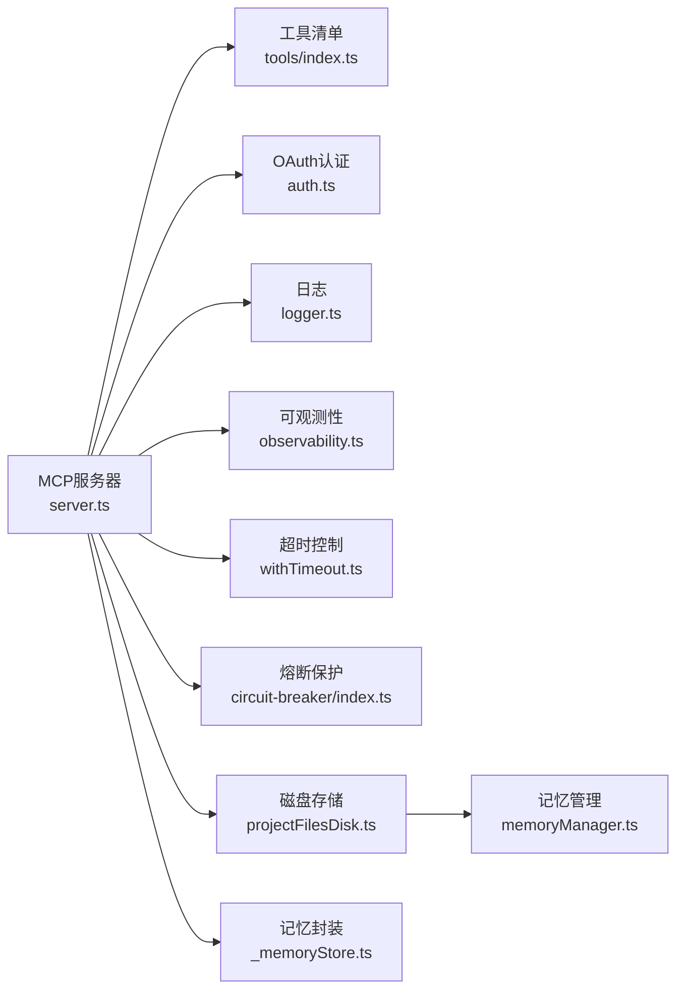

# 故障排查

<cite>
**本文引用的文件**
- [api/mcp/server.ts](file://api/mcp/server.ts)
- [api/mcp/auth.ts](file://api/mcp/auth.ts)
- [api/lib/logger.ts](file://api/lib/logger.ts)
- [api/lib/withTimeout.ts](file://api/lib/withTimeout.ts)
- [api/plugins/circuit-breaker/index.ts](file://api/plugins/circuit-breaker/index.ts)
- [api/lib/observability.ts](file://api/lib/observability.ts)
- [api/mcp/tools/_memoryStore.ts](file://api/mcp/tools/_memoryStore.ts)
- [api/services/memoryManager.ts](file://api/services/memoryManager.ts)
- [api/services/projectFilesDisk.ts](file://api/services/projectFilesDisk.ts)
- [api/mcp/tools/index.ts](file://api/mcp/tools/index.ts)
</cite>

## 目录
1. [简介](#简介)
2. [项目结构](#项目结构)
3. [核心组件](#核心组件)
4. [架构总览](#架构总览)
5. [详细组件分析](#详细组件分析)
6. [依赖关系分析](#依赖关系分析)
7. [性能注意事项](#性能注意事项)
8. [故障排查指南](#故障排查指南)
9. [结论](#结论)
10. [附录](#附录)

## 简介
本故障排查文档面向DeeWaanAI MCP工具的运维与开发者，聚焦常见问题诊断、日志分析与错误追踪最佳实践，覆盖内存存储问题、认证失败、API调用异常、网络超时、数据库连接、第三方服务异常等场景，并提供性能定位与优化建议、调试工具与监控仪表板使用指南，以及问题上报与社区支持渠道。

## 项目结构
MCP相关能力集中在以下模块：
- MCP服务器与工具注册：server.ts、tools/index.ts
- OAuth认证流程：auth.ts
- 日志与可观测性：logger.ts、observability.ts
- 超时控制：withTimeout.ts
- 熔断保护：plugins/circuit-breaker/index.ts
- 内存与项目文件存储：_memoryStore.ts、projectFilesDisk.ts、memoryManager.ts

图表来源
- [api/mcp/server.ts:135-186](file://api/mcp/server.ts#L135-L186)
- [api/mcp/tools/index.ts:45-94](file://api/mcp/tools/index.ts#L45-L94)
- [api/mcp/auth.ts:147-426](file://api/mcp/auth.ts#L147-L426)
- [api/lib/logger.ts:1-32](file://api/lib/logger.ts#L1-L32)
- [api/lib/observability.ts:1-34](file://api/lib/observability.ts#L1-L34)
- [api/lib/withTimeout.ts:1-18](file://api/lib/withTimeout.ts#L1-L18)
- [api/plugins/circuit-breaker/index.ts:1-186](file://api/plugins/circuit-breaker/index.ts#L1-L186)
- [api/services/projectFilesDisk.ts:1-143](file://api/services/projectFilesDisk.ts#L1-L143)
- [api/services/memoryManager.ts:1-123](file://api/services/memoryManager.ts#L1-L123)
- [api/mcp/tools/_memoryStore.ts:1-37](file://api/mcp/tools/_memoryStore.ts#L1-L37)

章节来源
- [api/mcp/server.ts:1-209](file://api/mcp/server.ts#L1-L209)
- [api/mcp/tools/index.ts:1-95](file://api/mcp/tools/index.ts#L1-L95)
- [api/mcp/auth.ts:1-428](file://api/mcp/auth.ts#L1-L428)
- [api/lib/logger.ts:1-32](file://api/lib/logger.ts#L1-L32)
- [api/lib/observability.ts:1-34](file://api/lib/observability.ts#L1-L34)
- [api/lib/withTimeout.ts:1-18](file://api/lib/withTimeout.ts#L1-L18)
- [api/plugins/circuit-breaker/index.ts:1-186](file://api/plugins/circuit-breaker/index.ts#L1-L186)
- [api/services/projectFilesDisk.ts:1-143](file://api/services/projectFilesDisk.ts#L1-L143)
- [api/services/memoryManager.ts:1-123](file://api/services/memoryManager.ts#L1-L123)
- [api/mcp/tools/_memoryStore.ts:1-37](file://api/mcp/tools/_memoryStore.ts#L1-L37)

## 核心组件
- MCP服务器：按会话创建独立McpServer实例，按权限与作用域注册工具，统一审计与用量统计。
- OAuth认证：实现授权码+PKCE流程，签发访问令牌与刷新令牌，校验重定向URI与Scope。
- 日志与可观测性：结构化JSON日志；Sentry可选初始化，失败不阻塞服务。
- 超时控制：为外部请求提供硬超时，避免挂起。
- 熔断保护：限制单条流水线运行的Token预算、花费、步骤超时与循环次数，防止失控。
- 存储层：项目文件优先落盘（PROJECT_FILES_DIR），记忆以episodes.json/state.json形式持久化。

章节来源
- [api/mcp/server.ts:46-124](file://api/mcp/server.ts#L46-L124)
- [api/mcp/auth.ts:35-84](file://api/mcp/auth.ts#L35-L84)
- [api/lib/logger.ts:1-32](file://api/lib/logger.ts#L1-L32)
- [api/lib/observability.ts:1-34](file://api/lib/observability.ts#L1-L34)
- [api/lib/withTimeout.ts:1-18](file://api/lib/withTimeout.ts#L1-L18)
- [api/plugins/circuit-breaker/index.ts:23-143](file://api/plugins/circuit-breaker/index.ts#L23-L143)
- [api/services/projectFilesDisk.ts:17-54](file://api/services/projectFilesDisk.ts#L17-L54)
- [api/mcp/tools/_memoryStore.ts:1-37](file://api/mcp/tools/_memoryStore.ts#L1-L37)

## 架构总览
MCP服务器在每次会话中构建并连接传输层，工具按作用域与特性开关动态注册。所有工具调用均被审计与计数。认证通过OAuth端点完成，存储走本地磁盘为主、Gitee同步为辅的混合架构。

图表来源
- [api/mcp/server.ts:84-124](file://api/mcp/server.ts#L84-L124)
- [api/mcp/server.ts:135-186](file://api/mcp/server.ts#L135-L186)
- [api/services/projectFilesDisk.ts:42-99](file://api/services/projectFilesDisk.ts#L42-L99)

## 详细组件分析

### MCP服务器与工具调用链路
- 每会话一个McpServer，工具列表来自tools/index.ts，按requiredScopes与featureFlag过滤。
- 工具参数由SDK基于inputSchema进行安全解析，非法参数直接返回InvalidParams。
- 每次调用记录mcp_audit_log与usageCounters，失败不影响主流程。

图表来源
- [api/mcp/server.ts:84-124](file://api/mcp/server.ts#L84-L124)
- [api/mcp/server.ts:135-186](file://api/mcp/server.ts#L135-L186)
- [api/mcp/tools/index.ts:45-94](file://api/mcp/tools/index.ts#L45-L94)

章节来源
- [api/mcp/server.ts:84-186](file://api/mcp/server.ts#L84-L186)
- [api/mcp/tools/index.ts:45-94](file://api/mcp/tools/index.ts#L45-L94)

### OAuth认证流程
- 受保护资源元数据与授权服务器元数据端点用于发现能力。
- 动态客户端注册校验重定向URI白名单。
- 授权端点强制PKCE S256，仅允许允许的Scope集合。
- 令牌端点支持授权码与刷新令牌，严格校验一次性授权码、过期时间、重定向URI与PKCE验证。

图表来源
- [api/mcp/auth.ts:147-173](file://api/mcp/auth.ts#L147-L173)
- [api/mcp/auth.ts:175-227](file://api/mcp/auth.ts#L175-L227)
- [api/mcp/auth.ts:229-335](file://api/mcp/auth.ts#L229-L335)
- [api/mcp/auth.ts:337-426](file://api/mcp/auth.ts#L337-L426)

章节来源
- [api/mcp/auth.ts:147-426](file://api/mcp/auth.ts#L147-L426)

### 日志与可观测性
- 结构化JSON日志，支持debug/info/warn/error级别，可通过环境变量控制输出等级。
- Sentry可选初始化，未配置DSN时跳过加载；初始化失败仅告警不中断服务。

章节来源
- [api/lib/logger.ts:1-32](file://api/lib/logger.ts#L1-L32)
- [api/lib/observability.ts:1-34](file://api/lib/observability.ts#L1-L34)

### 超时控制
- withTimeout对可能挂起的Promise设置硬超时，确保事件循环不被占用。
- 适用于外部HTTP请求、LLM流式调用等无默认超时的场景。

章节来源
- [api/lib/withTimeout.ts:1-18](file://api/lib/withTimeout.ts#L1-L18)

### 熔断保护
- 针对流水线运行设置Token预算、花费上限、步骤超时与WHILE循环最大迭代次数。
- 在每一步执行前检查，超限即中止并给出明确原因。
- 提供运行时用量查询与管理员更新默认限制的接口。

章节来源
- [api/plugins/circuit-breaker/index.ts:23-143](file://api/plugins/circuit-breaker/index.ts#L23-L143)
- [api/plugins/circuit-breaker/index.ts:147-186](file://api/plugins/circuit-breaker/index.ts#L147-L186)

### 内存存储与项目文件
- 项目文件优先落盘到PROJECT_FILES_DIR/{projectId}/，路径规范化防穿越攻击。
- 记忆以episodes.json与state.json形式存储，配合memoryManager进行关键词检索与轮转。
- _memoryStore封装了读取/保存记忆与状态的便捷方法。

章节来源
- [api/services/projectFilesDisk.ts:17-99](file://api/services/projectFilesDisk.ts#L17-L99)
- [api/services/memoryManager.ts:9-123](file://api/services/memoryManager.ts#L9-L123)
- [api/mcp/tools/_memoryStore.ts:1-37](file://api/mcp/tools/_memoryStore.ts#L1-L37)

## 依赖关系分析
- server.ts依赖tools/index.ts提供的工具清单，依赖auth上下文进行作用域与特性开关控制。
- auth.ts依赖数据库模型与tokenService进行授权码与令牌管理。
- 存储层依赖文件系统与环境变量配置。
- 可观测性与日志作为横切关注点被多处引用。

图表来源
- [api/mcp/server.ts:135-186](file://api/mcp/server.ts#L135-L186)
- [api/mcp/tools/index.ts:45-94](file://api/mcp/tools/index.ts#L45-L94)
- [api/mcp/auth.ts:147-426](file://api/mcp/auth.ts#L147-L426)
- [api/lib/logger.ts:1-32](file://api/lib/logger.ts#L1-L32)
- [api/lib/observability.ts:1-34](file://api/lib/observability.ts#L1-L34)
- [api/lib/withTimeout.ts:1-18](file://api/lib/withTimeout.ts#L1-L18)
- [api/plugins/circuit-breaker/index.ts:1-186](file://api/plugins/circuit-breaker/index.ts#L1-L186)
- [api/services/projectFilesDisk.ts:1-143](file://api/services/projectFilesDisk.ts#L1-L143)
- [api/services/memoryManager.ts:1-123](file://api/services/memoryManager.ts#L1-L123)
- [api/mcp/tools/_memoryStore.ts:1-37](file://api/mcp/tools/_memoryStore.ts#L1-L37)

## 性能注意事项
- 工具调用应尽量避免长耗时操作；必要时使用withTimeout限制外部调用。
- 流水线运行需合理设置熔断阈值，避免无限循环或过度消耗Token与费用。
- 磁盘I/O路径需保持短小且稳定，避免频繁大文件写盘导致阻塞。
- 日志级别在生产环境建议设置为info或warn，减少IO开销。

[本节为通用指导，无需特定文件来源]

## 故障排查指南

### 常见问题与解决方案

- 认证失败
  - 现象：授权码交换失败、重定向URI不匹配、Scope无效、授权码已使用或过期。
  - 排查要点：
    - 确认客户端已在/oauth/register正确注册redirect_uris。
    - 授权端点必须使用response_type=code与code_challenge_method=S256。
    - 令牌端点需传入正确的client_id、redirect_uri与code_verifier。
    - 检查授权码是否已被使用或过期。
  - 参考位置
    - [api/mcp/auth.ts:229-335](file://api/mcp/auth.ts#L229-L335)
    - [api/mcp/auth.ts:337-426](file://api/mcp/auth.ts#L337-L426)

- API调用异常（工具参数/权限）
  - 现象：InvalidParams、InvalidRequest、未知工具。
  - 排查要点：
    - 检查工具inputSchema是否符合要求。
    - 检查调用者作用域是否包含requiredScopes。
    - 检查特性开关是否启用该工具。
  - 参考位置
    - [api/mcp/server.ts:84-124](file://api/mcp/server.ts#L84-L124)
    - [api/mcp/server.ts:135-186](file://api/mcp/server.ts#L135-L186)

- 内存存储问题
  - 现象：记忆读取为空、状态文件损坏、写入失败。
  - 排查要点：
    - 确认PROJECT_FILES_DIR存在且可写。
    - 检查episodes.json与state.json是否存在且格式正确。
    - 查看磁盘写入日志中的错误信息。
  - 参考位置
    - [api/services/projectFilesDisk.ts:42-99](file://api/services/projectFilesDisk.ts#L42-L99)
    - [api/services/memoryManager.ts:109-123](file://api/services/memoryManager.ts#L109-L123)
    - [api/mcp/tools/_memoryStore.ts:18-36](file://api/mcp/tools/_memoryStore.ts#L18-L36)

- 网络超时
  - 现象：外部请求长时间无响应或卡死。
  - 排查要点：
    - 为外部调用包裹withTimeout，设置合理超时时间。
    - 检查目标服务健康与网络连通性。
  - 参考位置
    - [api/lib/withTimeout.ts:1-18](file://api/lib/withTimeout.ts#L1-L18)

- 数据库连接问题
  - 现象：授权码插入失败、用户查询失败、审计写入失败。
  - 排查要点：
    - 检查数据库连接是否正常。
    - 查看相关错误日志（如OAuth confirm插入失败）。
    - 确认表结构与索引是否正确迁移。
  - 参考位置
    - [api/mcp/auth.ts:314-335](file://api/mcp/auth.ts#L314-L335)
    - [api/mcp/server.ts:46-82](file://api/mcp/server.ts#L46-L82)

- 第三方服务异常
  - 现象：外部API不可用、限流或返回错误。
  - 排查要点：
    - 结合熔断器检查是否触发限制。
    - 使用日志与可观测性平台收集错误堆栈与指标。
  - 参考位置
    - [api/plugins/circuit-breaker/index.ts:62-110](file://api/plugins/circuit-breaker/index.ts#L62-L110)
    - [api/lib/observability.ts:17-33](file://api/lib/observability.ts#L17-L33)

### 日志分析与错误追踪最佳实践
- 使用结构化日志快速定位问题：
  - 关注error与warn级别日志，提取msg与data字段。
  - 通过日志时间戳与请求ID关联上下游调用。
- 利用审计与用量统计：
  - mcp_audit_log记录工具调用延迟与状态，便于定位慢调用与失败。
  - usageCounters用于月度用量统计，辅助容量规划。
- 可观测性平台：
  - 配置SENTRY_DSN后自动捕获异常；未配置时不影响服务稳定性。

章节来源
- [api/lib/logger.ts:1-32](file://api/lib/logger.ts#L1-L32)
- [api/mcp/server.ts:46-82](file://api/mcp/server.ts#L46-L82)
- [api/lib/observability.ts:17-33](file://api/lib/observability.ts#L17-L33)

### 性能问题的定位与优化建议
- 定位方法：
  - 通过审计日志的latencyMs识别慢工具。
  - 使用熔断器的getRunUsage查看Token与花费使用情况。
  - 结合withTimeout判断是否为外部调用导致的阻塞。
- 优化建议：
  - 调整熔断阈值（maxTokens、maxSpend、stepTimeout、maxIterations）以适应业务负载。
  - 将高频读操作缓存或批量处理，减少磁盘与数据库压力。
  - 降低日志级别或采样率以减少IO开销。

章节来源
- [api/mcp/server.ts:46-82](file://api/mcp/server.ts#L46-L82)
- [api/plugins/circuit-breaker/index.ts:136-173](file://api/plugins/circuit-breaker/index.ts#L136-L173)
- [api/lib/withTimeout.ts:1-18](file://api/lib/withTimeout.ts#L1-L18)

### 调试工具与监控仪表板使用指南
- 调试工具：
  - 使用OAuth测试脚本或命令行工具模拟授权码流程，验证重定向URI与Scope。
  - 通过工具帮助接口获取可用工具列表与说明，确认特性开关生效。
- 监控仪表板：
  - 观察审计日志中的工具调用成功率与延迟分布。
  - 查看熔断器用量与限制状态，及时调整阈值。
  - 使用可观测性平台聚合错误与异常，建立告警规则。

[本节为通用指导，无需特定文件来源]

### 问题上报与社区支持渠道
- 内部上报：
  - 通过可观测性平台提交错误报告，附带日志片段与复现步骤。
  - 在团队通道中同步关键故障与修复进展。
- 社区支持：
  - 查阅项目文档与协议规范，确认使用方式正确。
  - 在社区论坛或仓库Issue中提问，附上最小复现与日志。

[本节为通用指导，无需特定文件来源]

## 结论
通过对MCP服务器、认证流程、存储层与可观测性的系统分析，本文提供了从认证失败、API异常、内存存储、网络超时到数据库与第三方服务异常的完整排查路径。结合日志、审计、熔断与超时控制，可有效定位与解决大多数问题，并通过合理的阈值与监控策略提升系统稳定性与性能。

[本节为总结性内容，无需特定文件来源]

## 附录
- 常用环境变量：
  - LOG_LEVEL：日志级别（debug/info/warn/error）
  - PROJECT_FILES_DIR：项目文件存储根目录
  - SENTRY_DSN：可观测性DSN（可选）
- 关键端点：
  - /.well-known/oauth-protected-resource
  - /.well-known/oauth-authorization-server
  - /oauth/register
  - /oauth/authorize
  - /oauth/authorize/confirm
  - /oauth/token

[本节为补充信息，无需特定文件来源]