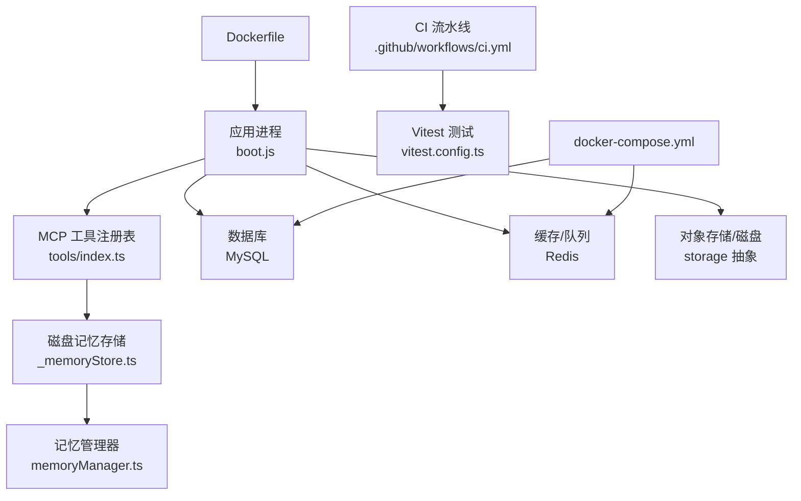
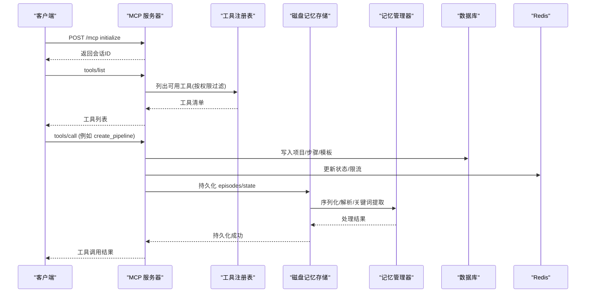
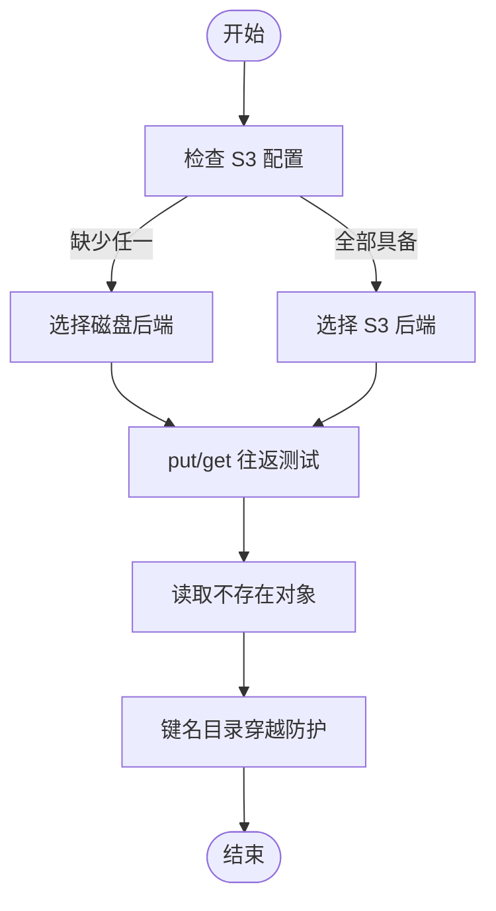
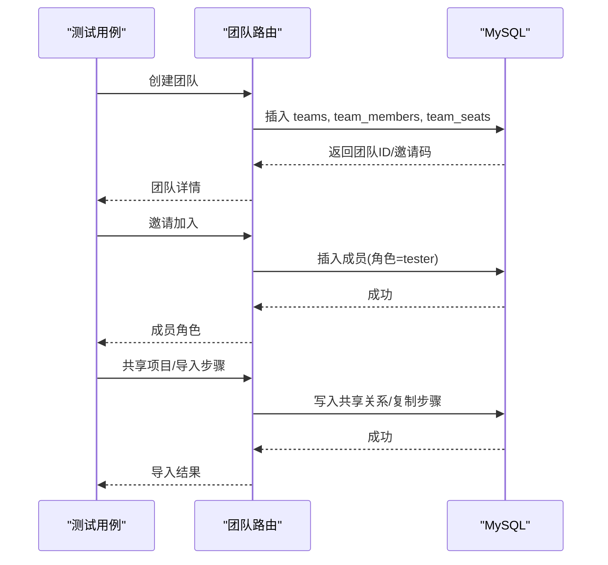
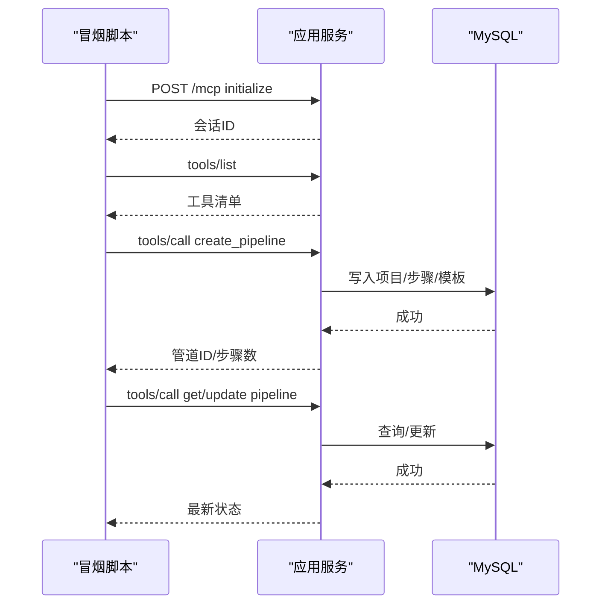
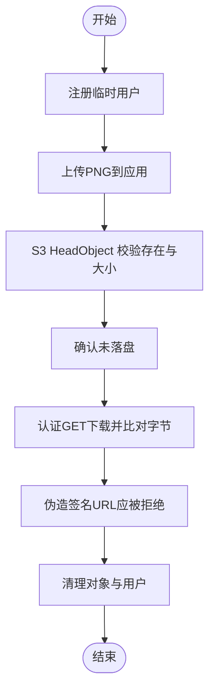
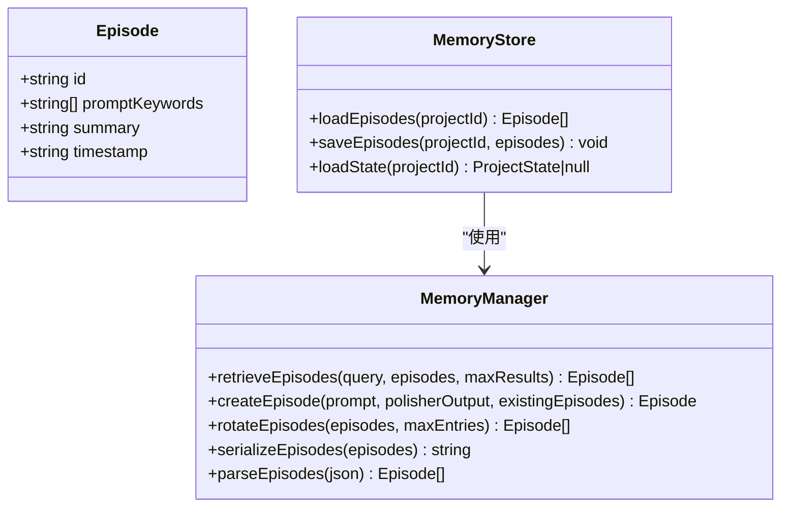
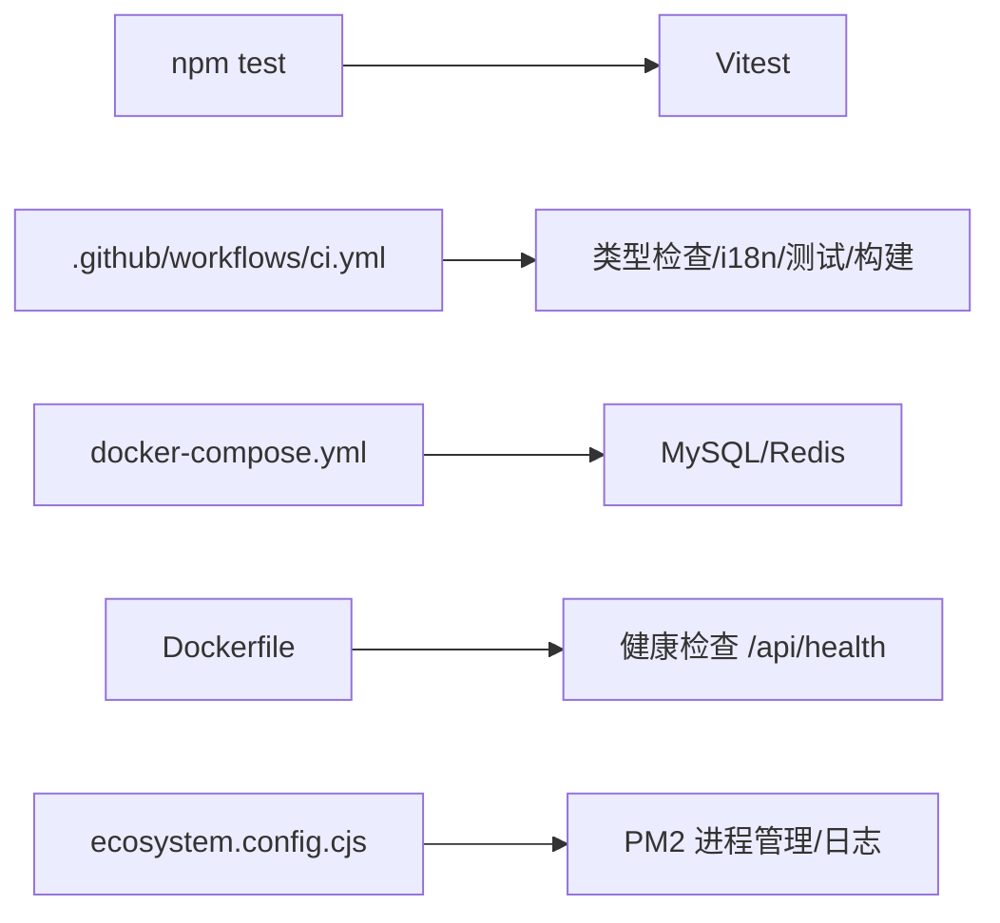

# 测试与部署

<cite>
**本文引用的文件**
- [package.json](file://package.json)
- [vitest.config.ts](file://vitest.config.ts)
- [DEPLOY.md](file://DEPLOY.md)
- [Dockerfile](file://Dockerfile)
- [docker-compose.yml](file://docker-compose.yml)
- [api/mcp/tools/index.ts](file://api/mcp/tools/index.ts)
- [api/mcp/tools/_memoryStore.ts](file://api/mcp/tools/_memoryStore.ts)
- [api/services/memoryManager.ts](file://api/services/memoryManager.ts)
- [scripts/smoke-mcp-authoring.mjs](file://scripts/smoke-mcp-authoring.mjs)
- [api/lib/storage.test.ts](file://api/lib/storage.test.ts)
- [api/routers/team.integration.test.ts](file://api/routers/team.integration.test.ts)
- [scripts/smoke-storage.mjs](file://scripts/smoke-storage.mjs)
- [.github/workflows/ci.yml](file://.github/workflows/ci.yml)
- [ecosystem.config.cjs](file://ecosystem.config.cjs)
</cite>

## 目录
1. [简介](#简介)
2. [项目结构](#项目结构)
3. [核心组件](#核心组件)
4. [架构总览](#架构总览)
5. [详细组件分析](#详细组件分析)
6. [依赖分析](#依赖分析)
7. [性能考虑](#性能考虑)
8. [故障排查指南](#故障排查指南)
9. [结论](#结论)
10. [附录](#附录)

## 简介
本文件面向 DeeWaanAI MCP 工具的测试与部署，覆盖单元测试、集成测试、端到端（冒烟）测试的编写方法；记录内存存储机制的使用与测试数据管理；提供性能与压力测试策略；给出本地开发环境搭建与调试配置；详述生产环境部署流程与监控配置；并包含故障排查指南、日志分析方法以及发布流程与版本管理策略。

## 项目结构
- 测试框架与入口
  - 使用 Vitest 作为测试运行器，配置文件定义测试环境与匹配规则。
  - 通过 npm scripts 统一执行测试、构建与启动命令。
- 服务与工具
  - MCP 工具注册表集中管理所有可用工具，便于按权限过滤与调用。
  - 内存存储基于磁盘持久化，配合记忆管理器实现关键词检索与压缩。
- 基础设施
  - Dockerfile 定义多阶段构建与健康检查。
  - docker-compose 提供 MySQL/Redis 本地依赖。
  - CI 流水线在 GitHub Actions 中执行类型检查、国际化校验、单元测试、构建与集成测试。
- 部署与运维
  - DEPLOY.md 提供 Railway 一键部署清单与环境变量说明。
  - ecosystem.config.cjs 用于 PM2 进程管理与日志轮转。

**图示来源**
- [Dockerfile:1-39](file://Dockerfile#L1-L39)
- [docker-compose.yml:1-52](file://docker-compose.yml#L1-L52)
- [api/mcp/tools/index.ts:1-95](file://api/mcp/tools/index.ts#L1-L95)
- [api/mcp/tools/_memoryStore.ts:1-37](file://api/mcp/tools/_memoryStore.ts#L1-L37)
- [api/services/memoryManager.ts:1-123](file://api/services/memoryManager.ts#L1-L123)
- [.github/workflows/ci.yml:1-96](file://.github/workflows/ci.yml#L1-L96)
- [vitest.config.ts:1-21](file://vitest.config.ts#L1-L21)

**章节来源**
- [package.json:7-21](file://package.json#L7-L21)
- [vitest.config.ts:1-21](file://vitest.config.ts#L1-L21)
- [docker-compose.yml:1-52](file://docker-compose.yml#L1-L52)
- [Dockerfile:1-39](file://Dockerfile#L1-L39)
- [DEPLOY.md:1-145](file://DEPLOY.md#L1-L145)

## 核心组件
- MCP 工具注册表：集中导出所有工具，供服务器按上下文过滤与授权。
- 内存存储层：以项目目录为根，持久化 episodes 与 state，配合记忆管理器进行关键词检索与旋转清理。
- 存储抽象：支持 S3 兼容后端与本地磁盘后端，测试覆盖选择逻辑与读写行为。
- 集成测试套件：团队功能端到端验证，覆盖创建、加入、权限、共享、导入等场景。
- 冒烟脚本：针对 MCP 工具链与存储路径的端到端验证，自动创建/清理测试数据。

**章节来源**
- [api/mcp/tools/index.ts:1-95](file://api/mcp/tools/index.ts#L1-L95)
- [api/mcp/tools/_memoryStore.ts:1-37](file://api/mcp/tools/_memoryStore.ts#L1-L37)
- [api/services/memoryManager.ts:1-123](file://api/services/memoryManager.ts#L1-L123)
- [api/lib/storage.test.ts:1-71](file://api/lib/storage.test.ts#L1-L71)
- [api/routers/team.integration.test.ts:1-436](file://api/routers/team.integration.test.ts#L1-L436)
- [scripts/smoke-mcp-authoring.mjs:1-248](file://scripts/smoke-mcp-authoring.mjs#L1-L248)
- [scripts/smoke-storage.mjs:1-143](file://scripts/smoke-storage.mjs#L1-L143)

## 架构总览
下图展示 MCP 工具调用从客户端到服务端再到存储与数据库的完整链路，包括会话初始化、工具列表获取与工具调用。

**图示来源**
- [api/mcp/tools/index.ts:1-95](file://api/mcp/tools/index.ts#L1-L95)
- [api/mcp/tools/_memoryStore.ts:1-37](file://api/mcp/tools/_memoryStore.ts#L1-L37)
- [api/services/memoryManager.ts:1-123](file://api/services/memoryManager.ts#L1-L123)

## 详细组件分析

### 单元测试：存储后端选择与磁盘读写
- 目标：验证在无 S3 配置时默认使用磁盘后端；当桶、密钥、密钥均设置时切换到 S3；磁盘后端 put/get 往返一致、缺失对象返回空、键名防目录穿越。
- 关键断言点：
  - 未配置 S3 → kind 为 disk。
  - 仅部分 S3 环境变量 → 仍为 disk。
  - 全部 S3 环境变量 → 切换为 s3。
  - 磁盘 put/get 字节级一致。
  - 缺失 key 返回 null。
  - 目录穿越被清洗，仅保留安全文件名。

**图示来源**
- [api/lib/storage.test.ts:1-71](file://api/lib/storage.test.ts#L1-L71)

**章节来源**
- [api/lib/storage.test.ts:1-71](file://api/lib/storage.test.ts#L1-L71)

### 集成测试：团队协作路由（真实 MySQL）
- 目标：覆盖团队创建、邀请加入、成员角色变更、删除、项目共享、步骤导入、共享查询、跨路由一致性、计费边界等场景。
- 关键断言点：
  - 创建团队返回邀请码与座位信息。
  - 有效邀请码加入成功，无效或重复加入报错。
  - 非成员无法访问团队详情。
  - 仅所有者可删除团队，级联清理成员与座位。
  - 角色提升受权限控制，不能修改所有者角色。
  - 成员自删允许，他人移除需管理员权限，禁止移除所有者。
  - 项目共享后成员可导入步骤，未共享源拒绝。
  - 共享查询对非成员拒绝。
  - 跨路由 list 包含共享项目。
  - 未配置计费时 join/remove 不抛错，checkout 前置失败。

**图示来源**
- [api/routers/team.integration.test.ts:1-436](file://api/routers/team.integration.test.ts#L1-L436)

**章节来源**
- [api/routers/team.integration.test.ts:1-436](file://api/routers/team.integration.test.ts#L1-L436)

### 端到端测试：MCP 工具链冒烟
- 目标：通过真实 HTTP 传输调用 MCP 工具，验证标准用户与高级用户的权限门控、工具可用性、管道创建/获取/更新、跨用户隔离。
- 关键断言点：
  - tools/list 包含预期工具。
  - 标准用户可创建顺序管道，但 IF 步骤与自动设计被门控拒绝。
  - 高级用户可创建含 while/if/approval 的控制流管道。
  - get_pipeline 返回有序步骤与配置。
  - update_pipeline 重命名并替换步骤。
  - 跨用户更新被拒绝（Project not found）。

**图示来源**
- [scripts/smoke-mcp-authoring.mjs:1-248](file://scripts/smoke-mcp-authoring.mjs#L1-L248)

**章节来源**
- [scripts/smoke-mcp-authoring.mjs:1-248](file://scripts/smoke-mcp-authoring.mjs#L1-L248)

### 端到端测试：存储路径冒烟（S3）
- 目标：验证截图上传走 S3 而非本地磁盘，认证下载返回相同字节，伪造签名 URL 被拒绝，并在结束后清理。
- 关键断言点：
  - 注册临时用户并上传 PNG。
  - 对象存在于 S3 且大小正确。
  - 本地磁盘无该文件。
  - 带认证头的 GET 返回相同字节。
  - 伪造签名 URL 返回 401。

**图示来源**
- [scripts/smoke-storage.mjs:1-143](file://scripts/smoke-storage.mjs#L1-L143)

**章节来源**
- [scripts/smoke-storage.mjs:1-143](file://scripts/smoke-storage.mjs#L1-L143)

### 内存存储机制与测试数据管理
- 存储位置：项目目录下的 memory/episodes.json 与 memory/state.json。
- 数据结构：Episode 包含 id、promptKeywords、summary、timestamp。
- 检索算法：关键词提取（中英停用词）、重叠计数、按分数与时间排序、取 Top-N。
- 生命周期：创建新片段、旋转保留最近 N 条、序列化为 JSON 持久化。
- 测试数据管理：
  - 冒烟脚本在开始前创建临时用户与项目，结束时清理。
  - 集成测试在 beforeAll/afterAll 中创建/清理团队与相关资源。
  - 存储测试使用临时目录隔离，避免污染。

**图示来源**
- [api/mcp/tools/_memoryStore.ts:1-37](file://api/mcp/tools/_memoryStore.ts#L1-L37)
- [api/services/memoryManager.ts:1-123](file://api/services/memoryManager.ts#L1-L123)

**章节来源**
- [api/mcp/tools/_memoryStore.ts:1-37](file://api/mcp/tools/_memoryStore.ts#L1-L37)
- [api/services/memoryManager.ts:1-123](file://api/services/memoryManager.ts#L1-L123)

## 依赖分析
- 测试与构建
  - Vitest 负责单元测试与集成测试运行。
  - CI 在 GitHub Actions 中执行类型检查、国际化校验、单元测试、构建与集成测试。
- 运行时依赖
  - MySQL 与 Redis 通过 docker-compose 在本地提供，或在云平台上配置。
  - Dockerfile 定义健康检查与最小化镜像。
- 进程管理
  - PM2 配置限制实例数、堆大小、日志轮转与崩溃重启。

**图示来源**
- [vitest.config.ts:1-21](file://vitest.config.ts#L1-L21)
- [.github/workflows/ci.yml:1-96](file://.github/workflows/ci.yml#L1-L96)
- [docker-compose.yml:1-52](file://docker-compose.yml#L1-L52)
- [Dockerfile:1-39](file://Dockerfile#L1-L39)
- [ecosystem.config.cjs:1-32](file://ecosystem.config.cjs#L1-L32)

**章节来源**
- [vitest.config.ts:1-21](file://vitest.config.ts#L1-L21)
- [.github/workflows/ci.yml:1-96](file://.github/workflows/ci.yml#L1-L96)
- [docker-compose.yml:1-52](file://docker-compose.yml#L1-L52)
- [Dockerfile:1-39](file://Dockerfile#L1-L39)
- [ecosystem.config.cjs:1-32](file://ecosystem.config.cjs#L1-L32)

## 性能考虑
- 内存与堆限制
  - PM2 配置单实例、最大内存重启阈值与 Node 堆上限，防止 OOM。
- 健康检查
  - Docker 健康检查定期探测 /api/health，结合平台探针快速发现退化。
- 速率限制与缓存
  - 使用 Redis 进行固定窗口限流与状态缓存，降低数据库压力。
- 存储后端选择
  - 根据环境变量动态选择 S3 或磁盘后端，避免不必要的网络开销。
- 建议的压力测试策略
  - 使用冒烟脚本扩展为并发调用，模拟多用户同时创建/更新管道。
  - 对 /api/health 与 /api/ready 进行持续探测，观察降级与恢复。
  - 在 CI 中引入负载脚本，逐步增加并发度，评估吞吐与延迟。

**章节来源**
- [ecosystem.config.cjs:1-32](file://ecosystem.config.cjs#L1-L32)
- [Dockerfile:35-36](file://Dockerfile#L35-L36)
- [DEPLOY.md:108-114](file://DEPLOY.md#L108-L114)
- [api/lib/storage.test.ts:24-39](file://api/lib/storage.test.ts#L24-L39)

## 故障排查指南
- 常见症状与定位
  - 健康检查失败：检查数据库与 Redis 连接、环境变量是否正确。
  - 工具调用失败：查看 MCP 会话是否初始化、权限是否足够、工具是否在列表中。
  - 存储异常：确认 S3 环境变量齐全，或磁盘路径可写；检查对象是否存在与权限。
- 日志分析
  - PM2 日志轮转：combined.log、out.log、error.log，注意文件大小与数量限制。
  - 容器日志：通过平台控制台查看应用输出，关注启动与错误堆栈。
- 数据一致性
  - 集成测试失败：核对数据库 schema 是否已推送，检查事务与级联删除。
  - 冒烟脚本失败：确认临时用户与对象已清理，避免污染后续运行。
- 回滚与恢复
  - 若部署失败，回退到上一稳定版本，确保数据库迁移可逆或已有备份。
  - 启用备份任务，定期将数据库导出至对象存储。

**章节来源**
- [ecosystem.config.cjs:10-30](file://ecosystem.config.cjs#L10-L30)
- [DEPLOY.md:125-133](file://DEPLOY.md#L125-L133)
- [scripts/smoke-storage.mjs:124-137](file://scripts/smoke-storage.mjs#L124-L137)

## 结论
本项目提供了完善的测试体系与部署方案：单元测试覆盖存储后端选择与读写；集成测试覆盖团队协作全流程；端到端冒烟脚本验证 MCP 工具链与存储路径。通过 Docker 与 CI 保障构建质量，PM2 与平台健康检查保障运行稳定性。建议在生产环境中完善监控告警、备份策略与压测计划，持续提升可靠性与可观测性。

## 附录
- 本地开发环境搭建
  - 使用 docker-compose 启动 MySQL 与 Redis。
  - 安装依赖并执行类型检查与测试。
  - 启动开发服务器，连接 MCP 端点进行调试。
- 生产环境部署流程
  - 参考部署清单完成云平台配置、环境变量注入、数据库迁移与功能开关设置。
  - 配置对象存储、备份令牌与监控指标。
- 发布流程与版本管理
  - 提交代码触发 CI，通过后合并 main 分支，平台自动部署。
  - 版本号由包管理工具维护，发布前确保测试与构建通过。

**章节来源**
- [docker-compose.yml:1-52](file://docker-compose.yml#L1-L52)
- [package.json:7-21](file://package.json#L7-L21)
- [DEPLOY.md:1-145](file://DEPLOY.md#L1-L145)
- [.github/workflows/ci.yml:1-96](file://.github/workflows/ci.yml#L1-L96)