# 生产部署

<cite>
**本文引用的文件**
- [Dockerfile](file://Dockerfile)
- [docker-compose.yml](file://docker-compose.yml)
- [docker-compose.backup.yml](file://docker-compose.backup.yml)
- [ecosystem.config.cjs](file://ecosystem.config.cjs)
- [DEPLOY.md](file://DEPLOY.md)
- [api/lib/env.ts](file://api/lib/env.ts)
- [api/mcp/server.ts](file://api/mcp/server.ts)
- [scripts/backup-db.sh](file://scripts/backup-db.sh)
- [deploy/install.sh](file://deploy/install.sh)
- [.github/workflows/backup.yml](file://.github/workflows/backup.yml)
- [api/services/backup.ts](file://api/services/backup.ts)
- [api/lib/logger.ts](file://api/lib/logger.ts)
- [api/boot.ts](file://api/boot.ts)
- [api/mcp/register.ts](file://api/mcp/register.ts)
</cite>

## 目录
1. [简介](#简介)
2. [项目结构](#项目结构)
3. [核心组件](#核心组件)
4. [架构总览](#架构总览)
5. [详细组件分析](#详细组件分析)
6. [依赖关系分析](#依赖关系分析)
7. [性能考虑](#性能考虑)
8. [故障排查指南](#故障排查指南)
9. [结论](#结论)
10. [附录](#附录)

## 简介
本文件面向生产环境，提供DeeWaanAI MCP工具及后端服务的完整部署与运维指南。内容涵盖：
- Docker容器化部署与编排
- PM2进程管理与自动重启
- 环境变量与敏感信息管理
- 监控、健康检查与日志收集
- 备份恢复与灾难恢复
- 性能调优与安全加固

## 项目结构
生产相关的关键文件包括：
- 容器镜像构建与运行：Dockerfile
- 本地/开发编排：docker-compose.yml（MySQL、Redis）
- 备份调度编排：docker-compose.backup.yml + scripts/backup-db.sh
- 进程管理：ecosystem.config.cjs（PM2）
- 一键安装脚本（Aliyun优化）：deploy/install.sh
- 环境变量定义与校验：api/lib/env.ts
- 健康检查端点：api/boot.ts
- 备份服务实现：api/services/backup.ts
- GitHub Actions定时备份：.github/workflows/backup.yml
- MCP服务器与鉴权：api/mcp/server.ts, api/mcp/register.ts
- 日志框架：api/lib/logger.ts

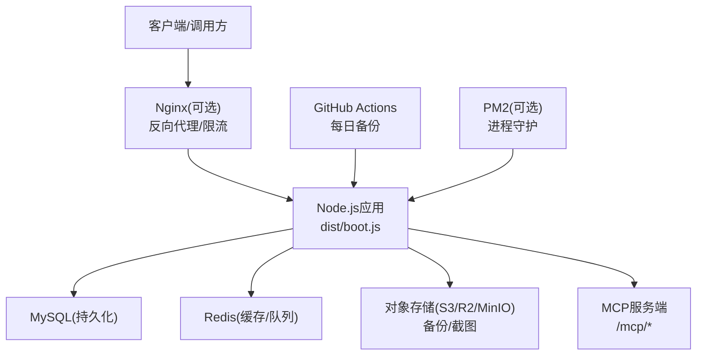

**图表来源**
- [Dockerfile:1-39](file://Dockerfile#L1-L39)
- [docker-compose.yml:1-52](file://docker-compose.yml#L1-L52)
- [ecosystem.config.cjs:1-32](file://ecosystem.config.cjs#L1-L32)
- [api/boot.ts:85-120](file://api/boot.ts#L85-L120)
- [api/mcp/register.ts:90-152](file://api/mcp/register.ts#L90-L152)

**章节来源**
- [Dockerfile:1-39](file://Dockerfile#L1-L39)
- [docker-compose.yml:1-52](file://docker-compose.yml#L1-L52)
- [ecosystem.config.cjs:1-32](file://ecosystem.config.cjs#L1-L32)
- [deploy/install.sh:1-222](file://deploy/install.sh#L1-L222)

## 核心组件
- 应用入口与健康检查：Node.js应用启动后暴露健康与就绪端点，用于容器编排与负载均衡探测。
- MCP服务：按会话创建McpServer，基于权限与作用域注册工具，记录审计与用量指标。
- 备份系统：通过mysqldump生成压缩SQL并上传至S3兼容存储，支持保留策略与清理。
- 日志与可观测性：结构化JSON日志输出，便于集中采集；支持Sentry集成（可选）。
- 进程管理：PM2单实例模式，内存上限保护与崩溃自动重启。

**章节来源**
- [api/boot.ts:85-120](file://api/boot.ts#L85-L120)
- [api/mcp/server.ts:1-209](file://api/mcp/server.ts#L1-L209)
- [api/services/backup.ts:1-224](file://api/services/backup.ts#L1-L224)
- [api/lib/logger.ts:1-32](file://api/lib/logger.ts#L1-L32)
- [ecosystem.config.cjs:1-32](file://ecosystem.config.cjs#L1-L32)

## 架构总览
生产部署通常包含以下层次：
- 边缘层：Nginx或云厂商网关进行HTTPS终止、限流、长连接转发。
- 应用层：Node.js应用（boot.js），承载HTTP API与MCP协议。
- 数据层：MySQL（持久化）、Redis（缓存/队列/限速）。
- 存储层：S3兼容对象存储（备份、截图等）。
- 运维层：PM2进程守护、日志采集、健康检查、定时备份。

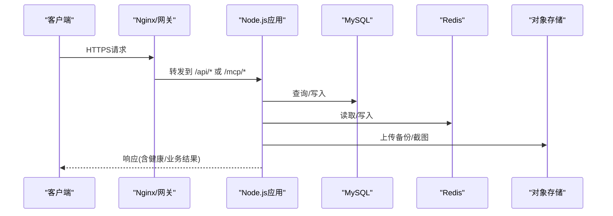

**图表来源**
- [deploy/install.sh:131-172](file://deploy/install.sh#L131-L172)
- [api/boot.ts:85-120](file://api/boot.ts#L85-L120)
- [api/services/backup.ts:175-224](file://api/services/backup.ts#L175-L224)

## 详细组件分析

### Docker容器化部署
- 多阶段构建：构建阶段使用node:20-alpine，生产阶段仅拷贝产物与运行时依赖，减小镜像体积。
- 安全运行：以非root用户appuser运行，最小化权限。
- 健康检查：内置HEALTHCHECK探测/api/health，配合编排器实现自愈。
- 端口与环境：默认暴露3000端口，NODE_ENV=production。

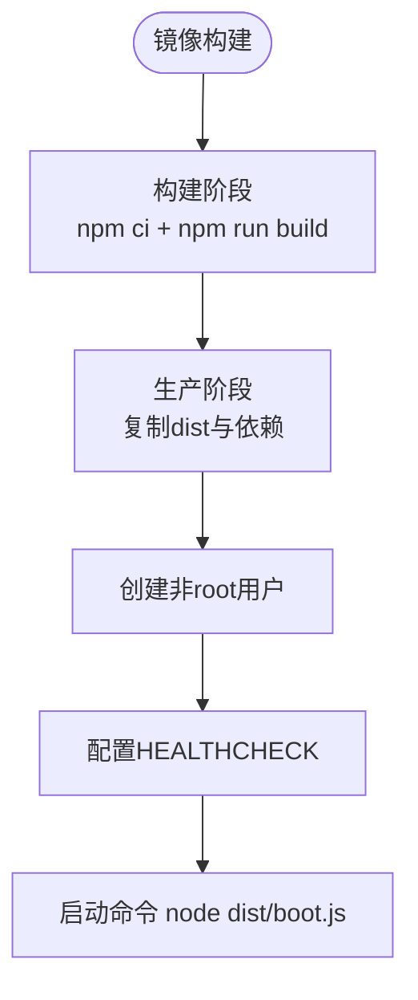

**图表来源**
- [Dockerfile:1-39](file://Dockerfile#L1-L39)

**章节来源**
- [Dockerfile:1-39](file://Dockerfile#L1-L39)

### PM2进程管理
- 单实例模式：避免共享内存导致的OOM风险。
- 内存限制：max_memory_restart触发重启，防止内存泄漏累积。
- 自动重启：autorestart=true，崩溃后快速恢复。
- 日志轮转：统一输出到logs目录，限制文件大小与数量。

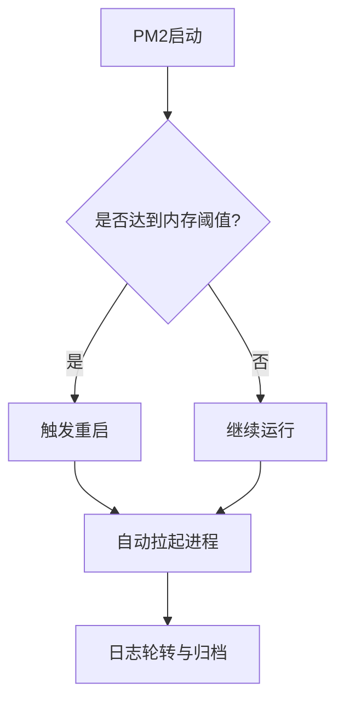

**图表来源**
- [ecosystem.config.cjs:1-32](file://ecosystem.config.cjs#L1-L32)

**章节来源**
- [ecosystem.config.cjs:1-32](file://ecosystem.config.cjs#L1-L32)

### 环境变量与敏感信息保护
- 必需变量：APP_SECRET、DATABASE_URL、AI_SWARM_MASTER_KEY、MARKETPLACE_MASTER_KEY在prod下缺失将阻止启动。
- 安全校验：拒绝已知不安全默认值，防止误用开发密钥。
- 可选能力：Redis、Stripe、S3、Sentry等按需启用，未配置时优雅降级。
- 建议：所有密钥通过平台Secrets管理（如Railway Variables/GitHub Secrets），不入库、不入代码。

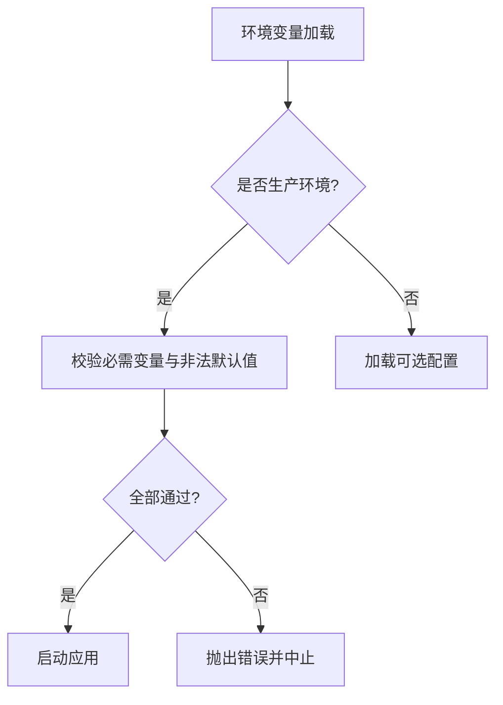

**图表来源**
- [api/lib/env.ts:1-105](file://api/lib/env.ts#L1-L105)

**章节来源**
- [api/lib/env.ts:1-105](file://api/lib/env.ts#L1-L105)
- [DEPLOY.md:46-65](file://DEPLOY.md#L46-L65)

### 健康检查与就绪探针
- /api/health：返回应用状态、数据库/Redis/队列/Worker状态与内存信息。
- /api/ready：当数据库可达且Redis（若启用）连通时才返回200，供负载均衡器路由决策。
- 容器健康检查：HEALTHCHECK定期探测/api/health，失败则标记不健康。

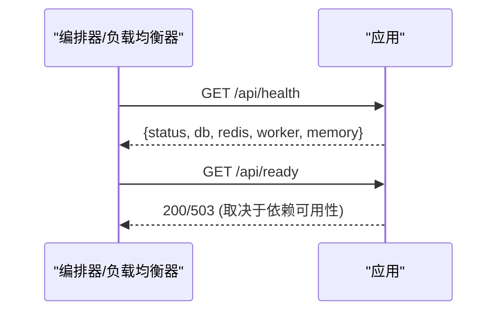

**图表来源**
- [api/boot.ts:85-120](file://api/boot.ts#L85-L120)
- [Dockerfile:35-36](file://Dockerfile#L35-L36)

**章节来源**
- [api/boot.ts:85-120](file://api/boot.ts#L85-L120)
- [Dockerfile:35-36](file://Dockerfile#L35-L36)

### 监控与日志收集
- 结构化日志：统一JSON格式输出，包含时间戳、级别、消息与上下文。
- 日志级别：通过LOG_LEVEL控制，便于生产调试。
- 外部链路：可通过Sentry DSN接入错误追踪（可选）。
- 建议：将stdout/stderr接入集中式日志系统（如CloudWatch/ELK/Fluentd）。

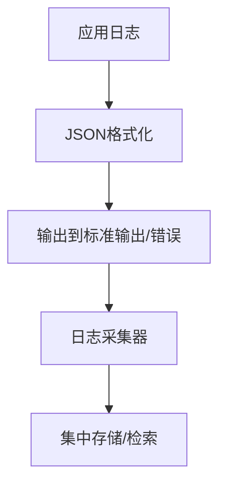

**图表来源**
- [api/lib/logger.ts:1-32](file://api/lib/logger.ts#L1-L32)

**章节来源**
- [api/lib/logger.ts:1-32](file://api/lib/logger.ts#L1-L32)

### 备份与灾难恢复
- 在线备份：GitHub Actions每日触发POST /api/admin/backup，执行mysqldump并上传至S3，保留7天。
- 离线备份：docker-compose.backup.yml + scripts/backup-db.sh，适合本地或任意可访问数据库的环境。
- 恢复流程：从S3下载对应时间点的.sql.gz，解压后导入MySQL。
- 安全要点：备份令牌BACKUP_TOKEN与S3凭据必须严格保管；数据库URL中密码需正确编码。

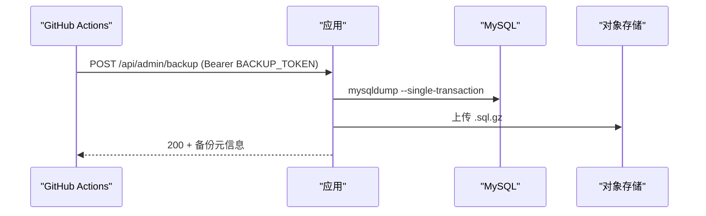

**图表来源**
- [.github/workflows/backup.yml:1-46](file://.github/workflows/backup.yml#L1-L46)
- [api/services/backup.ts:175-224](file://api/services/backup.ts#L175-L224)
- [scripts/backup-db.sh:1-56](file://scripts/backup-db.sh#L1-L56)

**章节来源**
- [.github/workflows/backup.yml:1-46](file://.github/workflows/backup.yml#L1-L46)
- [api/services/backup.ts:1-224](file://api/services/backup.ts#L1-L224)
- [scripts/backup-db.sh:1-56](file://scripts/backup-db.sh#L1-L56)
- [docker-compose.backup.yml:1-47](file://docker-compose.backup.yml#L1-L47)

### MCP工具与服务
- 会话级MCP服务器：每个会话创建独立McpServer，隔离认证上下文与工具注册。
- 权限与特性门控：工具按scopes与featureFlag动态注册，未授权或关闭的特性将被隐藏。
- 审计与用量：每次调用记录延迟、状态与错误，统计月度用量。
- 速率限制：按客户层级进行MCP调用限流，超限返回429并提示重试间隔。

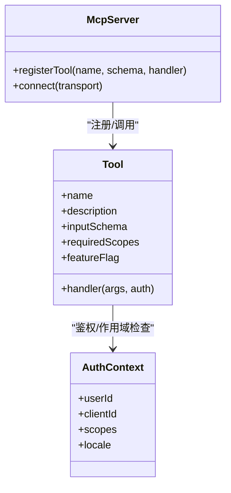

**图表来源**
- [api/mcp/server.ts:1-209](file://api/mcp/server.ts#L1-L209)
- [api/mcp/register.ts:90-152](file://api/mcp/register.ts#L90-L152)

**章节来源**
- [api/mcp/server.ts:1-209](file://api/mcp/server.ts#L1-L209)
- [api/mcp/register.ts:90-152](file://api/mcp/register.ts#L90-L152)

### 一键安装与Nginx配置（Aliyun优化）
- 自动准备：安装Node.js、MySQL、Nginx、PM2，配置低内存MySQL参数，创建应用数据库与用户。
- 反向代理：Nginx对API与流式接口设置超时与限流，屏蔽静态缓存，保障长连接稳定。
- PM2启动：使用ecosystem配置文件启动，保存并设置开机自启。
- 防火墙：开放22/80/443端口。

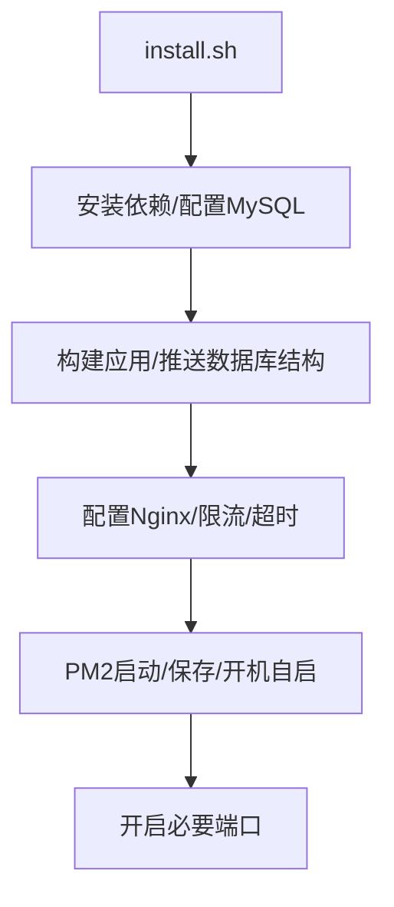

**图表来源**
- [deploy/install.sh:1-222](file://deploy/install.sh#L1-L222)

**章节来源**
- [deploy/install.sh:1-222](file://deploy/install.sh#L1-L222)

## 依赖关系分析
- 应用依赖：MySQL（持久化）、Redis（缓存/队列/限速）、对象存储（备份/附件）。
- 外部集成：GitHub Actions（定时备份）、Sentry（可选错误追踪）、Stripe（可选计费）。
- 进程模型：PM2单实例+内存上限；容器内健康检查由编排器驱动。

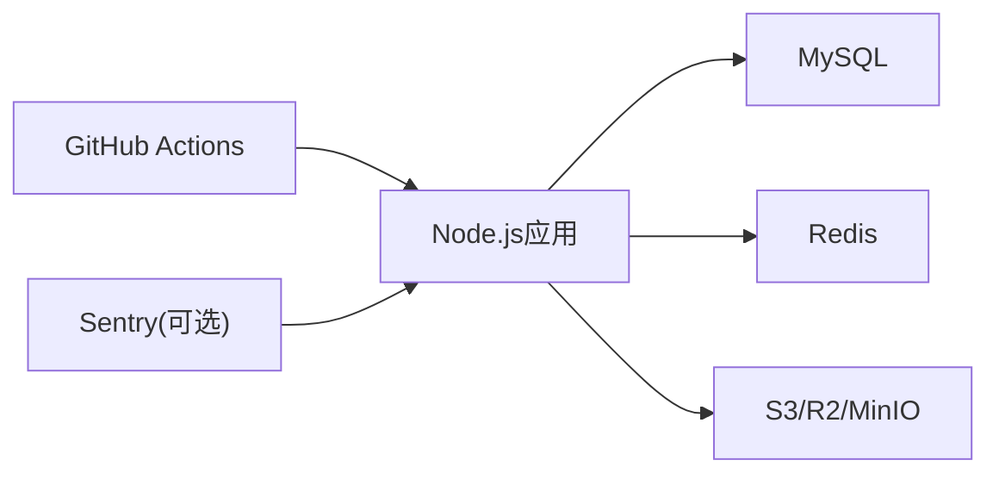

**图表来源**
- [api/lib/env.ts:24-95](file://api/lib/env.ts#L24-L95)
- [.github/workflows/backup.yml:1-46](file://.github/workflows/backup.yml#L1-L46)

**章节来源**
- [api/lib/env.ts:24-95](file://api/lib/env.ts#L24-L95)
- [.github/workflows/backup.yml:1-46](file://.github/workflows/backup.yml#L1-L46)

## 性能考虑
- Node.js堆大小：通过NODE_OPTIONS限制堆大小，结合PM2的max_memory_restart防止OOM。
- 数据库连接：合理设置最大连接数与超时，避免连接风暴。
- 缓存与队列：充分利用Redis提升读性能与任务吞吐。
- 反向代理：Nginx针对流式接口调整超时与缓冲，避免过早断开。
- 资源规划：小内存实例建议开启Swap，降低突发负载导致的崩溃概率。

[本节为通用指导，不直接分析具体文件]

## 故障排查指南
- 健康检查失败：查看/api/health与/api/ready，确认数据库与Redis状态。
- 备份失败：检查BACKUP_TOKEN与S3_*配置；确认数据库公网/内网可达；查看GitHub Actions运行日志。
- 进程频繁重启：关注PM2日志与内存使用，必要时调整堆大小或排查内存泄漏。
- MCP鉴权失败：确认OAuth令牌有效，检查速率限制与角色作用域。
- 日志定位：通过LOG_LEVEL提高详细度，结合集中式日志系统进行关联分析。

**章节来源**
- [api/boot.ts:85-120](file://api/boot.ts#L85-L120)
- [.github/workflows/backup.yml:1-46](file://.github/workflows/backup.yml#L1-L46)
- [ecosystem.config.cjs:1-32](file://ecosystem.config.cjs#L1-L32)
- [api/mcp/register.ts:90-152](file://api/mcp/register.ts#L90-L152)
- [api/lib/logger.ts:1-32](file://api/lib/logger.ts#L1-L32)

## 结论
本部署文档提供了从容器化、进程管理、环境变量、监控日志到备份恢复与性能安全的完整生产实践。建议在生产上线前完成：
- 完善环境变量与密钥管理
- 验证健康检查与就绪探针
- 配置日志采集与告警
- 启用并测试备份恢复流程
- 根据流量与资源情况调优性能与安全策略

[本节为总结，不直接分析具体文件]

## 附录
- 参考部署清单与步骤详见：[DEPLOY.md](file://DEPLOY.md)
- 本地/开发编排参考：[docker-compose.yml](file://docker-compose.yml)
- 备份编排参考：[docker-compose.backup.yml](file://docker-compose.backup.yml)
- 一键安装脚本参考：[deploy/install.sh](file://deploy/install.sh)