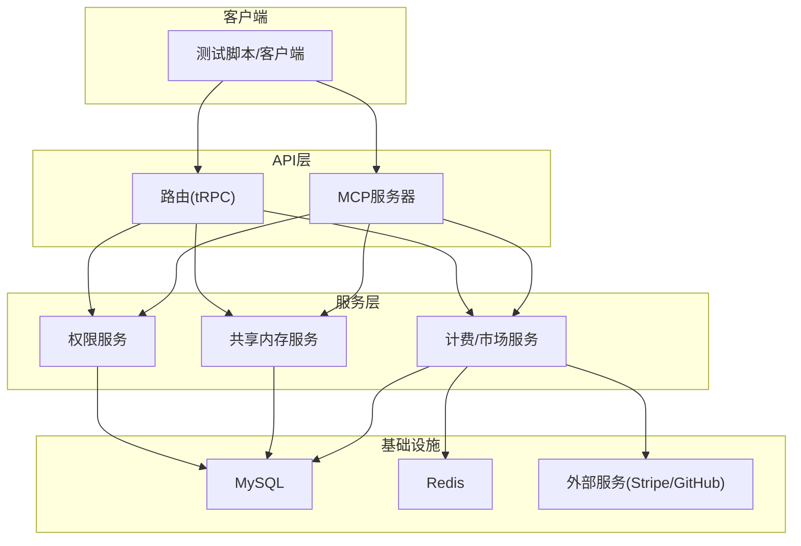
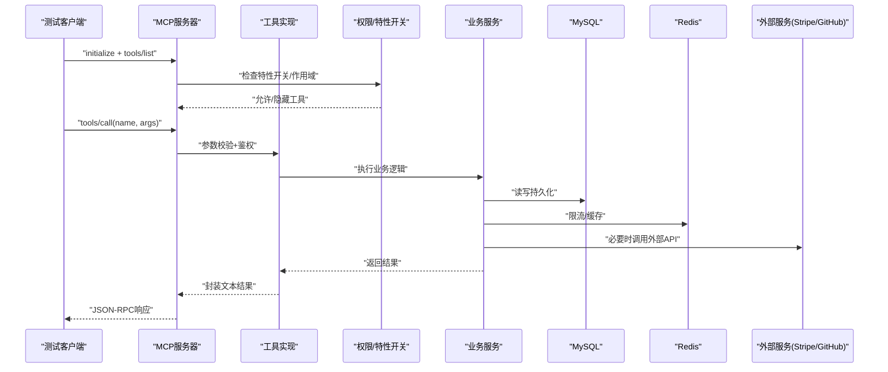
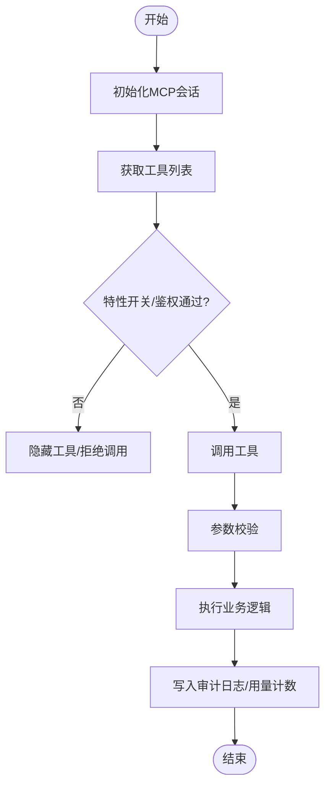
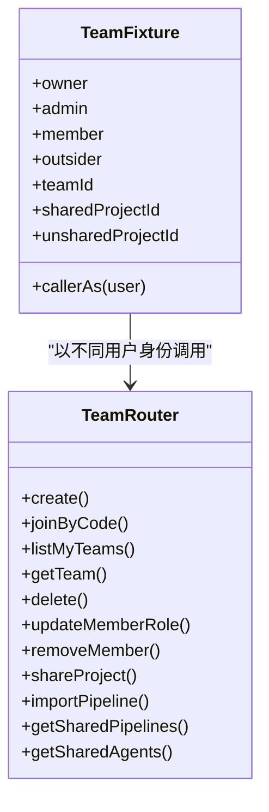
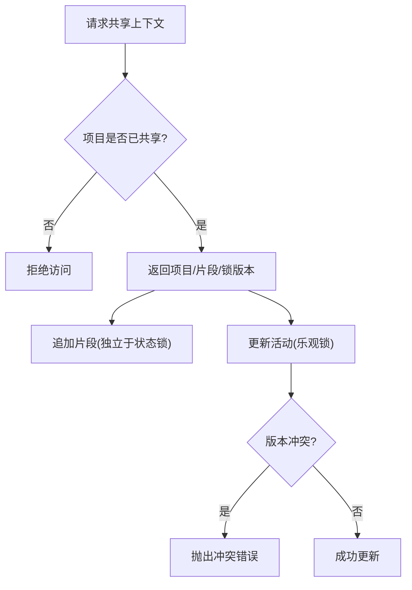
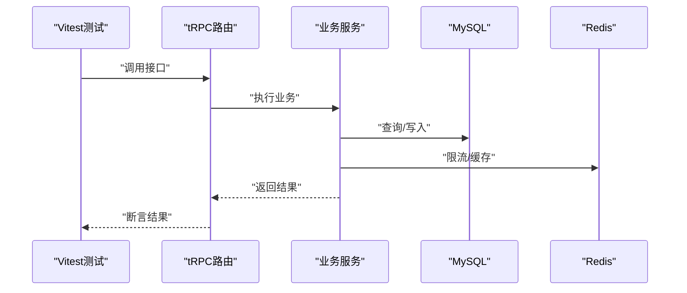
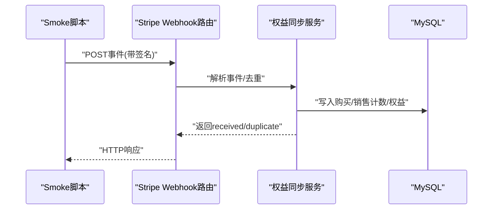
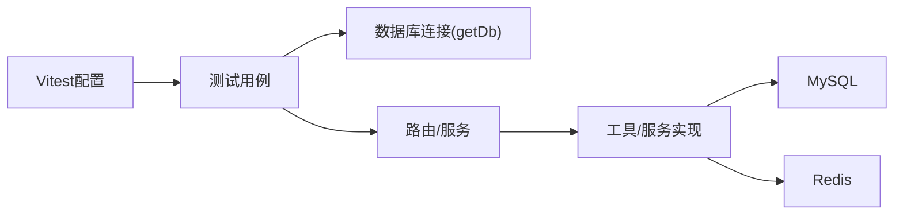

# 集成测试

<cite>
**本文引用的文件**
- [api/mcp/server.ts](file://api/mcp/server.ts)
- [api/mcp/tools/index.ts](file://api/mcp/tools/index.ts)
- [api/routers/team.integration.test.ts](file://api/routers/team.integration.test.ts)
- [api/services/sharedMemory.integration.test.ts](file://api/services/sharedMemory.integration.test.ts)
- [api/services/entitlements.integration.test.ts](file://api/services/entitlements.integration.test.ts)
- [api/testUtils/teamFixture.ts](file://api/testUtils/teamFixture.ts)
- [scripts/smoke-mcp-authoring.mjs](file://scripts/smoke-mcp-authoring.mjs)
- [scripts/smoke-stripe-webhook.mjs](file://scripts/smoke-stripe-webhook.mjs)
- [scripts/smoke-teamsync.mjs](file://scripts/smoke-teamsync.mjs)
- [vitest.config.ts](file://vitest.config.ts)
- [.github/workflows/ci.yml](file://.github/workflows/ci.yml)
- [api/queries/connection.ts](file://api/queries/connection.ts)
</cite>

## 目录
1. [简介](#简介)
2. [项目结构](#项目结构)
3. [核心组件](#核心组件)
4. [架构总览](#架构总览)
5. [详细组件分析](#详细组件分析)
6. [依赖关系分析](#依赖关系分析)
7. [性能考量](#性能考量)
8. [故障排查指南](#故障排查指南)
9. [结论](#结论)
10. [附录](#附录)

## 简介
本文件面向DeeWaanAI的MCP工具与后端服务的集成测试，目标是提供一套端到端（E2E）验证方案，覆盖：
- MCP工具注册、鉴权、特性开关控制与调用链路
- 团队协作功能、权限系统与共享内存机制
- API路由集成测试方法与Mock策略
- 第三方服务集成测试（Stripe支付、GitHub同步）
- 完整的测试执行流程与结果分析方法

文档基于仓库中现有的集成测试脚本与Vitest配置，结合真实MySQL/Redis环境进行说明，确保可复现、可维护。

## 项目结构
本项目采用分层组织：
- api/mcp：MCP服务端与工具注册、鉴权、审计与遥测
- api/routers：tRPC路由与业务接口
- api/services：领域服务（权限、共享内存、事件等）
- scripts：端到端冒烟脚本（MCP、Stripe、TeamSync等）
- db：数据库迁移与Schema
- .github/workflows：CI流水线，包含单元测试与集成测试

**图表来源**
- [api/mcp/server.ts:135-186](file://api/mcp/server.ts#L135-L186)
- [api/mcp/tools/index.ts:45-94](file://api/mcp/tools/index.ts#L45-L94)
- [api/services/entitlements.integration.test.ts:19-71](file://api/services/entitlements.integration.test.ts#L19-L71)
- [api/services/sharedMemory.integration.test.ts:15-69](file://api/services/sharedMemory.integration.test.ts#L15-L69)
- [scripts/smoke-stripe-webhook.mjs:106-112](file://scripts/smoke-stripe-webhook.mjs#L106-L112)

**章节来源**
- [vitest.config.ts:16-19](file://vitest.config.ts#L16-L19)
- [.github/workflows/ci.yml:45-95](file://.github/workflows/ci.yml#L45-L95)

## 核心组件
- MCP服务器与工具注册：每个会话创建独立McpServer实例，按用户上下文注册工具，支持特性开关隐藏工具、鉴权范围校验、审计日志与用量计数。
- 团队与权限：通过tRPC路由暴露团队管理、成员角色、项目共享、导入导出等能力；权限由权限服务与数据库模型共同保障。
- 共享内存：为团队项目提供协作式状态与片段追加，具备乐观锁与访问控制。
- 第三方集成：Stripe webhook处理购买/退款事件，驱动市场权益授予与撤销；GitHub同步用于数据可移植性。

**章节来源**
- [api/mcp/server.ts:84-124](file://api/mcp/server.ts#L84-L124)
- [api/mcp/server.ts:135-186](file://api/mcp/server.ts#L135-L186)
- [api/routers/team.integration.test.ts:26-56](file://api/routers/team.integration.test.ts#L26-L56)
- [api/services/sharedMemory.integration.test.ts:27-39](file://api/services/sharedMemory.integration.test.ts#L27-L39)
- [scripts/smoke-stripe-webhook.mjs:139-182](file://scripts/smoke-stripe-webhook.mjs#L139-L182)

## 架构总览
下图展示MCP工具调用从客户端到后端服务再到数据库/外部系统的完整序列。

**图表来源**
- [api/mcp/server.ts:84-124](file://api/mcp/server.ts#L84-L124)
- [api/mcp/server.ts:135-186](file://api/mcp/server.ts#L135-L186)
- [scripts/smoke-mcp-authoring.mjs:39-76](file://scripts/smoke-mcp-authoring.mjs#L39-L76)
- [scripts/smoke-stripe-webhook.mjs:106-112](file://scripts/smoke-stripe-webhook.mjs#L106-L112)

## 详细组件分析

### MCP工具集成测试
- 目标：验证工具列表可见性、参数校验、鉴权范围、特性开关、审计与用量统计。
- 方法：
  - 使用smoke-mcp-authoring.mjs对“pipeline authoring”工具链进行端到端验证，包括create/get/update/design及tier门控。
  - 使用smoke-teamsync.mjs对TeamSync工具进行特性开关控制验证（off/on/flow），并覆盖跨用户隔离。
  - 在MCP服务器层，每个工具调用都会记录审计日志与月度用量计数，失败时不影响主流程。

**图表来源**
- [api/mcp/server.ts:84-124](file://api/mcp/server.ts#L84-L124)
- [scripts/smoke-mcp-authoring.mjs:99-170](file://scripts/smoke-mcp-authoring.mjs#L99-L170)
- [scripts/smoke-teamsync.mjs:110-124](file://scripts/smoke-teamsync.mjs#L110-L124)

**章节来源**
- [scripts/smoke-mcp-authoring.mjs:82-173](file://scripts/smoke-mcp-authoring.mjs#L82-L173)
- [scripts/smoke-teamsync.mjs:91-124](file://scripts/smoke-teamsync.mjs#L91-L124)
- [api/mcp/server.ts:135-186](file://api/mcp/server.ts#L135-L186)

### 团队协作功能与权限系统
- 目标：验证团队创建、加入、成员角色变更、删除、项目共享、导入导出、跨路由可见性等。
- 方法：
  - 使用team.integration.test.ts以真实MySQL执行T1-T14用例，覆盖权限边界与级联清理。
  - 使用teamFixture.ts构造多角色用户与团队、项目，并通过tRPC caller模拟不同身份操作。

**图表来源**
- [api/testUtils/teamFixture.ts:16-26](file://api/testUtils/teamFixture.ts#L16-L26)
- [api/routers/team.integration.test.ts:26-56](file://api/routers/team.integration.test.ts#L26-L56)

**章节来源**
- [api/routers/team.integration.test.ts:58-95](file://api/routers/team.integration.test.ts#L58-L95)
- [api/routers/team.integration.test.ts:97-119](file://api/routers/team.integration.test.ts#L97-L119)
- [api/routers/team.integration.test.ts:121-153](file://api/routers/team.integration.test.ts#L121-L153)
- [api/routers/team.integration.test.ts:155-203](file://api/routers/team.integration.test.ts#L155-L203)
- [api/routers/team.integration.test.ts:205-243](file://api/routers/team.integration.test.ts#L205-L243)
- [api/routers/team.integration.test.ts:244-275](file://api/routers/team.integration.test.ts#L244-L275)
- [api/routers/team.integration.test.ts:277-350](file://api/routers/team.integration.test.ts#L277-L350)
- [api/routers/team.integration.test.ts:365-392](file://api/routers/team.integration.test.ts#L365-L392)
- [api/routers/team.integration.test.ts:394-434](file://api/routers/team.integration.test.ts#L394-L434)
- [api/testUtils/teamFixture.ts:28-131](file://api/testUtils/teamFixture.ts#L28-L131)

### 共享内存机制
- 目标：验证共享项目的访问控制、乐观锁冲突检测、独立追加片段。
- 方法：
  - sharedMemory.integration.test.ts使用真实MySQL验证T15/T16场景。
  - 通过getSharedContext、appendSharedEpisode、bumpSharedStateActivity等方法测试并发与一致性。

**图表来源**
- [api/services/sharedMemory.integration.test.ts:27-39](file://api/services/sharedMemory.integration.test.ts#L27-L39)
- [api/services/sharedMemory.integration.test.ts:42-69](file://api/services/sharedMemory.integration.test.ts#L42-L69)

**章节来源**
- [api/services/sharedMemory.integration.test.ts:27-39](file://api/services/sharedMemory.integration.test.ts#L27-L39)
- [api/services/sharedMemory.integration.test.ts:42-69](file://api/services/sharedMemory.integration.test.ts#L42-L69)

### API路由集成测试与Mock策略
- 目标：对tRPC路由进行端到端验证，并在需要时隔离外部依赖。
- 方法：
  - 使用Vitest运行api/**/*.test.ts与*.spec.ts，默认跳过无数据库环境的集成测试。
  - CI中启动MySQL与Redis容器，设置DATABASE_URL与REDIS_URL后执行db:push与测试。
  - Mock策略：
    - 对于外部服务（如Stripe），使用离线签名与本地事件构造，避免网络调用。
    - 对于内部服务（如权限、限流），可通过环境变量或注入方式替换实现。
    - 使用teamFixture.ts直接操作数据库构造测试数据，绕过复杂初始化逻辑。

**图表来源**
- [vitest.config.ts:16-19](file://vitest.config.ts#L16-L19)
- [.github/workflows/ci.yml:45-95](file://.github/workflows/ci.yml#L45-L95)
- [api/services/entitlements.integration.test.ts:19-71](file://api/services/entitlements.integration.test.ts#L19-L71)

**章节来源**
- [vitest.config.ts:16-19](file://vitest.config.ts#L16-L19)
- [.github/workflows/ci.yml:45-95](file://.github/workflows/ci.yml#L45-L95)
- [api/services/entitlements.integration.test.ts:19-71](file://api/services/entitlements.integration.test.ts#L19-L71)

### 第三方服务集成测试（Stripe支付与GitHub同步）
- Stripe支付：
  - 使用smoke-stripe-webhook.mjs构造checkout.session.completed与charge.refunded事件，验证购买/退款路径、幂等性与权益授予/撤销。
  - 无需真实Stripe网络调用，仅使用SDK生成签名与本地验证。
- GitHub同步：
  - 通过portability工具中的syncToGithub进行数据可移植性验证，可在E2E脚本中扩展调用。

**图表来源**
- [scripts/smoke-stripe-webhook.mjs:106-112](file://scripts/smoke-stripe-webhook.mjs#L106-L112)
- [scripts/smoke-stripe-webhook.mjs:139-182](file://scripts/smoke-stripe-webhook.mjs#L139-L182)
- [scripts/smoke-stripe-webhook.mjs:197-228](file://scripts/smoke-stripe-webhook.mjs#L197-L228)

**章节来源**
- [scripts/smoke-stripe-webhook.mjs:117-182](file://scripts/smoke-stripe-webhook.mjs#L117-L182)
- [scripts/smoke-stripe-webhook.mjs:197-228](file://scripts/smoke-stripe-webhook.mjs#L197-L228)

## 依赖关系分析
- 数据库连接：通过api/queries/connection.ts提供单例Drizzle实例，读优化时可切换只读副本。
- 测试环境：Vitest配置指定测试环境与包含规则；CI通过服务容器提供MySQL与Redis。
- 工具注册：MCP工具集中注册于api/mcp/tools/index.ts，服务器按会话构建并过滤。

**图表来源**
- [vitest.config.ts:16-19](file://vitest.config.ts#L16-L19)
- [api/queries/connection.ts:10-18](file://api/queries/connection.ts#L10-L18)
- [api/mcp/tools/index.ts:45-94](file://api/mcp/tools/index.ts#L45-L94)

**章节来源**
- [api/queries/connection.ts:10-18](file://api/queries/connection.ts#L10-L18)
- [api/mcp/tools/index.ts:45-94](file://api/mcp/tools/index.ts#L45-L94)

## 性能考量
- 审计与用量计数为fire-and-forget，不阻塞主流程，降低测试与生产开销。
- 乐观锁减少并发写冲突导致的回滚成本，测试中通过重复版本调用验证冲突行为。
- 限流器基于Redis固定窗口，测试中验证阈值与重试时间，有助于评估高负载下的稳定性。

[本节为通用指导，不直接分析具体文件]

## 故障排查指南
- 数据库未配置：集成测试自动跳过，需设置DATABASE_URL并执行db:push。
- Redis未配置：限流相关测试跳过，需设置REDIS_URL。
- 特性开关未启用：TeamSync工具不可见或被拒绝，需在feature_flags表中启用。
- Stripe签名错误：webhook路由会返回400，需确保STRIPE_WEBHOOK_SECRET一致。
- 清理失败：脚本finally块会尝试清理，若失败不影响主流程但可能影响后续运行。

**章节来源**
- [api/services/entitlements.integration.test.ts:19-29](file://api/services/entitlements.integration.test.ts#L19-L29)
- [scripts/smoke-stripe-webhook.mjs:193-196](file://scripts/smoke-stripe-webhook.mjs#L193-L196)
- [scripts/smoke-teamsync.mjs:91-124](file://scripts/smoke-teamsync.mjs#L91-L124)

## 结论
本项目提供了完善的集成测试体系：
- 使用Vitest与真实MySQL/Redis进行单元与集成测试
- 通过smoke脚本覆盖MCP工具、团队协作、权限、共享内存与第三方服务
- 借助特性开关与鉴权范围控制，确保工具可见性与安全性
- 提供清晰的测试执行流程与结果分析方法，便于持续集成与维护

[本节为总结，不直接分析具体文件]

## 附录
- 运行本地集成测试：
  - 设置DATABASE_URL与REDIS_URL
  - 执行npm run db:push
  - 执行npm test
- 运行CI：
  - 推送代码触发CI，自动启动MySQL与Redis容器并执行测试
- 运行Smoke脚本：
  - MCP作者工具：node scripts/smoke-mcp-authoring.mjs
  - Stripe Webhook：STRIPE_WEBHOOK_SECRET=... node scripts/smoke-stripe-webhook.mjs <baseUrl>
  - TeamSync：node scripts/smoke-teamsync.mjs on/off/flow/disable

[本节为补充信息，不直接分析具体文件]