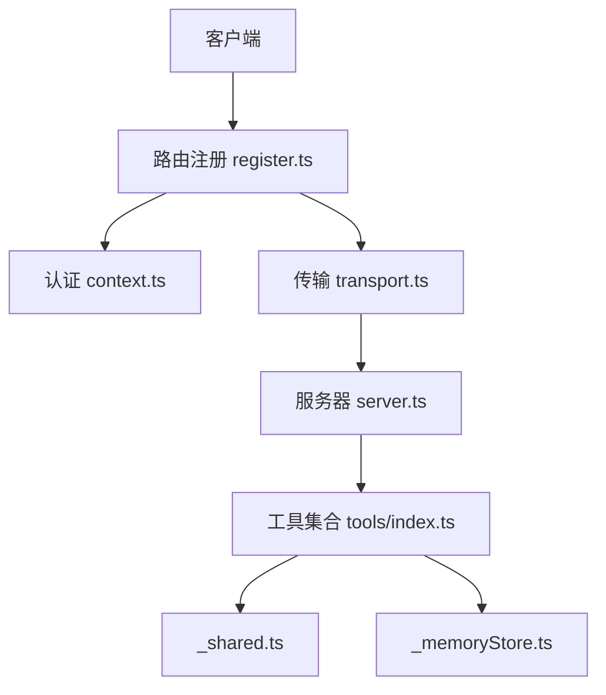
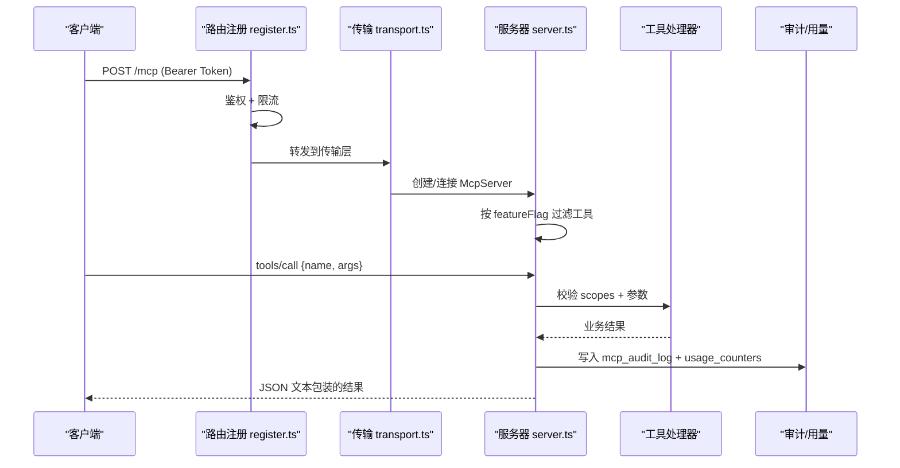
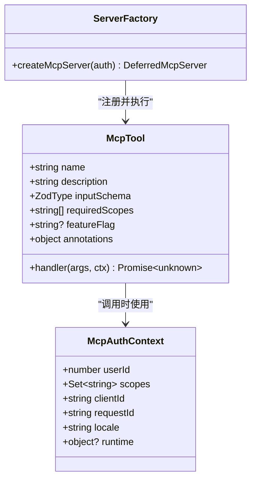
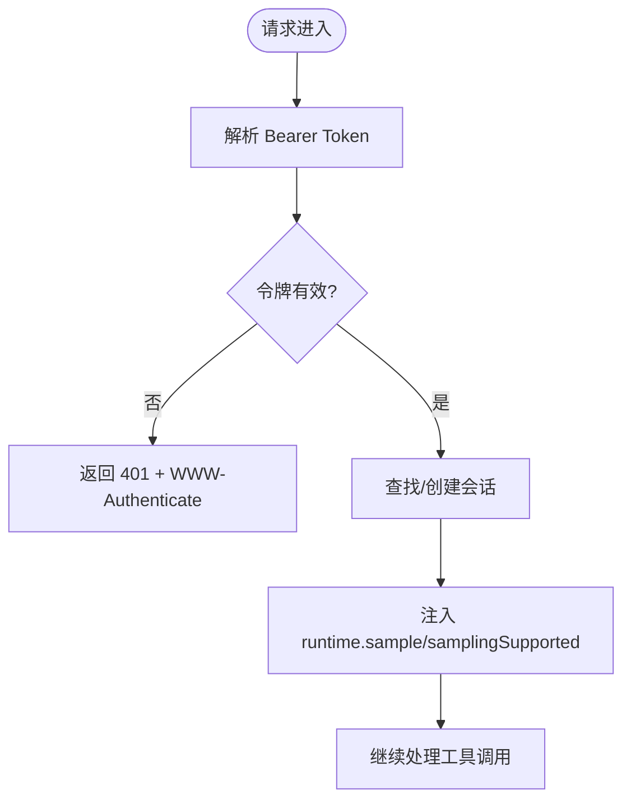
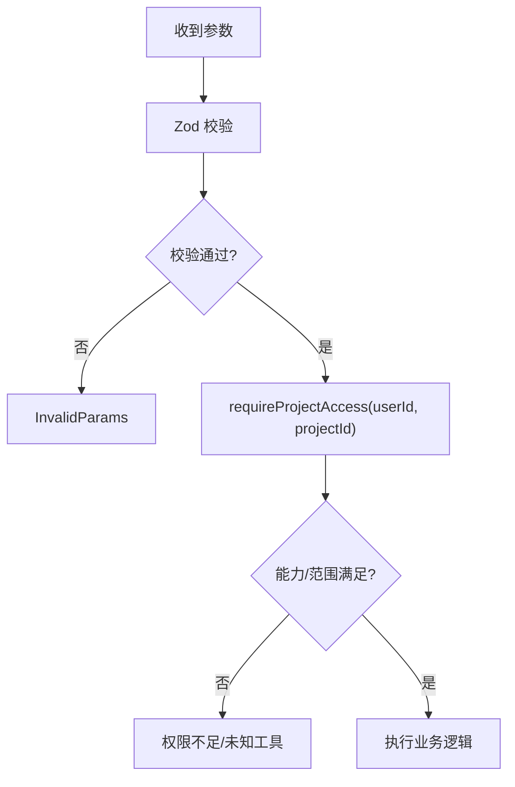
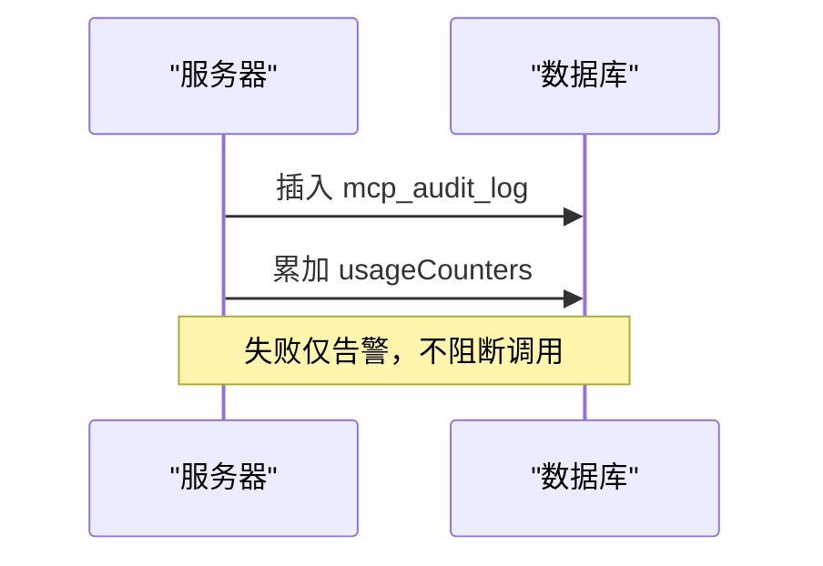
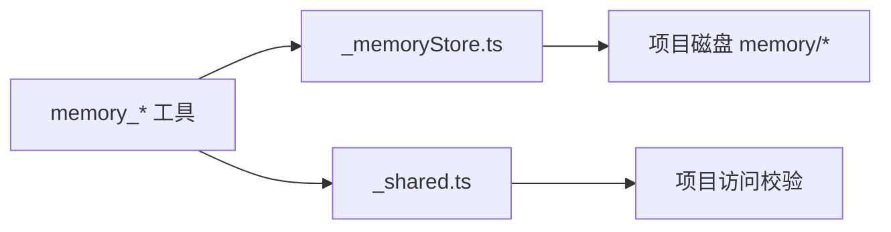
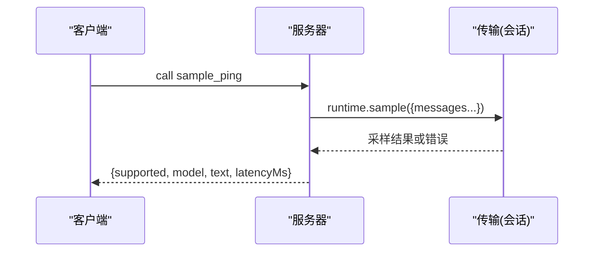
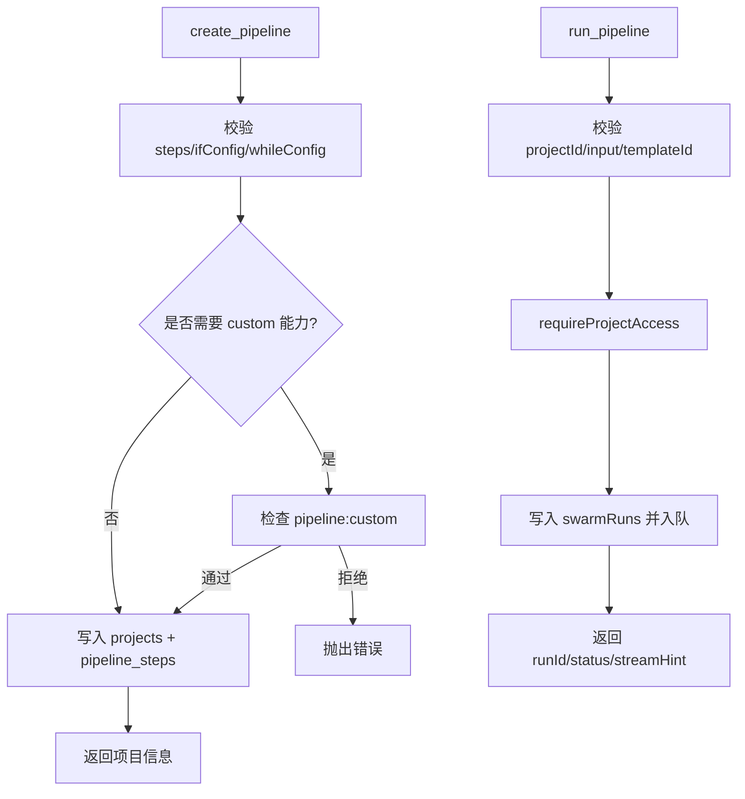
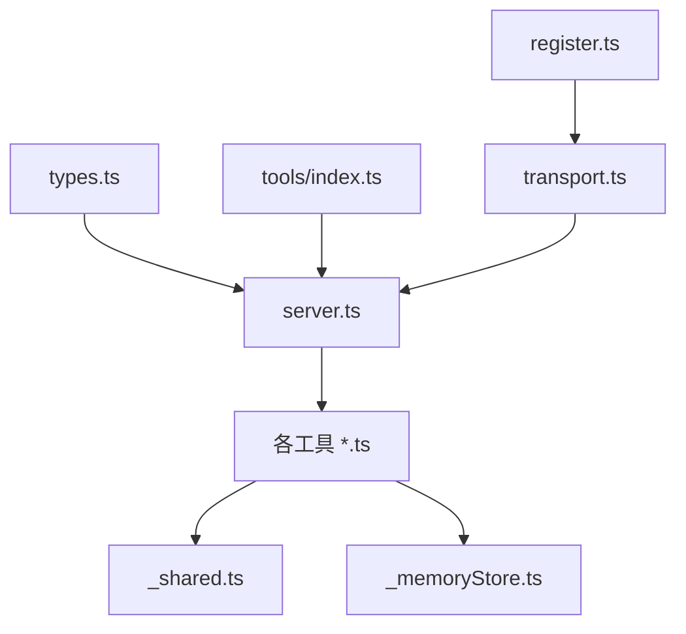

# 自定义工具开发

<cite>
**本文引用的文件**
- [api/mcp/tools/index.ts](file://api/mcp/tools/index.ts)
- [api/mcp/types.ts](file://api/mcp/types.ts)
- [api/mcp/server.ts](file://api/mcp/server.ts)
- [api/mcp/register.ts](file://api/mcp/register.ts)
- [api/mcp/transport.ts](file://api/mcp/transport.ts)
- [api/mcp/context.ts](file://api/mcp/context.ts)
- [api/mcp/tools/_shared.ts](file://api/mcp/tools/_shared.ts)
- [api/mcp/tools/_memoryStore.ts](file://api/mcp/tools/_memoryStore.ts)
- [api/mcp/tools/memory.ts](file://api/mcp/tools/memory.ts)
- [api/mcp/tools/samplePing.ts](file://api/mcp/tools/samplePing.ts)
- [api/mcp/tools/runPipeline.ts](file://api/mcp/tools/runPipeline.ts)
- [api/mcp/tools/createPipeline.ts](file://api/mcp/tools/createPipeline.ts)
- [api/mcp/tools/pipelineValidation.ts](file://api/mcp/tools/pipelineValidation.ts)
- [api/mcp/tools/helpContent.ts](file://api/mcp/tools/helpContent.ts)
</cite>

## 目录
1. [简介](#简介)
2. [项目结构](#项目结构)
3. [核心组件](#核心组件)
4. [架构总览](#架构总览)
5. [详细组件分析](#详细组件分析)
6. [依赖关系分析](#依赖关系分析)
7. [性能考虑](#性能考虑)
8. [故障排查指南](#故障排查指南)
9. [结论](#结论)
10. [附录：开发与发布流程](#附录：开发与发布流程)

## 简介
本指南面向在 DeeWaanAI 中开发 MCP（Model Context Protocol）自定义工具的工程师与产品/运营人员。内容覆盖工具规范、接口定义、注册机制、参数校验、错误处理、审计日志、共享模块使用、内存存储机制、测试方法，以及从简单工具到复杂工具的完整示例，并给出发布、版本管理与部署建议，以及调试技巧与性能优化要点。

## 项目结构
MCP 相关代码集中在 api/mcp 目录下，采用“协议层 + 传输层 + 服务器工厂 + 工具集合”的分层组织方式：
- 协议与类型：types.ts 定义 McpTool、McpAuthContext 等核心契约
- 认证上下文：context.ts 解析 Bearer Token 生成会话级认证上下文
- 路由注册：register.ts 挂载 OAuth 与 /mcp* 端点，统一鉴权与限流
- 传输层：transport.ts 实现 Streamable HTTP 与 Legacy SSE 两种传输
- 服务器工厂：server.ts 构建每会话的 McpServer，完成工具注册、权限门控、审计与用量统计
- 工具集合：tools/* 提供具体能力，index.ts 集中注册所有可用工具
- 共享模块：_shared.ts、_memoryStore.ts 提供项目访问控制、输出压缩与磁盘记忆存储

图表来源
- [api/mcp/register.ts:90-164](file://api/mcp/register.ts#L90-L164)
- [api/mcp/context.ts:17-41](file://api/mcp/context.ts#L17-L41)
- [api/mcp/transport.ts:76-141](file://api/mcp/transport.ts#L76-L141)
- [api/mcp/server.ts:135-186](file://api/mcp/server.ts#L135-L186)
- [api/mcp/tools/index.ts:45-94](file://api/mcp/tools/index.ts#L45-L94)

章节来源
- [api/mcp/register.ts:1-165](file://api/mcp/register.ts#L1-L165)
- [api/mcp/tools/index.ts:1-95](file://api/mcp/tools/index.ts#L1-L95)

## 核心组件
- 工具契约与上下文
  - McpTool：包含 name、description、inputSchema（Zod）、requiredScopes、featureFlag、annotations、handler
  - McpAuthContext：携带 userId、scopes、clientId、requestId、locale，以及可选 runtime（含 sessionId、sample、samplingSupported）
- 路由与鉴权
  - register.ts 对 /mcp* 统一鉴权、按客户分层限流，并挂载 OAuth 与传输端点
- 传输层
  - transport.ts 维护进程内会话映射，支持 Streamable HTTP 与 Legacy SSE；在会话初始化时注入 runtime.sample/samplingSupported
- 服务器工厂
  - server.ts 为每个会话创建独立 McpServer，按 featureFlag 过滤工具，执行 scope 检查、参数校验、调用 handler，记录审计与用量
- 工具注册中心
  - tools/index.ts 集中导出 TOOLS 数组，供服务器工厂遍历注册

章节来源
- [api/mcp/types.ts:9-44](file://api/mcp/types.ts#L9-L44)
- [api/mcp/register.ts:90-164](file://api/mcp/register.ts#L90-L164)
- [api/mcp/transport.ts:76-141](file://api/mcp/transport.ts#L76-L141)
- [api/mcp/server.ts:84-124](file://api/mcp/server.ts#L84-L124)
- [api/mcp/tools/index.ts:45-94](file://api/mcp/tools/index.ts#L45-L94)

## 架构总览
下图展示一次工具调用的端到端流程：客户端请求经路由鉴权与限流进入传输层，建立或复用会话后交由服务器工厂注册工具并执行，最终返回结果并记录审计与用量。

图表来源
- [api/mcp/register.ts:90-164](file://api/mcp/register.ts#L90-L164)
- [api/mcp/transport.ts:76-141](file://api/mcp/transport.ts#L76-L141)
- [api/mcp/server.ts:84-124](file://api/mcp/server.ts#L84-L124)
- [api/mcp/server.ts:47-82](file://api/mcp/server.ts#L47-L82)

## 详细组件分析

### 工具契约与注册机制
- 工具必须声明 inputSchema（Zod），由 SDK 自动进行安全解析与 InvalidParams 错误处理
- requiredScopes 用于运行时权限门控，缺失将返回 InvalidRequest
- featureFlag 用于功能开关，未启用时工具对 tools/list 隐藏且 tools/call 报未知工具
- annotations 标记只读/破坏性，便于上层 UI 提示
- 所有工具通过 tools/index.ts 的 TOOLS 数组集中注册，server.ts 在 buildMcpServer 中逐个注册

图表来源
- [api/mcp/types.ts:9-44](file://api/mcp/types.ts#L9-L44)
- [api/mcp/server.ts:135-186](file://api/mcp/server.ts#L135-L186)

章节来源
- [api/mcp/types.ts:9-44](file://api/mcp/types.ts#L9-L44)
- [api/mcp/server.ts:84-124](file://api/mcp/server.ts#L84-L124)
- [api/mcp/tools/index.ts:45-94](file://api/mcp/tools/index.ts#L45-L94)

### 认证、会话与运行时桥接
- 认证：context.ts 解析 Authorization: Bearer <token>，验证后生成 McpAuthContext
- 会话：transport.ts 维护进程内 sessions Map，按 mcp-session-id 或 ?sessionId= 关联
- 运行时桥接：会话初始化后将 runtime.sample/samplingSupported 注入 auth，使工具可反向调用桌面端 LLM（采样）

图表来源
- [api/mcp/context.ts:17-41](file://api/mcp/context.ts#L17-L41)
- [api/mcp/transport.ts:76-141](file://api/mcp/transport.ts#L76-L141)

章节来源
- [api/mcp/context.ts:1-42](file://api/mcp/context.ts#L1-L42)
- [api/mcp/transport.ts:1-234](file://api/mcp/transport.ts#L1-L234)

### 参数校验与权限控制
- 参数校验：各工具使用 Zod schema 严格校验输入，非法参数直接返回 InvalidParams
- 项目访问控制：_shared.ts 提供 canAccessProject/requireProjectAccess，确保仅项目所有者或团队成员可读写
- 能力门控：部分步骤（如 if/while）需要 pipeline:custom 能力，createPipeline 中显式校验

图表来源
- [api/mcp/tools/pipelineValidation.ts:26-59](file://api/mcp/tools/pipelineValidation.ts#L26-L59)
- [api/mcp/tools/_shared.ts:36-60](file://api/mcp/tools/_shared.ts#L36-L60)
- [api/mcp/tools/createPipeline.ts:40-52](file://api/mcp/tools/createPipeline.ts#L40-L52)

章节来源
- [api/mcp/tools/pipelineValidation.ts:1-84](file://api/mcp/tools/pipelineValidation.ts#L1-L84)
- [api/mcp/tools/_shared.ts:1-67](file://api/mcp/tools/_shared.ts#L1-L67)
- [api/mcp/tools/createPipeline.ts:20-52](file://api/mcp/tools/createPipeline.ts#L20-L52)

### 审计日志与用量统计
- 每次工具调用都会异步写入 mcp_audit_log（userId、clientId、toolName、latencyMs、status、error）
- 同时按月度累加 usageCounters（metric: mcp_tool_call），失败不影响主流程
- 限流：register.ts 根据客户层级（solo/team/admin）进行 per-customer 速率限制，超限返回 429 与 Retry-After

图表来源
- [api/mcp/server.ts:47-82](file://api/mcp/server.ts#L47-L82)
- [api/mcp/register.ts:112-138](file://api/mcp/register.ts#L112-L138)

章节来源
- [api/mcp/server.ts:47-82](file://api/mcp/server.ts#L47-L82)
- [api/mcp/register.ts:39-88](file://api/mcp/register.ts#L39-L88)

### 共享模块与内存存储
- _shared.ts：项目访问控制、步骤插入、输出截断
- _memoryStore.ts：基于磁盘的项目记忆存储（episodes.json、state.json），配合 memoryManager/stateSummarizer
- memory.ts：memory_get/memory_append 工具，读取最近片段与结构化状态摘要，追加笔记并持久化

图表来源
- [api/mcp/tools/_memoryStore.ts:1-37](file://api/mcp/tools/_memoryStore.ts#L1-L37)
- [api/mcp/tools/memory.ts:1-92](file://api/mcp/tools/memory.ts#L1-L92)
- [api/mcp/tools/_shared.ts:1-67](file://api/mcp/tools/_shared.ts#L1-L67)

章节来源
- [api/mcp/tools/_memoryStore.ts:1-37](file://api/mcp/tools/_memoryStore.ts#L1-L37)
- [api/mcp/tools/memory.ts:1-92](file://api/mcp/tools/memory.ts#L1-L92)
- [api/mcp/tools/_shared.ts:1-67](file://api/mcp/tools/_shared.ts#L1-L67)

### 简单工具示例：samplePing
- 用途：诊断桌面端是否支持 MCP sampling，返回模型、停止原因、响应文本与延迟
- 关键点：依赖 ctx.runtime.sample；若客户端不支持则返回 supported=false 及原因
- 适用场景：验证采样路径，无需 API Key

图表来源
- [api/mcp/tools/samplePing.ts:20-55](file://api/mcp/tools/samplePing.ts#L20-L55)
- [api/mcp/transport.ts:104-116](file://api/mcp/transport.ts#L104-L116)

章节来源
- [api/mcp/tools/samplePing.ts:1-56](file://api/mcp/tools/samplePing.ts#L1-L56)

### 复杂工具示例：runPipeline 与 createPipeline
- runPipeline：创建运行任务并入队，立即返回 runId 与状态，后续通过 run_status 轮询
- createPipeline：一次性创建项目与步骤链，支持 if/while 控制流（需 custom 能力），并生成模板与代理以便 Web 界面可见
- 两者均遵循：Zod 校验 → 项目访问控制 → 能力校验 → 数据写入 → 入队/完成 → 审计

图表来源
- [api/mcp/tools/createPipeline.ts:20-108](file://api/mcp/tools/createPipeline.ts#L20-L108)
- [api/mcp/tools/runPipeline.ts:15-156](file://api/mcp/tools/runPipeline.ts#L15-L156)
- [api/mcp/tools/pipelineValidation.ts:26-84](file://api/mcp/tools/pipelineValidation.ts#L26-L84)

章节来源
- [api/mcp/tools/createPipeline.ts:1-108](file://api/mcp/tools/createPipeline.ts#L1-L108)
- [api/mcp/tools/runPipeline.ts:1-156](file://api/mcp/tools/runPipeline.ts#L1-L156)
- [api/mcp/tools/pipelineValidation.ts:1-84](file://api/mcp/tools/pipelineValidation.ts#L1-L84)

### 帮助内容与能力发现
- helpContent.ts 提供工具目录与按用户能力/标志/作用域过滤的帮助内容
- 可用于 deewaanai_help 工具，向用户展示当前可用的工具、锁定项与升级建议

章节来源
- [api/mcp/tools/helpContent.ts:1-369](file://api/mcp/tools/helpContent.ts#L1-L369)

## 依赖关系分析
- 低耦合：工具通过 types.ts 契约与 server.ts 交互，避免直接依赖路由/传输细节
- 高内聚：每个工具聚焦单一职责，参数校验与业务逻辑在同一文件中
- 外部依赖：Drizzle ORM 访问数据库；@modelcontextprotocol/sdk 管理协议；zod 做参数校验
- 潜在循环：无直接循环导入；工具仅依赖 shared、services 与 db schema

图表来源
- [api/mcp/types.ts:9-44](file://api/mcp/types.ts#L9-L44)
- [api/mcp/server.ts:135-186](file://api/mcp/server.ts#L135-L186)
- [api/mcp/tools/index.ts:45-94](file://api/mcp/tools/index.ts#L45-L94)
- [api/mcp/register.ts:144-164](file://api/mcp/register.ts#L144-L164)
- [api/mcp/transport.ts:76-141](file://api/mcp/transport.ts#L76-L141)

章节来源
- [api/mcp/server.ts:135-186](file://api/mcp/server.ts#L135-L186)
- [api/mcp/tools/index.ts:45-94](file://api/mcp/tools/index.ts#L45-L94)

## 性能考虑
- 会话生命周期：transport.ts 维护进程内会话映射，设置 TTL 并定期清理，避免内存泄漏
- 限流与降级：register.ts 对高频请求进行 per-customer 限流，异常时开放放行以保证可用性
- 审计与用量：异步写入，失败仅告警，不阻塞主流程
- 输出压缩：_shared.ts 提供 truncate，避免大对象导致响应过大
- 批量与缓存：tier 解析使用本地 Map 缓存，减少重复查询

[本节为通用指导，不直接分析具体文件]

## 故障排查指南
- 401 未授权：检查 Authorization 头格式与令牌有效性；确认 register.ts 的鉴权与 WWW-Authenticate 挑战
- 429 速率限制：查看 retry_after 字段，降低调用频率或提升客户层级
- 工具不可见/未知工具：检查 tool.featureFlag 是否启用；确认 scopes 是否满足 requiredScopes
- 采样失败：确认客户端能力包含 sampling；transport.ts 注入的 runtime.sample 仅在会话初始化后存在
- 项目访问被拒：确认 requireProjectAccess 是否通过；检查团队/项目成员关系
- 审计/用量未更新：检查数据库写入是否成功；关注 server.ts 中的异步写入与告警日志

章节来源
- [api/mcp/register.ts:90-138](file://api/mcp/register.ts#L90-L138)
- [api/mcp/server.ts:84-124](file://api/mcp/server.ts#L84-L124)
- [api/mcp/transport.ts:104-116](file://api/mcp/transport.ts#L104-L116)
- [api/mcp/tools/_shared.ts:36-60](file://api/mcp/tools/_shared.ts#L36-L60)

## 结论
DeeWaanAI 的 MCP 工具体系以清晰的契约、严格的参数校验、完善的权限与功能开关、健壮的审计与用量统计为核心，结合双传输模式与灵活的运行时桥接，为扩展新工具提供了稳定、可观测、易维护的基础设施。遵循本文规范可实现从简单诊断到复杂编排的全链路工具开发。

## 附录：开发与发布流程

### 开发规范清单
- 定义工具
  - 在 tools/* 下新建文件，导出符合 McpTool 的对象
  - 使用 Zod 定义 inputSchema，明确必填/可选与约束
  - 声明 requiredScopes、annotations，必要时添加 featureFlag
- 注册工具
  - 在 tools/index.ts 的 TOOLS 数组中添加新工具
- 权限与访问
  - 涉及项目数据时调用 requireProjectAccess
  - 涉及控制流步骤时校验 pipeline:custom 能力
- 错误处理
  - 参数错误由 SDK 返回 InvalidParams
  - 业务错误抛出 Error，server.ts 会记录 errorText 并转为错误状态
- 审计与日志
  - 关键操作记录 logger.info/warn/error
  - 审计与用量由 server.ts 自动记录

章节来源
- [api/mcp/tools/index.ts:45-94](file://api/mcp/tools/index.ts#L45-L94)
- [api/mcp/server.ts:84-124](file://api/mcp/server.ts#L84-L124)
- [api/mcp/tools/_shared.ts:36-60](file://api/mcp/tools/_shared.ts#L36-L60)
- [api/mcp/tools/createPipeline.ts:40-52](file://api/mcp/tools/createPipeline.ts#L40-L52)

### 测试方法
- 单元测试
  - 对纯函数（如 pipelineValidation.ts）编写用例，覆盖边界与错误分支
  - 对 helpContent.ts 的 buildHelp 进行能力/标志/作用域过滤的断言
- 集成测试
  - 使用 scripts/mcp-call.mjs 或 smoke-mcp-* 脚本模拟工具调用
  - 验证鉴权、限流、审计写入与工具行为
- 端到端
  - 启动服务，通过 MCP 客户端发起 tools/list 与 tools/call，观察结果与日志

章节来源
- [api/mcp/tools/pipelineValidation.ts:1-84](file://api/mcp/tools/pipelineValidation.ts#L1-L84)
- [api/mcp/tools/helpContent.ts:280-369](file://api/mcp/tools/helpContent.ts#L280-L369)

### 发布与版本管理
- 工具版本
  - 工具名保持永久 snake_case，变更行为通过 featureFlag 渐进灰度
- 功能开关
  - 新增能力通过 featureFlag 暴露，默认关闭，逐步放开
- 配置与迁移
  - 数据库变更通过 migrations 管理；工具逻辑变更需兼容旧参数
- 部署
  - 服务重启后 register.ts 重新挂载路由；transport.ts 会话随进程生命周期管理

章节来源
- [api/mcp/server.ts:135-186](file://api/mcp/server.ts#L135-L186)
- [api/mcp/register.ts:144-164](file://api/mcp/register.ts#L144-L164)

### 调试技巧
- 启用调试日志：关注 server.ts 的工具注册数量与隐藏数量
- 检查会话：transport.ts 的 sessions Map 与 TTL 清理
- 采样问题：确认客户端能力包含 sampling；samplePing 作为探针
- 权限问题：打印 scopes 与 requiredScopes 差异，定位缺失范围
- 限流问题：查看 429 响应中的 tier、limit、retry_after

章节来源
- [api/mcp/server.ts:179-184](file://api/mcp/server.ts#L179-L184)
- [api/mcp/transport.ts:48-57](file://api/mcp/transport.ts#L48-L57)
- [api/mcp/register.ts:112-138](file://api/mcp/register.ts#L112-L138)

### 性能优化建议
- 减少大对象：使用 truncate 控制输出长度
- 批处理与节流：合理拆分批量任务，避免瞬时高峰触发限流
- 缓存热点：利用本地缓存（如 tier 解析）降低数据库压力
- 异步非阻塞：审计与用量写入保持 fire-and-forget，避免影响主路径

[本节为通用指导，不直接分析具体文件]