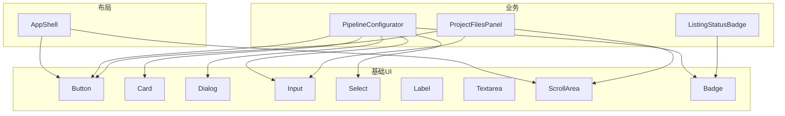
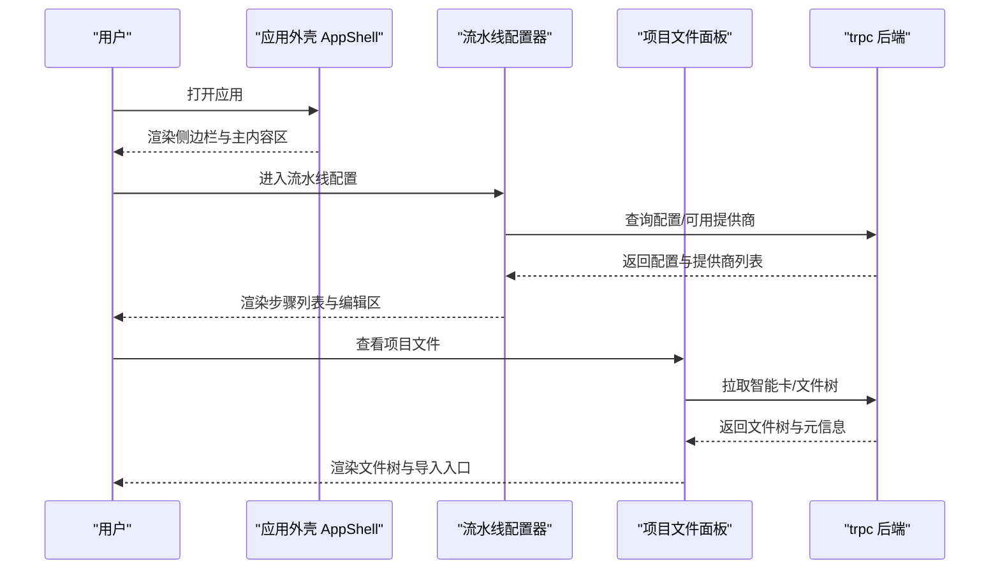
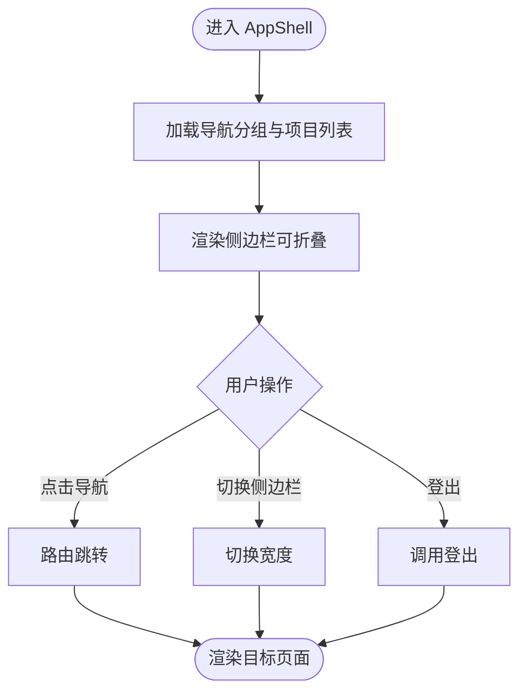
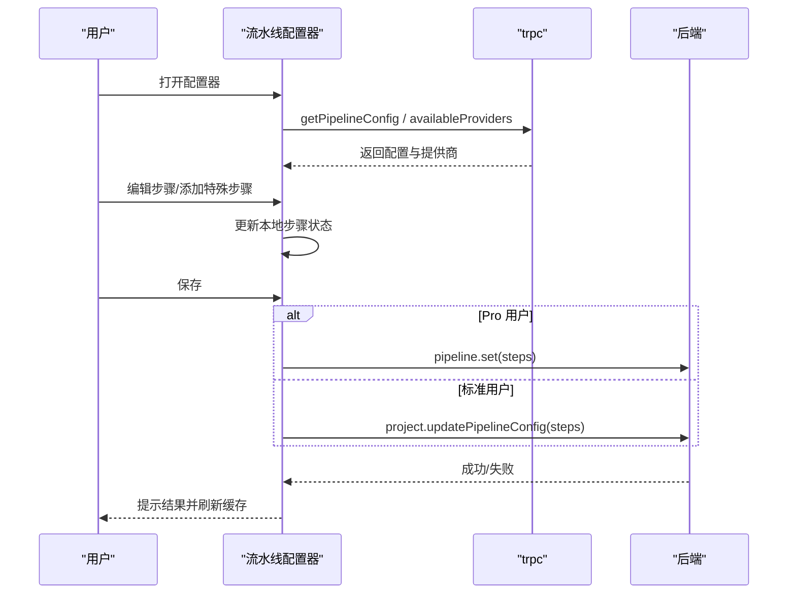
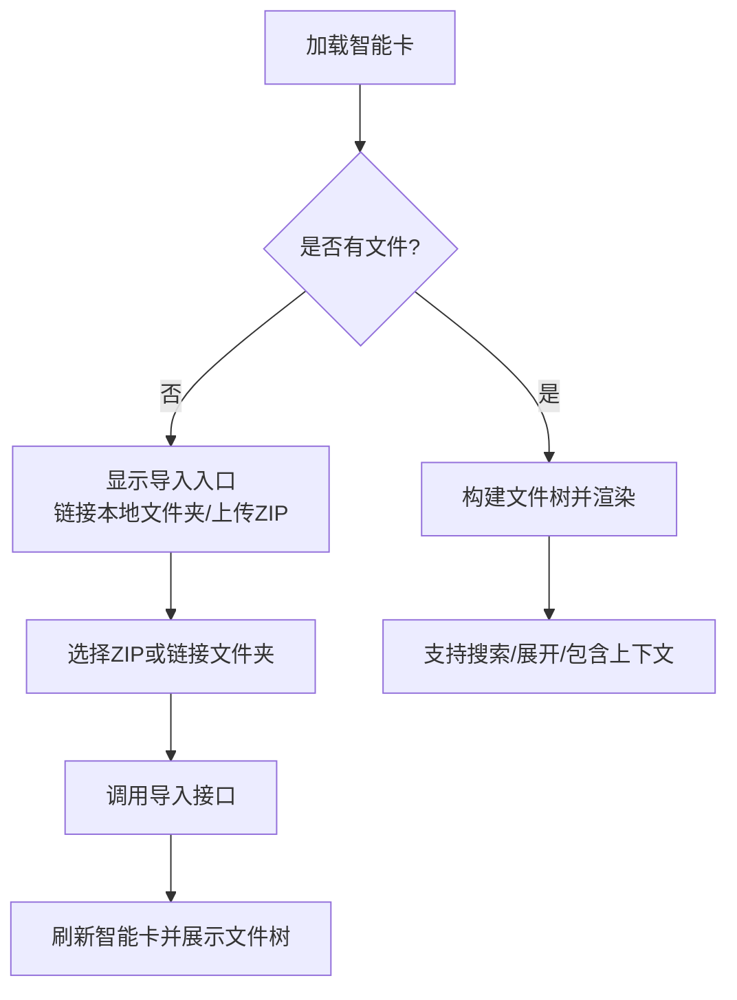
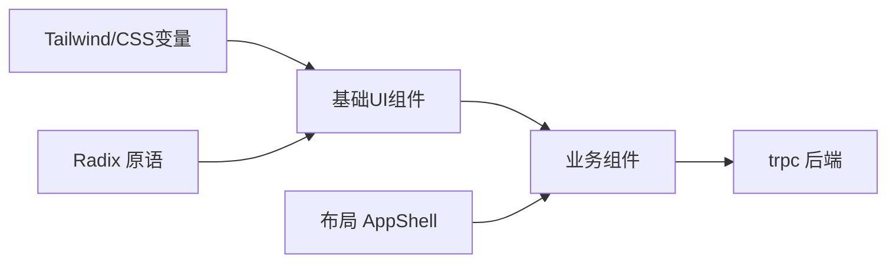

# UI组件库

<cite>
**本文引用的文件**
- [button.tsx](file://src/components/ui/button.tsx)
- [card.tsx](file://src/components/ui/card.tsx)
- [dialog.tsx](file://src/components/ui/dialog.tsx)
- [input.tsx](file://src/components/ui/input.tsx)
- [select.tsx](file://src/components/ui/select.tsx)
- [badge.tsx](file://src/components/ui/badge.tsx)
- [textarea.tsx](file://src/components/ui/textarea.tsx)
- [label.tsx](file://src/components/ui/label.tsx)
- [scroll-area.tsx](file://src/components/ui/scroll-area.tsx)
- [AppShell.tsx](file://src/components/layout/AppShell.tsx)
- [PipelineConfigurator.tsx](file://src/components/pipeline/PipelineConfigurator.tsx)
- [ProjectFilesPanel.tsx](file://src/components/project/ProjectFilesPanel.tsx)
- [ListingStatusBadge.tsx](file://src/components/marketplace/ListingStatusBadge.tsx)
- [tailwind.config.js](file://tailwind.config.js)
- [components.json](file://components.json)
</cite>

## 目录
1. [简介](#简介)
2. [项目结构](#项目结构)
3. [核心组件](#核心组件)
4. [架构总览](#架构总览)
5. [详细组件分析](#详细组件分析)
6. [依赖关系分析](#依赖关系分析)
7. [性能考虑](#性能考虑)
8. [故障排查指南](#故障排查指南)
9. [结论](#结论)
10. [附录](#附录)

## 简介
本文件为 DeeWaanAI 前端 UI 组件库的权威文档，覆盖基础 UI 组件（按钮、卡片、对话框、输入框、选择器、标签、文本域、滚动区域）、布局组件（应用外壳与导航）以及业务组件（流水线配置器、项目文件面板、市场状态徽章）。文档重点说明各组件的属性、事件、使用方式、样式定制、无障碍访问支持与跨浏览器兼容性，并提供最佳实践与常见问题排查建议。

## 项目结构
- 基础 UI 组件位于 src/components/ui，基于 Radix 原语与 Tailwind CSS，统一通过 data-slot 标记便于测试与样式定位。
- 布局组件位于 src/components/layout，提供应用外壳与侧边导航。
- 业务组件位于 src/components/{pipeline,project,marketplace}，封装领域逻辑并复用基础 UI 组件。
- 主题与样式由 tailwind.config.js 管理，采用 CSS 变量驱动暗色模式与品牌色。
- 组件注册与别名在 components.json 中定义，统一导入路径。

图表来源
- [AppShell.tsx:1-214](file://src/components/layout/AppShell.tsx#L1-L214)
- [PipelineConfigurator.tsx:1-534](file://src/components/pipeline/PipelineConfigurator.tsx#L1-L534)
- [ProjectFilesPanel.tsx:1-564](file://src/components/project/ProjectFilesPanel.tsx#L1-L564)
- [ListingStatusBadge.tsx:1-34](file://src/components/marketplace/ListingStatusBadge.tsx#L1-L34)
- [button.tsx:1-63](file://src/components/ui/button.tsx#L1-L63)
- [card.tsx:1-93](file://src/components/ui/card.tsx#L1-L93)
- [dialog.tsx:1-142](file://src/components/ui/dialog.tsx#L1-L142)
- [input.tsx:1-22](file://src/components/ui/input.tsx#L1-L22)
- [select.tsx:1-189](file://src/components/ui/select.tsx#L1-L189)
- [badge.tsx:1-47](file://src/components/ui/badge.tsx#L1-L47)
- [textarea.tsx:1-19](file://src/components/ui/textarea.tsx#L1-L19)
- [label.tsx:1-25](file://src/components/ui/label.tsx#L1-L25)
- [scroll-area.tsx:1-59](file://src/components/ui/scroll-area.tsx#L1-L59)

章节来源
- [tailwind.config.js:1-84](file://tailwind.config.js#L1-L84)
- [components.json:1-23](file://components.json#L1-L23)

## 核心组件
本节概述基础 UI 组件的职责、关键属性、事件与可访问性要点。

- 按钮 Button
  - 作用：通用触发控件，支持多种变体与尺寸。
  - 关键属性：variant（默认/破坏/描边/次要/幽灵/链接）、size（默认/小/大/图标系列）、asChild（是否透传为子元素）。
  - 事件：透传原生 button 事件（onClick 等）。
  - 可访问性：聚焦环、aria-invalid 状态联动；禁用态不可交互。
  - 样式：通过 class-variance-authority 组合类名，支持 dark 模式。
  - 参考实现路径
    - [button.tsx:7-37](file://src/components/ui/button.tsx#L7-L37)
    - [button.tsx:39-60](file://src/components/ui/button.tsx#L39-L60)

- 卡片 Card（含 Header/Title/Description/Action/Content/Footer）
  - 作用：内容容器，结构化展示信息块。
  - 关键属性：className 扩展；子组件用于语义化分区。
  - 可访问性：标题层级合理，描述文字使用 muted 色。
  - 参考实现路径
    - [card.tsx:5-15](file://src/components/ui/card.tsx#L5-L15)
    - [card.tsx:18-82](file://src/components/ui/card.tsx#L18-L82)

- 对话框 Dialog（Overlay/Content/Header/Footer/Title/Description/Trigger/Close/Portal）
  - 作用：模态交互，承载表单或确认操作。
  - 关键属性：showCloseButton（是否显示关闭按钮）、位置与动画由 Radix 控制。
  - 事件：打开/关闭生命周期由 Radix 管理；可自定义触发与关闭行为。
  - 可访问性：焦点陷阱、Esc 关闭、屏幕阅读器友好（sr-only 关闭提示）。
  - 参考实现路径
    - [dialog.tsx:7-79](file://src/components/ui/dialog.tsx#L7-L79)
    - [dialog.tsx:81-128](file://src/components/ui/dialog.tsx#L81-L128)

- 输入框 Input
  - 作用：单行文本输入，支持类型、占位符、禁用态。
  - 事件：onChange、onFocus、onBlur 等原生事件。
  - 可访问性：focus-visible 高亮、aria-invalid 错误态。
  - 参考实现路径
    - [input.tsx:5-18](file://src/components/ui/input.tsx#L5-L18)

- 选择器 Select（Trigger/Content/Item/Group/Label/Separator/Value/滚动按钮）
  - 作用：下拉选择，支持分组、标签、分隔线、滚动。
  - 关键属性：position（item-aligned/popper）、align（center/left/right）。
  - 事件：值变更由 Radix 管理；可自定义选项渲染。
  - 可访问性：键盘导航、ARIA 状态同步。
  - 参考实现路径
    - [select.tsx:7-86](file://src/components/ui/select.tsx#L7-L86)
    - [select.tsx:101-139](file://src/components/ui/select.tsx#L101-L139)

- 标签 Badge
  - 作用：轻量状态或分类标识。
  - 关键属性：variant（默认/次要/破坏/描边）、asChild。
  - 参考实现路径
    - [badge.tsx:7-43](file://src/components/ui/badge.tsx#L7-L43)

- 文本域 Textarea
  - 作用：多行文本输入，自适应高度。
  - 事件：原生输入事件。
  - 可访问性：focus-visible、aria-invalid。
  - 参考实现路径
    - [textarea.tsx:5-15](file://src/components/ui/textarea.tsx#L5-L15)

- 标签 Label
  - 作用：与表单控件关联的可读标签。
  - 可访问性：与 input/textarea 的 id/for 关联（由上层组合）。
  - 参考实现路径
    - [label.tsx:8-20](file://src/components/ui/label.tsx#L8-L20)

- 滚动区域 ScrollArea
  - 作用：跨平台一致滚动体验，带滚动条。
  - 可访问性：聚焦环、键盘滚动。
  - 参考实现路径
    - [scroll-area.tsx:8-28](file://src/components/ui/scroll-area.tsx#L8-L28)
    - [scroll-area.tsx:31-56](file://src/components/ui/scroll-area.tsx#L31-L56)

章节来源
- [button.tsx:1-63](file://src/components/ui/button.tsx#L1-L63)
- [card.tsx:1-93](file://src/components/ui/card.tsx#L1-L93)
- [dialog.tsx:1-142](file://src/components/ui/dialog.tsx#L1-L142)
- [input.tsx:1-22](file://src/components/ui/input.tsx#L1-L22)
- [select.tsx:1-189](file://src/components/ui/select.tsx#L1-L189)
- [badge.tsx:1-47](file://src/components/ui/badge.tsx#L1-L47)
- [textarea.tsx:1-19](file://src/components/ui/textarea.tsx#L1-L19)
- [label.tsx:1-25](file://src/components/ui/label.tsx#L1-L25)
- [scroll-area.tsx:1-59](file://src/components/ui/scroll-area.tsx#L1-L59)

## 架构总览
应用外壳 AppShell 组织全局导航与用户信息区，业务页面在其 main 区域内渲染。业务组件通过 trpc 获取数据并与后端交互，同时复用基础 UI 组件完成交互与展示。

图表来源
- [AppShell.tsx:28-214](file://src/components/layout/AppShell.tsx#L28-L214)
- [PipelineConfigurator.tsx:44-236](file://src/components/pipeline/PipelineConfigurator.tsx#L44-L236)
- [ProjectFilesPanel.tsx:185-312](file://src/components/project/ProjectFilesPanel.tsx#L185-L312)

## 详细组件分析

### 应用外壳 AppShell（布局与导航）
- 职责：提供全局侧边导航、用户信息、语言切换、登出、项目列表与折叠/展开。
- 响应式：侧边栏宽度随状态切换，移动端可通过外层容器适配。
- 主题：深色背景与中性色体系，品牌色用于激活项。
- 可访问性：导航项使用 Link 语义，图标+文字组合，焦点可见。
- 集成点：trpc.project.list 获取项目列表；useAuth 获取用户信息；useWorkspaceStore 管理侧边栏状态。

图表来源
- [AppShell.tsx:39-163](file://src/components/layout/AppShell.tsx#L39-L163)
- [AppShell.tsx:166-210](file://src/components/layout/AppShell.tsx#L166-L210)

章节来源
- [AppShell.tsx:1-214](file://src/components/layout/AppShell.tsx#L1-L214)

### 流水线配置器 PipelineConfigurator（业务组件）
- 功能：可视化编排 AI 流水线步骤，支持增删改查、排序、启用/禁用、模板添加、IF/WHILE 条件与人工审批步骤、保存为模板、内存模式设置。
- 数据流：读取项目流水线配置与可用提供商，本地维护步骤状态，提交时根据权限（Pro/标准）走不同保存路径。
- 交互：使用 Dialog 添加步骤，使用 Select/Input/Textarea 编辑参数，使用 Badge 显示状态。
- 限制：非 Pro 用户仅能编辑提示词与开关，且最多使用 3 个 LLM。
- 可访问性：表单控件具备 label 与必要提示，错误通过 toast 反馈。

图表来源
- [PipelineConfigurator.tsx:44-113](file://src/components/pipeline/PipelineConfigurator.tsx#L44-L113)
- [PipelineConfigurator.tsx:198-236](file://src/components/pipeline/PipelineConfigurator.tsx#L198-L236)
- [PipelineConfigurator.tsx:490-530](file://src/components/pipeline/PipelineConfigurator.tsx#L490-L530)

章节来源
- [PipelineConfigurator.tsx:1-534](file://src/components/pipeline/PipelineConfigurator.tsx#L1-L534)

### 项目文件面板 ProjectFilesPanel（业务组件）
- 功能：展示导入项目的文件树，支持搜索、展开/折叠、包含到聊天上下文开关、清理智能卡、上传 ZIP、链接本地文件夹并导入。
- 数据流：通过 trpc.projectImport.getIntelligenceCard 获取文件树与元信息；本地文件夹能力通过 Web FileSystem API 与后端导入接口协作。
- 交互：使用 Dialog/Overlay 进行导入，使用 ScrollArea 滚动文件树，使用 Input 搜索。
- 可访问性：按钮有明确文案与图标，错误与成功通过 toast 提示。

图表来源
- [ProjectFilesPanel.tsx:185-216](file://src/components/project/ProjectFilesPanel.tsx#L185-L216)
- [ProjectFilesPanel.tsx:225-312](file://src/components/project/ProjectFilesPanel.tsx#L225-L312)
- [ProjectFilesPanel.tsx:456-564](file://src/components/project/ProjectFilesPanel.tsx#L456-L564)

章节来源
- [ProjectFilesPanel.tsx:1-564](file://src/components/project/ProjectFilesPanel.tsx#L1-L564)

### 市场状态徽章 ListingStatusBadge（业务组件）
- 功能：根据发布状态渲染“认证中/已认证”徽章，其他状态不显示。
- 集成：依赖 Badge 基础组件与 i18n。
- 可访问性：徽章内包含图标与可读文案。

章节来源
- [ListingStatusBadge.tsx:1-34](file://src/components/marketplace/ListingStatusBadge.tsx#L1-L34)

## 依赖关系分析
- 组件间耦合
  - 业务组件强依赖基础 UI 组件（Button/Card/Dialog/Input/Select/Badge/Textarea/ScrollArea），形成清晰的分层。
  - AppShell 作为布局壳，聚合导航与用户信息，不直接耦合业务细节。
- 外部依赖
  - Radix UI 提供无样式但可访问的原语（Dialog/Select/ScrollArea/Label）。
  - Tailwind CSS + CSS 变量驱动主题与暗色模式。
  - trpc 用于前后端类型安全的数据获取与变更。
- 潜在循环依赖
  - 当前结构以单向依赖为主，未见循环引用。

图表来源
- [components.json:14-20](file://components.json#L14-L20)
- [tailwind.config.js:1-84](file://tailwind.config.js#L1-L84)
- [dialog.tsx:1-142](file://src/components/ui/dialog.tsx#L1-L142)
- [select.tsx:1-189](file://src/components/ui/select.tsx#L1-L189)
- [scroll-area.tsx:1-59](file://src/components/ui/scroll-area.tsx#L1-L59)

章节来源
- [components.json:1-23](file://components.json#L1-L23)
- [tailwind.config.js:1-84](file://tailwind.config.js#L1-L84)

## 性能考虑
- 列表渲染
  - 文件树与流水线步骤均为中等规模列表，建议使用虚拟滚动或分页（当前使用 ScrollArea 与本地状态，适合中小数据量）。
- 网络请求
  - 使用 trpc 缓存与失效策略（如 invalidate）减少重复请求；避免在高频事件中发起请求。
- 状态管理
  - 局部状态优先，必要时将共享状态提升到父组件或使用 store（如 workspaceStore）。
- 样式与重绘
  - 尽量使用 Tailwind 原子类，避免复杂计算样式；动画使用内置 keyframes。

[本节为通用指导，不直接分析具体文件]

## 故障排查指南
- 对话框无法关闭或焦点异常
  - 检查是否正确使用 Dialog.Trigger/Dialog.Close，并确保焦点陷阱生效。
  - 参考路径：[dialog.tsx:7-79](file://src/components/ui/dialog.tsx#L7-L79)
- 选择器选项不显示或错位
  - 确认 position 与 align 设置，确保 Portal 挂载正确。
  - 参考路径：[select.tsx:51-86](file://src/components/ui/select.tsx#L51-L86)
- 输入框错误态未生效
  - 确保 aria-invalid 与 focus-visible 样式生效，检查父级表单验证逻辑。
  - 参考路径：[input.tsx:5-18](file://src/components/ui/input.tsx#L5-L18)
- 主题颜色不生效
  - 检查 tailwind.config.js 中的 CSS 变量映射与 index.css 中的变量定义。
  - 参考路径：[tailwind.config.js:7-51](file://tailwind.config.js#L7-L51)
- 组件导入路径错误
  - 确认 components.json 的别名配置与导入路径一致。
  - 参考路径：[components.json:14-20](file://components.json#L14-L20)

章节来源
- [dialog.tsx:1-142](file://src/components/ui/dialog.tsx#L1-L142)
- [select.tsx:1-189](file://src/components/ui/select.tsx#L1-L189)
- [input.tsx:1-22](file://src/components/ui/input.tsx#L1-L22)
- [tailwind.config.js:1-84](file://tailwind.config.js#L1-L84)
- [components.json:1-23](file://components.json#L1-L23)

## 结论
本组件库以 Radix 原语为基础，结合 Tailwind 与 CSS 变量实现一致的暗色主题与可访问性。布局与应用外壳提供稳定的导航与上下文，业务组件在此基础上封装领域逻辑。通过统一的 data-slot 与清晰的组件分层，便于测试、样式定制与扩展。建议在新增组件时遵循现有命名与结构约定，保持主题变量与可访问性规范。

[本节为总结，不直接分析具体文件]

## 附录

### 主题与样式定制
- 颜色与圆角、阴影、动画均在 tailwind.config.js 中扩展，通过 CSS 变量实现主题切换。
- 组件样式通过 cn 工具函数合并类名，支持 className 覆盖。
- 参考路径
  - [tailwind.config.js:5-84](file://tailwind.config.js#L5-L84)
  - [button.tsx:7-37](file://src/components/ui/button.tsx#L7-L37)

### 无障碍访问支持
- 所有交互组件均基于 Radix，提供键盘导航、焦点管理与 ARIA 状态同步。
- 对话框包含 sr-only 关闭提示；输入与选择器支持 aria-invalid。
- 参考路径
  - [dialog.tsx:67-75](file://src/components/ui/dialog.tsx#L67-L75)
  - [input.tsx:10-14](file://src/components/ui/input.tsx#L10-L14)
  - [select.tsx:33-48](file://src/components/ui/select.tsx#L33-L48)

### 跨浏览器兼容性
- 使用现代 Web API（如 Web FileSystem）时需做降级处理或特性检测（项目中使用 isLocalFolderSupported 等判断）。
- 滚动区域使用 ScrollArea 保证跨平台一致性。
- 参考路径
  - [ProjectFilesPanel.tsx:20-27](file://src/components/project/ProjectFilesPanel.tsx#L20-L27)
  - [scroll-area.tsx:8-28](file://src/components/ui/scroll-area.tsx#L8-L28)

### 使用示例与最佳实践
- 按钮
  - 使用 variant 表达意图（默认/破坏/描边/次要/幽灵/链接），使用 size 控制尺寸。
  - 参考路径：[button.tsx:39-60](file://src/components/ui/button.tsx#L39-L60)
- 卡片
  - 使用 CardHeader/CardTitle/CardDescription/CardContent/CardFooter 组织内容。
  - 参考路径：[card.tsx:18-82](file://src/components/ui/card.tsx#L18-L82)
- 对话框
  - 使用 Trigger 打开，Content 承载内容，Close 关闭；必要时自定义 Overlay。
  - 参考路径：[dialog.tsx:7-79](file://src/components/ui/dialog.tsx#L7-L79)
- 输入框与文本域
  - 配合 Label 使用，确保可访问性；使用 placeholder 与 disabled 提升可用性。
  - 参考路径：[input.tsx:5-18](file://src/components/ui/input.tsx#L5-L18)、[textarea.tsx:5-15](file://src/components/ui/textarea.tsx#L5-L15)
- 选择器
  - 使用 Group/Label/Separator 组织选项；popper 模式下注意对齐。
  - 参考路径：[select.tsx:51-86](file://src/components/ui/select.tsx#L51-L86)
- 业务组件
  - 流水线配置器：按权限控制编辑能力，使用 Dialog 添加步骤，保存前校验。
    - 参考路径：[PipelineConfigurator.tsx:198-236](file://src/components/pipeline/PipelineConfigurator.tsx#L198-L236)
  - 项目文件面板：先拉取智能卡再渲染文件树，支持搜索与上下文开关。
    - 参考路径：[ProjectFilesPanel.tsx:456-564](file://src/components/project/ProjectFilesPanel.tsx#L456-L564)
  - 市场状态徽章：根据状态渲染对应徽章，无状态则不显示。
    - 参考路径：[ListingStatusBadge.tsx:11-33](file://src/components/marketplace/ListingStatusBadge.tsx#L11-L33)

章节来源
- [button.tsx:1-63](file://src/components/ui/button.tsx#L1-L63)
- [card.tsx:1-93](file://src/components/ui/card.tsx#L1-L93)
- [dialog.tsx:1-142](file://src/components/ui/dialog.tsx#L1-L142)
- [input.tsx:1-22](file://src/components/ui/input.tsx#L1-L22)
- [textarea.tsx:1-19](file://src/components/ui/textarea.tsx#L1-L19)
- [select.tsx:1-189](file://src/components/ui/select.tsx#L1-L189)
- [PipelineConfigurator.tsx:1-534](file://src/components/pipeline/PipelineConfigurator.tsx#L1-L534)
- [ProjectFilesPanel.tsx:1-564](file://src/components/project/ProjectFilesPanel.tsx#L1-L564)
- [ListingStatusBadge.tsx:1-34](file://src/components/marketplace/ListingStatusBadge.tsx#L1-L34)