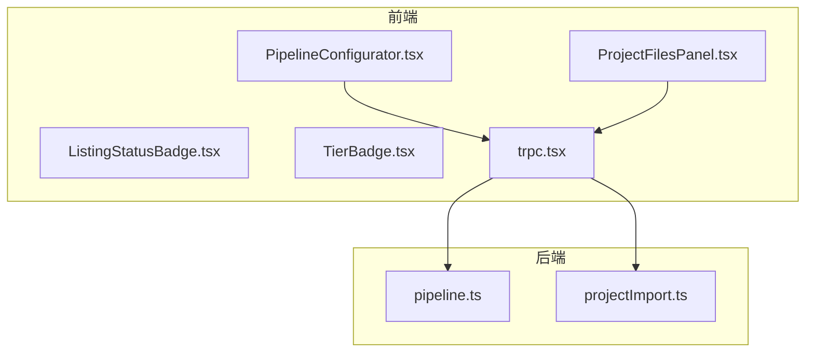
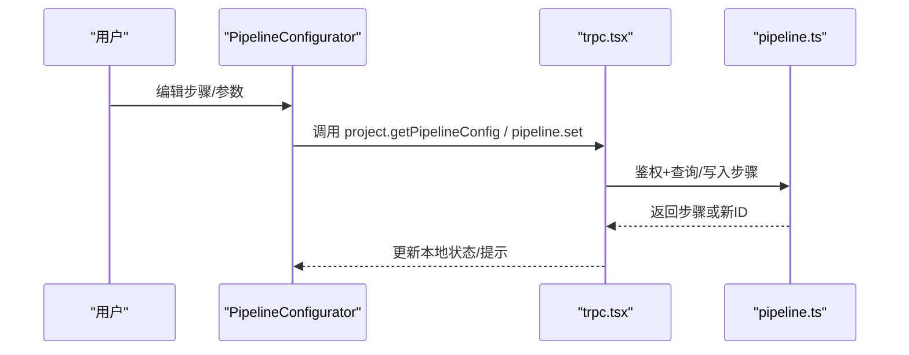
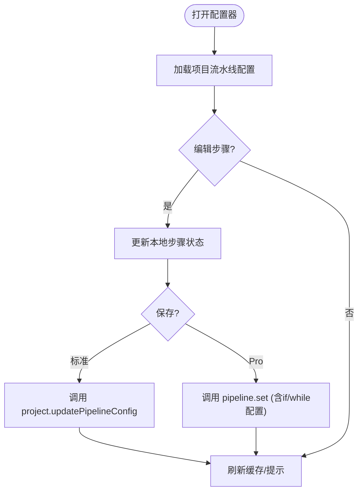
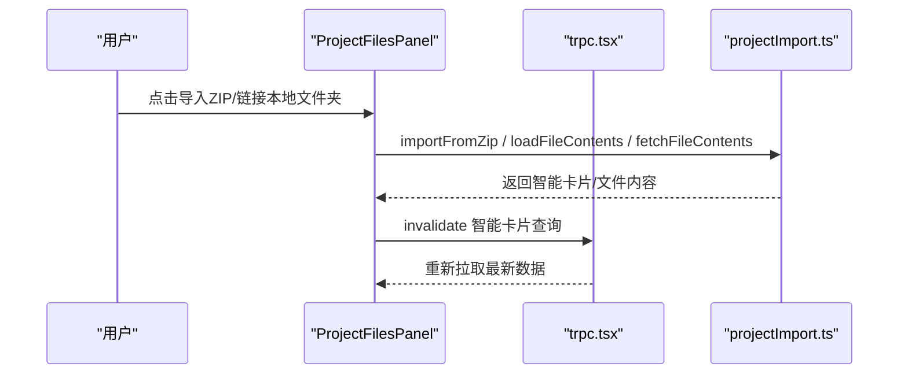
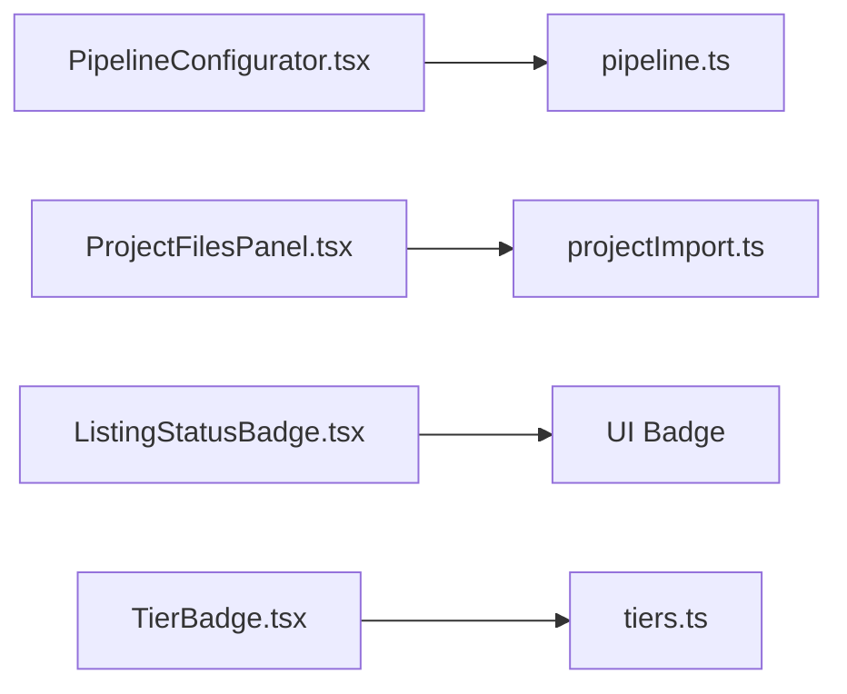

# 业务组件

<cite>
**本文引用的文件**
- [PipelineConfigurator.tsx](file://src/components/pipeline/PipelineConfigurator.tsx)
- [ProjectFilesPanel.tsx](file://src/components/project/ProjectFilesPanel.tsx)
- [ListingStatusBadge.tsx](file://src/components/marketplace/ListingStatusBadge.tsx)
- [TierBadge.tsx](file://src/components/TierBadge.tsx)
- [tiers.ts](file://src/lib/tiers.ts)
- [trpc.tsx](file://src/providers/trpc.tsx)
- [pipeline.ts](file://api/routers/pipeline.ts)
- [projectImport.ts](file://api/routers/projectImport.ts)
</cite>

## 目录
1. [简介](#简介)
2. [项目结构](#项目结构)
3. [核心组件](#核心组件)
4. [架构总览](#架构总览)
5. [详细组件分析](#详细组件分析)
6. [依赖关系分析](#依赖关系分析)
7. [性能考虑](#性能考虑)
8. [故障排查指南](#故障排查指南)
9. [结论](#结论)
10. [附录](#附录)

## 简介
本文件面向DeeWaanAI的业务组件，聚焦以下能力：
- 流水线配置器（PipelineConfigurator）：可视化工作流构建、步骤编辑器与执行控制。
- 项目文件面板（ProjectFilesPanel）：文件管理、同步机制与预览能力。
- 市场状态徽章（ListingStatusBadge）与层级徽章（TierBadge）：状态显示与业务逻辑。
- 组件与后端API的集成方式、数据绑定模式与错误处理策略。
- 在业务流程中的使用示例与扩展开发指南。

## 项目结构
前端组件位于 src/components 下，分别对应流水线、项目文件、市场徽章等；后端路由位于 api/routers，提供 tRPC 接口供前端调用。数据通过 trpc 客户端进行请求与缓存更新。

**图示来源**
- [PipelineConfigurator.tsx:1-534](file://src/components/pipeline/PipelineConfigurator.tsx#L1-L534)
- [ProjectFilesPanel.tsx:1-564](file://src/components/project/ProjectFilesPanel.tsx#L1-L564)
- [ListingStatusBadge.tsx:1-34](file://src/components/marketplace/ListingStatusBadge.tsx#L1-L34)
- [TierBadge.tsx:1-40](file://src/components/TierBadge.tsx#L1-L40)
- [trpc.tsx:1-50](file://src/providers/trpc.tsx#L1-L50)
- [pipeline.ts:1-327](file://api/routers/pipeline.ts#L1-L327)
- [projectImport.ts:1-653](file://api/routers/projectImport.ts#L1-L653)

**章节来源**
- [PipelineConfigurator.tsx:1-534](file://src/components/pipeline/PipelineConfigurator.tsx#L1-L534)
- [ProjectFilesPanel.tsx:1-564](file://src/components/project/ProjectFilesPanel.tsx#L1-L564)
- [trpc.tsx:1-50](file://src/providers/trpc.tsx#L1-L50)
- [pipeline.ts:1-327](file://api/routers/pipeline.ts#L1-L327)
- [projectImport.ts:1-653](file://api/routers/projectImport.ts#L1-L653)

## 核心组件
- PipelineConfigurator：可视化编辑流水线步骤，支持添加/删除/排序/启用禁用、IF分支、WHILE循环、人工审批等特殊步骤；Pro用户可配置LLM提供者、模型、温度与最大Token数；保存时根据权限走不同后端接口。
- ProjectFilesPanel：展示导入项目的智能卡片与文件树，支持本地文件夹链接、ZIP导入、搜索、展开/折叠、清理、上下文包含开关；具备从磁盘优先、Gitee回退的文件读取策略。
- ListingStatusBadge：基于市场条目状态渲染“认证中/已认证”徽章，其他状态不显示。
- TierBadge：根据当前用户层级渲染徽章，支持大小尺寸与颜色图标映射。

**章节来源**
- [PipelineConfigurator.tsx:44-534](file://src/components/pipeline/PipelineConfigurator.tsx#L44-L534)
- [ProjectFilesPanel.tsx:185-564](file://src/components/project/ProjectFilesPanel.tsx#L185-L564)
- [ListingStatusBadge.tsx:11-33](file://src/components/marketplace/ListingStatusBadge.tsx#L11-L33)
- [TierBadge.tsx:18-39](file://src/components/TierBadge.tsx#L18-L39)

## 架构总览
前端通过 tRPC 客户端统一访问后端路由。流水线配置器调用 pipeline 路由获取/设置步骤；项目文件面板调用 projectImport 路由获取智能卡片、导入ZIP、读取文件内容并支持Gitee同步。

**图示来源**
- [PipelineConfigurator.tsx:51-87](file://src/components/pipeline/PipelineConfigurator.tsx#L51-L87)
- [trpc.tsx:18-39](file://src/providers/trpc.tsx#L18-L39)
- [pipeline.ts:82-219](file://api/routers/pipeline.ts#L82-L219)

## 详细组件分析

### 流水线配置器（PipelineConfigurator）
- 可视化工作流构建
  - 步骤列表：序号、名称、角色、系统提示、是否启用、特殊类型标签（IF/WHILE/Approval）。
  - 拖拽式顺序调整（Pro）、启用/禁用切换、删除确认。
  - 模板与自定义代理：可从用户代理库或内置模板添加步骤。
  - 特殊步骤：IF条件分支（选项→目标步骤映射）、WHILE循环（目标步骤+最大迭代次数）、人工审批。
- 步骤编辑器
  - 编辑系统提示；Pro模式下可配置LLM提供者、模型、温度、最大Token。
  - IF/WHILE步骤的配置表单动态显示。
- 执行控制
  - 标准用户：仅允许修改启用状态与提示词，调用 project.updatePipelineConfig。
  - Pro用户：可新增/重排/删除步骤，限制最多3个不同LLM提供者，调用 pipeline.set 原子替换所有步骤。
  - 保存后刷新缓存并提示成功；失败则显示错误提示。
- 内存模式
  - 保守/均衡/激进三种模式，持久化到本地存储，影响运行时行为（由上层消费）。

**图示来源**
- [PipelineConfigurator.tsx:95-113](file://src/components/pipeline/PipelineConfigurator.tsx#L95-L113)
- [PipelineConfigurator.tsx:122-196](file://src/components/pipeline/PipelineConfigurator.tsx#L122-L196)
- [PipelineConfigurator.tsx:198-236](file://src/components/pipeline/PipelineConfigurator.tsx#L198-L236)
- [pipeline.ts:128-219](file://api/routers/pipeline.ts#L128-L219)

**章节来源**
- [PipelineConfigurator.tsx:24-534](file://src/components/pipeline/PipelineConfigurator.tsx#L24-L534)
- [pipeline.ts:82-219](file://api/routers/pipeline.ts#L82-L219)

### 项目文件面板（ProjectFilesPanel）
- 文件管理
  - 展示智能卡片信息（文件总数、主语言、框架、入口点、架构等）。
  - 文件树递归渲染，支持按名称/描述搜索、展开/折叠、一键全部展开。
  - 支持将项目文件纳入聊天上下文的开关。
- 同步机制
  - 本地文件夹链接：请求浏览器文件系统访问，列出ZIP并直接导入。
  - ZIP上传：选择ZIP后通过 /api/import-project 导入，生成智能卡片并可选推送到Gitee。
  - 文件读取策略：优先从本地磁盘读取，缺失时回退到Gitee拉取并缓存到磁盘。
  - 清理：清除智能卡片与本地文件。
- 预览功能
  - 文件树节点显示类别图标、大小、入口标记。
  - 底部摘要显示入口点、架构类型、Gitee同步状态与待办数量。

**图示来源**
- [ProjectFilesPanel.tsx:200-223](file://src/components/project/ProjectFilesPanel.tsx#L200-L223)
- [ProjectFilesPanel.tsx:225-312](file://src/components/project/ProjectFilesPanel.tsx#L225-L312)
- [projectImport.ts:83-238](file://api/routers/projectImport.ts#L83-L238)
- [projectImport.ts:247-309](file://api/routers/projectImport.ts#L247-L309)

**章节来源**
- [ProjectFilesPanel.tsx:29-564](file://src/components/project/ProjectFilesPanel.tsx#L29-L564)
- [projectImport.ts:83-653](file://api/routers/projectImport.ts#L83-L653)

### 市场状态徽章（ListingStatusBadge）
- 状态显示
  - certifying：显示“认证中”，不可购买。
  - published：显示“已认证”，可购买。
  - 其他状态：不渲染任何内容。
- 业务逻辑
  - 纯展示组件，无副作用；文案来自i18n。

**章节来源**
- [ListingStatusBadge.tsx:1-34](file://src/components/marketplace/ListingStatusBadge.tsx#L1-L34)

### 层级徽章（TierBadge）
- 层级显示
  - 根据当前用户层级（standard/pro_designer/pro_auto）渲染对应徽章文本与颜色图标。
  - 支持小尺寸与大尺寸两种样式。
- 业务逻辑
  - 使用 tiers 常量映射层级到短名、长名与颜色类。
  - 依赖 useAuth 获取用户信息。

**章节来源**
- [TierBadge.tsx:1-40](file://src/components/TierBadge.tsx#L1-L40)
- [tiers.ts:1-8](file://src/lib/tiers.ts#L1-L8)

## 依赖关系分析
- 组件依赖
  - PipelineConfigurator 依赖 trpc 客户端与 UI 组件，调用 pipeline 路由。
  - ProjectFilesPanel 依赖 trpc 客户端与本地文件夹工具，调用 projectImport 路由。
  - ListingStatusBadge 与 TierBadge 为纯展示组件，依赖 i18n 与 UI 基础组件。
- 后端依赖
  - pipeline.ts 负责流水线步骤的查询、设置与默认创建，包含批量代理解析与事务写入。
  - projectImport.ts 负责ZIP导入、智能卡片生成、磁盘/Gitee文件读写与清理。

**图示来源**
- [PipelineConfigurator.tsx:51-87](file://src/components/pipeline/PipelineConfigurator.tsx#L51-L87)
- [ProjectFilesPanel.tsx:200-223](file://src/components/project/ProjectFilesPanel.tsx#L200-L223)
- [pipeline.ts:82-219](file://api/routers/pipeline.ts#L82-L219)
- [projectImport.ts:83-238](file://api/routers/projectImport.ts#L83-L238)
- [tiers.ts:1-8](file://src/lib/tiers.ts#L1-L8)

**章节来源**
- [PipelineConfigurator.tsx:51-87](file://src/components/pipeline/PipelineConfigurator.tsx#L51-L87)
- [ProjectFilesPanel.tsx:200-223](file://src/components/project/ProjectFilesPanel.tsx#L200-L223)
- [pipeline.ts:82-219](file://api/routers/pipeline.ts#L82-L219)
- [projectImport.ts:83-238](file://api/routers/projectImport.ts#L83-L238)
- [tiers.ts:1-8](file://src/lib/tiers.ts#L1-L8)

## 性能考虑
- 流水线保存
  - Pro用户保存采用事务原子替换所有步骤，减少中间态不一致风险。
  - 批量解析代理，避免N+1查询，提升写入性能。
- 项目文件读取
  - 优先本地磁盘读取，缺失再回退Gitee，降低网络开销。
  - 批量读取路径上限限制（如最多20条），避免单次过大负载。
- 前端缓存
  - tRPC 默认查询 staleTime 与关闭自动refetch，减少重复请求。
  - 变更操作后主动invalidate相关查询，保证数据一致性。

[本节为通用性能建议，无需特定文件引用]

## 故障排查指南
- 流水线保存失败
  - 检查是否超过LLM提供者数量限制（Pro最多3个不同提供者）。
  - 查看错误提示，确认步骤至少有一个且必填字段完整。
  - 若后端报错“未找到项目”，确认项目归属或团队共享权限。
- 项目文件导入失败
  - 确认ZIP格式正确且大小不超过限制。
  - 若Gitee同步失败，不影响本地导入，但无法跨设备访问；检查令牌与仓库配置。
  - 清理智能卡片后需重新导入以恢复文件树。
- 文件读取异常
  - 本地磁盘缺失时自动回退Gitee；若仍失败，检查项目是否已同步至Gitee及令牌有效性。
  - 搜索无结果时，尝试扩大关键词或清空搜索条件。

**章节来源**
- [PipelineConfigurator.tsx:198-236](file://src/components/pipeline/PipelineConfigurator.tsx#L198-L236)
- [pipeline.ts:153-170](file://api/routers/pipeline.ts#L153-L170)
- [projectImport.ts:104-108](file://api/routers/projectImport.ts#L104-L108)
- [projectImport.ts:247-309](file://api/routers/projectImport.ts#L247-L309)

## 结论
本组件集提供了完整的流水线可视化编辑与项目文件管理能力，结合市场徽章与层级徽章完善用户体验。通过tRPC与后端路由紧密集成，实现了高效的数据绑定与一致的错误处理。建议在扩展时遵循现有模式：明确权限边界、使用事务保障一致性、优先本地读取并回退云端，以及利用缓存与失效机制优化性能。

## 附录
- 使用示例
  - 流水线配置：进入项目工作区，打开流水线配置器，添加步骤并配置参数，保存后刷新查看生效。
  - 项目文件导入：在项目文件面板中选择ZIP或链接本地文件夹，导入后查看智能卡片与文件树。
  - 市场与层级：在市场页面查看Listing状态徽章；在任意页面查看用户层级徽章。
- 扩展开发指南
  - 新增步骤类型：在前端扩展Step类型与UI表单，在后端pipeline路由增加校验与持久化。
  - 新增文件源：在projectImport路由增加新的读取策略（如GitLab），并在前端适配调用。
  - 新增徽章：复用UI Badge与i18n，保持纯展示无副作用。

[本节为通用指导，无需特定文件引用]