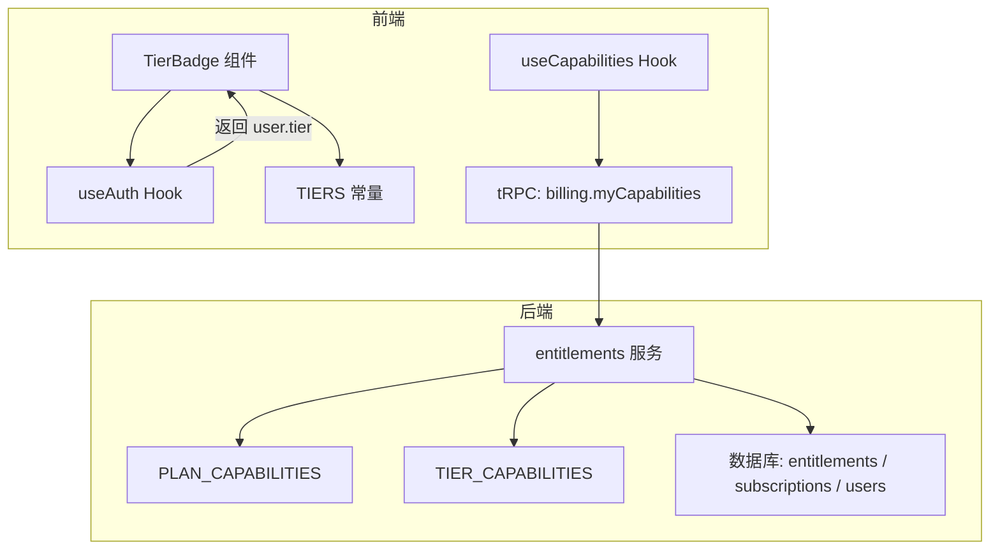
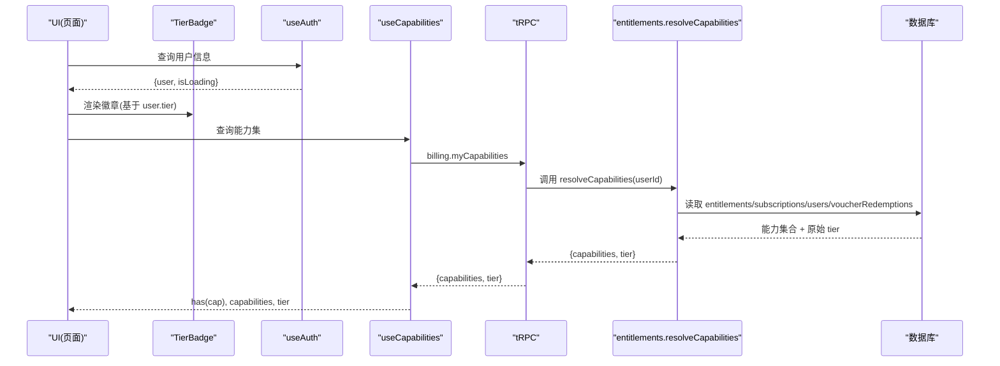
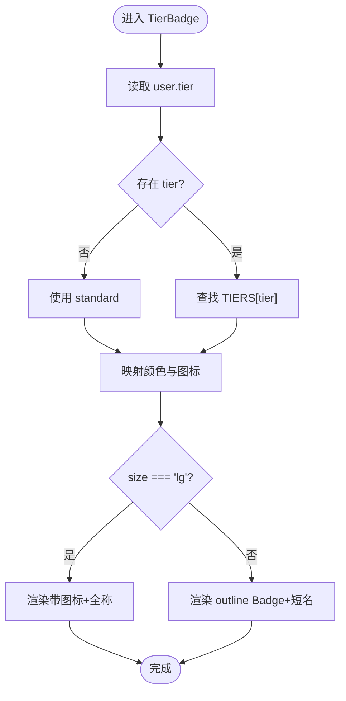
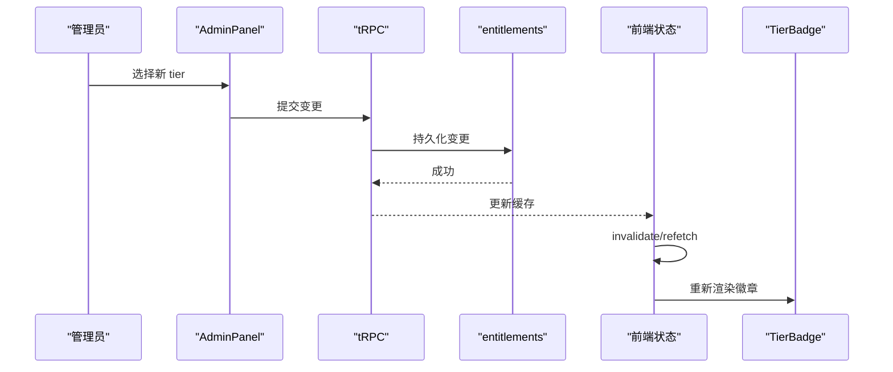
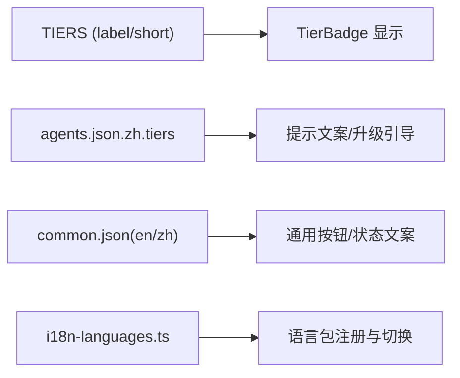
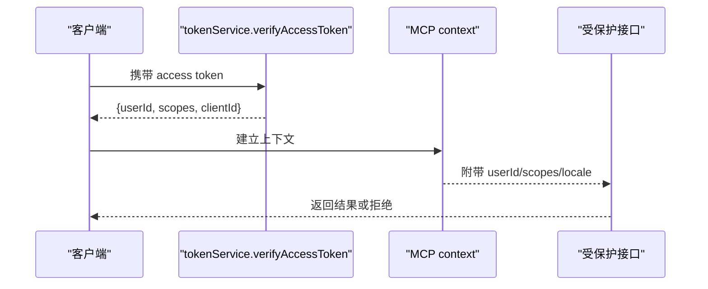
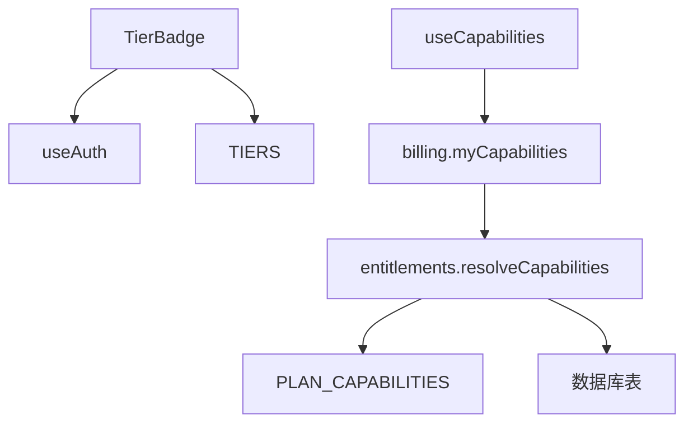

# 层级徽章

<cite>
**本文引用的文件**
- [TierBadge.tsx](file://src/components/TierBadge.tsx)
- [tiers.ts](file://src/lib/tiers.ts)
- [useAuth.ts](file://src/hooks/useAuth.ts)
- [useCapabilities.ts](file://src/hooks/useCapabilities.ts)
- [entitlements.ts](file://api/services/entitlements.ts)
- [plans.ts](file://api/config/plans.ts)
- [schema.ts](file://db/schema.ts)
- [agents.json（中文）](file://src/locales/zh/agents.json)
- [common.json（英文）](file://src/locales/en/common.json)
- [common.json（中文）](file://src/locales/zh/common.json)
- [i18n-languages.ts](file://src/i18n-languages.ts)
- [AdminPanel.tsx](file://src/pages/AdminPanel.tsx)
- [tokenService.ts](file://api/services/tokenService.ts)
- [auth.ts（MCP）](file://api/mcp/auth.ts)
- [context.ts（MCP）](file://api/mcp/context.ts)
</cite>

## 目录
1. [简介](#简介)
2. [项目结构](#项目结构)
3. [核心组件](#核心组件)
4. [架构总览](#架构总览)
5. [详细组件分析](#详细组件分析)
6. [依赖关系分析](#依赖关系分析)
7. [性能考虑](#性能考虑)
8. [故障排查指南](#故障排查指南)
9. [结论](#结论)
10. [附录](#附录)

## 简介
本文件为 DeeWaanAI 的“层级徽章”组件提供完整技术文档，覆盖以下方面：
- 用户层级标识（Artist/Master/Sage，对应 standard/pro_designer/pro_auto）的显示逻辑与视觉设计。
- 权限控制系统：能力矩阵、功能访问控制与 UI 条件渲染。
- 徽章动态更新机制：用户权限变更时的实时刷新策略。
- 多语言支持与国际化配置：确保不同地区用户的正确显示。
- 集成方式：全局权限检查与本地状态管理。
- 可定制选项：样式主题与布局适配。
- 安全与性能：权限验证的安全考量与优化策略。

## 项目结构
层级徽章由前端展示层、权限数据源与国际化资源共同组成：
- 展示层：TierBadge 组件负责读取当前用户层级并渲染徽章。
- 权限数据源：后端 entitlements 服务聚合 tier、订阅计划、凭证等来源的能力集合；前端通过 useCapabilities 获取能力集。
- 国际化：层级名称与提示文案通过 i18n 资源文件组织，支持中英文切换。



图表来源
- [TierBadge.tsx:1-39](file://src/components/TierBadge.tsx#L1-L39)
- [useAuth.ts:1-35](file://src/hooks/useAuth.ts#L1-L35)
- [useCapabilities.ts:1-31](file://src/hooks/useCapabilities.ts#L1-L31)
- [entitlements.ts:22-30](file://api/services/entitlements.ts#L22-L30)
- [plans.ts:36-40](file://api/config/plans.ts#L36-L40)
- [schema.ts:1081-1093](file://db/schema.ts#L1081-L1093)

章节来源
- [TierBadge.tsx:1-39](file://src/components/TierBadge.tsx#L1-L39)
- [useAuth.ts:1-35](file://src/hooks/useAuth.ts#L1-L35)
- [useCapabilities.ts:1-31](file://src/hooks/useCapabilities.ts#L1-L31)
- [entitlements.ts:22-30](file://api/services/entitlements.ts#L22-L30)
- [plans.ts:36-40](file://api/config/plans.ts#L36-L40)
- [schema.ts:1081-1093](file://db/schema.ts#L1081-L1093)

## 核心组件
- TierBadge 组件
  - 输入：size（sm/lg），用于控制徽章尺寸与内容（短标签或带图标的全称）。
  - 数据来源：useAuth 提供的 user.tier；默认 fallback 为 standard。
  - 视觉映射：根据 TIERS.color 选择颜色与图标，渲染 outline Badge 或自定义容器。
  - 行为：无副作用，纯展示；依赖 React 状态自动重渲染。

- 层级定义
  - TIERS 常量集中维护层级键名、显示名、短名、颜色与描述，便于统一扩展与维护。

- 权限能力
  - useCapabilities 提供 has(capability) 方法，用于功能开关与 UI 条件渲染。
  - 后端 entitlements 聚合 explicit grants、活跃订阅计划、tier 与未过期凭证，输出 capabilities 列表与原始 tier。

章节来源
- [TierBadge.tsx:1-39](file://src/components/TierBadge.tsx#L1-L39)
- [tiers.ts:1-8](file://src/lib/tiers.ts#L1-L8)
- [useCapabilities.ts:1-31](file://src/hooks/useCapabilities.ts#L1-L31)
- [entitlements.ts:165-207](file://api/services/entitlements.ts#L165-L207)

## 架构总览
层级徽章的数据流与权限判定流程如下：
- 前端加载时，useAuth 拉取当前用户信息（含 tier），TierBadge 据此渲染。
- 功能访问控制不直接比较 tier，而是通过 useCapabilities.has("capability") 判断。
- 后端 resolveCapabilities 将多层来源合并为能力集，供前端消费。



图表来源
- [useAuth.ts:1-35](file://src/hooks/useAuth.ts#L1-L35)
- [useCapabilities.ts:1-31](file://src/hooks/useCapabilities.ts#L1-L31)
- [entitlements.ts:165-207](file://api/services/entitlements.ts#L165-L207)
- [schema.ts:1081-1093](file://db/schema.ts#L1081-L1093)

## 详细组件分析

### TierBadge 组件
- 职责：根据当前用户层级渲染徽章，支持两种尺寸。
- 显示逻辑：
  - 从 useAuth 获取 user.tier，若缺失则回退到 standard。
  - 使用 TIERS 中的 color 映射到 Tailwind 类名与图标。
  - size=lg 时显示带图标的完整层级名；否则显示短标签。
- 可定制性：
  - 可通过修改 TIERS 与 COLORS/ICONS 映射实现主题化。
  - 可在父组件中传入 size 以适配不同布局。



图表来源
- [TierBadge.tsx:18-39](file://src/components/TierBadge.tsx#L18-L39)
- [tiers.ts:3-7](file://src/lib/tiers.ts#L3-L7)

章节来源
- [TierBadge.tsx:1-39](file://src/components/TierBadge.tsx#L1-L39)
- [tiers.ts:1-8](file://src/lib/tiers.ts#L1-L8)

### 权限控制系统
- 能力矩阵
  - TIER_CAPABILITIES：按 tier 定义基础能力集（如 pipeline:fixed、llm:1、pipeline:custom、marketplace:publish、pipeline:autodesign）。
  - PLAN_CAPABILITIES：按订阅计划授予额外能力（如 team:collaborate）。
- 解析流程
  - resolveCapabilities 合并显式授权、活跃订阅计划、tier、未过期凭证，返回排序后的 capabilities 与原始 tier。
- 前端使用
  - useCapabilities 暴露 has(capability) 用于功能门控，避免直接比较 tier。
  - 同时返回 tier 用于展示用途（非鉴权）。

```mermaid
classDiagram
class EntitlementsService {
+can(userId, capability, ctx) Promise~boolean~
+resolveCapabilities(userId) Promise~{capabilities : string[], tier : string}~
}
class PlansConfig {
+PLAN_CAPABILITIES
+listPublicPlans()
}
class DatabaseSchema {
+entitlements
+subscriptions
+users
+voucherRedemptions
}
EntitlementsService --> PlansConfig : "读取计划能力"
EntitlementsService --> DatabaseSchema : "读取用户/订阅/凭证"
```

图表来源
- [entitlements.ts:22-30](file://api/services/entitlements.ts#L22-L30)
- [entitlements.ts:165-207](file://api/services/entitlements.ts#L165-L207)
- [plans.ts:36-40](file://api/config/plans.ts#L36-L40)
- [schema.ts:1081-1093](file://db/schema.ts#L1081-L1093)

章节来源
- [entitlements.ts:22-30](file://api/services/entitlements.ts#L22-L30)
- [entitlements.ts:165-207](file://api/services/entitlements.ts#L165-L207)
- [plans.ts:36-40](file://api/config/plans.ts#L36-L40)
- [schema.ts:1081-1093](file://db/schema.ts#L1081-L1093)

### 动态更新机制
- 前端缓存与刷新
  - useAuth 与 useCapabilities 均设置 staleTime 与 retry=false，减少频繁请求。
  - 提供 refetch/refresh 方法，在权限变更后主动刷新（例如管理员调整 tier）。
- 管理员操作
  - AdminPanel 允许选择并变更用户 tier，触发 tRPC mutation，随后前端可刷新能力集与徽章。



图表来源
- [useAuth.ts:17-31](file://src/hooks/useAuth.ts#L17-L31)
- [useCapabilities.ts:12-29](file://src/hooks/useCapabilities.ts#L12-L29)
- [AdminPanel.tsx:701-721](file://src/pages/AdminPanel.tsx#L701-L721)

章节来源
- [useAuth.ts:17-31](file://src/hooks/useAuth.ts#L17-L31)
- [useCapabilities.ts:12-29](file://src/hooks/useCapabilities.ts#L12-L29)
- [AdminPanel.tsx:701-721](file://src/pages/AdminPanel.tsx#L701-L721)

### 多语言支持与国际化配置
- 层级名称
  - 前端 TIERS 提供 label/short/color/desc，用于徽章显示与描述。
  - 中文 agents.json 包含 tiers 翻译键（sage/master/artist），可用于界面提示与文案。
- 通用文案
  - common.json（en/zh）提供 actions.status.language 等通用文案，支持语言切换。
- 语言配置
  - i18n-languages.ts 定义支持的语言与命名空间，便于扩展新语言。



图表来源
- [tiers.ts:3-7](file://src/lib/tiers.ts#L3-L7)
- [agents.json（中文）:51-62](file://src/locales/zh/agents.json#L51-L62)
- [common.json（英文）:88-92](file://src/locales/en/common.json#L88-L92)
- [common.json（中文）:88-92](file://src/locales/zh/common.json#L88-L92)
- [i18n-languages.ts:49-100](file://src/i18n-languages.ts#L49-L100)

章节来源
- [tiers.ts:3-7](file://src/lib/tiers.ts#L3-L7)
- [agents.json（中文）:51-62](file://src/locales/zh/agents.json#L51-L62)
- [common.json（英文）:88-92](file://src/locales/en/common.json#L88-L92)
- [common.json（中文）:88-92](file://src/locales/zh/common.json#L88-L92)
- [i18n-languages.ts:49-100](file://src/i18n-languages.ts#L49-L100)

### 集成方式：全局权限检查与本地状态管理
- 全局权限检查
  - 在服务端通过 token 校验与 scopes 过滤，确保 API 访问安全。
  - MCP 上下文解析 access token，提取 userId/scopes/locale，作为后续鉴权依据。
- 本地状态管理
  - useAuth 与 useCapabilities 通过 tRPC 查询与缓存，提供响应式状态。
  - 组件内仅消费状态，不直接处理鉴权逻辑，保持低耦合。



图表来源
- [tokenService.ts:50-66](file://api/services/tokenService.ts#L50-L66)
- [auth.ts（MCP）:281-312](file://api/mcp/auth.ts#L281-L312)
- [context.ts（MCP）:25-41](file://api/mcp/context.ts#L25-L41)

章节来源
- [tokenService.ts:50-66](file://api/services/tokenService.ts#L50-L66)
- [auth.ts（MCP）:281-312](file://api/mcp/auth.ts#L281-L312)
- [context.ts（MCP）:25-41](file://api/mcp/context.ts#L25-L41)

## 依赖关系分析
- 组件依赖
  - TierBadge 依赖 useAuth（用户信息）、TIERS（层级定义）、UI Badge 组件。
  - useCapabilities 依赖 tRPC billing.myCapabilities，间接依赖 entitlements 服务。
- 后端依赖
  - entitlements 依赖 plans 配置与数据库表（entitlements/subscriptions/users/voucherRedemptions）。
- 外部集成
  - 认证与令牌校验通过 tokenService 与 MCP 上下文完成。



图表来源
- [TierBadge.tsx:1-39](file://src/components/TierBadge.tsx#L1-L39)
- [useCapabilities.ts:1-31](file://src/hooks/useCapabilities.ts#L1-L31)
- [entitlements.ts:165-207](file://api/services/entitlements.ts#L165-L207)
- [plans.ts:36-40](file://api/config/plans.ts#L36-L40)
- [schema.ts:1081-1093](file://db/schema.ts#L1081-L1093)

章节来源
- [TierBadge.tsx:1-39](file://src/components/TierBadge.tsx#L1-L39)
- [useCapabilities.ts:1-31](file://src/hooks/useCapabilities.ts#L1-L31)
- [entitlements.ts:165-207](file://api/services/entitlements.ts#L165-L207)
- [plans.ts:36-40](file://api/config/plans.ts#L36-L40)
- [schema.ts:1081-1093](file://db/schema.ts#L1081-L1093)

## 性能考虑
- 缓存策略
  - useAuth 与 useCapabilities 设置 staleTime 与 retry=false，降低重复请求频率。
  - 服务端可对公开资源（如认证徽章 SVG）设置 Cache-Control 与 ETag，提升 CDN 缓存命中。
- 渲染优化
  - TierBadge 为纯展示组件，无副作用，依赖 React 状态驱动重渲染。
  - 使用 useMemo 对能力集进行稳定引用，避免不必要的重计算。
- 网络优化
  - 仅在必要时调用 refetch/refresh，避免频繁刷新导致抖动。

[本节为通用指导，无需具体文件分析]

## 故障排查指南
- 徽章不更新
  - 检查 useAuth.useQuery 是否成功返回 user.tier；确认 tRPC localAuth.me 可用。
  - 权限变更后，调用 refetch/refresh 或 invalidate 以刷新缓存。
- 功能不可用
  - 使用 useCapabilities.has("capability") 判断，而非直接比较 tier。
  - 检查后端 entitlements.resolveCapabilities 是否正确聚合能力集。
- 国际化显示异常
  - 确认 i18n 语言包已注册且当前语言生效。
  - 检查 agents.json 与 common.json 中对应键是否存在。

章节来源
- [useAuth.ts:17-31](file://src/hooks/useAuth.ts#L17-L31)
- [useCapabilities.ts:12-29](file://src/hooks/useCapabilities.ts#L12-L29)
- [entitlements.ts:165-207](file://api/services/entitlements.ts#L165-L207)
- [i18n-languages.ts:49-100](file://src/i18n-languages.ts#L49-L100)

## 结论
层级徽章组件以简洁的前端展示与强大的后端权限系统相结合，实现了：
- 清晰的用户层级标识与视觉反馈。
- 基于能力矩阵的功能访问控制与 UI 条件渲染。
- 动态更新机制，支持权限变更后的实时刷新。
- 完善的多语言支持与可扩展的国际化配置。
- 安全的权限验证与高性能的缓存策略。

建议在实际使用中：
- 始终通过 useCapabilities.has 进行功能门控，避免直接比较 tier。
- 合理设置 staleTime 与刷新时机，平衡实时性与性能。
- 扩展层级与能力时，同步更新 TIERS、TIER_CAPABILITIES 与 PLAN_CAPABILITIES，并确保数据库迁移一致。

[本节为总结，无需具体文件分析]

## 附录
- 关键路径参考
  - 徽章组件：[TierBadge.tsx:1-39](file://src/components/TierBadge.tsx#L1-L39)
  - 层级定义：[tiers.ts:3-7](file://src/lib/tiers.ts#L3-L7)
  - 能力查询：[useCapabilities.ts:12-29](file://src/hooks/useCapabilities.ts#L12-L29)
  - 能力解析：[entitlements.ts:165-207](file://api/services/entitlements.ts#L165-L207)
  - 计划能力：[plans.ts:36-40](file://api/config/plans.ts#L36-L40)
  - 数据库表：[schema.ts:1081-1093](file://db/schema.ts#L1081-L1093)
  - 国际化：[agents.json（中文）:51-62](file://src/locales/zh/agents.json#L51-L62)、[common.json（英文）:88-92](file://src/locales/en/common.json#L88-L92)、[common.json（中文）:88-92](file://src/locales/zh/common.json#L88-L92)、[i18n-languages.ts:49-100](file://src/i18n-languages.ts#L49-L100)
  - 管理员操作：[AdminPanel.tsx:701-721](file://src/pages/AdminPanel.tsx#L701-L721)
  - 令牌校验：[tokenService.ts:50-66](file://api/services/tokenService.ts#L50-L66)
  - MCP 上下文：[auth.ts（MCP）:281-312](file://api/mcp/auth.ts#L281-L312)、[context.ts（MCP）:25-41](file://api/mcp/context.ts#L25-L41)