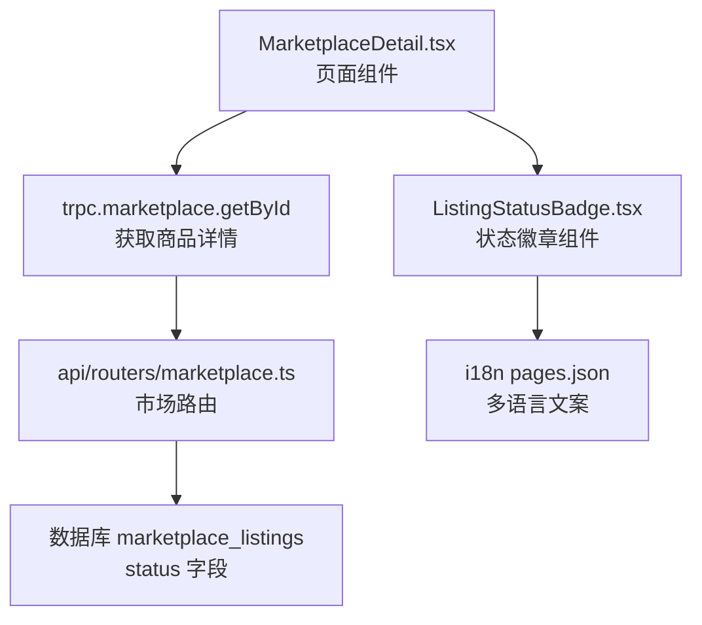
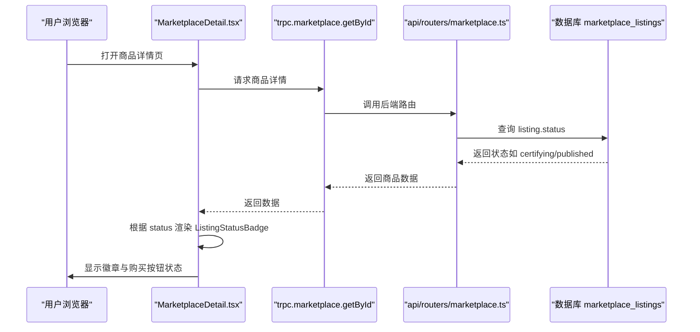
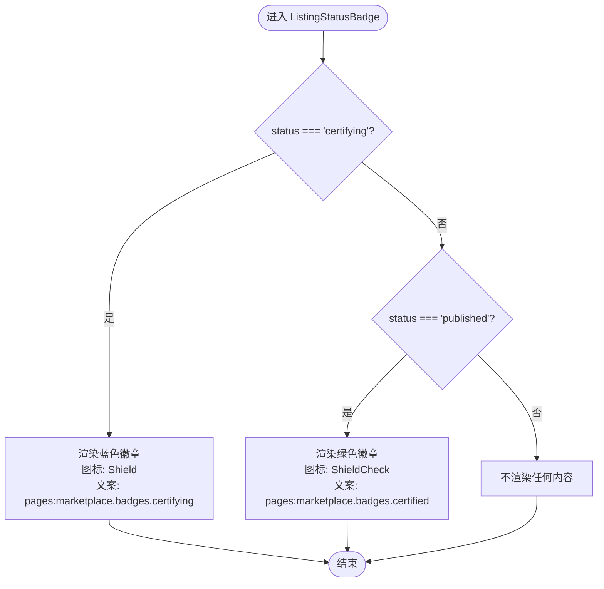
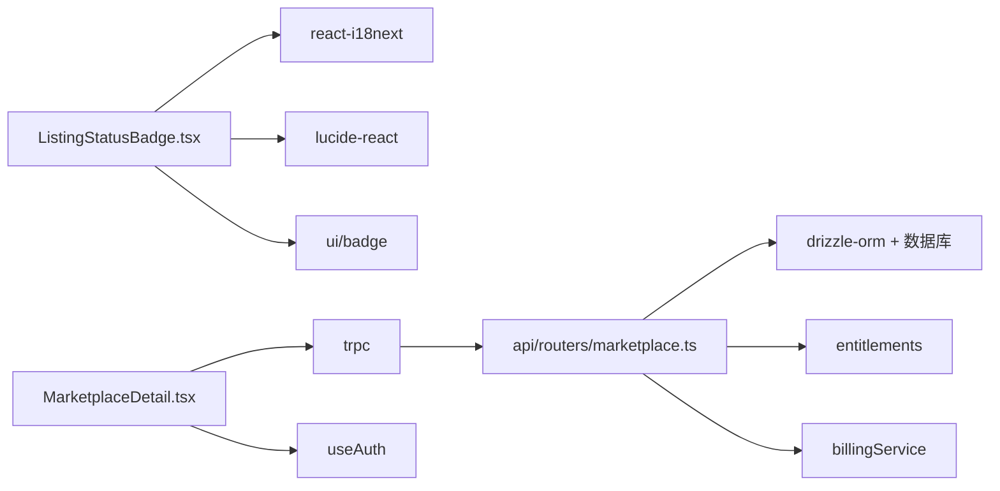

# 市场状态徽章

<cite>
**本文引用的文件**
- [ListingStatusBadge.tsx](file://src/components/marketplace/ListingStatusBadge.tsx)
- [MarketplaceDetail.tsx](file://src/pages/MarketplaceDetail.tsx)
- [marketplace.ts](file://api/routers/marketplace.ts)
- [014_marketplace_trust.sql](file://db/migrations/014_marketplace_trust.sql)
- [pages.json（英文）](file://src/locales/en/pages.json)
- [pages.json（中文）](file://src/locales/zh/pages.json)
- [certification-badge-route.ts](file://api/certification-badge-route.ts)
</cite>

## 目录
1. [简介](#简介)
2. [项目结构](#项目结构)
3. [核心组件](#核心组件)
4. [架构总览](#架构总览)
5. [详细组件分析](#详细组件分析)
6. [依赖关系分析](#依赖关系分析)
7. [性能考虑](#性能考虑)
8. [故障排查指南](#故障排查指南)
9. [结论](#结论)
10. [附录](#附录)

## 简介
本文件为 DeeWaanAI 市场的“商品状态徽章”组件提供完整技术文档。该组件用于在市场详情页展示商品当前认证与可购买状态的视觉标识，包括“认证中”和“已认证”两种状态，并配合后端市场 API 实现数据绑定与实时更新。文档涵盖：
- 状态类型、视觉样式与交互行为
- 状态转换的业务逻辑、触发条件与权限验证
- 组件的可定制性（颜色主题、尺寸适配、多语言支持）
- 与后端市场 API 的数据绑定与更新机制
- 在不同页面场景下的使用模式与最佳实践
- 无障碍访问支持与响应式设计实现细节
- 扩展新状态类型的开发指南与集成示例

## 项目结构
市场状态徽章由前端组件与后端市场路由共同协作完成：
- 前端：ListingStatusBadge 组件负责根据传入的 status 渲染不同样式的徽章；MarketplaceDetail 页面通过 tRPC 查询商品详情并传递状态给徽章组件。
- 后端：marketplace.ts 路由定义商品状态枚举、认证流程与购买校验；数据库迁移定义了状态枚举值；国际化资源提供多语言文案。

图表来源
- [MarketplaceDetail.tsx:33-41](file://src/pages/MarketplaceDetail.tsx#L33-L41)
- [marketplace.ts:1370-1397](file://api/routers/marketplace.ts#L1370-L1397)
- [014_marketplace_trust.sql:7-13](file://db/migrations/014_marketplace_trust.sql#L7-L13)
- [ListingStatusBadge.tsx:11-33](file://src/components/marketplace/ListingStatusBadge.tsx#L11-L33)
- [pages.json（英文）:388-392](file://src/locales/en/pages.json#L388-L392)
- [pages.json（中文）:388-392](file://src/locales/zh/pages.json#L388-L392)

章节来源
- [MarketplaceDetail.tsx:25-86](file://src/pages/MarketplaceDetail.tsx#L25-L86)
- [marketplace.ts:1370-1397](file://api/routers/marketplace.ts#L1370-L1397)
- [014_marketplace_trust.sql:7-13](file://db/migrations/014_marketplace_trust.sql#L7-L13)
- [ListingStatusBadge.tsx:11-33](file://src/components/marketplace/ListingStatusBadge.tsx#L11-L33)
- [pages.json（英文）:388-392](file://src/locales/en/pages.json#L388-L392)
- [pages.json（中文）:388-392](file://src/locales/zh/pages.json#L388-L392)

## 核心组件
- ListingStatusBadge：接收 status 字符串或 null，当 status 为 "certifying" 时显示“认证中”蓝色徽章；当 status 为 "published" 时显示“已认证”绿色徽章；其他状态不渲染任何内容。
- MarketplaceDetail：通过 trpc 获取商品详情，将 listing.status 传递给徽章组件，并根据状态控制购买按钮等交互。

章节来源
- [ListingStatusBadge.tsx:11-33](file://src/components/marketplace/ListingStatusBadge.tsx#L11-L33)
- [MarketplaceDetail.tsx:33-41](file://src/pages/MarketplaceDetail.tsx#L33-L41)

## 架构总览
市场状态徽章的数据流与业务逻辑如下：
- 页面加载后调用 trpc.marketplace.getById 获取商品详情，包含 status、价格、评分等信息。
- 后端 marketplace.ts 在提交审核流程中将商品状态推进到 "certifying"（可见但不可购买），并在满足人类评审阈值后推进到 "published"（可购买）。
- 前端根据 status 渲染对应徽章，同时根据状态禁用购买按钮或提示“仍在认证中”。

图表来源
- [MarketplaceDetail.tsx:33-41](file://src/pages/MarketplaceDetail.tsx#L33-L41)
- [marketplace.ts:1370-1397](file://api/routers/marketplace.ts#L1370-L1397)

## 详细组件分析

### 组件：ListingStatusBadge
- 输入参数：status（string | null）
- 渲染规则：
  - "certifying" → 蓝色徽章，图标为盾牌，文案来自 i18n keys pages:marketplace.badges.certifying
  - "published" → 绿色徽章，图标为带勾盾牌，文案来自 i18n keys pages:marketplace.badges.certified
  - 其他状态 → 不渲染任何内容
- 样式：使用 Tailwind 类名设置背景色、文字色、边框透明度与字号；图标使用 lucide-react 的 Shield 与 ShieldCheck
- 多语言：通过 react-i18next 的 useTranslation("pages") 获取本地化文案

图表来源
- [ListingStatusBadge.tsx:11-33](file://src/components/marketplace/ListingStatusBadge.tsx#L11-L33)
- [pages.json（英文）:388-392](file://src/locales/en/pages.json#L388-L392)
- [pages.json（中文）:388-392](file://src/locales/zh/pages.json#L388-L392)

章节来源
- [ListingStatusBadge.tsx:11-33](file://src/components/marketplace/ListingStatusBadge.tsx#L11-L33)

### 页面：MarketplaceDetail
- 数据获取：使用 trpc.marketplace.getById.useQuery 获取商品详情，enabled 条件确保 id 有效
- 购买检查：使用 trpc.marketplace.checkPurchase.useQuery 判断是否已购买或具备权限
- 状态处理：根据 listing.status 控制购买按钮与提示信息；当 status 为 "certifying" 时提示“仍在认证中，暂时无法购买”，并提供成为审核者的入口
- 徽章集成：将 listing.status 传递给 ListingStatusBadge 进行渲染

章节来源
- [MarketplaceDetail.tsx:25-86](file://src/pages/MarketplaceDetail.tsx#L25-L86)
- [MarketplaceDetail.tsx:249-271](file://src/pages/MarketplaceDetail.tsx#L249-L271)

### 后端：市场路由与状态流转
- 状态枚举：数据库迁移定义了 marketplace_listings.status 的枚举值，包括 draft、generating、pending_review、reviewing、certifying、rejected、approved、published、unpublished
- 认证流程：
  - AI 初审低于阈值 → 状态置为 "rejected"
  - 通过 AI 初审 → 状态推进到 "certifying"（可见但不可购买）
  - 人类评审达到阈值 → 状态推进到 "published"（可购买）
- 购买校验：checkPurchase 结合购买记录与权限能力（entitlements）判断是否允许购买

章节来源
- [014_marketplace_trust.sql:7-13](file://db/migrations/014_marketplace_trust.sql#L7-L13)
- [marketplace.ts:1370-1397](file://api/routers/marketplace.ts#L1370-L1397)
- [marketplace.ts:2094-2110](file://api/routers/marketplace.ts#L2094-L2110)

### 认证徽章接口
- 公开 SVG 徽章：/api/certification/:id/badge.svg 仅对 approved/published 且存在 grade 的商品返回 SVG 徽章，用于外部嵌入或 SEO 展示

章节来源
- [certification-badge-route.ts:48-70](file://api/certification-badge-route.ts#L48-L70)

## 依赖关系分析
- 组件依赖：
  - react-i18next：多语言文案
  - lucide-react：图标（Shield、ShieldCheck）
  - @/components/ui/badge：基础徽章 UI 组件
- 页面依赖：
  - trpc：与后端市场路由通信
  - useAuth：获取当前用户信息以控制购买权限
- 后端依赖：
  - drizzle-orm：数据库查询与更新
  - entitlements：权限能力校验
  - billingService：创建支付会话

图表来源
- [ListingStatusBadge.tsx:1-3](file://src/components/marketplace/ListingStatusBadge.tsx#L1-L3)
- [MarketplaceDetail.tsx:1-10](file://src/pages/MarketplaceDetail.tsx#L1-L10)
- [marketplace.ts:1-35](file://api/routers/marketplace.ts#L1-L35)

章节来源
- [ListingStatusBadge.tsx:1-3](file://src/components/marketplace/ListingStatusBadge.tsx#L1-L3)
- [MarketplaceDetail.tsx:1-10](file://src/pages/MarketplaceDetail.tsx#L1-L10)
- [marketplace.ts:1-35](file://api/routers/marketplace.ts#L1-L35)

## 性能考虑
- 前端渲染：徽章组件为纯函数式组件，无副作用，渲染开销极低
- 数据获取：tRPC 查询默认启用缓存与增量更新，避免频繁刷新
- 后端缓存：市场浏览数据设置了较短的浏览器 TTL 与较长的边缘缓存 TTL，减少数据库压力
- 图片徽章：认证徽章 SVG 接口设置了合理的 Cache-Control 与 ETag，利于 CDN 缓存

[本节为通用性能建议，无需特定文件引用]

## 故障排查指南
- 徽章不显示：
  - 检查传入的 status 是否为 "certifying" 或 "published"
  - 确认 i18n 文案 key 是否存在于 pages.json
- 购买按钮异常：
  - 检查 checkPurchase 返回的 purchased 字段
  - 确认用户是否登录且具备购买权限
- 状态未更新：
  - 检查后端认证流程是否正确推进状态
  - 确认数据库迁移已执行，status 枚举包含所需值

章节来源
- [ListingStatusBadge.tsx:11-33](file://src/components/marketplace/ListingStatusBadge.tsx#L11-L33)
- [MarketplaceDetail.tsx:33-41](file://src/pages/MarketplaceDetail.tsx#L33-L41)
- [marketplace.ts:1370-1397](file://api/routers/marketplace.ts#L1370-L1397)
- [014_marketplace_trust.sql:7-13](file://db/migrations/014_marketplace_trust.sql#L7-L13)

## 结论
市场状态徽章组件简洁高效，通过清晰的状态映射与多语言支持，为用户提供了直观的商品认证状态反馈。结合后端严格的认证流程与权限控制，确保了商品上架质量与购买体验。未来可扩展更多状态类型与视觉样式，以满足更复杂的市场需求。

[本节为总结性内容，无需特定文件引用]

## 附录

### 状态类型与视觉样式
- "certifying"：蓝色徽章，盾牌图标，表示“认证中”，不可购买
- "published"：绿色徽章，带勾盾牌图标，表示“已认证”，可购买
- 其他状态：不渲染徽章

章节来源
- [ListingStatusBadge.tsx:11-33](file://src/components/marketplace/ListingStatusBadge.tsx#L11-L33)
- [pages.json（英文）:388-392](file://src/locales/en/pages.json#L388-L392)
- [pages.json（中文）:388-392](file://src/locales/zh/pages.json#L388-L392)

### 状态转换业务逻辑
- AI 初审失败 → "rejected"
- AI 初审通过 → "certifying"（可见但不可购买）
- 人类评审达标 → "published"（可购买）

章节来源
- [marketplace.ts:1370-1397](file://api/routers/marketplace.ts#L1370-L1397)

### 权限验证机制
- 购买前检查：checkPurchase 结合购买记录与 entitlements 权限能力
- 用户登录：需要登录才能购买
- 创作者限制：创作者不能购买自己的商品

章节来源
- [marketplace.ts:2094-2110](file://api/routers/marketplace.ts#L2094-L2110)
- [MarketplaceDetail.tsx:83-86](file://src/pages/MarketplaceDetail.tsx#L83-L86)

### 可定制性
- 颜色主题：可通过修改 Tailwind 类名调整徽章颜色
- 尺寸适配：使用 text-xs 与小图标，适合紧凑布局
- 多语言支持：通过 i18n keys 支持中英文切换

章节来源
- [ListingStatusBadge.tsx:14-29](file://src/components/marketplace/ListingStatusBadge.tsx#L14-L29)
- [pages.json（英文）:388-392](file://src/locales/en/pages.json#L388-L392)
- [pages.json（中文）:388-392](file://src/locales/zh/pages.json#L388-L392)

### 数据绑定与实时更新
- 数据绑定：MarketplaceDetail 通过 trpc 获取 listing.status 并传递给徽章组件
- 实时更新：tRPC 查询默认启用缓存与增量更新，状态变化时自动刷新

章节来源
- [MarketplaceDetail.tsx:33-41](file://src/pages/MarketplaceDetail.tsx#L33-L41)

### 使用模式与最佳实践
- 在商品详情页使用徽章组件展示状态
- 根据状态控制购买按钮与提示信息
- 确保 i18n 文案完整，避免显示空白文本

章节来源
- [MarketplaceDetail.tsx:25-86](file://src/pages/MarketplaceDetail.tsx#L25-L86)

### 无障碍访问与响应式设计
- 无障碍：徽章使用语义化 Badge 组件，图标具有描述性含义
- 响应式：Tailwind 类名适配不同屏幕尺寸，小字号与紧凑布局适合移动端

章节来源
- [ListingStatusBadge.tsx:14-29](file://src/components/marketplace/ListingStatusBadge.tsx#L14-L29)

### 扩展新状态类型的开发指南
- 添加新状态：在数据库迁移中扩展 status 枚举
- 更新组件：在 ListingStatusBadge 中添加新状态分支
- 更新文案：在 pages.json 中添加对应多语言文案
- 更新逻辑：在后端路由中添加状态转换规则

章节来源
- [014_marketplace_trust.sql:7-13](file://db/migrations/014_marketplace_trust.sql#L7-L13)
- [ListingStatusBadge.tsx:11-33](file://src/components/marketplace/ListingStatusBadge.tsx#L11-L33)
- [pages.json（英文）:388-392](file://src/locales/en/pages.json#L388-L392)
- [pages.json（中文）:388-392](file://src/locales/zh/pages.json#L388-L392)