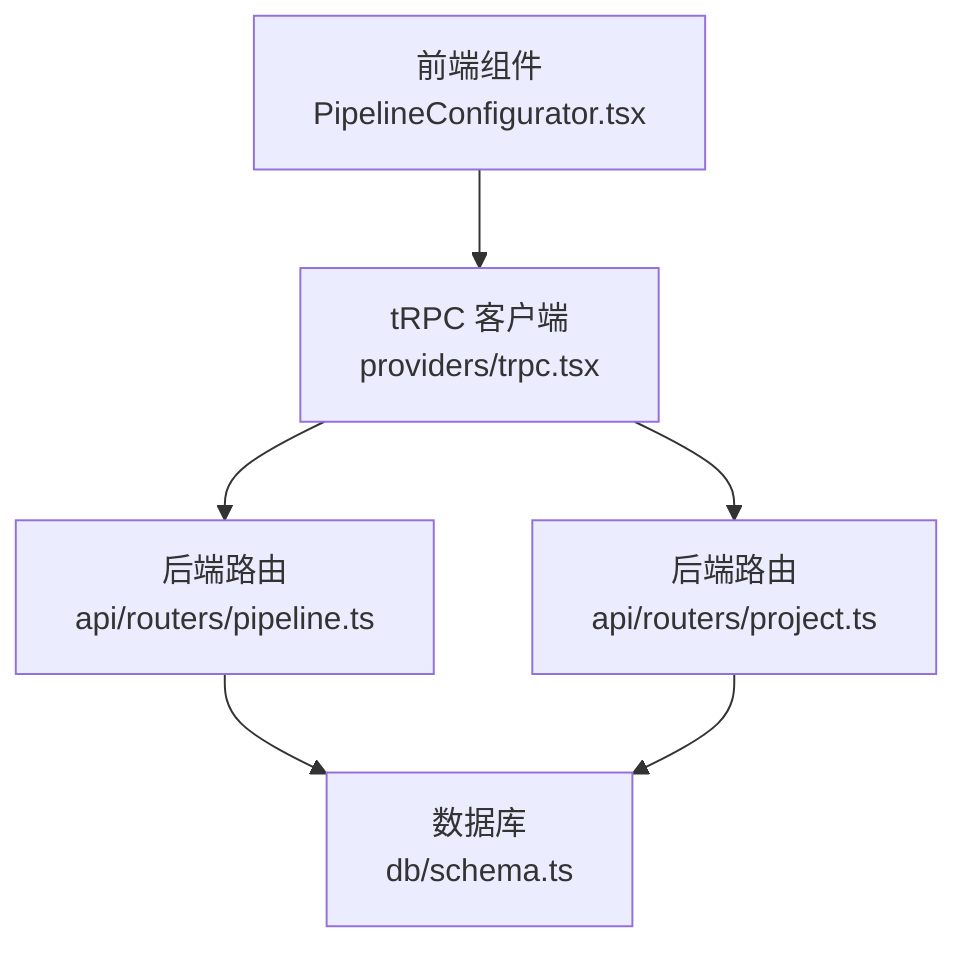
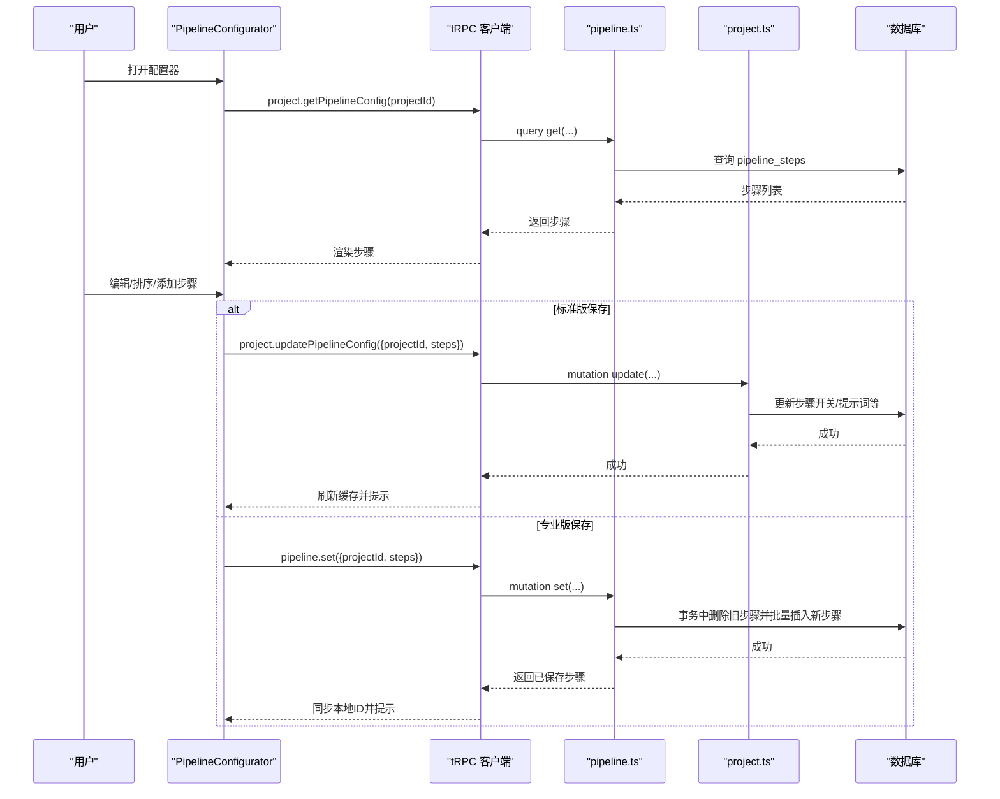
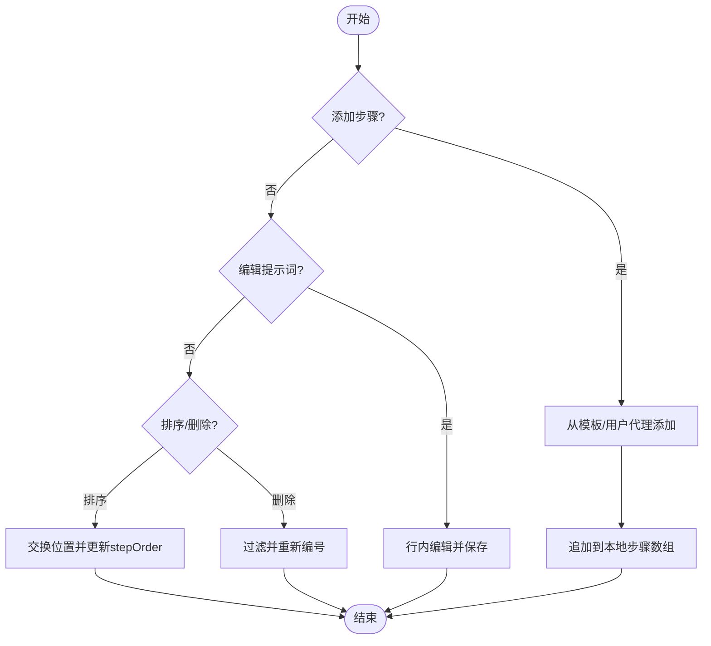
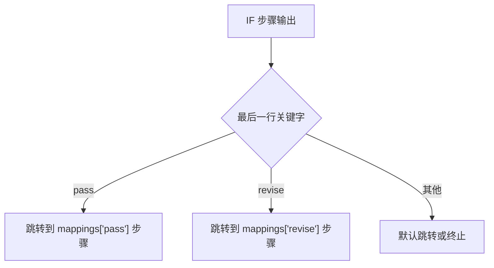
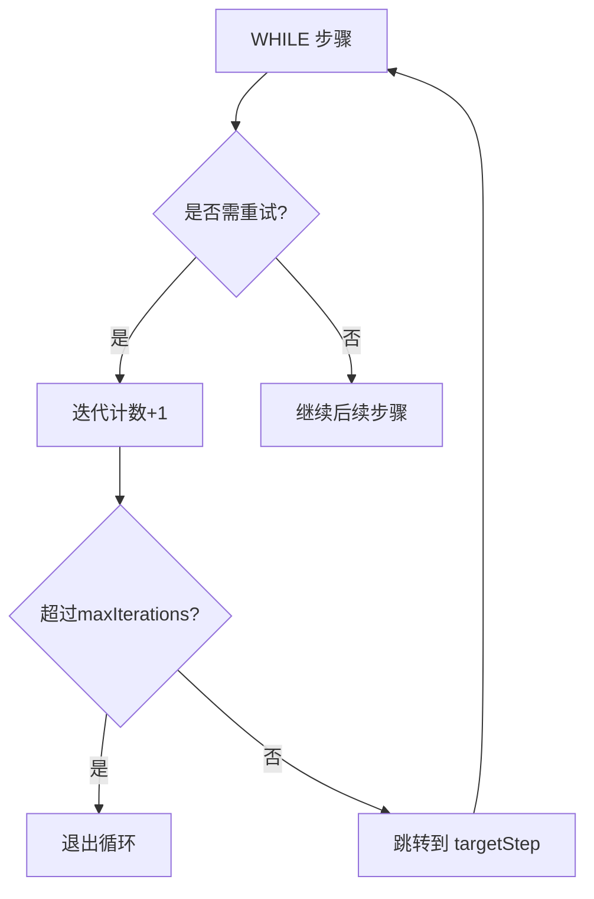
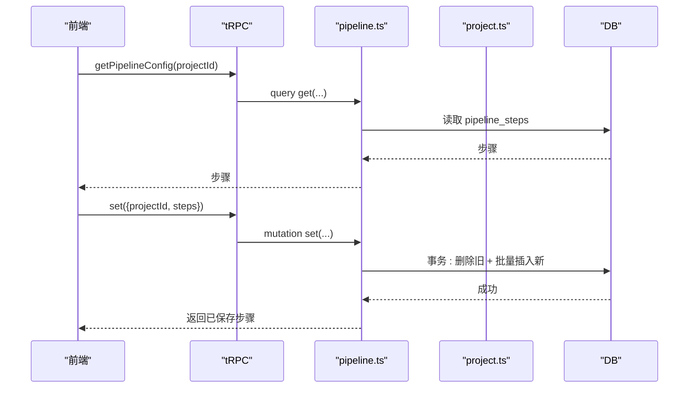
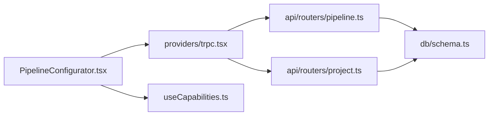

# 流水线配置器

<cite>
**本文引用的文件**
- [PipelineConfigurator.tsx](file://src/components/pipeline/PipelineConfigurator.tsx)
- [pipeline.ts](file://api/routers/pipeline.ts)
- [project.ts](file://api/routers/project.ts)
- [schema.ts](file://db/schema.ts)
- [useCapabilities.ts](file://src/hooks/useCapabilities.ts)
- [trpc.tsx](file://src/providers/trpc.tsx)
- [pipeline.json（英文）](file://src/locales/en/pipeline.json)
</cite>

## 目录
1. [简介](#简介)
2. [项目结构](#项目结构)
3. [核心组件](#核心组件)
4. [架构总览](#架构总览)
5. [详细组件分析](#详细组件分析)
6. [依赖关系分析](#依赖关系分析)
7. [性能考量](#性能考量)
8. [故障排查指南](#故障排查指南)
9. [结论](#结论)
10. [附录](#附录)

## 简介
本文件为 DeeWaanAI 流水线配置器组件的权威技术文档，聚焦可视化工作流构建能力：步骤管理（添加、编辑、删除、排序）、条件分支（IF Gate）与循环控制（WHILE Loop）的实现机制；标准版与专业版的功能差异（LLM 提供商选择、模型参数温度与最大令牌数、内存模式）；与后端 tRPC API 的集成方式（数据同步、错误处理）；以及前端状态管理、本地存储持久化与用户体验优化。文末提供扩展新步骤类型与自定义业务逻辑的实践指引。

## 项目结构
- 前端
  - 组件：src/components/pipeline/PipelineConfigurator.tsx 负责可视化编排、UI 交互、本地状态与 tRPC 调用。
  - 能力判定：src/hooks/useCapabilities.ts 提供基于能力的功能门控（如 pipeline:custom）。
  - i18n：src/locales/en/pipeline.json 提供界面文案。
- 后端
  - tRPC 路由：api/routers/pipeline.ts 暴露 get/set/createDefault/availableProviders 等接口，实现步骤保存、默认流水线创建、可用 LLM 提供商查询。
  - 项目路由：api/routers/project.ts 提供项目级操作（含默认流水线初始化逻辑）。
- 数据层
  - 数据库模式：db/schema.ts 定义 pipeline_steps、llm_providers、projects、pipeline_templates 等表结构，支撑步骤、条件与循环配置。

图表来源
- [PipelineConfigurator.tsx:1-534](file://src/components/pipeline/PipelineConfigurator.tsx#L1-L534)
- [pipeline.ts:82-327](file://api/routers/pipeline.ts#L82-L327)
- [project.ts:103-200](file://api/routers/project.ts#L103-L200)
- [schema.ts:453-480](file://db/schema.ts#L453-L480)

章节来源
- [PipelineConfigurator.tsx:1-534](file://src/components/pipeline/PipelineConfigurator.tsx#L1-L534)
- [pipeline.ts:82-327](file://api/routers/pipeline.ts#L82-L327)
- [project.ts:103-200](file://api/routers/project.ts#L103-L200)
- [schema.ts:453-480](file://db/schema.ts#L453-L480)

## 核心组件
- 可视化步骤列表与编辑：支持查看、启用/禁用、编辑系统提示词、调整顺序、删除（专业版）。
- 模板与特殊步骤：可从用户代理或模板添加步骤；支持 IF Gate、WHILE Loop、人工审批三种特殊步骤。
- 专业版能力：按步骤选择 LLM 提供商与模型、设置温度与最大令牌数；限制每流水线最多 3 个不同 LLM。
- 内存模式：保守/均衡/激进三档，写入 localStorage 持久化。
- 保存与回退：保存时根据版本走不同后端接口；支持重置为默认四步流水线。

章节来源
- [PipelineConfigurator.tsx:24-236](file://src/components/pipeline/PipelineConfigurator.tsx#L24-L236)
- [pipeline.json:1-51](file://src/locales/en/pipeline.json#L1-L51)

## 架构总览
前端通过 tRPC 与后端通信：
- 读取：getPipelineConfig 获取当前项目的步骤序列。
- 写入：updatePipelineConfig（标准版仅允许开关与提示词微调），set（专业版全量覆盖并自动创建/解析 Agent）。
- 辅助：availableProviders 获取可用 LLM 提供商；createFromPipeline 将当前流水线保存为模板。

图表来源
- [PipelineConfigurator.tsx:51-87](file://src/components/pipeline/PipelineConfigurator.tsx#L51-L87)
- [pipeline.ts:128-219](file://api/routers/pipeline.ts#L128-L219)
- [project.ts:169-200](file://api/routers/project.ts#L169-L200)

## 详细组件分析

### 步骤管理与排序
- 添加步骤：从“用户代理”或“模板”添加，或新增特殊步骤（IF/WHILE/Approval）。
- 编辑步骤：点击提示词进入行内编辑，保存后更新本地状态。
- 删除步骤：仅专业版可用，二次确认后移除并重排 stepOrder。
- 排序：仅专业版可用，上下移动并维护 stepOrder。
- 启用/禁用：所有版本均可切换 isEnabled。

图表来源
- [PipelineConfigurator.tsx:122-196](file://src/components/pipeline/PipelineConfigurator.tsx#L122-L196)

章节来源
- [PipelineConfigurator.tsx:122-196](file://src/components/pipeline/PipelineConfigurator.tsx#L122-L196)

### 条件分支（IF Gate）
- 数据结构：ifConfig 包含 options（关键词数组）与 mappings（关键词→目标步骤序号映射）。
- 行为：在步骤编辑面板中可配置选项与映射；保存时随步骤一并提交至后端。
- 执行语义：由运行侧依据最后行的关键字路由到对应步骤（前端仅负责配置与展示）。

图表来源
- [PipelineConfigurator.tsx:388-427](file://src/components/pipeline/PipelineConfigurator.tsx#L388-L427)
- [schema.ts:471-474](file://db/schema.ts#L471-L474)

章节来源
- [PipelineConfigurator.tsx:388-427](file://src/components/pipeline/PipelineConfigurator.tsx#L388-L427)
- [schema.ts:471-474](file://db/schema.ts#L471-L474)

### 循环控制（WHILE Loop）
- 数据结构：whileConfig 包含 targetStep（目标步骤序号）与 maxIterations（最大迭代次数）。
- 行为：当判定需要重试时，回跳到 targetStep 继续执行，直至达到 maxIterations。
- 安全边界：前端对输入范围进行约束，避免非法值。

图表来源
- [PipelineConfigurator.tsx:429-458](file://src/components/pipeline/PipelineConfigurator.tsx#L429-L458)
- [schema.ts:472-474](file://db/schema.ts#L472-L474)

章节来源
- [PipelineConfigurator.tsx:429-458](file://src/components/pipeline/PipelineConfigurator.tsx#L429-L458)
- [schema.ts:472-474](file://db/schema.ts#L472-L474)

### 用户层级与功能差异
- 标准版：仅能启用/禁用步骤、编辑提示词；不可排序、删除、添加步骤；不可按步骤选择 LLM。
- 专业版：完整步骤管理、按步骤选择 LLM 提供商与模型、设置温度与最大令牌数；限制每流水线最多 3 个不同 LLM。
- 能力判定：通过 useCapabilities 的 has("pipeline:custom") 控制 UI 与权限。

章节来源
- [PipelineConfigurator.tsx:44-53](file://src/components/pipeline/PipelineConfigurator.tsx#L44-L53)
- [PipelineConfigurator.tsx:216-235](file://src/components/pipeline/PipelineConfigurator.tsx#L216-L235)
- [useCapabilities.ts:1-31](file://src/hooks/useCapabilities.ts#L1-L31)

### 与后端 API 的集成
- 读取配置：project.getPipelineConfig 拉取步骤序列。
- 保存配置：
  - 标准版：project.updatePipelineConfig 仅更新开关与提示词等字段。
  - 专业版：pipeline.set 全量覆盖，并在事务中删除旧步骤、批量插入新步骤；同时批量解析/创建 Agent。
- 可用提供商：pipeline.availableProviders 返回用户配置的 LLM 提供商列表。
- 模板保存：template.createFromPipeline 将当前流水线保存为用户模板。

图表来源
- [pipeline.ts:82-219](file://api/routers/pipeline.ts#L82-L219)
- [project.ts:169-200](file://api/routers/project.ts#L169-L200)

章节来源
- [pipeline.ts:82-219](file://api/routers/pipeline.ts#L82-L219)
- [project.ts:169-200](file://api/routers/project.ts#L169-L200)

### 错误处理策略
- 前端：使用 toast 显示成功/失败消息；保存前校验至少一个步骤；专业版保存前校验 LLM 数量上限。
- 后端：Zod 校验输入；项目不存在/无权限时抛出错误；保存失败时事务回滚。
- 网络异常：tRPC 错误透传至前端 toast。

章节来源
- [PipelineConfigurator.tsx:55-87](file://src/components/pipeline/PipelineConfigurator.tsx#L55-L87)
- [pipeline.ts:153-170](file://api/routers/pipeline.ts#L153-L170)

### 状态管理与本地持久化
- 本地状态：steps、memoryMode、编辑态等通过 React useState 管理。
- 本地持久化：memory-mode-{projectId} 存入 localStorage，页面加载时恢复。
- 缓存失效：保存成功后通过 utils.invalidate 刷新相关查询缓存。

章节来源
- [PipelineConfigurator.tsx:89-120](file://src/components/pipeline/PipelineConfigurator.tsx#L89-L120)
- [PipelineConfigurator.tsx:55-87](file://src/components/pipeline/PipelineConfigurator.tsx#L55-L87)

### 用户体验优化
- 非专业版：以遮罩提示升级，阻止误操作。
- 实时反馈：保存按钮在请求期间禁用并显示加载图标。
- 多语言：通过 i18n 键值统一文案。
- 视觉提示：启用/禁用、步骤类型标签、LLM 用量徽章。

章节来源
- [PipelineConfigurator.tsx:252-301](file://src/components/pipeline/PipelineConfigurator.tsx#L252-L301)
- [pipeline.json:1-51](file://src/locales/en/pipeline.json#L1-L51)

## 依赖关系分析
- 组件依赖
  - PipelineConfigurator 依赖 tRPC 客户端、能力钩子、UI 组件库与国际化。
- 后端依赖
  - pipeline.ts 依赖 Drizzle ORM、数据库 schema、日志与认证中间件。
- 数据依赖
  - pipeline_steps 表承载步骤、类型与配置；llm_providers 提供 LLM 元信息；projects 作为资源归属。

图表来源
- [PipelineConfigurator.tsx:1-534](file://src/components/pipeline/PipelineConfigurator.tsx#L1-L534)
- [pipeline.ts:1-327](file://api/routers/pipeline.ts#L1-L327)
- [project.ts:1-200](file://api/routers/project.ts#L1-L200)
- [schema.ts:453-480](file://db/schema.ts#L453-L480)

章节来源
- [PipelineConfigurator.tsx:1-534](file://src/components/pipeline/PipelineConfigurator.tsx#L1-L534)
- [pipeline.ts:1-327](file://api/routers/pipeline.ts#L1-L327)
- [project.ts:1-200](file://api/routers/project.ts#L1-L200)
- [schema.ts:453-480](file://db/schema.ts#L453-L480)

## 性能考量
- 批量解析 Agent：后端使用 batchResolveAgents 一次性查询并批量创建缺失 Agent，避免 N+1 查询。
- 事务原子性：保存步骤采用事务包裹删除与插入，保证一致性。
- 前端缓存：使用 tRPC 缓存与 invalidate 减少重复请求。
- 本地持久化：内存模式写入 localStorage，避免每次启动重新计算。

章节来源
- [pipeline.ts:13-80](file://api/routers/pipeline.ts#L13-L80)
- [pipeline.ts:178-219](file://api/routers/pipeline.ts#L178-L219)
- [PipelineConfigurator.tsx:55-87](file://src/components/pipeline/PipelineConfigurator.tsx#L55-L87)
- [PipelineConfigurator.tsx:115-120](file://src/components/pipeline/PipelineConfigurator.tsx#L115-L120)

## 故障排查指南
- 保存失败
  - 检查是否至少有一个步骤；专业版是否超过 3 个不同 LLM。
  - 查看后端 Zod 校验错误与项目权限。
- 无法排序/删除
  - 确认当前用户是否具备 pipeline:custom 能力。
- 步骤未生效
  - 确认保存后是否触发缓存失效；检查返回的步骤是否包含正确 ID。
- 条件/循环不工作
  - 检查 ifConfig/whileConfig 配置是否正确；确保运行侧遵循配置语义。

章节来源
- [PipelineConfigurator.tsx:198-235](file://src/components/pipeline/PipelineConfigurator.tsx#L198-L235)
- [pipeline.ts:162-170](file://api/routers/pipeline.ts#L162-L170)

## 结论
流水线配置器提供了直观的可视化工作流构建体验，覆盖步骤管理、条件分支与循环控制，并通过能力门控区分标准版与专业版功能。前后端通过 tRPC 紧密协作，结合事务与批量处理保障数据一致性与性能。建议在生产环境中完善错误上报与审计日志，持续优化用户引导与提示。

## 附录

### 扩展新步骤类型的实践
- 前端
  - 在 Step 类型中添加新的 stepType 字段与相应配置结构。
  - 在 addSpecialStep 中新增分支，生成默认配置与 UI 表单。
  - 在编辑面板中渲染新配置项，并更新保存载荷。
- 后端
  - 在 pipeline.ts 的 set 输入校验中增加新 stepType 及配置结构。
  - 在保存逻辑中处理新类型的持久化与执行语义（如需）。
- 数据库
  - 若需额外字段，扩展 pipeline_steps 表的 JSON 列或新增列，并更新 schema.ts。

章节来源
- [PipelineConfigurator.tsx:24-38](file://src/components/pipeline/PipelineConfigurator.tsx#L24-L38)
- [PipelineConfigurator.tsx:163-196](file://src/components/pipeline/PipelineConfigurator.tsx#L163-L196)
- [pipeline.ts:131-152](file://api/routers/pipeline.ts#L131-L152)
- [schema.ts:453-480](file://db/schema.ts#L453-L480)