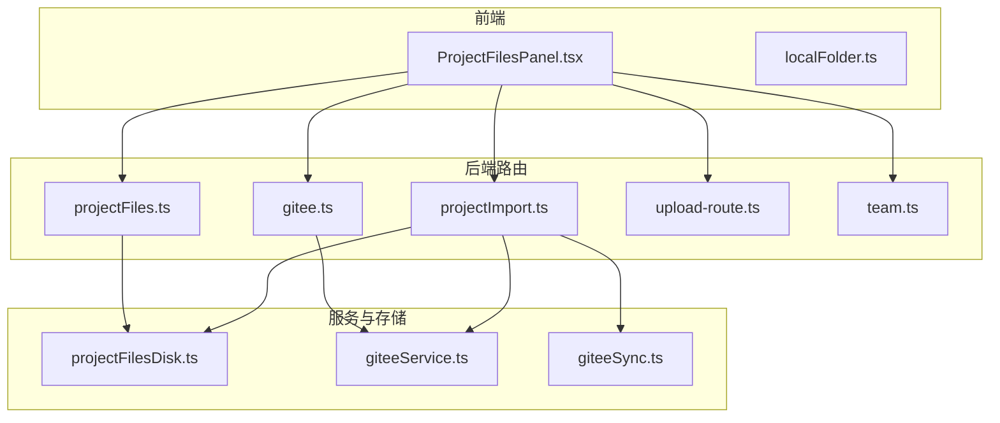
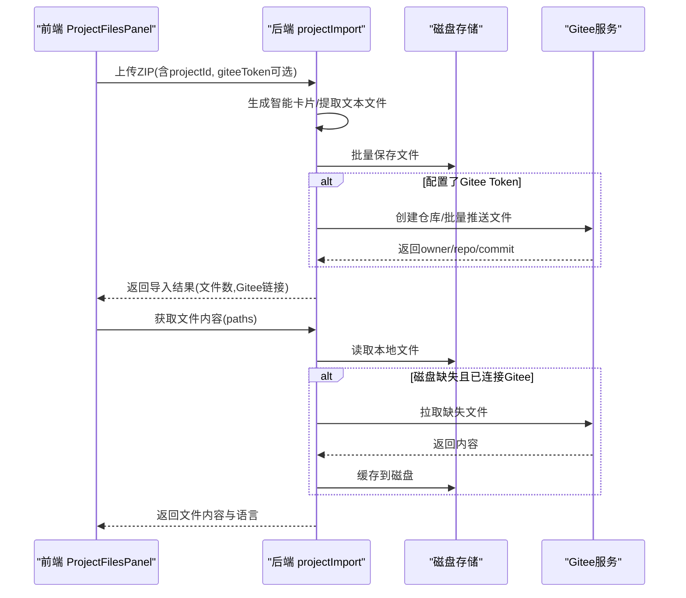
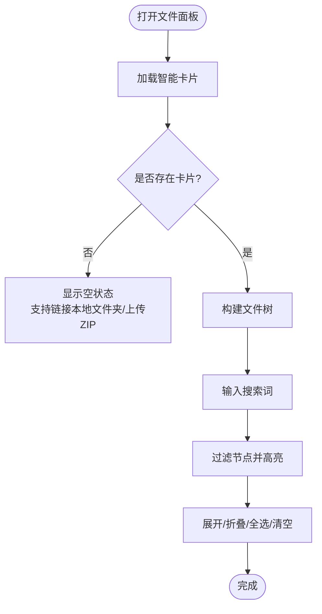
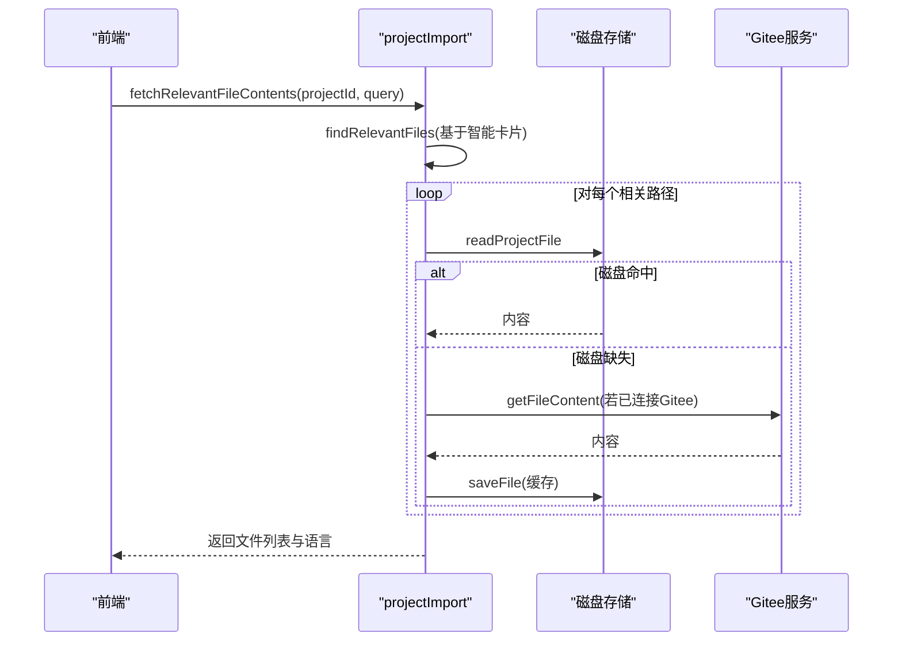
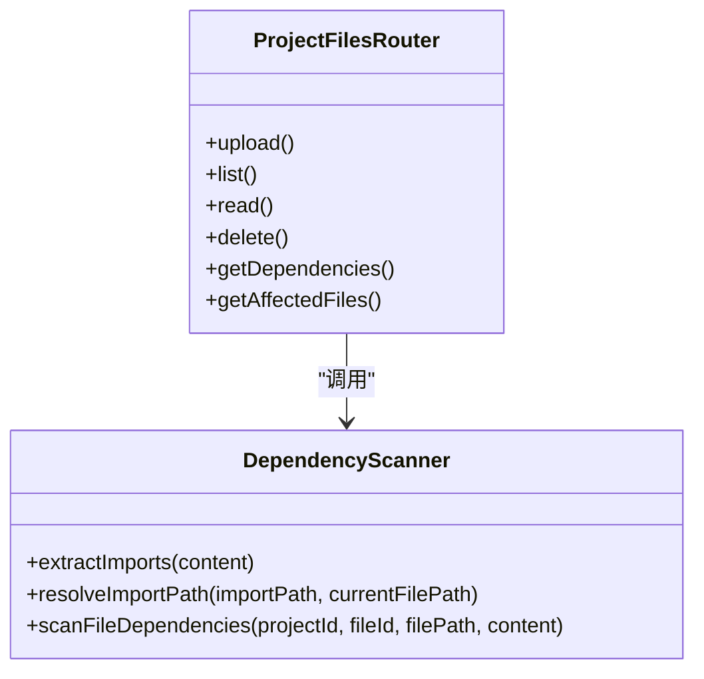
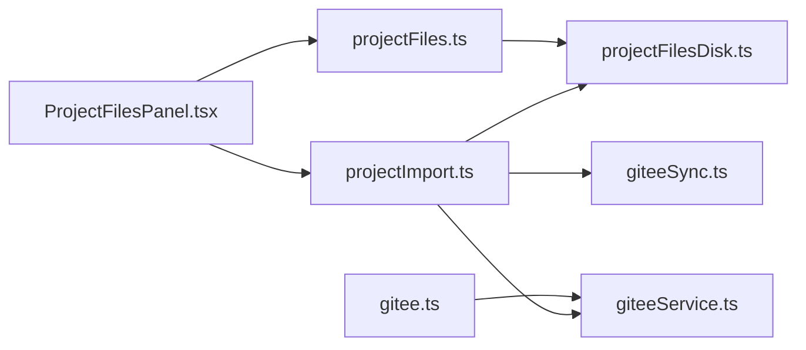

# 项目文件面板

<cite>
**本文引用的文件**
- [ProjectFilesPanel.tsx](file://src/components/project/ProjectFilesPanel.tsx)
- [localFolder.ts](file://src/lib/localFolder.ts)
- [projectImport.ts](file://api/routers/projectImport.ts)
- [projectFiles.ts](file://api/routers/projectFiles.ts)
- [projectFilesDisk.ts](file://api/services/projectFilesDisk.ts)
- [giteeSync.ts](file://api/services/giteeSync.ts)
- [giteeService.ts](file://api/services/giteeService.ts)
- [gitee.ts](file://api/routers/gitee.ts)
- [upload-route.ts](file://api/upload-route.ts)
- [team.ts](file://api/routers/team.ts)
</cite>

## 目录
1. [简介](#简介)
2. [项目结构](#项目结构)
3. [核心组件](#核心组件)
4. [架构总览](#架构总览)
5. [详细组件分析](#详细组件分析)
6. [依赖关系分析](#依赖关系分析)
7. [性能考量](#性能考量)
8. [故障排查指南](#故障排查指南)
9. [结论](#结论)
10. [附录：API与集成要点](#附录api与集成要点)

## 简介
本文件面向DeeWaanAI项目的“项目文件面板”能力，覆盖以下目标：
- 文件浏览、上传、下载、删除、重命名等基础管理能力
- 与Gitee的代码仓库同步机制（含拉取、推送、分支与版本信息）
- 文件预览与在线查看（文本、图片、PDF、DOCX等）
- 权限控制与团队协作共享
- 文件索引、搜索与性能优化策略
- 与后端服务的API集成方式（含批量操作与错误处理、重试机制、用户反馈）
说明：当前实现以Gitee为主，未包含GitHub同步；实时同步通过服务端轮询或事件驱动扩展可实现。

## 项目结构
前端以React组件展示项目文件树、导入ZIP、本地文件夹链接、搜索与上下文开关；后端提供项目导入、文件读取、依赖扫描、磁盘存储、Gitee同步与团队共享等能力。

图表来源
- [ProjectFilesPanel.tsx:185-564](file://src/components/project/ProjectFilesPanel.tsx#L185-L564)
- [projectImport.ts:75-653](file://api/routers/projectImport.ts#L75-L653)
- [projectFiles.ts:67-381](file://api/routers/projectFiles.ts#L67-L381)
- [projectFilesDisk.ts:1-143](file://api/services/projectFilesDisk.ts#L1-L143)
- [giteeService.ts:35-119](file://api/services/giteeService.ts#L35-L119)
- [giteeSync.ts:26-129](file://api/services/giteeSync.ts#L26-L129)
- [gitee.ts:33-270](file://api/routers/gitee.ts#L33-L270)
- [upload-route.ts:91-283](file://api/upload-route.ts#L91-L283)
- [team.ts:369-411](file://api/routers/team.ts#L369-L411)

章节来源
- [ProjectFilesPanel.tsx:185-564](file://src/components/project/ProjectFilesPanel.tsx#L185-L564)
- [projectImport.ts:75-653](file://api/routers/projectImport.ts#L75-L653)
- [projectFiles.ts:67-381](file://api/routers/projectFiles.ts#L67-L381)
- [projectFilesDisk.ts:1-143](file://api/services/projectFilesDisk.ts#L1-L143)
- [giteeService.ts:35-119](file://api/services/giteeService.ts#L35-L119)
- [giteeSync.ts:26-129](file://api/services/giteeSync.ts#L26-L129)
- [gitee.ts:33-270](file://api/routers/gitee.ts#L33-L270)
- [upload-route.ts:91-283](file://api/upload-route.ts#L91-L283)
- [team.ts:369-411](file://api/routers/team.ts#L369-L411)

## 核心组件
- 前端文件面板：负责展示文件树、导入ZIP、链接本地文件夹、搜索过滤、上下文开关、清理数据等交互。
- 项目导入路由：解析ZIP、生成智能卡片、写入磁盘、可选推送到Gitee、提供按路径/查询获取文件内容的能力。
- 文件服务路由：提供文件的上传、列表、读取、删除、依赖扫描与影响分析。
- 磁盘存储服务：将文件内容持久化到服务器磁盘，支持读写、批量保存、递归遍历与删除。
- Gitee同步服务：创建仓库、批量推送文件、并行拉取文件、获取文件树与内容。
- 团队共享路由：基于团队与项目共享关系进行访问控制。

章节来源
- [ProjectFilesPanel.tsx:185-564](file://src/components/project/ProjectFilesPanel.tsx#L185-L564)
- [projectImport.ts:75-653](file://api/routers/projectImport.ts#L75-L653)
- [projectFiles.ts:67-381](file://api/routers/projectFiles.ts#L67-L381)
- [projectFilesDisk.ts:1-143](file://api/services/projectFilesDisk.ts#L1-L143)
- [giteeSync.ts:26-129](file://api/services/giteeSync.ts#L26-L129)
- [giteeService.ts:35-119](file://api/services/giteeService.ts#L35-L119)
- [team.ts:369-411](file://api/routers/team.ts#L369-L411)

## 架构总览
系统采用“混合架构”：
- 主存储：服务器磁盘（快速读取，适合LLM上下文）
- 备份/协作：Gitee私有仓库（跨设备、团队协作）
- 前端：浏览器本地文件夹访问（File System Access API），支持直接选择ZIP并上传

关键流程：
- 导入ZIP：前端上传ZIP → 后端解压、生成智能卡片、写磁盘、可选推送到Gitee
- 读取文件：优先从磁盘读取，缺失则回退至Gitee，再落盘缓存
- 搜索相关：基于智能卡片的元数据进行关键词匹配，返回相关文件路径与内容
- 团队共享：通过团队-项目关联校验访问权限

图表来源
- [projectImport.ts:75-238](file://api/routers/projectImport.ts#L75-L238)
- [projectImport.ts:247-309](file://api/routers/projectImport.ts#L247-L309)
- [projectFilesDisk.ts:42-81](file://api/services/projectFilesDisk.ts#L42-L81)
- [giteeSync.ts:26-93](file://api/services/giteeSync.ts#L26-L93)
- [giteeService.ts:55-98](file://api/services/giteeService.ts#L55-L98)

## 详细组件分析

### 前端文件面板（ProjectFilesPanel）
- 功能要点
  - 展示智能卡片中的文件树，支持展开/折叠、搜索高亮、入口点标记
  - 支持上传ZIP导入项目，支持链接本地文件夹（Chrome/Edge）并列出ZIP快速导入
  - 支持清空智能卡片与本地文件夹解绑
  - 支持切换是否将项目文件纳入聊天上下文
- 交互与状态
  - 使用trpc调用获取智能卡片，失败时友好提示
  - 本地文件夹访问通过File System Access API，权限丢失自动清理
  - 上传过程显示加载态，成功/失败通过toast反馈

图表来源
- [ProjectFilesPanel.tsx:54-98](file://src/components/project/ProjectFilesPanel.tsx#L54-L98)
- [ProjectFilesPanel.tsx:185-564](file://src/components/project/ProjectFilesPanel.tsx#L185-L564)

章节来源
- [ProjectFilesPanel.tsx:185-564](file://src/components/project/ProjectFilesPanel.tsx#L185-L564)
- [localFolder.ts:91-195](file://src/lib/localFolder.ts#L91-L195)

### 项目导入与智能卡片（projectImport）
- ZIP导入
  - 限制大小、排除敏感/二进制文件、生成智能卡片、写磁盘、可选推送到Gitee
- 文件内容获取
  - 优先读磁盘，缺失则回退Gitee，成功后缓存磁盘
- 智能搜索
  - 基于智能卡片元数据（路径、名称、导出、描述）进行关键词匹配
- 同步
  - 支持从Gitee拉取文件树并批量下载到磁盘

图表来源
- [projectImport.ts:314-412](file://api/routers/projectImport.ts#L314-L412)
- [projectFilesDisk.ts:87-99](file://api/services/projectFilesDisk.ts#L87-L99)
- [giteeService.ts:35-48](file://api/services/giteeService.ts#L35-L48)

章节来源
- [projectImport.ts:75-653](file://api/routers/projectImport.ts#L75-L653)

### 文件服务（projectFiles）
- 上传/更新：支持文本与二进制（以标记形式存储），代码文件自动扫描依赖
- 列表/读取：按项目隔离，校验所有权
- 删除：级联删除依赖关系
- 依赖扫描：解析ES6/CommonJS/动态import，批量匹配目标文件，建立依赖图
- 影响分析：BFS批量查询受影响文件

图表来源
- [projectFiles.ts:67-381](file://api/routers/projectFiles.ts#L67-L381)

章节来源
- [projectFiles.ts:67-381](file://api/routers/projectFiles.ts#L67-L381)

### 磁盘存储（projectFilesDisk）
- 安全：路径规范化防止目录穿越
- 批量保存：逐文件写入，记录成功/失败计数
- 读取/列举：递归遍历项目目录
- 删除：递归删除项目目录

章节来源
- [projectFilesDisk.ts:1-143](file://api/services/projectFilesDisk.ts#L1-L143)

### Gitee同步（giteeSync / giteeService）
- 推送：创建私有仓库，分批推送文本文件，尊重速率限制
- 拉取：并行获取多个文件内容，过滤失败项
- 文件树/内容：提供目录枚举与内容读取接口

章节来源
- [giteeSync.ts:26-129](file://api/services/giteeSync.ts#L26-L129)
- [giteeService.ts:35-119](file://api/services/giteeService.ts#L35-L119)

### 团队共享与权限（team）
- 共享项目：仅项目所有者可共享，重复共享幂等
- 访问控制：导入/读取前校验用户是否为项目所有者或团队成员

章节来源
- [team.ts:369-411](file://api/routers/team.ts#L369-L411)
- [projectImport.ts:52-73](file://api/routers/projectImport.ts#L52-L73)

## 依赖关系分析
- 前端依赖trpc调用后端路由，使用本地文件夹工具进行ZIP选择与读取
- 后端路由依赖磁盘服务与Gitee服务，形成“磁盘优先、Gitee回退”的读取链路
- 依赖扫描与影响分析增强代码理解与变更风险评估

图表来源
- [ProjectFilesPanel.tsx:185-564](file://src/components/project/ProjectFilesPanel.tsx#L185-L564)
- [projectImport.ts:75-653](file://api/routers/projectImport.ts#L75-L653)
- [projectFiles.ts:67-381](file://api/routers/projectFiles.ts#L67-L381)
- [projectFilesDisk.ts:1-143](file://api/services/projectFilesDisk.ts#L1-L143)
- [giteeService.ts:35-119](file://api/services/giteeService.ts#L35-L119)
- [giteeSync.ts:26-129](file://api/services/giteeSync.ts#L26-L129)
- [gitee.ts:33-270](file://api/routers/gitee.ts#L33-L270)

章节来源
- [ProjectFilesPanel.tsx:185-564](file://src/components/project/ProjectFilesPanel.tsx#L185-L564)
- [projectImport.ts:75-653](file://api/routers/projectImport.ts#L75-L653)
- [projectFiles.ts:67-381](file://api/routers/projectFiles.ts#L67-L381)
- [projectFilesDisk.ts:1-143](file://api/services/projectFilesDisk.ts#L1-L143)
- [giteeService.ts:35-119](file://api/services/giteeService.ts#L35-L119)
- [giteeSync.ts:26-129](file://api/services/giteeSync.ts#L26-L129)
- [gitee.ts:33-270](file://api/routers/gitee.ts#L33-L270)

## 性能考量
- 磁盘优先读取：减少网络开销，提升大文件与频繁读取场景性能
- 批量写入/读取：磁盘服务与Gitee拉取均使用批处理与并发策略
- 依赖扫描优化：一次性批量查询匹配所有可能路径，避免多次数据库往返
- 速率限制：Gitee推送分批并加入延迟，避免触发限流
- 前端渲染：文件树按需展开、搜索过滤减少DOM节点数量

[本节为通用指导，不直接分析具体文件]

## 故障排查指南
- 导入失败
  - 检查ZIP大小限制与排除规则
  - 确认Gitee Token有效且具备仓库写入权限
  - 查看磁盘写入权限与可用空间
- 文件读取为空
  - 确认磁盘路径存在且可读
  - 若磁盘缺失，检查Gitee回退逻辑与网络连接
- 依赖扫描异常
  - 检查import语法与别名解析是否正确
  - 确认目标文件存在于项目内
- 团队访问被拒
  - 确认用户为项目所有者或团队成员
  - 检查共享关系是否建立

章节来源
- [projectImport.ts:75-238](file://api/routers/projectImport.ts#L75-L238)
- [projectFilesDisk.ts:24-28](file://api/services/projectFilesDisk.ts#L24-L28)
- [projectFiles.ts:305-381](file://api/routers/projectFiles.ts#L305-L381)
- [team.ts:369-411](file://api/routers/team.ts#L369-L411)

## 结论
本项目文件面板实现了完整的文件管理闭环：导入、浏览、搜索、读取、依赖分析与团队协作共享。通过“磁盘优先、Gitee回退”的混合架构，兼顾性能与可移植性。未来可扩展GitHub同步、WebSocket实时更新与更丰富的在线编辑器集成。

[本节为总结，不直接分析具体文件]

## 附录：API与集成要点
- 文件上传与预览
  - 支持图片、文本、PDF、DOCX等类型分类与处理，返回dataUrl或文本内容用于前端预览
- 批量操作
  - 支持批量保存文件、批量拉取文件、批量依赖扫描
- 错误处理与重试
  - 磁盘/Gitee操作失败记录日志并继续其他任务；前端通过toast反馈错误
- 实时同步
  - 当前未内置WebSocket；可通过服务端事件+客户端轮询或引入WebSocket通道实现增量同步
- 权限与安全
  - 所有操作均校验项目所有权或团队共享关系；路径规范化防止目录穿越

章节来源
- [upload-route.ts:91-283](file://api/upload-route.ts#L91-L283)
- [projectImport.ts:247-412](file://api/routers/projectImport.ts#L247-L412)
- [projectFilesDisk.ts:42-81](file://api/services/projectFilesDisk.ts#L42-L81)
- [giteeSync.ts:112-129](file://api/services/giteeSync.ts#L112-L129)
- [projectFiles.ts:67-381](file://api/routers/projectFiles.ts#L67-L381)
- [team.ts:369-411](file://api/routers/team.ts#L369-L411)