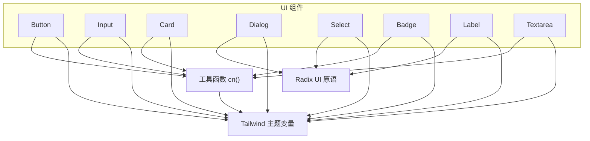
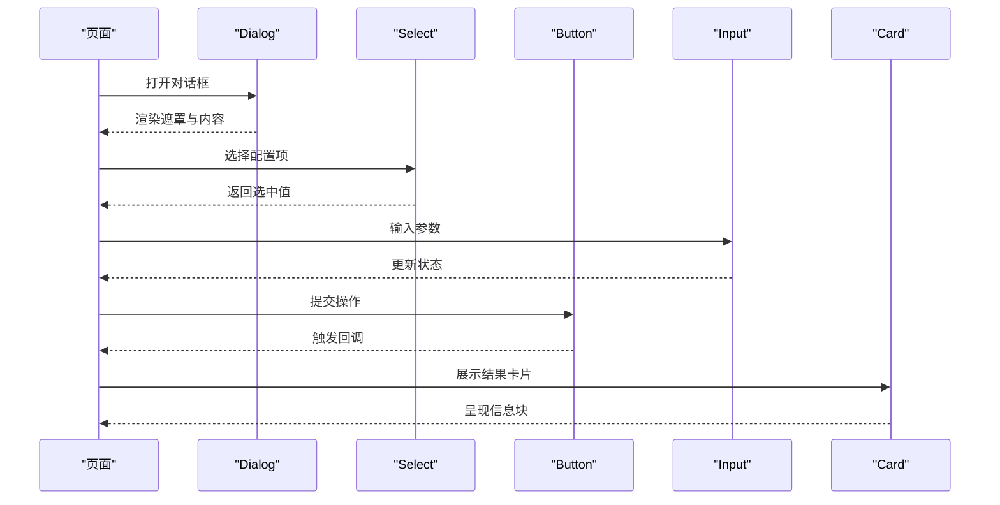
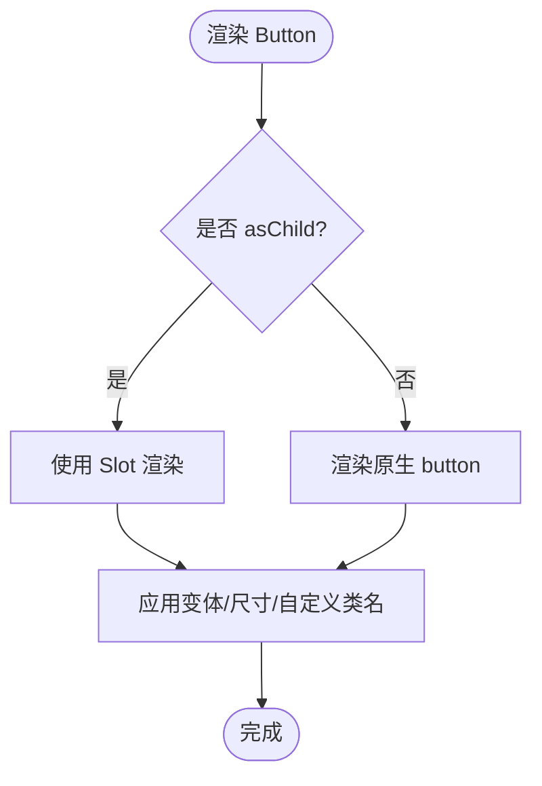
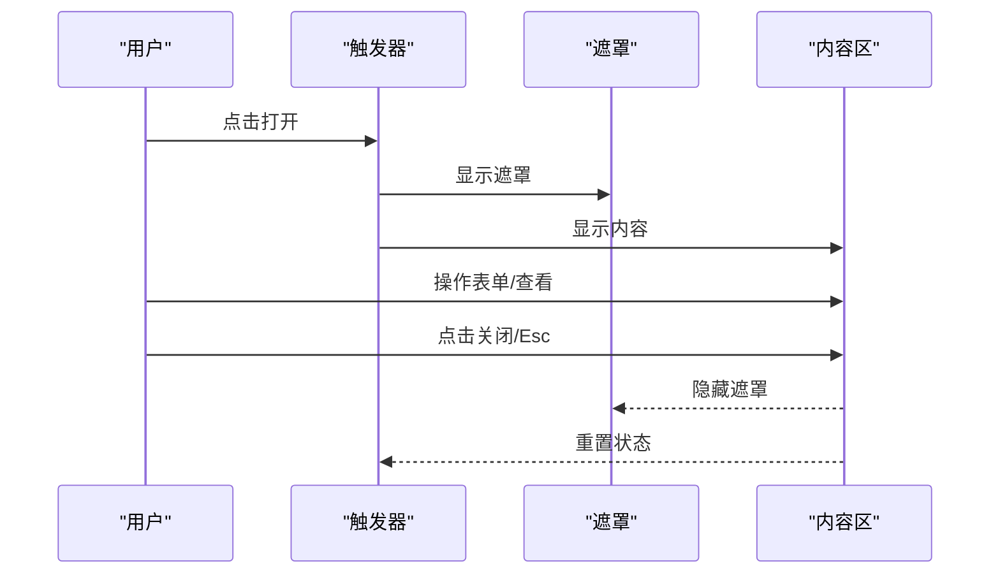
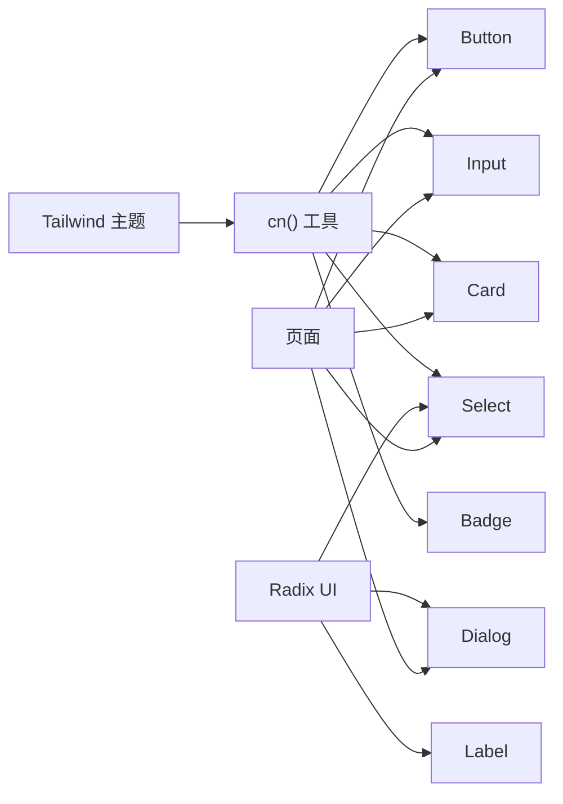

# 基础UI组件

<cite>
**本文引用的文件**
- [button.tsx](file://src/components/ui/button.tsx)
- [input.tsx](file://src/components/ui/input.tsx)
- [card.tsx](file://src/components/ui/card.tsx)
- [dialog.tsx](file://src/components/ui/dialog.tsx)
- [select.tsx](file://src/components/ui/select.tsx)
- [badge.tsx](file://src/components/ui/badge.tsx)
- [label.tsx](file://src/components/ui/label.tsx)
- [textarea.tsx](file://src/components/ui/textarea.tsx)
- [utils.ts](file://src/lib/utils.ts)
- [tailwind.config.js](file://tailwind.config.js)
- [Dashboard.tsx](file://src/pages/Dashboard.tsx)
- [Settings.tsx](file://src/pages/Settings.tsx)
- [TierBadge.tsx](file://src/components/TierBadge.tsx)
</cite>

## 目录
1. [简介](#简介)
2. [项目结构](#项目结构)
3. [核心组件](#核心组件)
4. [架构总览](#架构总览)
5. [详细组件分析](#详细组件分析)
6. [依赖关系分析](#依赖关系分析)
7. [性能考虑](#性能考虑)
8. [故障排查指南](#故障排查指南)
9. [结论](#结论)
10. [附录](#附录)

## 简介
本文件为 DeeWaanAI 前端基础 UI 组件库的权威文档，覆盖按钮、输入框、卡片、对话框、选择器、徽章、标签、文本域等核心组件。内容包含：
- 每个组件的 Props 接口、默认值与可定制样式
- 事件与无障碍访问支持说明
- 响应式设计与主题定制方法
- 使用示例与最佳实践（以“代码片段路径”形式引用）
- 与其他组件的组合模式与常见用法

## 项目结构
UI 组件位于 src/components/ui 目录下，采用“按功能拆分 + 原子化样式”的组织方式；通过 Tailwind CSS 变量实现主题化，并通过 Radix UI 提供无障碍能力。页面级示例在 src/pages 中展示组合用法。

图表来源
- [button.tsx:1-63](file://src/components/ui/button.tsx#L1-L63)
- [input.tsx:1-22](file://src/components/ui/input.tsx#L1-L22)
- [card.tsx:1-93](file://src/components/ui/card.tsx#L1-L93)
- [dialog.tsx:1-142](file://src/components/ui/dialog.tsx#L1-L142)
- [select.tsx:1-189](file://src/components/ui/select.tsx#L1-L189)
- [badge.tsx:1-47](file://src/components/ui/badge.tsx#L1-L47)
- [label.tsx:1-25](file://src/components/ui/label.tsx#L1-L25)
- [textarea.tsx:1-19](file://src/components/ui/textarea.tsx#L1-L19)
- [utils.ts:1-7](file://src/lib/utils.ts#L1-L7)
- [tailwind.config.js:1-84](file://tailwind.config.js#L1-L84)

章节来源
- [button.tsx:1-63](file://src/components/ui/button.tsx#L1-L63)
- [input.tsx:1-22](file://src/components/ui/input.tsx#L1-L22)
- [card.tsx:1-93](file://src/components/ui/card.tsx#L1-L93)
- [dialog.tsx:1-142](file://src/components/ui/dialog.tsx#L1-L142)
- [select.tsx:1-189](file://src/components/ui/select.tsx#L1-L189)
- [badge.tsx:1-47](file://src/components/ui/badge.tsx#L1-L47)
- [label.tsx:1-25](file://src/components/ui/label.tsx#L1-L25)
- [textarea.tsx:1-19](file://src/components/ui/textarea.tsx#L1-L19)
- [utils.ts:1-7](file://src/lib/utils.ts#L1-L7)
- [tailwind.config.js:1-84](file://tailwind.config.js#L1-L84)

## 核心组件
本节概述各组件的职责、Props 能力、默认行为与样式定制点。

- 按钮 Button
  - 职责：通用交互触发控件，支持多种变体与尺寸，支持 asChild 透传至 Slot。
  - 关键 Props：variant、size、asChild、以及所有原生 button 属性。
  - 默认值：variant=default，size=default。
  - 样式定制：通过 variant/size 切换外观；可通过 className 叠加；焦点环与无效状态样式内置。
  - 无障碍：保留原生 button 语义；focus-visible 与 aria-invalid 状态已处理。
  - 参考路径：[button.tsx:7-37](file://src/components/ui/button.tsx#L7-L37)、[button.tsx:39-63](file://src/components/ui/button.tsx#L39-L63)

- 输入框 Input
  - 职责：单行文本输入，统一边框、占位符、禁用态与焦点样式。
  - 关键 Props：type、className 及所有原生 input 属性。
  - 默认值：无特殊默认值，遵循原生 input。
  - 样式定制：通过 className 扩展；内置 focus-visible 与 aria-invalid 样式。
  - 无障碍：原生 input 语义；placeholder 与禁用态提示清晰。
  - 参考路径：[input.tsx:5-18](file://src/components/ui/input.tsx#L5-L18)

- 卡片 Card
  - 职责：信息容器，提供 Header/Title/Description/Content/Footer/Action 子区域。
  - 关键 Props：各子组件均接受 className 与对应原生 div 属性。
  - 默认值：间距、圆角、阴影与布局预设。
  - 样式定制：通过 className 调整；支持容器查询 @container/card-header。
  - 无障碍：语义由外层 div 承载，建议配合标题与描述提升可读性。
  - 参考路径：[card.tsx:5-15](file://src/components/ui/card.tsx#L5-L15)、[card.tsx:18-82](file://src/components/ui/card.tsx#L18-L82)

- 对话框 Dialog
  - 职责：模态窗口，基于 Radix Dialog，含 Overlay、Portal、Header/Footer、Title/Description。
  - 关键 Props：showCloseButton（DialogContent）、以及 Radix 提供的全部属性。
  - 默认值：居中定位、缩放淡入动画、关闭按钮可见。
  - 样式定制：Overlay 背景、Content 尺寸与动画类名均可通过 className 覆盖。
  - 无障碍：自动管理焦点、Esc 关闭、屏幕阅读器友好（关闭按钮含 sr-only）。
  - 参考路径：[dialog.tsx:7-142](file://src/components/ui/dialog.tsx#L7-L142)

- 选择器 Select
  - 职责：下拉选择控件，支持分组、分隔符、滚动按钮与图标指示。
  - 关键 Props：Trigger size（sm/default）、Content position/align、以及 Radix 全部属性。
  - 默认值：item-aligned 对齐、popper 可选、带上下滚动按钮。
  - 样式定制：Trigger/Content/Item 均可通过 className 覆盖；支持自定义图标。
  - 无障碍：键盘导航、ARIA 状态、焦点环与无效状态样式。
  - 参考路径：[select.tsx:7-189](file://src/components/ui/select.tsx#L7-L189)

- 徽章 Badge
  - 职责：轻量状态或分类标记，支持多种变体与 asChild。
  - 关键 Props：variant、asChild、className。
  - 默认值：default 变体。
  - 样式定制：通过 variant 切换配色；可叠加 className。
  - 无障碍：聚焦环与无效状态样式；作为 span 时注意语义场景。
  - 参考路径：[badge.tsx:7-47](file://src/components/ui/badge.tsx#L7-L47)

- 标签 Label
  - 职责：表单标签，与关联控件形成可点击的可达区域。
  - 关键 Props：className 与 Radix Label Root 属性。
  - 默认值：字体大小、禁用态与 peer-disabled 联动样式。
  - 样式定制：通过 className 调整；可与 Input/Textarea 组合。
  - 无障碍：原生 label 语义，点击可聚焦关联控件。
  - 参考路径：[label.tsx:8-25](file://src/components/ui/label.tsx#L8-L25)

- 文本域 Textarea
  - 职责：多行文本输入，自适应高度与统一视觉风格。
  - 关键 Props：className 与所有原生 textarea 属性。
  - 默认值：最小高度、内边距、禁用态与焦点样式。
  - 样式定制：通过 className 扩展；支持 field-sizing-content。
  - 无障碍：原生 textarea 语义；aria-invalid 与禁用态样式。
  - 参考路径：[textarea.tsx:5-18](file://src/components/ui/textarea.tsx#L5-L18)

章节来源
- [button.tsx:7-63](file://src/components/ui/button.tsx#L7-L63)
- [input.tsx:5-18](file://src/components/ui/input.tsx#L5-L18)
- [card.tsx:5-93](file://src/components/ui/card.tsx#L5-L93)
- [dialog.tsx:7-142](file://src/components/ui/dialog.tsx#L7-L142)
- [select.tsx:7-189](file://src/components/ui/select.tsx#L7-L189)
- [badge.tsx:7-47](file://src/components/ui/badge.tsx#L7-L47)
- [label.tsx:8-25](file://src/components/ui/label.tsx#L8-L25)
- [textarea.tsx:5-18](file://src/components/ui/textarea.tsx#L5-L18)

## 架构总览
组件层通过统一的工具函数合并类名，并基于 Tailwind 变量实现主题化；交互与可访问性由 Radix UI 原语保障。页面通过组合这些原子组件构建业务界面。

图表来源
- [dialog.tsx:7-142](file://src/components/ui/dialog.tsx#L7-L142)
- [select.tsx:7-189](file://src/components/ui/select.tsx#L7-L189)
- [button.tsx:7-63](file://src/components/ui/button.tsx#L7-L63)
- [input.tsx:5-18](file://src/components/ui/input.tsx#L5-L18)
- [card.tsx:5-93](file://src/components/ui/card.tsx#L5-L93)

## 详细组件分析

### 按钮 Button
- 设计要点
  - 使用 class-variance-authority 定义变体与尺寸，便于集中管理与扩展。
  - 支持 asChild 将组件降级为 Slot，便于与路由或第三方组件集成。
  - 内置焦点环与无效状态样式，确保可访问性与一致性。
- 常用场景
  - 主操作、次要操作、危险操作、链接式按钮、图标按钮等。
- 组合模式
  - 与 Input/Textarea 搭配用于表单提交；与 Dialog 搭配用于确认操作。
- 参考路径
  - 变体与尺寸定义：[button.tsx:7-37](file://src/components/ui/button.tsx#L7-L37)
  - 组件实现与导出：[button.tsx:39-63](file://src/components/ui/button.tsx#L39-L63)

图表来源
- [button.tsx:39-63](file://src/components/ui/button.tsx#L39-L63)

章节来源
- [button.tsx:7-63](file://src/components/ui/button.tsx#L7-L63)

### 输入框 Input
- 设计要点
  - 统一边框、占位符颜色、禁用态与焦点环；移动端字号适配。
  - 支持 file 类型时的文件输入样式优化。
- 常用场景
  - 搜索、过滤、表单字段、快速输入。
- 组合模式
  - 与 Label 绑定；与 Button 组成搜索栏；与 Dialog 组合录入数据。
- 参考路径
  - 样式与属性透传：[input.tsx:5-18](file://src/components/ui/input.tsx#L5-L18)

章节来源
- [input.tsx:5-18](file://src/components/ui/input.tsx#L5-L18)

### 卡片 Card
- 设计要点
  - 提供 CardHeader/CardTitle/CardDescription/CardContent/CardFooter/CardAction 子组件，结构化布局。
  - 使用容器查询与网格布局，增强响应式表现。
- 常用场景
  - 信息概览、设置面板、结果展示。
- 组合模式
  - 内部嵌套 Input/Select/Button 实现可操作的卡片。
- 参考路径
  - 结构与样式：[card.tsx:5-93](file://src/components/ui/card.tsx#L5-L93)

章节来源
- [card.tsx:5-93](file://src/components/ui/card.tsx#L5-L93)

### 对话框 Dialog
- 设计要点
  - 基于 Radix Dialog，提供 Portal、Overlay、Header/Footer、Title/Description。
  - 默认居中、缩放淡入动画、可关闭按钮。
- 常用场景
  - 确认删除、新增/编辑表单、帮助提示。
- 组合模式
  - 与 Select/Input/Button 组合完成复杂表单流程。
- 参考路径
  - 完整实现：[dialog.tsx:7-142](file://src/components/ui/dialog.tsx#L7-L142)

图表来源
- [dialog.tsx:7-142](file://src/components/ui/dialog.tsx#L7-L142)

章节来源
- [dialog.tsx:7-142](file://src/components/ui/dialog.tsx#L7-L142)

### 选择器 Select
- 设计要点
  - Trigger 支持 sm/default 尺寸；Content 支持 item-aligned/pop 定位与对齐策略。
  - 内置滚动按钮与分隔符，支持分组与标签。
- 常用场景
  - 配置项选择、模型/提供商选择、筛选条件。
- 组合模式
  - 与 Button 组合为“添加/保存”动作；与 Dialog 组合为配置弹窗。
- 参考路径
  - 完整实现：[select.tsx:7-189](file://src/components/ui/select.tsx#L7-L189)

章节来源
- [select.tsx:7-189](file://src/components/ui/select.tsx#L7-L189)

### 徽章 Badge
- 设计要点
  - 紧凑的状态/分类标识，支持多种变体与 asChild。
  - 聚焦环与无效状态样式一致。
- 常用场景
  - 等级/状态/计数/标签。
- 组合模式
  - 与 Button 组合为“带状态的按钮”；与 Card 组合为元信息。
- 参考路径
  - 变体与实现：[badge.tsx:7-47](file://src/components/ui/badge.tsx#L7-L47)

章节来源
- [badge.tsx:7-47](file://src/components/ui/badge.tsx#L7-L47)

### 标签 Label
- 设计要点
  - 与表单控件配对，提升可达性与可点击范围。
  - 支持禁用态与 peer-disabled 联动。
- 常用场景
  - 表单字段标注、说明文字。
- 组合模式
  - 与 Input/Textarea 组合；在 Card 中作为字段标题。
- 参考路径
  - 实现与样式：[label.tsx:8-25](file://src/components/ui/label.tsx#L8-L25)

章节来源
- [label.tsx:8-25](file://src/components/ui/label.tsx#L8-L25)

### 文本域 Textarea
- 设计要点
  - 多行输入，自适应高度，统一视觉风格。
  - 支持 field-sizing-content 与禁用态。
- 常用场景
  - 评论、备注、长文本输入。
- 组合模式
  - 与 Label 绑定；与 Button 提交；在 Dialog 中编辑内容。
- 参考路径
  - 实现与样式：[textarea.tsx:5-18](file://src/components/ui/textarea.tsx#L5-L18)

章节来源
- [textarea.tsx:5-18](file://src/components/ui/textarea.tsx#L5-L18)

## 依赖关系分析
- 样式系统
  - 通过 tailwind.config.js 定义主题色、圆角、阴影与动画，组件使用 Tailwind 类名进行样式组合。
  - 工具函数 cn() 负责安全合并类名，避免冲突。
- 可访问性与交互
  - Dialog/Select/Label 基于 Radix UI 原语，提供键盘导航、焦点管理与 ARIA 状态。
- 页面集成
  - Dashboard.tsx 展示了 Card/Input/Button/Dialog 的组合使用。
  - Settings.tsx 展示了 Select/Input/Button/Dialog 的配置流程。
  - TierBadge.tsx 展示了 Badge 的业务封装与复用。

图表来源
- [tailwind.config.js:1-84](file://tailwind.config.js#L1-L84)
- [utils.ts:1-7](file://src/lib/utils.ts#L1-L7)
- [dialog.tsx:1-142](file://src/components/ui/dialog.tsx#L1-L142)
- [select.tsx:1-189](file://src/components/ui/select.tsx#L1-L189)
- [label.tsx:1-25](file://src/components/ui/label.tsx#L1-L25)
- [Dashboard.tsx:1-200](file://src/pages/Dashboard.tsx#L1-L200)
- [Settings.tsx:1-200](file://src/pages/Settings.tsx#L1-L200)

章节来源
- [tailwind.config.js:1-84](file://tailwind.config.js#L1-L84)
- [utils.ts:1-7](file://src/lib/utils.ts#L1-L7)
- [Dashboard.tsx:1-200](file://src/pages/Dashboard.tsx#L1-L200)
- [Settings.tsx:1-200](file://src/pages/Settings.tsx#L1-L200)

## 性能考虑
- 类名合并
  - 使用 cn() 合并类名，减少重复与冲突，降低样式计算开销。
- 动画与过渡
  - 组件内置轻量过渡（如 Dialog/Select），避免重排重绘；按需开启。
- 渲染成本
  - 组件均为轻量包装，避免不必要的重渲染；在父组件中合理拆分状态。
- 主题变量
  - 通过 CSS 变量驱动主题，切换成本低，利于暗色模式与品牌定制。

## 故障排查指南
- 样式未生效
  - 检查是否在 className 中正确传递；确认 Tailwind 配置已包含组件路径。
  - 参考：[tailwind.config.js:1-84](file://tailwind.config.js#L1-L84)
- 焦点环不可见
  - 浏览器可能隐藏焦点环；可使用 focus-visible 或自定义 ring 样式。
  - 参考：[button.tsx:7-37](file://src/components/ui/button.tsx#L7-L37)、[input.tsx:5-18](file://src/components/ui/input.tsx#L5-L18)
- 对话框无法关闭
  - 检查是否阻止了默认关闭行为（如 onPointerDownOutside/onInteractOutside）；确认 showCloseButton 与 Esc 行为。
  - 参考：[dialog.tsx:47-79](file://src/components/ui/dialog.tsx#L47-L79)
- 选择器选项不显示
  - 检查 SelectContent 的 position/align 与视口高度；必要时启用 popper。
  - 参考：[select.tsx:51-86](file://src/components/ui/select.tsx#L51-L86)
- 表单验证反馈
  - 使用 aria-invalid 与错误提示；确保 Label 与控件关联。
  - 参考：[label.tsx:8-25](file://src/components/ui/label.tsx#L8-L25)、[input.tsx:5-18](file://src/components/ui/input.tsx#L5-L18)

章节来源
- [tailwind.config.js:1-84](file://tailwind.config.js#L1-L84)
- [button.tsx:7-37](file://src/components/ui/button.tsx#L7-L37)
- [input.tsx:5-18](file://src/components/ui/input.tsx#L5-L18)
- [dialog.tsx:47-79](file://src/components/ui/dialog.tsx#L47-L79)
- [select.tsx:51-86](file://src/components/ui/select.tsx#L51-L86)
- [label.tsx:8-25](file://src/components/ui/label.tsx#L8-L25)

## 结论
DeeWaanAI 的基础 UI 组件以原子化、可组合、可访问为核心原则，借助 Tailwind 主题与 Radix UI 原语，提供了稳定一致的交互体验。通过统一的样式系统与工具函数，开发者可以快速定制主题与行为，并在页面中以卡片、对话框、选择器等组合构建复杂界面。

## 附录
- 主题定制
  - 在 tailwind.config.js 中扩展 colors、borderRadius、boxShadow 等主题变量，即可全局影响组件外观。
  - 参考：[tailwind.config.js:1-84](file://tailwind.config.js#L1-L84)
- 使用示例（页面级组合）
  - 登录/注册页使用 Card/Input/Button/Dialog 组合：[Dashboard.tsx:1-200](file://src/pages/Dashboard.tsx#L1-L200)
  - 设置页使用 Select/Input/Button/Dialog 组合：[Settings.tsx:1-200](file://src/pages/Settings.tsx#L1-L200)
  - 业务徽章封装使用 Badge：[TierBadge.tsx:1-40](file://src/components/TierBadge.tsx#L1-L40)
- 最佳实践
  - 始终为可交互元素提供清晰的焦点样式与键盘支持。
  - 使用 Label 与表单控件关联，提升可达性。
  - 通过 variant/size 控制组件外观，避免重复样式。
  - 在复杂表单中使用 Dialog 承载步骤流程，结合 Select/Input 提高可用性。
  - 使用 cn() 合并类名，保持样式一致性与可维护性。