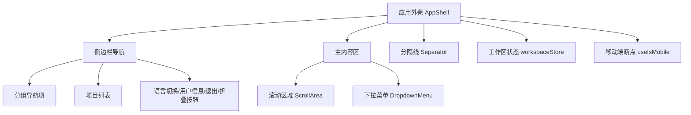
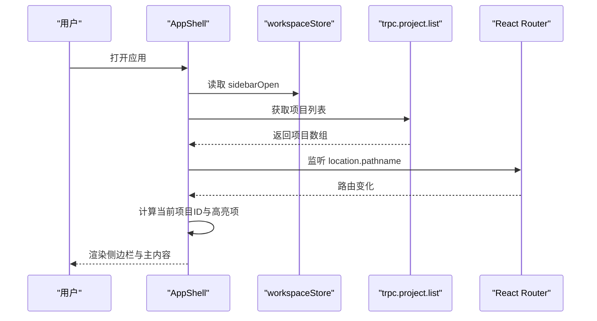
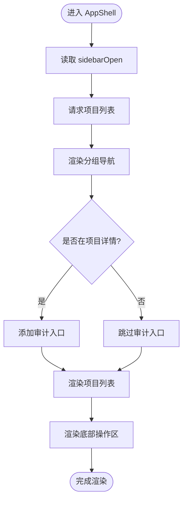
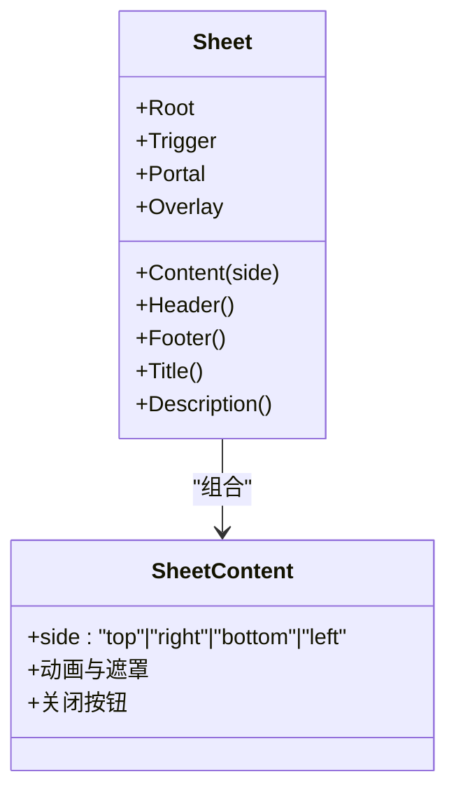
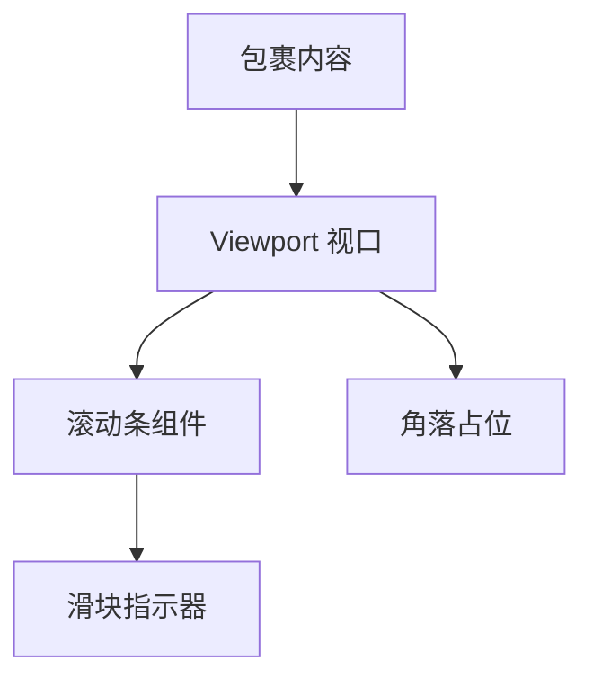
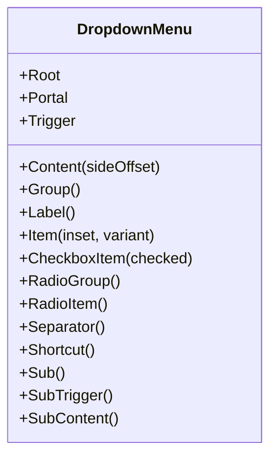
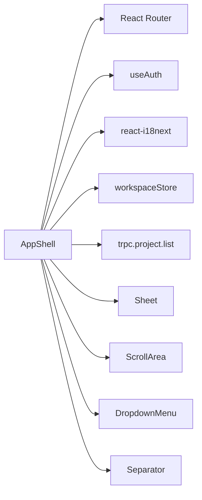
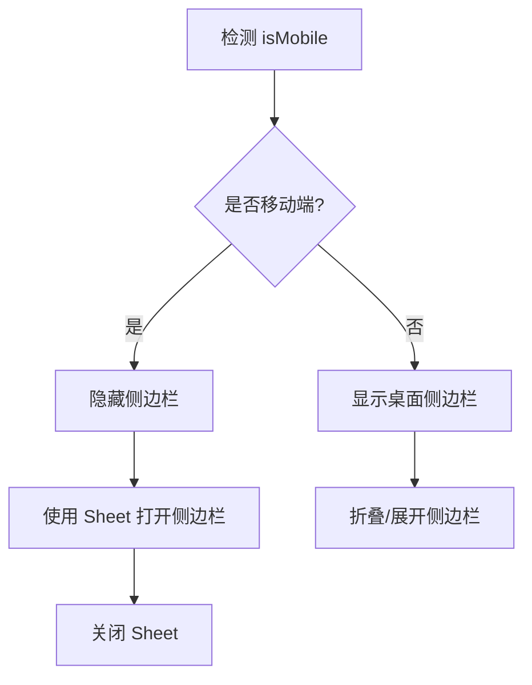

# 布局组件

<cite>
**本文引用的文件**
- [AppShell.tsx](file://src/components/layout/AppShell.tsx)
- [sheet.tsx](file://src/components/ui/sheet.tsx)
- [scroll-area.tsx](file://src/components/ui/scroll-area.tsx)
- [separator.tsx](file://src/components/ui/separator.tsx)
- [dropdown-menu.tsx](file://src/components/ui/dropdown-menu.tsx)
- [workspaceStore.ts](file://src/stores/workspaceStore.ts)
- [use-mobile.ts](file://src/hooks/use-mobile.ts)
- [ProjectWorkspace.tsx](file://src/pages/ProjectWorkspace.tsx)
</cite>

## 目录
1. [简介](#简介)
2. [项目结构](#项目结构)
3. [核心组件](#核心组件)
4. [架构总览](#架构总览)
5. [详细组件分析](#详细组件分析)
6. [依赖关系分析](#依赖关系分析)
7. [性能考量](#性能考量)
8. [故障排查指南](#故障排查指南)
9. [结论](#结论)
10. [附录：响应式与自定义布局指南](#附录响应式与自定义布局指南)

## 简介
本文件面向DeeWaanAI应用的前端布局层，聚焦于应用外壳（AppShell）的结构设计、导航集成与响应式布局实现；并系统说明侧边栏（Sheet）、滚动区域（ScrollArea）、分隔线（Separator）和下拉菜单（DropdownMenu）等布局辅助组件的功能、使用方式与最佳实践。文档还涵盖组件嵌套关系、状态管理策略、不同屏幕尺寸下的适配方案以及自定义布局模式的实现指引，帮助开发者快速理解并扩展应用的布局体系。

## 项目结构
- 应用外壳位于布局组件目录中，负责整体页面骨架、侧边栏导航、用户信息与全局操作入口。
- 基础UI组件集中在ui目录，提供可复用的Sheet、ScrollArea、Separator、DropdownMenu等原子能力。
- 工作区状态通过Zustand store集中管理，包括侧边栏展开状态、面板切换、项目级消息与运行态等。
- 移动端适配通过统一的断点Hook提供，便于在不同屏幕下切换布局行为。
- 具体业务页面（如项目工作区）组合上述布局与辅助组件，形成完整的交互体验。

图表来源
- [AppShell.tsx:28-214](file://src/components/layout/AppShell.tsx#L28-L214)
- [scroll-area.tsx:8-59](file://src/components/ui/scroll-area.tsx#L8-L59)
- [dropdown-menu.tsx:7-256](file://src/components/ui/dropdown-menu.tsx#L7-L256)
- [separator.tsx:8-29](file://src/components/ui/separator.tsx#L8-L29)
- [workspaceStore.ts:35-77](file://src/stores/workspaceStore.ts#L35-L77)
- [use-mobile.ts:1-20](file://src/hooks/use-mobile.ts#L1-L20)

章节来源
- [AppShell.tsx:28-214](file://src/components/layout/AppShell.tsx#L28-L214)
- [workspaceStore.ts:35-77](file://src/stores/workspaceStore.ts#L35-L77)
- [use-mobile.ts:1-20](file://src/hooks/use-mobile.ts#L1-L20)

## 核心组件
- 应用外壳 AppShell
  - 职责：构建全屏布局容器，左侧固定宽度侧边栏，右侧自适应主内容区；承载导航分组、项目列表、用户信息与全局操作；控制侧边栏展开/收起状态。
  - 关键特性：基于路由高亮当前项；动态注入“审计”入口；支持国际化文案；通过持久化store保持侧边栏状态。
- 侧边栏 Sheet
  - 职责：在移动端或需要覆盖层场景下，以滑出面板形式展示侧边内容；支持多方向（上/下/左/右）与遮罩关闭。
  - 关键特性：动画过渡、无障碍关闭按钮、可定制头部/底部/标题/描述。
- 滚动区域 ScrollArea
  - 职责：提供高性能的滚动容器，统一滚动条样式与焦点环，避免原生滚动差异。
  - 关键特性：垂直/水平滚动条、圆角继承、可访问性焦点处理。
- 分隔线 Separator
  - 职责：用于视觉分割区域，支持水平/垂直两种方向。
  - 关键特性：根据方向自动调整宽高、可装饰性标记。
- 下拉菜单 DropdownMenu
  - 职责：提供丰富的菜单交互，包含普通项、复选框项、单选组、子菜单、分隔符与快捷键提示。
  - 关键特性：定位与动画、键盘导航、可访问性指示器。

章节来源
- [AppShell.tsx:28-214](file://src/components/layout/AppShell.tsx#L28-L214)
- [sheet.tsx:7-138](file://src/components/ui/sheet.tsx#L7-L138)
- [scroll-area.tsx:8-59](file://src/components/ui/scroll-area.tsx#L8-L59)
- [separator.tsx:8-29](file://src/components/ui/separator.tsx#L8-L29)
- [dropdown-menu.tsx:7-256](file://src/components/ui/dropdown-menu.tsx#L7-L256)

## 架构总览
应用外壳作为顶层布局容器，将导航与内容解耦。导航由分组数据驱动渲染，支持按角色动态显示管理入口；项目列表通过远程查询加载，并在当前项目路径下高亮。主内容区通过滚动区域包裹，保证长内容时的稳定滚动体验。移动端可通过Sheet将侧边栏以覆盖层形式呈现，结合断点Hook进行响应式切换。

图表来源
- [AppShell.tsx:28-214](file://src/components/layout/AppShell.tsx#L28-L214)
- [workspaceStore.ts:35-77](file://src/stores/workspaceStore.ts#L35-L77)

章节来源
- [AppShell.tsx:28-214](file://src/components/layout/AppShell.tsx#L28-L214)
- [workspaceStore.ts:35-77](file://src/stores/workspaceStore.ts#L35-L77)

## 详细组件分析

### 应用外壳 AppShell
- 结构设计
  - 外层容器采用全屏flex布局，左侧aside为侧边栏，右侧main为主内容区。
  - 侧边栏内部划分为头部、导航区、项目列表与底部操作区。
  - 导航按分组组织，每项携带图标与标签，支持国际化。
  - 当处于项目详情页时，动态插入“审计”入口。
- 导航集成
  - 使用路由位置判断当前激活项，并通过样式区分高亮。
  - 项目列表通过远程查询加载，点击跳转至对应项目路径。
- 响应式布局
  - 侧边栏宽度随展开状态在固定宽度与窄条之间切换，文本与图标按需显示。
  - 移动端可使用Sheet将侧边栏以覆盖层形式展示，配合断点Hook进行切换。
- 状态管理
  - 侧边栏展开状态由workspaceStore管理，支持持久化存储，刷新后保持用户偏好。
  - 用户信息、登出操作与语言切换集成在底部区域。
- 性能优化
  - 导航项渲染函数复用，减少重复逻辑。
  - 项目列表仅在展开状态下渲染，降低小屏渲染压力。
  - 使用CSS transition平滑切换侧边栏宽度。

图表来源
- [AppShell.tsx:28-214](file://src/components/layout/AppShell.tsx#L28-L214)

章节来源
- [AppShell.tsx:28-214](file://src/components/layout/AppShell.tsx#L28-L214)
- [workspaceStore.ts:35-77](file://src/stores/workspaceStore.ts#L35-L77)

### 侧边栏 Sheet
- 功能概述
  - 基于对话框原语封装，提供触发器、内容、遮罩、关闭按钮、头尾与标题描述等子组件。
  - 支持四个方向的滑入滑出动画，适配移动端覆盖层场景。
- 使用方法
  - 通过Trigger触发打开，Content承载内容，Close用于关闭。
  - 可在Header/Footer中放置表单或操作按钮，Title/Description提供上下文说明。
- 响应式适配
  - 在小屏设备上，可将AppShell的侧边栏替换为Sheet，实现从抽屉到覆盖层的切换。
  - 结合useIsMobile断点Hook，在移动端默认隐藏侧边栏，通过Sheet打开。
- 可访问性
  - 内置关闭按钮与无障碍标签，确保键盘与读屏设备可用。

图表来源
- [sheet.tsx:7-138](file://src/components/ui/sheet.tsx#L7-L138)

章节来源
- [sheet.tsx:7-138](file://src/components/ui/sheet.tsx#L7-L138)

### 滚动区域 ScrollArea
- 功能概述
  - 提供统一的滚动容器，封装滚动条与焦点环样式，提升跨浏览器一致性。
  - 支持垂直与水平滚动，圆角继承父容器。
- 使用方法
  - 将长内容包裹在Viewport内，自动处理滚动条显示与交互。
  - 可通过className自定义外观与行为。
- 性能优化
  - 使用底层原语的虚拟滚动能力，减少大列表渲染开销。
  - 避免在滚动区域内频繁重排，建议将静态结构与动态内容分离。

图表来源
- [scroll-area.tsx:8-59](file://src/components/ui/scroll-area.tsx#L8-L59)

章节来源
- [scroll-area.tsx:8-59](file://src/components/ui/scroll-area.tsx#L8-L59)

### 分隔线 Separator
- 功能概述
  - 用于划分界面区块，支持水平与垂直方向。
  - 可根据方向自动设置宽高，保持视觉一致。
- 使用方法
  - 在导航分组之间、面板边界处插入分隔线，增强层次结构。
  - 可通过className定制颜色与粗细。

章节来源
- [separator.tsx:8-29](file://src/components/ui/separator.tsx#L8-L29)

### 下拉菜单 DropdownMenu
- 功能概述
  - 提供完整菜单能力：普通项、复选框项、单选组、子菜单、分隔符、快捷键提示。
  - 支持定位偏移、动画与键盘导航。
- 使用方法
  - 通过Trigger触发，Content承载菜单项，Group/Label组织结构。
  - 使用CheckboxItem/RadioItem表达选择状态，Separator划分逻辑段。
- 可访问性
  - 内置指示器与焦点管理，确保键盘与读屏设备可用。

图表来源
- [dropdown-menu.tsx:7-256](file://src/components/ui/dropdown-menu.tsx#L7-L256)

章节来源
- [dropdown-menu.tsx:7-256](file://src/components/ui/dropdown-menu.tsx#L7-L256)

## 依赖关系分析
- AppShell依赖
  - 路由：用于高亮当前导航项与项目详情判断。
  - 认证：获取用户信息与登出动作。
  - 国际化：翻译导航文案与用户提示。
  - 工作区状态：管理侧边栏展开状态与面板切换。
  - 远程数据：加载项目列表。
- 辅助组件依赖
  - Sheet/ScrollArea/DropdownMenu/Separator均基于Radix UI原语封装，提供一致的交互与可访问性。
  - 样式通过工具类组合，保持主题一致性与可定制性。

图表来源
- [AppShell.tsx:28-214](file://src/components/layout/AppShell.tsx#L28-L214)
- [workspaceStore.ts:35-77](file://src/stores/workspaceStore.ts#L35-L77)

章节来源
- [AppShell.tsx:28-214](file://src/components/layout/AppShell.tsx#L28-L214)
- [workspaceStore.ts:35-77](file://src/stores/workspaceStore.ts#L35-L77)

## 性能考量
- 渲染优化
  - 侧边栏文本与图标在折叠时隐藏，减少DOM节点数量。
  - 项目列表仅在展开状态下渲染，降低小屏渲染压力。
  - 使用CSS transition替代JS动画，提升流畅度。
- 状态管理
  - 侧边栏状态持久化，避免重复初始化与闪烁。
  - 项目消息与运行态按项目隔离，减少不必要的全局更新。
- 滚动性能
  - 使用ScrollArea统一滚动行为，避免原生滚动差异导致的抖动。
  - 在大列表中结合虚拟化或分页策略，减少首屏渲染成本。
- 网络请求
  - 项目列表使用查询缓存与增量更新，避免重复请求。
  - 路由变化时仅更新必要的高亮状态，不触发全量重渲染。

章节来源
- [AppShell.tsx:28-214](file://src/components/layout/AppShell.tsx#L28-L214)
- [workspaceStore.ts:67-207](file://src/stores/workspaceStore.ts#L67-L207)
- [scroll-area.tsx:8-59](file://src/components/ui/scroll-area.tsx#L8-L59)

## 故障排查指南
- 侧边栏状态异常
  - 检查workspaceStore中的sidebarOpen是否正确读写。
  - 确认持久化配置未过滤掉关键状态字段。
- 导航高亮不正确
  - 核对路由路径与导航项path是否完全匹配。
  - 项目详情页需正确解析路径参数以注入审计入口。
- 滚动区域卡顿
  - 避免在ScrollArea内频繁创建/销毁大型组件。
  - 检查是否存在阻塞主线程的重计算逻辑。
- 下拉菜单定位错误
  - 确认Content的sideOffset与父容器边距合理。
  - 检查z-index层级是否被其他元素覆盖。
- 移动端Sheet无法打开
  - 确认Trigger绑定事件未被阻止冒泡。
  - 检查遮罩层是否遮挡了触发元素。

章节来源
- [workspaceStore.ts:67-207](file://src/stores/workspaceStore.ts#L67-L207)
- [AppShell.tsx:28-214](file://src/components/layout/AppShell.tsx#L28-L214)
- [dropdown-menu.tsx:7-256](file://src/components/ui/dropdown-menu.tsx#L7-L256)
- [sheet.tsx:7-138](file://src/components/ui/sheet.tsx#L7-L138)

## 结论
AppShell作为应用外壳，提供了稳定的布局骨架与导航集成，结合Sheet、ScrollArea、Separator与DropdownMenu等辅助组件，实现了可扩展、可访问且高性能的界面结构。通过workspaceStore集中管理状态，并使用useIsMobile进行响应式适配，能够在不同屏幕尺寸下保持一致的用户体验。建议在新增页面时优先复用这些布局组件，以保持整体风格与交互的一致性。

## 附录：响应式与自定义布局指南
- 响应式策略
  - 使用useIsMobile检测断点，在移动端隐藏侧边栏并以Sheet形式打开。
  - 在小屏设备上，优先展示核心内容，次要信息放入Sheet或DropdownMenu。
  - 利用Tailwind的响应式类名，在不同断点下调整布局与间距。
- 自定义布局模式
  - 在AppShell基础上，可通过条件渲染切换不同的侧边栏结构（如双栏、三栏）。
  - 使用Separator划分面板边界，结合ScrollArea实现独立滚动区域。
  - 通过DropdownMenu收纳高级操作，保持界面简洁。
- 示例流程（移动端侧边栏切换）

图表来源
- [use-mobile.ts:1-20](file://src/hooks/use-mobile.ts#L1-L20)
- [sheet.tsx:7-138](file://src/components/ui/sheet.tsx#L7-L138)
- [AppShell.tsx:28-214](file://src/components/layout/AppShell.tsx#L28-L214)

章节来源
- [use-mobile.ts:1-20](file://src/hooks/use-mobile.ts#L1-L20)
- [sheet.tsx:7-138](file://src/components/ui/sheet.tsx#L7-L138)
- [AppShell.tsx:28-214](file://src/components/layout/AppShell.tsx#L28-L214)