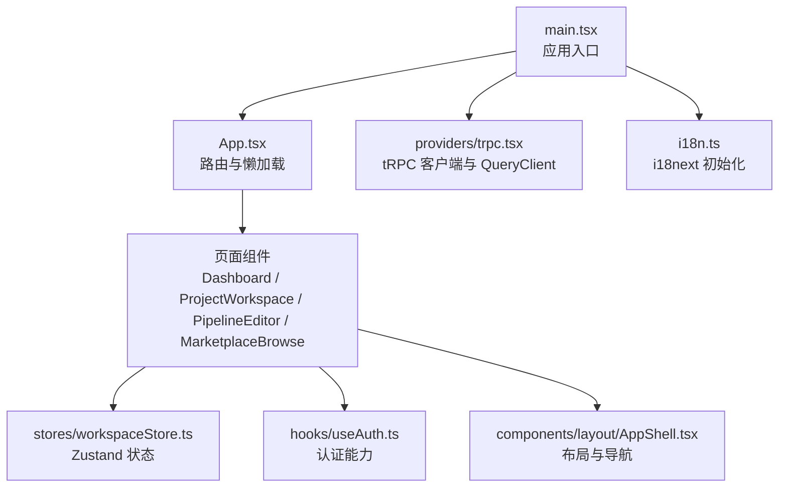
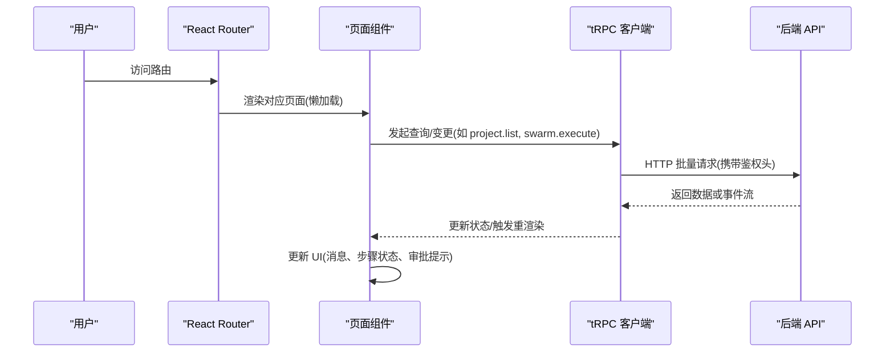
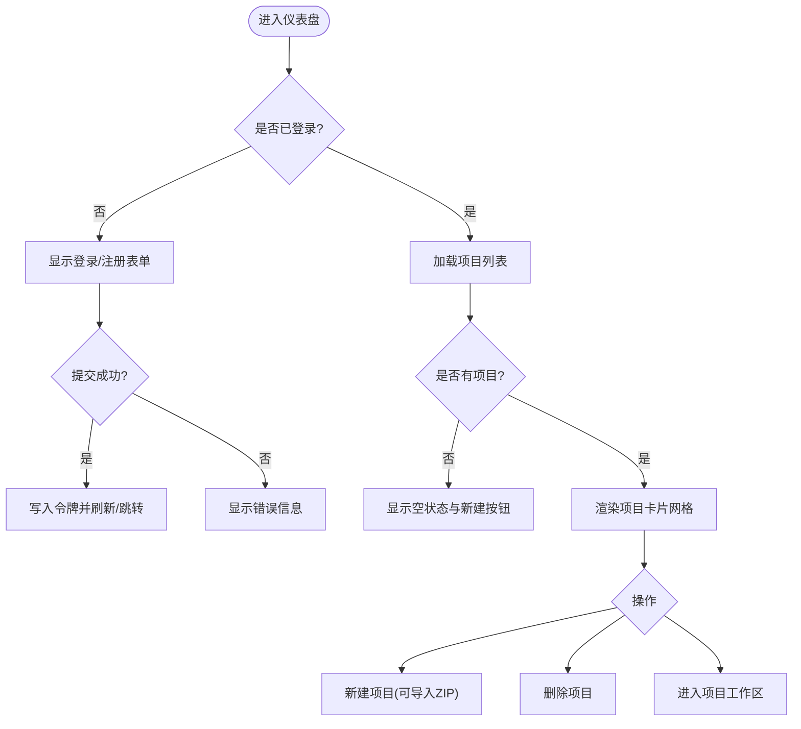
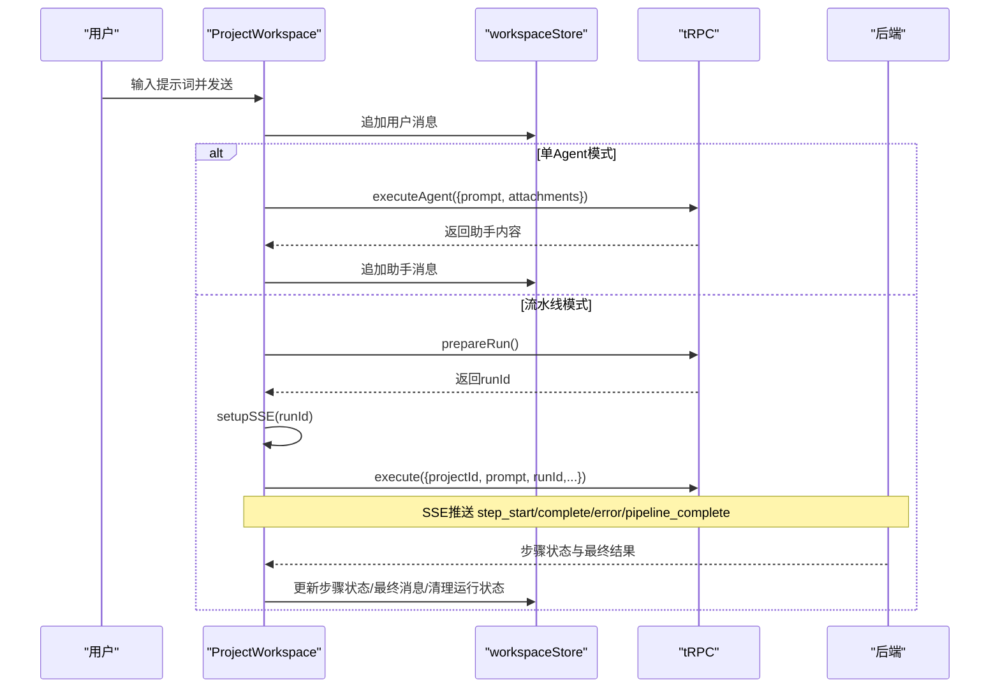
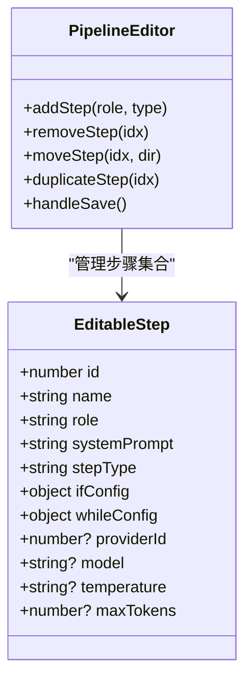
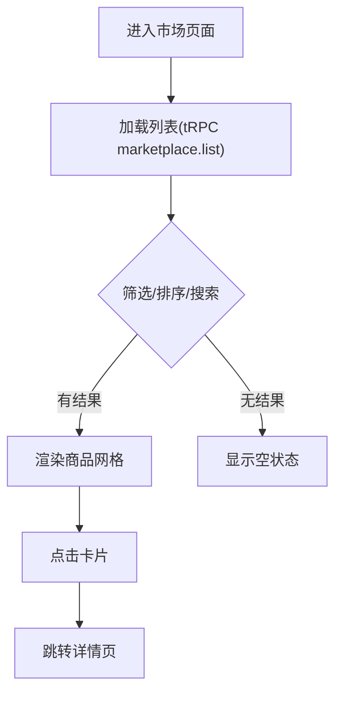
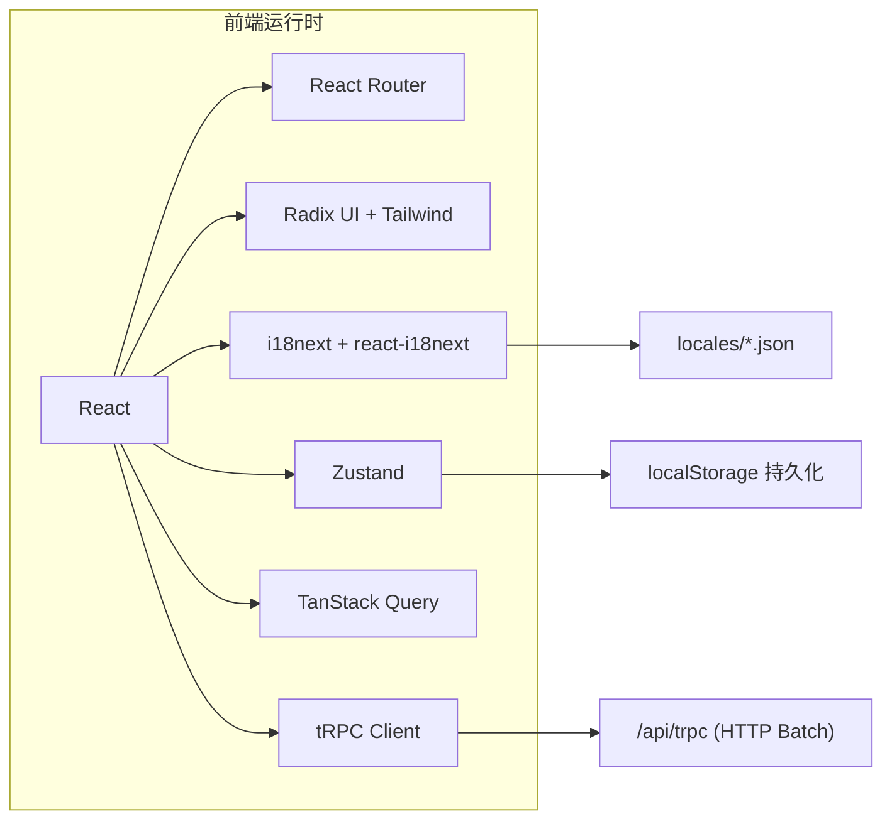

# 前端应用文档

<cite>
**本文引用的文件**
- [main.tsx](file://src/main.tsx)
- [App.tsx](file://src/App.tsx)
- [vite.config.ts](file://vite.config.ts)
- [package.json](file://package.json)
- [i18n.ts](file://src/i18n.ts)
- [i18n-languages.ts](file://src/i18n-languages.ts)
- [trpc.tsx](file://src/providers/trpc.tsx)
- [useAuth.ts](file://src/hooks/useAuth.ts)
- [AppShell.tsx](file://src/components/layout/AppShell.tsx)
- [Dashboard.tsx](file://src/pages/Dashboard.tsx)
- [ProjectWorkspace.tsx](file://src/pages/ProjectWorkspace.tsx)
- [PipelineEditor.tsx](file://src/pages/PipelineEditor.tsx)
- [MarketplaceBrowse.tsx](file://src/pages/MarketplaceBrowse.tsx)
- [workspaceStore.ts](file://src/stores/workspaceStore.ts)
- [projectStore.ts](file://src/stores/projectStore.ts)
</cite>

## 目录
1. [简介](#简介)
2. [项目结构](#项目结构)
3. [核心组件](#核心组件)
4. [架构总览](#架构总览)
5. [详细组件分析](#详细组件分析)
6. [依赖关系分析](#依赖关系分析)
7. [性能考虑](#性能考虑)
8. [故障排查指南](#故障排查指南)
9. [结论](#结论)
10. [附录](#附录)

## 简介
本文件为 DeeWaanAI 前端应用的完整技术文档，面向开发者与产品维护者。内容涵盖 React 应用架构、路由与懒加载、状态管理（Zustand + tRPC）、国际化（i18next）与多语言切换、UI 组件库组织方式、四大核心页面（仪表盘、项目工作区、流水线编辑器、市场浏览器）的功能说明与使用流程，以及响应式设计与无障碍建议。所有说明均基于仓库中的实际源码实现进行梳理与可视化。

## 项目结构
- 入口与全局配置
  - 应用根入口：挂载 React 根节点、错误边界、路由、tRPC 客户端与 i18n 初始化。
  - 路由与懒加载：集中定义页面路由，采用 React.lazy 按需加载以提升首屏性能。
  - Vite 构建：通过 manualChunks 拆分第三方包（react、trpc、i18n、icons），优化缓存与加载体积。
- 数据与服务
  - tRPC 客户端：统一封装 HTTP 批量请求、鉴权头注入、长超时策略（执行任务场景）。
  - 认证 Hook：获取当前用户、登录态、登出刷新等能力。
- 状态管理
  - Zustand Store：按项目维度持久化聊天消息、审批状态、运行状态与待处理提示词；对大附件 dataUrl 做裁剪以规避 localStorage 配额限制。
- UI 与布局
  - 应用外壳：侧边栏导航、分组菜单、项目列表、语言切换、用户信息与退出。
  - 基础与业务组件：按钮、卡片、对话框、选择器、滚动区域等 Radix 风格组件；市场状态徽章等。
- 国际化
  - i18next + react-i18next：集中语言清单、命名空间、检测顺序与默认语言；支持动态切换。

图表来源
- [main.tsx:1-21](file://src/main.tsx#L1-L21)
- [App.tsx:1-70](file://src/App.tsx#L1-L70)
- [trpc.tsx:1-50](file://src/providers/trpc.tsx#L1-L50)
- [i18n.ts:1-28](file://src/i18n.ts#L1-L28)
- [workspaceStore.ts:1-207](file://src/stores/workspaceStore.ts#L1-L207)
- [useAuth.ts:1-35](file://src/hooks/useAuth.ts#L1-L35)
- [AppShell.tsx:1-214](file://src/components/layout/AppShell.tsx#L1-L214)

章节来源
- [main.tsx:1-21](file://src/main.tsx#L1-L21)
- [App.tsx:1-70](file://src/App.tsx#L1-L70)
- [vite.config.ts:1-66](file://vite.config.ts#L1-L66)
- [package.json:1-100](file://package.json#L1-L100)

## 核心组件
- 应用外壳 AppShell
  - 提供侧边栏导航、分组菜单、项目列表、语言切换、用户信息展示与退出。
  - 支持折叠/展开侧边栏，高亮当前路由项。
  - 在“项目页”上下文下显示审计入口。
- 认证 useAuth
  - 查询当前用户信息、登录态、错误与加载状态。
  - 提供登出方法（清除本地令牌并刷新 tRPC 缓存）。
- tRPC 提供者 TRPCProvider
  - 配置 httpBatchLink、自动注入鉴权头、长超时（10 分钟）用于流水线执行。
  - 提供 QueryClient 与 tRPC Provider。
- 工作区状态 workspaceStore
  - 按项目维度存储消息、审批、运行状态与待处理提示词。
  - 持久化到 localStorage，并对大附件 dataUrl 做裁剪以避免超出配额。
  - 提供增删改查与合并消息等方法。

章节来源
- [AppShell.tsx:1-214](file://src/components/layout/AppShell.tsx#L1-L214)
- [useAuth.ts:1-35](file://src/hooks/useAuth.ts#L1-L35)
- [trpc.tsx:1-50](file://src/providers/trpc.tsx#L1-L50)
- [workspaceStore.ts:1-207](file://src/stores/workspaceStore.ts#L1-L207)

## 架构总览
前端采用 React + React Router 7 的 SPA 架构，结合 tRPC 与 TanStack Query 进行类型安全的数据获取与缓存；Zustand 负责跨组件共享状态；i18next 提供多语言支持；Vite 负责开发与构建优化。

图表来源
- [App.tsx:1-70](file://src/App.tsx#L1-L70)
- [trpc.tsx:1-50](file://src/providers/trpc.tsx#L1-L50)
- [ProjectWorkspace.tsx:1-800](file://src/pages/ProjectWorkspace.tsx#L1-L800)

## 详细组件分析

### 仪表盘 Dashboard
- 功能概述
  - 未登录时显示登录/注册表单，支持本地账号与 SSO 跳转。
  - 登录后展示项目列表，支持创建新项目、导入 ZIP 填充项目、删除项目。
  - 使用 tRPC 查询项目列表，并在成功后刷新缓存。
- 关键交互
  - 登录/注册：调用 localAuth.login/signup，成功后写入本地令牌并重定向。
  - 创建项目：调用 project.create 与 agent.createDefaults，可选上传 ZIP 导入。
  - 删除项目：调用 project.delete 并刷新列表。
- 状态与副作用
  - 使用 Suspense 包裹路由，避免加载闪烁。
  - 使用 tRPC 的 useMutation/useQuery 管理异步状态与缓存失效。

图表来源
- [Dashboard.tsx:1-556](file://src/pages/Dashboard.tsx#L1-L556)
- [App.tsx:1-70](file://src/App.tsx#L1-L70)

章节来源
- [Dashboard.tsx:1-556](file://src/pages/Dashboard.tsx#L1-L556)
- [App.tsx:1-70](file://src/App.tsx#L1-L70)

### 项目工作区 ProjectWorkspace
- 功能概述
  - 聊天输入与消息历史（按项目持久化），支持附件上传与预览。
  - 两种执行模式：单 Agent 直调与多步流水线执行。
  - 流水线可视化：步骤条展示 pending/running/completed/error 状态。
  - 人机协同审批（HITL）：等待人工批准、拒绝或修改后继续。
  - 自动设计：根据任务描述自动生成流水线模板并保存提示词以便立即运行。
- 数据流与事件
  - 通过 tRPC 准备运行、执行流水线/Agent、取消运行、审批步骤。
  - 使用 SSE（EventSource）订阅运行事件，实时更新步骤状态与最终结果。
  - 将消息、审批状态、运行状态同步到 Zustand 并持久化，支持页面导航恢复。
- 关键流程（发送消息）
  - 校验输入与运行中状态，追加用户消息，清空输入。
  - Agent 模式：直接调用 executeAgent，接收结果并追加助手消息。
  - 流水线模式：prepareRun → setupSSE → execute（fire-and-forget），由 SSE 驱动完成。
- 关键流程（审批恢复）
  - 挂载时检查后端运行状态，若存在活跃运行则重建 SSE 连接。
  - 若处于等待审批状态，同步审批 UI 并阻止重复显示。

图表来源
- [ProjectWorkspace.tsx:1-800](file://src/pages/ProjectWorkspace.tsx#L1-L800)
- [workspaceStore.ts:1-207](file://src/stores/workspaceStore.ts#L1-L207)
- [trpc.tsx:1-50](file://src/providers/trpc.tsx#L1-L50)

章节来源
- [ProjectWorkspace.tsx:1-800](file://src/pages/ProjectWorkspace.tsx#L1-L800)
- [workspaceStore.ts:1-207](file://src/stores/workspaceStore.ts#L1-L207)

### 流水线编辑器 PipelineEditor
- 功能概述
  - 可视化编辑流水线模板：添加/移动/复制/删除步骤，设置系统提示词、温度、最大 token。
  - 支持多种步骤类型：agent、if（条件门控）、while（循环）、approval（人工审批）。
  - 权限控制：仅具备相应权限的用户可编辑或启用高级特性。
  - 保存与复用：创建/更新模板，复制到项目中使用。
- 关键交互
  - 新增步骤：从角色库或特殊步骤中添加，自动填充默认提示词与配置。
  - 编辑步骤：展开编辑名称、角色、系统提示词、参数与条件/循环配置。
  - 保存：新建时先创建空模板再回填步骤；已有模板直接更新。
  - 应用到项目：将模板应用到目标项目，供工作区使用。

图表来源
- [PipelineEditor.tsx:1-374](file://src/pages/PipelineEditor.tsx#L1-L374)

章节来源
- [PipelineEditor.tsx:1-374](file://src/pages/PipelineEditor.tsx#L1-L374)

### 市场浏览器 MarketplaceBrowse
- 功能概述
  - 浏览已发布的流水线/代理商品，支持分类筛选、排序与关键词搜索。
  - 展示价格、评分、销量、评审数与一致性分数（Kappa）。
  - 提供跳转到创作者中心与评审门户的入口。
- 关键交互
  - 分类与排序：通过 Select 组件切换类别与排序规则。
  - 搜索：前端过滤标题与描述包含关键词的商品。
  - 详情：点击卡片跳转到详情页（路由 /marketplace/:id）。

图表来源
- [MarketplaceBrowse.tsx:1-192](file://src/pages/MarketplaceBrowse.tsx#L1-L192)

章节来源
- [MarketplaceBrowse.tsx:1-192](file://src/pages/MarketplaceBrowse.tsx#L1-L192)

## 依赖关系分析
- 运行时依赖
  - React、React Router、Tailwind CSS、Radix UI 系列组件、Lucide 图标、Sonner 通知。
  - tRPC 客户端与服务端集成、TanStack Query 缓存、SuperJSON 序列化。
  - i18next + react-i18next + 浏览器语言检测。
  - Zustand 状态管理与持久化中间件。
- 构建与分包
  - Vite 插件：Hono 开发服务器、React 插件、属性检查插件。
  - manualChunks：将 react、trpc、i18n、icons 拆分为独立 chunk，提升缓存命中率与首屏速度。

图表来源
- [package.json:1-100](file://package.json#L1-L100)
- [vite.config.ts:1-66](file://vite.config.ts#L1-L66)
- [trpc.tsx:1-50](file://src/providers/trpc.tsx#L1-L50)
- [i18n.ts:1-28](file://src/i18n.ts#L1-L28)
- [workspaceStore.ts:1-207](file://src/stores/workspaceStore.ts#L1-L207)

章节来源
- [package.json:1-100](file://package.json#L1-L100)
- [vite.config.ts:1-66](file://vite.config.ts#L1-L66)

## 性能考虑
- 路由懒加载：所有页面通过 React.lazy 与 Suspense 延迟加载，减少首屏体积。
- 代码分割：Vite manualChunks 将常用库（react、trpc、i18n、icons）分离为稳定 chunk，利于长期缓存。
- 网络请求：
  - tRPC 使用 httpBatchLink 批量请求，降低握手开销。
  - 执行类接口设置 10 分钟超时，避免长时间任务被提前中断。
- 状态持久化：
  - 工作区消息与审批状态持久化至 localStorage，但裁剪大附件 dataUrl，避免超出配额。
  - 运行状态不持久化，确保始终从服务端获取最新状态，防止陈旧 SSE/run 状态导致 UI 不一致。
- 渲染优化：
  - 流水线步骤更新仅在数量或名称变化时替换，避免不必要的重渲染。
  - 使用 memo 与稳定引用（如 store 方法）减少子组件重渲染。

[本节为通用性能建议，无需特定文件来源]

## 故障排查指南
- 认证与授权
  - 未登录：Dashboard 会显示登录/注册表单；确认本地令牌是否存在且有效。
  - 登出：useAuth.logout 会清除本地令牌并刷新 tRPC 缓存。
- 流水线执行异常
  - SSE 断开：ProjectWorkspace 会在挂载时尝试恢复连接；若仍失败，检查后端运行状态与网络连通性。
  - 审批卡住：确认审批状态已从 store 清除；必要时重新发起执行或刷新页面。
- 消息与附件
  - 附件过大：store 会裁剪 dataUrl 以避免 localStorage 溢出；如需保留大图，建议使用服务端 URL。
  - 消息丢失：确认服务端的 savedMessages 同步逻辑；必要时重新加载项目或检查 beforeunload 上报。
- 国际化
  - 文案缺失：检查 i18n-languages.ts 的命名空间与 locales 文件是否齐全；使用 i18n:check 脚本验证。
  - 语言切换无效：确认 LanguageDetector 顺序与 localStorage 缓存；必要时清除缓存重试。

章节来源
- [useAuth.ts:1-35](file://src/hooks/useAuth.ts#L1-L35)
- [ProjectWorkspace.tsx:1-800](file://src/pages/ProjectWorkspace.tsx#L1-L800)
- [workspaceStore.ts:1-207](file://src/stores/workspaceStore.ts#L1-L207)
- [i18n.ts:1-28](file://src/i18n.ts#L1-L28)
- [i18n-languages.ts:1-107](file://src/i18n-languages.ts#L1-L107)

## 结论
DeeWaanAI 前端以 React + tRPC + Zustand + i18next 为核心技术栈，构建了类型安全、可扩展且易于维护的前端体系。通过路由懒加载与代码分割优化了首屏性能；通过 SSE 与持久化状态实现了流畅的流水线执行与人机协作体验；通过统一的布局与组件库提升了界面一致性与可维护性。建议在后续迭代中持续完善无障碍访问、测试覆盖与监控埋点，进一步提升用户体验与稳定性。

[本节为总结性内容，无需特定文件来源]

## 附录

### 路由与页面映射
- / → Dashboard（含登录/注册）
- /pipelines → 我的流水线
- /pipelines/new → 新建流水线
- /pipelines/:id/edit → 编辑流水线
- /projects/:id → 项目工作区
- /projects/:id/settings → 项目设置
- /projects/:id/audit → 项目审计
- /settings → 设置
- /marketplace → 市场浏览
- /marketplace/:id → 市场详情
- /creator/listings → 创作者中心
- /reviewer/portal → 评审门户
- /reviewer/review/:listingId → 评审详情
- /my-data → 我的数据
- /team → 团队看板
- /team/connect → 团队连接
- /admin → 管理面板
- /connect → 连接
- /oauth/consent → OAuth 同意
- /certification/:id → 认证报告
- /pricing → 定价
- /login → 重定向到 Dashboard（未登录时显示登录）

章节来源
- [App.tsx:1-70](file://src/App.tsx#L1-L70)

### 国际化与多语言
- 语言清单：i18n-languages.ts 集中声明可用语言、标签与命名空间。
- 初始化：i18n.ts 配置资源、回退语言、检测顺序与命名空间。
- 切换：LanguageSwitcher 组件提供语言切换入口（位于 AppShell 底部）。
- 命名空间：common、pages、dashboard、workspace、pipeline、agents、settings、audit、connect、mcp、certification、pricing、teamsync、login。

章节来源
- [i18n-languages.ts:1-107](file://src/i18n-languages.ts#L1-L107)
- [i18n.ts:1-28](file://src/i18n.ts#L1-L28)
- [AppShell.tsx:1-214](file://src/components/layout/AppShell.tsx#L1-L214)

### 响应式设计与无障碍建议
- 响应式
  - 使用 Tailwind 栅格与断点适配不同屏幕尺寸。
  - 侧边栏支持折叠，移动端可通过手势或按钮切换。
  - 表格与网格布局在小屏下自动换行与滚动。
- 无障碍
  - 为交互元素提供语义化标签与键盘可达性。
  - 颜色对比度符合 WCAG 标准，避免仅用颜色传达信息。
  - 图片与图标提供替代文本或 aria-label。
  - 表单控件关联 label，错误信息清晰可读。

[本节为通用指导，无需特定文件来源]

### 组件属性、事件与自定义选项（概览）
- 基础 UI 组件（按钮、输入、卡片、对话框、选择器、滚动区域、徽章等）
  - 常见属性：variant、size、disabled、className、children。
  - 事件：onClick、onChange、onSubmit、onOpenChange（对话框）。
  - 自定义：通过 className 与样式变量扩展外观。
- 业务组件
  - ListingStatusBadge：status 属性决定状态徽标样式。
  - PipelineVisualizer：steps 数组驱动步骤条渲染。
- 布局组件
  - AppShell：children 插槽承载页面内容；支持侧边栏开关与导航项。

章节来源
- [AppShell.tsx:1-214](file://src/components/layout/AppShell.tsx#L1-L214)
- [MarketplaceBrowse.tsx:1-192](file://src/pages/MarketplaceBrowse.tsx#L1-L192)
- [ProjectWorkspace.tsx:1-800](file://src/pages/ProjectWorkspace.tsx#L1-L800)

### 动画与过渡效果
- 使用 Tailwind 与 tw-animate-css 提供的过渡类实现按钮悬停、卡片悬浮、侧边栏展开/收起等动效。
- 步骤状态指示器使用旋转加载与颜色变化表达运行与完成状态。
- 建议：保持动画时长短促（~200-300ms），避免影响主流程感知。

[本节为通用指导，无需特定文件来源]