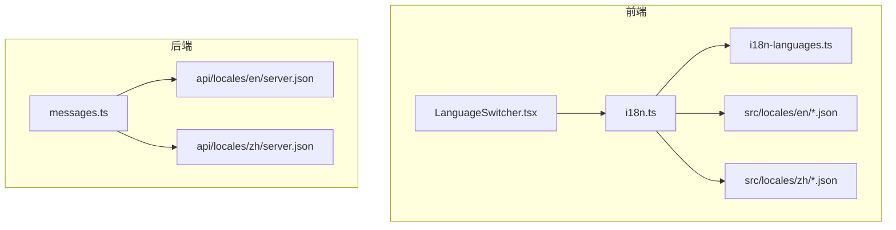
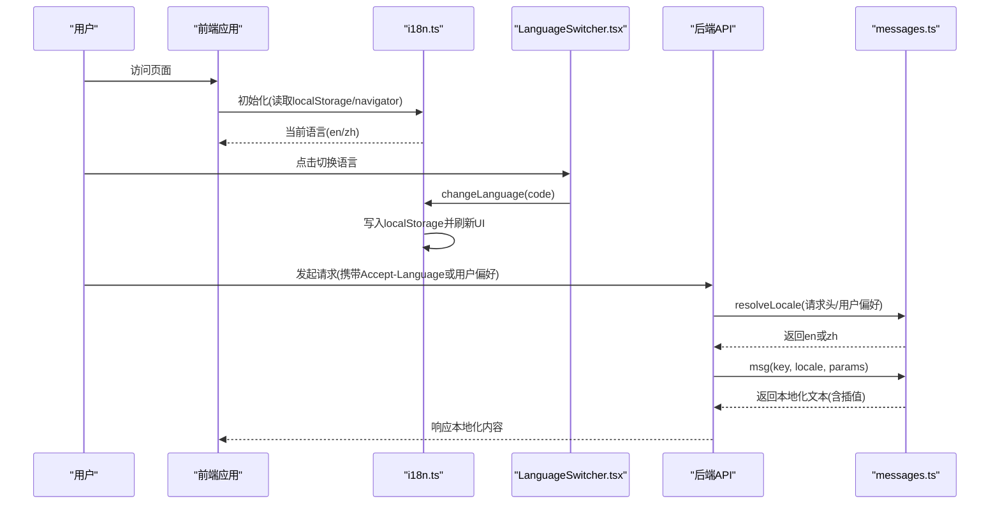
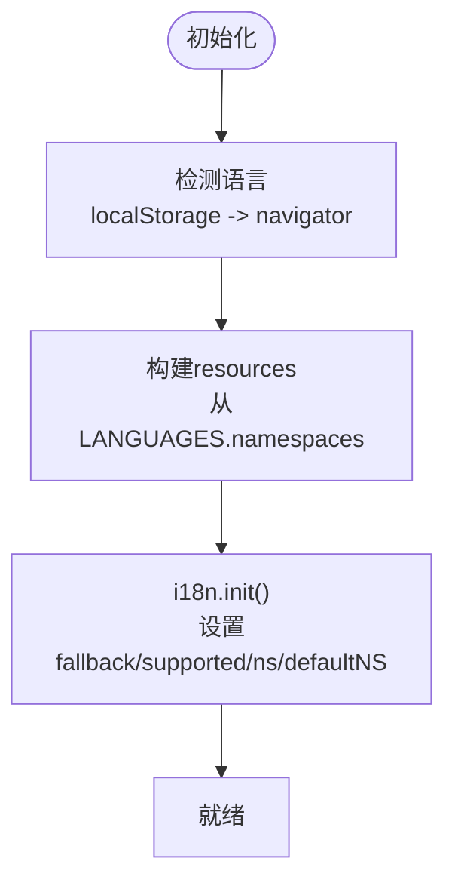
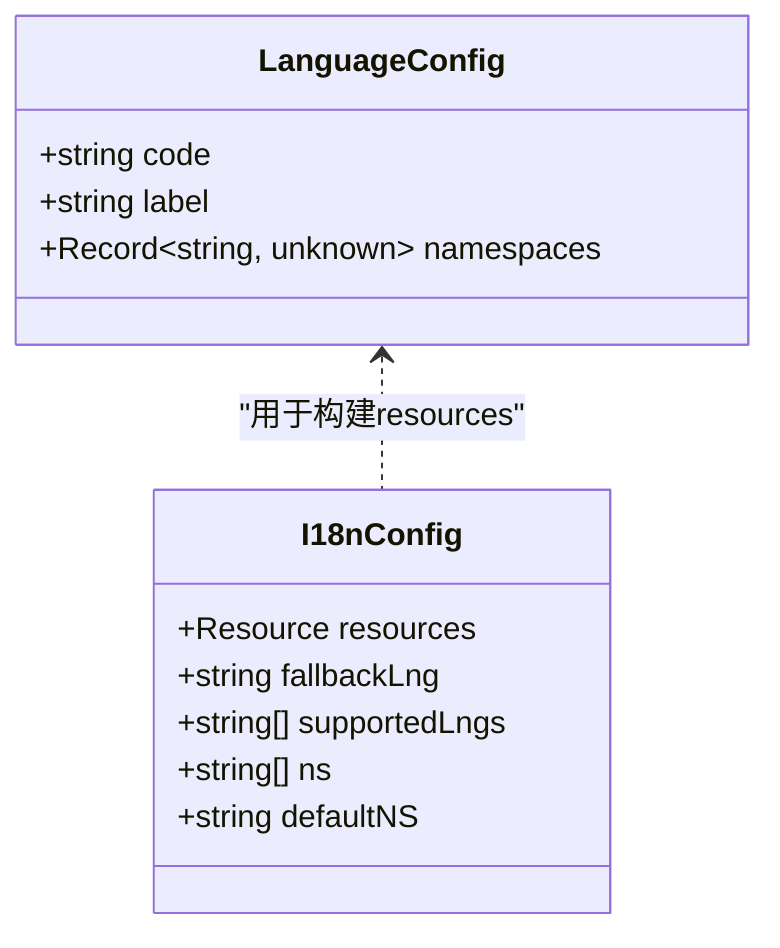
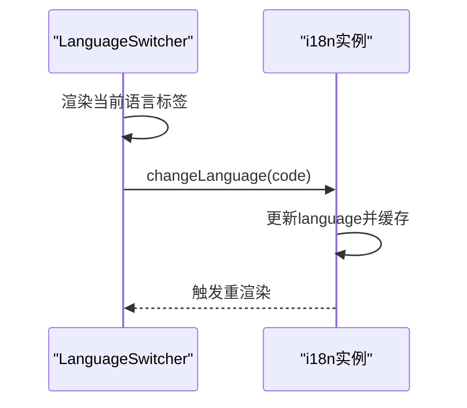
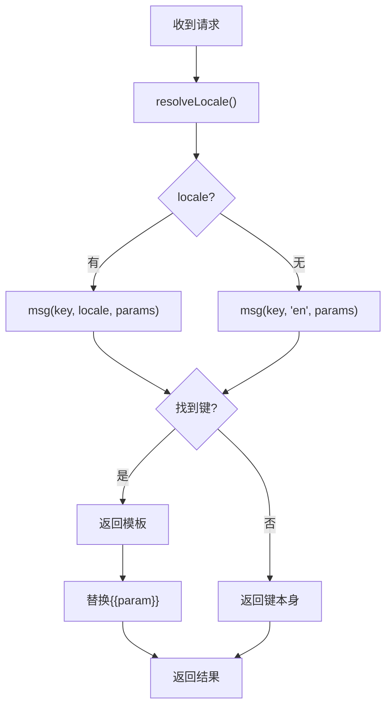
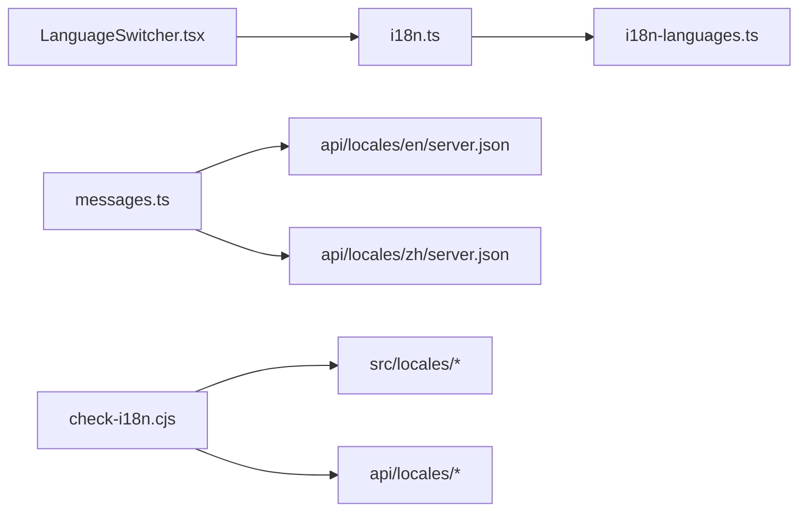

# 国际化支持

<cite>
**本文引用的文件**
- [src/i18n.ts](file://src/i18n.ts)
- [src/i18n-languages.ts](file://src/i18n-languages.ts)
- [src/components/LanguageSwitcher.tsx](file://src/components/LanguageSwitcher.tsx)
- [src/locales/en/common.json](file://src/locales/en/common.json)
- [src/locales/zh/common.json](file://src/locales/zh/common.json)
- [api/lib/messages.ts](file://api/lib/messages.ts)
- [api/locales/en/server.json](file://api/locales/en/server.json)
- [api/locales/zh/server.json](file://api/locales/zh/server.json)
- [scripts/check-i18n.cjs](file://scripts/check-i18n.cjs)
</cite>

## 目录
1. [简介](#简介)
2. [项目结构](#项目结构)
3. [核心组件](#核心组件)
4. [架构总览](#架构总览)
5. [详细组件分析](#详细组件分析)
6. [依赖关系分析](#依赖关系分析)
7. [性能考量](#性能考量)
8. [故障排查指南](#故障排查指南)
9. [结论](#结论)
10. [附录：新增语言与质量检查](#附录新增语言与质量检查)

## 简介
本文件为 DeeWaanAI 的国际化（i18n）系统提供完整技术文档，覆盖前后端多语言配置、语言包结构与组织方式、动态语言加载、本地化策略、语种清单、翻译键值规范与格式化规则、语言检测、默认语言设置与回退机制，以及新增语言的步骤与翻译质量检查方法。目标是帮助开发者快速理解并安全扩展系统的多语言能力。

## 项目结构
- 前端（React + i18next）
  - 初始化与插件：src/i18n.ts
  - 语言清单与命名空间注册：src/i18n-languages.ts
  - 语言切换组件：src/components/LanguageSwitcher.tsx
  - 翻译资源：src/locales/<lang>/*.json（按命名空间拆分）
- 后端（Node/Hono 服务）
  - 服务端消息解析与回退：api/lib/messages.ts
  - 服务端翻译资源：api/locales/<lang>/server.json
- 质量保障脚本
  - 键一致性校验：scripts/check-i18n.cjs

图表来源
- [src/i18n.ts:1-28](file://src/i18n.ts#L1-L28)
- [src/i18n-languages.ts:1-107](file://src/i18n-languages.ts#L1-L107)
- [src/components/LanguageSwitcher.tsx:1-46](file://src/components/LanguageSwitcher.tsx#L1-L46)
- [api/lib/messages.ts:1-57](file://api/lib/messages.ts#L1-L57)
- [api/locales/en/server.json:1-10](file://api/locales/en/server.json#L1-L10)
- [api/locales/zh/server.json:1-10](file://api/locales/zh/server.json#L1-L10)

章节来源
- [src/i18n.ts:1-28](file://src/i18n.ts#L1-L28)
- [src/i18n-languages.ts:1-107](file://src/i18n-languages.ts#L1-L107)
- [api/lib/messages.ts:1-57](file://api/lib/messages.ts#L1-L57)

## 核心组件
- 前端 i18n 初始化
  - 使用 i18next + react-i18next + i18next-browser-languagedetector
  - 通过集中式语言配置构建 resources，声明命名空间与默认命名空间
  - 配置检测顺序与缓存策略，设置默认语言与受支持语言列表
- 语言清单与命名空间
  - 单一事实源：LANGUAGES 数组定义所有可用语言、显示标签与命名空间映射
  - NAMESPACES 与 SUPPORTED_LANG_CODES 由清单派生，避免硬编码
- 语言切换器
  - 基于 DropdownMenu 展示当前语言与可选语言
  - 调用 i18n.changeLanguage 切换语言，持久化到 localStorage
- 服务端消息工具
  - 提供 msg(key, locale, params) 进行点路径查找与占位符插值
  - 提供 resolveLocale(reqHeaders, userPrefs) 根据用户偏好与 Accept-Language 确定有效语言
  - 回退链：请求语言 → en → 键本身

章节来源
- [src/i18n.ts:1-28](file://src/i18n.ts#L1-L28)
- [src/i18n-languages.ts:1-107](file://src/i18n-languages.ts#L1-L107)
- [src/components/LanguageSwitcher.tsx:1-46](file://src/components/LanguageSwitcher.tsx#L1-L46)
- [api/lib/messages.ts:1-57](file://api/lib/messages.ts#L1-L57)

## 架构总览
下图展示了前端与后端的国际化数据流与交互关系。

图表来源
- [src/i18n.ts:11-27](file://src/i18n.ts#L11-L27)
- [src/components/LanguageSwitcher.tsx:11-45](file://src/components/LanguageSwitcher.tsx#L11-L45)
- [api/lib/messages.ts:28-56](file://api/lib/messages.ts#L28-L56)

## 详细组件分析

### 前端 i18n 初始化与语言检测
- 初始化流程
  - 使用 LanguageDetector 从 localStorage 与 navigator 检测语言
  - 将 LANGUAGES 中每个语言的 namespaces 合并为 resources
  - 设置 fallbackLng 为 en，supportedLngs 为 SUPPORTED_LANG_CODES
  - 设置 defaultNS 为 common，ns 为 NAMESPACES
- 插值与转义
  - interpolation.escapeValue 设为 false（React 已处理转义）
- 检测顺序与缓存
  - order: ["localStorage", "navigator"]
  - caches: ["localStorage"]

图表来源
- [src/i18n.ts:1-28](file://src/i18n.ts#L1-L28)
- [src/i18n-languages.ts:49-107](file://src/i18n-languages.ts#L49-L107)

章节来源
- [src/i18n.ts:1-28](file://src/i18n.ts#L1-L28)
- [src/i18n-languages.ts:1-107](file://src/i18n-languages.ts#L1-L107)

### 语言清单与命名空间组织
- 语言清单
  - 当前支持：en（English）、zh（中文）
  - 每个语言包含一组命名空间：common、login、dashboard、workspace、settings、audit、agents、pipeline、pages、connect、mcp、certification、pricing、teamsync
- 派生常量
  - NAMESPACES：从首个语言的 namespaces 键集合推导
  - SUPPORTED_LANG_CODES：所有语言代码列表
- 扩展性
  - 新增语言只需在 LANGUAGES 中添加条目并引入对应命名空间 JSON

图表来源
- [src/i18n-languages.ts:40-107](file://src/i18n-languages.ts#L40-L107)
- [src/i18n.ts:6-27](file://src/i18n.ts#L6-L27)

章节来源
- [src/i18n-languages.ts:1-107](file://src/i18n-languages.ts#L1-L107)

### 语言切换机制
- 组件职责
  - 展示当前语言名称与下拉菜单
  - 调用 i18n.changeLanguage 切换语言
- 持久化
  - 语言检测阶段会读取 localStorage；切换时也会写入，保证下次打开保持选择
- UI 反馈
  - 高亮当前选中语言项

图表来源
- [src/components/LanguageSwitcher.tsx:11-45](file://src/components/LanguageSwitcher.tsx#L11-L45)
- [src/i18n.ts:11-27](file://src/i18n.ts#L11-L27)

章节来源
- [src/components/LanguageSwitcher.tsx:1-46](file://src/components/LanguageSwitcher.tsx#L1-L46)

### 服务端本地化策略
- 消息解析
  - msg(key, locale, params) 支持点路径查找与 {{param}} 插值
  - 回退链：请求语言 → en → 键本身
- 语言解析
  - resolveLocale(reqHeaders, userPrefs) 优先使用用户偏好，其次 Accept-Language，默认 en
  - 对 zh* 与 en* 做前缀匹配以兼容区域变体
- 资源位置
  - api/locales/en/server.json、api/locales/zh/server.json

图表来源
- [api/lib/messages.ts:13-56](file://api/lib/messages.ts#L13-L56)

章节来源
- [api/lib/messages.ts:1-57](file://api/lib/messages.ts#L1-L57)
- [api/locales/en/server.json:1-10](file://api/locales/en/server.json#L1-L10)
- [api/locales/zh/server.json:1-10](file://api/locales/zh/server.json#L1-L10)

### 翻译键值规范与格式化规则
- 键名规范
  - 使用点路径表示层级，如 nav.dashboard、errors.networkError、mcp.errors.insufficientScope
  - 命名空间按功能域拆分（common、login、dashboard 等），便于维护与按需加载
- 值格式
  - 字符串值，可包含 {{param}} 占位符用于插值
  - 嵌套对象用于结构化组织，最终扁平化为点路径键
- 插值规则
  - 服务端：正则匹配 {{name}} 并用 params[name] 替换，未匹配的占位符保留原样
  - 前端：react-i18next 原生支持插值，escapeValue 关闭以避免重复转义

章节来源
- [api/lib/messages.ts:28-38](file://api/lib/messages.ts#L28-L38)
- [src/i18n.ts:18-20](file://src/i18n.ts#L18-L20)
- [api/locales/en/server.json:1-10](file://api/locales/en/server.json#L1-L10)
- [api/locales/zh/server.json:1-10](file://api/locales/zh/server.json#L1-L10)

## 依赖关系分析
- 前端
  - i18n.ts 依赖 i18n-languages.ts 提供的 LANGUAGES、NAMESPACES、SUPPORTED_LANG_CODES
  - LanguageSwitcher.tsx 依赖 i18n 实例与 LANGUAGES 列表
  - 各页面通过 useTranslation 指定命名空间获取翻译
- 后端
  - messages.ts 静态导入 en/zh 的 server.json 作为 bundles
  - 路由或服务层通过 msg/resolveLocale 完成本地化
- 质量保障
  - check-i18n.cjs 对比 src/locales 与 api/locales 下各语言的命名空间键集一致性

图表来源
- [src/i18n.ts:1-28](file://src/i18n.ts#L1-L28)
- [src/i18n-languages.ts:1-107](file://src/i18n-languages.ts#L1-L107)
- [src/components/LanguageSwitcher.tsx:1-46](file://src/components/LanguageSwitcher.tsx#L1-L46)
- [api/lib/messages.ts:1-57](file://api/lib/messages.ts#L1-L57)
- [scripts/check-i18n.cjs:1-96](file://scripts/check-i18n.cjs#L1-L96)

章节来源
- [scripts/check-i18n.cjs:1-96](file://scripts/check-i18n.cjs#L1-L96)

## 性能考量
- 资源体积
  - 命名空间拆分减少首屏负担，可按需加载
- 检测与缓存
  - 优先从 localStorage 读取，避免每次浏览器检测开销
- 服务端插值
  - 简单正则替换，开销低；避免复杂模板引擎
- 建议
  - 对大命名空间考虑懒加载或分包
  - 在 CI 中加入 check-i18n 以保证键一致性

## 故障排查指南
- 现象：切换语言无效
  - 检查 localStorage 是否被其他逻辑覆盖
  - 确认 i18n.changeLanguage 被正确调用
- 现象：某些文案未显示或显示键本身
  - 检查命名空间是否正确传入 useTranslation
  - 检查键是否存在于对应命名空间文件中
- 现象：服务端返回英文而非期望语言
  - 检查 resolveLocale 的用户偏好与 Accept-Language 是否传递正确
  - 确认目标键在请求语言中存在，否则回退到 en
- 现象：构建或测试失败
  - 运行 scripts/check-i18n.cjs 检查键一致性
  - 确保新增语言的所有命名空间文件齐全且键一致

章节来源
- [api/lib/messages.ts:28-56](file://api/lib/messages.ts#L28-L56)
- [scripts/check-i18n.cjs:1-96](file://scripts/check-i18n.cjs#L1-L96)

## 结论
DeeWaanAI 的国际化方案采用前后端分离的多语言策略：前端基于 i18next 实现检测、切换与命名空间管理；后端通过轻量级消息工具提供点路径查找与插值，并具备健壮的回退链。统一的语言清单与命名空间组织提升了可维护性与可扩展性，配合键一致性检查脚本保障质量。该设计易于新增语言与扩展命名空间，同时兼顾性能与用户体验。

## 附录：新增语言与质量检查

### 新增语言步骤
- 创建翻译资源
  - 在 src/locales/<code>/ 下为每个命名空间创建 JSON 文件
  - 在 api/locales/<code>/ 下创建 server.json（如需服务端文案）
- 注册语言
  - 在 src/i18n-languages.ts 的 LANGUAGES 中添加新语言条目，引入所有命名空间 JSON
  - 确保 NAMESPACES 与 SUPPORTED_LANG_CODES 自动派生
- 验证
  - 运行 scripts/check-i18n.cjs 确保键一致性
  - 在 UI 中切换语言验证显示正确

章节来源
- [src/i18n-languages.ts:49-107](file://src/i18n-languages.ts#L49-L107)
- [scripts/check-i18n.cjs:1-96](file://scripts/check-i18n.cjs#L1-L96)

### 翻译质量检查方法
- 键一致性检查
  - 脚本会遍历 src/locales 与 api/locales，比较各语言命名空间的键集，报告缺失或多余键
- 运行时检查
  - 结合单元测试（如 api/lib/messages.test.ts）验证插值与回退行为
- 建议纳入CI
  - 在持续集成中执行 check-i18n 与相关测试，防止遗漏

章节来源
- [scripts/check-i18n.cjs:1-96](file://scripts/check-i18n.cjs#L1-L96)