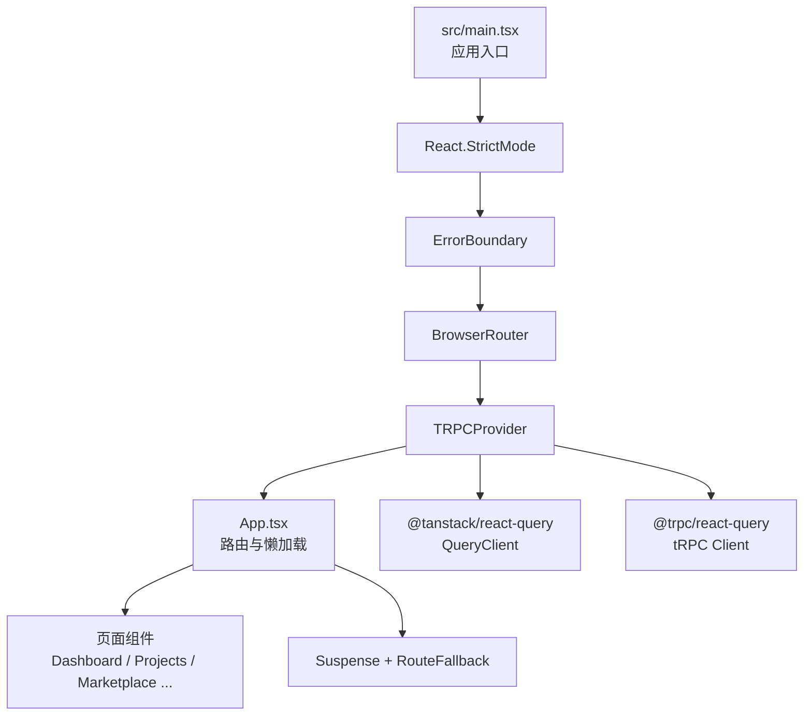
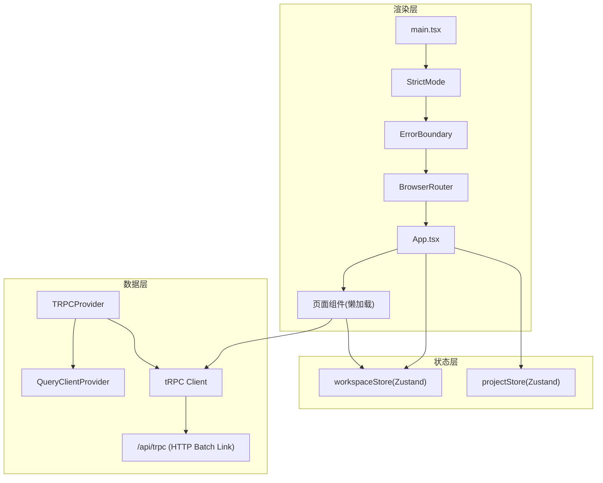
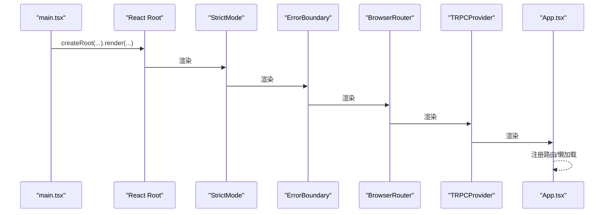
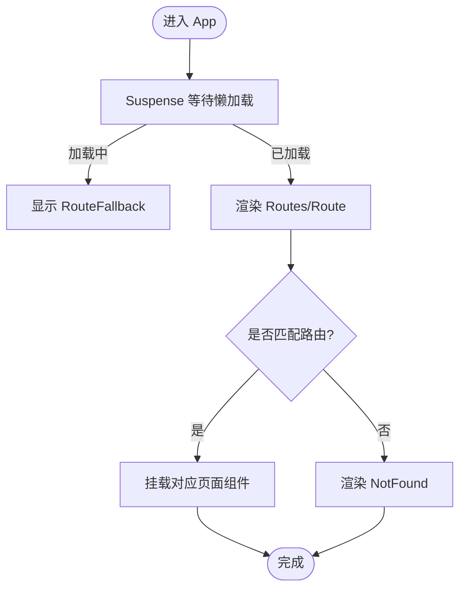
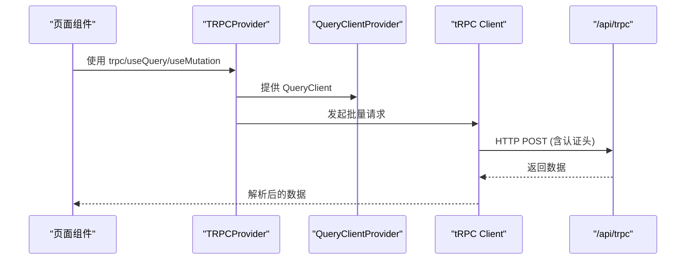
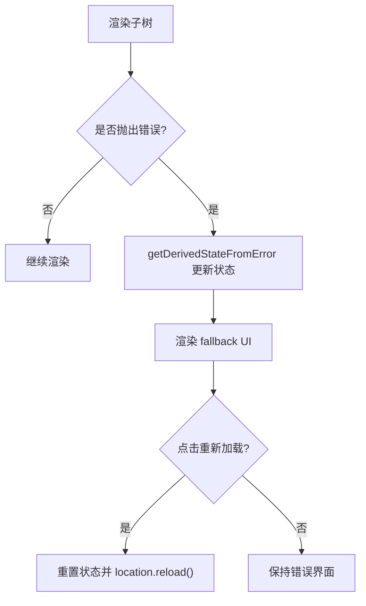
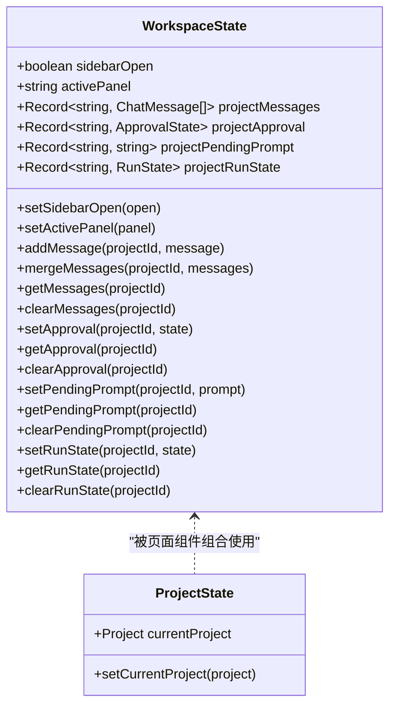
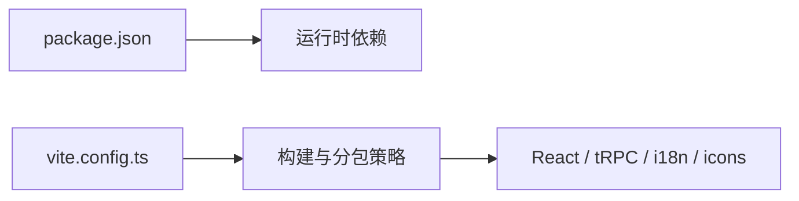

# 应用架构

<cite>
**本文引用的文件**
- [src/main.tsx](file://src/main.tsx)
- [src/App.tsx](file://src/App.tsx)
- [src/providers/trpc.tsx](file://src/providers/trpc.tsx)
- [src/components/ErrorBoundary.tsx](file://src/components/ErrorBoundary.tsx)
- [vite.config.ts](file://vite.config.ts)
- [src/i18n.ts](file://src/i18n.ts)
- [src/components/RouteFallback.tsx](file://src/components/RouteFallback.tsx)
- [src/stores/workspaceStore.ts](file://src/stores/workspaceStore.ts)
- [src/stores/projectStore.ts](file://src/stores/projectStore.ts)
- [package.json](file://package.json)
</cite>

## 目录
1. [简介](#简介)
2. [项目结构](#项目结构)
3. [核心组件](#核心组件)
4. [架构总览](#架构总览)
5. [详细组件分析](#详细组件分析)
6. [依赖关系分析](#依赖关系分析)
7. [性能考量](#性能考量)
8. [故障排查指南](#故障排查指南)
9. [结论](#结论)
10. [附录](#附录)

## 简介
本文件为 DeeWaanAI 前端应用的架构文档，聚焦 React 应用的启动流程、组件层次结构、依赖注入机制与数据流。重点说明 BrowserRouter 路由配置、TRPCProvider 数据提供者、ErrorBoundary 错误边界与 StrictMode 严格模式的使用；记录应用初始化过程、全局状态管理与生命周期管理；并给出应用配置、环境变量处理与性能优化策略。文末提供架构图与组件关系图，帮助读者理解各模块间的交互方式。

## 项目结构
前端采用 Vite + React 工程化方案，入口在 src/main.tsx，应用根组件在 src/App.tsx，通过 react-router 进行页面级路由，使用 TRPCProvider 集成 tRPC + React Query 作为数据层，ErrorBoundary 提供全局错误兜底，i18n 在应用启动时初始化。构建与分包策略由 vite.config.ts 控制，全局状态由 Zustand store 管理（workspaceStore、projectStore）。

图表来源
- [src/main.tsx:10-19](file://src/main.tsx#L10-L19)
- [src/App.tsx:32-67](file://src/App.tsx#L32-L67)
- [src/providers/trpc.tsx:41-48](file://src/providers/trpc.tsx#L41-L48)

章节来源
- [src/main.tsx:1-21](file://src/main.tsx#L1-L21)
- [src/App.tsx:1-70](file://src/App.tsx#L1-L70)
- [vite.config.ts:9-65](file://vite.config.ts#L9-L65)

## 核心组件
- 应用入口与渲染树：在 src/main.tsx 中创建 React 根节点，依次包裹 StrictMode、ErrorBoundary、BrowserRouter、TRPCProvider，最后挂载 App。
- 路由与懒加载：App 中使用 Routes/Route 定义所有页面路由，并通过 React.lazy + Suspense 实现按需加载，配合 RouteFallback 展示加载态。
- 数据提供者：TRPCProvider 同时提供 tRPC 客户端与 React Query 的 QueryClient，统一封装请求头、超时、序列化等逻辑。
- 错误边界：ErrorBoundary 捕获子树渲染错误并提供恢复按钮。
- 国际化：i18n 在入口处初始化，基于浏览器语言检测与本地存储缓存。
- 全局状态：Zustand 管理的 workspaceStore 与 projectStore，前者持久化到 localStorage，后者用于当前项目上下文。

章节来源
- [src/main.tsx:1-21](file://src/main.tsx#L1-L21)
- [src/App.tsx:1-70](file://src/App.tsx#L1-L70)
- [src/providers/trpc.tsx:1-50](file://src/providers/trpc.tsx#L1-L50)
- [src/components/ErrorBoundary.tsx:1-54](file://src/components/ErrorBoundary.tsx#L1-L54)
- [src/i18n.ts:1-28](file://src/i18n.ts#L1-L28)
- [src/stores/workspaceStore.ts:1-207](file://src/stores/workspaceStore.ts#L1-L207)
- [src/stores/projectStore.ts:1-16](file://src/stores/projectStore.ts#L1-L16)

## 架构总览
下图展示了从入口到页面、数据层与状态层的整体交互关系。

图表来源
- [src/main.tsx:10-19](file://src/main.tsx#L10-L19)
- [src/App.tsx:32-67](file://src/App.tsx#L32-L67)
- [src/providers/trpc.tsx:18-48](file://src/providers/trpc.tsx#L18-L48)

## 详细组件分析

### 应用启动与渲染流程
- 创建根节点并渲染：在 main.tsx 中调用 createRoot 渲染 React 树。
- 严格模式：使用 StrictMode 以启用开发期的额外检查。
- 错误边界：ErrorBoundary 包裹整个应用，捕获渲染期错误并提供恢复能力。
- 路由：BrowserRouter 提供前端路由能力。
- 数据层：TRPCProvider 提供 tRPC 客户端与 React Query 实例。
- 应用根：App 负责路由注册与懒加载。

图表来源
- [src/main.tsx:10-19](file://src/main.tsx#L10-L19)
- [src/App.tsx:32-67](file://src/App.tsx#L32-L67)

章节来源
- [src/main.tsx:1-21](file://src/main.tsx#L1-L21)

### 路由配置与懒加载
- 路由定义：App 中集中声明所有页面路由，包括仪表盘、项目管理、市场、创作者面板、审核者门户、团队、管理员、定价等。
- 懒加载：所有页面通过 React.lazy 动态导入，减少首屏体积。
- 加载占位：Suspense fallback 使用 RouteFallback 显示全屏加载指示器。
- 未匹配路由：通配符路由指向 NotFound。

图表来源
- [src/App.tsx:1-70](file://src/App.tsx#L1-L70)
- [src/components/RouteFallback.tsx:1-17](file://src/components/RouteFallback.tsx#L1-L17)

章节来源
- [src/App.tsx:1-70](file://src/App.tsx#L1-L70)
- [src/components/RouteFallback.tsx:1-17](file://src/components/RouteFallback.tsx#L1-L17)

### TRPCProvider 数据提供者
- 客户端与查询客户端：创建 tRPC 客户端与 React Query 的 QueryClient，设置默认查询过期时间、窗口焦点重取策略、以及 mutation 不自动重试。
- 网络层：使用 httpBatchLink 批量请求到 /api/trpc，启用 superjson 序列化，自动附加认证头 x-local-auth-token。
- 超时控制：为长耗时操作（如流水线执行）设置 10 分钟超时 AbortController。
- 作用域：TRPCProvider 同时提供 tRPC 与 QueryClient，供子组件通过 hooks 访问。

图表来源
- [src/providers/trpc.tsx:1-50](file://src/providers/trpc.tsx#L1-L50)

章节来源
- [src/providers/trpc.tsx:1-50](file://src/providers/trpc.tsx#L1-L50)

### ErrorBoundary 错误边界
- 捕获渲染错误：通过 getDerivedStateFromError 更新状态并阻止崩溃扩散。
- 日志记录：componentDidCatch 输出错误堆栈便于调试。
- 用户恢复：提供“重新加载应用”按钮，重置状态并刷新页面。

图表来源
- [src/components/ErrorBoundary.tsx:13-53](file://src/components/ErrorBoundary.tsx#L13-L53)

章节来源
- [src/components/ErrorBoundary.tsx:1-54](file://src/components/ErrorBoundary.tsx#L1-L54)

### 国际化 i18n
- 初始化：在入口引入 i18n.ts，使用 LanguageDetector 与 initReactI18next 初始化。
- 资源与命名空间：基于集中式语言配置构建 resources，支持多命名空间。
- 回退与检测：默认语言为 en，支持浏览器与 localStorage 检测，缓存于 localStorage。

章节来源
- [src/i18n.ts:1-28](file://src/i18n.ts#L1-L28)

### 全局状态管理（Zustand）
- workspaceStore：按项目维度维护聊天消息、审批状态、待处理提示、运行状态等，并通过 persist 中间件持久化到 localStorage。为避免超出配额，对大附件 dataUrl 进行裁剪。
- projectStore：维护当前项目上下文，类型来自后端 AppRouter 的输出类型推断，保证前后端类型一致。

图表来源
- [src/stores/workspaceStore.ts:35-65](file://src/stores/workspaceStore.ts#L35-L65)
- [src/stores/projectStore.ts:7-15](file://src/stores/projectStore.ts#L7-L15)

章节来源
- [src/stores/workspaceStore.ts:1-207](file://src/stores/workspaceStore.ts#L1-L207)
- [src/stores/projectStore.ts:1-16](file://src/stores/projectStore.ts#L1-L16)

## 依赖关系分析
- 运行时依赖：React、react-dom、react-router、@tanstack/react-query、@trpc/*、i18next、zustand、sonner 等。
- 构建工具：Vite + @vitejs/plugin-react，开发服务器通过 @hono/vite-dev-server 代理后端入口。
- 分包策略：将 React、tRPC、i18n、图标库等拆分为独立 chunk，提升缓存命中率与首屏性能。

图表来源
- [package.json:23-73](file://package.json#L23-L73)
- [vite.config.ts:25-64](file://vite.config.ts#L25-L64)

章节来源
- [package.json:1-100](file://package.json#L1-L100)
- [vite.config.ts:1-66](file://vite.config.ts#L1-L66)

## 性能考量
- 路由级懒加载：所有页面组件通过 React.lazy 延迟加载，降低首屏包体。
- 构建分包：将稳定依赖（React、tRPC、i18n、图标）拆分为长期缓存 chunk，提高缓存命中。
- 查询缓存：React Query 默认 staleTime 与关闭窗口焦点重取，减少不必要请求。
- 长耗时请求：为流水线执行等场景设置 10 分钟超时，避免长时间挂起。
- 状态持久化：workspaceStore 仅持久化必要字段，并对大附件 dataUrl 进行裁剪，防止 localStorage 溢出。

[本节为通用性能建议，无需特定文件引用]

## 故障排查指南
- 渲染错误：ErrorBoundary 会捕获并展示友好错误信息，可通过控制台查看错误堆栈定位问题。
- 路由加载失败：Suspense fallback 显示加载态，若长时间无响应，检查网络或路由懒加载路径是否正确。
- 数据请求异常：tRPC 请求失败时，mutation 默认不重试，需手动重试；可结合 React Query 的重试与错误处理策略。
- 国际化缺失：确认 i18n 资源与命名空间正确加载，检查浏览器语言检测与 localStorage 缓存。
- 状态不一致：检查 workspaceStore 的持久化逻辑，确保大附件 dataUrl 被正确裁剪，避免存储超限。

章节来源
- [src/components/ErrorBoundary.tsx:19-53](file://src/components/ErrorBoundary.tsx#L19-L53)
- [src/providers/trpc.tsx:10-17](file://src/providers/trpc.tsx#L10-L17)
- [src/stores/workspaceStore.ts:180-204](file://src/stores/workspaceStore.ts#L180-L204)

## 结论
DeeWaanAI 前端采用清晰的分层架构：入口层负责应用装配，路由层负责导航与懒加载，数据层通过 tRPC + React Query 统一管理远端数据，状态层使用 Zustand 管理跨组件共享状态。结合 ErrorBoundary 与 StrictMode，提升了健壮性与开发体验；通过构建分包与查询缓存策略，保障了性能。该架构易于扩展与维护，适合复杂业务场景下的持续演进。

[本节为总结性内容，无需特定文件引用]

## 附录
- 环境变量与配置：后端通过 api/lib/env.ts 校验必需环境变量并在生产环境拒绝不安全默认值；前端通过 Vite 的 envDir 与别名简化路径引用。
- 脚本与命令：package.json 定义了 dev/build/start 等常用命令，便于开发与部署。

章节来源
- [package.json:7-21](file://package.json#L7-L21)