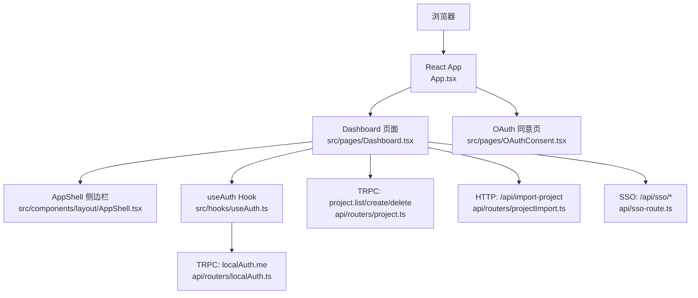
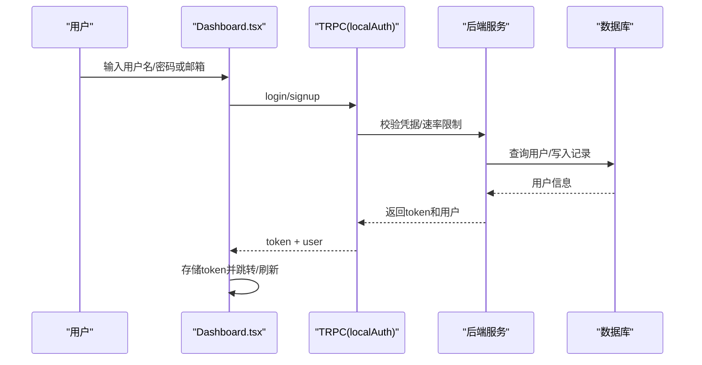
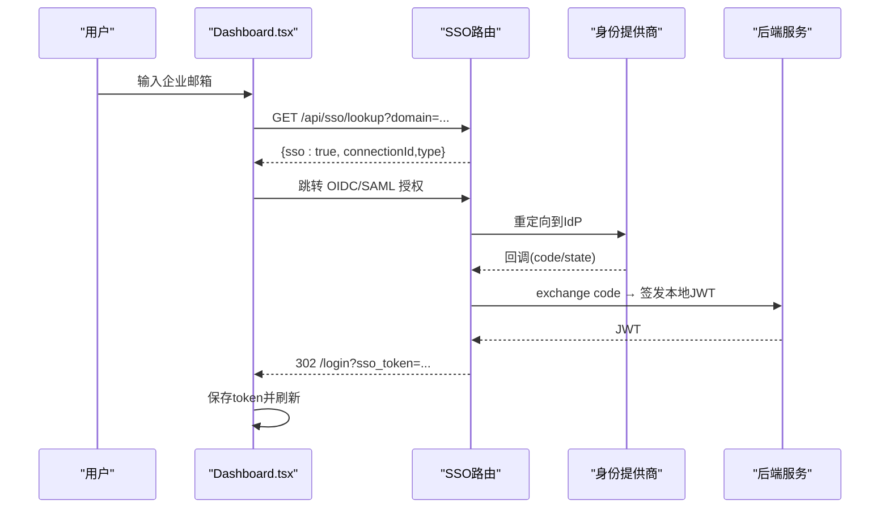
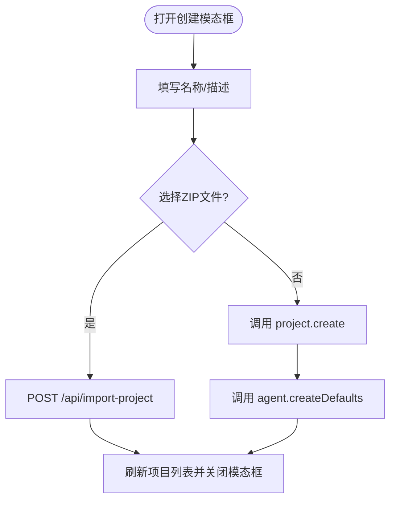
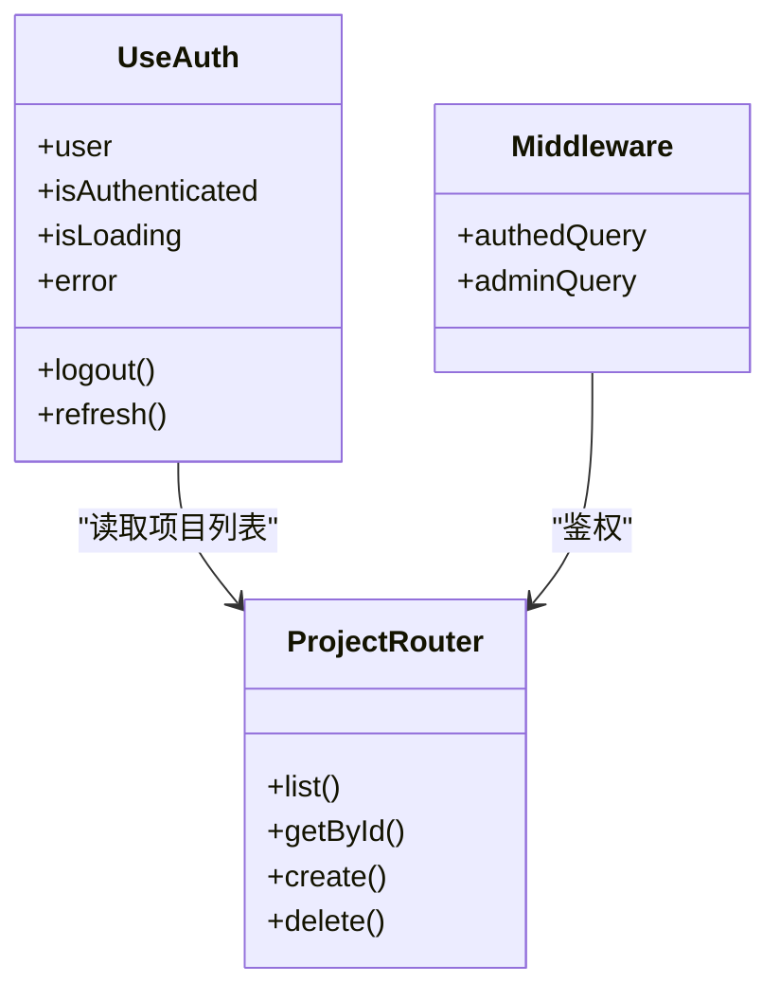
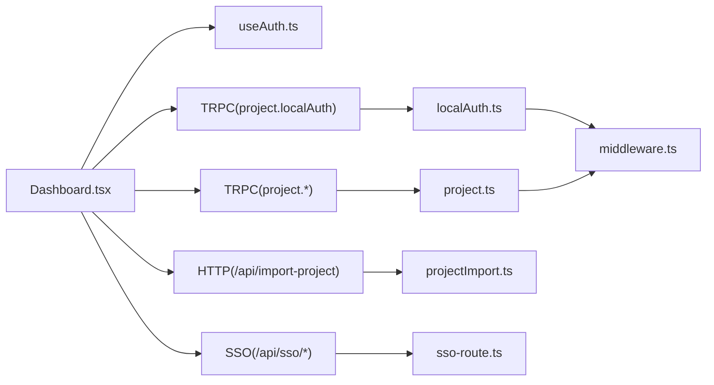

# 仪表盘页面

<cite>
**本文引用的文件**
- [Dashboard.tsx](file://src/pages/Dashboard.tsx)
- [useAuth.ts](file://src/hooks/useAuth.ts)
- [AppShell.tsx](file://src/components/layout/AppShell.tsx)
- [App.tsx](file://src/App.tsx)
- [localAuth.ts](file://api/routers/localAuth.ts)
- [sso-route.ts](file://api/sso-route.ts)
- [OAuthConsent.tsx](file://src/pages/OAuthConsent.tsx)
- [project.ts](file://api/routers/project.ts)
- [projectImport.ts](file://api/routers/projectImport.ts)
- [middleware.ts](file://api/middleware.ts)
</cite>

## 目录
1. [简介](#简介)
2. [项目结构](#项目结构)
3. [核心组件](#核心组件)
4. [架构总览](#架构总览)
5. [详细组件分析](#详细组件分析)
6. [依赖关系分析](#依赖关系分析)
7. [性能考量](#性能考量)
8. [故障排查指南](#故障排查指南)
9. [结论](#结论)
10. [附录：交互流程与API示例](#附录：交互流程与api示例)

## 简介
本文件为 DeeWaanAI 仪表盘页面的完整技术文档，覆盖认证（本地登录/注册、企业SSO集成、OAuth授权同意）、项目卡片展示、项目创建模态框与ZIP导入、用户状态管理、权限控制、路由导航、错误处理、加载状态与用户反馈机制，并提供完整的用户交互流程与API调用示例。

## 项目结构
仪表盘由前端页面、全局布局、认证Hook以及后端TRPC路由和SSO路由组成。关键路径如下：
- 前端页面：src/pages/Dashboard.tsx
- 全局布局：src/components/layout/AppShell.tsx
- 路由入口：src/App.tsx
- 认证Hook：src/hooks/useAuth.ts
- 本地认证后端：api/routers/localAuth.ts
- 企业SSO后端：api/sso-route.ts
- OAuth授权同意页：src/pages/OAuthConsot.tsx
- 项目管理后端：api/routers/project.ts
- ZIP导入后端：api/routers/projectImport.ts
- TRPC中间件：api/middleware.ts

图表来源
- [App.tsx:32-62](file://src/App.tsx#L32-L62)
- [Dashboard.tsx:485-556](file://src/pages/Dashboard.tsx#L485-L556)
- [AppShell.tsx:28-214](file://src/components/layout/AppShell.tsx#L28-L214)
- [useAuth.ts:4-34](file://src/hooks/useAuth.ts#L4-L34)
- [localAuth.ts:60-169](file://api/routers/localAuth.ts#L60-L169)
- [project.ts:11-101](file://api/routers/project.ts#L11-L101)
- [projectImport.ts:75-238](file://api/routers/projectImport.ts#L75-L238)
- [sso-route.ts:108-291](file://api/sso-route.ts#L108-L291)
- [OAuthConsent.tsx:19-171](file://src/pages/OAuthConsent.tsx#L19-L171)

章节来源
- [App.tsx:32-62](file://src/App.tsx#L32-L62)
- [Dashboard.tsx:485-556](file://src/pages/Dashboard.tsx#L485-L556)
- [AppShell.tsx:28-214](file://src/components/layout/AppShell.tsx#L28-L214)

## 核心组件
- 认证表单与SSO分支：在 Dashboard 中实现本地登录/注册与企业SSO域名分支，支持安全next参数校验与SSO回调落地页处理。
- 项目卡片与列表：通过 TRPC 获取项目列表，渲染卡片并支持删除、进入设置与工作区。
- 项目创建模态框：支持创建项目、可选上传ZIP文件进行导入，成功后刷新项目列表。
- 用户状态管理：useAuth 通过 TRPC 查询当前用户，提供 isAuthenticated、logout、refresh 能力。
- 权限控制：TRPC 中间件对受保护接口进行鉴权；部分操作需要管理员角色。
- 路由导航：AppShell 提供侧边栏导航，Dashboard 根据认证状态切换视图。

章节来源
- [Dashboard.tsx:38-311](file://src/pages/Dashboard.tsx#L38-L311)
- [Dashboard.tsx:315-416](file://src/pages/Dashboard.tsx#L315-L416)
- [Dashboard.tsx:420-481](file://src/pages/Dashboard.tsx#L420-L481)
- [useAuth.ts:4-34](file://src/hooks/useAuth.ts#L4-L34)
- [middleware.ts:17-51](file://api/middleware.ts#L17-L51)
- [AppShell.tsx:39-72](file://src/components/layout/AppShell.tsx#L39-L72)

## 架构总览
仪表盘采用前后端分离的TRPC架构，结合Hono路由承载SSO与导入等HTTP接口。认证令牌以JWT形式存储在客户端，通过请求头传递到服务端进行验证。

图表来源
- [Dashboard.tsx:135-173](file://src/pages/Dashboard.tsx#L135-L173)
- [localAuth.ts:60-158](file://api/routers/localAuth.ts#L60-L158)

章节来源
- [localAuth.ts:60-169](file://api/routers/localAuth.ts#L60-L169)
- [Dashboard.tsx:135-173](file://src/pages/Dashboard.tsx#L135-L173)

## 详细组件分析

### 认证功能（本地登录/注册、企业SSO、OAuth）
- 本地登录/注册
  - 前端：Dashboard 中的 AuthForm 组件负责收集用户名、密码、显示名，提交到 TRPC 的 localAuth.login/signup。成功后将JWT存入localStorage并刷新或跳转到安全next路径。
  - 后端：localAuthRouter 提供 signup/login/me 接口，包含速率限制、弱口令拦截、自动管理员引导、JWT签发与验证。
- 企业SSO集成
  - 前端：在登录表单中支持输入企业邮箱，调用 /api/sso/lookup 判断是否启用SSO，并根据类型跳转到OIDC或SAML授权。
  - 后端：sso-route.ts 提供 /api/sso/lookup、/api/sso/oidc/authorize、/api/sso/oidc/callback、/api/sso/saml/authorize、/api/sso/saml/metadata/:id、/api/sso/saml/acs/:id。所有SSO路由受企业特性开关保护，失败统一重定向到 /login?sso_error=...，成功签发本地JWT并重定向到 /login?sso_token=...。
- OAuth授权同意
  - 前端：OAuthConsent.tsx 展示第三方应用请求的scope，用户可允许或拒绝，提交到 /oauth/authorize/confirm，成功后重定向到授权回调地址。
  - 该页面要求用户已登录，否则引导至登录并携带next参数。

图表来源
- [Dashboard.tsx:93-133](file://src/pages/Dashboard.tsx#L93-L133)
- [sso-route.ts:108-203](file://api/sso-route.ts#L108-L203)
- [sso-route.ts:205-287](file://api/sso-route.ts#L205-L287)

章节来源
- [Dashboard.tsx:38-311](file://src/pages/Dashboard.tsx#L38-L311)
- [localAuth.ts:60-169](file://api/routers/localAuth.ts#L60-L169)
- [sso-route.ts:108-291](file://api/sso-route.ts#L108-L291)
- [OAuthConsent.tsx:19-171](file://src/pages/OAuthConsent.tsx#L19-L171)

### 项目卡片展示与项目创建模态框
- 项目列表
  - 使用 TRPC project.list 获取当前用户的项目及团队共享项目，按更新时间倒序排列。
  - 空状态提示与加载状态清晰可见。
- 项目卡片
  - 展示项目名称、描述、Gitee仓库信息、创建时间，支持进入设置与删除。
  - 删除时附带Gitee Token清理远程资源。
- 项目创建模态框
  - 支持填写名称、描述，可选上传ZIP文件。
  - 创建成功后调用 agent.createDefaults 初始化默认流水线步骤，并可选择将ZIP导入到项目。
  - ZIP导入通过 HTTP POST /api/import-project 完成，携带 x-local-auth-token 与可选 giteeToken。

图表来源
- [Dashboard.tsx:315-416](file://src/pages/Dashboard.tsx#L315-L416)
- [project.ts:103-250](file://api/routers/project.ts#L103-L250)
- [projectImport.ts:75-238](file://api/routers/projectImport.ts#L75-L238)

章节来源
- [Dashboard.tsx:420-481](file://src/pages/Dashboard.tsx#L420-L481)
- [Dashboard.tsx:315-416](file://src/pages/Dashboard.tsx#L315-L416)
- [project.ts:11-101](file://api/routers/project.ts#L11-L101)
- [project.ts:103-250](file://api/routers/project.ts#L103-L250)
- [projectImport.ts:75-238](file://api/routers/projectImport.ts#L75-L238)

### 用户状态管理与权限控制
- 用户状态
  - useAuth 通过 TRPC localAuth.me 获取当前用户，缓存策略为5分钟，提供 logout 清除本地token并刷新页面。
- 权限控制
  - TRPC 中间件 authedQuery 确保请求已认证，adminQuery 进一步要求管理员角色。
  - 项目列表与详情会检查用户拥有或团队共享权限。
- 路由导航
  - AppShell 根据当前路径高亮菜单项，并在项目中显示上下文审计链接。
  - 仪表盘根据 isAuthenticated 决定是否显示认证表单。

图表来源
- [useAuth.ts:4-34](file://src/hooks/useAuth.ts#L4-L34)
- [middleware.ts:17-51](file://api/middleware.ts#L17-L51)
- [project.ts:11-101](file://api/routers/project.ts#L11-L101)

章节来源
- [useAuth.ts:4-34](file://src/hooks/useAuth.ts#L4-L34)
- [middleware.ts:17-51](file://api/middleware.ts#L17-L51)
- [project.ts:11-101](file://api/routers/project.ts#L11-L101)
- [AppShell.tsx:39-72](file://src/components/layout/AppShell.tsx#L39-L72)

### 错误处理、加载状态与用户反馈
- 加载状态
  - 认证与项目列表均显示加载指示器，避免界面卡顿感。
- 错误处理
  - 登录/注册失败时显示错误消息；SSO失败时映射为本地化错误键；ZIP导入失败时给出警告提示。
  - 后端对数据库连接异常、模式不同步等进行友好错误提示。
- 用户反馈
  - 使用对话框、按钮禁用、旋转图标等直观反馈；Toast用于OAuth同意页的错误提示。

章节来源
- [Dashboard.tsx:135-173](file://src/pages/Dashboard.tsx#L135-L173)
- [Dashboard.tsx:240-251](file://src/pages/Dashboard.tsx#L240-L251)
- [Dashboard.tsx:323-372](file://src/pages/Dashboard.tsx#L323-L372)
- [localAuth.ts:23-36](file://api/routers/localAuth.ts#L23-L36)
- [OAuthConsent.tsx:38-70](file://src/pages/OAuthConsent.tsx#L38-L70)

## 依赖关系分析
- 前端依赖
  - Dashboard 依赖 useAuth、trpc、AppShell、UI组件库。
  - AppShell 依赖 trpc.project.list 与路由状态。
- 后端依赖
  - localAuthRouter 依赖数据库、bcrypt、jose、速率限制、日志。
  - sso-route.ts 依赖特性开关、速率限制、SSO服务、日志。
  - projectImport.ts 依赖磁盘存储、Gitee同步、智能卡生成。
- 中间件
  - TRPC 中间件提供认证与角色校验。

图表来源
- [Dashboard.tsx:485-556](file://src/pages/Dashboard.tsx#L485-L556)
- [localAuth.ts:60-169](file://api/routers/localAuth.ts#L60-L169)
- [project.ts:11-101](file://api/routers/project.ts#L11-L101)
- [projectImport.ts:75-238](file://api/routers/projectImport.ts#L75-L238)
- [sso-route.ts:108-291](file://api/sso-route.ts#L108-L291)
- [middleware.ts:17-51](file://api/middleware.ts#L17-L51)

章节来源
- [Dashboard.tsx:485-556](file://src/pages/Dashboard.tsx#L485-L556)
- [localAuth.ts:60-169](file://api/routers/localAuth.ts#L60-L169)
- [project.ts:11-101](file://api/routers/project.ts#L11-L101)
- [projectImport.ts:75-238](file://api/routers/projectImport.ts#L75-L238)
- [sso-route.ts:108-291](file://api/sso-route.ts#L108-L291)
- [middleware.ts:17-51](file://api/middleware.ts#L17-L51)

## 性能考量
- 前端
  - 使用TRPC缓存与staleTime减少重复请求。
  - 懒加载页面降低首屏体积。
- 后端
  - 速率限制防止暴力破解与滥用。
  - 数据库事务保证项目创建的原子性。
  - ZIP导入时对二进制与大文件进行过滤，仅推送文本文件到Gitee，提升效率。
  - 文件读取优先本地磁盘，缺失时回退到Gitee，兼顾速度与一致性。

[本节为通用指导，不直接分析具体文件]

## 故障排查指南
- 登录/注册失败
  - 检查网络与速率限制；确认用户名唯一与密码强度；查看后端日志与错误消息。
- SSO失败
  - 检查 enterprise_sso 特性开关；确认connectionId有效；核对nonce/state与回调地址；查看重定向参数 sso_error。
- ZIP导入失败
  - 确认文件大小与格式；检查Gitee Token有效性；查看导入日志与错误响应体。
- 权限问题
  - 确认用户已通过认证；检查角色是否为admin；验证项目归属或团队共享关系。

章节来源
- [localAuth.ts:23-36](file://api/routers/localAuth.ts#L23-L36)
- [sso-route.ts:75-101](file://api/sso-route.ts#L75-L101)
- [projectImport.ts:91-238](file://api/routers/projectImport.ts#L91-L238)
- [middleware.ts:17-51](file://api/middleware.ts#L17-L51)

## 结论
DeeWaanAI 仪表盘提供了完善的认证体系（本地、企业SSO、OAuth）、直观的项目管理与导入能力、健壮的用户状态与权限控制，以及清晰的错误处理与用户体验设计。通过TRPC与Hono的组合，实现了前后端解耦与安全可控的交互流程。

[本节为总结，不直接分析具体文件]

## 附录：交互流程与API示例

### 本地登录/注册流程
- 前端触发：Dashboard.AuthForm 提交表单
- API调用：
  - POST /api/trpc/localAuth.login (TRPC)
  - POST /api/trpc/localAuth.signup (TRPC)
- 成功响应：返回 token 与用户信息，前端存储后刷新或跳转

章节来源
- [Dashboard.tsx:135-173](file://src/pages/Dashboard.tsx#L135-L173)
- [localAuth.ts:60-158](file://api/routers/localAuth.ts#L60-L158)

### 企业SSO流程（OIDC/SAML）
- 前端触发：输入邮箱并点击继续
- API调用：
  - GET /api/sso/lookup?domain=...
  - GET /api/sso/oidc/authorize?connectionId=...&next=...
  - GET /api/sso/oidc/callback?code=...&state=...
  - GET /api/sso/saml/authorize?connectionId=...&next=...
  - POST /api/sso/saml/acs/:id
- 成功响应：302 重定向到 /login?sso_token=...，前端存储后刷新

章节来源
- [Dashboard.tsx:93-133](file://src/pages/Dashboard.tsx#L93-L133)
- [sso-route.ts:108-203](file://api/sso-route.ts#L108-L203)
- [sso-route.ts:205-287](file://api/sso-route.ts#L205-L287)

### OAuth授权同意流程
- 前端触发：用户访问 /oauth/consent
- API调用：
  - POST /oauth/authorize/confirm
- 成功响应：返回 redirect URL，前端跳转

章节来源
- [OAuthConsent.tsx:38-70](file://src/pages/OAuthConsent.tsx#L38-L70)

### 项目创建与ZIP导入流程
- 前端触发：CreateProjectModal 提交
- API调用：
  - TRPC: project.create
  - TRPC: agent.createDefaults
  - HTTP: POST /api/import-project (FormData: projectId, zipFile, giteeToken; Header: x-local-auth-token)
- 成功响应：刷新项目列表并关闭模态框

章节来源
- [Dashboard.tsx:315-416](file://src/pages/Dashboard.tsx#L315-L416)
- [project.ts:103-250](file://api/routers/project.ts#L103-L250)
- [projectImport.ts:75-238](file://api/routers/projectImport.ts#L75-L238)